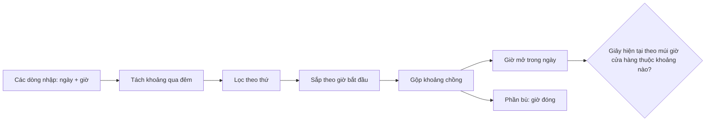

"Mở cửa 18:00 đến 02:00, thứ Sáu và thứ Bảy." Câu này người đọc hiểu ngay, nhưng máy tính phải trả lời được:

- Rạng sáng **Chủ nhật** lúc 01:30 quán có mở không? (Có, vì khoảng của tối thứ Bảy kéo sang.)
- Thứ Hai có hai khoảng 10:00–14:00 và 13:00–22:00 bị nhập chồng, hiển thị thế nào?
- Đang 23:30 tối thứ Sáu, "đóng cửa lúc mấy giờ, hôm nay hay ngày mai"?
- Khách ở Việt Nam xem trang của một quán ở New York: "bây giờ" là giờ của ai?

Facebook Pages có một editor cho đúng loại dữ liệu này: chọn các ngày trong tuần, giờ bắt đầu, giờ kết thúc, có thể nhiều dòng. Phần tính toán nằm trong module `PagesTimeRangeEditorUtilities`, ngắn và dễ mang đi dùng lại.

> [!TIP]
> **Tóm tắt**
> - Lưu mỗi khoảng là `{weekdays, fromSecInDay, toSecInDay}`: giây kể từ 0:00, không lưu ngày giờ cụ thể.
> - Khoảng qua đêm (`from ≥ to`) được tách: `[from, 24:00)` cho ngày đã chọn và `[0:00, to)` cho ngày `(weekday + 1) % 7`.
> - Theo từng ngày: lọc, sắp theo giờ bắt đầu, gộp khoảng chồng. Phần bù trong `[0, 24h)` là "giờ còn lại".
> - Ba lỗi nhỏ của bản gốc: so sánh hở hai đầu, nhãn "ngày mai" sai vào 31/12, cộng giây từ nửa đêm lệch một giờ vào ngày đổi giờ mùa hè.

<iframe class="demo-frame" src="/demos/facebook-patterns/index.html?theme=dark#/weekly-hours" title="Demo weekly-hours" loading="lazy" style="height: 1250px"></iframe>

<p class="demo-links">▶ <a href="/demos/facebook-patterns/index.html#/weekly-hours" target="_blank" rel="noopener">Mở demo toàn màn hình ↗</a> · <a href="https://stackblitz.com/github/hunghg255/blog-hunghg/tree/master/examples/facebook-patterns?file=src/lib/weeklyHours.ts" target="_blank" rel="noopener">Sửa code trên StackBlitz ↗</a> · <a href="https://github.com/hunghg255/blog-hunghg/blob/master/examples/facebook-patterns/src/lib/weeklyHours.ts" target="_blank" rel="noopener">Xem source trên GitHub ↗</a></p>

## Facebook làm thế nào?

`PagesTimeRangeEditorUtilities` và `PagesTimeRangeEditorStore` nằm trong `66.js`. Tên các hàm cho thấy dữ liệu là **giờ vắng mặt** (away) của Page: `getAwayTimeBracketsForWeekday`, `getIsRequestTimeInAwayTimeRange`. Phép tính không quan tâm khoảng đó là giờ mở hay giờ vắng, nên bài này dùng ví dụ giờ mở cửa cho dễ hình dung.

### Dữ liệu

Mỗi dòng trong editor là một object:

```js
{
  id: guid(),
  isRecurrent: true,          // lặp hằng tuần (false: chỉ một ngày cụ thể, lưu ở `date`)
  weekdays: Immutable.Set([5, 6]),   // 0 = Chủ nhật … 6 = thứ Bảy
  fromSecInDay: 64800,        // 18:00
  toSecInDay: 7200,           // 02:00 → nhỏ hơn from: qua đêm
  date: 1729990000,
}
```

Dòng mới tạo mặc định là `0` tới `86399` (23:59:59), tức "cả ngày" trừ giây cuối.

### Tách khoảng qua đêm

```js
const DAY = 24 * 3600;
function splitOverNightTimeRanges(ranges) {
  const out = [];
  ranges.map((r) => {
    if (!r.isRecurrent || r.fromSecInDay < r.toSecInDay) { out.push(r); return; }
    out.push({ ...r, toSecInDay: DAY });                       // phần trước nửa đêm
    out.push({ ...r, id: r.id + '_overnight', fromSecInDay: 0, // phần sau nửa đêm…
      weekdays: Immutable.Set(r.weekdays.map((d) => (d + 1) % 7)) }); // …thuộc NGÀY HÔM SAU
  });
  return Immutable.List(out);
}
```

`(d + 1) % 7` đưa thứ Bảy (6) về Chủ nhật (0). Sau bước này mọi khoảng đều nằm gọn trong một ngày, phần còn lại chỉ là xử lý khoảng trên một trục thẳng `[0, 86400)`.

### Gộp khoảng theo từng ngày

```js
function getAwayTimeBracketsForWeekday(weekday, ranges) {
  const sorted = splitOverNightTimeRanges(ranges)
    .filter((r) => r.weekdays.contains(weekday) && r.isRecurrent)
    .sort((a, b) => a.fromSecInDay - b.fromSecInDay);
  const merged = [];
  for (const r of sorted) {
    const last = merged[merged.length - 1];
    if (last && last.to >= r.fromSecInDay) last.to = Math.max(last.to, r.toSecInDay);
    else merged.push({ from: r.fromSecInDay, to: r.toSecInDay });
  }
  return Immutable.List(merged);
}
```

Thuật toán gộp khoảng kinh điển: sắp theo điểm đầu, rồi đi một lượt; khoảng mới chồng (hoặc chạm, nhờ dấu `>=`) khoảng cuối thì kéo dài, không thì mở khoảng mới. Độ phức tạp `O(n log n)` vì bước sắp xếp.

Hàm này chỉ tính các khoảng **lặp lại**. Khoảng một lần (`isRecurrent: false`) được giữ nguyên ở bước tách nhưng bị lọc bỏ ở đây.

### Phần bù

```js
function getReversedTimeBrackets(brackets) {
  brackets = brackets.sort((a, b) => a.from - b.from);
  let cursor = 0;
  const out = [];
  for (const b of brackets) {
    if (cursor < b.from) out.push({ from: cursor, to: b.from });
    cursor = b.to;
  }
  if (cursor < DAY) out.push({ from: cursor, to: DAY });
  return Immutable.List(out);
}
```

Có giờ vắng thì phần bù là giờ có mặt, và ngược lại. `cursor = b.to` đúng khi đầu vào đã gộp (như kết quả của hàm trên). Đưa vào danh sách chưa gộp, ví dụ `[10–20, 12–14]`, thì cursor lùi về 14 và tạo ra khoảng `14–20` sai; bản viết lại dùng `max` cho chắc.

### "Bây giờ" theo múi giờ của Page

```js
getIsRequestTimeInAwayTimeRange(ranges, timezoneName) {
  return this.isTimeInAwayTimeRange(DateTime.now(this.getTimezoneID(timezoneName)), ranges);
},
isTimeInAwayTimeRange(now, ranges) {
  const brackets = this.getAwayTimeBracketsForWeekday(now.getDayOfWeek(), ranges);
  for (const b of brackets) {
    const from = now.startOfDay().addSeconds(b.from);
    const to = now.startOfDay().addSeconds(b.to);
    if (now.isAfter(from) && now.isBefore(to)) return true;
  }
  return false;
},
```

`DateTime.now(timezoneID)` lấy giờ hiện tại **theo múi giờ của Page** (danh sách múi lấy từ `AdsTimezone`), không phải múi của máy người đang xem. Đây là quyết định đúng: quán ở New York đóng cửa lúc 22:00 giờ New York, bất kể khách xem từ đâu.

### Ba lỗi nhỏ

1. **Biên hở hai đầu.** `isAfter(from) && isBefore(to)` loại cả `from` lẫn `to`. Khoảng 07:00–22:00 thì đúng 07:00:00 bị coi là ngoài khoảng. Lỗi chỉ trong một giây, nhưng với một khoảng `0 → 86399` thì giây 0 và giây cuối của ngày rơi ra ngoài.
2. **"Ngày mai" theo số thứ tự ngày trong năm.** Hàm hiển thị so `today.getDayOfYear() + 1 === target.getDayOfYear()`. Ngày 31/12 là ngày 365, ngày 1/1 là ngày 1, nên 365 + 1 ≠ 1 và nhãn rơi về tên thứ thay vì "ngày mai".
3. **Cộng giây từ nửa đêm.** `startOfDay().addSeconds(s)` cộng một khoảng thời gian thật. Ngày đổi sang giờ mùa hè chỉ có 23 giờ, nên "0:00 + 9 giờ" là 10:00 giờ treo tường chứ không phải 09:00. Demo tính lại đúng phép này cho New York ngày 8/3/2026 bằng `Intl`. Lỗi này suy ra từ cách `DateTime` được dùng; mình không có mã `DateTime.addSeconds` trong bản dump để xác nhận nó cộng theo thời gian thật hay theo giờ treo tường.

Thêm một chi tiết ở store: `PagesTimeRangeEditorStore` sửa thẳng object cũ (`a.isRecurrent = !a.isRecurrent`) **rồi** mới `Object.assign({}, a)` để thay vào List. Object cũ vẫn nằm trong List của lần state trước, nên state trước cũng bị đổi theo. Với Flux store chỉ phát sự kiện "đã đổi" thì không ai thấy; nhưng nếu có component so sánh state cũ/mới để bỏ qua render thì sẽ sai.

## Bên trong: khoảng trên một trục thẳng



Lý do mô hình này dễ đúng: nó không động tới lịch thật. "Giây trong ngày" và "thứ mấy" là hai số nguyên; mọi phép so sánh là so số. Lịch thật (ngày, múi giờ, giờ mùa hè) chỉ xuất hiện ở **một chỗ**: đổi "bây giờ" thành `(thứ, giây trong ngày)` theo múi giờ của cửa hàng. Gom phần khó vào một hàm thì chỉ cần kiểm kỹ một hàm.

Hàm đó viết bằng `Intl.DateTimeFormat` với `timeZone` là đủ: `formatToParts` trả về thứ, giờ, phút, giây **giờ treo tường** ở múi đó, đã tính giờ mùa hè.

## Viết lại

Tách, gộp, phần bù giữ nguyên ý tưởng:

```ts title=src/lib/weeklyHours.ts
/** Tách khoảng qua đêm thành phần trước nửa đêm và phần sau nửa đêm của ngày hôm sau. */
export function splitOvernight(ranges: WeeklyRange[]): WeeklyRange[] {
  return ranges.flatMap((r) => {
    if (r.fromSec < r.toSec) return [r];
    return [
      { ...r, toSec: SECONDS_IN_DAY },
      // toSec = 0 nghĩa là "tới đúng nửa đêm": phần hôm sau rỗng, bỏ đi
      ...(r.toSec > 0
        ? [{ ...r, id: `${r.id}_overnight`, weekdays: r.weekdays.map((d) => (d + 1) % 7), fromSec: 0 }]
        : []),
    ];
  });
}

/** Các khoảng của một ngày, đã sắp xếp và gộp chỗ chồng nhau. */
export function bracketsForDay(weekday: number, ranges: WeeklyRange[]): Bracket[] {
  const sorted = splitOvernight(ranges)
    .filter((r) => r.weekdays.includes(weekday))
    .sort((a, b) => a.fromSec - b.fromSec);
  const merged: Bracket[] = [];
  for (const r of sorted) {
    const last = merged[merged.length - 1];
    if (last && last.to >= r.fromSec) last.to = Math.max(last.to, r.toSec);
    else merged.push({ from: r.fromSec, to: r.toSec });
  }
  return merged;
}

/** Phần bù trong [0, 24h): từ danh sách giờ mở ra danh sách giờ đóng và ngược lại. */
export function complement(brackets: Bracket[]): Bracket[] {
  const result: Bracket[] = [];
  let cursor = 0;
  for (const b of [...brackets].sort((x, y) => x.from - y.from)) {
    if (cursor < b.from) result.push({ from: cursor, to: b.from });
    // max: an toàn kể cả khi đầu vào chưa được gộp (bản gốc gán thẳng cursor = b.to)
    cursor = Math.max(cursor, b.to);
  }
  if (cursor < SECONDS_IN_DAY) result.push({ from: cursor, to: SECONDS_IN_DAY });
  return result;
}

/** Khoảng nửa mở [from, to): đúng 22:00:00 là đã đóng cửa nếu khoảng kết thúc lúc 22:00. */
export function isInBrackets(secondOfDay: number, brackets: Bracket[]) {
  return brackets.some((b) => secondOfDay >= b.from && secondOfDay < b.to);
}

/** Cách so sánh của bản gốc: isAfter(from) && isBefore(to), hở cả hai đầu. */
export function fbStyleIsInBrackets(secondOfDay: number, brackets: Bracket[]) {
  return brackets.some((b) => secondOfDay > b.from && secondOfDay < b.to);
}
```

Đọc "bây giờ" theo múi giờ cửa hàng. `getOpenStatus` (trong file đầy đủ) dùng kết quả này để tìm mốc đổi trạng thái tiếp theo.

```ts title=src/lib/weeklyHours.ts
/** Thứ và giây trong ngày theo giờ treo tường của múi giờ cửa hàng. */
export function zonedNow(instant: Date, timeZone: string): ZonedNow {
  const parts = Object.fromEntries(
    new Intl.DateTimeFormat('en-US', {
      timeZone,
      weekday: 'short',
      year: 'numeric',
      month: '2-digit',
      day: '2-digit',
      hour: '2-digit',
      minute: '2-digit',
      second: '2-digit',
      hourCycle: 'h23',
    })
      .formatToParts(instant)
      .map((p) => [p.type, p.value]),
  );
  return {
    weekday: WEEKDAYS.indexOf(parts.weekday),
    secondOfDay: Number(parts.hour) * 3600 + Number(parts.minute) * 60 + Number(parts.second),
    date: `${parts.year}-${parts.month}-${parts.day}`,
  };
}
```

::: spoiler Xem toàn bộ src/lib/weeklyHours.ts

```ts title=src/lib/weeklyHours.ts
/**
 * Giờ mở cửa theo tuần (ý tưởng từ PagesTimeRangeEditorUtilities của Facebook Pages).
 *
 * - Mỗi khoảng: tập ngày trong tuần + giờ bắt đầu/kết thúc tính bằng giây kể từ 0:00.
 * - Khoảng qua đêm (22:00 → 02:00) được tách làm hai: [22:00, 24:00) của ngày đã chọn
 *   và [0:00, 02:00) của NGÀY HÔM SAU, tức (weekday + 1) % 7.
 * - Theo từng ngày: lọc, sắp theo giờ bắt đầu, gộp các khoảng chồng nhau.
 * - Phần bù trong [0, 24h) cho ra "giờ đóng cửa" (hoặc ngược lại, tuỳ dữ liệu là giờ mở hay giờ vắng).
 * - Giờ hiện tại được đọc theo MÚI GIỜ CỦA CỬA HÀNG (Intl), không theo máy người xem.
 */

export const SECONDS_IN_DAY = 86_400;

export interface WeeklyRange {
  id: string;
  /** 0 = Chủ nhật … 6 = thứ Bảy */
  weekdays: number[];
  fromSec: number;
  toSec: number;
}

export interface Bracket {
  from: number;
  to: number;
}

/** Tách khoảng qua đêm thành phần trước nửa đêm và phần sau nửa đêm của ngày hôm sau. */
export function splitOvernight(ranges: WeeklyRange[]): WeeklyRange[] {
  return ranges.flatMap((r) => {
    if (r.fromSec < r.toSec) return [r];
    return [
      { ...r, toSec: SECONDS_IN_DAY },
      // toSec = 0 nghĩa là "tới đúng nửa đêm": phần hôm sau rỗng, bỏ đi
      ...(r.toSec > 0
        ? [{ ...r, id: `${r.id}_overnight`, weekdays: r.weekdays.map((d) => (d + 1) % 7), fromSec: 0 }]
        : []),
    ];
  });
}

/** Các khoảng của một ngày, đã sắp xếp và gộp chỗ chồng nhau. */
export function bracketsForDay(weekday: number, ranges: WeeklyRange[]): Bracket[] {
  const sorted = splitOvernight(ranges)
    .filter((r) => r.weekdays.includes(weekday))
    .sort((a, b) => a.fromSec - b.fromSec);
  const merged: Bracket[] = [];
  for (const r of sorted) {
    const last = merged[merged.length - 1];
    if (last && last.to >= r.fromSec) last.to = Math.max(last.to, r.toSec);
    else merged.push({ from: r.fromSec, to: r.toSec });
  }
  return merged;
}

/** Phần bù trong [0, 24h): từ danh sách giờ mở ra danh sách giờ đóng và ngược lại. */
export function complement(brackets: Bracket[]): Bracket[] {
  const result: Bracket[] = [];
  let cursor = 0;
  for (const b of [...brackets].sort((x, y) => x.from - y.from)) {
    if (cursor < b.from) result.push({ from: cursor, to: b.from });
    // max: an toàn kể cả khi đầu vào chưa được gộp (bản gốc gán thẳng cursor = b.to)
    cursor = Math.max(cursor, b.to);
  }
  if (cursor < SECONDS_IN_DAY) result.push({ from: cursor, to: SECONDS_IN_DAY });
  return result;
}

/** Khoảng nửa mở [from, to): đúng 22:00:00 là đã đóng cửa nếu khoảng kết thúc lúc 22:00. */
export function isInBrackets(secondOfDay: number, brackets: Bracket[]) {
  return brackets.some((b) => secondOfDay >= b.from && secondOfDay < b.to);
}

/** Cách so sánh của bản gốc: isAfter(from) && isBefore(to), hở cả hai đầu. */
export function fbStyleIsInBrackets(secondOfDay: number, brackets: Bracket[]) {
  return brackets.some((b) => secondOfDay > b.from && secondOfDay < b.to);
}

export interface ZonedNow {
  weekday: number;
  secondOfDay: number;
  /** "YYYY-MM-DD" theo múi giờ cửa hàng */
  date: string;
}

const WEEKDAYS = ['Sun', 'Mon', 'Tue', 'Wed', 'Thu', 'Fri', 'Sat'];

/** Thứ và giây trong ngày theo giờ treo tường của múi giờ cửa hàng. */
export function zonedNow(instant: Date, timeZone: string): ZonedNow {
  const parts = Object.fromEntries(
    new Intl.DateTimeFormat('en-US', {
      timeZone,
      weekday: 'short',
      year: 'numeric',
      month: '2-digit',
      day: '2-digit',
      hour: '2-digit',
      minute: '2-digit',
      second: '2-digit',
      hourCycle: 'h23',
    })
      .formatToParts(instant)
      .map((p) => [p.type, p.value]),
  );
  return {
    weekday: WEEKDAYS.indexOf(parts.weekday),
    secondOfDay: Number(parts.hour) * 3600 + Number(parts.minute) * 60 + Number(parts.second),
    date: `${parts.year}-${parts.month}-${parts.day}`,
  };
}

export interface OpenStatus {
  open: boolean;
  /** lần đổi trạng thái tiếp theo, tính bằng số ngày tới và giây trong ngày đó */
  next: { inDays: number; weekday: number; secondOfDay: number } | null;
}

/** Đang mở hay đóng, và khi nào đổi. `openRanges` là các khoảng giờ MỞ cửa. */
export function getOpenStatus(now: ZonedNow, openRanges: WeeklyRange[]): OpenStatus {
  const today = bracketsForDay(now.weekday, openRanges);
  const open = isInBrackets(now.secondOfDay, today);
  // duyệt tối đa 8 ngày (hôm nay + 7) để tìm mốc đổi trạng thái đầu tiên
  for (let inDays = 0; inDays <= 7; inDays++) {
    const weekday = (now.weekday + inDays) % 7;
    const brackets = bracketsForDay(weekday, openRanges);
    const edges = brackets
      .flatMap((b) => [b.from, b.to])
      // 24:00 của hôm nay chỉ là mốc đổi nếu ngày mai không mở tiếp từ 0:00
      .filter((s) => s < SECONDS_IN_DAY || !isInBrackets(0, bracketsForDay((weekday + 1) % 7, openRanges)))
      .filter((s) => s > 0 || !isInBrackets(SECONDS_IN_DAY - 1, bracketsForDay((weekday + 6) % 7, openRanges)))
      .filter((s) => inDays > 0 || s > now.secondOfDay)
      .sort((a, b) => a - b);
    if (edges.length) {
      const s = edges[0];
      return s >= SECONDS_IN_DAY
        ? { open, next: { inDays: inDays + 1, weekday: (weekday + 1) % 7, secondOfDay: 0 } }
        : { open, next: { inDays, weekday, secondOfDay: s } };
    }
  }
  return { open, next: null };
}

/** "hôm nay" / "ngày mai" / tên thứ: so theo SỐ NGÀY TỚI, không theo getDayOfYear() + 1. */
export function dayLabel(inDays: number, weekday: number) {
  if (inDays === 0) return 'hôm nay';
  if (inDays === 1) return 'ngày mai';
  return ['Chủ nhật', 'thứ Hai', 'thứ Ba', 'thứ Tư', 'thứ Năm', 'thứ Sáu', 'thứ Bảy'][weekday];
}

/** Nhãn kiểu bản gốc: so số thứ tự ngày trong năm, nên 31/12 → 1/1 không ra "ngày mai". */
export function fbStyleDayLabel(todayDayOfYear: number, targetDayOfYear: number) {
  if (todayDayOfYear === targetDayOfYear) return 'hôm nay';
  if (todayDayOfYear + 1 === targetDayOfYear) return 'ngày mai';
  return '(tên thứ)';
}

export function formatSecond(second: number) {
  const h = Math.floor(second / 3600);
  const m = Math.floor((second % 3600) / 60);
  return `${String(h).padStart(2, '0')}:${String(m).padStart(2, '0')}`;
}

export function parseHHMM(value: string) {
  const [h, m] = value.split(':').map(Number);
  return h * 3600 + m * 60;
}

/**
 * Bản gốc đổi "giây trong ngày" ra thời điểm bằng startOfDay().addSeconds(s). Ngày đổi giờ
 * mùa hè chỉ có 23 giờ, nên 02:30 cộng từ nửa đêm thành 03:30 giờ treo tường.
 * Hàm này tái hiện phép tính đó bằng Intl để demo cho thấy độ lệch.
 */
export function wallClockAfterAddingSeconds(midnightUtc: Date, seconds: number, timeZone: string) {
  const at = new Date(midnightUtc.getTime() + seconds * 1000);
  return new Intl.DateTimeFormat('vi-VN', { timeZone, hour: '2-digit', minute: '2-digit', hourCycle: 'h23' }).format(at);
}

/** Mốc UTC của 0:00 giờ treo tường ngày `date` ở múi `timeZone` (dò theo offset, đủ cho demo). */
export function zonedMidnight(date: string, timeZone: string) {
  const [y, m, d] = date.split('-').map(Number);
  let guess = Date.UTC(y, m - 1, d);
  for (let i = 0; i < 3; i++) {
    const z = zonedNow(new Date(guess), timeZone);
    const diffDays = (Date.UTC(y, m - 1, d) - Date.parse(`${z.date}T00:00:00Z`)) / 86_400_000;
    guess += diffDays * 86_400_000 - z.secondOfDay * 1000;
  }
  return new Date(guess);
}
```

:::

**Khác bản gốc:**

- Khoảng nửa mở `[from, to)`: mở lúc 07:00:00, đóng lúc 22:00:00.
- Không cộng giây từ nửa đêm. So sánh trực tiếp "giây trong ngày" lấy từ `Intl` theo múi giờ cửa hàng, nên ngày đổi giờ không lệch.
- Nhãn "hôm nay/ngày mai" đếm số ngày tới (`inDays`), không so số thứ tự ngày trong năm.
- Thêm `getOpenStatus` trả luôn mốc đổi trạng thái kế tiếp, xử lý khoảng chạy qua nửa đêm (không báo "đóng lúc 24:00" khi hôm sau mở tiếp từ 0:00).
- Khoảng qua đêm kết thúc đúng 0:00 (`to = 0`) không sinh ra khoảng rỗng ở ngày hôm sau.

## Đi qua code

- `splitOvernight` dùng `flatMap`: một khoảng thường cho ra một phần tử, khoảng qua đêm cho ra hai.
- `bracketsForDay` giữ nguyên thuật toán gộp. Dấu `>=` làm hai khoảng **chạm nhau** (10:00–14:00 và 14:00–18:00) gộp thành một, đúng ý người dùng.
- `complement` dùng `Math.max` khi dời cursor.
- `zonedNow` gọi `formatToParts` với `hourCycle: 'h23'` để giờ luôn từ 00 tới 23 (có engine trả "24" cho nửa đêm nếu dùng `hour12: false`).
- `getOpenStatus` duyệt hôm nay và 7 ngày sau, gom mọi mép khoảng (`from`, `to`), bỏ những mép không làm đổi trạng thái (24:00 nối sang 0:00 hôm sau), lấy mép đầu tiên sau "bây giờ".

## Tại sao không làm cách khác?

**Lưu `Date` bắt đầu/kết thúc cho mỗi ngày trong tuần?** Lịch "hằng tuần" không gắn với ngày cụ thể. Lưu ngày giờ thật buộc phải chọn một tuần mẫu, rồi đổi múi giờ hoặc giờ mùa hè là lệch.

**Lưu khoảng qua đêm thành `to = 26:00`?** Gọn khi nhập, nhưng mọi chỗ dùng phải nhớ cắt phần vượt 24:00 sang hôm sau. Tách ngay khi đọc thì phần còn lại chỉ làm việc với `[0, 24h)`.

**Tính "bây giờ" bằng `new Date().getHours()`?** Đó là giờ của máy người xem. Khách ở Hà Nội xem quán ở New York sẽ thấy giờ mở cửa lệch 11–12 tiếng.

## Edge case và cạm bẫy

- **Khoảng `from = to`**: bản gốc coi là qua đêm, cho ra `[from, 24h)` hôm nay cộng `[0, from)` **hôm sau**, tức đúng 24 giờ bắt đầu từ `from`. Bản viết lại giữ hành vi đó; riêng `0 → 0` ra một khoảng `[0, 24h)` trong ngày.
- **Khoảng của thứ Bảy kéo sang Chủ nhật**: `(6 + 1) % 7 = 0`, đã được tính.
- **Hai dòng chồng nhau**: 10:00–14:00 và 13:00–22:00 hiển thị thành 10:00–22:00 trên timeline. Nếu muốn báo lỗi "các khoảng chồng nhau" cho người nhập thì kiểm ở bước nhập, đừng dựa vào bước gộp.
- **Múi giờ không hợp lệ**: `Intl.DateTimeFormat` ném `RangeError`. Bản gốc báo "Bạn phải cung cấp múi giờ" ở bước validate.
- **Ngày đổi giờ lùi** (mùa thu): 01:00–02:00 xảy ra hai lần. Mô hình "giây trong ngày" coi hai lần đó như nhau, thường là điều người dùng muốn.

## Dùng trong dự án

```ts
const hours: WeeklyRange[] = [
  { id: 'weekday', weekdays: [1, 2, 3, 4], fromSec: parseHHMM('18:00'), toSec: parseHHMM('23:00') },
  { id: 'weekend', weekdays: [5, 6], fromSec: parseHHMM('18:00'), toSec: parseHHMM('02:00') },
];

const status = getOpenStatus(zonedNow(new Date(), 'America/New_York'), hours);
const text = status.open
  ? `Đang mở, đóng lúc ${formatSecond(status.next!.secondOfDay)} ${dayLabel(status.next!.inDays, status.next!.weekday)}`
  : status.next
    ? `Đang đóng, mở lại lúc ${formatSecond(status.next.secondOfDay)} ${dayLabel(status.next.inDays, status.next.weekday)}`
    : 'Đóng cửa';
```

Server cũng nên dùng đúng các hàm này (chạy được trên Node) để trang tĩnh và API trả cùng một kết quả.

## Kiểm thử

::: spoiler Ví dụ test (bản phác, không có trong repo)

```ts
import { describe, expect, it } from 'vitest';
import { bracketsForDay, complement, getOpenStatus, isInBrackets, fbStyleIsInBrackets, parseHHMM as t, zonedNow, type WeeklyRange } from './weeklyHours';

const bar: WeeklyRange[] = [
  { id: 'wk', weekdays: [1, 2, 3, 4], fromSec: t('18:00'), toSec: t('23:00') },
  { id: 'we', weekdays: [5, 6], fromSec: t('18:00'), toSec: t('02:00') },
];

describe('weeklyHours', () => {
  it('khoảng qua đêm kéo sang hôm sau', () => {
    expect(bracketsForDay(0, bar)).toEqual([{ from: 0, to: t('02:00') }]); // rạng sáng Chủ nhật
    expect(bracketsForDay(6, bar)).toEqual([{ from: 0, to: t('02:00') }, { from: t('18:00'), to: 86400 }]);
  });

  it('gộp khoảng chồng và khoảng chạm nhau', () => {
    const r: WeeklyRange[] = [
      { id: 'a', weekdays: [1], fromSec: t('10:00'), toSec: t('14:00') },
      { id: 'b', weekdays: [1], fromSec: t('13:00'), toSec: t('18:00') },
      { id: 'c', weekdays: [1], fromSec: t('18:00'), toSec: t('20:00') },
    ];
    expect(bracketsForDay(1, r)).toEqual([{ from: t('10:00'), to: t('20:00') }]);
    expect(complement(bracketsForDay(1, r))).toEqual([{ from: 0, to: t('10:00') }, { from: t('20:00'), to: 86400 }]);
  });

  it('biên nửa mở, khác bản gốc', () => {
    const b = [{ from: t('07:00'), to: t('22:00') }];
    expect(isInBrackets(t('07:00'), b)).toBe(true);
    expect(fbStyleIsInBrackets(t('07:00'), b)).toBe(false);
    expect(isInBrackets(t('22:00'), b)).toBe(false);
  });

  it('tối thứ Sáu 23:30: đang mở, đóng 02:00 ngày mai', () => {
    const s = getOpenStatus({ weekday: 5, secondOfDay: t('23:30'), date: '' }, bar);
    expect(s).toEqual({ open: true, next: { inDays: 1, weekday: 6, secondOfDay: t('02:00') } });
  });

  it('giờ theo múi của cửa hàng, không theo máy', () => {
    const now = zonedNow(new Date('2026-12-31T16:30:00Z'), 'Asia/Ho_Chi_Minh');
    expect(now).toEqual({ weekday: 4, secondOfDay: t('23:30'), date: '2026-12-31' });
  });
});
```

:::

## So với thư viện và chuẩn web

- **`Intl.DateTimeFormat` + `timeZone`** đã đủ để đọc giờ treo tường ở múi bất kỳ, có ở mọi trình duyệt hiện đại và Node. Không cần nạp dữ liệu múi giờ riêng như thời moment-timezone.
- **Temporal** có `Temporal.ZonedDateTime` và `Temporal.PlainTime`, đúng hai khái niệm bài này dùng ("thời điểm ở một múi giờ" và "giờ trong ngày không gắn ngày"). Khi Temporal có sẵn ở các trình duyệt bạn hỗ trợ, `zonedNow` gọn còn một dòng.
- **schema.org `OpeningHoursSpecification`** dùng đúng mô hình "ngày trong tuần + opens + closes". Lưu theo mô hình này thì xuất ra dữ liệu có cấu trúc cho công cụ tìm kiếm rất dễ.

Bài liên quan: [Học từ web lớn #49: xử lý giờ mùa hè không cần thư viện](/blogs/web-dst-without-library), [Học từ web lớn #26: parse ngày giờ gõ tay khoan dung](/blogs/web-lenient-date-parser).

---

Bài này thuộc series **[Học từ mã nguồn Facebook](/series/facebook)** (58 bài, đọc theo thứ tự).

::: spoiler Xem nhanh danh sách bài trong series

*Phần 1*

- [Mở đầu: cách đọc code minify của Facebook](/blogs/learn-from-facebook-source-code)
- [#1 Dùng chung IntersectionObserver + infinite scroll](/blogs/facebook-shared-intersection-observer)
- [#2 useViewportDuration: đo thời gian thực sự được xem](/blogs/facebook-use-viewport-duration)
- [#3 Preload code + data khi hover](/blogs/facebook-preload-on-hover)
- [#4 Toast manager với external store](/blogs/facebook-toast-manager)
- [#5 Network status + heartbeat backoff](/blogs/facebook-network-status-heartbeat)
- [#6 ErrorGuard: bắt lỗi theo ngữ cảnh](/blogs/facebook-error-guard)
- [#7 Banzai: gom log theo lô + sendBeacon](/blogs/facebook-batch-logger)
- [#8 Focus trap + Esc theo layer](/blogs/facebook-focus-trap)

*Phần 2*

- [#9 Mẹo calc(… * 9999): container query, line-clamp, mũi tên carousel bằng CSS](/blogs/facebook-css-9999-trick)
- [#10 Thanh cuộn tuỳ biến bằng CSS 3D](/blogs/facebook-css-3d-scrollbar)
- [#11 Modal cuộn bằng window, giữ vị trí trang nền](/blogs/facebook-document-scroll-modal)
- [#12 Popover, tooltip group và hovercard](/blogs/facebook-popover-tooltip)
- [#13 Primitive Pressable + focus-visible](/blogs/facebook-pressable)
- [#14 Tab "Xem thêm" + sticky header bằng IntersectionObserver](/blogs/facebook-priority-tabs-sticky-header)
- [#15 Avatar khoét mask, gradient Messenger, skeleton steps()](/blogs/facebook-visual-tricks)
- [#16 Khung chat không giật](/blogs/facebook-chat-scroller)
- [#17 Thuật toán chọn bố cục collage ảnh](/blogs/facebook-photo-collage-layout)
- [#18 Keep-alive tab trong SPA](/blogs/facebook-keep-alive-tabs)
- [#19 Tự đo Visual Completion & interaction tracing](/blogs/facebook-visual-completion)
- [#20 Router SPA bền bỉ & tải chunk có retry](/blogs/facebook-spa-router-resilient-loading)

*Phần 3*

- [#21 Smart Compose: gợi ý chữ mờ khi gõ](/blogs/facebook-smart-compose-ghost-text)
- [#22 MQTT ngay trong trình duyệt, tự chuyển sang long-poll](/blogs/facebook-mqtt-in-browser)
- [#23 Đo thời gian dùng bằng bitmap 64 giây](/blogs/facebook-time-spent-bitmap)
- [#24 Bảng reaction nhấn giữ rồi trượt](/blogs/facebook-reaction-press-slide)
- [#25 Tìm kiếm gấp dấu, phiên âm và highlight đầu từ](/blogs/facebook-search-diacritics-tokenize)
- [#26 Ring buffer biết trace nào đã mất log](/blogs/facebook-trace-ring-buffer)
- [#27 Engine animation JS: một vòng rAF và solver cubic-bezier](/blogs/facebook-keyframes-loop-cubic-bezier)
- [#28 Bootloader: bitmap tài nguyên đã tải, chỉ reload khi cần](/blogs/facebook-bootloader-bitmap-consistency)
- [#29 Nhận biết click do screen reader tạo ra](/blogs/facebook-virtual-cursor-detection)
- [#30 Tải trước feed theo chất lượng mạng, đoán hạng thiết bị](/blogs/facebook-network-aware-prefetch)
- [#31 Hàng đợi gửi tin chat giữ đúng thứ tự](/blogs/facebook-ordered-send-queue)
- [#32 Gộp lời gọi API trong cùng một tick](/blogs/facebook-api-batcher)
- [#33 Resize ảnh trong pool Web Worker](/blogs/facebook-jpeg-resize-worker-pool)
- [#34 Crop ảnh theo nhiều khuôn mặt](/blogs/facebook-face-aware-crop)
- [#35 Kéo-thả sắp xếp và vùng thả file không nhấp nháy](/blogs/facebook-flicker-free-drag-drop)
- [#36 Tiện ích UI: fade-out, sticky event, hàm huỷ được](/blogs/facebook-ui-utility-hooks)
- [#37 Hạ tầng nhỏ: cookie, hash lỗi, prefetch khi chuột dừng](/blogs/facebook-small-infra-cookie-hash-idle)

*Phần 4–6*

- [#38 Đồng bộ tin nhắn: phát hiện lỗ seqID và fetch bù theo tầng](/blogs/facebook-messenger-sync-seqid-gaps)
- [#39 OTID: ID tin nhắn kiểu Snowflake sinh ở client](/blogs/facebook-otid-client-snowflake)
- [#40 QPL: lấy mẫu từ lúc bắt đầu, đo RTT gửi tin đầu-cuối](/blogs/facebook-qpl-send-rtt)
- [#41 Bộ điều phối request bảy chế độ gộp và chống trùng](/blogs/facebook-request-dispatcher-modes)
- [#42 Thread list theo mốc thời gian, cookie presence có version](/blogs/facebook-threadlist-ranged-presence)
- [#43 Composer dạng plugin: reducer, dirty checker, chuỗi kiểm tra](/blogs/facebook-plugin-composer)
- [#44 Thanh toán bất đồng bộ: subscribe trước, poll dự phòng](/blogs/facebook-async-checkout)
- [#45 Validate số thẻ: sửa lỗi gõ, dải BIN, Luhn](/blogs/facebook-card-validation)
- [#46 Lịch chọn khoảng ngày: bo góc dải chọn, phím đủ bộ, RTL](/blogs/facebook-range-calendar-a11y)
- **#47 Giờ mở cửa theo tuần: qua đêm, gộp khoảng, phần bù** (bài này)
- [#48 Tiến độ đăng realtime: giữ event chờ snapshot, watchdog](/blogs/facebook-realtime-publish-snapshot)
- [#49 Tiền tệ theo đơn vị nhỏ nhất và ô nhập tiền](/blogs/facebook-currency-minor-units)
- [#50 Sửa hàng loạt Empty/Uniform/Mixed, seen/read bằng 2 bit](/blogs/facebook-bulk-edit-seen-bits)
- [#51 Phát hiện script lạ hook vào hàm native](/blogs/facebook-native-hook-detection)
- [#52 localStorage tự dọn khi đầy quota](/blogs/facebook-quota-aware-storage)
- [#53 Cache tuyến do server phân giải, chờ sẵn promise](/blogs/facebook-route-cache-prefetch)
- [#54 Lưới phím mũi tên 2D và focus không làm cuộn trang](/blogs/facebook-focus-table-grid)
- [#55 Tách emoji bằng máy trạng thái](/blogs/facebook-emoji-segmentation)
- [#56 Đọc trước ghi sau trong một frame, con tự biết vị trí](/blogs/facebook-read-then-write-dom)
- [#57 Hàng đợi lệnh cho video và stream sắp lại chunk](/blogs/facebook-video-command-queue)

:::

Code + demo: [`examples/facebook-patterns`](https://github.com/hunghg255/blog-hunghg/tree/master/examples/facebook-patterns) · [Mở trên StackBlitz](https://stackblitz.com/github/hunghg255/blog-hunghg/tree/master/examples/facebook-patterns)
