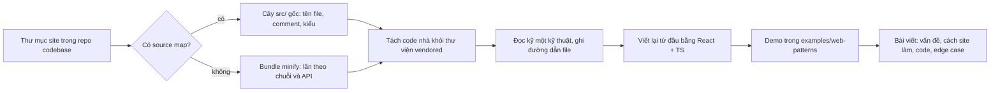

Tài liệu frontend thường dạy ta cách *dùng* một API. Còn chuyện một đội lớn ghép các API đó lại thế nào khi có hàng triệu người dùng, mạng chập chờn, mười tab mở cùng lúc, và bản deploy mới ra mỗi ngày, thì hiếm ai viết ra. Câu trả lời nằm sẵn trong code mà trình duyệt của bạn tải về mỗi lần mở Telegram, App Store hay Trello.

Series [Học từ mã nguồn Facebook](/series/facebook) đã làm việc này với một site. Series này mở rộng ra **28 web app khác**: Telegram, Apple App Store, HubSpot, Trello, Zappos, Outlook, Coursera, Intercom… Mỗi bài chọn một kỹ thuật, đọc code gốc để hiểu họ làm gì và tại sao, rồi viết lại bằng React + TypeScript kèm demo chạy ngay trong bài.

> [!TIP]
> **Tóm tắt**
> - Repo [hunghg255/codebase](https://github.com/hunghg255/codebase) lưu source front-end (đa phần dựng lại từ source map) của 28 web app lớn, cộng thêm Facebook.
> - Đọc code production: tách code nhà khỏi thư viện vendored trước, rồi lần theo chuỗi văn bản, tên API trình duyệt và tên file.
> - Series có 41 bài trong 8 phần: trải nghiệm người dùng, hiệu năng và đo lường, nhiều tab và cập nhật, kiến trúc, soạn thảo và hiển thị nội dung, tương tác, mạng và async, hiệu năng và vận hành.
> - Học ý tưởng, viết lại code từ đầu. Toàn bộ code mẫu ở `examples/web-patterns` trong repo blog.

## Repo `codebase` chứa gì?

Mỗi thư mục cấp đầu là một site. Bên trong là những gì DevTools thấy ở tab **Sources** khi mở site đó: thư mục theo từng host mà trang tải script về (domain chính, CDN, và cả các bên thứ ba như `cdn.pendo.io`, `bat.bing.com`, `browser.sentry-cdn.com`), cùng các thư mục `webpack/`, `(webpack)/`, `src/` được trình duyệt dựng lại từ **source map**.

Source map là thứ quyết định repo này có đọc được hay không:

- Site nào phát hành source map công khai thì ta có lại gần như nguyên vẹn cây thư mục gốc: tên file, tên biến, comment, cả kiểu TypeScript. Telegram Web, App Store (Svelte), Trello, Elastic Cloud, Coursera thuộc nhóm này. Ví dụ `web.telegram.org/src/util/fastSmoothScroll.ts` đọc như code trong repo nội bộ của họ.
- Site không có source map thì chỉ còn bundle đã minify (vd `auth.udacity.com/.../static/js/main.12b11e7b.chunk.js`). Vẫn đọc được, nhưng chậm hơn nhiều; cách đọc loại này đã nói kỹ ở [bài mở đầu series Facebook](/blogs/learn-from-facebook-source-code).

Kích thước rất khác nhau. Đếm số file `.js/.ts/.tsx/.jsx/.svelte` trong từng thư mục (tính cả thư viện và script bên thứ ba):

| Nhóm | Site (số file) |
|---|---|
| Rất lớn | Outlook (≈7.800), SimilarWeb (≈4.400), Coursera (≈3.400), Udemy (≈2.800), HubSpot (≈2.600), Pipedrive (≈2.400), Trello (≈2.300) |
| Lớn | Elastic Cloud (≈1.700), Best Buy (≈1.400), Anchor (≈960), Simplified (≈750), Zappos (≈680), InVision (≈670), Tribe (≈660), Telegram (≈630), Calibre (≈600) |
| Vừa và nhỏ | Stackshare, Postman, Classroom Udacity, Skillshare, Apple App Store, Glitch, Intercom, Gatsby, Ello, Sendbird, Toptal, Auth Udacity (170–570) |

Con số này không nói lên độ phức tạp của sản phẩm. Phần lớn file của Outlook là thư viện và SDK; còn Telegram chỉ khoảng 630 file nhưng gần như toàn bộ là code tự viết, kể cả một framework riêng.

Thư mục `notes/` trong repo là ghi chú đã chắt lọc: mỗi site một file, cùng bộ `cookbook/` gom 81 kỹ thuật theo chủ đề, cộng hơn 100 mục bổ sung trong ghi chú từng site. Series này dùng ghi chú làm bản đồ, nhưng mọi bài đều **đọc lại code gốc** để xác minh. Ghi chú viết nhanh có chỗ sai, và vài chỗ như thế đã được sửa trong lúc viết series.

## 28 site, mỗi site một bài học

Bảng dưới tóm tắt stack và điểm đáng học nhất của từng site. Những dòng có số bài là kỹ thuật được viết thành bài trong series.

| Site | Stack (đọc từ code) | Điểm đáng học | Bài |
|---|---|---|---|
| Gatsby | Gatsby, theme-ui | Dark mode không nháy, lazy hydration ảnh | #1 |
| Toptal | React SSR trên framework nội bộ `@toptal/frontier` | 35+ hook: `useValueByMedia`, `useIdle`, `usePageLeave`; hàng đợi callback, gộp request trùng | #2, #3, #25, #35 |
| InVision | React, Redux-Saga | `useWiggle` (lắc chuột), giới hạn kích thước cookie | #3, #15 |
| Udacity Auth | React, design system VDS | Độ mạnh mật khẩu theo ký tự duy nhất | #4 |
| Pipedrive | React, TypeScript, atomic design | `useRequiredFields`, cắt chữ bằng canvas, khoá phím khi kết quả chưa ổn định | #4, #25, #34 |
| Ello | React, Redux, redux-saga | Kiểm tra file bằng magic number, EXIF, dán ảnh, autocomplete tại con trỏ | #5, #21 |
| Telegram Web | Framework tự viết `Teact` | Cuộn xa vẫn nhanh, Worker RPC, tab chủ, gesture, phát video qua Service Worker | #6, #12, #14, #21, #28, #30, #37, #39 |
| Best Buy | React, Redux, `business-rules/` | Countdown giả lập ngày cho QA, tombstone giỏ hàng | #7 |
| Apple App Store | Svelte | Hàng đợi rAF 3ms/frame, srcset cho artwork, preconnect, LineClamp | #8, #9, #25 |
| HubSpot | React, chia theo domain nghiệp vụ | Quick-fetch, bầu tab chủ cho thông báo | #10, #14 |
| Postman | React, MobX, page manifest | Performance span bằng User Timing | #11 |
| Calibre | Rails + React, thư viện chart tự viết | Dòng thời gian long task, crosshair tooltip | #11 |
| Skillshare | Backbone.js | Đếm thời gian xem chống sleep | #13 |
| Simplified | React, Redux, fabric.js | Master timeline sửa lệch, đường gióng hút cạnh trên canvas | #13, #31 |
| Elastic Cloud | React, Redux, TypeScript | Đồng bộ đăng nhập giữa các tab, báo bản mới qua header `x-ui-tag` | #15, #16, #26 |
| Trello | Monorepo ~50 package nội bộ | Tự cập nhật ở ranh giới an toàn, phím tắt theo phạm vi, giả lập mù màu, polling thưa dần | #16, #29, #32, #36 |
| Zappos | React, Redux | Reverse portal, SPA tự hết hạn | #16, #17 |
| Intercom | Next.js, Contentful | Page Behaviors cấu hình từ CMS | #18 |
| Outlook Web | Floodgate, roosterjs, GraphQL resolver | Bitmask tần suất, dark mode email bằng CIELAB, TTI governor, upload chia chunk | #19, #22, #23, #24, #26, #38, #39, #40 |
| Coursera | Naptime, React Aria | `HTTPHybridLink`: REST sang GraphQL dần dần | #20 |
| Glitch | React, XState, observable | `track-serially` (chỉ chạy lệnh mới nhất), `useObservable` | #35 |
| Stackshare | React, Apollo | Analytics context lồng nhau, gom lô | |
| Classroom Udacity | React, Redux | Iframe chấm code, kiểm tra cookie bên thứ ba | |
| Tribe | Next.js, Apollo, Chakra UI | Optimistic reaction bằng `writeFragment`, đọc lỗi XML của S3 | #38 |
| Anchor | React, React Query | Nền đổi màu theo cuộn, vạch thước theo mức zoom, tách audio bằng ffmpeg.wasm | #30, #33 |
| Udemy | Design system `@udemy/*` | menuAim, ô tìm kiếm, RUM tự viết, cache localStorage có hạn | #27, #34, #37, #41 |
| SimilarWeb | React, Redux, Highcharts | Gộp nhiều AbortSignal, cache IndexedDB theo version, cấp phát màu cho chart | #33, #34, #37 |
| Sendbird | Bundle + Sentry SDK nguyên bản | UTM → cookie → CRM | |

Ba site chưa có bài riêng (Stackshare, Classroom Udacity, Sendbird) vẫn có trong ghi chú `notes/<site>.md`; phần lớn kỹ thuật hay của chúng đã được series Facebook hoặc các bài khác đề cập.

## Cách đọc code production

Quy trình dưới đây là cách các bài trong series được viết.



### 1. Tách code nhà khỏi thư viện

Bước dễ bị bỏ qua nhất, và cũng là nguồn sai nhiều nhất. Một hàm trông rất hay có thể là của thư viện chứ không phải của đội sản phẩm:

- `dashboard.sendbird.com` và `auth.udacity.com` chứa nguyên mã nguồn Sentry SDK (`SyncPromise`, Hub/Scope). Đó là thiết kế của Sentry.
- Coursera mang theo cả `@react-aria` của Adobe. Phần thực sự của Coursera là lớp mạng Naptime và `HTTPHybridLink`.
- Outlook có Fuse.js (thuật toán Bitap) và Floodgate SDK của Microsoft; Simplified có `web-vitals` và `react-design-editor`; Intercom có client của Next.js.

Dấu hiệu nhận biết: thư mục `node_modules` hay tên package trong đường dẫn, header bản quyền, comment kiểu `@license`, hoặc tên hàm trùng với tài liệu của một thư viện quen. Code vendored vẫn đáng đọc, nhưng khi viết bài phải ghi rõ "đây là thư viện X".

### 2. Lần theo chuỗi và API trình duyệt

Muốn tìm cách một site xử lý chuyện gì, grep theo thứ không bao giờ bị minify:

- Tên API trình duyệt: `BroadcastChannel`, `visibilitychange`, `requestIdleCallback`, `PerformanceObserver`, `sendBeacon`.
- Key lưu trữ và tên sự kiện: `localStorage.setItem('…')`, tên cookie, tên event analytics.
- Chuỗi hiển thị cho người dùng: thông báo lỗi, nhãn nút.

```bash
# Ai dùng BroadcastChannel?
grep -rl "BroadcastChannel" --include=*.{js,ts,tsx} . | grep -v node_modules

# Code tự cập nhật của Trello
grep -rn "shouldReloadToUpdate" trello.com --include=*.ts | head
```

### 3. Nhận diện framework

Tên file và cách viết tiết lộ framework trước cả khi đọc logic: `.svelte` và `$:` là Svelte (Apple); `Backbone.View.extend` và helper cho `stickit` là Backbone (Skillshare); `getGlobal` từ `lib/teact/teactn` là framework tự viết của Telegram; thư mục `pages/` đi cùng `next-server` hay `next/router` là Next.js (Intercom, Tribe). Biết framework thì biết đâu là quy ước của framework, đâu là lựa chọn riêng của đội.

### 4. Đọc thành tầng, ghi lại đường dẫn

Mỗi kỹ thuật trong series đi kèm đường dẫn file gốc, để bạn tự mở ra kiểm tra. Khi lý do của một quyết định không có trong code (không comment, không commit message), bài sẽ ghi rõ là "có lẽ" thay vì khẳng định.

## Series được tổ chức thế nào?

Tám phần, đọc theo thứ tự nhưng mỗi bài đều đứng riêng được:

1. **Trải nghiệm người dùng** (#1–#7): những chi tiết người dùng cảm thấy ngay. Trang không chớp trắng khi bật dark mode, form báo lỗi đúng lúc, cuộn qua 5.000 tin nhắn trong nửa giây, countdown khuyến mãi mà QA kiểm thử được.
2. **Hiệu năng và đo lường** (#8–#13): chia việc theo frame, bắn request trước khi JavaScript tải xong, đo span và long task, đẩy việc nặng sang Worker, đồng hồ media không bị lệch khi máy ngủ.
3. **Nhiều tab, phiên đăng nhập, cập nhật** (#14–#16): người dùng mở mười tab. Chỉ một tab nên kêu thông báo, đăng xuất ở một tab thì các tab khác phải biết, và bản deploy mới phải tới được cả những tab mở từ tuần trước.
4. **Kiến trúc** (#17–#20): di chuyển component không remount, cho đội marketing gắn hành vi từ CMS, giới hạn tần suất hiển thị, chuyển REST sang GraphQL mà không viết lại cả app.
5. **Soạn thảo và hiển thị nội dung** (#21–#26): autocomplete ngay tại con trỏ, dark mode cho email HTML bất kỳ, bảng quá rộng, cảnh báo quên đính kèm, cắt chữ nhiều dòng chính xác, parse ngày người dùng gõ.
6. **Tương tác** (#27–#33): menu không đóng khi rê chéo, kéo vuốt chung cho chuột và cảm ứng, phím tắt theo phạm vi, nội suy màu, canvas có đường gióng và undo, giả lập mù màu, vạch thước theo zoom.
7. **Mạng, dữ liệu và async** (#34–#39): ô tìm kiếm chuẩn production, chỉ chạy lệnh mới nhất, polling thưa dần, cache phía client theo version, upload file lớn theo chunk, phát video qua Service Worker.
8. **Hiệu năng và vận hành** (#40–#41): hoãn việc phụ tới khi trang dùng được, tự đo Web Vitals trên máy người dùng và phục vụ bản nhẹ cho máy yếu.

Mỗi bài có cùng bố cục: vấn đề → site làm thế nào (kèm đường dẫn code gốc) → cơ chế trong trình duyệt → code viết lại → edge case → demo → cách dùng trong dự án → test mẫu. Danh sách đầy đủ ở cuối bài.

## Chạy code mẫu

Code của cả series nằm ở [`examples/web-patterns`](https://github.com/hunghg255/blog-hunghg/tree/master/examples/web-patterns): Vite + React 19 + TypeScript, không phụ thuộc thư viện ngoài React. Mỗi kỹ thuật là một file trong `src/lib/`, mỗi demo một file trong `src/demos/`.

```bash
git clone https://github.com/hunghg255/blog-hunghg
cd blog-hunghg/examples/web-patterns
npm ci
npm run dev        # mở http://localhost:5173, chọn demo trong danh sách
```

Hoặc mở thẳng [trên StackBlitz](https://stackblitz.com/github/hunghg255/blog-hunghg/tree/master/examples/web-patterns) để sửa code mà không cần cài gì. Demo nhúng trong bài là bản build tĩnh của chính thư mục này.

## Học ý tưởng, không chép code

Code trong repo `codebase` là tài sản của các công ty tương ứng. Nó được tải về trình duyệt của bất kỳ ai mở site, nhưng điều đó không có nghĩa là được phép dùng lại. Series theo ba nguyên tắc:

- **Chỉ trích ngắn** đoạn code gốc khi cần phân tích, kèm đường dẫn nguồn.
- **Viết lại từ đầu** mọi thứ trong `examples/web-patterns`, theo ý tưởng chứ không theo từng dòng. Nhiều bản viết lại khác bản gốc có chủ đích (sửa lỗi, bỏ phụ thuộc nội bộ), và bài nào cũng có mục "Khác bản gốc".
- **Không dùng** cho mục đích thương mại phần code gốc. Ý tưởng kỹ thuật (bầu tab chủ, quick-fetch, bitmask tần suất) thì là kiến thức chung, cứ mang về dự án của bạn.

Nếu bạn chưa đọc series Facebook, [bài mở đầu](/blogs/learn-from-facebook-source-code) có thêm mẹo đọc code đã minify và giải mã module kiểu `__d(...)`, rất hữu ích cho những site trong repo không có source map.

---

Bài này thuộc series **[Học từ mã nguồn các web lớn](/series/web)** (42 bài, đọc theo thứ tự).

::: spoiler Xem nhanh danh sách bài trong series

*Mở đầu*

- **Mở đầu: đọc code production của 28 trang web** (bài này)

*Phần 1: trải nghiệm người dùng*

- [#1 Dark mode không nháy (Gatsby)](/blogs/web-dark-mode-no-flash)
- [#2 useValueByMedia: giá trị theo breakpoint (Toptal)](/blogs/web-use-value-by-media)
- [#3 Đoán ý định: idle, exit-intent, lắc chuột (Toptal, InVision)](/blogs/web-user-intent-idle-exit-wiggle)
- [#4 Validate form thân thiện (Udacity, Pipedrive)](/blogs/web-form-validation-ux)
- [#5 Magic number, EXIF và dán ảnh (Ello)](/blogs/web-file-magic-number-exif-paste)
- [#6 fastSmoothScroll: cuộn xa vẫn nhanh (Telegram)](/blogs/web-telegram-fast-smooth-scroll)
- [#7 Countdown time-travel và tombstone giỏ hàng (Best Buy)](/blogs/web-countdown-time-travel-tombstone)

*Phần 2: hiệu năng và đo lường*

- [#8 Hàng đợi requestAnimationFrame 3ms (Apple)](/blogs/web-raf-queue-3ms)
- [#9 srcset cho artwork và preconnect tự động (Apple)](/blogs/web-responsive-artwork-preconnect)
- [#10 Quick-fetch: gọi API trước khi bundle tải xong (HubSpot)](/blogs/web-quick-fetch-early-requests)
- [#11 Performance span và long task (Postman, Calibre)](/blogs/web-performance-spans-long-tasks)
- [#12 Gọi Web Worker như hàm async (Telegram)](/blogs/web-worker-promise-rpc)
- [#13 Đồng hồ media: đếm giờ xem và sửa lệch (Skillshare, Simplified)](/blogs/web-media-clock-watch-time-drift)

*Phần 3: nhiều tab, phiên đăng nhập, cập nhật*

- [#14 Bầu tab chủ cho thông báo (HubSpot, Telegram)](/blogs/web-leader-tab-notifications)
- [#15 Đồng bộ đăng nhập giữa tab và giới hạn cookie (Elastic, InVision)](/blogs/web-cross-tab-auth-cookie-guard)
- [#16 SPA tự cập nhật: Trello, Zappos, Facebook, Elastic](/blogs/web-spa-self-update-strategies)

*Phần 4: kiến trúc*

- [#17 Reverse portal: di chuyển component không remount (Zappos)](/blogs/web-reverse-portal)
- [#18 Page behaviors: gắn hành vi từ CMS (Intercom)](/blogs/web-page-behaviors-cms)
- [#19 Giới hạn tần suất hiển thị bằng bitmask (Outlook)](/blogs/web-frequency-cap-bitmask)
- [#20 Chuyển REST sang GraphQL dần dần (Coursera)](/blogs/web-rest-to-graphql-hybrid-link)

*Phần 5: soạn thảo và hiển thị nội dung*

- [#21 Autocomplete tại con trỏ trong contenteditable (Ello, Telegram)](/blogs/web-caret-autocomplete-contenteditable)
- [#22 Dark mode cho email HTML bằng CIELAB (Outlook)](/blogs/web-email-dark-mode-cielab)
- [#23 Thu nhỏ bảng rộng cho vừa khung, vá font emoji (Outlook)](/blogs/web-email-wide-content-scale)
- [#24 Cảnh báo quên đính kèm file (Outlook)](/blogs/web-forgotten-attachment-warning)
- [#25 Cắt chữ nhiều dòng chính xác (Pipedrive, Apple, Toptal)](/blogs/web-multiline-truncate-measure-text)
- [#26 Parse ngày giờ gõ tay khoan dung (Outlook, Elastic)](/blogs/web-lenient-date-parser)

*Phần 6: tương tác*

- [#27 menuAim: rê chéo vào submenu không bị đóng (Udemy)](/blogs/web-menu-aim-triangle)
- [#28 Kéo, vuốt chung cho chuột và cảm ứng (Telegram)](/blogs/web-unified-pointer-gestures)
- [#29 Phím tắt theo phạm vi, IME và bàn phím phi Latinh (Trello)](/blogs/web-scoped-keyboard-shortcuts)
- [#30 Nội suy màu: đổi theme và nền theo cuộn (Telegram, Anchor)](/blogs/web-color-interpolation-theme-scroll)
- [#31 Đường gióng hút cạnh và undo/redo trên canvas (Simplified)](/blogs/web-canvas-snap-guides-undo)
- [#32 Giả lập mù màu bằng feColorMatrix (Trello)](/blogs/web-color-vision-simulator)
- [#33 Vạch thước theo mức zoom và cấp phát màu cho biểu đồ (Anchor, Similarweb)](/blogs/web-timeline-ticks-color-stack)

*Phần 7: mạng, dữ liệu và async*

- [#34 Ô tìm kiếm chuẩn production (Similarweb, Udemy, Pipedrive)](/blogs/web-production-search-box)
- [#35 Điều phối async: latest-wins, single-flight (Glitch, Toptal)](/blogs/web-async-coordination-latest-wins)
- [#36 Polling thưa dần và debounce động (Trello)](/blogs/web-decaying-polling-dynamic-debounce)
- [#37 Cache phía client theo version (Similarweb, Telegram, Udemy)](/blogs/web-client-cache-versioned)
- [#38 Upload file lớn theo chunk (Outlook, Tribe)](/blogs/web-chunked-upload-pipeline)
- [#39 Phát video qua Service Worker bằng Range request (Telegram, Outlook)](/blogs/web-service-worker-range-streaming)

*Phần 8: hiệu năng và vận hành*

- [#40 TTI governor: hoãn việc phụ tới sau khi trang dùng được (Outlook)](/blogs/web-tti-governor)
- [#41 Tự đo LCP/CLS/TBT và phục vụ bản nhẹ cho máy yếu (Udemy)](/blogs/web-rum-adaptive-loading)

:::

Code + demo: [`examples/web-patterns`](https://github.com/hunghg255/blog-hunghg/tree/master/examples/web-patterns) · [Mở trên StackBlitz](https://stackblitz.com/github/hunghg255/blog-hunghg/tree/master/examples/web-patterns)
