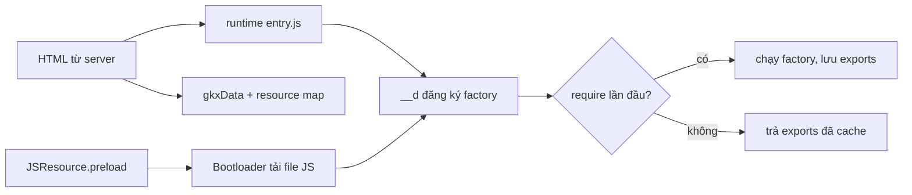

Facebook là một trong những ứng dụng web lớn nhất thế giới, chạy hàng triệu dòng JavaScript trên đủ loại thiết bị và mạng. Họ không open-source frontend của facebook.com, nhưng **bundle JavaScript gửi xuống trình duyệt thì ai cũng tải về đọc được**. Repo [facebook-codebase](https://github.com/hunghg255/facebook-codebase) chứa vài nghìn module như vậy, tải từ bản "Comet" (bản React hiện tại của facebook.com).

Series này đi qua những module mình thấy **hay nhất và dễ mang sang dự án khác nhất**. Mỗi bài có 4 phần:

1. Facebook giải quyết vấn đề gì và giải quyết thế nào, kèm phân tích code gốc.
2. Code viết lại bằng **React 19 + TypeScript**, gọn và có comment.
3. **Demo chạy ngay trong bài**: bấm, cuộn, hover thử luôn.
4. Bên trong trình duyệt, các bẫy, edge case và cách kiểm thử khi đưa vào production.

> [!WARNING]
> Mã nguồn của facebook.com thuộc bản quyền của Meta và không có license cho phép tái sử dụng. Đừng copy nguyên văn vào dự án. Toàn bộ code trong series này được **viết lại từ đầu** dựa trên ý tưởng đọc được. Những đoạn code gốc trích trong bài chỉ dài vài dòng để phân tích. Những phần Meta đã open-source (React, [StyleX](https://stylexjs.com), [Lexical](https://lexical.dev), [fbt](https://facebook.github.io/fbt/)) thì nên dùng bản chính thức.

Trước khi vào từng kỹ thuật, ta cần hiểu cách "đọc" đống code này. Phần dưới đây dài, nhưng đọc một lần thì 8 bài sau sẽ dễ hơn nhiều.

## Hệ module của facebook.com

Facebook không dùng ES module (`import`/`export`) hay webpack runtime ở production. Họ có hệ module riêng, đi kèm một runtime nhỏ được nạp đầu tiên trong trang (trong repo là file `000/entry.js`). Mỗi file JS gửi xuống là một chuỗi lời gọi `__d(...)`:

```js
__d("useDelayedState", ["React", "clearTimeout", "emptyFunction", "setTimeout"], (function (a, b, c, d, e, f) {
  "use strict";
  e.exports = a;
  var g = b("React");
  function a(a) { /* ... */ }
}), null);
```

### `__d` chỉ đăng ký, chưa chạy

`__d(id, deps, factory, flags)` viết tắt của **define**. Đọc runtime trong `000/entry.js`, ta thấy nó chỉ lưu một bản ghi gồm `id`, danh sách dependency và hàm factory vào một map toàn cục. **Factory chưa chạy.** Factory chỉ chạy ở lần đầu tiên có ai đó `require(id)`. Kết quả được giữ lại trong `module.exports`, lần `require` sau trả về luôn.

Hệ quả thực tế: tải về 2MB JS không có nghĩa là phải **thực thi** 2MB JS lúc khởi động. Phần đắt nhất của JavaScript trên điện thoại yếu thường là parse và execute, không phải tải. Module nào chưa cần thì chỉ tốn chi phí parse cú pháp, chưa tốn chi phí chạy.

Vài chi tiết khác đọc được từ runtime:

- `require` của module chưa từng chạy sẽ tự bọc trong `ErrorGuard.applyWithGuard` (xem [bài #6](/blogs/facebook-error-guard)). Factory nào throw thì module bị đánh dấu `hasError`, các lần `require` sau ném lại lỗi `Requiring module "X" which threw an exception`. Lỗi không bị nuốt.
- Mỗi module có `refcount`. Khi mọi nơi cần nó đã `require` xong, bản ghi trong map bị xoá cho nhẹ bộ nhớ. Ai cần thì đã giữ `exports` rồi.
- Khi bật cờ `profile_require_factories`, runtime đo `factoryStart`/`factoryEnd` của từng module. Đây là cách họ biết module nào làm chậm lúc khởi động.
- Nếu `exports` là function chưa có `displayName`, runtime gắn thêm `"(tên hàm) [from ModuleName]"`. Nhờ vậy React DevTools vẫn hiện tên dễ đọc dù code đã minify.

### 6 tham số `(a, b, c, d, e, f)`

Factory luôn nhận 6 tham số chuẩn theo đúng thứ tự runtime truyền vào:

| Tham số | Là gì | Dùng thế nào |
| --- | --- | --- |
| `a` | `global` (window) | hiếm khi dùng, thường bị minifier **tái sử dụng làm biến khác** |
| `b` | `require` | `b("React")` |
| `c` | `requireDynamic` | gần như không dùng |
| `d` | `requireLazy` | `d(["X"], cb)`: chờ module X sẵn sàng rồi gọi cb |
| `e` | `module` | `e.exports = ...` |
| `f` | `exports` | `f.isOnline = ...` |

Nếu factory khai báo **nhiều hơn 6 tham số**, runtime truyền thêm `exports` của các dependency theo đúng thứ tự trong mảng `deps`. Ví dụ module `gkx` có deps `["invariant", "BanzaiLazyQueue", "emptyFunction"]` và factory `(a, b, c, d, e, f, g)`. Lúc đó `g` chính là `invariant`, nên trong code bạn sẽ thấy `c != null || g(0, 3444, a)`. Đó là `invariant(c != null, ...)` với **mã lỗi số** thay cho message, vì message bị bỏ khỏi bản production để giảm dung lượng.

> [!TIP]
> Minifier tái sử dụng tên tham số rất mạnh tay. `a` vừa là `global`, vừa là tên hàm được export (`e.exports = a; function a() {}` nhờ hoisting), vừa là tham số đầu tiên của hàm đó. Khi đọc, đừng tin tên biến. Hãy xem **nó được gán ở dòng nào gần nhất**.

### Bảng tra nhanh khi đọc

| Thấy gì | Nghĩa là |
| --- | --- |
| `!0` / `!1` / `void 0` | `true` / `false` / `undefined` |
| `a === void 0 && (a = 0)` | tham số mặc định `a = 0` |
| `x != null ? x : y` | `x ?? y` |
| `(h \|\| (h = b("X")))` | lazy require: chỉ require X ở lần dùng đầu tiên |
| `babelHelpers["extends"]({}, a, b)` | `{ ...a, ...b }` |
| `babelHelpers.objectWithoutPropertiesLoose(a, ["children"])` | `const { children, ...rest } = a` |
| `this.$1`, `this.$2`, `c.$6 = function` | private field / method của class, đã bị đổi tên theo số thứ tự |
| `g.jsx("div", {...})` | JSX đã biên dịch: `<div {...} />` |
| `g._("...")` | `fbt`: chuỗi đã dịch (i18n) |

### Gatekeeper: `gkx("1475760")`

Facebook bật/tắt tính năng theo người dùng bằng **gatekeeper** (GK). Đọc module `gkx`, ta thấy:

- Server nhúng sẵn kết quả của các GK mà trang cần vào HTML (file `gkxData` trong repo), dạng `{ "1475760": { result: false, hash: "AT7..." } }`. Client **không tự tính** điều kiện, chỉ đọc kết quả.
- Lần đầu một GK được đọc, `gkx` gửi một event `gk2_exposure` (qua `BanzaiLazyQueue`, xem [bài #7](/blogs/facebook-batch-logger)). Mỗi GK chỉ gửi một lần. Đây là **exposure logging** cho A/B test: chỉ người dùng thực sự **chạm tới** đoạn code có GK mới được tính vào thí nghiệm, nên kết quả thí nghiệm không bị loãng.

Bài học mang đi được: feature flag nên log exposure ở **thời điểm đọc flag**, không phải lúc tải trang.

### `requireCond` và `cr:1234`: chọn module lúc build

Bạn sẽ thấy những dependency kỳ lạ như `"cr:1142206"` và `b("cr:1142206")`. Đây là kết quả của `requireCond`: chọn module **ở bước build/serve**, tuỳ điều kiện (bản dev hay prod, đang trong thí nghiệm nào…). Module `requireCond` gốc trong runtime chỉ có một dòng `throw new Error("Cannot use raw untransformed requireCond.")`, nghĩa là mọi lời gọi đều phải được compiler biến đổi trước.

Ví dụ trong `CometInfiniteScrollSuspenseList`, `b("cr:1142206")` là một công cụ debug cho việc tải thêm ở cuối danh sách. Code luôn viết `b("cr:1142206") != null && b("cr:1142206").log(...)`, nghĩa là điều kiện có thể chọn `null` cho slot đó. Với người dùng thường, module debug có thể không hề có mặt trong bundle. Với nhân viên nội bộ, slot đó là module thật. Đây là phiên bản "build-time" của `if (process.env.NODE_ENV !== 'production')` mà ta quen dùng.

### `JSResource`: code splitting kiểu Facebook

`React.lazy(() => import("./X"))` là cách ta code-split. Ở Facebook là `JSResource("X")`:

- `JSResource("X")` trả về một **reference** (`JSResourceReference`), được cache theo tên module. Gọi bao nhiêu lần cũng ra cùng một object.
- `.preload()` báo `Bootloader` tải trước, chưa chạy. `.load()` trả về Promise của module.
- `getModuleIfRequired()` trả về module **ngay lập tức** nếu đã tải xong, không thì `null`. Hàm này cho phép render đồng bộ khi code đã có sẵn. Ta sẽ gặp lại đúng ý tưởng này trong [bài #3](/blogs/facebook-preload-on-hover).
- `Bootloader` biết mỗi module nằm trong file JS/CSS nào (qua "resource map" server gửi xuống), gom nhiều module vào ít request, tải CSS đi kèm và theo dõi lỗi tải.



## Giải mã một module từ đầu tới cuối

Lấy module nhỏ `useDelayedState` (thư mục `hooks/` của repo) làm ví dụ. Phần lõi trông như sau:

```js
a = g.useCallback(function (a, c, f) {
  c === void 0 && (c = 0), f === void 0 && (f = b("emptyFunction")),
  b("clearTimeout")(e.current), e.current = null,
  c === 0 ? (d(a), f(a)) : e.current = b("setTimeout")(function () {
    d(a), f(a), e.current = null
  }, c)
}, []);
return [c, a]
```

**Bước 1: tìm xem biến nào là gì.** Phía trên đoạn này có `a = g.useState(a); var c = a[0], d = a[1], e = g.useRef(null);`. Vậy `c` là state, `d` là `setState`, `e` là ref giữ timer. Trong `useCallback`, tham số `a, c, f` **che** các biến bên ngoài: `a` là giá trị mới, `c` là độ trễ, `f` là callback.

**Bước 2: tách các biểu thức nối bằng dấu phẩy** thành từng câu lệnh, và đổi `x === void 0 && (x = ...)` thành tham số mặc định.

**Bước 3: đổi `cond ? (A, B) : C` thành `if/else`.**

**Bước 4: đặt tên và thêm type:**

```ts
function useDelayedState<T>(initial: T) {
  const [state, setState] = useState(initial);
  const timerRef = useRef<ReturnType<typeof setTimeout> | null>(null);

  // unmount thì huỷ timer đang chờ
  useEffect(() => () => clearTimeout(timerRef.current ?? undefined), []);

  const setDelayedState = useCallback(
    (value: T, delay = 0, callback: (value: T) => void = () => {}) => {
      clearTimeout(timerRef.current ?? undefined); // lần set mới huỷ lần đang chờ
      timerRef.current = null;
      if (delay === 0) {
        setState(value);
        callback(value);
      } else {
        timerRef.current = setTimeout(() => {
          setState(value);
          callback(value);
          timerRef.current = null;
        }, delay);
      }
    },
    [],
  );

  return [state, setDelayedState] as const;
}
```

Đọc ra rồi thì thấy đây là một hook rất hữu ích: `setOpen(true, 300)` để tooltip chỉ hiện khi hover đủ lâu, `setOpen(false)` để tắt ngay và **huỷ luôn** lần hiện đang chờ. Đây chính là cơ chế chống "nháy" tooltip khi rê chuột qua nhanh.

Mẹo đọc nhanh cho mọi module:

- **Đọc danh sách dependency trước.** `["CometMouseActivity", "JSScheduler", "setTimeout"]` đã cho biết module này làm gì với chuột, có lập lịch, có hẹn giờ.
- **Tìm chuỗi.** Tên lỗi, tên event, tên log (`"Network switched to offline"`, `"COMPONENT_UNMOUNTED"`) là manh mối tốt nhất.
- **Đọc theo cụm.** Một tính năng thường gồm 5–15 module có tên giống nhau (`CometToaster*`, `Error*`). Đọc cả cụm dễ hiểu hơn đọc lẻ từng file.
- **Kiểm chứng bằng cách viết lại và chạy thử.** Đó là cách mình làm cho cả series này.

## 8 kỹ thuật trong series

---

**Series "Học từ mã nguồn Facebook"**

- **Mở đầu: cách đọc code minify của Facebook** (bài này)
- [#1 Dùng chung IntersectionObserver + infinite scroll](/blogs/facebook-shared-intersection-observer)
- [#2 useViewportDuration: đo thời gian thực sự được xem](/blogs/facebook-use-viewport-duration)
- [#3 Preload code + data khi hover](/blogs/facebook-preload-on-hover)
- [#4 Toast manager với external store](/blogs/facebook-toast-manager)
- [#5 Network status + heartbeat backoff](/blogs/facebook-network-status-heartbeat)
- [#6 ErrorGuard: bắt lỗi theo ngữ cảnh](/blogs/facebook-error-guard)
- [#7 Banzai: gom log theo lô + sendBeacon](/blogs/facebook-batch-logger)
- [#8 Focus trap + Esc theo layer](/blogs/facebook-focus-trap)

Code + demo: [`examples/facebook-patterns`](https://github.com/hunghg255/blog-hunghg/tree/master/examples/facebook-patterns) · [Mở trên StackBlitz](https://stackblitz.com/github/hunghg255/blog-hunghg/tree/master/examples/facebook-patterns)

Tất cả demo được gom trong một project Vite nhỏ: [`examples/facebook-patterns`](https://github.com/hunghg255/blog-hunghg/tree/master/examples/facebook-patterns). Bạn có thể clone về chạy `npm install && npm run dev`, hoặc [mở trên StackBlitz](https://stackblitz.com/github/hunghg255/blog-hunghg/tree/master/examples/facebook-patterns) để sửa code ngay trên trình duyệt.

<iframe class="demo-frame" src="/demos/facebook-patterns/index.html?theme=dark" title="Demo facebook-patterns" loading="lazy" style="height: 560px"></iframe>

<p class="demo-links">▶ <a href="/demos/facebook-patterns/index.html" target="_blank" rel="noopener">Mở demo toàn màn hình ↗</a> · <a href="https://stackblitz.com/github/hunghg255/blog-hunghg/tree/master/examples/facebook-patterns" target="_blank" rel="noopener">Sửa code trên StackBlitz ↗</a></p>

## Điểm chung của 8 kỹ thuật

Đọc xong cả series, bạn sẽ thấy vài nguyên tắc Facebook lặp đi lặp lại:

- **Tách state khỏi React.** Toast, network status, logger đều là object/class thuần với `subscribe` + `getSnapshot`. React chỉ là một "view" cắm vào qua `useSyncExternalStore`. Nhờ vậy code nào cũng gọi được (`toast.push()` trong một hàm fetch chẳng hạn) và test được mà không cần render.
- **Dùng chung tài nguyên đắt.** Một IntersectionObserver cho hàng trăm element, một listener `keydown` cho mọi layer, một hàng đợi cho mọi log, một bản ghi module cho mọi lần `require`.
- **Làm muộn nhất có thể.** Factory chỉ chạy khi cần, observer chỉ được tạo khi có người observe, listener chỉ gắn khi có người subscribe.
- **Không tin trình duyệt 100%.** `navigator.onLine` có thể sai. `isIntersecting` chưa có nghĩa là người dùng đang xem. `unload` thường không chạy trên mobile.
- **Đo trước, tối ưu sau.** Rất nhiều module chỉ để log: thời gian chạy factory, exposure của gatekeeper, thời gian hiển thị, guard stack lúc lỗi.
- **Tận dụng thời gian chờ của người dùng.** Họ hover trước khi click khoảng 200–300ms. Đó là khoảng thời gian miễn phí để tải trước.

Bắt đầu với bài đầu tiên: [Shared IntersectionObserver](/blogs/facebook-shared-intersection-observer).
