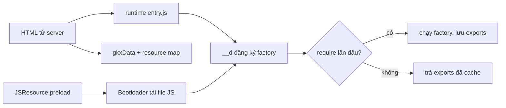

Facebook là một trong những ứng dụng web lớn nhất thế giới, chạy hàng triệu dòng JavaScript trên đủ loại thiết bị và mạng. Họ không open-source frontend của facebook.com, nhưng **bundle JavaScript gửi xuống trình duyệt thì ai cũng tải về đọc được**. Repo [facebook-codebase](https://github.com/hunghg255/facebook-codebase) chứa hơn 1.600 file như vậy, tải từ bản "Comet" (bản React hiện tại của facebook.com). Để tìm cho đủ, mình đã lập chỉ mục mọi lời gọi `__d(...)` trong repo: khoảng 25.000 khai báo module trong 1.451 file, tương ứng hơn 17.000 tên module khác nhau (một module thường có mặt ở nhiều bundle).

Series này đi qua những module mình thấy **hay nhất và dễ mang sang dự án khác nhất**. Mỗi bài có 4 phần:

1. Facebook giải quyết vấn đề gì và giải quyết thế nào, kèm phân tích code gốc.
2. Code viết lại bằng **React 19 + TypeScript**, gọn và có comment.
3. **Demo chạy ngay trong bài**: bấm, cuộn, hover thử luôn.
4. Bên trong trình duyệt, các bẫy, edge case và cách kiểm thử khi đưa vào production.

> [!TIP]
> **Tóm tắt**
> - Bundle JS của facebook.com đọc được, và chứa rất nhiều kỹ thuật frontend đáng học.
> - Đọc được nó chỉ cần nắm vài quy ước: `__d` (define), `b("X")` (require), 6 tham số factory, gatekeeper `gkx`, `cr:` và `JSResource`.
> - Series viết lại 82 kỹ thuật bằng React 19 + TypeScript, chia 10 phần, mỗi bài có demo chạy ngay trong trang. Bốn phần cuối đi vào video và upload, thuật toán, thời gian/chuỗi/URL, và hạ tầng/bảo mật/hình học.
> - Nhiều bài chỉ ra lỗi thật trong code gốc (tên sự kiện gõ sai, regex lọt khoá, bộ rút hàng đợi bỏ đói trình duyệt), đã kiểm chứng bằng cách chạy lại.
> - Các đoạn "Kiểm thử" trong bài là **bản phác** để bạn tham khảo, không nằm trong repo ví dụ.

> [!WARNING]
> Mã nguồn của facebook.com thuộc bản quyền của Meta và không có license cho phép tái sử dụng. Đừng copy nguyên văn vào dự án. Toàn bộ code trong series này được **viết lại từ đầu** dựa trên ý tưởng đọc được. Những đoạn code gốc trích trong bài chỉ dài vài dòng để phân tích. Những phần Meta đã open-source (React, [StyleX](https://stylexjs.com), [Lexical](https://lexical.dev), [fbt](https://facebook.github.io/fbt/)) thì nên dùng bản chính thức.

Trước khi vào từng kỹ thuật, ta cần hiểu cách "đọc" đống code này. Phần dưới đây dài, nhưng đọc một lần thì cả 82 bài sau sẽ dễ đọc hơn nhiều.

## Hệ module của facebook.com

Facebook không dùng ES module (`import`/`export`) hay webpack runtime ở production. Họ có hệ module riêng, đi kèm một runtime nhỏ được nạp đầu tiên trong trang (trong repo là file `000/entry.js`). Mỗi file JS gửi xuống là một chuỗi lời gọi `__d(...)`:

```js
__d("useDelayedState", ["React", "clearTimeout", "emptyFunction", "setTimeout"], (function (a, b, c, d, e, f) {
  "use strict";
  e.exports = a;
  var g = b("React");
  function a(a) { /* ... */ }
}), null);
```

### `__d` chỉ đăng ký, chưa chạy

`__d(id, deps, factory, flags)` viết tắt của **define**. Đọc runtime trong `000/entry.js`, ta thấy nó chỉ lưu một bản ghi gồm `id`, danh sách dependency và hàm factory vào một map toàn cục. **Factory chưa chạy.** Factory chỉ chạy ở lần đầu tiên có ai đó `require(id)`. Kết quả được giữ lại trong `module.exports`, lần `require` sau trả về luôn.

Hệ quả thực tế: tải về 2MB JS không có nghĩa là phải **thực thi** 2MB JS lúc khởi động. Phần đắt nhất của JavaScript trên điện thoại yếu thường là parse và execute, không phải tải. Module nào chưa cần thì chỉ tốn chi phí parse cú pháp, chưa tốn chi phí chạy.

Vài chi tiết khác đọc được từ runtime:

- `require` của module chưa từng chạy sẽ tự bọc trong `ErrorGuard.applyWithGuard` (xem [bài #6](/blogs/facebook-error-guard)). Factory nào throw thì module bị đánh dấu `hasError`, các lần `require` sau ném lại lỗi `Requiring module "X" which threw an exception`. Lỗi không bị nuốt.
- Mỗi module có `refcount`. Khi mọi nơi cần nó đã `require` xong, bản ghi trong map bị xoá cho nhẹ bộ nhớ. Ai cần thì đã giữ `exports` rồi.
- Khi bật cờ `profile_require_factories`, runtime đo `factoryStart`/`factoryEnd` của từng module. Đây là cách họ biết module nào làm chậm lúc khởi động.
- Nếu `exports` là function chưa có `displayName`, runtime gắn thêm `"(tên hàm) [from ModuleName]"`. Nhờ vậy React DevTools vẫn hiện tên dễ đọc dù code đã minify.

### 6 tham số `(a, b, c, d, e, f)`

Factory luôn nhận 6 tham số chuẩn theo đúng thứ tự runtime truyền vào:

| Tham số | Là gì | Dùng thế nào |
| --- | --- | --- |
| `a` | `global` (window) | hiếm khi dùng, thường bị minifier **tái sử dụng làm biến khác** |
| `b` | `require` | `b("React")` |
| `c` | `requireDynamic` | gần như không dùng |
| `d` | `requireLazy` | `d(["X"], cb)`: chờ module X sẵn sàng rồi gọi cb |
| `e` | `module` | `e.exports = ...` |
| `f` | `exports` | `f.isOnline = ...` |

Nếu factory khai báo **nhiều hơn 6 tham số**, runtime truyền thêm `exports` của các dependency theo đúng thứ tự trong mảng `deps`. Ví dụ module `gkx` có deps `["invariant", "BanzaiLazyQueue", "emptyFunction"]` và factory `(a, b, c, d, e, f, g)`. Lúc đó `g` chính là `invariant`, nên trong code bạn sẽ thấy `c != null || g(0, 3444, a)`. Đó là `invariant(c != null, ...)` với **mã lỗi số** thay cho message, vì message bị bỏ khỏi bản production để giảm dung lượng.

> [!TIP]
> Minifier tái sử dụng tên tham số rất mạnh tay. `a` vừa là `global`, vừa là tên hàm được export (`e.exports = a; function a() {}` nhờ hoisting), vừa là tham số đầu tiên của hàm đó. Khi đọc, đừng tin tên biến. Hãy xem **nó được gán ở dòng nào gần nhất**.

### Bảng tra nhanh khi đọc

| Thấy gì | Nghĩa là |
| --- | --- |
| `!0` / `!1` / `void 0` | `true` / `false` / `undefined` |
| `a === void 0 && (a = 0)` | tham số mặc định `a = 0` |
| `x != null ? x : y` | `x ?? y` |
| `(h \|\| (h = b("X")))` | lazy require: chỉ require X ở lần dùng đầu tiên |
| `babelHelpers["extends"]({}, a, b)` | `{ ...a, ...b }` |
| `babelHelpers.objectWithoutPropertiesLoose(a, ["children"])` | `const { children, ...rest } = a` |
| `this.$1`, `this.$2`, `c.$6 = function` | private field / method của class, đã bị đổi tên theo số thứ tự |
| `g.jsx("div", {...})` | JSX đã biên dịch: `<div {...} />` |
| `g._("...")` | `fbt`: chuỗi đã dịch (i18n) |

### Gatekeeper: `gkx("1475760")`

Facebook bật/tắt tính năng theo người dùng bằng **gatekeeper** (GK). Đọc module `gkx`, ta thấy:

- Server nhúng sẵn kết quả của các GK mà trang cần vào HTML (file `gkxData` trong repo), dạng `{ "1475760": { result: false, hash: "AT7..." } }`. Client **không tự tính** điều kiện, chỉ đọc kết quả.
- Lần đầu một GK được đọc, `gkx` gửi một event `gk2_exposure` (qua `BanzaiLazyQueue`, xem [bài #7](/blogs/facebook-batch-logger)). Mỗi GK chỉ gửi một lần. Đây là **exposure logging** cho A/B test: chỉ người dùng thực sự **chạm tới** đoạn code có GK mới được tính vào thí nghiệm, nên kết quả thí nghiệm không bị loãng.

Bài học mang đi được: feature flag nên log exposure ở **thời điểm đọc flag**, không phải lúc tải trang.

### `requireCond` và `cr:1234`: chọn module lúc build

Bạn sẽ thấy những dependency kỳ lạ như `"cr:1142206"` và `b("cr:1142206")`. Đây là kết quả của `requireCond`: chọn module **ở bước build/serve**, tuỳ điều kiện (bản dev hay prod, đang trong thí nghiệm nào…). Module `requireCond` gốc trong runtime chỉ có một dòng `throw new Error("Cannot use raw untransformed requireCond.")`, nghĩa là mọi lời gọi đều phải được compiler biến đổi trước.

Ví dụ trong `CometInfiniteScrollSuspenseList`, `b("cr:1142206")` là một công cụ debug cho việc tải thêm ở cuối danh sách. Code luôn viết `b("cr:1142206") != null && b("cr:1142206").log(...)`, nghĩa là điều kiện có thể chọn `null` cho slot đó. Với người dùng thường, module debug có thể không hề có mặt trong bundle. Với nhân viên nội bộ, slot đó là module thật. Đây là phiên bản "build-time" của `if (process.env.NODE_ENV !== 'production')` mà ta quen dùng.

### `JSResource`: code splitting kiểu Facebook

`React.lazy(() => import("./X"))` là cách ta code-split. Ở Facebook là `JSResource("X")`:

- `JSResource("X")` trả về một **reference** (`JSResourceReference`), được cache theo tên module. Gọi bao nhiêu lần cũng ra cùng một object.
- `.preload()` báo `Bootloader` tải trước, chưa chạy. `.load()` trả về Promise của module.
- Có hai hàm lấy module **đồng bộ**, trả về `null` nếu chưa được:
  - `getModuleIfRequireable()`: code đã tải về (module đã được `__d`) thì `require` luôn và trả về, kể cả khi factory chưa từng chạy.
  - `getModuleIfRequired()`: chỉ trả về nếu module **đã được require** ở đâu đó rồi.

  Nhờ hai hàm này, component có thể render đồng bộ khi code đã có sẵn thay vì suspend. `BootloaderResource.read` dùng `getModuleIfRequireable`, và ta sẽ gặp lại đúng ý tưởng này trong [bài #3](/blogs/facebook-preload-on-hover).
- `Bootloader` biết mỗi module nằm trong file JS/CSS nào (qua "resource map" server gửi xuống), gom nhiều module vào ít request, tải CSS đi kèm và theo dõi lỗi tải.



## Giải mã một module từ đầu tới cuối

Lấy module nhỏ `useDelayedState` (thư mục `hooks/` của repo) làm ví dụ. Phần lõi trông như sau:

```js
a = g.useCallback(function (a, c, f) {
  c === void 0 && (c = 0), f === void 0 && (f = b("emptyFunction")),
  b("clearTimeout")(e.current), e.current = null,
  c === 0 ? (d(a), f(a)) : e.current = b("setTimeout")(function () {
    d(a), f(a), e.current = null
  }, c)
}, []);
return [c, a]
```

**Bước 1: tìm xem biến nào là gì.** Phía trên đoạn này có `a = g.useState(a); var c = a[0], d = a[1], e = g.useRef(null);`. Vậy `c` là state, `d` là `setState`, `e` là ref giữ timer. Trong `useCallback`, tham số `a, c, f` **che** các biến bên ngoài: `a` là giá trị mới, `c` là độ trễ, `f` là callback.

**Bước 2: tách các biểu thức nối bằng dấu phẩy** thành từng câu lệnh, và đổi `x === void 0 && (x = ...)` thành tham số mặc định.

**Bước 3: đổi `cond ? (A, B) : C` thành `if/else`.**

**Bước 4: đặt tên và thêm type:**

```ts
function useDelayedState<T>(initial: T) {
  const [state, setState] = useState(initial);
  const timerRef = useRef<ReturnType<typeof setTimeout> | null>(null);

  // unmount thì huỷ timer đang chờ
  useEffect(() => () => clearTimeout(timerRef.current ?? undefined), []);

  const setDelayedState = useCallback(
    (value: T, delay = 0, callback: (value: T) => void = () => {}) => {
      clearTimeout(timerRef.current ?? undefined); // lần set mới huỷ lần đang chờ
      timerRef.current = null;
      if (delay === 0) {
        setState(value);
        callback(value);
      } else {
        timerRef.current = setTimeout(() => {
          setState(value);
          callback(value);
          timerRef.current = null;
        }, delay);
      }
    },
    [],
  );

  return [state, setDelayedState] as const;
}
```

Đọc ra rồi thì thấy đây là một hook rất hữu ích: `setOpen(true, 300)` để tooltip chỉ hiện khi hover đủ lâu, `setOpen(false)` để tắt ngay và **huỷ luôn** lần hiện đang chờ. Đây chính là cơ chế chống "nháy" tooltip khi rê chuột qua nhanh.

Mẹo đọc nhanh cho mọi module:

- **Đọc danh sách dependency trước.** `["CometMouseActivity", "JSScheduler", "setTimeout"]` đã cho biết module này làm gì với chuột, có lập lịch, có hẹn giờ.
- **Tìm chuỗi.** Tên lỗi, tên event, tên log (`"Network switched to offline"`, `"COMPONENT_UNMOUNTED"`) là manh mối tốt nhất.
- **Đọc theo cụm.** Một tính năng thường gồm 5–15 module có tên giống nhau (`CometToaster*`, `Error*`). Đọc cả cụm dễ hiểu hơn đọc lẻ từng file.
- **Kiểm chứng bằng cách viết lại và chạy thử.** Đó là cách mình làm cho cả series này.

## 82 kỹ thuật trong series

Series chia làm mười phần. **Phần 1** (#1–#8) tập trung vào hạ tầng chạy ngầm: observer, logging, lỗi, mạng, focus. **Phần 2** (#9–#20) đi sang những thứ người dùng nhìn thấy: mẹo CSS không cần JS, thanh cuộn, modal, popover, tab, khung chat, bố cục ảnh. Cuối phần 2 là các kỹ thuật giữ cho một SPA chạy lâu vẫn nhanh và ổn định. **Phần 3** (#21–#37) là đợt đọc lại toàn bộ bundle, từng thư mục và từng file: Smart Compose, MQTT ngay trong trình duyệt, đo thời gian dùng, engine animation, bootloader, xử lý ảnh trong worker, kéo-thả và các module hạ tầng nhỏ. Ba phần tiếp theo đi sâu thêm một lượt nữa: **Phần 4** (#38–#42) là Messenger và realtime (đồng bộ tin nhắn theo seqID, ID sinh ở client, đo thời gian gửi tin, bộ điều phối request); **Phần 5** (#43–#50) là các module sản phẩm như composer, thanh toán, quảng cáo, Pages; **Phần 6** (#51–#57) là hạ tầng sâu: phát hiện script lạ, localStorage đầy quota, cache tuyến, lưới phím 2D, tách emoji, gom đọc/ghi DOM, hàng đợi lệnh video.

Bốn phần sau cùng là lượt đọc thứ ba, dựa trên chỉ mục toàn bộ khai báo module. **Phần 7** (#58–#62) là video và upload: ước lượng băng thông, chọn bitrate, prefetch segment DASH, đọc metadata MP4 và upload tiếp tục được. **Phần 8** (#63–#70) là thuật toán thuần: Fenwick tree, vạch trục "đẹp", khoảng cách sửa chữ, PRNG có seed, heap đôi, memo nhiều khoá, thống kê cửa sổ trượt, số 64 bit và UTF. **Phần 9** (#71–#74) là thời gian, chuỗi và URL: múi giờ IANA ngay trên client, semver, auto-link và parser query kiểu PHP. **Phần 10** (#75–#82) là hạ tầng, bảo mật và hình học: popover tự lật, tiền tố chống JSON hijacking, chống lộ referrer, `setImmediate` tự viết, phát hiện tab crash, cookie DPR và che khoá trong log, Flux `waitFor`, crop và xoay sticker.

| # | Kỹ thuật | Mang về được gì |
| --- | --- | --- |
| 1 | [Dùng chung IntersectionObserver](/blogs/facebook-shared-intersection-observer) | 1 observer cho hàng trăm element, infinite scroll không gọi API trùng |
| 2 | [useViewportDuration](/blogs/facebook-use-viewport-duration) | Đo thời gian người dùng thực sự xem một bài, kèm lý do ẩn |
| 3 | [Preload khi hover](/blogs/facebook-preload-on-hover) | Tải trước code + data trước khi click, và bẫy 300ms của Suspense |
| 4 | [Toast manager](/blogs/facebook-toast-manager) | Store ngoài React, hàng đợi, dừng đồng hồ khi hover/focus |
| 5 | [Network heartbeat](/blogs/facebook-network-status-heartbeat) | Biết online/offline thật bằng heartbeat có backoff |
| 6 | [ErrorGuard](/blogs/facebook-error-guard) | Bắt lỗi kèm ngữ cảnh, một pipeline cho mọi loại lỗi |
| 7 | [Batch logger (Banzai)](/blogs/facebook-batch-logger) | Gom log theo lô, ưu tiên, gửi bằng sendBeacon khi rời trang |
| 8 | [Focus trap](/blogs/facebook-focus-trap) | Giữ focus trong dialog, Esc chỉ đóng lớp trên cùng |
| 9 | [Mẹo `calc(… * 9999)`](/blogs/facebook-css-9999-trick) | Style theo kích thước container chỉ bằng CSS |
| 10 | [Thanh cuộn CSS 3D](/blogs/facebook-css-3d-scrollbar) | Thanh cuộn tuỳ biến chạy trên compositor |
| 11 | [Modal cuộn bằng window](/blogs/facebook-document-scroll-modal) | Mở/đóng modal mà trang nền giữ đúng vị trí cuộn |
| 12 | [Popover, tooltip, hovercard](/blogs/facebook-popover-tooltip) | Định vị, tự lật, tooltip nhóm, hovercard xuyên portal |
| 13 | [Pressable](/blogs/facebook-pressable) | Primitive nút/link: press-out, focus-visible, Ctrl+click |
| 14 | [Tab "Xem thêm" + sticky header](/blogs/facebook-priority-tabs-sticky-header) | Gom tab thừa và biết header đang dính mà không đo bằng JS |
| 15 | [Mẹo hình ảnh](/blogs/facebook-visual-tricks) | Avatar khoét mask, gradient chat, skeleton tiết kiệm CPU |
| 16 | [Khung chat không giật](/blogs/facebook-chat-scroller) | Dính đáy, giữ chỗ khi tải tin cũ |
| 17 | [Bố cục collage ảnh](/blogs/facebook-photo-collage-layout) | Chấm điểm bố cục theo độ cắt xén, cắt theo focal point |
| 18 | [Keep-alive tab](/blogs/facebook-keep-alive-tabs) | Quay lại tab là thấy ngay nguyên trạng thái |
| 19 | [Visual Completion](/blogs/facebook-visual-completion) | Tự đo Speed Index và thời điểm tương tác render xong |
| 20 | [Router SPA bền bỉ](/blogs/facebook-spa-router-resilient-loading) | Tự reload đúng lúc, tải JS/CSS có retry và ngắt mạch |
| 21 | [Smart Compose](/blogs/facebook-smart-compose-ghost-text) | Gợi ý chữ mờ khi gõ, không làm phiền người gõ nhanh |
| 22 | [MQTT trong trình duyệt](/blogs/facebook-mqtt-in-browser) | Codec nhị phân, tự chuyển sang long-poll khi WebSocket hỏng |
| 23 | [Bitmap 64 giây](/blogs/facebook-time-spent-bitmap) | Đo thời gian dùng thật bằng bitmap, lấy mẫu theo user |
| 24 | [Reaction nhấn giữ rồi trượt](/blogs/facebook-reaction-press-slide) | Chọn bằng cách trượt ngón tay, chặn click nhầm |
| 25 | [Tìm kiếm gấp dấu](/blogs/facebook-search-diacritics-tokenize) | Gấp dấu, phiên âm, highlight đầu từ an toàn |
| 26 | [Ring buffer cho trace](/blogs/facebook-trace-ring-buffer) | Biết trace nào đã mất log khi buffer tràn |
| 27 | [Engine animation JS](/blogs/facebook-keyframes-loop-cubic-bezier) | Một vòng rAF dùng chung, tự giải cubic-bezier |
| 28 | [Bootloader](/blogs/facebook-bootloader-bitmap-consistency) | Bitmap tài nguyên đã tải, chỉ reload khi module đang dùng đổi |
| 29 | [Click của screen reader](/blogs/facebook-virtual-cursor-detection) | Nhận biết click do trình đọc màn hình tạo ra |
| 30 | [Prefetch theo chất lượng mạng](/blogs/facebook-network-aware-prefetch) | Mạng càng kém càng tải trước xa, đoán hạng thiết bị |
| 31 | [Hàng đợi gửi tin](/blogs/facebook-ordered-send-queue) | Giữ đúng thứ tự tin nhắn khi mạng chập chờn |
| 32 | [ApiBatcher](/blogs/facebook-api-batcher) | Gộp các lời gọi API trong cùng một tick |
| 33 | [Resize ảnh trong pool worker](/blogs/facebook-jpeg-resize-worker-pool) | Thu nhỏ ảnh trước khi upload, worker chết thì tạo lại |
| 34 | [Crop theo nhiều khuôn mặt](/blogs/facebook-face-aware-crop) | Cửa sổ crop giữ nhiều mặt nhất, đổi toạ độ khi xoay |
| 35 | [Kéo-thả không nhấp nháy](/blogs/facebook-flicker-free-drag-drop) | Đổi chỗ theo mép, overlay thả file đếm enter/leave |
| 36 | [Bốn tiện ích UI](/blogs/facebook-ui-utility-hooks) | Fade không kẹt, sự kiện dính, callback huỷ được, sentinel không kẹt |
| 37 | [Cookie, hash lỗi, chuột dừng](/blogs/facebook-small-infra-cookie-hash-idle) | Một bảng chính sách cho mọi cookie |
| 38 | [Đồng bộ tin nhắn theo seqID](/blogs/facebook-messenger-sync-seqid-gaps) | Phát hiện lỗ seqID, fetch bù theo từng tầng |
| 39 | [OTID sinh ở client](/blogs/facebook-otid-client-snowflake) | ID tin nhắn kiểu Snowflake, tự sắp theo thời gian |
| 40 | [QPL và RTT gửi tin](/blogs/facebook-qpl-send-rtt) | Lấy mẫu từ lúc bắt đầu, đo gửi tin đầu-cuối |
| 41 | [Bộ điều phối request](/blogs/facebook-request-dispatcher-modes) | Bảy chế độ gộp và chống trùng theo endpoint |
| 42 | [Thread list và presence](/blogs/facebook-threadlist-ranged-presence) | Phân trang theo mốc thời gian, cookie có version |
| 43 | [Composer dạng plugin](/blogs/facebook-plugin-composer) | Plugin tự đăng ký reducer và bước kiểm tra trước khi đăng |
| 44 | [Thanh toán bất đồng bộ](/blogs/facebook-async-checkout) | Subscribe trước khi charge, poll dự phòng |
| 45 | [Validate số thẻ](/blogs/facebook-card-validation) | Sửa lỗi gõ, dải BIN, Luhn |
| 46 | [Lịch chọn khoảng ngày](/blogs/facebook-range-calendar-a11y) | Bo góc dải chọn, phím đủ bộ, RTL |
| 47 | [Giờ mở cửa theo tuần](/blogs/facebook-weekly-hours-intervals) | Khoảng qua đêm, gộp khoảng, lấy phần bù |
| 48 | [Tiến độ đăng realtime](/blogs/facebook-realtime-publish-snapshot) | Giữ event chờ snapshot, watchdog chuyển sang REST |
| 49 | [Tiền tệ theo đơn vị nhỏ nhất](/blogs/facebook-currency-minor-units) | Định dạng và ô nhập tiền không làm tròn sai |
| 50 | [Sửa hàng loạt, seen/read 2 bit](/blogs/facebook-bulk-edit-seen-bits) | Empty/Uniform/Mixed, XOR để biết bit nào đổi |
| 51 | [Phát hiện hook hàm native](/blogs/facebook-native-hook-detection) | Biết script lạ nào đã bọc API trình duyệt |
| 52 | [localStorage đầy quota](/blogs/facebook-quota-aware-storage) | Tự dọn nửa entry cũ nhất rồi ghi lại |
| 53 | [Cache tuyến](/blogs/facebook-route-cache-prefetch) | Server phân giải route, client chờ sẵn promise |
| 54 | [Lưới phím mũi tên 2D](/blogs/facebook-focus-table-grid) | Ô gộp cột, RTL, roving tabindex, focus không cuộn |
| 55 | [Tách cụm emoji](/blogs/facebook-emoji-segmentation) | Máy trạng thái so với Intl.Segmenter |
| 56 | [Đọc trước ghi sau](/blogs/facebook-read-then-write-dom) | Tránh layout thrashing, con tự biết vị trí |
| 57 | [Hàng đợi lệnh video](/blogs/facebook-video-command-queue) | Nén play/pause/seek, stream sắp lại chunk |
| 58 | [Ước lượng băng thông EWMA](/blogs/facebook-bandwidth-ewma-estimator) | Loại outlier, nhớ băng thông qua phiên |
| 59 | [ABR theo độ tự tin](/blogs/facebook-abr-playback-confidence) | Chọn bitrate theo độ tự tin phát, cắt bậc theo MOS |
| 60 | [Segment DASH dự đoán](/blogs/facebook-dash-predicted-segments) | Prefetch segment từ manifest, parse hộp sidx |
| 61 | [Metadata MP4/MOV](/blogs/facebook-mp4-metadata-client) | Đọc thông tin video ngay trên client, trước khi upload |
| 62 | [Upload tiếp tục được](/blogs/facebook-resumable-upload) | Offset, hash chống trùng, phát hiện treo |
| 63 | [Fenwick tree](/blogs/facebook-fenwick-weighted-random) | Rút thăm có trọng số và offset dòng trong O(log n) |
| 64 | [Vạch trục "đẹp"](/blogs/facebook-nice-axis-ticks) | Bước 1/2/5 × 10^k, vạch thời gian theo đơn vị lịch |
| 65 | [Damerau-Levenshtein](/blogs/facebook-damerau-levenshtein) | Khoảng cách sửa chữ theo dải chéo, tự sửa tên gõ sai |
| 66 | [PRNG có seed](/blogs/facebook-seeded-prng-sampling) | Shuffle tái lập được, lấy mẫu trace ổn định |
| 67 | [Heap đôi](/blogs/facebook-dual-heap-buffer-set) | Tái dùng vị trí DOM trong danh sách ảo |
| 68 | [Memo nhiều khoá](/blogs/facebook-multikey-memo-interning) | Map/WeakMap lồng nhau, interning object |
| 69 | [Thống kê cửa sổ trượt](/blogs/facebook-moving-stat-intervals) | Trung bình động, đại số khoảng thời gian |
| 70 | [Int64 và UTF](/blogs/facebook-int64-utf-codepoints) | Số 64 bit từ hai số 32 bit, offset theo code point |
| 71 | [Múi giờ IANA trên client](/blogs/facebook-client-iana-timezone) | Engine múi giờ tự viết, phát hiện đồng hồ lệch |
| 72 | [Semver range](/blogs/facebook-semver-range) | Tự cài so khớp phiên bản `^`, `~`, khoảng |
| 73 | [Auto-link, cắt chữ an toàn](/blogs/facebook-autolink-safe-truncate) | Không chặt đôi URL, giới hạn LaTeX lồng nhau |
| 74 | [Parser query kiểu PHP](/blogs/facebook-php-query-serializer) | `a[b][]=1` mà không bị prototype pollution |
| 75 | [Popover tự lật](/blogs/facebook-popover-auto-flip) | Chọn hướng có phần tràn nhỏ nhất, mũi tên theo RTL |
| 76 | [Tiền tố `for(;;)`](/blogs/facebook-csrf-prefix-streaming) | Chống JSON hijacking, parse phản hồi streaming |
| 77 | [Referrer và linkshim](/blogs/facebook-referrer-linkshim-url-scrub) | Không lộ URL riêng tư, xoá token khỏi thanh địa chỉ |
| 78 | [setImmediate tự viết](/blogs/facebook-setimmediate-mouse-batching) | Né mức kẹp 4ms, gom delta chuột theo frame |
| 79 | [Phát hiện tab crash](/blogs/facebook-crash-heartbeat-proxy-check) | Heartbeat localStorage, chỉ một tab báo mỗi crash |
| 80 | [Cookie DPR, che khoá trong log](/blogs/facebook-dpr-cookie-secret-redaction) | Ảnh @2x từ lượt tải sau, regex khoá SDES đúng |
| 81 | [Flux waitFor, proxy có đệm](/blogs/facebook-flux-dispatch-buffered-proxy) | Thứ tự store, lỗi vòng kèm chuỗi, gọi trước khi tải |
| 82 | [Crop và xoay sticker](/blogs/facebook-image-crop-rotation-geometry) | Crop giữa theo tỉ lệ, góc sticker trong vùng an toàn |

Tất cả demo được gom trong một project Vite nhỏ: [`examples/facebook-patterns`](https://github.com/hunghg255/blog-hunghg/tree/master/examples/facebook-patterns). Bạn có thể clone về chạy `npm install && npm run dev`, hoặc [mở trên StackBlitz](https://stackblitz.com/github/hunghg255/blog-hunghg/tree/master/examples/facebook-patterns) để sửa code ngay trên trình duyệt.

<iframe class="demo-frame" src="/demos/facebook-patterns/index.html?theme=dark" title="Demo facebook-patterns" loading="lazy" style="height: 560px"></iframe>

<p class="demo-links">▶ <a href="/demos/facebook-patterns/index.html" target="_blank" rel="noopener">Mở demo toàn màn hình ↗</a> · <a href="https://stackblitz.com/github/hunghg255/blog-hunghg/tree/master/examples/facebook-patterns" target="_blank" rel="noopener">Sửa code trên StackBlitz ↗</a></p>

## Điểm chung của các kỹ thuật

Đọc xong cả series, bạn sẽ thấy vài nguyên tắc Facebook lặp đi lặp lại:

- **Tách state khỏi React.** Toast, network status, logger đều là object/class thuần với `subscribe` + `getSnapshot`. React chỉ là một "view" cắm vào qua `useSyncExternalStore`. Nhờ vậy code nào cũng gọi được (`toast.push()` trong một hàm fetch chẳng hạn) và test được mà không cần render.
- **Dùng chung tài nguyên đắt.** Một IntersectionObserver cho hàng trăm element, một listener `keydown` cho mọi layer, một hàng đợi cho mọi log, một bản ghi module cho mọi lần `require`.
- **Làm muộn nhất có thể.** Factory chỉ chạy khi cần, observer chỉ được tạo khi có người observe, listener chỉ gắn khi có người subscribe.
- **Không tin trình duyệt 100%.** `navigator.onLine` có thể sai. `isIntersecting` chưa có nghĩa là người dùng đang xem. `unload` thường không chạy trên mobile.
- **Đo trước, tối ưu sau.** Rất nhiều module chỉ để log: thời gian chạy factory, exposure của gatekeeper, thời gian hiển thị, guard stack lúc lỗi.
- **Tận dụng thời gian chờ của người dùng.** Từ lúc đưa chuột lên nút tới lúc click thường mất vài trăm mili-giây. Đó là khoảng thời gian miễn phí để tải trước.

Bắt đầu với bài đầu tiên: [Shared IntersectionObserver](/blogs/facebook-shared-intersection-observer).

---

Bài này thuộc series **[Học từ mã nguồn Facebook](/series/facebook)** (83 bài, đọc theo thứ tự).

::: spoiler Xem nhanh danh sách bài trong series

*Phần 1*

- **Mở đầu: cách đọc code minify của Facebook** (bài này)
- [#1 Dùng chung IntersectionObserver + infinite scroll](/blogs/facebook-shared-intersection-observer)
- [#2 useViewportDuration: đo thời gian thực sự được xem](/blogs/facebook-use-viewport-duration)
- [#3 Preload code + data khi hover](/blogs/facebook-preload-on-hover)
- [#4 Toast manager với external store](/blogs/facebook-toast-manager)
- [#5 Network status + heartbeat backoff](/blogs/facebook-network-status-heartbeat)
- [#6 ErrorGuard: bắt lỗi theo ngữ cảnh](/blogs/facebook-error-guard)
- [#7 Banzai: gom log theo lô + sendBeacon](/blogs/facebook-batch-logger)
- [#8 Focus trap + Esc theo layer](/blogs/facebook-focus-trap)

*Phần 2*

- [#9 Mẹo calc(… * 9999): container query, line-clamp, mũi tên carousel bằng CSS](/blogs/facebook-css-9999-trick)
- [#10 Thanh cuộn tuỳ biến bằng CSS 3D](/blogs/facebook-css-3d-scrollbar)
- [#11 Modal cuộn bằng window, giữ vị trí trang nền](/blogs/facebook-document-scroll-modal)
- [#12 Popover, tooltip group và hovercard](/blogs/facebook-popover-tooltip)
- [#13 Primitive Pressable + focus-visible](/blogs/facebook-pressable)
- [#14 Tab "Xem thêm" + sticky header bằng IntersectionObserver](/blogs/facebook-priority-tabs-sticky-header)
- [#15 Avatar khoét mask, gradient Messenger, skeleton steps()](/blogs/facebook-visual-tricks)
- [#16 Khung chat không giật](/blogs/facebook-chat-scroller)
- [#17 Thuật toán chọn bố cục collage ảnh](/blogs/facebook-photo-collage-layout)
- [#18 Keep-alive tab trong SPA](/blogs/facebook-keep-alive-tabs)
- [#19 Tự đo Visual Completion & interaction tracing](/blogs/facebook-visual-completion)
- [#20 Router SPA bền bỉ & tải chunk có retry](/blogs/facebook-spa-router-resilient-loading)

*Phần 3*

- [#21 Smart Compose: gợi ý chữ mờ khi gõ](/blogs/facebook-smart-compose-ghost-text)
- [#22 MQTT ngay trong trình duyệt, tự chuyển sang long-poll](/blogs/facebook-mqtt-in-browser)
- [#23 Đo thời gian dùng bằng bitmap 64 giây](/blogs/facebook-time-spent-bitmap)
- [#24 Bảng reaction nhấn giữ rồi trượt](/blogs/facebook-reaction-press-slide)
- [#25 Tìm kiếm gấp dấu, phiên âm và highlight đầu từ](/blogs/facebook-search-diacritics-tokenize)
- [#26 Ring buffer biết trace nào đã mất log](/blogs/facebook-trace-ring-buffer)
- [#27 Engine animation JS: một vòng rAF và solver cubic-bezier](/blogs/facebook-keyframes-loop-cubic-bezier)
- [#28 Bootloader: bitmap tài nguyên đã tải, chỉ reload khi cần](/blogs/facebook-bootloader-bitmap-consistency)
- [#29 Nhận biết click do screen reader tạo ra](/blogs/facebook-virtual-cursor-detection)
- [#30 Tải trước feed theo chất lượng mạng, đoán hạng thiết bị](/blogs/facebook-network-aware-prefetch)
- [#31 Hàng đợi gửi tin chat giữ đúng thứ tự](/blogs/facebook-ordered-send-queue)
- [#32 Gộp lời gọi API trong cùng một tick](/blogs/facebook-api-batcher)
- [#33 Resize ảnh trong pool Web Worker](/blogs/facebook-jpeg-resize-worker-pool)
- [#34 Crop ảnh theo nhiều khuôn mặt](/blogs/facebook-face-aware-crop)
- [#35 Kéo-thả sắp xếp và vùng thả file không nhấp nháy](/blogs/facebook-flicker-free-drag-drop)
- [#36 Tiện ích UI: fade-out, sticky event, hàm huỷ được](/blogs/facebook-ui-utility-hooks)
- [#37 Hạ tầng nhỏ: cookie, hash lỗi, prefetch khi chuột dừng](/blogs/facebook-small-infra-cookie-hash-idle)

*Phần 4–6*

- [#38 Đồng bộ tin nhắn: phát hiện lỗ seqID và fetch bù theo tầng](/blogs/facebook-messenger-sync-seqid-gaps)
- [#39 OTID: ID tin nhắn kiểu Snowflake sinh ở client](/blogs/facebook-otid-client-snowflake)
- [#40 QPL: lấy mẫu từ lúc bắt đầu, đo RTT gửi tin đầu-cuối](/blogs/facebook-qpl-send-rtt)
- [#41 Bộ điều phối request bảy chế độ gộp và chống trùng](/blogs/facebook-request-dispatcher-modes)
- [#42 Thread list theo mốc thời gian, cookie presence có version](/blogs/facebook-threadlist-ranged-presence)
- [#43 Composer dạng plugin: reducer, dirty checker, chuỗi kiểm tra](/blogs/facebook-plugin-composer)
- [#44 Thanh toán bất đồng bộ: subscribe trước, poll dự phòng](/blogs/facebook-async-checkout)
- [#45 Validate số thẻ: sửa lỗi gõ, dải BIN, Luhn](/blogs/facebook-card-validation)
- [#46 Lịch chọn khoảng ngày: bo góc dải chọn, phím đủ bộ, RTL](/blogs/facebook-range-calendar-a11y)
- [#47 Giờ mở cửa theo tuần: qua đêm, gộp khoảng, phần bù](/blogs/facebook-weekly-hours-intervals)
- [#48 Tiến độ đăng realtime: giữ event chờ snapshot, watchdog](/blogs/facebook-realtime-publish-snapshot)
- [#49 Tiền tệ theo đơn vị nhỏ nhất và ô nhập tiền](/blogs/facebook-currency-minor-units)
- [#50 Sửa hàng loạt Empty/Uniform/Mixed, seen/read bằng 2 bit](/blogs/facebook-bulk-edit-seen-bits)
- [#51 Phát hiện script lạ hook vào hàm native](/blogs/facebook-native-hook-detection)
- [#52 localStorage tự dọn khi đầy quota](/blogs/facebook-quota-aware-storage)
- [#53 Cache tuyến do server phân giải, chờ sẵn promise](/blogs/facebook-route-cache-prefetch)
- [#54 Lưới phím mũi tên 2D và focus không làm cuộn trang](/blogs/facebook-focus-table-grid)
- [#55 Tách emoji bằng máy trạng thái](/blogs/facebook-emoji-segmentation)
- [#56 Đọc trước ghi sau trong một frame, con tự biết vị trí](/blogs/facebook-read-then-write-dom)
- [#57 Hàng đợi lệnh cho video và stream sắp lại chunk](/blogs/facebook-video-command-queue)

*Phần 7–10*

- [#58 Ước lượng băng thông EWMA: loại outlier, nhớ qua phiên](/blogs/facebook-bandwidth-ewma-estimator)
- [#59 ABR theo độ tự tin phát và cắt bậc bitrate theo MOS](/blogs/facebook-abr-playback-confidence)
- [#60 Prefetch segment dự đoán từ manifest, parse hộp sidx](/blogs/facebook-dash-predicted-segments)
- [#61 Đọc metadata MP4/MOV ngay trên client](/blogs/facebook-mp4-metadata-client)
- [#62 Upload tiếp tục được: offset, hash dedupe, phát hiện treo](/blogs/facebook-resumable-upload)
- [#63 Fenwick tree: chọn ngẫu nhiên có trọng số và offset dòng](/blogs/facebook-fenwick-weighted-random)
- [#64 Vạch trục số và trục thời gian "đẹp"](/blogs/facebook-nice-axis-ticks)
- [#65 Damerau-Levenshtein theo dải chéo và tự sửa tên gõ sai](/blogs/facebook-damerau-levenshtein)
- [#66 PRNG có seed, shuffle tái lập và lấy mẫu trace](/blogs/facebook-seeded-prng-sampling)
- [#67 Cặp min/max-heap tái dùng vị trí trong danh sách ảo](/blogs/facebook-dual-heap-buffer-set)
- [#68 Memo nhiều đối số bằng Map/WeakMap và interning object](/blogs/facebook-multikey-memo-interning)
- [#69 Thống kê cửa sổ trượt và đại số khoảng thời gian](/blogs/facebook-moving-stat-intervals)
- [#70 Int64 từ hai số 32-bit, decode UTF, offset theo code point](/blogs/facebook-int64-utf-codepoints)
- [#71 Engine múi giờ IANA trên client, phát hiện lệch giờ](/blogs/facebook-client-iana-timezone)
- [#72 Tự cài semver range](/blogs/facebook-semver-range)
- [#73 Auto-link URL, cắt chữ an toàn, giới hạn LaTeX](/blogs/facebook-autolink-safe-truncate)
- [#74 Parser query kiểu PHP chống prototype pollution](/blogs/facebook-php-query-serializer)
- [#75 Popover tự lật theo phần tràn nhỏ nhất](/blogs/facebook-popover-auto-flip)
- [#76 Tiền tố for(;;) chống JSON hijacking, đọc stream](/blogs/facebook-csrf-prefix-streaming)
- [#77 Chống lộ Referer, linkshim, xoá token trên URL](/blogs/facebook-referrer-linkshim-url-scrub)
- [#78 setImmediate bằng postMessage, gom delta chuột theo frame](/blogs/facebook-setimmediate-mouse-batching)
- [#79 Phát hiện crash qua heartbeat, dò proxy cache hỏng](/blogs/facebook-crash-heartbeat-proxy-check)
- [#80 DPR vào cookie cho ảnh @2x, che khoá trong log](/blogs/facebook-dpr-cookie-secret-redaction)
- [#81 Flux waitFor tự viết và proxy có đệm](/blogs/facebook-flux-dispatch-buffered-proxy)
- [#82 Crop đúng tỉ lệ, xoay sticker bằng ma trận](/blogs/facebook-image-crop-rotation-geometry)

:::

Code + demo: [`examples/facebook-patterns`](https://github.com/hunghg255/blog-hunghg/tree/master/examples/facebook-patterns) · [Mở trên StackBlitz](https://stackblitz.com/github/hunghg255/blog-hunghg/tree/master/examples/facebook-patterns)
