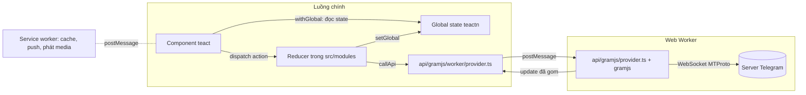

Trong series [Học từ mã nguồn các web lớn](/series/web), Telegram xuất hiện ở gần chục bài: cuộn xa vẫn nhanh, gọi Web Worker như hàm async, kéo vuốt chung chuột và cảm ứng, tin nhắn thoại… Lần nào đọc lại code cũng thấy thêm thứ mới. Đợt quét gần nhất, mở từng file trong `src/util`, `src/hooks`, `src/lib`, `src/components` và `src/modules`, tìm ra thêm khoảng 60 kỹ thuật đáng học. Nhiều quá để nhét vào một series chung, nên Telegram có series riêng, giống [series Facebook](/series/facebook).

Bài mở đầu này vẽ bức tranh tổng thể: Telegram Web A được ghép từ những mảnh nào, dữ liệu chạy qua đâu, và đọc repo theo thứ tự nào cho đỡ lạc.

> [!TIP]
> **Tóm tắt**
> - Telegram Web A là client web **mã nguồn mở** của Telegram ([Ajaxy/telegram-tt](https://github.com/Ajaxy/telegram-tt), giấy phép GPL-3.0). Bản trong repo [hunghg255/codebase](https://github.com/hunghg255/codebase) là code lấy từ trình duyệt (source map), còn mang tên cũ "Telegram WebZ".
> - Bốn mảnh chính: **teact** (React tự viết, khoảng 1.500 dòng), **teactn** (một global state duy nhất + reducer), **gramjs chạy trong Web Worker** (giao thức MTProto), và **service worker** (cache, push, phát media).
> - Hầu hết kỹ thuật hay nằm ở chỗ các mảnh này gặp nhau: cập nhật từ worker được gom theo nhịp animation, state được lưu lúc rảnh, UI vẽ trước khi server trả lời.
> - Series gồm 24 bài chia 4 phần: dữ liệu và đồng bộ, animation và giao diện, media/mobile/thông báo, soạn tin/media/chi tiết UI. Mỗi bài có code viết lại và demo chạy trong bài.

## Telegram Web A là gì?

Telegram có hai client web chính thức: **Web K** và **Web A** (trước đây gọi là Web Z, nên `config.ts` trong bản dump vẫn ghi `APP_NAME = 'Telegram WebZ'`). Mã nguồn Web A nằm trong repo `Ajaxy/telegram-tt`. Điểm đáng chú ý nhất: nó trông như một app React nhưng không dùng React thật.

Vì Web A là mã nguồn mở (GPL-3.0), bạn có thể đọc trực tiếp trên GitHub. Series này vẫn làm như với các site khác: đọc bản production trong repo `codebase` để thấy đúng thứ đang chạy, rồi **viết lại từ đầu** bằng React + TypeScript để giải thích ý tưởng. Code trong bài không phải code của Telegram; nếu muốn dùng code gốc của họ thì phải tuân theo GPL.

Bản dump có 784 file trong `src`: 288 file `.tsx`, 144 file `.scss`, phần còn lại là TypeScript và vài thư viện vendored.

## Bốn mảnh ghép



### 1. teact: React tự viết

`src/lib/teact` chỉ có 4 file, khoảng 1.500 dòng: `teact.ts` (component, hook), `teact-dom.ts` (render ra DOM thật, diff danh sách có key), `dom-events.ts` (event delegation, giống React), `teactn.tsx` (global state). API gần như React (`useState`, `useEffect`, `useCallback`, `memo`), nên đọc component không thấy lạ. Tự viết thì kiểm soát được từng chi tiết: ví dụ `teact-dom.ts` có một nhánh riêng cho danh sách rất dài (`teactFastList`) dùng một `DocumentFragment` và khoá thứ tự (`teactOrderKey`) để tránh di chuyển DOM thừa. [Bài #5](/blogs/telegram-teactn-store-fast-list) đi sâu vào phần này.

### 2. teactn: một global state, cập nhật theo frame

Toàn bộ dữ liệu (chat, tin nhắn, người dùng, cài đặt) nằm trong **một object** `GlobalState`. Reducer được đăng ký bằng `addReducer('tên', fn)` trong `src/modules/actions` (bản dump có 241 lần gọi `addReducer`). Component đọc state qua `withGlobal(mapStateToProps)`, giống `connect` của Redux.

Điểm khác Redux: `setGlobal` **không** báo cho component ngay mà gom lại và chạy một lần mỗi frame. Mười action trong cùng một frame chỉ gây một lượt render. Lúc khởi động, `global/index.ts` đọc state đã lưu từ lần trước (`loadCache`) để vẽ danh sách chat ngay trước khi kết nối xong; [bài #3](/blogs/telegram-persist-global-state) nói về cách lưu.

### 3. gramjs trong Web Worker

Telegram không dùng REST mà dùng giao thức MTProto qua WebSocket, có mã hoá và tuần tự hoá nhị phân riêng. Toàn bộ phần này (thư viện gramjs, `src/lib/gramjs`) chạy trong một **Web Worker**:

- Luồng chính gọi `callApi('sendMessage', …)` trong `api/gramjs/worker/provider.ts`. Hàm này gửi `postMessage` sang worker và trả về một Promise (cách làm giống [bài Worker RPC](/blogs/web-worker-promise-rpc) trong series web).
- Worker (`api/gramjs/provider.ts` và `api/gramjs/methods/*`) gọi server, chuyển kiểu dữ liệu MTProto thành kiểu gọn hơn (`api/gramjs/apiBuilders`), rồi trả về.
- Server đẩy update liên tục (tin mới, đang gõ, đã đọc…). Worker gom chúng lại rồi gửi về luồng chính theo lô, nhịp được chọn khớp với animation gửi tin ([bài #4](/blogs/telegram-realtime-update-batching)).

Nhờ vậy, mã hoá, giải mã và parse nhị phân không bao giờ chạy trên luồng vẽ UI.

### 4. Service worker

`src/serviceWorker` có ba việc: cache tài nguyên tĩnh (`assetCache.ts`), phát video/audio từng phần qua Range request (`progressive.ts`, xem [bài phát video qua service worker](/blogs/web-service-worker-range-streaming)), và Web Push (`pushNotification.ts`, [bài #14](/blogs/telegram-push-dedupe-read-receipts)).

## Đọc repo theo thứ tự nào?

1. **`src/index.tsx`** (40 dòng): thứ tự khởi động. Import `handleError`, `setupServiceWorker`, global state, rồi `dispatch.init()` và `TeactDOM.render(<App />)`. Có một chi tiết vui: double-click ở bất kỳ đâu sẽ in toàn bộ global state ra console.
2. **`src/global`**: `initial.ts` (hình dạng state ban đầu) và `cache.ts` (lưu/đọc state).
3. **`src/modules`**: `actions/api/*` (reducer gọi API), `actions/apiUpdaters/*` (reducer nhận update từ server), `reducers/*` (hàm thuần sửa state), `selectors/*` (đọc state).
4. **`src/api/gramjs`**: ranh giới với worker. `methods/messages.ts` là nơi đáng đọc nhất (gửi tin, upload, gửi lạc quan).
5. **`src/util`** và **`src/hooks`**: kho kỹ thuật nhỏ, mỗi file một việc. Đây là nơi phần lớn bài trong series bắt đầu.
6. **`src/components`**: chia theo vùng màn hình (`left` danh sách chat, `middle` cuộc trò chuyện, `right` thông tin, `mediaViewer`, `common`, `ui`). Đọc khi đã biết state và API chạy thế nào.

Mẹo khi đọc: grep tên action (ví dụ `'markMessageListRead'`) sẽ ra cả nơi `addReducer` lẫn nơi `dispatch`, nên lần theo một luồng từ click tới API rất nhanh. Bản dump là source map nên tên biến, comment và kiểu TypeScript còn nguyên.

## Series này có gì?

Danh sách đầy đủ ở cuối bài và ở [trang series](/series/telegram). Tóm tắt:

- **Phần 1, dữ liệu và đồng bộ**: gửi tin lạc quan khớp tin thật bằng `randomId`; lịch sử tin nhắn chia "hai đảo"; lưu global state lúc rảnh; gom update realtime; store tự viết và diff danh sách.
- **Phần 2, animation và giao diện**: sắp xếp danh sách chat bằng FLIP mà không đo DOM; ảnh bay giữa hai cây DOM trong media viewer; bố cục album theo hàm chi phí; giờ gửi nằm gọn trong bong bóng chat; composer biến hình và component `Transition`.
- **Phần 3, media, mobile, thông báo**: thumbnail 100 byte; player sticker; `--vh`, bàn phím ảo, nhấn giữ và số điện thoại; đánh dấu đã đọc và thông báo không trùng.
- **Phần 4, soạn tin, media, chi tiết UI**: rich text ⇄ entities, thanh định dạng nổi và nháp theo chat; ô nhập tự giãn, tin chỉ có emoji và gom tin theo ngày/người/album; bảng emoji/sticker chỉ render nhóm đang xem; `mediaLoader` gộp request, ảnh mờ sang nét; trình phát audio toàn cục; màn tải đua 700ms và ba mức animation; PanZoom bằng `matrix()`; ngày dính khi cuộn và khoá cuộn khi đổi tab; vùng thả file, nén ảnh, copy ảnh; tiêu đề nhấp nháy và favicon đếm tin mới.

Mỗi bài theo một khuôn: vấn đề, Telegram làm thế nào (kèm đường dẫn file), cơ chế bên dưới, code viết lại, edge case, test mẫu. Với mỗi bài, mình cố tìm cả **lỗi** trong code gốc: một codebase tốt vẫn có lỗi, và hiểu vì sao nó sai giúp hiểu kỹ thuật kỹ hơn.

### Telegram trong series web

Các bài này đã viết trước, nằm trong series chung vì so sánh nhiều site. Nên đọc kèm:

- [Cuộn xa vẫn nhanh với fastSmoothScroll](/blogs/web-telegram-fast-smooth-scroll)
- [Gọi Web Worker như một hàm async](/blogs/web-worker-promise-rpc)
- [Bầu một tab chủ cho thông báo](/blogs/web-leader-tab-notifications) (HubSpot và Telegram)
- [Autocomplete ngay tại con trỏ](/blogs/web-caret-autocomplete-contenteditable) (Ello và Telegram)
- [Kéo, vuốt chung cho chuột và cảm ứng](/blogs/web-unified-pointer-gestures)
- [Nội suy màu khi đổi theme, khi cuộn](/blogs/web-color-interpolation-theme-scroll) (Telegram và Anchor)
- [Phát video qua service worker](/blogs/web-service-worker-range-streaming) (Telegram và Outlook)
- [Lấy màu từ ảnh, chọn màu chữ](/blogs/web-colors-from-images)
- [Tin nhắn thoại, waveform và nén 5 bit](/blogs/web-voice-message-waveform)

## Chạy demo

Demo của series nằm chung app với series web: [`examples/web-patterns`](https://github.com/hunghg255/blog-hunghg/tree/master/examples/web-patterns). Route của các bài Telegram có tiền tố `tg-`.

```bash
cd examples/web-patterns
npm ci
npm run dev   # mở http://localhost:5173/#/tg-mobile
```

Hoặc mở thẳng trên [StackBlitz](https://stackblitz.com/github/hunghg255/blog-hunghg/tree/master/examples/web-patterns).

---

Bài này thuộc series **[Học từ mã nguồn Telegram](/series/telegram)** (25 bài, đọc theo thứ tự).

::: spoiler Xem nhanh danh sách bài trong series

*Mở đầu*

- **Mở đầu: bên trong Telegram Web A** (bài này)

*Phần 1: dữ liệu và đồng bộ*

- [#1 Gửi tin lạc quan, khớp tin thật bằng randomId](/blogs/telegram-optimistic-send)
- [#2 Lịch sử tin nhắn chia hai đảo](/blogs/telegram-message-history-islands)
- [#3 Lưu global state lúc rảnh, chỉ giữ phần cần](/blogs/telegram-persist-global-state)
- [#4 Gom update realtime theo nhịp animation](/blogs/telegram-realtime-update-batching)
- [#5 Store tự viết và diff danh sách có key](/blogs/telegram-teactn-store-fast-list)

*Phần 2: animation và giao diện*

- [#6 Animation sắp xếp danh sách chat không đo DOM](/blogs/telegram-chat-list-flip)
- [#7 Ảnh bay giữa hai cây DOM trong media viewer](/blogs/telegram-media-viewer-ghost)
- [#8 Bố cục album chọn theo hàm chi phí](/blogs/telegram-album-layout)
- [#9 Giờ gửi nằm gọn trong bong bóng chat](/blogs/telegram-bubble-meta-spacer)
- [#10 Composer biến hình, Transition và gạch chân tab](/blogs/telegram-composer-morph-transition)

*Phần 3: media, mobile, thông báo*

- [#11 Thumbnail 100 byte và viền sticker nén](/blogs/telegram-tiny-thumbnails)
- [#12 Player sticker: DPR, hạ fps, cache khung](/blogs/telegram-lottie-player)
- [#13 Mobile: --vh, bàn phím ảo, nhấn giữ, số điện thoại](/blogs/telegram-mobile-viewport-touch)
- [#14 Web Push không trùng và đánh dấu đã đọc](/blogs/telegram-push-dedupe-read-receipts)

*Phần 4: soạn tin, media, chi tiết UI*

- [#15 Rich text ⇄ entities, thanh định dạng nổi, nháp theo chat](/blogs/telegram-rich-text-entities)
- [#16 Ô nhập tự giãn, emoji phóng to, gom tin theo ngày/người/album](/blogs/telegram-auto-grow-input-grouping)
- [#17 Bảng emoji/sticker chỉ render nhóm đang xem](/blogs/telegram-emoji-picker-virtualization)
- [#18 mediaLoader gộp request, ảnh mờ sang nét, spinner không chớp](/blogs/telegram-media-loader-blur-buffering)
- [#19 Trình phát audio toàn cục và playlist](/blogs/telegram-global-audio-player)
- [#20 UiLoader chạy đua 700ms, ba mức animation](/blogs/telegram-ui-loader-animation-levels)
- [#21 PanZoom bằng matrix() trong media viewer](/blogs/telegram-panzoom-matrix)
- [#22 Ngày dính khi cuộn, khoá cuộn, dừng momentum iOS](/blogs/telegram-sticky-date-scroll-lock)
- [#23 Vùng thả file, nén ảnh trước khi gửi, copy ảnh](/blogs/telegram-drop-zone-compress-copy)
- [#24 Tiêu đề nhấp nháy và favicon đếm tin mới](/blogs/telegram-title-favicon-unread)

:::

Code + demo: [`examples/web-patterns`](https://github.com/hunghg255/blog-hunghg/tree/master/examples/web-patterns) · [Mở trên StackBlitz](https://stackblitz.com/github/hunghg255/blog-hunghg/tree/master/examples/web-patterns)
