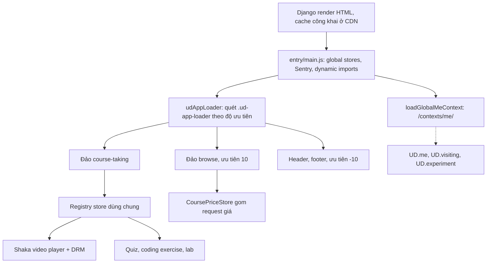

Udemy là một trong những nền tảng học online lớn nhất: hàng trăm nghìn khoá học, video có DRM, bài tập lập trình chạy ngay trong trình duyệt, bài thi có giờ, lab với máy ảo thật, và một bản dành cho doanh nghiệp (Udemy Business). Phía sau là một frontend lớn lên cùng một backend Django lâu năm: HTML do Django render, phần tương tác là các app React + MobX gắn vào trang.

Trong [series web](/series/web) đã có bảy bài lấy kỹ thuật từ Udemy. Series này đi sâu hơn: đọc từng file trong 87 module của app, chọn ra 20 kỹ thuật đáng học, viết lại bằng TypeScript và làm demo chạy ngay trong bài. Mỗi bài cũng chỉ ra chỗ bản gốc hở, vì đọc code production thì học được cả cách làm đúng lẫn những lỗi mà team lớn vẫn mắc.

> [!TIP]
> **Tóm tắt**
> - Stack: Django render HTML, các "đảo" React + MobX được nạp theo độ ưu tiên; design system tách thành gói `@udemy/*`; video dùng Shaka Player với DRM Widevine/PlayReady/FairPlay.
> - Mã nguồn đọc được nhờ source map: khoảng 3.300 file trong `webpack---/src/udemy/js`, 87 module, giữ nguyên tên file, comment và cả TODO.
> - 20 bài chia bốn phần: video và học bài, bài tập/thi/lab, editor và nội dung, hạ tầng và trải nghiệm.
> - Mọi code trong series được viết lại từ đầu, chỉ học ý tưởng; đoạn trích code gốc được giữ ngắn để phân tích.

## Bản dump có gì?

Repo [hunghg255/codebase](https://github.com/hunghg255/codebase/tree/main/udemy.com) lưu lại những gì DevTools thấy khi mở udemy.com: script, style, và (quan trọng nhất) source map. Webpack sinh source map kèm nội dung file gốc, nên tab Sources hiện lại cây thư mục gần như nguyên vẹn.

| Thư mục | Nội dung |
|---|---|
| `webpack---/src/udemy/js/<module>/` | Code app: 87 module (`course-taking`, `shaka-video-player`, `cart`, `instructor`, `labs`…), khoảng 3.300 file, trong đó hơn 600 file TypeScript |
| `webpack---/src/*` khác | Gói dùng chung được build cùng: `course-price-store`, `observers` (web vitals tự viết), `tracker`, `price-text`, `course-card`… |
| `nab.udemy.com`, `s.udemycdn.com` | Script và tài nguyên tĩnh của trang |
| `hls-c`, `dash-enc-c`, `mp4-c`, `vtt-c.udemycdn.com` | Phân đoạn video HLS/DASH, MP4, phụ đề WebVTT |
| Các domain bên thứ ba | Optimizely (thử nghiệm A/B), OneTrust (đồng ý cookie), Pendo, Intercom, Braze, Datadog (log trình duyệt), Sentry, Mux Data (`litix.io`, đo chất lượng video), Filestack, Credly |

Những gói `@udemy/*` (design system, icons, i18n, event tracking, autosuggest…) chỉ có phần đã build hoặc không có trong dump; khi một bài dựa vào hành vi của gói đó, bài sẽ nói rõ là suy luận.

## Stack nhìn từ code



- **React + MobX.** Gần 950 file import `mobx-react`. Store là class có `@observable`, `@computed`, `@action`, đặt tên `*.mobx-store.js/ts`; component là `*.react-component.tsx`. Quy ước tên file chặt chẽ này làm việc đọc repo dễ hơn hẳn.
- **Design system tách gói.** `@udemy/icons` được import ở hơn 600 file, `@udemy/react-core-components` hơn 500 file. Component dùng chung nằm ở `base-components/`, một phần đánh dấu `ungraduated` (chưa đủ chín để chuyển vào design system).
- **Django vẫn là chủ trang.** HTML do Django render, React chỉ chiếm các đảo. Nhiều comment nhắc tới Django, có chỗ chép thẳng từ Django (regex kiểm URL trong rich-text editor ghi "Copied from django.core.validators:URLValidator").
- **Hai thế hệ video player.** `video-player/` (video.js) và `shaka-video-player/` (Shaka Player, DRM đa hệ) cùng tồn tại; Shaka dùng cho nội dung có bảo vệ.
- **Editor**: ProseMirror cho rich text (có NodeView React cho công thức toán MathJax và ảnh), Ace cho code.

## Cách đọc repo này

1. **Bắt đầu từ tên file.** `*.mobx-store.*` là logic, `*.react-component.*` là giao diện, `utils/` là hàm thuần. Muốn hiểu một tính năng, đọc store trước.
2. **Grep theo hằng số và API trình duyệt.** `requestMediaKeySystemAccess` dẫn thẳng tới DRM, `sendBeacon` tới pipeline tracking, `setTimeout(..., 250)` tới batch loader giá.
3. **Đọc comment và TODO.** Udemy để lại nhiều comment giải thích *vì sao*: tại sao không dùng ES6 Proxy, tại sao không dùng interact.js, tại sao header không nằm trong `main.js`. Đó là phần đáng học nhất.
4. **Theo dấu từ nơi gọi.** Một util chỉ có ý nghĩa khi biết ai dùng nó: `grep -rn "create-ud-proxy"` cho thấy `udMe`, `udVisiting` và tham số tracking theo người dùng đều qua cùng một cơ chế.
5. **Tách code nhà khỏi thư viện.** Thư mục `shaka-video-player/` là lớp tích hợp do Udemy viết; Shaka Player bản thân là thư viện của Google. Series chỉ lấy phần Udemy tự viết.

## Series này có gì?

**Phần 1: video và học bài** (#1–#6). Thương lượng DRM với ba hệ, URL ký và license hết hạn, ghi tiến độ xem theo bucket, thumbnail sprite từ WebVTT, phụ đề tự chọn ngôn ngữ và editor phụ đề, các mẹo autoplay và đo băng thông.

**Phần 2: bài tập, bài thi, lab** (#7–#10). Chạy code HTML/React của học viên trong iframe cách ly, bài thi có giờ với tạm dừng khi rảnh và autosave, chấm code realtime, mở lab mà không bị chặn popup.

**Phần 3: editor và nội dung** (#11–#14). Tích hợp ProseMirror, parse HTML an toàn bằng document tách rời, sinh file lịch `.ics` có múi giờ, đọc Open Badges giấu trong ảnh.

**Phần 4: hạ tầng và trải nghiệm** (#15–#20). Pipeline tracking với `sendBeacon` và HTTP 207, gợi ý tính năng mới qua nhiều phiên, kéo mép để resize, gom request giá, trả lời tin nhắn lạc quan, nạp đảo app theo ưu tiên.

Danh sách đầy đủ ở cuối bài.

## Các bài về Udemy trong series web

- [Proof-of-work trên client để chặn API ẩn danh](/blogs/web-client-proof-of-work)
- [Tự đo LCP, CLS, TBT và chọn bản nhẹ cho máy yếu](/blogs/web-rum-adaptive-loading)
- [menuAim: rê chéo vào submenu không bị đóng](/blogs/web-menu-aim-triangle)
- [Ô tìm kiếm chuẩn production](/blogs/web-production-search-box)
- [Xử lý giờ mùa hè không cần thư viện](/blogs/web-dst-without-library)
- [Kiểm tra WebVTT và bôi chọn transcript](/blogs/web-webvtt-transcript-selection)
- [Cache client theo version](/blogs/web-client-cache-versioned)

Hai series đi sâu khác: [Học từ mã nguồn Facebook](/series/facebook) và [Học từ mã nguồn Telegram](/series/telegram).

## Chạy demo

Demo của series nằm trong [`examples/web-patterns`](https://github.com/hunghg255/blog-hunghg/tree/master/examples/web-patterns) (Vite + React + TypeScript), route bắt đầu bằng `ud-`:

```bash
git clone https://github.com/hunghg255/blog-hunghg
cd blog-hunghg/examples/web-patterns
npm ci
npm run dev        # mở http://localhost:5173/#/ud-resizer
```

Những phần cần server thật (license DRM, Pusher, S3, API giá) được giả lập trong demo; mỗi bài ghi rõ phần nào là giả lập.

## Về chuyện học từ code của người khác

Code trong dump là tài sản của Udemy. Series chỉ trích những đoạn ngắn để phân tích và viết lại mọi thứ từ đầu; đừng chép code gốc vào dự án. Những lỗi được nêu ra là để học, không phải để chê: phần lớn chỉ lộ ra trong tình huống hiếm, và team nào cũng có.

---

Bài này thuộc series **[Học từ mã nguồn Udemy](/series/udemy)** (21 bài, đọc theo thứ tự).

::: spoiler Xem nhanh danh sách bài trong series

*Mở đầu*

- **Mở đầu: bên trong frontend của Udemy** (bài này)

*Phần 1: video và học bài*

- [#1 DRM đa hệ: Widevine, PlayReady, FairPlay](/blogs/udemy-drm-multi-key-system)
- [#2 URL ký và license hết hạn: tự làm mới, tải trước bài kế](/blogs/udemy-expiring-media-urls)
- [#3 Ghi tiến độ xem theo bucket, tự hoàn thành, backoff lỗi](/blogs/udemy-watch-progress-buckets)
- [#4 Thumbnail sprite từ WebVTT và slide trên seekbar](/blogs/udemy-sprite-thumbnails-vtt)
- [#5 Phụ đề: tự chọn ngôn ngữ và editor có phím tắt](/blogs/udemy-captions-auto-select-editor)
- [#6 Đo băng thông, autoplay Safari, iPad giả làm Mac](/blogs/udemy-video-quirks-autoplay)

*Phần 2: bài tập, bài thi, lab*

- [#7 Preview code HTML/React trong iframe sandbox](/blogs/udemy-code-preview-sandbox)
- [#8 Bài thi có giờ: tạm dừng khi rảnh, autosave theo dấu vân tay](/blogs/udemy-timed-exam)
- [#9 Chấm code realtime: đăng ký kênh trước, có đường dự phòng](/blogs/udemy-realtime-grading)
- [#10 Mở lab không bị chặn popup, heartbeat, xung đột phiên](/blogs/udemy-lab-launcher)

*Phần 3: editor và nội dung*

- [#11 ProseMirror: schema theo flag, NodeView React, HTML cho email](/blogs/udemy-prosemirror-integration)
- [#12 Parse HTML an toàn bằng document tách rời](/blogs/udemy-safe-html-parse)
- [#13 Sinh file .ics có VTIMEZONE tự dò giờ mùa hè](/blogs/udemy-ics-vtimezone)
- [#14 Đọc Open Badges giấu trong ảnh PNG và SVG](/blogs/udemy-open-badges-image)

*Phần 4: hạ tầng và trải nghiệm*

- [#15 Pipeline tracking: batch, sendBeacon, bfcache, HTTP 207](/blogs/udemy-event-tracking-pipeline)
- [#16 Gợi ý tính năng mới qua nhiều phiên bằng máy trạng thái](/blogs/udemy-feature-discoverability)
- [#17 Kéo cạnh để resize và mép cuộn mờ dần](/blogs/udemy-resizer-gradient-scroll)
- [#18 Gom request giá khoá học, cập nhật một phần khi áp coupon](/blogs/udemy-price-dataloader-partial-update)
- [#19 Trả lời lạc quan có rollback, autocomplete hai tầng cache](/blogs/udemy-optimistic-reply-autocomplete)
- [#20 Nạp app theo ưu tiên, registry store, HTML cache công khai](/blogs/udemy-app-loader-registry)

:::

Code + demo: [`examples/web-patterns`](https://github.com/hunghg255/blog-hunghg/tree/master/examples/web-patterns) · [Mở trên StackBlitz](https://stackblitz.com/github/hunghg255/blog-hunghg/tree/master/examples/web-patterns)
