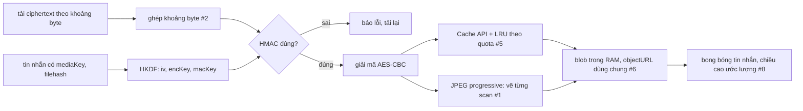

Hai series trước đọc mã nguồn [Facebook](/series/facebook) và [Telegram Web A](/series/telegram). Telegram là mã nguồn mở, có tên file, có TypeScript. Facebook là bundle production nhưng còn giữ tên module (`ContextualLayerAutoFlip`, `QuickPerformanceLogger`…). WhatsApp Web khó hơn cả hai: một file JavaScript 2,8 MB, **không một tên module nào**, chỉ có những chuỗi như `dhgjbgdbhg`, `igjghefdb`, `bjgiedaj`.

Vậy mà bên trong có những thứ rất đáng học: giải mã ảnh JPEG theo từng lớp trong lúc còn đang tải, kho media tự co lại khi trình duyệt sắp hết dung lượng, ước lượng chiều cao tin nhắn mà không cần DOM, phát hiện link giả mạo bằng chữ Kirin… Series này gồm 18 bài, mỗi bài đọc vài module, chỉ ra cách chúng làm (và chỗ chúng sai), rồi viết lại bằng TypeScript kèm demo chạy ngay trong bài.

Bài mở đầu nói về chính cái bundle: nó là gì, đọc thế nào khi không có tên, và các mảnh ghép lại ra sao.

> [!TIP]
> **Tóm tắt**
> - File `0 Whatapp list/all.js` trong repo [hunghg255/facebook-codebase](https://github.com/hunghg255/facebook-codebase) là **một chunk webpack** (chunk số 6) của WhatsApp Web năm 2020: 1.235 module, 85 nghìn dòng sau khi định dạng lại. Bản hiện tại của WhatsApp chắc chắn đã khác nhiều.
> - Module không có tên, chỉ có mã gồm các chữ `a`–`j`. Đọc bằng cách bắt đầu từ một chuỗi dễ tìm (thông báo lỗi, log), rồi lần theo các lời gọi `a("…")` (require) ra hai phía; tên tự đặt dựa vào tên export, chuỗi log và cách dùng.
> - Stack: component React dạng class, model và collection kiểu Backbone, thư viện Promise có huỷ (giống Bluebird), CSS Modules, Web Worker, service worker, Cache API và IndexedDB cho media, WebCrypto cho giải mã.
> - Series chia 5 phần: media và mã hoá, lưu trữ trên trình duyệt, danh sách tin nhắn, soạn tin và chữ, realtime và tiện ích.

## Bundle này là gì?

Repo `facebook-codebase` là bộ sưu tập mã nguồn production của nhiều sản phẩm Meta lấy từ trình duyệt. Thư mục `0 Whatapp list` (tên thư mục giữ nguyên như trong repo) có ba thứ: `all.js`, `icons.js` (chunk 134, một bảng tên icon → chuỗi SVG) và vài file `.svg` lẻ.

Dòng đầu của `all.js`:

```js
/*! Copyright (c) 2020 WhatsApp Inc. All Rights Reserved. */
(window.webpackJsonp = window.webpackJsonp || []).push([
  [6], {
    baabifghjg: function(e, t, a) { "use strict"; var i = a("cfjecfhbfg"), … },
```

Đây là định dạng **chunk JSONP** của webpack 4: mỗi chunk tự đẩy mình vào mảng toàn cục `webpackJsonp`, runtime webpack (nằm ở file khác) lấy ra và đăng ký các module. `[6]` là số hiệu chunk. Mỗi module là một hàm `(module, exports, require)`, đã bị đổi tên thành `(e, t, a)`.

Vì chỉ là **một** chunk, nhiều phần lõi không có ở đây: lớp gốc của Model/Collection, các hàm mã hoá thật (`aesCbcDecrypt`), một số hằng số như `IDLE_TIMEOUT`, `PRESENCE_COMPOSING_TIMEOUT`. Gặp những chỗ đó, các bài trong series sẽ nói rõ "không có trong bundle" và chỉ suy luận ở mức "có lẽ".

Năm 2020 cũng có nghĩa là: chưa có tính năng nhiều thiết bị (multi-device ra mắt năm 2021, WhatsApp Web không còn cần điện thoại online), chưa có kênh (channels), nhiều API trình duyệt dùng trong các bài viết lại (Long Animation Frames, Document Picture-in-Picture) khi đó chưa tồn tại.

## Đọc module không có tên

Tên module như `dhgjbgdbhg` chỉ gồm 8–10 chữ cái từ `a` tới `j`. Có lẽ đó là mã số module được viết bằng chữ thay cho chữ số (`a` = 0 … `j` = 9), để tên ngắn mà không lộ đường dẫn file. Dù là gì, nó không cho biết module làm gì. Cách đọc được dùng suốt series:

1. **Bắt đầu từ chuỗi.** Thông báo lỗi và log là thứ không bị rút gọn. Tìm `"macAndDecrypt HMAC mismatch"` dẫn thẳng tới module `dhgjbgdbhg`; tìm `"Low FPS Tracker"` dẫn tới chỗ đăng ký đo FPS trong `chgfegiddc`. Bundle có hơn 700 lời gọi `__LOG__(mức)` kèm template string, rất hữu ích.
2. **Đọc tên export.** Minifier đổi tên biến cục bộ nhưng giữ tên thuộc tính: `t.macAndDecrypt = function…`, `t.validatePrice = …`, `t.MIN_ASPECT_RATIO = 145 / 330`. Đây là tên gần nhất với tên gốc.
3. **Lần theo require.** `var o = a("bjegcccgec")` cho biết module này dùng module kia. Từ module đã hiểu, đi xuống những gì nó require (hàm tiện ích) và đi lên những module require nó (nơi dùng). Mỗi bài trong series liệt kê các module theo đúng chuỗi đó.
4. **Đặt tên tạm.** Đọc xong thì ghi lại vai trò: "`igjghefdb`: model Presence", "`dffjiffehg`: component cửa sổ nổi". Các bài luôn ghi cả mã băm lẫn vai trò để bạn tìm lại được trong file.
5. **Chạy lại để kiểm chứng.** Hàm thuần (tính toán, phân tích chuỗi) có thể chép ra chạy bằng Node. Vài bug trong series (giá tiền ở locale Tây Ban Nha, `NaN` do thứ tự toán tử) được xác nhận đúng cách này.

Những thứ **không** giúp được: tên class CSS đã bị băm (`_1cbKf`), chuỗi giao diện được thay bằng số (`f.default.t(769)` tra bảng dịch ở file khác), tên component React thường bị mất.

## Stack

- **React, component dạng class.** Khoảng 130 class kế thừa `Component` và hơn 2.800 lời gọi `createElement`. Năm 2020 hook đã có, nhưng phần lớn code WhatsApp vẫn là class với `setState`, `componentDidMount`.
- **Model và collection kiểu Backbone.** `defineModel` với các trường `prop()` (lưu), `session()` (chỉ trong phiên), `collection()` và `derived()`; collection có `find`, `get`, sự kiện `change:tên_trường`. Model `Presence` trong [bài #15](/blogs/whatsapp-presence-typing-notifications) là một ví dụ.
- **Promise có huỷ.** `Promise.loop`, `Promise.delay`, `.catchType(LoạiLỗi, …)`, `.checkpoint()`, `addCancelControl()`: một thư viện Promise riêng (giống Bluebird), cho phép huỷ một chuỗi bất đồng bộ khi component unmount.
- **CSS Modules.** Mỗi component import một object tên class đã băm.
- **Web Worker** (4 file `.worker.js` được tạo bằng `new Worker(a.p + "….worker.js")`) và **service worker** (phát video theo từng khoảng byte, tải trước bundle).
- **Lưu trữ**: Cache API (`caches.open`) cho blob media, IndexedDB (`lru-media-storage-idb`) cho metadata hoặc làm phương án dự phòng, cộng một cache blob trong RAM.
- **Mã hoá**: media được mã hoá AES-CBC, khoá suy ra bằng HKDF từ `mediaKey` với nhãn như `"WhatsApp Image Keys"`, toàn vẹn kiểm bằng HMAC; padding PKCS7 kiểu WebCrypto. Series chỉ nói tới mức xử lý media như code cho thấy; demo tự sinh khoá và dữ liệu giả.

## Một tấm ảnh đi qua những đâu

Luồng media nối nhiều bài trong series lại với nhau. Một ảnh JPEG trong tin nhắn:



- Tải: file lớn (video) được tải bằng nhiều request `Range` và ghép lại ([#2](/blogs/whatsapp-byte-range-merge)); service worker phát video từ các khoảng đã có, giống cách [phát video qua service worker](/blogs/web-service-worker-range-streaming) của Telegram và Outlook.
- Kiểm và giải mã: `macAndDecrypt` so HMAC trước, đúng mới giải mã ([#1](/blogs/whatsapp-progressive-jpeg-hmac)). Ảnh progressive còn được kiểm và vẽ **từng scan** trong lúc tải.
- Lưu: Cache API, có LRU tự co khi `navigator.storage.estimate()` báo sắp đầy ([#5](/blogs/whatsapp-quota-aware-media-lru)); blob đang hiển thị được ghim trong RAM theo số lần dùng ([#6](/blogs/whatsapp-blob-cache-refcount)). Facebook giải bài toán quota tương tự trong [bài về lưu trữ theo quota](/blogs/facebook-quota-aware-storage).
- Hiển thị: danh sách tin nhắn chỉ render một cửa sổ quanh tin đang xem, chiều cao mỗi tin được ước lượng trước khi ảnh tải xong ([#8](/blogs/whatsapp-render-cursor-window)). Telegram làm phần ảnh mờ sang nét bằng thumbnail 100 byte ([bài Telegram #11](/blogs/telegram-tiny-thumbnails)).

## Series này có gì?

- **Phần 1, media và mã hoá**: giải mã JPEG progressive theo từng scan kèm HMAC; ghép khoảng byte cho video; xoá EXIF không cần mã hoá lại và tạo thumbnail theo ngân sách byte; đọc metadata sticker WebP động.
- **Phần 2, lưu trữ trên trình duyệt**: kho media LRU tự co theo quota; cache blob trong RAM có đếm tham chiếu và tự thu hồi objectURL; khoá IndexedDB giữ đúng thứ tự.
- **Phần 3, danh sách tin nhắn**: render theo cửa sổ chiều cao ước lượng; theo dõi tin nào đang trong viewport bằng tìm kiếm nhị phân, ngày dính; FlatList tái dùng key React.
- **Phần 4, soạn tin và chữ**: biến emoticon thành emoji bằng trie đọc ngược, tìm emoji; mention bằng token zero-width; xác định hướng chữ bằng bảng nén; phát hiện homograph trong link và chặn giả đuôi file bằng ký tự RTLO.
- **Phần 5, realtime và tiện ích**: presence, "đang gõ" và thông báo nhóm; đo FPS phát hiện UI đóng băng, idle monitor; cửa sổ video nổi; đọc giá tiền theo locale.

Mỗi bài theo cùng một khuôn: vấn đề, WhatsApp làm thế nào (mã module + vai trò), cơ chế trình duyệt bên dưới, code viết lại, edge case, test mẫu. Code trong bài **viết lại từ đầu**, không chép mã của WhatsApp. Khi code gốc có lỗi, bài nêu rõ lỗi, cách kiểm chứng và cách sửa.

## Chạy demo

Demo của series nằm chung app với các series khác: [`examples/web-patterns`](https://github.com/hunghg255/blog-hunghg/tree/master/examples/web-patterns). Route của các bài WhatsApp có tiền tố `wa-`.

```bash
cd examples/web-patterns
npm ci
npm run dev   # mở http://localhost:5173/#/wa-price
```

Hoặc mở thẳng trên [StackBlitz](https://stackblitz.com/github/hunghg255/blog-hunghg/tree/master/examples/web-patterns).

---

Bài này thuộc series **[Học từ mã nguồn WhatsApp Web](/series/whatsapp)** (19 bài, đọc theo thứ tự).

::: spoiler Xem nhanh danh sách bài trong series

*Mở đầu*

- **Mở đầu: đọc bundle WhatsApp Web 2020** (bài này)

*Phần 1: media và mã hoá*

- [#1 Giải mã JPEG progressive theo từng scan, kiểm HMAC](/blogs/whatsapp-progressive-jpeg-hmac)
- [#2 Ghép khoảng byte cho video streaming](/blogs/whatsapp-byte-range-merge)
- [#3 Xoá EXIF không re-encode, thumbnail theo ngân sách byte](/blogs/whatsapp-jpeg-strip-thumb-budget)
- [#4 Đọc metadata sticker WebP động](/blogs/whatsapp-webp-sticker-metadata)

*Phần 2: lưu trữ trên trình duyệt*

- [#5 Kho media LRU tự co theo quota](/blogs/whatsapp-quota-aware-media-lru)
- [#6 Cache blob trong RAM có refcount, tự revoke objectURL](/blogs/whatsapp-blob-cache-refcount)
- [#7 Khoá IndexedDB giữ đúng thứ tự từ điển](/blogs/whatsapp-indexeddb-ordered-keys)

*Phần 3: danh sách tin nhắn*

- [#8 Render tin nhắn theo cửa sổ chiều cao ước lượng](/blogs/whatsapp-render-cursor-window)
- [#9 Theo dõi viewport tin nhắn: binary search, ngày dính](/blogs/whatsapp-message-viewport-tracking)
- [#10 FlatList tái dùng key React, overscan bất đối xứng](/blogs/whatsapp-flatlist-key-reuse)

*Phần 4: soạn tin và chữ*

- [#11 Emoticon thành emoji bằng trie đọc ngược, tìm emoji](/blogs/whatsapp-emoticon-trie-emoji-search)
- [#12 Mention bằng token zero-width, giới hạn theo code point](/blogs/whatsapp-mention-zero-width-input)
- [#13 Xác định hướng chữ bằng bảng delta nén](/blogs/whatsapp-text-direction-table)
- [#14 Phát hiện homograph trong link, chặn giả đuôi file RTLO](/blogs/whatsapp-homograph-rtlo-guard)

*Phần 5: realtime và tiện ích*

- [#15 Presence, "đang gõ" và thông báo theo kích thước group](/blogs/whatsapp-presence-typing-notifications)
- [#16 Đo FPS phát hiện UI đóng băng, idle monitor](/blogs/whatsapp-fps-freeze-idle)
- [#17 Cửa sổ PiP: resize 8 hướng, khoá tỉ lệ, né vật cản](/blogs/whatsapp-pip-resize-avoid)
- [#18 Parse giá tiền theo locale bằng Intl](/blogs/whatsapp-locale-price-parse)

:::

Code + demo: [`examples/web-patterns`](https://github.com/hunghg255/blog-hunghg/tree/master/examples/web-patterns) · [Mở trên StackBlitz](https://stackblitz.com/github/hunghg255/blog-hunghg/tree/master/examples/web-patterns)
