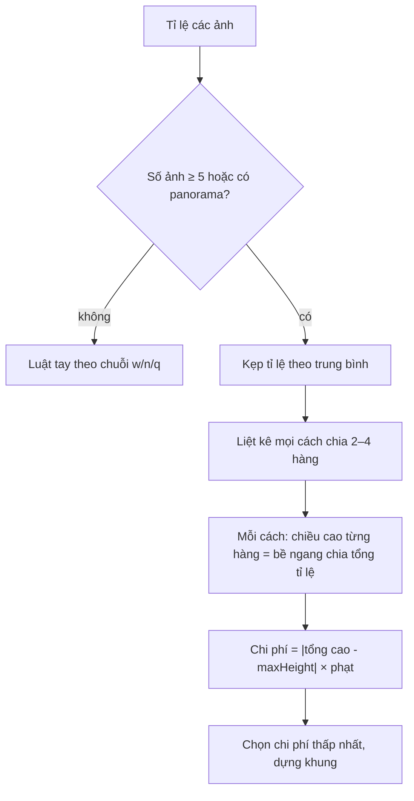

Gửi một lúc nhiều ảnh trong Telegram, chúng hiện thành một khối gọn gàng: ảnh ngang to ở trên, hai ảnh dọc nhỏ ở dưới, mép ngoài thẳng hàng, khe giữa các ảnh đều 2px. Không ảnh nào bị bỏ (khác Facebook hay hiện "+3"), và khối luôn vừa bề ngang của bong bóng chat.

Thuật toán nằm trong một file 591 dòng của Telegram Web A, port từ Telegram Desktop (C++) và Telegram macOS (Swift). Nó đáng đọc vì cách tiếp cận khác hẳn thuật toán collage của Facebook ở [bài #17 series Facebook](/blogs/facebook-photo-collage-layout): Facebook chọn từ một **danh sách bố cục có sẵn** và chấm điểm theo phần ảnh bị cắt; Telegram **sinh mọi cách chia hàng** rồi chọn cách có chiều cao gần mục tiêu nhất.

> [!TIP]
> **Tóm tắt**
> - Mỗi ảnh được gán một chữ theo tỉ lệ: `w` (ngang, > 1.2), `n` (dọc, < 0.8), `q` (gần vuông). Album 2–4 ảnh dùng **luật viết tay** theo chuỗi chữ này (vd. `ww` thì xếp trên-dưới).
> - Từ 5 ảnh: thử **mọi cách chia 2, 3, 4 hàng** (mỗi hàng tối đa 3 ảnh). Chiều cao mỗi hàng tính để các ảnh giữ tỉ lệ và vừa khít bề ngang.
> - Chọn cách có tổng chiều cao gần `maxHeight` nhất; **phạt ×1.5** nếu có hàng thấp hơn 100px hoặc hàng trên nhiều ảnh hơn hàng dưới.
> - Ảnh cuối mỗi hàng lấy phần bề ngang còn dư để mép phải luôn thẳng. Một bitmask 4 cạnh cho biết ảnh nào nằm ở góc để bo tròn.

<iframe class="demo-frame" src="/demos/web-patterns/index.html?theme=dark#/tg-album" title="Demo tg-album" loading="lazy" style="height: 1100px"></iframe>

<p class="demo-links">▶ <a href="/demos/web-patterns/index.html#/tg-album" target="_blank" rel="noopener">Mở demo toàn màn hình ↗</a> · <a href="https://stackblitz.com/github/hunghg255/blog-hunghg/tree/master/examples/web-patterns?file=src/lib/tgAlbumLayout.ts" target="_blank" rel="noopener">Sửa code trên StackBlitz ↗</a> · <a href="https://github.com/hunghg255/blog-hunghg/blob/master/examples/web-patterns/src/lib/tgAlbumLayout.ts" target="_blank" rel="noopener">Xem source trên GitHub ↗</a></p>

Chọn "10 ảnh" để thấy bảng các phương án: mỗi dòng là một cách chia hàng, cột "Chi phí" là độ lệch so với chiều cao mục tiêu sau khi nhân hệ số phạt. Dòng xanh là phương án được chọn. Kéo thanh "Bề ngang tối đa" để thấy phương án thắng thay đổi.

## Telegram làm thế nào?

File: [`components/middle/message/helpers/calculateAlbumLayout.ts`](https://github.com/hunghg255/codebase/blob/main/web.telegram.org/src/components/middle/message/helpers/calculateAlbumLayout.ts). Dòng đầu ghi rõ nguồn: `grouped_layout.cpp` của Telegram Desktop và `GroupedLayout.swift` của Telegram macOS.

### Bước 1: dáng của từng ảnh

```ts
function getProportions(ratios: number[]) {
  return ratios.map((ratio) => (ratio > 1.2 ? 'w' : (ratio < 0.8 ? 'n' : 'q'))).join('');
}
```

Ba ảnh ngang, dọc, vuông thành chuỗi `"wnq"`. Chuỗi này quyết định luật tay cho album nhỏ.

### Bước 2: luật tay cho 2–4 ảnh

```ts
if (albumCount >= 5 || forceCalc) {
  layout = layoutWithComplexLayouter(params);
} else if (albumCount === 2) {
  layout = layoutTwo(params);
} else if (albumCount === 3) {
  layout = layoutThree(params);
} else {
  layout = layoutFour(params);
}
```

`forceCalc` bật khi có ảnh tỉ lệ lớn hơn 2 (panorama): luật tay không xử lý tốt nên chuyển sang vét cạn. Mỗi hàm luật tay là vài phép tính:

- **2 ảnh**: `ww` có trung bình > 1.4 và hai ảnh gần giống nhau thì xếp **trên-dưới**; `ww` hoặc `qq` thì chia đôi **trái-phải**; còn lại (khác dáng) thì chia bề ngang theo tỉ lệ để cùng chiều cao, nhưng mỗi ảnh tối thiểu 40% bề ngang.
- **3 ảnh**: ảnh đầu dọc (`n…`) thì chiếm **cột trái** cao hết, hai ảnh kia xếp chồng bên phải; còn lại thì ảnh đầu chiếm **hàng trên** (tối đa 66% chiều cao), hai ảnh dưới chia đôi.
- **4 ảnh**: ảnh đầu ngang (`w…`) thì nằm trên, ba ảnh dưới chia theo tỉ lệ; còn lại thì ảnh đầu ở cột trái, ba ảnh xếp dọc bên phải.

Ảnh đầu tiên luôn là ảnh "chính", luôn được chỗ to nhất. Thứ tự ảnh không bao giờ bị đổi.

### Bước 3: vét cạn cho 5+ ảnh

```ts
const multiHeight = (offset: number, attemptCount: number) => {
  const attemptRatios = ratios.slice(offset, offset + attemptCount);
  const sum = accumulate(attemptRatios, 0);

  return (maxWidth - (attemptCount - 1) * spacing) / sum;
};
```

Đây là công thức của **justified layout**: một hàng `n` ảnh, ảnh thứ `i` có tỉ lệ `rᵢ`. Nếu cả hàng cao `h`, ảnh `i` rộng `h·rᵢ`. Muốn tổng bề ngang (kể cả khe) bằng `maxWidth` thì `h = (maxWidth − (n−1)·spacing) / Σrᵢ`.

Code thử mọi cách chia: 2 hàng (`[1, n−1]`, `[2, n−2]`…), 3 hàng, 4 hàng, với giới hạn mỗi hàng tối đa 3 ảnh (hàng giữa được 4 nếu album toàn ảnh dọc, hàng cuối được 4 khi chia 4 hàng). Rồi chấm điểm:

```ts
const totalHeight = accumulate(heights, 0) + spacing * (lineCount - 1);
const minLineHeight = Math.min(...heights);
const bad1 = minLineHeight < minWidth ? 1.5 : 1;
const bad2 = (() => {
  for (let line = 1; line !== lineCount; ++line) {
    if (lineCounts[line - 1] > lineCounts[line]) {
      return 1.5;
    }
  }

  return 1;
})();
const diff = Math.abs(totalHeight - maxHeight) * bad1 * bad2;
```

Chi phí là độ lệch giữa tổng chiều cao và `maxHeight` (Telegram Web A đặt `maxHeight = maxWidth`, tức nhắm tới một khối gần vuông). Hai hệ số phạt:

- `bad1`: có hàng thấp hơn `minWidth = 100px` thì ảnh trong hàng đó quá nhỏ để nhìn.
- `bad2`: hàng trên đông hơn hàng dưới (vd. 3 rồi 2). Bố cục "trên ít, dưới nhiều" nhìn vững hơn, giống ảnh to ở trên, ảnh nhỏ ở dưới.

Trước khi tính, tỉ lệ ảnh được **kẹp lại**: album nghiêng về ngang (trung bình > 1.1) thì mọi ảnh bị kẹp vào `[1, 2.75]` (ảnh dọc bị crop thành vuông); album nghiêng về dọc thì kẹp vào `[0.6667, 1]` (ảnh ngang bị crop thành vuông). Một hàng có ảnh siêu ngang lẫn ảnh siêu dọc sẽ có chiều cao vô lý, nên chấp nhận crop một chút để cả khối đẹp.

### Bước 4: dựng khung và bitmask góc

```ts
const width = col === colCount - 1 ? maxWidth - x : Math.round(ratio * lineHeight);
```

Mỗi ảnh được làm tròn bề ngang, nên cộng dồn có thể lệch 1–2px. Ảnh cuối hàng lấy hết phần còn lại: mép phải luôn thẳng. Mỗi ảnh còn có `sides`, một bitmask `Top | Right | Bottom | Left` cho biết nó chạm mép nào của khối; ảnh chạm cả `Top` và `Left` thì bo góc trên trái theo bong bóng chat.

### Một điểm lạ: trung bình lệch +1/n

```ts
function getAverageRatio(ratios: number[]) {
  return ratios.reduce((result, ratio) => ratio + result, 1) / ratios.length;
}
```

`reduce` khởi tạo bằng `1` thay vì `0`, nên "trung bình" thực ra là `(Σr + 1) / n`. Với 5 ảnh, giá trị lệch thêm 0.2. Mình không đối chiếu được với bản C++ gốc nên không biết đây là lỗi port hay chủ ý, nhưng nó **đổi kết quả**: bộ 5 ảnh `[1.5, 0.75, 1, 1.33, 0.8]` có trung bình thật 1.076 (< 1.1, nghiêng dọc, ảnh ngang bị crop thành vuông, khối 360×334), còn với công thức của Telegram là 1.276 (> 1.1, nghiêng ngang, hai ảnh dọc bị crop thành vuông, khối 360×252). Demo có ô "Trung bình kiểu bản gốc" để so sánh.

## Bên trong thuật toán: vì sao vét cạn được



Số cách chia rất nhỏ. Với 10 ảnh (tối đa của Telegram), giới hạn "mỗi hàng ≤ 3 ảnh" loại gần hết: chỉ còn 17 phương án (demo có bảng). Mỗi phương án là vài phép cộng và chia. Tổng chi phí tính toán không đáng kể, nên không cần thuật toán tối ưu nào thông minh hơn.

## Viết lại

Phần liệt kê cách chia hàng tách thành hàm riêng `enumerateLineCounts` (để test và để demo hiện bảng). Phần chấm điểm trả về cả danh sách phương án:

```ts title=src/lib/tgAlbumLayout.ts
function layoutComplex({ ratios: original, averageRatio, maxWidth, minWidth, spacing, maxHeight }: Params) {
  // ép tỉ lệ về khoảng hợp lý để một ảnh siêu ngang không làm hàng của nó mỏng như sợi chỉ
  const ratios = original.map((r) => (averageRatio > 1.1 ? clamp(r, 1, 2.75) : clamp(r, 0.6667, 1)));

  // Chiều cao hàng để các ảnh (giữ tỉ lệ) vừa khít bề ngang: h * Σratio + khoảng cách = maxWidth
  const rowHeight = (offset: number, n: number) =>
    (maxWidth - (n - 1) * spacing) / sum(ratios.slice(offset, offset + n));

  const attempts: Attempt[] = enumerateLineCounts(original.length, averageRatio).map((lineCounts) => {
    let offset = 0;
    const heights = lineCounts.map((n) => {
      const h = rowHeight(offset, n);
      offset += n;
      return h;
    });
    const totalHeight = sum(heights) + spacing * (lineCounts.length - 1);
    const penalties: string[] = [];
    let cost = Math.abs(totalHeight - maxHeight);
    if (Math.min(...heights) < minWidth) {
      cost *= 1.5;
      penalties.push(`có hàng thấp hơn ${minWidth}px`);
    }
    if (lineCounts.some((n, i) => i > 0 && lineCounts[i - 1] > n)) {
      cost *= 1.5;
      penalties.push('hàng trên đông hơn hàng dưới');
    }
    return { lineCounts, heights, totalHeight, cost, penalties };
  });

  const best = attempts.reduce((a, b) => (b.cost < a.cost ? b : a));
```

::: spoiler Xem toàn bộ src/lib/tgAlbumLayout.ts

```ts title=src/lib/tgAlbumLayout.ts
/**
 * Xếp album 2–10 ảnh thành các hàng, theo thuật toán Telegram Web A dùng
 * (components/middle/message/helpers/calculateAlbumLayout.ts, port từ grouped_layout.cpp của
 * Telegram Desktop và GroupedLayout.swift của Telegram macOS):
 *
 * - 2–4 ảnh: luật viết tay theo "dáng" của từng ảnh: w (ngang, tỉ lệ > 1.2), n (dọc, < 0.8), q (vuông).
 * - Từ 5 ảnh, hoặc có ảnh rất ngang (tỉ lệ > 2): VÉT CẠN mọi cách chia 2, 3, 4 hàng, tính chiều cao
 *   mỗi hàng sao cho các ảnh vừa khít bề ngang, rồi chọn cách có tổng chiều cao gần `maxHeight` nhất
 *   (có phạt khi hàng quá thấp hoặc hàng trên đông hơn hàng dưới).
 */

export const Side = { None: 0, Top: 1, Right: 2, Bottom: 4, Left: 8 } as const;

export interface Box {
  x: number;
  y: number;
  width: number;
  height: number;
  /** bitmask các cạnh chạm mép album (để bo góc đúng ảnh) */
  sides: number;
}

export interface Attempt {
  lineCounts: number[];
  heights: number[];
  totalHeight: number;
  cost: number;
  penalties: string[];
}

export type Strategy =
  | 'two-top-bottom'
  | 'two-equal'
  | 'two-left-right'
  | 'three-left'
  | 'three-top'
  | 'four-top'
  | 'four-left'
  | 'complex';

export interface AlbumLayout {
  boxes: Box[];
  width: number;
  height: number;
  strategy: Strategy;
  proportions: string;
  averageRatio: number;
  /** chỉ có với strategy 'complex': mọi phương án đã thử, kèm chi phí */
  attempts?: Attempt[];
}

export interface LayoutOptions {
  maxWidth: number;
  maxHeight?: number;
  minWidth?: number;
  spacing?: number;
  /**
   * Bản Telegram Web A tính trung bình bằng `reduce(..., 1) / n` (khởi tạo bằng 1 thay vì 0),
   * nên giá trị lệch +1/n. Bật cờ này để tái hiện đúng kết quả của bản gốc.
   */
  legacyAverage?: boolean;
}

interface Params {
  ratios: number[];
  proportions: string;
  averageRatio: number;
  maxWidth: number;
  maxHeight: number;
  minWidth: number;
  spacing: number;
}

const clamp = (value: number, low: number, high: number) => Math.min(high, Math.max(low, value));
const sum = (list: number[]) => list.reduce((a, b) => a + b, 0);

export function getProportions(ratios: number[]) {
  return ratios.map((r) => (r > 1.2 ? 'w' : r < 0.8 ? 'n' : 'q')).join('');
}

export function calculateAlbumLayout(ratios: number[], options: LayoutOptions): AlbumLayout {
  const { maxWidth, maxHeight = maxWidth, minWidth = 100, spacing = 2, legacyAverage = false } = options;
  if (ratios.length < 2) throw new Error('Album cần ít nhất 2 ảnh');

  const proportions = getProportions(ratios);
  const averageRatio = (sum(ratios) + (legacyAverage ? 1 : 0)) / ratios.length;
  const params: Params = { ratios, proportions, averageRatio, maxWidth, maxHeight, minWidth, spacing };

  let result: { boxes: Box[]; strategy: Strategy; attempts?: Attempt[] };
  if (ratios.length >= 5 || ratios.some((r) => r > 2)) {
    result = layoutComplex(params);
  } else if (ratios.length === 2) {
    result = layoutTwo(params);
  } else if (ratios.length === 3) {
    result = proportions[0] === 'n' ? layoutThreeLeft(params) : layoutThreeTop(params);
  } else {
    result = proportions[0] === 'w' ? layoutFourTop(params) : layoutFourLeft(params);
  }

  // kích thước khung album = mép phải/dưới xa nhất
  const width = Math.max(...result.boxes.map((b) => b.x + b.width));
  const height = Math.max(...result.boxes.map((b) => b.y + b.height));
  return { ...result, width, height, proportions, averageRatio };
}

// ---------- Phương án vét cạn cho 5+ ảnh ----------

/** Liệt kê mọi cách chia `count` ảnh thành 2–4 hàng với giới hạn số ảnh mỗi hàng của Telegram. */
export function enumerateLineCounts(count: number, averageRatio: number) {
  const options: number[][] = [];
  for (let a = 1; a < count; a++) {
    const b = count - a;
    if (a <= 3 && b <= 3) options.push([a, b]);
  }
  for (let a = 1; a < count - 1; a++) {
    for (let b = 1; b < count - a; b++) {
      const c = count - a - b;
      // hàng giữa được 4 ảnh nếu album toàn ảnh dọc (ảnh dọc hẹp, xếp 4 vẫn đủ to)
      if (a <= 3 && b <= (averageRatio < 0.85 ? 4 : 3) && c <= 3) options.push([a, b, c]);
    }
  }
  for (let a = 1; a < count - 2; a++) {
    for (let b = 1; b < count - a - 1; b++) {
      for (let c = 1; c < count - a - b; c++) {
        const d = count - a - b - c;
        if (a <= 3 && b <= 3 && c <= 3 && d <= 4) options.push([a, b, c, d]);
      }
    }
  }
  return options;
}

function layoutComplex({ ratios: original, averageRatio, maxWidth, minWidth, spacing, maxHeight }: Params) {
  // ép tỉ lệ về khoảng hợp lý để một ảnh siêu ngang không làm hàng của nó mỏng như sợi chỉ
  const ratios = original.map((r) => (averageRatio > 1.1 ? clamp(r, 1, 2.75) : clamp(r, 0.6667, 1)));

  // Chiều cao hàng để các ảnh (giữ tỉ lệ) vừa khít bề ngang: h * Σratio + khoảng cách = maxWidth
  const rowHeight = (offset: number, n: number) =>
    (maxWidth - (n - 1) * spacing) / sum(ratios.slice(offset, offset + n));

  const attempts: Attempt[] = enumerateLineCounts(original.length, averageRatio).map((lineCounts) => {
    let offset = 0;
    const heights = lineCounts.map((n) => {
      const h = rowHeight(offset, n);
      offset += n;
      return h;
    });
    const totalHeight = sum(heights) + spacing * (lineCounts.length - 1);
    const penalties: string[] = [];
    let cost = Math.abs(totalHeight - maxHeight);
    if (Math.min(...heights) < minWidth) {
      cost *= 1.5;
      penalties.push(`có hàng thấp hơn ${minWidth}px`);
    }
    if (lineCounts.some((n, i) => i > 0 && lineCounts[i - 1] > n)) {
      cost *= 1.5;
      penalties.push('hàng trên đông hơn hàng dưới');
    }
    return { lineCounts, heights, totalHeight, cost, penalties };
  });

  const best = attempts.reduce((a, b) => (b.cost < a.cost ? b : a));
  const boxes: Box[] = [];
  let index = 0;
  let y = 0;
  best.lineCounts.forEach((n, row) => {
    const height = Math.round(best.heights[row]);
    let x = 0;
    for (let col = 0; col < n; col++) {
      const isLast = col === n - 1;
      // ảnh cuối hàng lấy phần bề ngang còn lại, để mép phải luôn thẳng dù đã làm tròn
      const width = isLast ? maxWidth - x : Math.round(ratios[index] * best.heights[row]);
      const sides =
        (row === 0 ? Side.Top : 0) |
        (row === best.lineCounts.length - 1 ? Side.Bottom : 0) |
        (col === 0 ? Side.Left : 0) |
        (isLast ? Side.Right : 0);
      boxes.push({ x, y, width, height, sides });
      x += width + spacing;
      index++;
    }
    y += height + spacing;
  });

  return { boxes, strategy: 'complex' as const, attempts };
}

// ---------- Luật viết tay cho 2–4 ảnh ----------

function layoutTwo(p: Params) {
  const { ratios, proportions, averageRatio, maxWidth, maxHeight, spacing, minWidth } = p;
  if (proportions === 'ww' && averageRatio > 1.4 && ratios[1] - ratios[0] < 0.2) {
    // hai ảnh ngang gần giống nhau: xếp trên-dưới
    const height = Math.round(Math.min(maxWidth / ratios[0], maxWidth / ratios[1], (maxHeight - spacing) / 2));
    return {
      strategy: 'two-top-bottom' as const,
      boxes: [
        { x: 0, y: 0, width: maxWidth, height, sides: Side.Left | Side.Top | Side.Right },
        { x: 0, y: height + spacing, width: maxWidth, height, sides: Side.Left | Side.Bottom | Side.Right },
      ],
    };
  }
  if (proportions === 'ww' || proportions === 'qq') {
    const width = (maxWidth - spacing) / 2;
    const height = Math.round(Math.min(width / ratios[0], width / ratios[1], maxHeight));
    return {
      strategy: 'two-equal' as const,
      boxes: [
        { x: 0, y: 0, width, height, sides: Side.Top | Side.Left | Side.Bottom },
        { x: width + spacing, y: 0, width, height, sides: Side.Top | Side.Right | Side.Bottom },
      ],
    };
  }
  // hai ảnh khác dáng: chia bề ngang theo tỉ lệ để cùng chiều cao, nhưng mỗi ảnh tối thiểu 40% / 1.5 minWidth
  const free = maxWidth - spacing;
  const secondWidth = Math.min(
    Math.round(Math.max(0.4 * free, free / ratios[0] / (1 / ratios[0] + 1 / ratios[1]))),
    free - Math.round(1.5 * minWidth),
  );
  const firstWidth = free - secondWidth;
  const height = Math.min(maxHeight, Math.round(Math.min(firstWidth / ratios[0], secondWidth / ratios[1])));
  return {
    strategy: 'two-left-right' as const,
    boxes: [
      { x: 0, y: 0, width: firstWidth, height, sides: Side.Top | Side.Left | Side.Bottom },
      { x: firstWidth + spacing, y: 0, width: secondWidth, height, sides: Side.Top | Side.Right | Side.Bottom },
    ],
  };
}

function layoutThreeLeft({ ratios, maxWidth, maxHeight, spacing, minWidth }: Params) {
  // ảnh đầu dọc: chiếm cột trái cao hết, hai ảnh còn lại xếp chồng bên phải
  const firstHeight = maxHeight;
  const thirdHeight = Math.round(Math.min((maxHeight - spacing) / 2, (ratios[1] * (maxWidth - spacing)) / (ratios[2] + ratios[1])));
  const secondHeight = firstHeight - thirdHeight - spacing;
  const rightWidth = Math.max(
    minWidth,
    Math.round(Math.min((maxWidth - spacing) / 2, thirdHeight * ratios[2], secondHeight * ratios[1])),
  );
  const leftWidth = Math.min(Math.round(firstHeight * ratios[0]), maxWidth - spacing - rightWidth);
  return {
    strategy: 'three-left' as const,
    boxes: [
      { x: 0, y: 0, width: leftWidth, height: firstHeight, sides: Side.Top | Side.Left | Side.Bottom },
      { x: leftWidth + spacing, y: 0, width: rightWidth, height: secondHeight, sides: Side.Top | Side.Right },
      {
        x: leftWidth + spacing,
        y: secondHeight + spacing,
        width: rightWidth,
        height: thirdHeight,
        sides: Side.Bottom | Side.Right,
      },
    ],
  };
}

function layoutThreeTop({ ratios, maxWidth, maxHeight, spacing }: Params) {
  // ảnh đầu nằm trọn hàng trên (tối đa 66% chiều cao), hai ảnh dưới chia đôi
  const firstHeight = Math.round(Math.min(maxWidth / ratios[0], 0.66 * (maxHeight - spacing)));
  const secondWidth = (maxWidth - spacing) / 2;
  const secondHeight = Math.min(
    maxHeight - firstHeight - spacing,
    Math.round(Math.min(secondWidth / ratios[1], secondWidth / ratios[2])),
  );
  const thirdWidth = maxWidth - secondWidth - spacing;
  return {
    strategy: 'three-top' as const,
    boxes: [
      { x: 0, y: 0, width: maxWidth, height: firstHeight, sides: Side.Left | Side.Top | Side.Right },
      { x: 0, y: firstHeight + spacing, width: secondWidth, height: secondHeight, sides: Side.Bottom | Side.Left },
      {
        x: secondWidth + spacing,
        y: firstHeight + spacing,
        width: thirdWidth,
        height: secondHeight,
        sides: Side.Bottom | Side.Right,
      },
    ],
  };
}

function layoutFourTop({ ratios, maxWidth, maxHeight, spacing, minWidth }: Params) {
  const h0 = Math.round(Math.min(maxWidth / ratios[0], 0.66 * (maxHeight - spacing)));
  const h = Math.round((maxWidth - 2 * spacing) / (ratios[1] + ratios[2] + ratios[3]));
  const w0 = Math.max(minWidth, Math.round(Math.min(0.4 * (maxWidth - 2 * spacing), h * ratios[1])));
  const w2 = Math.round(Math.max(minWidth, 0.33 * (maxWidth - 2 * spacing), h * ratios[3]));
  const w1 = maxWidth - w0 - w2 - 2 * spacing;
  const h1 = Math.min(maxHeight - h0 - spacing, h);
  const y = h0 + spacing;
  return {
    strategy: 'four-top' as const,
    boxes: [
      { x: 0, y: 0, width: maxWidth, height: h0, sides: Side.Left | Side.Top | Side.Right },
      { x: 0, y, width: w0, height: h1, sides: Side.Bottom | Side.Left },
      { x: w0 + spacing, y, width: w1, height: h1, sides: Side.Bottom },
      { x: w0 + w1 + 2 * spacing, y, width: w2, height: h1, sides: Side.Right | Side.Bottom },
    ],
  };
}

function layoutFourLeft({ ratios, maxWidth, maxHeight, spacing, minWidth }: Params) {
  const w0 = Math.round(Math.min(maxHeight * ratios[0], 0.6 * (maxWidth - spacing)));
  const w = Math.round((maxHeight - 2 * spacing) / (1 / ratios[1] + 1 / ratios[2] + 1 / ratios[3]));
  const h0 = Math.round(w / ratios[1]);
  const h1 = Math.round(w / ratios[2]);
  const h2 = maxHeight - h0 - h1 - 2 * spacing;
  const w1 = Math.max(minWidth, Math.min(maxWidth - w0 - spacing, w));
  const x = w0 + spacing;
  return {
    strategy: 'four-left' as const,
    boxes: [
      { x: 0, y: 0, width: w0, height: maxHeight, sides: Side.Top | Side.Left | Side.Bottom },
      { x, y: 0, width: w1, height: h0, sides: Side.Top | Side.Right },
      { x, y: h0 + spacing, width: w1, height: h1, sides: Side.Right },
      { x, y: h0 + h1 + 2 * spacing, width: w1, height: h2, sides: Side.Bottom | Side.Right },
    ],
  };
}
```

:::

## Đi qua code

- **`enumerateLineCounts`** viết lại ba vòng lặp của bản gốc với điều kiện dừng rõ hơn (`a < count - 1` thay vì `first !== count - 1`); tập phương án sinh ra giống hệt.
- **`rowHeight(offset, n)`** dùng tỉ lệ **đã kẹp**. Ảnh dọc trong album nghiêng ngang được coi như vuông khi tính, và sẽ được hiển thị bằng `object-fit: cover` (phần trên dưới bị cắt).
- **`attempts.reduce((a, b) => (b.cost < a.cost ? b : a))`**: bằng chi phí thì giữ phương án đứng trước, giống `diff < optimalDiff` của bản gốc. Thứ tự liệt kê (2 hàng trước, rồi 3, rồi 4) vì thế ưu tiên ít hàng hơn khi hòa.
- **`legacyAverage`** mặc định `false` (trung bình đúng); bật lên để có kết quả giống hệt Telegram Web A.
- **`width`/`height` của khối** tính từ mép phải và mép dưới xa nhất của các khung, thay cho vòng lặp dò bitmask của bản gốc.

**Khác bản gốc:** nhận thẳng mảng tỉ lệ thay vì danh sách tin nhắn; trả về thêm `strategy`, `proportions`, `attempts` để hiển thị; tùy chọn sửa cách tính trung bình.

## Tại sao không làm cách khác?

- **Lưới đều** (CSS grid 2–3 cột, ảnh vuông): đơn giản, nhưng crop mọi ảnh thành vuông và để lại ô trống ở hàng cuối.
- **Justified layout kiểu Flickr/Google Photos** (lấp đầy từng hàng đến khi đủ cao, theo thứ tự): hợp cho thư viện ảnh dài vô tận. Với album 2–10 ảnh trong một bong bóng chat, cần một khối gọn có tổng chiều cao gần mục tiêu, nên vét cạn số hàng là đủ và cho kết quả ổn định hơn.
- **Danh sách bố cục có sẵn + chấm điểm (Facebook #17)**: kiểm soát được thẩm mỹ từng trường hợp, nhưng phải thiết kế tay bố cục cho từng số lượng ảnh, và ảnh thừa bị ẩn sau "+N".
- **Thuật toán chia hàng tối ưu** (vd. quy hoạch động như thư viện justified layout của Flickr): hữu ích khi có hàng trăm ảnh; với tối đa 10 ảnh và 17 phương án thì vét cạn rõ ràng và dễ đọc hơn.

## Edge case và cạm bẫy

- **Ảnh chưa có kích thước.** Bố cục cần tỉ lệ trước khi ảnh tải xong, nên server phải gửi kèm `width/height` (Telegram có sẵn trong metadata ảnh). Không có thì hiển thị tạm theo tỉ lệ 1:1 rồi tính lại, chấp nhận nhảy layout.
- **Làm tròn.** Cộng dồn các bề ngang đã làm tròn có thể vượt `maxWidth` 1–2px; luôn để ảnh cuối hàng lấy phần còn lại.
- **Hàng có chiều cao âm hoặc quá thấp** ở luật tay 4 ảnh (`layoutFourLeft`): nếu ba ảnh bên phải rất ngang, `h2 = maxHeight - h0 - h1 - 2·spacing` có thể rất nhỏ. Luật tay không có hệ số phạt như phương án vét cạn, nên với dữ liệu lạ, hãy kẹp kết quả về một chiều cao tối thiểu.
- **RTL.** Bitmask `Left/Right` cần đảo khi giao diện viết từ phải sang trái nếu bạn dùng nó để bo góc.

## Dùng trong dự án

Album trong ứng dụng chat, ảnh đính kèm trong bình luận, gallery nhỏ trong bài đăng. Hiển thị bằng `position: absolute` theo `x, y, width, height`, ảnh bên trong dùng `object-fit: cover`:

```tsx
const layout = calculateAlbumLayout(photos.map((p) => p.width / p.height), { maxWidth: 360 });

<div style={{ position: 'relative', width: layout.width, height: layout.height }}>
  {layout.boxes.map((box, i) => (
    
  ))}
</div>;
```

## Kiểm thử

::: spoiler Ví dụ test (bản phác, không có trong repo)

```ts
import { describe, expect, it } from 'vitest';
import { calculateAlbumLayout, enumerateLineCounts, getProportions } from './tgAlbumLayout';

const noOverlap = (boxes: { x: number; y: number; width: number; height: number }[]) =>
  boxes.every((a, i) =>
    boxes.every(
      (b, j) => i === j || a.x + a.width <= b.x || b.x + b.width <= a.x || a.y + a.height <= b.y || b.y + b.height <= a.y,
    ),
  );

describe('calculateAlbumLayout', () => {
  it('gán dáng w/n/q', () => {
    expect(getProportions([1.5, 0.5, 1])).toBe('wnq');
  });

  it('hai ảnh ngang giống nhau: xếp trên-dưới', () => {
    expect(calculateAlbumLayout([1.78, 1.7], { maxWidth: 360 }).strategy).toBe('two-top-bottom');
  });

  it('3 ảnh, ảnh đầu dọc: cột trái', () => {
    expect(calculateAlbumLayout([0.6, 1.33, 1.5], { maxWidth: 360 }).strategy).toBe('three-left');
  });

  it('5+ ảnh: vét cạn, mép phải thẳng, không chồng nhau', () => {
    const layout = calculateAlbumLayout([1.33, 1, 0.75, 1.78, 1.5, 0.66, 1, 1.33, 0.8, 1.6], { maxWidth: 360 });
    expect(layout.strategy).toBe('complex');
    expect(layout.attempts).toHaveLength(17);
    const rightEdges = layout.boxes.filter((b) => b.sides & 2).map((b) => b.x + b.width);
    expect(new Set(rightEdges)).toEqual(new Set([360]));
    expect(noOverlap(layout.boxes)).toBe(true);
  });

  it('liệt kê cách chia hàng: mỗi hàng ≤ 3 ảnh (trừ ngoại lệ 4)', () => {
    const options = enumerateLineCounts(5, 1.2);
    expect(options).toContainEqual([2, 3]);
    expect(options).not.toContainEqual([1, 4]);
    expect(options.every((o) => o.reduce((a, b) => a + b) === 5)).toBe(true);
  });

  it('trung bình kiểu bản gốc có thể đổi kết quả', () => {
    const ratios = [1.5, 0.75, 1, 1.33, 0.8];
    expect(calculateAlbumLayout(ratios, { maxWidth: 360 }).height).toBe(334);
    expect(calculateAlbumLayout(ratios, { maxWidth: 360, legacyAverage: true }).height).toBe(252);
  });
});
```

:::

## So với thư viện và chuẩn web

- **[`justified-layout`](https://github.com/flickr/justified-layout)** (Flickr): justified layout cho gallery dài, theo hàng.
- **CSS**: chưa có thuộc tính nào tự làm justified layout có giữ tỉ lệ; flexbox với `flex-grow` tỉ lệ với aspect ratio (`flex: <ratio>`) gần được cho một hàng, nhưng không chọn được số hàng. CSS Masonry vẫn đang được chuẩn hóa (tính tới 10/2026 cú pháp còn thay đổi), và đó là bố cục xếp theo cột, không phải theo hàng.
- **Facebook #17** ở series trước: cùng bài toán, cách giải bằng danh sách bố cục có sẵn và chấm điểm phần ảnh bị cắt.

---

Bài này thuộc series **[Học từ mã nguồn Telegram](/series/telegram)** (15 bài, đọc theo thứ tự).

::: spoiler Xem nhanh danh sách bài trong series

*Mở đầu*

- [Mở đầu: bên trong Telegram Web A](/blogs/learn-from-telegram-source-code)

*Phần 1: dữ liệu và đồng bộ*

- [#1 Gửi tin lạc quan, khớp tin thật bằng randomId](/blogs/telegram-optimistic-send)
- [#2 Lịch sử tin nhắn chia hai đảo](/blogs/telegram-message-history-islands)
- [#3 Lưu global state lúc rảnh, chỉ giữ phần cần](/blogs/telegram-persist-global-state)
- [#4 Gom update realtime theo nhịp animation](/blogs/telegram-realtime-update-batching)
- [#5 Store tự viết và diff danh sách có key](/blogs/telegram-teactn-store-fast-list)

*Phần 2: animation và giao diện*

- [#6 Animation sắp xếp danh sách chat không đo DOM](/blogs/telegram-chat-list-flip)
- [#7 Ảnh bay giữa hai cây DOM trong media viewer](/blogs/telegram-media-viewer-ghost)
- **#8 Bố cục album chọn theo hàm chi phí** (bài này)
- [#9 Giờ gửi nằm gọn trong bong bóng chat](/blogs/telegram-bubble-meta-spacer)
- [#10 Composer biến hình, Transition và gạch chân tab](/blogs/telegram-composer-morph-transition)

*Phần 3: media, mobile, thông báo*

- [#11 Thumbnail 100 byte và viền sticker nén](/blogs/telegram-tiny-thumbnails)
- [#12 Player sticker: DPR, hạ fps, cache khung](/blogs/telegram-lottie-player)
- [#13 Mobile: --vh, bàn phím ảo, nhấn giữ, số điện thoại](/blogs/telegram-mobile-viewport-touch)
- [#14 Web Push không trùng và đánh dấu đã đọc](/blogs/telegram-push-dedupe-read-receipts)

:::

Code + demo: [`examples/web-patterns`](https://github.com/hunghg255/blog-hunghg/tree/master/examples/web-patterns) · [Mở trên StackBlitz](https://stackblitz.com/github/hunghg255/blog-hunghg/tree/master/examples/web-patterns)
