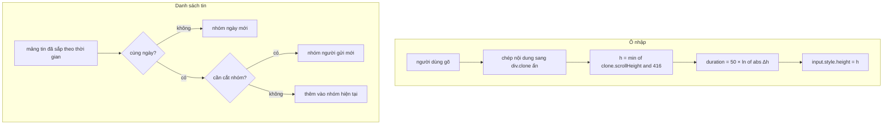

Mở một khung chat Telegram và để ý ba chi tiết. Tin liên tiếp của cùng một người dính vào nhau, avatar chỉ hiện ở tin cuối, tên chỉ hiện ở tin đầu. Gửi một mình 🔥 thì nó to bằng con tem, không có bong bóng. Gõ dài ra nhiều dòng thì ô nhập cao dần một cách mượt mà, và co lại ngay khi bấm gửi.

Không chi tiết nào là tính năng lớn, nhưng thiếu chúng là khung chat trông "rẻ" ngay. Bài này đọc ba đoạn code tương ứng của Telegram Web A.

> [!TIP]
> **Tóm tắt**
> - **Ô nhập tự giãn**: đổ cùng nội dung vào một bản sao ẩn, đọc `scrollHeight` của bản sao, kẹp tối đa 416px (256px trên mobile). Thời lượng animation là `50 × ln(|Δh|)` ms: giãn ít thì chậm vừa đủ, giãn nhiều cũng không quá lâu.
> - **Tin chỉ có 1–3 emoji** bỏ bong bóng và phóng to (4.5rem / 4rem / 3rem). Bản gốc dùng regex twemoji; ở đây đếm theo grapheme bằng `Intl.Segmenter` và `\p{Extended_Pictographic}`.
> - **Gom tin**: một lượt duyệt chia theo ngày, rồi cắt nhóm người gửi khi đổi người, đổi chiều gửi, gặp tin hệ thống, tin có nút bấm, tin chưa đọc đầu tiên hoặc cách nhau hơn 10 phút. Ảnh cùng album gom thành một khối.
> - Hai lỗi nhỏ của bản gốc: `groupMessages([])` ném lỗi, và nhóm bị cắt giữa một album thì album dời sang nhóm sau.

<iframe class="demo-frame" src="/demos/web-patterns/index.html?theme=dark#/tg-message-grouping" title="Demo tg-message-grouping" loading="lazy" style="height: 1020px"></iframe>

<p class="demo-links">▶ <a href="/demos/web-patterns/index.html#/tg-message-grouping" target="_blank" rel="noopener">Mở demo toàn màn hình ↗</a> · <a href="https://stackblitz.com/github/hunghg255/blog-hunghg/tree/master/examples/web-patterns?file=src/lib/tgMessageGrouping.ts" target="_blank" rel="noopener">Sửa code trên StackBlitz ↗</a> · <a href="https://github.com/hunghg255/blog-hunghg/blob/master/examples/web-patterns/src/lib/tgMessageGrouping.ts" target="_blank" rel="noopener">Xem source trên GitHub ↗</a></p>

Trong demo: bấm **9 dòng** rồi **Gửi** để thấy ô nhập giãn ra rồi co lại; kéo thanh **Hệ số log** về 0 để mất animation. Bấm 🔥, 👍👍, 🇻🇳❤️🎉 rồi gửi để thấy tin phóng to; **4 emoji** thì vẫn là bong bóng thường. Bỏ chọn **Gom tin** để so: mỗi tin một avatar, một tên.

## Telegram làm thế nào?

### Ô nhập tự giãn bằng bản sao ẩn

Trong [`components/middle/composer/MessageInput.tsx`](https://github.com/hunghg255/codebase/blob/main/web.telegram.org/src/components/middle/composer/MessageInput.tsx), ngay dưới ô `contenteditable` có một `div.clone` ẩn. Mỗi khi nội dung đổi, nội dung đó được chép sang bản sao, rồi:

```ts
// trích, giữ nguyên logic
const MAX_INPUT_HEIGHT = IS_SINGLE_COLUMN_LAYOUT ? 256 : 416;
const TRANSITION_DURATION_FACTOR = 50;

function updateInputHeight(willSend = false) {
  const currentHeight = Number(input.style.height.replace('px', ''));
  const newHeight = Math.min(clone.scrollHeight, MAX_INPUT_HEIGHT);
  if (newHeight === currentHeight) return;

  const transitionDuration = Math.round(
    TRANSITION_DURATION_FACTOR * Math.log(Math.abs(newHeight - currentHeight)),
  );
  const exec = () => {
    input.style.height = `${newHeight}px`;
    input.style.transitionDuration = `${transitionDuration}ms`;
    input.classList.toggle('overflown', clone.scrollHeight > MAX_INPUT_HEIGHT);
  };

  if (willSend) requestAnimationFrame(exec); // khớp với animation tin bay lên
  else exec();
}
```

Ba ý đáng chép:

1. **Đo trên bản sao, không đo trên ô thật.** Cách quen thuộc là gán `height: auto` cho chính ô nhập, đọc `scrollHeight`, rồi gán lại. Cách đó làm ô co về một dòng trong lúc đo; nếu ô đang có thanh cuộn thì mất luôn vị trí cuộn. Bản sao ẩn có cùng font và bề rộng, nên đo trên nó không ảnh hưởng gì tới ô thật.
2. **Thời lượng tỉ lệ log.** Δh = 20px cho khoảng 150ms, Δh = 120px khoảng 240ms, Δh = 400px khoảng 300ms. Mỗi dòng thêm không bị chờ lâu, mà nhảy từ 1 dòng lên 10 dòng cũng không kéo dài gần nửa giây.
3. **Khi gửi, đợi một frame.** Ô co về một dòng cùng frame với animation tin vừa gửi bay lên, nên hai chuyển động khớp nhau.

Khi chạm trần, class `overflown` bật thanh cuộn bên trong ô. Cùng file còn vài chi tiết nhỏ: phím ↑ khi ô trống thì sửa tin cuối, và Safari để lại `<br>` sau khi xoá hết chữ nên phải coi `<br>` là rỗng.

Một điểm nhỏ: `Math.log(1)` bằng 0, còn `Math.log` của số nhỏ hơn 1 là số âm. Với Δh = 1px, thời lượng là 0ms, không sao. Bản viết lại vẫn kẹp kết quả về ≥ 0 cho chắc.

### Tin chỉ có emoji

[`components/common/helpers/parseEmojiOnlyString.ts`](https://github.com/hunghg255/codebase/blob/main/web.telegram.org/src/components/common/helpers/parseEmojiOnlyString.ts):

```ts
const DETECT_UP_TO = 3;
const MAX_LENGTH = DETECT_UP_TO * 8; // Maximum 8 per one emoji.
const RE_EMOJI_ONLY = new RegExp(`^(?:${twemojiRegex.source})+$`, '');

export default (text: string): number | false => {
  if (text.length > MAX_LENGTH) return false;
  if (!text.match(RE_EMOJI_ONLY)) return false;

  let emojiCount = 0;
  while (twemojiRegex.exec(text)) {
    emojiCount++;
    if (emojiCount > DETECT_UP_TO) {
      twemojiRegex.lastIndex = 0;
      return false;
    }
  }
  return emojiCount;
};
```

Kết quả (1, 2 hoặc 3) thành class `emoji-only-1/2/3` trong `buildContentClassName.ts`. CSS trong `Message.scss` bỏ nền bong bóng và đặt cỡ chữ 4.5rem, 4rem, 3rem; ảnh emoji (khi thiết bị không có font emoji) cao 5rem, 4rem, 3rem. Hàm này còn được dùng để **không** mở thanh định dạng khi người dùng bôi đen toàn emoji.

Hai chỗ đáng lưu ý:

- `twemojiRegex` có cờ `g` và được dùng chung cho mọi lần gọi, nên `lastIndex` là trạng thái chung. Code phải nhớ reset khi thoát sớm. Khi vòng lặp chạy hết thì `exec` trả `null` và tự reset, nên trường hợp thường không sao.
- Giới hạn "8 đơn vị UTF-16 mỗi emoji" hơi chật. Emoji gia đình 👨‍👩‍👧‍👦 dài **11** đơn vị (4 người nối bằng ZWJ), nên 3 emoji như thế vượt 24 và không được phóng to.

### Gom tin theo ngày, người gửi, album

[`components/middle/helpers/groupMessages.ts`](https://github.com/hunghg255/codebase/blob/main/web.telegram.org/src/components/middle/helpers/groupMessages.ts) duyệt danh sách tin một lần. Ngày được so bằng `getDayStart` (0h theo giờ máy người xem). Trong cùng một ngày, nhóm người gửi bị cắt khi tin kế tiếp:

- là tin chưa đọc đầu tiên (để vạch "Tin chưa đọc" nằm giữa hai nhóm);
- khác người gửi, hoặc khác chiều (`isOutgoing`);
- là tin hệ thống, hoặc tin trước là tin hệ thống;
- cả hai đều là tin chuyển tiếp nhưng từ nguồn khác nhau;
- một trong hai có nút bấm inline;
- cách tin trước hơn `GROUP_INTERVAL_SECONDS = 600` giây.

Ảnh cùng `groupedId` được gom thành một album, và tin có caption trở thành `mainMessage`. Kết hợp với CSS, chỉ tin cuối nhóm có avatar và "đuôi" bong bóng, các tin giữa nhóm bo góc nhỏ hơn ở phía avatar.

Hai lỗi nhỏ đọc ra từ code:

- Dòng đầu là `originalDate: messages[0].date`, nên gọi với mảng rỗng sẽ ném `TypeError`. Nơi gọi hiện có kiểm tra trước, nhưng hàm không tự bảo vệ.
- Album chỉ được đẩy vào nhóm khi gặp ảnh **cuối** của album. Nếu nhóm bị cắt giữa album (ví dụ tin chưa đọc đầu tiên rơi vào ảnh thứ hai), album sẽ nằm trong nhóm sau, tách khỏi những tin đứng ngay trước nó.

Khi danh sách tin hiện ra, mỗi tin có `appearanceOrder`, trễ thêm 10ms mỗi tin, tính **từ dưới lên**: tin mới nhất ở đáy hiện trước, mắt người đọc thấy nội dung gần nhất đầu tiên.

## Bên trong trình duyệt



- `scrollHeight` của một phần tử luôn tính đủ chiều cao nội dung, kể cả phần bị che khi `overflow: hidden`. Phần tử ẩn bằng `visibility: hidden` vẫn được layout nên vẫn đo được; `display: none` thì không, vì không có box nào.
- Một phần tử rỗng không có dòng chữ nào nên cao bằng padding. Bản sao phải có ít nhất một ký tự (ví dụ khoảng trắng không ngắt) thì mới đo ra đúng chiều cao một dòng. Demo đã dính lỗi này ở bản đầu: ô nhập rỗng chỉ cao 18px.
- "Một emoji" trên màn hình có thể là nhiều code point: cờ 🇻🇳 là 2 ký tự Regional Indicator, gia đình là 4 người nối bằng ZWJ. Đơn vị đúng để đếm là **grapheme cluster**, thứ `Intl.Segmenter` trả về.

## Viết lại

Ô nhập:

```ts title=src/lib/tgMessageGrouping.ts
// ---------- Ô nhập tự giãn ----------

/** Hệ số của bản gốc: thời lượng = 50 · ln(|Δh|) ms. */
export const TRANSITION_DURATION_FACTOR = 50;

/**
 * Thời lượng animation tỉ lệ log theo quãng đường: nhảy 20px mất ~150ms, nhảy 400px chỉ ~300ms.
 * Bản gốc gọi Math.log thẳng nên |Δh| = 1 cho 0ms và |Δh| < 1 cho số âm; ở đây kẹp ≥ 0.
 */
export function growDuration(delta: number, factor = TRANSITION_DURATION_FACTOR) {
  const distance = Math.abs(delta);
  if (distance < 1) return 0;
  return Math.max(0, Math.round(factor * Math.log(distance)));
}

export interface GrowResult {
  height: number;
  duration: number;
  overflown: boolean;
}

/**
 * Đo chiều cao bằng một bản sao ẩn (cùng font, cùng bề rộng) thay vì chính ô nhập:
 * đặt `height: auto` lên ô thật để đo sẽ làm khung nhảy một frame và mất vị trí cuộn.
 */
export function measureGrow(clone: HTMLElement, currentHeight: number, maxHeight: number): GrowResult | undefined {
  const next = Math.min(clone.scrollHeight, maxHeight);
  if (next === currentHeight) return undefined;
  return { height: next, duration: growDuration(next - currentHeight), overflown: clone.scrollHeight > maxHeight };
}
```

Tin chỉ có emoji, đếm theo grapheme:

```ts title=src/lib/tgMessageGrouping.ts
// ---------- Tin chỉ có emoji ----------

const EMOJI_ONLY_MAX = 3;
// Một "emoji" có thể là chuỗi ZWJ nhiều code point (👨‍👩‍👧) hoặc cờ (🇻🇳): đếm theo grapheme
const PICTOGRAPHIC = /\p{Extended_Pictographic}|\p{Regional_Indicator}/u;
const segmenter = typeof Intl !== 'undefined' && 'Segmenter' in Intl
  ? new Intl.Segmenter(undefined, { granularity: 'grapheme' })
  : undefined;

/**
 * Trả về số emoji (1–3) nếu chuỗi CHỈ gồm emoji, ngược lại false.
 * Bản gốc dùng regex twemoji (~10KB) với cờ `g` dùng chung giữa các lần gọi và phải tự reset lastIndex.
 */
export function countEmojiOnly(text: string, max = EMOJI_ONLY_MAX): number | false {
  const trimmed = text.trim();
  // thoát sớm. Bản gốc cho 8 đơn vị UTF-16 mỗi emoji (3 × 8 = 24), hụt với emoji gia đình ZWJ dài 11
  if (!trimmed || trimmed.length > max * 11) return false;
  const graphemes = segmenter
    ? Array.from(segmenter.segment(trimmed), (s) => s.segment)
    : Array.from(trimmed);
  const emojis = graphemes.filter((g) => !/^\s+$/.test(g));
  if (emojis.length === 0 || emojis.length > max) return false;
  return emojis.every((g) => PICTOGRAPHIC.test(g)) ? emojis.length : false;
}
```

Điều kiện cắt nhóm (hàm `groupMessages` dùng nó trong một vòng duyệt, xem bản đầy đủ):

```ts title=src/lib/tgMessageGrouping.ts
/** Có cần cắt nhóm người gửi giữa a và b (tin liền sau) không. */
export function shouldBreakGroup(a: ChatMessage, b: ChatMessage, firstUnreadId?: number) {
  return (
    b.id === firstUnreadId ||
    a.senderId !== b.senderId ||
    Boolean(a.isOutgoing) !== Boolean(b.isOutgoing) ||
    Boolean(a.isService) ||
    Boolean(b.isService) ||
    // chỉ cắt khi CẢ HAI đều là tin chuyển tiếp và từ hai nguồn khác nhau
    (a.forwardFrom !== undefined && b.forwardFrom !== undefined && a.forwardFrom !== b.forwardFrom) ||
    Boolean(a.hasButtons) ||
    Boolean(b.hasButtons) ||
    b.date - a.date > GROUP_INTERVAL_SECONDS
  );
}
```

::: spoiler Xem toàn bộ src/lib/tgMessageGrouping.ts

```ts title=src/lib/tgMessageGrouping.ts
/**
 * Ô nhập tự giãn, tin chỉ có emoji phóng to, gom tin theo ngày/người gửi/album (Telegram #16).
 */

// ---------- Ô nhập tự giãn ----------

/** Hệ số của bản gốc: thời lượng = 50 · ln(|Δh|) ms. */
export const TRANSITION_DURATION_FACTOR = 50;

/**
 * Thời lượng animation tỉ lệ log theo quãng đường: nhảy 20px mất ~150ms, nhảy 400px chỉ ~300ms.
 * Bản gốc gọi Math.log thẳng nên |Δh| = 1 cho 0ms và |Δh| < 1 cho số âm; ở đây kẹp ≥ 0.
 */
export function growDuration(delta: number, factor = TRANSITION_DURATION_FACTOR) {
  const distance = Math.abs(delta);
  if (distance < 1) return 0;
  return Math.max(0, Math.round(factor * Math.log(distance)));
}

export interface GrowResult {
  height: number;
  duration: number;
  overflown: boolean;
}

/**
 * Đo chiều cao bằng một bản sao ẩn (cùng font, cùng bề rộng) thay vì chính ô nhập:
 * đặt `height: auto` lên ô thật để đo sẽ làm khung nhảy một frame và mất vị trí cuộn.
 */
export function measureGrow(clone: HTMLElement, currentHeight: number, maxHeight: number): GrowResult | undefined {
  const next = Math.min(clone.scrollHeight, maxHeight);
  if (next === currentHeight) return undefined;
  return { height: next, duration: growDuration(next - currentHeight), overflown: clone.scrollHeight > maxHeight };
}

// ---------- Tin chỉ có emoji ----------

const EMOJI_ONLY_MAX = 3;
// Một "emoji" có thể là chuỗi ZWJ nhiều code point (👨‍👩‍👧) hoặc cờ (🇻🇳): đếm theo grapheme
const PICTOGRAPHIC = /\p{Extended_Pictographic}|\p{Regional_Indicator}/u;
const segmenter = typeof Intl !== 'undefined' && 'Segmenter' in Intl
  ? new Intl.Segmenter(undefined, { granularity: 'grapheme' })
  : undefined;

/**
 * Trả về số emoji (1–3) nếu chuỗi CHỈ gồm emoji, ngược lại false.
 * Bản gốc dùng regex twemoji (~10KB) với cờ `g` dùng chung giữa các lần gọi và phải tự reset lastIndex.
 */
export function countEmojiOnly(text: string, max = EMOJI_ONLY_MAX): number | false {
  const trimmed = text.trim();
  // thoát sớm. Bản gốc cho 8 đơn vị UTF-16 mỗi emoji (3 × 8 = 24), hụt với emoji gia đình ZWJ dài 11
  if (!trimmed || trimmed.length > max * 11) return false;
  const graphemes = segmenter
    ? Array.from(segmenter.segment(trimmed), (s) => s.segment)
    : Array.from(trimmed);
  const emojis = graphemes.filter((g) => !/^\s+$/.test(g));
  if (emojis.length === 0 || emojis.length > max) return false;
  return emojis.every((g) => PICTOGRAPHIC.test(g)) ? emojis.length : false;
}

// ---------- Gom tin ----------

export interface ChatMessage {
  id: number;
  senderId: string;
  /** giây (unix) như API Telegram */
  date: number;
  text?: string;
  isOutgoing?: boolean;
  isService?: boolean;
  albumId?: string;
  forwardFrom?: string;
  hasButtons?: boolean;
}

export interface Album {
  albumId: string;
  messages: ChatMessage[];
  /** tin có caption, nếu không có thì tin đầu */
  main: ChatMessage;
}

export type GroupItem = ChatMessage | Album;
export interface SenderGroup {
  items: GroupItem[];
}
export interface DateGroup {
  dayStart: number;
  senderGroups: SenderGroup[];
}

export const GROUP_INTERVAL_SECONDS = 600;

export const isAlbum = (item: GroupItem): item is Album => 'albumId' in item && 'messages' in item;

/** Mốc 0h theo giờ địa phương của người xem (Telegram cũng chia ngày theo máy người xem). */
export function dayStart(seconds: number) {
  const d = new Date(seconds * 1000);
  d.setHours(0, 0, 0, 0);
  return d.getTime();
}

/** Có cần cắt nhóm người gửi giữa a và b (tin liền sau) không. */
export function shouldBreakGroup(a: ChatMessage, b: ChatMessage, firstUnreadId?: number) {
  return (
    b.id === firstUnreadId ||
    a.senderId !== b.senderId ||
    Boolean(a.isOutgoing) !== Boolean(b.isOutgoing) ||
    Boolean(a.isService) ||
    Boolean(b.isService) ||
    // chỉ cắt khi CẢ HAI đều là tin chuyển tiếp và từ hai nguồn khác nhau
    (a.forwardFrom !== undefined && b.forwardFrom !== undefined && a.forwardFrom !== b.forwardFrom) ||
    Boolean(a.hasButtons) ||
    Boolean(b.hasButtons) ||
    b.date - a.date > GROUP_INTERVAL_SECONDS
  );
}

/**
 * Một lượt duyệt: chia ngày → nhóm người gửi → album.
 * Album được gắn vào nhóm ngay ở ảnh ĐẦU và không bao giờ cắt nhóm giữa hai ảnh cùng album,
 * nên album luôn nằm trọn trong nhóm chứa ảnh đầu của nó.
 */
export function groupMessages(messages: ChatMessage[], firstUnreadId?: number): DateGroup[] {
  if (messages.length === 0) return []; // bản gốc đọc messages[0] nên ném lỗi với mảng rỗng

  const dateGroups: DateGroup[] = [];
  let dateGroup: DateGroup | undefined;
  let senderGroup: SenderGroup | undefined;
  let album: Album | undefined;

  messages.forEach((message, index) => {
    const prev = messages[index - 1];
    const day = dayStart(message.date);

    if (!dateGroup || dateGroup.dayStart !== day) {
      dateGroup = { dayStart: day, senderGroups: [] };
      dateGroups.push(dateGroup);
      senderGroup = undefined;
    } else if (
      prev &&
      // không cắt giữa một album: các ảnh cùng album luôn nằm chung một nhóm
      !(message.albumId && prev.albumId === message.albumId) &&
      shouldBreakGroup(prev, message, firstUnreadId)
    ) {
      senderGroup = undefined;
    }

    if (!senderGroup) {
      senderGroup = { items: [] };
      dateGroup.senderGroups.push(senderGroup);
    }

    if (message.albumId) {
      if (album && album.albumId === message.albumId) {
        album.messages.push(message);
        if (message.text && !album.main.text) album.main = message;
      } else {
        album = { albumId: message.albumId, messages: [message], main: message };
        senderGroup.items.push(album);
      }
    } else {
      album = undefined;
      senderGroup.items.push(message);
    }
  });

  return dateGroups;
}

/**
 * Hiệu ứng hiện tin kiểu Telegram: tin dưới cùng hiện trước, mỗi tin trễ thêm 10ms.
 * Trả về delay (ms) cho phần tử thứ `index` trong danh sách có `count` phần tử.
 */
export const appearanceDelay = (index: number, count: number, step = 10) => (count - 1 - index) * step;
```

:::

## Đi qua code

- **`measureGrow`** chỉ trả kết quả khi chiều cao thật sự đổi, để không ghi đè `transitionDuration` vô ích. `overflown` so với chiều cao **chưa kẹp** của bản sao.
- **`countEmojiOnly`** thoát sớm theo độ dài, tách grapheme, bỏ khoảng trắng, rồi yêu cầu mọi grapheme đều chứa ký tự pictographic hoặc Regional Indicator. Không còn trạng thái `lastIndex` dùng chung.
- **`shouldBreakGroup`** gom mọi điều kiện cắt nhóm vào một chỗ, dễ test riêng.
- **`groupMessages`** trả mảng rỗng với đầu vào rỗng; tạo nhóm ngày khi đổi ngày; **không cắt nhóm giữa hai ảnh cùng album**; album được gắn vào nhóm ngay ở ảnh đầu, các ảnh sau chỉ nối vào album đó.
- **`appearanceDelay`** trả delay cho hiệu ứng hiện tin: phần tử cuối danh sách có delay 0.

**Khác bản gốc:** đếm emoji bằng `Intl.Segmenter` thay vì regex twemoji; ngưỡng thoát sớm 11 đơn vị mỗi emoji thay vì 8; `groupMessages` chịu mảng rỗng và giữ album trọn trong nhóm chứa ảnh đầu.

## Tại sao không làm cách khác?

- **`field-sizing: content`?** CSS mới này cho `<textarea>` tự giãn theo nội dung mà không cần JS. Nó chưa có trên mọi trình duyệt (xem [caniuse](https://caniuse.com/mdn-css_properties_field-sizing)), không kèm animation, và không áp cho `contenteditable` theo cách cần ở đây.
- **`ResizeObserver` trên ô nhập?** Nó báo sau khi kích thước đã đổi, còn ở đây ta cần biết chiều cao **mới** để chủ động animate tới đó.
- **Gom tin bằng CSS (`:has()`, sibling selector)?** Không có selector nào so được thời gian hay người gửi giữa hai phần tử. Phải tính trong JS rồi gắn class.

## Edge case và cạm bẫy

- **Đổi múi giờ hoặc qua nửa đêm** trong lúc app mở: nhóm ngày được tính lúc render, nên cần render lại (Telegram render lại khi có tin mới).
- **Emoji có biến thể văn bản**: "❤" (U+2764) không kèm `️` vẫn là pictographic và vẫn được phóng to. Một số font hiển thị nó như ký tự đen trắng.
- **`\p{Extended_Pictographic}` không trùng khít với "emoji".** Chạy thử: keycap 1️⃣ và #️⃣ **không** khớp (chữ số và dấu `#` không phải pictographic), nên bản viết lại không phóng to chúng; ngược lại © và ™ **có** khớp, nên một tin chỉ gồm "©" sẽ bị phóng to. Muốn sát với Telegram hơn, dùng `\p{RGI_Emoji}` với cờ `v` của regex (Chrome 112+, Firefox 116+, Safari 17+), hoặc regex emoji đầy đủ như twemoji.
- **Ô nhập trong khung bị ẩn**: bản sao cũng bị ẩn, `scrollHeight` bằng 0. Chỉ đo khi ô đang hiển thị.

## Dùng trong dự án

```tsx
function ChatList({ messages, firstUnreadId }: { messages: ChatMessage[]; firstUnreadId?: number }) {
  const groups = useMemo(() => groupMessages(messages, firstUnreadId), [messages, firstUnreadId]);
  return groups.map((day) => (
    <section key={day.dayStart}>
      <DateHeader time={day.dayStart} />
      {day.senderGroups.map((group, i) => (
        <SenderGroupView key={i} items={group.items} /> // avatar ở item cuối
      ))}
    </section>
  ));
}
```

::: spoiler Ví dụ test (bản phác, không có trong repo)

```ts
import { describe, expect, it } from 'vitest';
import { countEmojiOnly, groupMessages, growDuration, type ChatMessage } from './tgMessageGrouping';

describe('growDuration', () => {
  it('tỉ lệ log và không âm', () => {
    expect(growDuration(1)).toBe(0);
    expect(growDuration(0.5)).toBe(0);
    expect(growDuration(20)).toBe(150);
    expect(growDuration(-400)).toBe(300);
  });
});

describe('countEmojiOnly', () => {
  it('đếm theo grapheme', () => {
    expect(countEmojiOnly('🔥')).toBe(1);
    expect(countEmojiOnly('🇻🇳❤️')).toBe(2);
    expect(countEmojiOnly('👨‍👩‍👧‍👦👨‍👩‍👧‍👦👨‍👩‍👧‍👦')).toBe(3);
    expect(countEmojiOnly('😀😀😀😀')).toBe(false);
    expect(countEmojiOnly('ok 👍')).toBe(false);
    expect(countEmojiOnly('123')).toBe(false);
  });
});

const base = 1_700_000_000;
const msg = (id: number, senderId: string, date: number, extra: Partial<ChatMessage> = {}): ChatMessage => ({
  id, senderId, date: base + date, ...extra,
});

describe('groupMessages', () => {
  it('mảng rỗng không ném lỗi', () => {
    expect(groupMessages([])).toEqual([]);
  });
  it('cắt nhóm khi cách nhau hơn 10 phút hoặc đổi người', () => {
    const groups = groupMessages([msg(1, 'a', 0), msg(2, 'a', 60), msg(3, 'b', 120), msg(4, 'b', 120 + 601)]);
    expect(groups[0].senderGroups.map((g) => g.items.length)).toEqual([2, 1, 1]);
  });
  it('album nằm trọn trong nhóm chứa ảnh đầu, kể cả khi tin chưa đọc rơi giữa album', () => {
    const groups = groupMessages(
      [msg(1, 'a', 0), msg(2, 'a', 10, { albumId: 'x' }), msg(3, 'a', 11, { albumId: 'x', text: 'caption' })],
      3,
    );
    const items = groups[0].senderGroups[0].items;
    expect(groups[0].senderGroups).toHaveLength(1);
    expect(items).toHaveLength(2);
    expect('messages' in items[1] && items[1].messages.map((m) => m.id)).toEqual([2, 3]);
    expect('main' in items[1] && items[1].main.id).toBe(3);
  });
});
```

:::

## So với thư viện và chuẩn web

- **`field-sizing: content`** (Chrome/Edge từ 123) là cách tương lai cho `<textarea>` tự giãn; với `contenteditable` thì phần tử vốn đã tự giãn, cái cần là **giới hạn chiều cao và animate**, việc mà bản sao ẩn làm được.
- **`Intl.Segmenter`** có ở mọi trình duyệt chính (Firefox từ 125). Thư viện như `grapheme-splitter` chỉ còn cần cho môi trường cũ.
- Các bộ UI chat (Stream, Sendbird UIKit) có sẵn logic gom tin tương tự; điều kiện cắt nhóm của Telegram là danh sách tham khảo tốt nếu bạn tự viết.

Bài liên quan: [giờ gửi nằm gọn trong bong bóng chat](/blogs/telegram-bubble-meta-spacer) (Telegram #9).

---

Bài này thuộc series **[Học từ mã nguồn Telegram](/series/telegram)** (25 bài, đọc theo thứ tự).

::: spoiler Xem nhanh danh sách bài trong series

*Mở đầu*

- [Mở đầu: bên trong Telegram Web A](/blogs/learn-from-telegram-source-code)

*Phần 1: dữ liệu và đồng bộ*

- [#1 Gửi tin lạc quan, khớp tin thật bằng randomId](/blogs/telegram-optimistic-send)
- [#2 Lịch sử tin nhắn chia hai đảo](/blogs/telegram-message-history-islands)
- [#3 Lưu global state lúc rảnh, chỉ giữ phần cần](/blogs/telegram-persist-global-state)
- [#4 Gom update realtime theo nhịp animation](/blogs/telegram-realtime-update-batching)
- [#5 Store tự viết và diff danh sách có key](/blogs/telegram-teactn-store-fast-list)

*Phần 2: animation và giao diện*

- [#6 Animation sắp xếp danh sách chat không đo DOM](/blogs/telegram-chat-list-flip)
- [#7 Ảnh bay giữa hai cây DOM trong media viewer](/blogs/telegram-media-viewer-ghost)
- [#8 Bố cục album chọn theo hàm chi phí](/blogs/telegram-album-layout)
- [#9 Giờ gửi nằm gọn trong bong bóng chat](/blogs/telegram-bubble-meta-spacer)
- [#10 Composer biến hình, Transition và gạch chân tab](/blogs/telegram-composer-morph-transition)

*Phần 3: media, mobile, thông báo*

- [#11 Thumbnail 100 byte và viền sticker nén](/blogs/telegram-tiny-thumbnails)
- [#12 Player sticker: DPR, hạ fps, cache khung](/blogs/telegram-lottie-player)
- [#13 Mobile: --vh, bàn phím ảo, nhấn giữ, số điện thoại](/blogs/telegram-mobile-viewport-touch)
- [#14 Web Push không trùng và đánh dấu đã đọc](/blogs/telegram-push-dedupe-read-receipts)

*Phần 4: soạn tin, media, chi tiết UI*

- [#15 Rich text ⇄ entities, thanh định dạng nổi, nháp theo chat](/blogs/telegram-rich-text-entities)
- **#16 Ô nhập tự giãn, emoji phóng to, gom tin theo ngày/người/album** (bài này)
- [#17 Bảng emoji/sticker chỉ render nhóm đang xem](/blogs/telegram-emoji-picker-virtualization)
- [#18 mediaLoader gộp request, ảnh mờ sang nét, spinner không chớp](/blogs/telegram-media-loader-blur-buffering)
- [#19 Trình phát audio toàn cục và playlist](/blogs/telegram-global-audio-player)
- [#20 UiLoader chạy đua 700ms, ba mức animation](/blogs/telegram-ui-loader-animation-levels)
- [#21 PanZoom bằng matrix() trong media viewer](/blogs/telegram-panzoom-matrix)
- [#22 Ngày dính khi cuộn, khoá cuộn, dừng momentum iOS](/blogs/telegram-sticky-date-scroll-lock)
- [#23 Vùng thả file, nén ảnh trước khi gửi, copy ảnh](/blogs/telegram-drop-zone-compress-copy)
- [#24 Tiêu đề nhấp nháy và favicon đếm tin mới](/blogs/telegram-title-favicon-unread)

:::

Code + demo: [`examples/web-patterns`](https://github.com/hunghg255/blog-hunghg/tree/master/examples/web-patterns) · [Mở trên StackBlitz](https://stackblitz.com/github/hunghg255/blog-hunghg/tree/master/examples/web-patterns)
