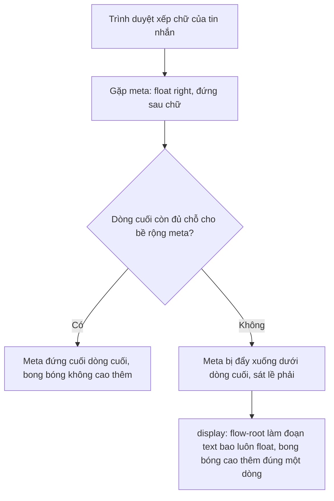

Nhìn kỹ một bong bóng chat trên Telegram (hay Messenger, WhatsApp): giờ gửi `21:07 ✓✓` luôn nằm ở góc dưới bên phải.

- Tin ngắn: giờ đứng **cùng dòng** với chữ, bong bóng chỉ cao một dòng.
- Tin dài mà dòng cuối còn chỗ: giờ vẫn chen vào dòng cuối.
- Dòng cuối đã kín: giờ **tự xuống dòng mới**, không bao giờ đè lên chữ.

Làm "ngây thơ" thì chỉ được một trong hai: đặt giờ `position: absolute` ở góc thì có lúc **đè lên chữ**; cho giờ thành một dòng riêng thì tin nào cũng **cao thêm một dòng**. Muốn cả hai, nhiều người nghĩ phải dùng JS đo vị trí dòng cuối. Telegram Web không đo gì cả: toàn bộ là CSS.

> [!TIP]
> **Tóm tắt**
> - Đặt phần giờ gửi (meta) **ngay trong đoạn text**, ở cuối, với `float: right`. Dòng cuối còn chỗ thì float đứng cùng dòng, hết chỗ thì trình duyệt tự đẩy nó xuống. Không cần JS.
> - Khi meta buộc phải nằm ngoài đoạn text (`position: absolute`), thêm `::after` cuối đoạn text rộng đúng bằng meta để **giữ chỗ**. Bề rộng đó ghép bằng CSS var: phần cố định (giờ, tick) + phần thêm (lượt xem, "đã sửa") + chữ ký.
> - Chỉ chữ ký là phải đo. Bản gốc đo bằng `span.innerHTML = signature`: tên người đăng do người dùng đặt, nên đây là **lỗ XSS**. Đo bằng `canvas.measureText` thì không parse HTML.

<iframe class="demo-frame" src="/demos/web-patterns/index.html?theme=dark#/tg-bubble-meta" title="Demo tg-bubble-meta" loading="lazy" style="height: 980px"></iframe>

<p class="demo-links">▶ <a href="/demos/web-patterns/index.html#/tg-bubble-meta" target="_blank" rel="noopener">Mở demo toàn màn hình ↗</a> · <a href="https://stackblitz.com/github/hunghg255/blog-hunghg/tree/master/examples/web-patterns?file=src/lib/tgBubbleMeta.ts" target="_blank" rel="noopener">Sửa code trên StackBlitz ↗</a> · <a href="https://github.com/hunghg255/blog-hunghg/blob/master/examples/web-patterns/src/lib/tgBubbleMeta.ts" target="_blank" rel="noopener">Xem source trên GitHub ↗</a></p>

Kéo thanh "Độ dài tin" và để ý bốn bong bóng. Bong bóng thứ nhất có lúc báo **đè lên chữ**, bong bóng thứ hai luôn cao hơn một dòng (68px so với 51px ở độ dài 38 ký tự). Hai cách của Telegram vừa không đè vừa không tốn dòng. Kiểm thử trong Playwright: quét mọi độ dài từ 1 tới 112 ký tự ở 4 bề rộng 160–420px, bật cả lượt xem, "đã sửa" và chữ ký, hai cách của Telegram không có lần nào đè lên chữ.

## Telegram làm thế nào?

Code nằm trong [`components/middle/message/`](https://github.com/hunghg255/codebase/tree/main/web.telegram.org/src/components/middle/message) của Telegram Web A (bản trong repo codebase là bản cũ, viết bằng framework tự làm tên Teact, cú pháp giống React).

### Cách 1: meta nằm trong đoạn text

Trong `Message.tsx`, khi tin có chữ (và không có link preview hay emoji động), `MessageMeta` được render **bên trong** thẻ `<p>` của đoạn text, ngay sau chữ:

```tsx
const shouldInlineMeta = !webPage && !animatedEmoji && textParts;
// ...
<p className={textContentClass} dir="auto">
  {textParts}
  {shouldInlineMeta && <MessageMeta message={message} outgoingStatus={outgoingStatus} signature={signature} />}
</p>
```

Phần CSS (đã định dạng lại từ `Message.scss` bản build):

```css
.message-content .text-content {
  display: flow-root;
  word-break: break-word;
  line-height: 1.3125;
}
.message-content:not(.custom-shape) .text-content > .MessageMeta {
  position: relative;
  top: .375rem;
  float: right;
  height: calc(var(--message-meta-height, 1rem));
  margin-left: .4375rem;
  margin-right: -.5rem;
}
```

Cả mẹo chỉ có vậy: **một float đứng sau chữ**. `display: flow-root` để đoạn text bao luôn cả float (không có nó, float tràn ra khỏi bong bóng). `top: .375rem` đẩy meta xuống một chút cho chân chữ của giờ thẳng với chân dòng chữ cuối. Ngoài ra còn các biến thể `top` cho từng cỡ chữ (`html[data-message-text-size="17"]`…) và `float: left` khi đoạn text viết từ phải sang trái (`:dir(rtl)`).

### Cách 2: `::after` giữ chỗ cho meta nằm ngoài

Khi meta không thể nằm trong đoạn text (ví dụ tin có link preview: meta phải nằm dưới cùng bong bóng, sau khung preview), nó được render ngoài và đặt `position: absolute` ở góc. Lúc đó đoạn text cần "nhường" chỗ. Telegram khai báo bề rộng meta thành CSS var trên `.Message`:

```css
.Message {
  --meta-safe-area-size: calc(var(--meta-safe-area-base) + var(--meta-safe-author-width)
    + var(--meta-safe-area-extra-width));
}
/* selector rút gọn; bản gốc: .message-content.has-solid-background .forwarded-message > … */
.text-content:not(.with-meta):last-child::after {
  content: '';
  display: inline-block;
  width: var(--meta-safe-area-size);
  height: 1rem;
}
```

::: spoiler Xem đầy đủ phần CSS gốc của cách 2

```css
.Message {
  --meta-safe-area-base: 2.25rem;
  --meta-safe-author-width: 0px;
  --meta-safe-area-extra-width: 0px;
  --meta-safe-area-size: calc(var(--meta-safe-area-base) + var(--meta-safe-author-width)
    + var(--meta-safe-area-extra-width));
}
.Message.own { --meta-safe-area-base: 3.5rem; }              /* thêm dấu ✓✓ */
.Message.has-views { --meta-safe-area-extra-width: 4rem; }
.Message.was-edited { --meta-safe-area-extra-width: 2.5rem; }
.Message.was-edited.has-views { --meta-safe-area-extra-width: 7.5rem; }
html[lang=ru] .Message.was-edited { --meta-safe-area-extra-width: 3.5rem; }

.message-content.has-solid-background .forwarded-message > .text-content:not(.with-meta):last-child::after {
  content: '';
  display: inline-block;
  width: var(--meta-safe-area-size);
  height: 1rem;
}
```

:::

Hai chi tiết đáng để ý:

- **Bề rộng meta gần như cố định**, nên không đo mà khai báo sẵn bằng rem theo từng trạng thái (tin của mình, có lượt xem, đã sửa). Dòng `html[lang=ru]` cho thấy cái giá của cách này: chữ "đã sửa" bằng tiếng Nga dài hơn tiếng Anh, phải thêm luật riêng cho từng ngôn ngữ.
- Trong bản build có trong repo, `::after` giữ chỗ **chỉ còn dùng cho một trường hợp**: đoạn text trong tin chuyển tiếp không chứa meta inline. Mọi tin chữ bình thường đã chuyển sang cách 1. Có lẽ Telegram bắt đầu bằng cách 2 rồi chuyển dần sang cách 1 vì nó không cần biết bề rộng meta.

### Phần duy nhất phải đo: chữ ký, và một lỗ XSS

Kênh bật "ký tên bài đăng" thì meta có thêm tên người đăng (trường `postAuthor` của tin, Telegram Web gọi là `signature`). Tên này dài ngắn tuỳ người nên không khai báo sẵn được. `Message.tsx` đo nó rồi gán vào `--meta-safe-author-width`:

```tsx
const metaSafeAuthorWidth = useMemo(() => {
  return signature ? calculateAuthorWidth(signature) : undefined;
}, [signature]);
// trên phần tử .Message:
style={metaSafeAuthorWidth ? `--meta-safe-author-width: ${metaSafeAuthorWidth}px` : undefined}
```

Và đây là [`helpers/calculateAuthorWidth.ts`](https://github.com/hunghg255/codebase/blob/main/web.telegram.org/src/components/middle/message/helpers/calculateAuthorWidth.ts):

```ts
let element: HTMLSpanElement | undefined;

export default function calculateAuthorWidth(text: string) {
  if (!element) {
    element = document.createElement('span');
    element.style.font = IS_IOS ? '400 12px system-ui, …' : '400 12px "Roboto", …';
    element.style.whiteSpace = 'nowrap';
    element.style.position = 'absolute';
    element.style.left = '-999px';
    element.style.opacity = '.01';
    document.body.appendChild(element);
  }

  element.innerHTML = text;

  return element.offsetWidth;
}
```

Ý tưởng dùng chung một `span` ẩn để đo thì ổn. Vấn đề là `innerHTML`. `signature` lấy từ `postAuthor`: tên hiển thị của người đăng bài trong kênh, do chính người đó đặt. Đặt tên là `` thì mọi người mở kênh đó, ở mọi tin có ký tên, sẽ chạy đoạn JS kèm theo. Chỗ **hiển thị** chữ ký thì an toàn (`MessageMeta` render qua `renderText`, có bước escape HTML); chỉ chỗ **đo** là không. Ngoài XSS, tên chứa `<` hay `&` cũng bị đo sai, vì trình duyệt hiểu chúng là HTML.

Demo ở trên có ô "Chữ ký": nhập `Admin`, phần dưới cho thấy cách gốc chỉ đo được chữ `"Admin"` và trình duyệt đã tạo thêm thẻ ``. (Demo chạy `innerHTML` trong một document "trơ" tạo bằng `createHTMLDocument`, nơi trình duyệt không chạy script, nên không có gì thực sự chạy.)

## Bên trong trình duyệt: float đứng sau chữ được xếp thế nào?

Đặc tả CSS có hai luật quyết định chỗ của một float đứng sau nội dung inline:

1. Mép trên của float **không được cao hơn** dòng chứa phần nội dung đứng trước nó trong mã nguồn. Float ở cuối đoạn nên nó bắt đầu từ dòng cuối.
2. Float phải nằm **sát lề** (ở đây là lề phải) và **không được chồng lên** chữ đã xếp. Dòng hiện tại không còn đủ chỗ cho bề rộng của float thì float bị đẩy xuống bên dưới dòng đó.

Ghép lại: dòng cuối còn chỗ thì meta đứng ở cuối dòng cuối; không còn thì meta xuống một dòng mới, sát phải. Đúng thứ ta cần, và trình duyệt tự tính lại mỗi khi bề rộng bong bóng hay cỡ chữ đổi.



Cách 2 dựa trên cùng logic xếp dòng nhưng với một hộp `inline-block`: `::after` là một "chữ" vô hình rộng bằng meta. Nó vừa dòng cuối thì đứng đó (meta absolute nằm đè lên đúng chỗ trống ấy); không vừa thì cả hộp rơi xuống dòng mới. Hộp inline-block không bị ngắt giữa chừng, nên chỗ trống luôn nằm trọn trên một dòng.

So sánh hai cách:

| | Float trong đoạn text | `::after` giữ chỗ |
|---|---|---|
| Cần biết bề rộng meta | Không | Có (CSS var, chữ ký phải đo) |
| Meta nằm ở đâu trong DOM | Trong `<p>` của đoạn text | Ngoài đoạn text, `position: absolute` |
| Dùng khi | Tin chữ bình thường | Meta phải nằm ở đáy bong bóng (sau link preview, ảnh…) |
| Cái giá | Meta là một phần của đoạn text (chọn/copy chữ có thể dính giờ, nên cần `user-select: none`) | Đổi ngôn ngữ hay thêm trạng thái là phải sửa số rem |

## Viết lại

Phần CSS là phần chính:

```css title=src/lib/tgBubbleMeta.css
/* Cách 1: meta nằm trong đoạn text, float phải ở cuối.
   display: flow-root để float không tràn ra ngoài bong bóng. */
.tgb-text {
  margin: 0;
  display: flow-root;
  word-break: break-word;
}

.tgb-text > .tgb-meta {
  float: right;
  position: relative;
  /* đẩy xuống một chút cho thẳng hàng với đáy dòng chữ */
  top: 0.375rem;
  margin-left: 0.4375rem;
  margin-right: -0.5rem;
}

/* Cách 2: meta position: absolute ở góc; ::after cuối đoạn text giữ chỗ cho nó.
   Dòng cuối còn đủ chỗ thì ::after đứng cùng dòng, không đủ thì tự rơi xuống dòng mới. */
.tgb-bubble--spacer .tgb-text::after {
  content: '';
  display: inline-block;
  width: var(--meta-safe-area-size);
  height: 1rem;
}

.tgb-bubble--spacer > .tgb-meta {
  position: absolute;
  right: 0.5rem;
  bottom: 0.3rem;
}
```

Phần JS chỉ còn hai việc: ghép ba CSS var cho cách 2 (`metaSafeAreaVars`, xem file đầy đủ bên dưới), và đo chữ ký an toàn:

```ts title=src/lib/tgBubbleMeta.ts
export function measureTextWidth(text: string, font: string): number {
  const key = `${font}|${text}`;
  const cached = widthCache.get(key);
  if (cached !== undefined) return cached;
  measureCtx ??= document.createElement('canvas').getContext('2d');
  if (!measureCtx) return 0;
  measureCtx.font = font;
  const width = measureCtx.measureText(text).width;
  if (widthCache.size > 500) widthCache.clear();
  widthCache.set(key, width);
  return width;
}
```

::: spoiler Xem toàn bộ src/lib/tgBubbleMeta.ts

```ts title=src/lib/tgBubbleMeta.ts
/**
 * Giờ gửi (meta: giờ, dấu tick, lượt xem, "đã sửa", chữ ký) nằm gọn ở góc dưới bong bóng chat,
 * không đè lên chữ và không tốn thêm một dòng khi dòng cuối còn chỗ. Telegram Web dùng hai cách:
 *
 * 1. Meta nằm NGAY TRONG đoạn text, `float: right` ở cuối: dòng cuối đủ chỗ thì nó đứng cùng dòng,
 *    thiếu chỗ thì trình duyệt tự đẩy nó xuống dòng mới. Không cần JS đo gì.
 * 2. Meta nằm ngoài đoạn text (`position: absolute`): cuối đoạn text thêm một `::after` vô hình
 *    rộng đúng bằng meta (`--meta-safe-area-size`) để giữ chỗ.
 *
 * Bề rộng meta gần như cố định (giờ + tick) nên tính bằng CSS var; chỉ chữ ký là phải đo.
 */

export interface MetaInfo {
  own?: boolean;
  hasViews?: boolean;
  wasEdited?: boolean;
  /** bề rộng chữ ký (px), đo bằng measureTextWidth */
  authorWidth?: number;
}

// Các con số lấy theo Message.scss của Telegram Web
export const META_BASE_REM = { other: 2.25, own: 3.5 } as const; // tin của mình có thêm dấu tick
export const META_EXTRA_REM = { views: 4, edited: 2.5, both: 7.5 } as const;

/** CSS var cho phần giữ chỗ: cộng ba thành phần trong CSS bằng calc(). */
export function metaSafeAreaVars({ own, hasViews, wasEdited, authorWidth = 0 }: MetaInfo) {
  let extra = 0;
  if (hasViews && wasEdited) extra = META_EXTRA_REM.both;
  else if (hasViews) extra = META_EXTRA_REM.views;
  else if (wasEdited) extra = META_EXTRA_REM.edited;
  return {
    '--meta-safe-area-base': `${own ? META_BASE_REM.own : META_BASE_REM.other}rem`,
    '--meta-safe-author-width': `${Math.ceil(authorWidth)}px`,
    '--meta-safe-area-extra-width': `${extra}rem`,
  } as Record<string, string>;
}

const widthCache = new Map<string, number>();
let measureCtx: CanvasRenderingContext2D | null | undefined;

/**
 * Đo bề rộng chữ bằng canvas.measureText. Bản gốc gán `span.innerHTML = signature` rồi đọc
 * offsetWidth: chữ ký do server/người dùng đặt nên đó là lỗ XSS (vd ``),
 * và chữ có `<` `&` bị đo sai. measureText chỉ đo chuỗi, không parse HTML, không cần chạm DOM.
 */
export function measureTextWidth(text: string, font: string): number {
  const key = `${font}|${text}`;
  const cached = widthCache.get(key);
  if (cached !== undefined) return cached;
  measureCtx ??= document.createElement('canvas').getContext('2d');
  if (!measureCtx) return 0;
  measureCtx.font = font;
  const width = measureCtx.measureText(text).width;
  if (widthCache.size > 500) widthCache.clear();
  widthCache.set(key, width);
  return width;
}

/** Font của chữ ký trong meta: phải khớp với CSS thì số đo mới đúng. */
export function metaFont(element: Element) {
  const style = getComputedStyle(element);
  return `${style.fontStyle} ${style.fontWeight} ${style.fontSize} ${style.fontFamily}`;
}
```

:::

::: spoiler Xem toàn bộ src/lib/tgBubbleMeta.css

```css title=src/lib/tgBubbleMeta.css
/* Bong bóng chat với meta (giờ gửi) nằm gọn ở góc dưới phải. */
.tgb-bubble {
  --meta-safe-area-base: 2.25rem;
  --meta-safe-author-width: 0px;
  --meta-safe-area-extra-width: 0px;
  --meta-safe-area-size: calc(
    var(--meta-safe-area-base) + var(--meta-safe-author-width) + var(--meta-safe-area-extra-width)
  );
  position: relative;
  max-width: 100%;
  padding: 0.375rem 0.75rem 0.4rem;
  border-radius: 0.9rem;
  line-height: 1.3125;
}

.tgb-meta {
  display: inline-flex;
  align-items: center;
  gap: 0.2rem;
  height: 1rem;
  font-size: 0.75rem;
  white-space: nowrap;
  opacity: 0.7;
  user-select: none;
}

.tgb-signature {
  max-width: 8rem;
  overflow: hidden;
  text-overflow: ellipsis;
}

/* Cách 1: meta nằm trong đoạn text, float phải ở cuối.
   display: flow-root để float không tràn ra ngoài bong bóng. */
.tgb-text {
  margin: 0;
  display: flow-root;
  word-break: break-word;
}

.tgb-text > .tgb-meta {
  float: right;
  position: relative;
  /* đẩy xuống một chút cho thẳng hàng với đáy dòng chữ */
  top: 0.375rem;
  margin-left: 0.4375rem;
  margin-right: -0.5rem;
}

/* Cách 2: meta position: absolute ở góc; ::after cuối đoạn text giữ chỗ cho nó.
   Dòng cuối còn đủ chỗ thì ::after đứng cùng dòng, không đủ thì tự rơi xuống dòng mới. */
.tgb-bubble--spacer .tgb-text::after {
  content: '';
  display: inline-block;
  width: var(--meta-safe-area-size);
  height: 1rem;
}

.tgb-bubble--spacer > .tgb-meta {
  position: absolute;
  right: 0.5rem;
  bottom: 0.3rem;
}
```

:::

## Đi qua code

- **`.tgb-text { display: flow-root }`**: tạo một block formatting context mới cho đoạn text. Hệ quả là đoạn text cao đủ để chứa cả float. Trước khi có `flow-root`, người ta dùng `overflow: hidden` hoặc clearfix `::after { clear: both }` cho việc này; `flow-root` không cắt nội dung tràn ra như `overflow: hidden`.
- **`top` và `margin-right` âm của meta**: `position: relative` + `top` dịch meta xuống mà **không** làm thay đổi chỗ trình duyệt đã dành cho nó, nên không ảnh hưởng việc tính dòng. `margin-right: -0.5rem` kéo meta lấn vào padding của bong bóng, sát góc hơn.
- **`metaSafeAreaVars`**: không cộng sẵn thành một con số mà trả ba biến riêng, để CSS tự `calc()`. Phần cố định (base, extra) tính bằng rem nên tự đổi theo cỡ chữ người dùng chọn; chỉ phần chữ ký là px.
- **`measureTextWidth`**: một canvas dùng chung, `ctx.font` gán đúng font của chữ ký (lấy bằng `getComputedStyle`, xem `metaFont`), rồi `measureText`. Không chèn gì vào DOM, không gây layout, có cache theo cặp font + chuỗi.

**Khác bản gốc:**

- Đo chữ ký bằng `canvas.measureText` thay vì `innerHTML` + `offsetWidth`: hết XSS, hết đo sai với `<` và `&`, và không ép trình duyệt tính layout mỗi lần đo.
- Font đo lấy từ CSS thật thay vì ghi cứng `'400 12px "Roboto", …'` trong JS (ghi cứng thì đổi CSS là lệch số đo).

## Tại sao không làm cách khác?

- **Đo dòng cuối bằng JS** (`Range.getClientRects()` lấy hình chữ nhật dòng cuối, so với bề rộng bong bóng): làm được, demo này cũng dùng nó để *kiểm tra* có đè không. Nhưng phải chạy lại khi đổi bề rộng, đổi cỡ chữ, font tải xong, và mỗi lần đo là một lần ép layout. Với danh sách hàng nghìn tin, đó là chi phí không cần thiết khi CSS làm được.
- **Luôn chừa padding-right cho cả bong bóng**: không bao giờ đè, nhưng mọi dòng đều hụt một khoảng bằng meta, tin dài trông lởm chởm.
- **Luôn cho meta một dòng riêng**: đơn giản nhất, nhưng tin một chữ cũng cao gấp đôi (cách "ngây thơ 2" trong demo).
- **`display: grid` hoặc flex cho bong bóng**: flex/grid xếp *hộp*, không xếp được "phần còn trống ở cuối dòng chữ cuối". Chỉ inline formatting (float hoặc inline-block) mới chen được vào dòng chữ.

## Edge case và cạm bẫy

- **Chữ từ phải sang trái** (tiếng Ả Rập, Do Thái): meta phải float **trái**. Telegram dùng `:dir(rtl)` trên đoạn text kèm `dir="auto"` trên thẻ `<p>`, để trình duyệt tự đoán chiều chữ từ nội dung.
- **Chọn và copy chữ**: meta nằm trong `<p>` nên khi bôi đen cả tin, giờ gửi có thể bị chọn theo. Đặt `user-select: none` cho meta (bản viết lại có).
- **Trình đọc màn hình** đọc liền "…mua trà sữa 21:07". Muốn tách ra thì đặt nhãn cho meta (`aria-label="Gửi lúc 21:07, đã xem"`) hoặc ẩn phần tick khỏi trình đọc.
- **Tin chỉ có emoji to, tin có link preview, tin là ảnh**: mỗi loại cần vị trí meta khác (đè lên ảnh có nền mờ, nằm dưới preview…). Telegram có class riêng cho từng loại (`custom-shape`, `media`, `has-replies`…). Đừng cố dùng một luật cho tất cả.
- **Số rem cố định và bản dịch**: cách 2 dựa trên bề rộng khai báo sẵn, chữ "đã sửa" hay số lượt xem dài hơn dự kiến là đè. Nếu dùng cách 2, chừa dư hoặc đo một lần cho mỗi ngôn ngữ.
- **Chữ ký dài**: cho `max-width` + `text-overflow: ellipsis` cho chữ ký (Telegram có), và nhớ số đo phải khớp bề rộng sau khi cắt, nếu không spacer rộng hơn meta thật.

## Dùng trong dự án

Với một bong bóng chat React:

```tsx
import { metaFont, metaSafeAreaVars, measureTextWidth } from './tgBubbleMeta';
import './tgBubbleMeta.css';

function Bubble({ text, time, own, edited }: { text: string; time: string; own: boolean; edited: boolean }) {
  return (
    <div className="tgb-bubble">
      <p className="tgb-text" dir="auto">
        {text}
        <span className="tgb-meta" aria-label={`Gửi lúc ${time}`}>
          {edited && <span>đã sửa</span>}
          <span>{time}</span>
          {own && <span aria-hidden>✓✓</span>}
        </span>
      </p>
    </div>
  );
}
```

Khi meta phải nằm ngoài (bong bóng có ảnh, link preview), dùng biến thể `tgb-bubble--spacer` và truyền `style={metaSafeAreaVars({ own, hasViews, wasEdited, authorWidth })}`, với `authorWidth = measureTextWidth(signature, metaFont(phần tử chữ ký))`.

Không dùng React cũng vậy: phần chính là bốn khối CSS, copy là chạy.

## Kiểm thử

::: spoiler Ví dụ test (bản phác, không có trong repo)

```ts
import { describe, expect, it } from 'vitest';
import { metaSafeAreaVars } from './tgBubbleMeta';

describe('metaSafeAreaVars', () => {
  it('tin của mình rộng hơn vì có dấu tick', () => {
    expect(metaSafeAreaVars({ own: true })['--meta-safe-area-base']).toBe('3.5rem');
    expect(metaSafeAreaVars({ own: false })['--meta-safe-area-base']).toBe('2.25rem');
  });

  it('có cả lượt xem lẫn "đã sửa" thì dùng mức gộp, không cộng hai mức', () => {
    expect(metaSafeAreaVars({ hasViews: true, wasEdited: true })['--meta-safe-area-extra-width']).toBe('7.5rem');
  });

  it('làm tròn lên bề rộng chữ ký để spacer không hụt nửa pixel', () => {
    expect(metaSafeAreaVars({ authorWidth: 40.2 })['--meta-safe-author-width']).toBe('41px');
  });
});

// Phần CSS phải kiểm bằng trình duyệt thật (jsdom không xếp dòng). Với Playwright:
// với mỗi độ dài và bề rộng, lấy Range.getClientRects() của text node và getBoundingClientRect()
// của meta, khẳng định không hình chữ nhật nào giao nhau. Demo ở trên dùng đúng cách đó.
```

:::

## So với cách khác trên web

- **CSS không có selector "dòng cuối"** (chỉ có `::first-line`), nên chưa có cách khai báo thẳng "đặt phần tử vào cuối dòng cuối". Float ở cuối đoạn vẫn là cách gọn nhất.
- **`text-wrap: pretty`** thay đổi cách chia dòng (tránh dòng cuối chỉ còn một chữ), không giữ chỗ cho meta. Dùng chung với float được; hỗ trợ trình duyệt xem [caniuse](https://caniuse.com/?search=text-wrap) (tính tới 10/2026 chưa đồng đều).
- Nếu meta không cần luôn hiện (chỉ hiện khi rê chuột hay nhấn giữ), bài toán biến mất. Telegram và WhatsApp chọn luôn hiện giờ trong bong bóng, và float là cách rẻ nhất để làm điều đó.

---

Bài này thuộc series **[Học từ mã nguồn Telegram](/series/telegram)** (15 bài, đọc theo thứ tự).

::: spoiler Xem nhanh danh sách bài trong series

*Mở đầu*

- [Mở đầu: bên trong Telegram Web A](/blogs/learn-from-telegram-source-code)

*Phần 1: dữ liệu và đồng bộ*

- [#1 Gửi tin lạc quan, khớp tin thật bằng randomId](/blogs/telegram-optimistic-send)
- [#2 Lịch sử tin nhắn chia hai đảo](/blogs/telegram-message-history-islands)
- [#3 Lưu global state lúc rảnh, chỉ giữ phần cần](/blogs/telegram-persist-global-state)
- [#4 Gom update realtime theo nhịp animation](/blogs/telegram-realtime-update-batching)
- [#5 Store tự viết và diff danh sách có key](/blogs/telegram-teactn-store-fast-list)

*Phần 2: animation và giao diện*

- [#6 Animation sắp xếp danh sách chat không đo DOM](/blogs/telegram-chat-list-flip)
- [#7 Ảnh bay giữa hai cây DOM trong media viewer](/blogs/telegram-media-viewer-ghost)
- [#8 Bố cục album chọn theo hàm chi phí](/blogs/telegram-album-layout)
- **#9 Giờ gửi nằm gọn trong bong bóng chat** (bài này)
- [#10 Composer biến hình, Transition và gạch chân tab](/blogs/telegram-composer-morph-transition)

*Phần 3: media, mobile, thông báo*

- [#11 Thumbnail 100 byte và viền sticker nén](/blogs/telegram-tiny-thumbnails)
- [#12 Player sticker: DPR, hạ fps, cache khung](/blogs/telegram-lottie-player)
- [#13 Mobile: --vh, bàn phím ảo, nhấn giữ, số điện thoại](/blogs/telegram-mobile-viewport-touch)
- [#14 Web Push không trùng và đánh dấu đã đọc](/blogs/telegram-push-dedupe-read-receipts)

:::

Code + demo: [`examples/web-patterns`](https://github.com/hunghg255/blog-hunghg/tree/master/examples/web-patterns) · [Mở trên StackBlitz](https://stackblitz.com/github/hunghg255/blog-hunghg/tree/master/examples/web-patterns)
