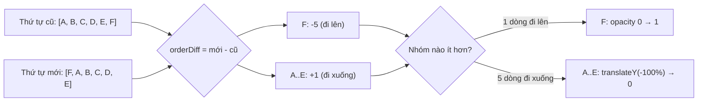

Danh sách chat sắp theo tin nhắn mới nhất. Mỗi lần có tin mới, một chat ở giữa nhảy lên đầu và mọi chat phía trên nó lùi xuống một bậc. Nếu đổi chỗ ngay lập tức, mắt người dùng mất dấu: dòng mình đang định bấm bỗng thành dòng khác. Nếu animate theo cách thông thường, chat thứ 30 sẽ bay một mạch qua 29 dòng để lên đầu, che hết những gì nằm trên đường đi.

Telegram Web A có một lời giải gọn: **không đo gì cả**, và **để nhóm dòng ít hơn mờ dần tại chỗ mới** thay vì bay.

> [!TIP]
> **Tóm tắt**
> - Mỗi dòng cao cố định, đặt bằng `position: absolute; top: i * 72px`. Biết chỉ số cũ và mới là biết khoảng cách phải trượt, không cần `getBoundingClientRect`.
> - `translateY(-orderDiff * 100%)`: phần trăm của `translate` tính theo chiều cao **chính phần tử**, nên 100% đúng bằng một dòng.
> - Đếm số dòng đi lên và đi xuống: **nhóm thiểu số fade, nhóm đa số trượt**. Chat nhảy lên đầu hiện mờ dần ở trên cùng, những chat khác trượt xuống một bậc.
> - Hủy hẹn giờ dọn dẹp khi thứ tự đổi tiếp giữa chừng (bản gốc quên việc này).

<iframe class="demo-frame" src="/demos/web-patterns/index.html?theme=dark#/tg-chat-list" title="Demo tg-chat-list" loading="lazy" style="height: 1100px"></iframe>

<p class="demo-links">▶ <a href="/demos/web-patterns/index.html#/tg-chat-list" target="_blank" rel="noopener">Mở demo toàn màn hình ↗</a> · <a href="https://stackblitz.com/github/hunghg255/blog-hunghg/tree/master/examples/web-patterns?file=src/lib/tgChatListFlip.ts" target="_blank" rel="noopener">Sửa code trên StackBlitz ↗</a> · <a href="https://github.com/hunghg255/blog-hunghg/blob/master/examples/web-patterns/src/lib/tgChatListFlip.ts" target="_blank" rel="noopener">Xem source trên GitHub ↗</a></p>

Bật "chậm (1,2s)" rồi bấm "Tin mới ở chat thứ 6" ở hai kiểu animation. Kiểu FLIP thường: chat thứ 6 trượt 280px xuyên qua 5 dòng. Kiểu Telegram: chat đó hiện mờ dần ở đầu danh sách, 5 dòng phía trên trượt xuống 56px, và không dòng nào phải đi xa hơn một bậc.

## Telegram làm thế nào?

### Bước 1: vị trí là một phép nhân

Trong [`components/left/main/ChatList.tsx`](https://github.com/hunghg255/codebase/blob/main/web.telegram.org/src/components/left/main/ChatList.tsx), mỗi chat được render với `style={`top: ${(pinnedOffset + i) * CHAT_HEIGHT_PX}px;`}`, trong đó `CHAT_HEIGHT_PX = 72` (khai báo ở `config.ts`). CSS của `.Chat` là `position: absolute; top: 0; left: 0; width: 100%`. Thứ tự hiển thị vì vậy do `top` quyết định, không do thứ tự trong DOM (đó cũng là lý do danh sách này dùng `teactFastList` mà không cần di chuyển node, xem bài #5).

Độ lệch thứ tự của mỗi chat được tính bằng `usePrevious`:

```ts
const prevOrderById = usePrevious(orderById);

const orderDiffById = useMemo(() => {
  if (!orderById || !prevOrderById) {
    return {};
  }

  return mapValues(orderById, (order, id) => {
    return order - (prevOrderById[id] !== undefined ? prevOrderById[id] : Infinity);
  });
}, [orderById, prevOrderById]);
```

Chat mới xuất hiện có `order - Infinity = -Infinity`.

### Bước 2: nhóm nào trượt, nhóm nào mờ

Toàn bộ quyết định nằm trong 35 dòng của [`hooks/useChatAnimationType.ts`](https://github.com/hunghg255/codebase/blob/main/web.telegram.org/src/components/left/main/hooks/useChatAnimationType.ts):

```ts
const orderDiffIds = Object.keys(orderDiffById).map(Number);
const numberOfUp = orderDiffIds.filter(movesUp).length;
const numberOfDown = orderDiffIds.filter(movesDown).length;

return useCallback((chatId: number): ChatAnimationTypes => {
  const orderDiff = orderDiffById[chatId];

  if (orderDiff === 0) {
    return ChatAnimationTypes.None;
  }

  if (
    orderDiff === Infinity
    || orderDiff === -Infinity
    || (movesUp(chatId) && numberOfUp <= numberOfDown)
    || (movesDown(chatId) && numberOfDown < numberOfUp)
  ) {
    return ChatAnimationTypes.Opacity;
  }

  return ChatAnimationTypes.Move;
}, [movesDown, movesUp, numberOfDown, numberOfUp, orderDiffById]);
```

Khi một chat ở vị trí 5 nhảy lên đầu: 1 dòng đi lên, 5 dòng đi xuống. Dòng đi lên thuộc nhóm ít hơn nên được `Opacity`; 5 dòng kia `Move`. Trường hợp ngược lại (một chat bị đẩy xuống cuối, vd. khi bỏ ghim) thì dòng đi xuống mờ dần, các dòng khác trượt lên.

### Bước 3: FLIP bằng phần trăm

Trong [`Chat.tsx`](https://github.com/hunghg255/codebase/blob/main/web.telegram.org/src/components/left/main/Chat.tsx), một `useLayoutEffect` chạy sau khi `top` mới đã được gán, trước khi trình duyệt vẽ:

```ts
if (animationType === ChatAnimationTypes.Opacity) {
  element.style.opacity = '0';

  fastRaf(() => {
    element.classList.add('animate-opacity');
    element.style.opacity = '1';
  });
} else if (animationType === ChatAnimationTypes.Move) {
  element.style.transform = `translate3d(0, ${-orderDiff * 100}%, 0)`;

  fastRaf(() => {
    element.classList.add('animate-transform');
    element.style.transform = '';
  });
}
```

Đây là kỹ thuật FLIP (First, Last, Invert, Play): phần tử đã ở vị trí mới (Last), dùng transform đưa nó về trông như ở vị trí cũ (Invert), frame sau bỏ transform và bật transition (Play). Bình thường bước Invert cần đo vị trí cũ và mới bằng `getBoundingClientRect`. Ở đây không cần, vì `translateY(100%)` là đúng một chiều cao dòng. CSS chỉ có `transition: transform .2s ease-out` và `transition: opacity .2s ease-out`.

Sau `ANIMATION_DURATION + ANIMATION_END_DELAY` (thêm 100ms dự phòng), một `setTimeout` gỡ class và style.

### Một lỗi nhỏ: hẹn giờ dọn dẹp không bị hủy

`useLayoutEffect` trên **không trả về hàm cleanup**. Nếu hai tin nhắn tới cách nhau 150ms, effect chạy lần hai và bắt đầu một animation mới, nhưng `setTimeout` của lần một vẫn còn hẹn. Tới hạn, nó gỡ class `animate-transform` khi animation thứ hai đang chạy: transition biến mất và dòng nhảy thẳng về đích. Bản viết lại trả về hàm hủy từ `animateRow` và gọi nó trước mỗi lần animate mới.

## Bên trong trình duyệt: vì sao không đo

FLIP thông thường đọc layout hai lần (trước và sau khi đổi), mỗi lần `getBoundingClientRect` có thể buộc trình duyệt tính lại layout đồng bộ (forced synchronous layout). Với 20 dòng thì không sao; với danh sách chat có thể vài trăm dòng được render (Telegram ảo hóa bằng `viewportIds`, nhưng vẫn có vài chục dòng), đọc rồi ghi xen kẽ là cách nhanh nhất để tạo ra một frame dài.

Khi biết trước chiều cao cố định, mọi thứ chỉ còn là số học:



Transform và opacity là hai thuộc tính trình duyệt có thể animate trên compositor (không cần layout hay paint lại mỗi frame), nên cả danh sách trượt mượt kể cả khi main thread đang bận.

## Viết lại

Phần quyết định giữ nguyên logic, kể cả việc đếm chat mới vào nhóm "đi lên":

```ts title=src/lib/tgChatListFlip.ts
/** Tính độ lệch vị trí của từng id giữa hai thứ tự. Id mới xuất hiện có độ lệch -Infinity. */
export function getOrderDiff(prevIds: readonly string[] | undefined, nextIds: readonly string[]) {
  const diff: Record<string, number> = {};
  if (!prevIds) return diff;
  const prevIndex = new Map(prevIds.map((id, i) => [id, i]));
  nextIds.forEach((id, i) => {
    const before = prevIndex.get(id);
    diff[id] = before === undefined ? -Infinity : i - before;
  });
  return diff;
}

export type AnimationStrategy = 'telegram' | 'move-all' | 'none';

/** Chọn kiểu animation cho từng dòng. */
export function getAnimationTypes(
  diff: Record<string, number>,
  strategy: AnimationStrategy = 'telegram',
): Record<string, AnimationType> {
  const ids = Object.keys(diff);
  // như bản gốc: chat mới (-Infinity) cũng được đếm vào nhóm "đi lên"
  const up = ids.filter((id) => diff[id] < 0).length;
  const down = ids.filter((id) => diff[id] > 0).length;
  const types: Record<string, AnimationType> = {};

  for (const id of ids) {
    const d = diff[id];
    if (strategy === 'none' || d === 0) {
      types[id] = 'none';
    } else if (!Number.isFinite(d)) {
      types[id] = 'fade'; // dòng mới: không có chỗ cũ để trượt từ đó
    } else if (strategy === 'move-all') {
      types[id] = 'move';
    } else if ((d < 0 && up <= down) || (d > 0 && down < up)) {
      types[id] = 'fade'; // thuộc nhóm thiểu số
    } else {
      types[id] = 'move';
    }
  }
  return types;
}
```

Hàm `animateRow` (xem file đầy đủ bên dưới) làm bước FLIP cho một dòng: tắt transition, gán `opacity: 0` hoặc `translate3d(0, -diff*100%, 0)`, frame sau bật transition và bỏ style, rồi trả về hàm hủy dọn cả rAF lẫn `setTimeout`.

::: spoiler Xem toàn bộ src/lib/tgChatListFlip.ts

```ts title=src/lib/tgChatListFlip.ts
/**
 * Animation sắp xếp lại danh sách chat KHÔNG cần đo DOM, theo cách của Telegram Web A
 * (components/left/main/ChatList.tsx, Chat.tsx, hooks/useChatAnimationType.ts):
 *
 * - Mỗi dòng cao cố định và đặt `position: absolute; top: index * ROW_HEIGHT`.
 * - Khi thứ tự đổi, độ lệch của mỗi dòng là `orderDiff = newIndex - oldIndex` (dòng mới: -Infinity).
 * - FLIP không cần getBoundingClientRect: gán `translateY(-orderDiff * 100%)` (100% = chiều cao dòng)
 *   để dòng "đứng" ở chỗ cũ, rồi frame sau bỏ transform cho nó trượt về chỗ mới.
 * - Mẹo chính: đếm số dòng đi lên và đi xuống. NHÓM ÍT HƠN thì hiện mờ dần (fade) tại chỗ mới,
 *   nhóm đông hơn thì trượt. Chat nhảy từ vị trí 5 lên đầu sẽ fade ở trên cùng, 5 chat kia trượt
 *   xuống một nấc; không có cảnh một dòng bay xuyên qua cả danh sách.
 */

export type AnimationType = 'none' | 'move' | 'fade';

/** Tính độ lệch vị trí của từng id giữa hai thứ tự. Id mới xuất hiện có độ lệch -Infinity. */
export function getOrderDiff(prevIds: readonly string[] | undefined, nextIds: readonly string[]) {
  const diff: Record<string, number> = {};
  if (!prevIds) return diff;
  const prevIndex = new Map(prevIds.map((id, i) => [id, i]));
  nextIds.forEach((id, i) => {
    const before = prevIndex.get(id);
    diff[id] = before === undefined ? -Infinity : i - before;
  });
  return diff;
}

export type AnimationStrategy = 'telegram' | 'move-all' | 'none';

/** Chọn kiểu animation cho từng dòng. */
export function getAnimationTypes(
  diff: Record<string, number>,
  strategy: AnimationStrategy = 'telegram',
): Record<string, AnimationType> {
  const ids = Object.keys(diff);
  // như bản gốc: chat mới (-Infinity) cũng được đếm vào nhóm "đi lên"
  const up = ids.filter((id) => diff[id] < 0).length;
  const down = ids.filter((id) => diff[id] > 0).length;
  const types: Record<string, AnimationType> = {};

  for (const id of ids) {
    const d = diff[id];
    if (strategy === 'none' || d === 0) {
      types[id] = 'none';
    } else if (!Number.isFinite(d)) {
      types[id] = 'fade'; // dòng mới: không có chỗ cũ để trượt từ đó
    } else if (strategy === 'move-all') {
      types[id] = 'move';
    } else if ((d < 0 && up <= down) || (d > 0 && down < up)) {
      types[id] = 'fade'; // thuộc nhóm thiểu số
    } else {
      types[id] = 'move';
    }
  }
  return types;
}

export interface AnimateOptions {
  durationMs?: number;
  /** chờ thêm chút sau animation rồi mới dọn style (Telegram: ANIMATION_END_DELAY = 100ms) */
  endDelayMs?: number;
}

/**
 * Áp animation cho một dòng ngay sau khi nó đã được đặt ở `top` mới (gọi trong useLayoutEffect,
 * trước khi trình duyệt vẽ). Trả về hàm huỷ để dọn dẹp nếu thứ tự đổi tiếp giữa chừng.
 */
export function animateRow(
  element: HTMLElement,
  type: AnimationType,
  orderDiff: number,
  { durationMs = 250, endDelayMs = 100 }: AnimateOptions = {},
) {
  if (type === 'none') return () => {};

  element.style.transition = 'none';
  if (type === 'fade') {
    element.style.opacity = '0';
  } else {
    // 100% của translateY là chiều cao chính dòng đó: không cần đo gì cả
    element.style.transform = `translate3d(0, ${-orderDiff * 100}%, 0)`;
  }

  // Telegram gom các callback vào MỘT requestAnimationFrame (fastRaf); ở đây mỗi dòng một rAF
  // cũng được vì trình duyệt gộp chúng vào cùng frame.
  const raf = requestAnimationFrame(() => {
    element.style.transition =
      type === 'fade' ? `opacity ${durationMs}ms ease` : `transform ${durationMs}ms cubic-bezier(0.2, 0, 0, 1)`;
    element.style.opacity = '';
    element.style.transform = '';
  });
  const timer = window.setTimeout(() => {
    element.style.transition = '';
  }, durationMs + endDelayMs);

  return () => {
    cancelAnimationFrame(raf);
    clearTimeout(timer);
    element.style.transition = '';
    element.style.opacity = '';
    element.style.transform = '';
  };
}
```

:::

Trong component, việc gọi diễn ra trong `useLayoutEffect`, phụ thuộc vào chuỗi id đã sắp:

```tsx
useLayoutEffect(() => {
  const prev = prevIdsRef.current;
  prevIdsRef.current = ids;
  if (!prev || prev.join() === ids.join()) return;

  cleanupsRef.current.forEach((cleanup) => cleanup()); // hủy animation đang dở
  const diff = getOrderDiff(prev, ids);
  const types = getAnimationTypes(diff, strategy);
  cleanupsRef.current = ids.map((id) => {
    const el = rowRefs.current.get(id);
    return el ? animateRow(el, types[id] ?? 'none', diff[id]) : () => {};
  });
}, [ids.join()]);
```

## Đi qua code

- **`getOrderDiff`** dựng một `Map` từ id tới chỉ số cũ, rồi trừ. Id chưa từng có trả `-Infinity`; id đã biến mất không xuất hiện trong kết quả (dòng của nó đã bị gỡ khỏi DOM).
- **`up <= down`** với dòng đi lên nhưng **`down < up`** với dòng đi xuống: khi hai nhóm bằng nhau (hai dòng kề nhau đổi chỗ), dòng đi lên fade, dòng đi xuống trượt. Thiếu dấu `=` ở một vế là cố ý, để không có trường hợp cả hai cùng fade.
- **`transition = 'none'`** trước khi gán transform, rồi gán transition trong rAF: nếu dòng đang có transition từ lần trước, gán transform ngược sẽ bị animate luôn (đi ngược rồi mới đi tới).
- **Hàm hủy** dọn cả rAF lẫn `setTimeout`, trả style về rỗng.

**Khác bản gốc:** hàm hủy cho từng dòng (sửa lỗi hẹn giờ không bị hủy); transition được đặt bằng inline style thay cho class; mỗi dòng gọi `requestAnimationFrame` riêng thay vì gom qua `fastRaf` (trình duyệt vẫn chạy chúng trong cùng một frame).

## Tại sao không làm cách khác?

- **FLIP đo DOM** (kiểu thư viện `react-flip-toolkit` hay tự viết): chạy với mọi layout, kể cả dòng cao khác nhau. Cái giá là hai lần đọc layout cho mỗi lần đổi, và vẫn còn vấn đề "bay xuyên danh sách".
- **CSS `transition: top`**: đơn giản nhất, nhưng animate `top` buộc trình duyệt tính lại layout ở mỗi frame.
- **View Transitions API** (`document.startViewTransition`, mỗi dòng một `view-transition-name`): trình duyệt tự chụp ảnh trước/sau và animate. Hợp với thay đổi lớn, nhưng chụp và ghép ảnh cho vài chục dòng mỗi khi có tin nhắn là tốn hơn nhiều so với vài thuộc tính transform. Tính tới 10/2026, View Transitions trong cùng tài liệu đã có ở Chrome, Edge, Safari và Firefox; xem [caniuse](https://caniuse.com/view-transitions) trước khi dùng.
- **Không animate**: đây là chế độ khi người dùng giảm hiệu ứng (`animationLevel === 0` trong Telegram). Nên tôn trọng `prefers-reduced-motion`.

## Edge case và cạm bẫy

- **Chiều cao phải thật sự cố định.** Một dòng có preview hai dòng sẽ làm `100%` không còn bằng một bậc. Telegram cố định 72px và cắt preview một dòng.
- **Ảo hóa danh sách.** Dòng nằm ngoài vùng render không có phần tử để animate; `orderDiff` của nó vẫn được tính nhưng không ai dùng. Dòng mới đi vào vùng render từ ngoài không có chỗ cũ trong DOM, nên coi như dòng mới (fade).
- **Đổi thứ tự liên tục.** Group chat sôi nổi có thể đổi thứ tự nhiều lần mỗi giây. Hủy animation cũ trước khi bắt đầu animation mới, nếu không sẽ có lỗi giật như mục trên.
- **Thứ tự DOM khác thứ tự hiển thị.** Phím Tab và trình đọc màn hình đi theo DOM. Nếu bạn dùng kỹ thuật `top` này, hãy giữ thứ tự DOM khớp với thứ tự hiển thị (React tự làm khi đổi thứ tự mảng có key).

## Dùng trong dự án

Bất kỳ danh sách nào sắp xếp lại thường xuyên mà chiều cao dòng cố định: bảng xếp hạng realtime, danh sách hội thoại, hàng đợi công việc, playlist. Ba bước:

1. Đặt dòng bằng `position: absolute; top: index * rowHeight` (hoặc `transform: translateY(...)` nếu muốn tránh layout).
2. Lưu thứ tự cũ (`useRef`), tính `getOrderDiff` trong `useLayoutEffect`.
3. Gọi `animateRow` cho từng dòng, giữ các hàm hủy để gọi trước lần sau.

## Kiểm thử

::: spoiler Ví dụ test (bản phác, không có trong repo)

```ts
import { describe, expect, it } from 'vitest';
import { getAnimationTypes, getOrderDiff } from './tgChatListFlip';

describe('chat list animation', () => {
  it('một chat nhảy lên đầu: nó fade, các chat phía trên trượt xuống', () => {
    const diff = getOrderDiff(['a', 'b', 'c', 'd', 'e', 'f'], ['f', 'a', 'b', 'c', 'd', 'e']);
    expect(diff).toEqual({ f: -5, a: 1, b: 1, c: 1, d: 1, e: 1 });
    const types = getAnimationTypes(diff);
    expect(types.f).toBe('fade');
    expect(['a', 'b', 'c', 'd', 'e'].every((id) => types[id] === 'move')).toBe(true);
  });

  it('một chat rơi xuống cuối: nó fade, các chat khác trượt lên', () => {
    const types = getAnimationTypes(getOrderDiff(['a', 'b', 'c', 'd'], ['b', 'c', 'd', 'a']));
    expect(types).toEqual({ a: 'fade', b: 'move', c: 'move', d: 'move' });
  });

  it('hai dòng đổi chỗ: dòng đi lên fade, dòng đi xuống trượt', () => {
    const types = getAnimationTypes(getOrderDiff(['a', 'b'], ['b', 'a']));
    expect(types).toEqual({ a: 'move', b: 'fade' });
  });

  it('chat mới luôn fade, chat đứng yên không animate', () => {
    const diff = getOrderDiff(['a', 'b'], ['new', 'a', 'b']);
    expect(diff.new).toBe(-Infinity);
    const types = getAnimationTypes(diff, 'move-all');
    expect(types).toEqual({ new: 'fade', a: 'move', b: 'move' });
    expect(getAnimationTypes(getOrderDiff(['a'], ['a']))).toEqual({ a: 'none' });
  });
});
```

:::

## So với thư viện và chuẩn web

- **[`auto-animate`](https://auto-animate.formkit.com/)**, **Framer Motion `layout`**: FLIP tự động bằng cách đo DOM, tiện cho mọi layout, đổi lại là chi phí đo và không có quy tắc "nhóm thiểu số fade".
- **View Transitions API**: chuẩn web, phù hợp cho chuyển trang hay thay đổi bố cục lớn hơn là danh sách cập nhật liên tục.
- **Ý tưởng "nhóm ít thì fade"** không phụ thuộc thư viện nào: áp dụng được cả khi bạn dùng các công cụ trên, bằng cách tắt layout animation cho những phần tử thuộc nhóm thiểu số.

---

Bài này thuộc series **[Học từ mã nguồn Telegram](/series/telegram)** (25 bài, đọc theo thứ tự).

::: spoiler Xem nhanh danh sách bài trong series

*Mở đầu*

- [Mở đầu: bên trong Telegram Web A](/blogs/learn-from-telegram-source-code)

*Phần 1: dữ liệu và đồng bộ*

- [#1 Gửi tin lạc quan, khớp tin thật bằng randomId](/blogs/telegram-optimistic-send)
- [#2 Lịch sử tin nhắn chia hai đảo](/blogs/telegram-message-history-islands)
- [#3 Lưu global state lúc rảnh, chỉ giữ phần cần](/blogs/telegram-persist-global-state)
- [#4 Gom update realtime theo nhịp animation](/blogs/telegram-realtime-update-batching)
- [#5 Store tự viết và diff danh sách có key](/blogs/telegram-teactn-store-fast-list)

*Phần 2: animation và giao diện*

- **#6 Animation sắp xếp danh sách chat không đo DOM** (bài này)
- [#7 Ảnh bay giữa hai cây DOM trong media viewer](/blogs/telegram-media-viewer-ghost)
- [#8 Bố cục album chọn theo hàm chi phí](/blogs/telegram-album-layout)
- [#9 Giờ gửi nằm gọn trong bong bóng chat](/blogs/telegram-bubble-meta-spacer)
- [#10 Composer biến hình, Transition và gạch chân tab](/blogs/telegram-composer-morph-transition)

*Phần 3: media, mobile, thông báo*

- [#11 Thumbnail 100 byte và viền sticker nén](/blogs/telegram-tiny-thumbnails)
- [#12 Player sticker: DPR, hạ fps, cache khung](/blogs/telegram-lottie-player)
- [#13 Mobile: --vh, bàn phím ảo, nhấn giữ, số điện thoại](/blogs/telegram-mobile-viewport-touch)
- [#14 Web Push không trùng và đánh dấu đã đọc](/blogs/telegram-push-dedupe-read-receipts)

*Phần 4: soạn tin, media, chi tiết UI*

- [#15 Rich text ⇄ entities, thanh định dạng nổi, nháp theo chat](/blogs/telegram-rich-text-entities)
- [#16 Ô nhập tự giãn, emoji phóng to, gom tin theo ngày/người/album](/blogs/telegram-auto-grow-input-grouping)
- [#17 Bảng emoji/sticker chỉ render nhóm đang xem](/blogs/telegram-emoji-picker-virtualization)
- [#18 mediaLoader gộp request, ảnh mờ sang nét, spinner không chớp](/blogs/telegram-media-loader-blur-buffering)
- [#19 Trình phát audio toàn cục và playlist](/blogs/telegram-global-audio-player)
- [#20 UiLoader chạy đua 700ms, ba mức animation](/blogs/telegram-ui-loader-animation-levels)
- [#21 PanZoom bằng matrix() trong media viewer](/blogs/telegram-panzoom-matrix)
- [#22 Ngày dính khi cuộn, khoá cuộn, dừng momentum iOS](/blogs/telegram-sticky-date-scroll-lock)
- [#23 Vùng thả file, nén ảnh trước khi gửi, copy ảnh](/blogs/telegram-drop-zone-compress-copy)
- [#24 Tiêu đề nhấp nháy và favicon đếm tin mới](/blogs/telegram-title-favicon-unread)

:::

Code + demo: [`examples/web-patterns`](https://github.com/hunghg255/blog-hunghg/tree/master/examples/web-patterns) · [Mở trên StackBlitz](https://stackblitz.com/github/hunghg255/blog-hunghg/tree/master/examples/web-patterns)
