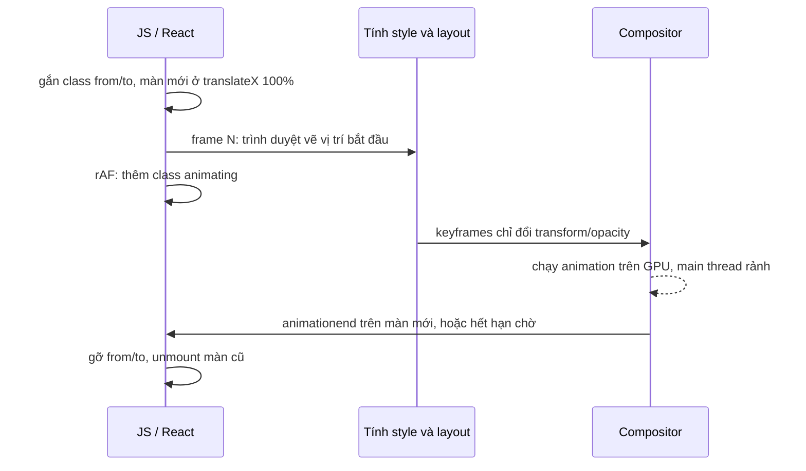

Mở Telegram Web, nhấn giữ (hoặc click chuột phải → Select) một tin nhắn. Ô soạn tin ở đáy **co lại** thành thanh "Đã chọn 1 · Chuyển tiếp · Xoá", như thể chính khung đó biến hình. Bấm qua các tab "Tất cả / Cá nhân / Kênh": gạch chân xanh **trượt và co giãn** từ tab cũ sang tab mới, còn danh sách chat trượt ngang theo.

Ba hiệu ứng này đều chạy mượt trên máy yếu vì chúng có chung một nguyên tắc: **chỉ animate `transform` và `opacity`**, và tính sẵn mọi con số trước khi animation bắt đầu. Bài này đọc cả ba trong code Telegram Web, viết lại bằng React, và sửa một lỗi làm `Transition` có thể kẹt mãi ở trạng thái "đang chạy".

> [!TIP]
> **Tóm tắt**
> - **Biến hình bằng `scaleX` tính sẵn**: hai khung chồng lên nhau, khung đang ẩn được scale tới đúng bề rộng của khung kia. Tỉ lệ tính từ bề rộng vùng chứa, lúc bấm không đo DOM.
> - **Transition giữ màn cũ**: lưu hàm render của màn đang rời đi để nó còn sống trong lúc trượt ra; gắn class `from`/`to`, frame sau mới bật `animating`, đợi `animationend`.
> - **Gạch chân tab trượt (FLIP)**: đặt gạch chân tab mới trùng chỗ gạch chân tab cũ bằng `translate + scale`, rồi gỡ transform để nó tự chạy về.
> - Luôn có **hạn chờ** cho `animationend`: bản gốc không có, màn mới mà không có animation (CSS bị ghi đè, `display: none`…) là `Transition` kẹt mãi.

<iframe class="demo-frame" src="/demos/web-patterns/index.html?theme=dark#/tg-composer-morph" title="Demo tg-composer-morph" loading="lazy" style="height: 1100px"></iframe>

<p class="demo-links">▶ <a href="/demos/web-patterns/index.html#/tg-composer-morph" target="_blank" rel="noopener">Mở demo toàn màn hình ↗</a> · <a href="https://stackblitz.com/github/hunghg255/blog-hunghg/tree/master/examples/web-patterns?file=src/lib/tgTransition.tsx" target="_blank" rel="noopener">Sửa code trên StackBlitz ↗</a> · <a href="https://github.com/hunghg255/blog-hunghg/blob/master/examples/web-patterns/src/lib/tgTransition.tsx" target="_blank" rel="noopener">Xem source trên GitHub ↗</a></p>

Trong demo: bấm "Chọn tin nhắn" để xem ô soạn tin biến hình (tắt ô "Biến hình" để so với kiểu chỉ mờ dần). Ở phần 2, bấm các tab, đổi kiểu chuyển cảnh, rồi bật hai ô ở cuối để thấy lỗi của bản gốc: `Transition` kẹt ở "đang chạy" và hai màn chồng lên nhau mãi.

## Telegram làm thế nào?

### 1. Ô soạn tin biến hình: `calculateMiddleFooterTransforms`

Ô soạn tin (`#message-compose`) và thanh chọn tin (`.MessageSelectToolbar`) nằm **chồng lên nhau** ở đáy cột giữa. Khi vào chế độ chọn, ô soạn tin bị scale ngang về đúng bề rộng thanh chọn rồi phần ruột mờ đi; thanh chọn hiện ra ở đúng chỗ đó và giãn về kích thước của nó. Hai chuyển động khớp nhau nên mắt thấy *một* khung đổi hình.

Để khớp được, phải biết tỉ lệ giữa hai bề rộng. [`components/middle/helpers/calculateMiddleFooterTransforms.ts`](https://github.com/hunghg255/codebase/blob/main/web.telegram.org/src/components/middle/helpers/calculateMiddleFooterTransforms.ts) **tự dựng lại phép tính layout** từ bề rộng cửa sổ, không đo phần tử nào:

```ts
const composerWidth = canPost ? messageListWidth - sidePadding - sendButtonWidth : messageListWidth - sidePadding;
const toolbarWidth = windowWidth > MOBILE_SCREEN_MAX_WIDTH
  ? Math.min(messageListWidth - sidePadding, MAX_TOOLBAR_WIDTH)
  : messageListWidth - sidePadding;

const composerHiddenScale = toolbarWidth / composerWidth;
const toolbarHiddenScale = composerWidth / toolbarWidth;
const composerTranslateX = canPost ? (sendButtonWidth / 2) * toolbarHiddenScale : 0;
const toolbarTranslateX = canPost ? (sendButtonWidth / 2) * -1 * composerHiddenScale : 0;
```

Ở đầu hàm, `messageListWidth` được tính lại từ `windowWidth` theo đúng các luật CSS của layout (cột trái `clamp(25%|40%, 18rem, 26.5rem)`, danh sách tối đa 45.5rem), `sendButtonWidth` là 4rem (3.375rem trên mobile).

`MiddleColumn.tsx` đặt kết quả thành CSS var (`--composer-hidden-scale`, `--toolbar-hidden-scale`, `--composer-translate-x`…) trên cột giữa, và tính lại chỉ khi bề rộng cửa sổ đổi (`useMemo` theo `windowWidth`). CSS làm phần còn lại:

```css
#MiddleColumn .Composer #message-compose {
  transform: scaleX(1) translateX(0);
  transition: transform var(--select-transition), border-bottom-right-radius var(--select-transition);
}
#MiddleColumn .Composer:not(.shown) #message-compose {
  transform: scaleX(var(--composer-hidden-scale, 1)) translateX(var(--composer-translate-x, 0));
}
#MiddleColumn .Composer:not(.shown) .message-input-wrapper { opacity: 0; }
#MiddleColumn .Composer:not(.shown) > .Button { opacity: 0 !important; transform: scale(0.5); }
```

Có một lỗi nhỏ trong CSS của thanh chọn tin (file `MessageSelectToolbar.scss`): selector biên dịch ra là `.MessageSelectToolbar:not(.shown)-inner`. Có lẽ do viết `&-inner` lồng bên trong `&:not(.shown)` trong SCSS. Selector đó không khớp phần tử nào, nhưng không ai thấy, vì luật đúng (`.MessageSelectToolbar:not(.shown).with-composer .MessageSelectToolbar-inner`) đứng ngay dưới.

### 2. `Transition`: giữ màn cũ để nó còn trượt ra được

Trong React, đổi `activeKey` là màn cũ unmount ngay. Muốn màn cũ trượt ra trong khi màn mới trượt vào, cả hai phải cùng tồn tại một lúc. [`components/ui/Transition.tsx`](https://github.com/hunghg255/codebase/blob/main/web.telegram.org/src/components/ui/Transition.tsx) giải quyết bằng cách **lưu hàm render của từng key** trong một ref:

```tsx
const rendersRef = useRef<Record<number, ChildrenFn | typeof CLEANED_UP>>({});
// ...
if (!renderCount && activeKeyChanged) {
  rendersRef.current = { [prevActiveKey]: rendersRef.current[prevActiveKey] };
}
rendersRef.current[activeKey] = children;
```

Khi key đổi, trong `useLayoutEffect` nó gắn class cho từng con: màn cũ `from`, màn mới `to`, các màn nằm giữa (khi nhảy nhiều bậc với `renderCount`) là `through` và bị ẩn. Rồi:

```tsx
requestAnimationFrame(() => {
  container.classList.add('animating');
  // ...
  const toNode = name === 'mv-slide' ? childNodes[activeIndex].firstChild : childNodes[activeIndex];
  if (animationLevel > 0 && toNode) {
    waitForAnimationEnd(toNode, onAnimationEnd);
  } else {
    onAnimationEnd();
  }
});
```

Lý do phải đợi một frame: CSS đặt sẵn `.slide > .to { transform: translateX(100%) }`. Frame đầu, trình duyệt vẽ màn mới ở vị trí bắt đầu (ngoài khung). Frame sau mới thêm `.animating` để keyframes chạy. Gộp hai bước vào cùng một frame thì có thể thấy màn mới nhảy vào trước khi animation kịp chạy.

Xong animation, `onAnimationEnd` gỡ `from/to`, đặt `active` cho màn mới, và nếu `shouldCleanup` thì thay hàm render của màn cũ bằng `Symbol('CLEANED_UP')` để nó unmount. Ngoài ra component còn:

- `direction: 'auto' | 'inverse' | 1 | -1`: key nhỏ hơn thì chạy ngược (`backwards`), như vuốt về tab trước.
- `shouldRestoreHeight`: các màn đều `position: absolute` khi đang chạy, nên chiều cao khung chứa được gán bằng màn active.
- Phát "heavy animation event" trong lúc chạy, để các phần nặng khác (sticker, video) tạm dừng, và đổi ngay không animation khi người dùng chọn mức animation 0.
- Mười kiểu CSS: `slide`, `slide-fade`, `zoom-fade`, `slide-layers` (màn dưới tối dần), `reveal` (lộ dần bằng `clip-path`), `push-slide`…

### Lỗi: `waitForAnimationEnd` không có hạn chờ, và điều kiện lọc bị đảo

[`util/cssAnimationEndListeners.ts`](https://github.com/hunghg255/codebase/blob/main/web.telegram.org/src/util/cssAnimationEndListeners.ts):

```ts
function waitForEndEvent(eventType, node, handler, detailedName?: string) {
  let isHandled = false;

  node.addEventListener(eventType, function handleAnimationEnd(e) {
    if (isHandled || e.target !== e.currentTarget) {
      return;
    }

    if (detailedName && (
      (e instanceof TransitionEvent && e.propertyName === detailedName)
      || (e instanceof AnimationEvent && e.animationName === detailedName)
    )) {
      return;
    }

    isHandled = true;
    node.removeEventListener(eventType, handleAnimationEnd);
    setTimeout(() => { handler(); }, ANIMATION_END_DELAY);
  });
}
```

Hai vấn đề:

1. **Điều kiện lọc bị đảo.** Truyền `detailedName = 'transform'` với ý "chỉ chờ transition của `transform`", nhưng code lại `return` (bỏ qua) đúng event có tên đó và nhận event *khác*. Đáng ra phải là `!==`. Trong bản này chưa nơi nào truyền tham số thứ ba nên lỗi chưa lộ ra.
2. **Không có hạn chờ.** Nếu `animationend` không bao giờ đến, `handler` không bao giờ chạy. Chuyện này xảy ra khá dễ: CSS bị ghi đè thành `animation: none`, phần tử bị `display: none` giữa chừng, tab bị ẩn khi animation đang chạy… Lúc đó `Transition` giữ cả hai màn mãi, class `animating` không bao giờ được gỡ, và heavy animation event không kết thúc (sticker, video đứng im theo). Demo tái hiện được: bật cả hai ô ở cuối phần 2 rồi đổi tab, trạng thái hiện "đang chạy" và đếm mãi.

### 3. Gạch chân tab bay: `Tab.tsx`

Mỗi tab có một thẻ `<i>` gạch chân **riêng**, không phải một gạch chân dùng chung chạy qua lại. Khi một tab thành active ([`components/ui/Tab.tsx`](https://github.com/hunghg255/codebase/blob/main/web.telegram.org/src/components/ui/Tab.tsx)):

```tsx
// We move and resize our indicator so it repeats the position and size of the previous one.
const shiftLeft = currentIndicator.parentElement!.offsetLeft - indicator.parentElement!.offsetLeft;
const scaleFactor = currentIndicator.clientWidth / indicator.clientWidth;
indicator.style.transform = `translate3d(${shiftLeft}px, 0, 0) scale3d(${scaleFactor}, 1, 1)`;

// 3 AFs needed here to synchronize animations with Transition component
requestAnimationFrame(() => {
  requestAnimationFrame(() => {
    requestAnimationFrame(() => {
      // Now we remove the transform to let it animate to its own position and size.
      indicator.classList.add('animate');
      indicator.style.transform = 'none';
    });
  });
});
```

Đây chính là kỹ thuật **FLIP** (First, Last, Invert, Play): phần tử đã ở vị trí cuối (Last), ta dùng transform đảo nó về vị trí đầu (Invert), rồi gỡ transform cho nó tự chạy (Play). CSS đặt `transform-origin: left` cho gạch chân để `scaleX` co giãn từ mép trái. `TabList.tsx` còn cuộn ngang để tab active nằm giữa, và **bỏ qua nếu chỉ lệch dưới 16px** (`TAB_SCROLL_THRESHOLD_PX`) để không giật vì vài pixel.

Comment "3 AFs" cho biết con số 3 không đến từ trình duyệt mà từ nhu cầu **khớp nhịp** với `Transition` của danh sách bên dưới (vốn chờ 1 frame rồi mới bật animation): có lẽ để gạch chân và danh sách bắt đầu chạy cùng lúc.

## Bên trong trình duyệt: vì sao phải đợi một frame?

Gán `transform` rồi gỡ ngay trong cùng một đoạn JS thì trình duyệt không thấy gì để animate: style chỉ được tính lại khi JS nhường luồng (hoặc khi bị ép), nên hai lần gán gộp làm một và phần tử nhảy thẳng tới đích. Có hai cách để "chốt" trạng thái bắt đầu:

1. **Đợi frame sau** (`requestAnimationFrame`, đôi khi phải hai lần): trình duyệt đã tính style và vẽ trạng thái đầu. Telegram dùng cách này.
2. **Ép tính style ngay** bằng cách đọc một thuộc tính layout (`el.offsetWidth`, `getBoundingClientRect()`), rồi mới gỡ transform. Bản viết lại dùng cách này cho gạch chân tab: không phải đợi frame nào, nhưng mỗi lần là một lần layout đồng bộ (với một phần tử nhỏ thì rẻ).



Vì chỉ đổi `transform` và `opacity`, trình duyệt không phải layout lại hay vẽ lại từng frame: các lớp đã vẽ được compositor dịch chuyển, co giãn, làm mờ. Đó là lý do biến hình ô soạn tin bằng `scaleX` mượt hơn nhiều so với animate `width` (đổi `width` thì mỗi frame phải layout lại cả footer).

Cái giá của `scaleX`: **nội dung bên trong cũng bị kéo dãn**. Chữ "Nhập tin nhắn…" mà còn hiện trong lúc scale thì sẽ méo. Telegram (và bản viết lại) làm mờ phần ruột về `opacity: 0` cùng lúc, nên mắt chỉ thấy cái khung nền co giãn.

## Viết lại

Phần biến hình là một hàm thuần (`morphVars` bọc kết quả thành CSS var, xem file đầy đủ bên dưới):

```tsx title=src/lib/tgTransition.tsx
export function calcMorphScales({ containerWidth, sidePadding, sendButtonWidth, maxToolbarWidth }: MorphInput) {
  const composerWidth = containerWidth - sidePadding - sendButtonWidth;
  const toolbarWidth = Math.min(containerWidth - sidePadding, maxToolbarWidth);
  const composerHiddenScale = toolbarWidth / composerWidth;
  const toolbarHiddenScale = composerWidth / toolbarWidth;
  return {
    composerWidth,
    toolbarWidth,
    composerHiddenScale,
    toolbarHiddenScale,
    // ô soạn tin lệch trái nửa nút gửi so với thanh chọn tin (căn giữa); dịch bù lại.
    // Đơn vị đo TRƯỚC khi scale nên phải nhân với nghịch đảo tỉ lệ
    composerTranslateX: sendButtonWidth ? (sendButtonWidth / 2) * toolbarHiddenScale : 0,
    toolbarTranslateX: sendButtonWidth ? -(sendButtonWidth / 2) * composerHiddenScale : 0,
  };
}
```

`Transition` cho React, bản rút gọn của Telegram (không có `renderCount`/`through`). Phần quan trọng là đoạn chờ kết thúc, có hạn chờ:

```tsx title=src/lib/tgTransition.tsx
    const toNode = container.querySelector<HTMLElement>(':scope > .to');
    let raf = requestAnimationFrame(() => {
      // frame sau mới bật animation: frame này để trình duyệt vẽ vị trí bắt đầu (.from/.to)
      container.classList.add('animating');
      callbacksRef.current.onStart?.();
    });

    let done = false;
    let timer: number | undefined;
    const onEnd = (event: AnimationEvent) => {
      // animationend của phần tử con nổi bọt lên: chỉ tính của chính màn mới
      if (done || event.target !== event.currentTarget) return;
      done = true;
      raf = requestAnimationFrame(finish);
    };
    toNode?.addEventListener('animationend', onEnd);
    if (!legacyWait) {
      timer = window.setTimeout(() => {
        if (done) return;
        done = true;
        finish();
      }, timeoutMs);
    }
```

Gạch chân tab, phần FLIP:

```tsx title=src/lib/tgTransition.tsx
    const fromRect = from.getBoundingClientRect();
    const toRect = to.getBoundingClientRect();
    to.style.transition = 'none';
    to.style.transform = `translate3d(${fromRect.left - toRect.left}px, 0, 0) scale3d(${fromRect.width / toRect.width}, 1, 1)`;
    // đọc layout để trình duyệt "chốt" transform vừa gán; nếu không, hai lần gán bị gộp làm một
    // và không có animation. Telegram dùng 3 lần rAF (để khớp nhịp với Transition) cho cùng mục đích
    void to.offsetWidth;
    to.style.transition = '';
    to.style.transform = '';
```

::: spoiler Xem toàn bộ src/lib/tgTransition.tsx

```tsx title=src/lib/tgTransition.tsx
import { useLayoutEffect, useRef, useState, type CSSProperties, type ReactNode } from 'react';
import './tgTransition.css';

/**
 * Ba mẹo chuyển cảnh của Telegram Web:
 * 1. calcMorphScales: ô soạn tin "biến hình" thành thanh chọn tin bằng scaleX tính trước, không đo DOM.
 * 2. Transition: giữ màn cũ để chạy animation ra/vào, gắn class from/to, đợi animationend.
 * 3. useSlidingIndicator: gạch chân tab bay từ tab cũ sang tab mới (FLIP).
 */

// ---------- 1. Biến hình bằng scaleX ----------

export interface MorphInput {
  /** bề rộng vùng chứa (danh sách tin) */
  containerWidth: number;
  /** padding hai bên của footer */
  sidePadding: number;
  /** nút gửi bên phải ô soạn tin; 0 nếu không được gửi tin */
  sendButtonWidth: number;
  /** bề rộng tối đa của thanh chọn tin */
  maxToolbarWidth: number;
}

/**
 * Ô soạn tin và thanh chọn tin nằm chồng lên nhau. Khi đổi qua lại, cái đang hiện co/giãn theo
 * chiều ngang tới đúng bề rộng của cái kia rồi mờ đi, cái kia làm ngược lại: nhìn như MỘT khung
 * đang biến hình. Mọi con số đều tính từ bề rộng vùng chứa, lúc bấm không phải đo phần tử nào.
 */
export function calcMorphScales({ containerWidth, sidePadding, sendButtonWidth, maxToolbarWidth }: MorphInput) {
  const composerWidth = containerWidth - sidePadding - sendButtonWidth;
  const toolbarWidth = Math.min(containerWidth - sidePadding, maxToolbarWidth);
  const composerHiddenScale = toolbarWidth / composerWidth;
  const toolbarHiddenScale = composerWidth / toolbarWidth;
  return {
    composerWidth,
    toolbarWidth,
    composerHiddenScale,
    toolbarHiddenScale,
    // ô soạn tin lệch trái nửa nút gửi so với thanh chọn tin (căn giữa); dịch bù lại.
    // Đơn vị đo TRƯỚC khi scale nên phải nhân với nghịch đảo tỉ lệ
    composerTranslateX: sendButtonWidth ? (sendButtonWidth / 2) * toolbarHiddenScale : 0,
    toolbarTranslateX: sendButtonWidth ? -(sendButtonWidth / 2) * composerHiddenScale : 0,
  };
}

export function morphVars(input: MorphInput): CSSProperties {
  const m = calcMorphScales(input);
  return {
    '--composer-hidden-scale': m.composerHiddenScale,
    '--toolbar-hidden-scale': m.toolbarHiddenScale,
    '--composer-translate-x': `${m.composerTranslateX}px`,
    '--toolbar-translate-x': `${m.toolbarTranslateX}px`,
  } as CSSProperties;
}

// ---------- 2. Transition ----------

export type TransitionName = 'slide' | 'slide-fade' | 'zoom-fade' | 'reveal';

export interface TransitionProps {
  activeKey: number;
  name?: TransitionName;
  /** 'auto': key lớn hơn là đi tới; 'inverse': ngược lại */
  direction?: 'auto' | 'inverse' | 1 | -1;
  /** chờ animationend tối đa bao lâu (ms) rồi coi như xong */
  timeoutMs?: number;
  /**
   * Chỉ để demo: chờ animationend như bản gốc (không có hạn chờ). Màn mới không có animation
   * thì không bao giờ có animationend, Transition kẹt ở trạng thái đang chạy.
   */
  legacyWait?: boolean;
  className?: string;
  onStart?: () => void;
  onStop?: () => void;
  children: (key: number) => ReactNode;
}

const prefersReducedMotion = () =>
  typeof matchMedia === 'function' && matchMedia('(prefers-reduced-motion: reduce)').matches;

export function Transition({
  activeKey,
  name = 'slide',
  direction = 'auto',
  timeoutMs = 700,
  legacyWait = false,
  className,
  onStart,
  onStop,
  children,
}: TransitionProps) {
  const containerRef = useRef<HTMLDivElement>(null);
  // Lưu hàm render của từng key: màn cũ phải tiếp tục render trong lúc chạy animation ra.
  // Ghi ref trong lúc render là ngoại lệ có chủ ý: idempotent, render lại bao nhiêu lần cũng vậy.
  const rendersRef = useRef(new Map<number, (key: number) => ReactNode>());
  rendersRef.current.set(activeKey, children);

  // fromKey: màn đang rời đi (undefined khi không có animation)
  const [state, setState] = useState<{ shownKey: number; fromKey?: number }>({ shownKey: activeKey });
  if (state.shownKey !== activeKey) {
    // "cập nhật state theo prop trong lúc render" (mẫu React khuyên dùng thay cho useEffect)
    setState({ shownKey: activeKey, fromKey: state.shownKey });
  }
  const { fromKey } = state;

  const callbacksRef = useRef({ onStart, onStop });
  callbacksRef.current = { onStart, onStop };

  useLayoutEffect(() => {
    const container = containerRef.current;
    if (!container || fromKey === undefined) return;

    const finish = () => {
      container.classList.remove('animating', 'backwards');
      // bỏ hàm render của màn cũ để nó unmount
      for (const key of [...rendersRef.current.keys()]) if (key !== activeKey) rendersRef.current.delete(key);
      setState((s) => (s.shownKey === activeKey ? { shownKey: activeKey } : s));
      callbacksRef.current.onStop?.();
    };

    if (prefersReducedMotion()) {
      finish();
      return;
    }

    const isBackwards =
      direction === -1 ||
      (direction === 'auto' && fromKey > activeKey) ||
      (direction === 'inverse' && fromKey < activeKey);
    container.classList.remove('animating');
    container.classList.toggle('backwards', isBackwards);

    const toNode = container.querySelector<HTMLElement>(':scope > .to');
    let raf = requestAnimationFrame(() => {
      // frame sau mới bật animation: frame này để trình duyệt vẽ vị trí bắt đầu (.from/.to)
      container.classList.add('animating');
      callbacksRef.current.onStart?.();
    });

    let done = false;
    let timer: number | undefined;
    const onEnd = (event: AnimationEvent) => {
      // animationend của phần tử con nổi bọt lên: chỉ tính của chính màn mới
      if (done || event.target !== event.currentTarget) return;
      done = true;
      raf = requestAnimationFrame(finish);
    };
    toNode?.addEventListener('animationend', onEnd);
    if (!legacyWait) {
      timer = window.setTimeout(() => {
        if (done) return;
        done = true;
        finish();
      }, timeoutMs);
    }

    return () => {
      // đổi activeKey giữa chừng: bỏ animation dở, effect mới chạy từ màn hiện tại
      cancelAnimationFrame(raf);
      clearTimeout(timer);
      toNode?.removeEventListener('animationend', onEnd);
    };
  }, [activeKey, fromKey, direction, legacyWait, timeoutMs]);

  const keys = fromKey === undefined ? [activeKey] : [fromKey, activeKey];
  return (
    <div ref={containerRef} className={['tgt', name, className].filter(Boolean).join(' ')}>
      {keys.map((key) => {
        const render = rendersRef.current.get(key);
        const role = fromKey === undefined ? 'active' : key === activeKey ? 'to' : 'from';
        return (
          <div key={key} className={role} aria-hidden={role === 'from' || undefined}>
            {render?.(key)}
          </div>
        );
      })}
    </div>
  );
}

// ---------- 3. Gạch chân tab trượt ----------

/**
 * Mỗi tab có gạch chân riêng. Khi tab mới thành active: đặt gạch chân của nó trùng vị trí và bề rộng
 * gạch chân tab cũ (translate + scaleX), ép trình duyệt tính style, rồi gỡ transform để nó tự trượt
 * và co giãn về chỗ. Chỉ dùng transform nên chạy trên compositor.
 */
export function useSlidingIndicator(listRef: React.RefObject<HTMLElement | null>, activeIndex: number) {
  const prevRef = useRef<number | undefined>(undefined);

  useLayoutEffect(() => {
    const list = listRef.current;
    const prev = prevRef.current;
    prevRef.current = activeIndex;
    if (!list || prev === undefined || prev === activeIndex) return;

    const tabs = list.querySelectorAll<HTMLElement>('[data-tab]');
    const from = tabs[prev]?.querySelector<HTMLElement>('[data-indicator]');
    const to = tabs[activeIndex]?.querySelector<HTMLElement>('[data-indicator]');
    if (!from || !to) return;

    const fromRect = from.getBoundingClientRect();
    const toRect = to.getBoundingClientRect();
    to.style.transition = 'none';
    to.style.transform = `translate3d(${fromRect.left - toRect.left}px, 0, 0) scale3d(${fromRect.width / toRect.width}, 1, 1)`;
    // đọc layout để trình duyệt "chốt" transform vừa gán; nếu không, hai lần gán bị gộp làm một
    // và không có animation. Telegram dùng 3 lần rAF (để khớp nhịp với Transition) cho cùng mục đích
    void to.offsetWidth;
    to.style.transition = '';
    to.style.transform = '';

    // tab active luôn nằm trong tầm nhìn; lệch ít thì thôi để không giật
    const tab = tabs[activeIndex];
    const listRect = list.getBoundingClientRect();
    const tabRect = tab.getBoundingClientRect();
    const offset = tabRect.left + tabRect.width / 2 - (listRect.left + listRect.width / 2);
    if (Math.abs(offset) > 16) list.scrollBy({ left: offset, behavior: prefersReducedMotion() ? 'auto' : 'smooth' });
  }, [listRef, activeIndex]);
}
```

:::

::: spoiler Xem toàn bộ src/lib/tgTransition.css

```css title=src/lib/tgTransition.css
/* Transition: màn cũ (.from) và màn mới (.to) chồng lên nhau trong lúc chạy animation.
   Hai màn đều position: absolute nên khung chứa cần chiều cao cố định (Telegram: 100% cột). */
.tgt {
  position: relative;
  overflow: hidden;
  --tgt-duration: 350ms;
  --tgt-ease: cubic-bezier(0.25, 1, 0.5, 1);
}
.tgt > * {
  width: 100%;
  height: 100%;
  animation-fill-mode: forwards;
}
.tgt > .from,
.tgt > .to {
  position: absolute;
  inset: 0;
}
/* trước khi .animating được bật (1 frame), màn mới đứng sẵn ở vị trí bắt đầu */
.tgt.slide > .to {
  transform: translateX(100%);
}
.tgt.slide.backwards > .to {
  transform: translateX(-100%);
}
.tgt.slide.animating > .from {
  animation: tgt-slide-out var(--tgt-duration) var(--tgt-ease);
}
.tgt.slide.animating > .to {
  animation: tgt-slide-in var(--tgt-duration) var(--tgt-ease);
}
.tgt.slide.backwards.animating > .from {
  animation-name: tgt-slide-out-back;
}
.tgt.slide.backwards.animating > .to {
  animation-name: tgt-slide-in-back;
}

.tgt.slide-fade > .to {
  opacity: 0;
  transform: translateX(1.5rem);
}
.tgt.slide-fade.backwards > .to {
  transform: translateX(-1.5rem);
}
.tgt.slide-fade.animating > .from {
  animation: tgt-fade-out var(--tgt-duration) var(--tgt-ease);
}
.tgt.slide-fade.animating > .to {
  animation: tgt-slide-fade-in var(--tgt-duration) var(--tgt-ease);
}

.tgt.zoom-fade > .to {
  opacity: 0;
}
.tgt.zoom-fade.animating > .from {
  animation: tgt-fade-out 150ms ease;
}
.tgt.zoom-fade.animating > .to {
  animation: tgt-zoom-in 150ms ease;
}

/* reveal: màn mới lộ dần từ trái sang bằng clip-path */
.tgt.reveal > .to {
  clip-path: inset(0 100% 0 0);
}
.tgt.reveal.animating > .to {
  animation: tgt-reveal var(--tgt-duration) var(--tgt-ease);
}

@keyframes tgt-slide-in {
  from { transform: translateX(100%); }
  to { transform: translateX(0); }
}
@keyframes tgt-slide-out {
  from { transform: translateX(0); }
  to { transform: translateX(-100%); }
}
@keyframes tgt-slide-in-back {
  from { transform: translateX(-100%); }
  to { transform: translateX(0); }
}
@keyframes tgt-slide-out-back {
  from { transform: translateX(0); }
  to { transform: translateX(100%); }
}
@keyframes tgt-fade-out {
  from { opacity: 1; }
  to { opacity: 0; }
}
@keyframes tgt-slide-fade-in {
  to { opacity: 1; transform: translateX(0); }
}
@keyframes tgt-zoom-in {
  from { opacity: 0; transform: scale(0.95); }
  to { opacity: 1; transform: scale(1); }
}
@keyframes tgt-reveal {
  to { clip-path: inset(0 0 0 0); }
}

@media (prefers-reduced-motion: reduce) {
  .tgt > * {
    animation: none !important;
  }
}
```

:::

## Đi qua code

- **`calcMorphScales`** nhận bề rộng vùng chứa và trả hai tỉ lệ nghịch đảo nhau. Phần `translateX` cần chú ý: CSS viết `scaleX(s) translateX(t)`, các hàm transform áp từ phải sang trái lên phần tử, nên `t` được đo trong hệ toạ độ **đã scale**. Muốn dịch thật nửa nút gửi (`send/2` px) thì phải truyền `send/2 ÷ s`, chính là `send/2 × toolbarHiddenScale`. Trong demo, kết quả đo bằng Playwright: thanh chọn tin lúc ẩn nằm đúng `[38px, 768px]` như ô soạn tin, còn ô soạn tin lúc ẩn nằm đúng `[194px, 512px]` như thanh chọn tin.
- **Lưu hàm render vào ref ngay trong lúc render**: phá quy tắc "render phải thuần" của React, nhưng chấp nhận được vì thao tác idempotent (render lại bao nhiêu lần thì map vẫn vậy). Việc "màn nào đang rời đi" thì để trong state, cập nhật theo mẫu *cập nhật state khi prop đổi ngay trong render* mà tài liệu React khuyên dùng thay cho `useEffect`.
- **Effect có cleanup**: đổi tab liên tục giữa lúc đang chạy, cleanup huỷ rAF, timer, listener của lượt cũ; lượt mới chạy từ màn đang hiện. Demo kiểm bằng cách bấm 4 tab cách nhau 60ms: cuối cùng chỉ còn đúng một màn `active`.
- **`event.target !== event.currentTarget`**: `animationend` nổi bọt, nên animation của bất kỳ phần tử con nào trong màn mới (một spinner chẳng hạn) cũng kích hoạt listener. Phải lọc chỉ lấy của chính màn mới (Telegram cũng làm vậy).
- **`prefers-reduced-motion`**: đổi ngay, không animation. Telegram dùng cài đặt riêng (mức animation 0/1/2 trong Settings) chứ không đọc media query này.

**Khác bản gốc:**

- `Transition` có `timeoutMs` (mặc định 700ms): `animationend` không đến thì vẫn kết thúc. Ô "Chờ animationend như bản gốc" trong demo tắt hạn chờ để tái hiện lỗi.
- Không có `renderCount`/`through` (giữ cố định N ô) và `shouldRestoreHeight`. Bản viết lại chỉ giữ 2 màn: đang đi và đang đến.
- Gạch chân tab "chốt" trạng thái đầu bằng `offsetWidth` thay vì 3 lần rAF, và đọc `getBoundingClientRect` của chính hai gạch chân (đúng cả khi gạch chân cũ đang trượt dở).
- `calcMorphScales` nhận bề rộng vùng chứa (đo bằng ResizeObserver, tính lại khi vùng chứa đổi cỡ) thay vì dựng lại công thức layout từ bề rộng cửa sổ. Ý chính giữ nguyên: lúc bấm không đo gì.

## Tại sao không làm cách khác?

- **Animate `width`** của khung: dễ viết, nhưng mỗi frame phải layout lại, và nội dung bên trong bị dàn trang lại liên tục (chữ xuống dòng, nút nhảy).
- **Đo hai khung lúc bấm** (`getBoundingClientRect`): đúng trong mọi trường hợp, nhưng lúc bấm là lúc cần phản hồi nhanh nhất. Telegram tính trước theo `windowWidth` vì layout của nó có công thức rõ ràng.
- **Một gạch chân dùng chung** chạy qua lại giữa các tab: phải tính `left/width` theo tab active mỗi lần render, và cần một phần tử nằm ngoài danh sách tab. Mỗi tab một gạch chân + FLIP thì tab active luôn có gạch chân đúng chỗ ngay cả khi JS chưa chạy.
- **CSS View Transitions** (`document.startViewTransition`, trong cùng tài liệu đã có ở Chrome và Safari, tính tới 10/2026 xem [caniuse](https://caniuse.com/view-transitions)): tự làm phần FLIP và giữ "ảnh chụp" của màn cũ. Rất hợp cho chuyển trang và gạch chân tab (đặt `view-transition-name` cho gạch chân). Nhưng mỗi lúc chỉ có một view transition trên cả tài liệu (gọi cái mới thì cái đang chạy bị bỏ qua), và trong lúc chuyển, lớp giả `::view-transition` phủ lên trang. Telegram cần nhiều hiệu ứng độc lập chạy song song (danh sách trượt, gạch chân bay, composer biến hình) mà trang vẫn bấm được, nên tự làm vẫn có lý.

## Edge case và cạm bẫy

- **Không có hạn chờ cho `animationend`/`transitionend`** là lỗi phổ biến nhất của loại component này. Hạn chờ nên lớn hơn thời lượng animation dài nhất một chút.
- **Tab bị ẩn giữa animation**: trình duyệt có thể dừng hẳn animation và rAF. Có hạn chờ bằng `setTimeout` thì vẫn kết thúc (timer ở tab ẩn có thể bị trì hoãn, nhưng vẫn chạy).
- **Khung chứa không có chiều cao**: `.from` và `.to` đều `position: absolute` khi đang chạy, khung chứa co về 0 nếu không đặt chiều cao. Telegram cho `Transition` cao 100% cột, hoặc dùng `shouldRestoreHeight`.
- **Màn cũ vẫn tương tác được**: trong lúc trượt ra, người dùng vẫn có thể click vào màn cũ. Đặt `aria-hidden` (bản viết lại có) và `pointer-events: none` cho `.from` nếu cần.
- **Focus**: phần tử đang có focus mà nằm trong màn cũ thì focus biến mất khi màn cũ unmount. Nên chuyển focus sang màn mới sau `onStop`.
- **`scaleX` làm méo bo góc**: `border-radius` cũng bị scale theo, góc tròn thành elip. Với tỉ lệ gần 1 (0.7–1.3) khó nhận ra; tỉ lệ xa hơn thì nên dùng `clip-path: inset(... round ...)` thay vì scale.

## Dùng trong dự án

```tsx
const [active, setActive] = useState(0);
const listRef = useRef<HTMLDivElement>(null);
useSlidingIndicator(listRef, active); // mỗi tab: <button data-tab>…<i data-indicator /></button>

<Transition activeKey={active} name="slide" className="panels">
  {(key) => tabs[key].render()}
</Transition>
```

CSS cần có: `.panels { height: ... }` (vì các màn absolute khi chạy), gạch chân `transform-origin: left` và `transition: transform`.

## Kiểm thử

::: spoiler Ví dụ test (bản phác, không có trong repo)

```ts
import { describe, expect, it } from 'vitest';
import { calcMorphScales } from './tgTransition';

describe('calcMorphScales', () => {
  const input = { containerWidth: 824, sidePadding: 0, sendButtonWidth: 56, maxToolbarWidth: 512 };

  it('scale ô soạn tin về đúng bề rộng thanh chọn tin và ngược lại', () => {
    const m = calcMorphScales(input);
    expect(m.composerWidth).toBe(768);
    expect(m.toolbarWidth).toBe(512);
    expect(m.composerWidth * m.composerHiddenScale).toBeCloseTo(m.toolbarWidth);
    expect(m.toolbarWidth * m.toolbarHiddenScale).toBeCloseTo(m.composerWidth);
  });

  it('translateX sau khi scale bằng đúng nửa nút gửi', () => {
    const m = calcMorphScales(input);
    // scaleX(s) translateX(t): dịch thật = t × s
    expect(m.composerTranslateX * m.composerHiddenScale).toBeCloseTo(28);
  });

  it('không được gửi tin thì không dịch', () => {
    expect(calcMorphScales({ ...input, sendButtonWidth: 0 }).composerTranslateX).toBe(0);
  });
});

// Transition: test bằng trình duyệt thật (Playwright). Ca quan trọng nhất:
// ép `animation: none` cho màn mới, đổi activeKey, khẳng định sau timeoutMs + 100ms
// container chỉ còn một con với class `active` và onStop đã được gọi.
```

:::

## So với thư viện

- **Framer Motion** (`AnimatePresence`, `layoutId`): giữ phần tử đang rời đi cho tới khi animation xong và làm FLIP tự động cho `layoutId`, đúng hai việc của `Transition` và gạch chân tab. Đổi lại thêm một thư viện vài chục KB.
- **react-transition-group** (`CSSTransition`, `SwitchTransition`): cũng gắn class enter/exit và có prop `timeout` bắt buộc. Thư viện này buộc bạn khai báo thời lượng, nên tránh được lỗi "chờ mãi" ở trên.
- **View Transitions API**: như phần "Tại sao không làm cách khác".

Telegram tự viết vì cần ít thứ (vài kiểu slide/fade), cần kiểm soát mức animation và tạm dừng phần nặng trong lúc chuyển, và vì cả app chạy trên framework tự viết (Teact), không dùng được thư viện React.

---

Bài này thuộc series **[Học từ mã nguồn Telegram](/series/telegram)** (15 bài, đọc theo thứ tự).

::: spoiler Xem nhanh danh sách bài trong series

*Mở đầu*

- [Mở đầu: bên trong Telegram Web A](/blogs/learn-from-telegram-source-code)

*Phần 1: dữ liệu và đồng bộ*

- [#1 Gửi tin lạc quan, khớp tin thật bằng randomId](/blogs/telegram-optimistic-send)
- [#2 Lịch sử tin nhắn chia hai đảo](/blogs/telegram-message-history-islands)
- [#3 Lưu global state lúc rảnh, chỉ giữ phần cần](/blogs/telegram-persist-global-state)
- [#4 Gom update realtime theo nhịp animation](/blogs/telegram-realtime-update-batching)
- [#5 Store tự viết và diff danh sách có key](/blogs/telegram-teactn-store-fast-list)

*Phần 2: animation và giao diện*

- [#6 Animation sắp xếp danh sách chat không đo DOM](/blogs/telegram-chat-list-flip)
- [#7 Ảnh bay giữa hai cây DOM trong media viewer](/blogs/telegram-media-viewer-ghost)
- [#8 Bố cục album chọn theo hàm chi phí](/blogs/telegram-album-layout)
- [#9 Giờ gửi nằm gọn trong bong bóng chat](/blogs/telegram-bubble-meta-spacer)
- **#10 Composer biến hình, Transition và gạch chân tab** (bài này)

*Phần 3: media, mobile, thông báo*

- [#11 Thumbnail 100 byte và viền sticker nén](/blogs/telegram-tiny-thumbnails)
- [#12 Player sticker: DPR, hạ fps, cache khung](/blogs/telegram-lottie-player)
- [#13 Mobile: --vh, bàn phím ảo, nhấn giữ, số điện thoại](/blogs/telegram-mobile-viewport-touch)
- [#14 Web Push không trùng và đánh dấu đã đọc](/blogs/telegram-push-dedupe-read-receipts)

:::

Code + demo: [`examples/web-patterns`](https://github.com/hunghg255/blog-hunghg/tree/master/examples/web-patterns) · [Mở trên StackBlitz](https://stackblitz.com/github/hunghg255/blog-hunghg/tree/master/examples/web-patterns)
