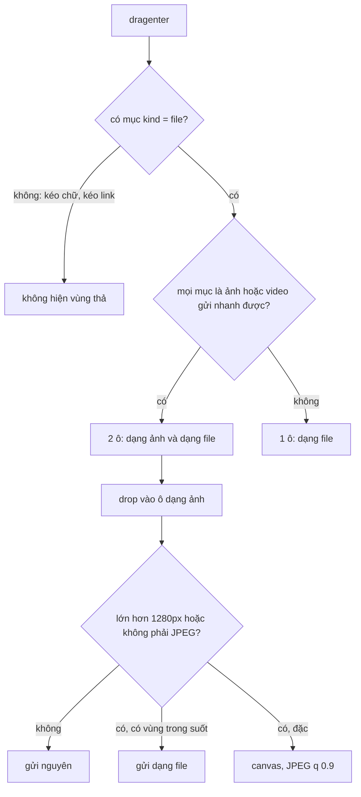

Kéo một tấm ảnh từ máy vào khung chat Telegram Web A: khung chat chia làm **hai ô**, "gửi dạng ảnh" (có nén, hiện ngay trong chat) và "gửi dạng file" (giữ nguyên). Kéo một file PDF vào thì chỉ có **một ô**. Điều thú vị: lúc vùng thả hiện ra, trình duyệt **chưa cho đọc** file người dùng đang kéo, vậy làm sao biết đó là ảnh hay PDF?

Bài này đọc ba file nhỏ trong Telegram Web A:

- `MiddleColumn.tsx` + `DropArea.tsx`: vùng thả 1 hay 2 ô, ẩn đúng lúc, không nháy.
- `buildAttachment.ts`: ảnh lớn hơn 1280px hoặc không phải JPEG thì vẽ lại lên canvas và nén trước khi gửi.
- `util/clipboard.ts`: copy ảnh (vẽ lại thành PNG) và copy chữ (textarea ẩn, giữ nguyên vùng đang bôi của người dùng).

Mỗi file có một lỗi nhỏ, demo tái hiện được cả ba.

> [!TIP]
> **Tóm tắt**
> - Ở `dragenter`, `dataTransfer.items` cho biết `kind` và MIME của từng mục (chưa cho nội dung). Toàn ảnh/video gửi nhanh được thì 2 ô, còn lại 1 ô. Bỏ `text/uri-list` mà Firefox tự thêm.
> - Chỉ tin `dragleave` có `relatedTarget == null`, hẹn ẩn 150ms, `dragover` tới thì huỷ hẹn: vùng thả không nháy khi rê qua phần tử con.
> - Nén: thu cạnh dài về 1280px, `canvas.toBlob(…, 'image/jpeg', q)`. Bản gốc truyền `q = 100` (ngoài khoảng 0..1, trình duyệt bỏ qua) và nén cả PNG trong suốt thành JPEG nền đen.
> - Copy ảnh: vẽ lại thành PNG, truyền **promise** vào `ClipboardItem` để vẫn nằm trong cú click của người dùng.

<iframe class="demo-frame" src="/demos/web-patterns/index.html?theme=dark#/tg-drop-zone" title="Demo tg-drop-zone" loading="lazy" style="height: 1700px"></iframe>

<p class="demo-links">▶ <a href="/demos/web-patterns/index.html#/tg-drop-zone" target="_blank" rel="noopener">Mở demo toàn màn hình ↗</a> · <a href="https://stackblitz.com/github/hunghg255/blog-hunghg/tree/master/examples/web-patterns?file=src/lib/tgDropZone.ts" target="_blank" rel="noopener">Sửa code trên StackBlitz ↗</a> · <a href="https://github.com/hunghg255/blog-hunghg/blob/master/examples/web-patterns/src/lib/tgDropZone.ts" target="_blank" rel="noopener">Xem source trên GitHub ↗</a></p>

Thử trong demo: kéo một ảnh và một file PDF từ máy vào khung chat, hoặc bấm ba nút giả lập. Nút "đoạn chữ đang bôi" cho thấy chỗ khác nhau giữa bản gốc và bản sửa. Phần 2 nén ba ảnh mẫu, phần 3 copy ảnh rồi dán vào ô bên dưới.

## Telegram làm thế nào?

### Một ô hay hai ô

Trong [`components/middle/MiddleColumn.tsx`](https://github.com/hunghg255/codebase/blob/main/web.telegram.org/src/components/middle/MiddleColumn.tsx):

```ts
function canBeQuicklyUploaded(item: DataTransferItem) {
  return item.kind === 'file' && item.type && CONTENT_TYPES_FOR_QUICK_UPLOAD.has(item.type);
}

const handleDragEnter = useCallback((e) => {
  if (IS_TOUCH_ENV) return;

  const { items } = e.dataTransfer || {};
  const shouldDrawQuick = items && Array.from(items)
    // Filter unnecessary element for drag and drop images in Firefox (https://github.com/Ajaxy/telegram-tt/issues/49)
    .filter((item) => item.type !== 'text/uri-list')
    .every(canBeQuicklyUploaded);

  setDropAreaState(shouldDrawQuick ? DropAreaState.QuickFile : DropAreaState.Document);
}, []);
```

`CONTENT_TYPES_FOR_QUICK_UPLOAD` trong `config.ts` là `image/png`, `image/gif`, `image/jpeg`, `video/mp4`, `video/avi`, `video/quicktime`. Chi tiết `text/uri-list` có link tới issue của repo: kéo ảnh từ một trang web khác, Firefox gửi kèm cả URL của ảnh như một mục chữ, làm `every` trả `false` dù người dùng chỉ kéo một ảnh.

**Lỗi 1**: không có bước kiểm tra "có ít nhất một file". Kéo một đoạn chữ đang bôi trong chính trang (hoặc kéo một link), `items` chỉ có `text/plain`, `text/html`: `every(canBeQuicklyUploaded)` là `false`, nên state thành `Document` và **vùng thả "gửi dạng file" hiện lên** dù không có file nào. Thả xuống thì `handleFilesDrop` thấy `files.length === 0` và không làm gì; vùng thả chỉ biến mất nhờ `onDrop={onHide}`. Demo phần 1 bấm "Giả lập kéo: đoạn chữ đang bôi": kiểu bản gốc ra "1 ô (dạng file)", bản sửa ra "không hiện".

### Ẩn vùng thả đúng lúc

[`components/middle/composer/DropArea.tsx`](https://github.com/hunghg255/codebase/blob/main/web.telegram.org/src/components/middle/composer/DropArea.tsx):

```ts
const DROP_LEAVE_TIMEOUT_MS = 150;

const handleDragLeave = useCallback((e) => {
  e.stopPropagation();
  const { target: fromTarget, relatedTarget: toTarget } = e;

  // Esc button pressed during drag event
  if ((fromTarget as HTMLDivElement).matches('.DropTarget, .DropArea') && !toTarget) {
    hideTimeoutRef.current = window.setTimeout(() => onHide(), DROP_LEAVE_TIMEOUT_MS);
  }
}, [onHide]);

const handleDragOver = () => {
  if (hideTimeoutRef.current) window.clearTimeout(hideTimeoutRef.current);
};
```

Vấn đề kinh điển của kéo-thả: `dragleave` bắn mỗi khi con trỏ đi từ phần tử cha **vào phần tử con** (ô thả, chữ trong ô). Ẩn ngay ở `dragleave` thì vùng thả nháy liên tục. Telegram chỉ tin `dragleave` có `relatedTarget` rỗng, tức con trỏ đi ra **ngoài cửa sổ** hoặc người dùng bấm Esc huỷ kéo, rồi vẫn chờ thêm 150ms; nếu `dragover` tới trong lúc đó (con trỏ quay lại) thì huỷ. Esc còn được bắt riêng qua `captureEscKeyListener`.

### Nén ảnh trước khi gửi

[`components/middle/composer/helpers/buildAttachment.ts`](https://github.com/hunghg255/codebase/blob/main/web.telegram.org/src/components/middle/composer/helpers/buildAttachment.ts):

```ts
const MAX_QUICK_IMG_SIZE = 1280; // px

if (width > MAX_QUICK_IMG_SIZE || height > MAX_QUICK_IMG_SIZE || mimeType !== 'image/jpeg') {
  const newBlob = await squeezeImage(img);
  if (newBlob) {
    URL.revokeObjectURL(blobUrl);
    return buildAttachment(filename, newBlob, true, options);  // gọi lại với blob mới
  } else {
    return buildAttachment(filename, blob, false, options);   // nén lỗi: gửi dạng file
  }
}

function squeezeImage(img) {
  // … thu cạnh dài về 1280, giữ tỉ lệ
  ctx.drawImage(img, 0, 0, img.width, img.height, 0, 0, width, height);
  canvas.toBlob(resolve, 'image/jpeg', 100);
}
```

Mẹo đệ quy gọn: sau khi nén, blob mới là JPEG ≤ 1280px nên lần gọi lại đi thẳng vào nhánh "đã đạt", không nén lần nữa. Video dưới 10MB cũng được gửi dạng nhanh, chỉ đọc `videoWidth/Height/duration` và tạo poster bằng canvas.

**Lỗi 2: `quality = 100`**. Tham số chất lượng của `toBlob` là số trong khoảng **0..1**. Spec HTML nói giá trị ngoài khoảng thì bị bỏ qua và dùng mặc định. Đo trong demo: `quality 100` cho ra **đúng cùng kích thước** với khi không truyền gì (240 KB), còn `quality 1` cho 1306 KB. Ý định "nén chất lượng cao nhất" không thành; may là mặc định của Chromium (0.92) vốn hợp lý.

**Lỗi 3: PNG trong suốt**. Mọi ảnh không phải JPEG đều bị nén thành JPEG, kể cả PNG nhỏ có vùng trong suốt (logo, sticker tự làm, ảnh chụp màn hình có góc bo). JPEG không có kênh alpha; canvas xuất JPEG thì điểm ảnh trong suốt thành **màu đen**. Demo đo góc của logo sau khi nén kiểu bản gốc: `rgb(0, 0, 0)`.

### Copy ảnh và chữ

[`util/clipboard.ts`](https://github.com/hunghg255/codebase/blob/main/web.telegram.org/src/util/clipboard.ts):

```ts
export const copyTextToClipboard = (str: string): void => {
  textCopyEl.value = str;
  document.body.appendChild(textCopyEl);
  const selection = document.getSelection();
  if (selection) {
    const rangeToRestore = selection.rangeCount > 0 && selection.getRangeAt(0);
    textCopyEl.select();
    document.execCommand('copy');
    if (rangeToRestore) {
      selection.removeAllRanges();
      selection.addRange(rangeToRestore);   // trả lại vùng người dùng đang bôi
    }
  }
  document.body.removeChild(textCopyEl);
};

export const copyImageToClipboard = (imageUrl?: string) => {
  // … img.onload: vẽ lên canvas, toBlob('image/png') rồi navigator.clipboard.write([new ClipboardItem(...)])
};
```

Hai ý hay: copy chữ **trả lại vùng đang bôi** (người dùng đang chọn một đoạn khác, bấm "Copy link" thì vùng chọn không mất); copy ảnh **vẽ lại thành PNG** vì `ClipboardItem` chỉ được đảm bảo hỗ trợ `image/png` trên mọi trình duyệt, ảnh JPEG/WebP ghi thẳng sẽ bị từ chối.

Điểm yếu: `clipboard.write` chạy trong `img.onload`, tức **sau** một thao tác async. Safari yêu cầu thao tác clipboard nằm trong cú click của người dùng; theo hướng dẫn của WebKit, cách đúng là gọi `write` ngay và truyền **promise** của blob vào `ClipboardItem`.

## Bên trong trình duyệt

**Chế độ bảo vệ của kéo-thả**. Spec HTML chia "drag data store" thành ba chế độ: lúc `dragstart` (đọc/ghi), lúc `drop` (chỉ đọc), các sự kiện còn lại như `dragenter`/`dragover` (**protected mode**): trang chỉ thấy danh sách mục, mỗi mục có `kind` (`'file'` hay `'string'`) và `type` (MIME), không đọc được nội dung, `dataTransfer.files` rỗng. Đủ để quyết định giao diện, không đủ để lộ dữ liệu người dùng chưa thả.

**`relatedTarget` của `dragleave`** là phần tử con trỏ đi vào. Đi ra ngoài cửa sổ hoặc kéo bị huỷ thì là `null`. Đây là tín hiệu "thật sự rời khỏi" đáng tin hơn đếm `dragenter`/`dragleave`.

**Canvas và JPEG**: `toBlob(cb, 'image/jpeg', q)` mã hoá lại toàn bộ ảnh. JPEG không có alpha, điểm ảnh trong suốt (RGBA = 0,0,0,0) giữ phần RGB là đen. Muốn nền trắng phải tự `fillRect` trắng trước khi `drawImage`.



## Viết lại

Vùng thả:

```ts title=src/lib/tgDropZone.ts
export type DropMode = 'none' | 'document' | 'quick';

/**
 * Quyết định ngay ở `dragenter`, lúc trình duyệt chưa cho đọc file nhưng đã cho biết `kind` và MIME:
 * - không có file nào (đang kéo chữ, kéo link): không hiện vùng thả
 * - mọi file đều gửi nhanh được: 2 ô ("dạng ảnh" và "dạng file")
 * - còn lại: 1 ô ("dạng file")
 */
export function getDropMode(items: Iterable<Pick<DataTransferItem, 'kind' | 'type'>> | null | undefined): DropMode {
  // Firefox tự thêm text/uri-list khi kéo ảnh từ trang khác: bỏ qua
  const list = Array.from(items ?? []).filter((item) => item.type !== 'text/uri-list');
  const files = list.filter((item) => item.kind === 'file');
  // Bản gốc thiếu bước này: kéo một đoạn chữ cũng hiện vùng thả "gửi dạng file"
  if (files.length === 0) return 'none';
  return files.length === list.length && files.every((f) => QUICK_TYPES.has(f.type)) ? 'quick' : 'document';
}

/**
 * Ẩn vùng thả cho đúng lúc. `dragleave` bắn cả khi con trỏ đi từ phần tử cha vào phần tử con,
 * nên chỉ tin `dragleave` có `relatedTarget == null` (ra khỏi cửa sổ hoặc bấm Esc), và hẹn 150ms;
 * `dragover` tới tiếp thì huỷ hẹn để vùng thả không nháy.
 */
export function createDropHide(onHide: () => void, delay = 150) {
  let timer: ReturnType<typeof setTimeout> | undefined;
  return {
    dragLeave(e: Pick<DragEvent, 'relatedTarget'>) {
      if (e.relatedTarget) return;
      clearTimeout(timer);
      timer = setTimeout(onHide, delay);
    },
    dragOver() {
      clearTimeout(timer);
    },
    cancel() {
      clearTimeout(timer);
    },
  };
}
```

Nén ảnh:

```ts title=src/lib/tgDropZone.ts
export async function squeezeImage(file: Blob, quality = 0.9): Promise<SqueezeResult> {
  const bitmap = await createImageBitmap(file);
  // GIF có thể là ảnh động: vẽ lên canvas chỉ còn khung đầu. Gửi nguyên dạng file.
  if (file.type === 'image/gif') {
    const size = { width: bitmap.width, height: bitmap.height };
    bitmap.close();
    return { blob: file, ...size, asPhoto: false };
  }
  const { width, height } = fitWithin(bitmap.width, bitmap.height);
  if (file.type === 'image/jpeg' && width === bitmap.width && height === bitmap.height) {
    bitmap.close();
    return { blob: file, width, height, asPhoto: true };
  }

  const canvas = document.createElement('canvas');
  canvas.width = width;
  canvas.height = height;
  const ctx = canvas.getContext('2d', { willReadFrequently: true })!;
  ctx.drawImage(bitmap, 0, 0, width, height);
  bitmap.close();

  if (file.type !== 'image/jpeg' && hasTransparency(ctx, width, height)) {
    return { blob: file, width, height, asPhoto: false };
  }

  const blob = await new Promise<Blob | null>((resolve) => canvas.toBlob(resolve, 'image/jpeg', quality));
  return blob ? { blob, width, height, asPhoto: true } : { blob: file, width, height, asPhoto: false };
}
```

::: spoiler Xem toàn bộ src/lib/tgDropZone.ts

```ts title=src/lib/tgDropZone.ts
/**
 * Thả file vào khung chat, nén ảnh trước khi gửi, copy ảnh/chữ, theo ý tưởng của Telegram Web A
 * (components/middle/MiddleColumn.tsx, composer/DropArea.tsx, composer/helpers/buildAttachment.ts, util/clipboard.ts).
 */

// ---------------------------------------------------------------- 1. vùng thả 1 hay 2 ô

/** Loại file gửi "nhanh" được (dạng ảnh/video có nén), giống CONTENT_TYPES_FOR_QUICK_UPLOAD của Telegram. */
export const QUICK_TYPES = new Set(['image/png', 'image/gif', 'image/jpeg', 'video/mp4', 'video/avi', 'video/quicktime']);

export type DropMode = 'none' | 'document' | 'quick';

/**
 * Quyết định ngay ở `dragenter`, lúc trình duyệt chưa cho đọc file nhưng đã cho biết `kind` và MIME:
 * - không có file nào (đang kéo chữ, kéo link): không hiện vùng thả
 * - mọi file đều gửi nhanh được: 2 ô ("dạng ảnh" và "dạng file")
 * - còn lại: 1 ô ("dạng file")
 */
export function getDropMode(items: Iterable<Pick<DataTransferItem, 'kind' | 'type'>> | null | undefined): DropMode {
  // Firefox tự thêm text/uri-list khi kéo ảnh từ trang khác: bỏ qua
  const list = Array.from(items ?? []).filter((item) => item.type !== 'text/uri-list');
  const files = list.filter((item) => item.kind === 'file');
  // Bản gốc thiếu bước này: kéo một đoạn chữ cũng hiện vùng thả "gửi dạng file"
  if (files.length === 0) return 'none';
  return files.length === list.length && files.every((f) => QUICK_TYPES.has(f.type)) ? 'quick' : 'document';
}

/**
 * Ẩn vùng thả cho đúng lúc. `dragleave` bắn cả khi con trỏ đi từ phần tử cha vào phần tử con,
 * nên chỉ tin `dragleave` có `relatedTarget == null` (ra khỏi cửa sổ hoặc bấm Esc), và hẹn 150ms;
 * `dragover` tới tiếp thì huỷ hẹn để vùng thả không nháy.
 */
export function createDropHide(onHide: () => void, delay = 150) {
  let timer: ReturnType<typeof setTimeout> | undefined;
  return {
    dragLeave(e: Pick<DragEvent, 'relatedTarget'>) {
      if (e.relatedTarget) return;
      clearTimeout(timer);
      timer = setTimeout(onHide, delay);
    },
    dragOver() {
      clearTimeout(timer);
    },
    cancel() {
      clearTimeout(timer);
    },
  };
}

// ---------------------------------------------------------------- 2. nén ảnh trước khi gửi

export const MAX_QUICK_SIDE = 1280;

export interface SqueezeResult {
  blob: Blob;
  width: number;
  height: number;
  /** false: gửi nguyên ảnh dạng file (ảnh có trong suốt, hoặc nén lỗi) */
  asPhoto: boolean;
}

/** Kích thước sau khi thu cạnh dài về `max`, giữ tỉ lệ. */
export function fitWithin(width: number, height: number, max = MAX_QUICK_SIDE) {
  if (width <= max && height <= max) return { width, height };
  const k = max / Math.max(width, height);
  return { width: Math.round(width * k), height: Math.round(height * k) };
}

function hasTransparency(ctx: CanvasRenderingContext2D, width: number, height: number) {
  const { data } = ctx.getImageData(0, 0, width, height);
  for (let i = 3; i < data.length; i += 4 * 7) {
    if (data[i] < 255) return true;
  }
  return false;
}

/**
 * Ảnh lớn hơn 1280px hoặc không phải JPEG: vẽ lại lên canvas rồi xuất JPEG.
 * Sửa hai chỗ so với bản gốc:
 * - chất lượng truyền 0..1 (bản gốc truyền 100: ngoài khoảng, trình duyệt bỏ qua và dùng mặc định)
 * - PNG có vùng trong suốt: JPEG không có alpha nên nền thành màu đen. Gửi dạng file thay vì nén.
 * - GIF (có thể là ảnh động) gửi nguyên dạng file.
 */
export async function squeezeImage(file: Blob, quality = 0.9): Promise<SqueezeResult> {
  const bitmap = await createImageBitmap(file);
  // GIF có thể là ảnh động: vẽ lên canvas chỉ còn khung đầu. Gửi nguyên dạng file.
  if (file.type === 'image/gif') {
    const size = { width: bitmap.width, height: bitmap.height };
    bitmap.close();
    return { blob: file, ...size, asPhoto: false };
  }
  const { width, height } = fitWithin(bitmap.width, bitmap.height);
  if (file.type === 'image/jpeg' && width === bitmap.width && height === bitmap.height) {
    bitmap.close();
    return { blob: file, width, height, asPhoto: true };
  }

  const canvas = document.createElement('canvas');
  canvas.width = width;
  canvas.height = height;
  const ctx = canvas.getContext('2d', { willReadFrequently: true })!;
  ctx.drawImage(bitmap, 0, 0, width, height);
  bitmap.close();

  if (file.type !== 'image/jpeg' && hasTransparency(ctx, width, height)) {
    return { blob: file, width, height, asPhoto: false };
  }

  const blob = await new Promise<Blob | null>((resolve) => canvas.toBlob(resolve, 'image/jpeg', quality));
  return blob ? { blob, width, height, asPhoto: true } : { blob: file, width, height, asPhoto: false };
}

// ---------------------------------------------------------------- 3. copy ảnh và chữ

/**
 * Copy ảnh: clipboard chỉ chắc chắn nhận PNG, nên vẽ lại thành PNG.
 * Truyền PROMISE vào ClipboardItem để gọi `clipboard.write` ngay trong cú click
 * (Safari từ chối nếu gọi sau một thao tác async; bản gốc gọi trong `img.onload`).
 */
export async function copyImageToClipboard(source: Blob) {
  if (!navigator.clipboard || typeof ClipboardItem === 'undefined') throw new Error('Clipboard API không có');
  const png = (async () => {
    if (source.type === 'image/png') return source;
    const bitmap = await createImageBitmap(source);
    const canvas = document.createElement('canvas');
    canvas.width = bitmap.width;
    canvas.height = bitmap.height;
    canvas.getContext('2d')!.drawImage(bitmap, 0, 0);
    bitmap.close();
    const blob = await new Promise<Blob | null>((resolve) => canvas.toBlob(resolve, 'image/png'));
    if (!blob) throw new Error('Không xuất được PNG');
    return blob;
  })();
  await navigator.clipboard.write([new ClipboardItem({ 'image/png': png })]);
}

/** Copy chữ: dùng API mới nếu có, không thì textarea ẩn + execCommand và trả lại vùng đang bôi của người dùng. */
export async function copyText(text: string) {
  if (navigator.clipboard?.writeText) {
    try {
      await navigator.clipboard.writeText(text);
      return;
    } catch {
      // không có quyền (vd iframe thiếu allow="clipboard-write"): rơi xuống cách cũ
    }
  }
  const el = document.createElement('textarea');
  el.value = text;
  el.setAttribute('readonly', '');
  el.style.cssText = 'position:fixed;top:0;left:0;opacity:0;';
  document.body.appendChild(el);
  const selection = document.getSelection();
  const saved = selection && selection.rangeCount > 0 ? selection.getRangeAt(0) : null;
  el.select();
  document.execCommand('copy');
  document.body.removeChild(el);
  if (saved && selection) {
    selection.removeAllRanges();
    selection.addRange(saved);
  }
}
```

:::

## Đi qua code

- **`getDropMode`** nhận bất kỳ thứ gì có `kind` và `type` (không cần `DataTransferItemList` thật), test được không cần trình duyệt. Thứ tự: bỏ `text/uri-list`, lọc ra các mục file, không có file thì `'none'`. "2 ô" đòi hỏi **mọi** mục còn lại đều là file gửi nhanh được: ảnh kèm một đoạn chữ thì vẫn 1 ô.
- **`createDropHide`** tách logic ẩn/hiện ra khỏi component: `dragLeave(e)`, `dragOver()`, `cancel()`. Component chỉ việc gọi đúng chỗ.
- **`squeezeImage`** dùng `createImageBitmap(file)` thay cho `` + object URL: không cần chèn gì vào DOM, giải mã có thể chạy ngoài main thread, và có `close()` để giải phóng bộ nhớ ngay.
- JPEG vừa sẵn kích thước thì trả nguyên file, không nén lại (nén lại JPEG chỉ làm giảm chất lượng).
- **`hasTransparency`** lấy mẫu kênh alpha (cứ 7 điểm ảnh lấy 1 cho nhanh). Có trong suốt thì trả về `asPhoto: false`: gửi dạng file, giữ nguyên PNG. Cách khác là tô nền trắng; tuỳ sản phẩm.
- **`copyImageToClipboard`** tạo promise `png` rồi gọi `clipboard.write` **ngay**, trước mọi `await`. Trình duyệt chờ promise trong `ClipboardItem` tự giải quyết.
- **`copyText`** thử `navigator.clipboard.writeText` trước; trong iframe thiếu quyền `clipboard-write` nó ném lỗi, lúc đó mới quay về textarea + `execCommand('copy')` (API cũ, đã bị đánh dấu deprecated nhưng vẫn chạy).

**Khác bản gốc:** có trạng thái "không hiện" khi kéo chữ; chất lượng JPEG 0.9 truyền đúng khoảng; ảnh trong suốt và GIF gửi dạng file; `createImageBitmap` thay ``; promise trong `ClipboardItem`; copy chữ thử API mới trước.

## Tại sao không làm cách khác?

- **Luôn hiện 2 ô**: người dùng kéo PDF thấy ô "gửi dạng ảnh" vô nghĩa, thả nhầm vào thì phải xử lý lỗi. Quyết định từ MIME ở `dragenter` cho giao diện đúng ngay từ đầu.
- **Đếm `dragenter` - `dragleave`** để biết còn ở trong vùng thả không: cách hay được khuyên dùng, nhưng dễ lệch khi phần tử con bị gỡ khỏi DOM giữa chừng. Cách của Telegram (tin `relatedTarget == null` + hẹn 150ms) ít trạng thái hơn.
- **Nén ở server**: tốn băng thông tải lên ảnh 12MB rồi mới nén. Nén ở client: ảnh chụp 4000×3000 dạng PNG (11,8 MB trong demo) còn 93 KB trước khi rời máy.
- **Thư viện nén ảnh** (browser-image-compression…): có thêm Web Worker và xử lý EXIF. Nếu chỉ cần "thu về 1280px, xuất JPEG" thì vài chục dòng canvas là đủ.

## Edge case và cạm bẫy

- **EXIF orientation**: ảnh chụp dọc từ điện thoại có thể lưu ngang kèm cờ xoay. `createImageBitmap` và `drawImage` của các trình duyệt hiện đại tự áp cờ này; xem [Học từ web lớn #5](/blogs/web-file-magic-number-exif-paste) về chuyện xoay hai lần.
- **Ảnh động GIF**: vẽ lên canvas chỉ lấy khung đầu. Telegram để `image/gif` trong danh sách gửi nhanh, và `buildAttachment` nén mọi ảnh không phải JPEG, nên theo code thì GIF động gửi dạng ảnh sẽ thành JPEG tĩnh (mình chỉ đọc code, chưa thử trên app thật). Bản viết lại gửi GIF nguyên dạng file.
- **Ảnh cực lớn**: canvas có giới hạn kích thước (khác nhau theo trình duyệt, iOS Safari thấp nhất). Ảnh 100 megapixel có thể làm `getContext` trả `null` hoặc `toBlob` trả `null`; luôn có nhánh dự phòng "gửi dạng file".
- **Canvas bị "taint"**: copy ảnh từ origin khác mà không có CORS thì `toBlob` ném `SecurityError`. Ảnh tải về dạng blob URL (như Telegram) thì không gặp.
- **Kéo từ trình duyệt khác / ứng dụng khác**: một số nguồn chỉ gửi `text/uri-list` hoặc `text/html` chứa ``. Bản sửa sẽ không hiện vùng thả cho trường hợp đó; nếu muốn hỗ trợ "kéo ảnh từ web" thì phải tải ảnh về theo URL sau khi thả.

## Dùng trong dự án

```tsx
function Composer() {
  const [mode, setMode] = useState<DropMode>('none');
  const hide = useMemo(() => createDropHide(() => setMode('none')), []);

  const onFiles = async (files: File[], asPhoto: boolean) => {
    for (const file of files) {
      if (asPhoto && file.type.startsWith('image/')) {
        const r = await squeezeImage(file);
        await upload(r.blob, { asPhoto: r.asPhoto, width: r.width, height: r.height });
      } else {
        await upload(file, { asPhoto: false });
      }
    }
  };

  return (
    <div
      onDragEnter={(e) => setMode(getDropMode(e.dataTransfer.items))}
      onDragOver={(e) => { e.preventDefault(); hide.dragOver(); }}
      onDragLeave={(e) => hide.dragLeave(e.nativeEvent)}
    >
      {mode !== 'none' && <DropTargets mode={mode} onFiles={onFiles} />}
    </div>
  );
}
```

::: spoiler Ví dụ test (bản phác, không có trong repo)

```ts
import { describe, expect, it, vi } from 'vitest';
import { createDropHide, fitWithin, getDropMode } from './tgDropZone';

const f = (type: string) => ({ kind: 'file', type });
const s = (type: string) => ({ kind: 'string', type });

describe('getDropMode', () => {
  it('toàn ảnh/video gửi nhanh được: 2 ô', () => {
    expect(getDropMode([f('image/jpeg'), f('image/png')])).toBe('quick');
  });
  it('lẫn file khác: 1 ô', () => {
    expect(getDropMode([f('image/png'), f('application/pdf')])).toBe('document');
  });
  it('bỏ text/uri-list Firefox tự thêm', () => {
    expect(getDropMode([f('image/jpeg'), s('text/uri-list')])).toBe('quick');
  });
  it('kéo chữ (không có file): không hiện', () => {
    expect(getDropMode([s('text/plain'), s('text/html')])).toBe('none');
  });
});

describe('createDropHide', () => {
  it('dragleave ra ngoài thì ẩn sau 150ms, dragover tới kịp thì huỷ', () => {
    vi.useFakeTimers();
    const onHide = vi.fn();
    const h = createDropHide(onHide);
    h.dragLeave({ relatedTarget: document.body }); // sang phần tử con: bỏ qua
    h.dragLeave({ relatedTarget: null });
    vi.advanceTimersByTime(100);
    h.dragOver();
    vi.advanceTimersByTime(200);
    expect(onHide).not.toHaveBeenCalled();
    h.dragLeave({ relatedTarget: null });
    vi.advanceTimersByTime(150);
    expect(onHide).toHaveBeenCalledTimes(1);
    vi.useRealTimers();
  });
});

describe('fitWithin', () => {
  it('thu cạnh dài về 1280, giữ tỉ lệ', () => {
    expect(fitWithin(4000, 3000)).toEqual({ width: 1280, height: 960 });
    expect(fitWithin(800, 600)).toEqual({ width: 800, height: 600 });
  });
});
```

:::

## So với cách làm hiện đại

- **`OffscreenCanvas.convertToBlob()`** cho phép nén ảnh trong Web Worker, main thread không bị chặn khi ảnh lớn ([caniuse](https://caniuse.com/offscreencanvas)).
- **WebP/AVIF**: `toBlob(cb, 'image/webp', q)` cho file nhỏ hơn JPEG ở cùng chất lượng và **có** kênh alpha. Server và các client khác phải đọc được định dạng đó; Telegram giữ JPEG có lẽ vì lý do này.
- **Async Clipboard API** (`navigator.clipboard.write` với `ClipboardItem`) thay cho `execCommand('copy')`. Hỗ trợ ảnh khác nhau giữa các trình duyệt; PNG là định dạng an toàn nhất ([caniuse](https://caniuse.com/mdn-api_clipboarditem)).
- Bài [Học từ web lớn #54](/blogs/web-clipboard-tricks) so sánh cách copy/dán của Trello, Anchor, Pipedrive và Tribe.

---

Bài này thuộc series **[Học từ mã nguồn Telegram](/series/telegram)** (25 bài, đọc theo thứ tự).

::: spoiler Xem nhanh danh sách bài trong series

*Mở đầu*

- [Mở đầu: bên trong Telegram Web A](/blogs/learn-from-telegram-source-code)

*Phần 1: dữ liệu và đồng bộ*

- [#1 Gửi tin lạc quan, khớp tin thật bằng randomId](/blogs/telegram-optimistic-send)
- [#2 Lịch sử tin nhắn chia hai đảo](/blogs/telegram-message-history-islands)
- [#3 Lưu global state lúc rảnh, chỉ giữ phần cần](/blogs/telegram-persist-global-state)
- [#4 Gom update realtime theo nhịp animation](/blogs/telegram-realtime-update-batching)
- [#5 Store tự viết và diff danh sách có key](/blogs/telegram-teactn-store-fast-list)

*Phần 2: animation và giao diện*

- [#6 Animation sắp xếp danh sách chat không đo DOM](/blogs/telegram-chat-list-flip)
- [#7 Ảnh bay giữa hai cây DOM trong media viewer](/blogs/telegram-media-viewer-ghost)
- [#8 Bố cục album chọn theo hàm chi phí](/blogs/telegram-album-layout)
- [#9 Giờ gửi nằm gọn trong bong bóng chat](/blogs/telegram-bubble-meta-spacer)
- [#10 Composer biến hình, Transition và gạch chân tab](/blogs/telegram-composer-morph-transition)

*Phần 3: media, mobile, thông báo*

- [#11 Thumbnail 100 byte và viền sticker nén](/blogs/telegram-tiny-thumbnails)
- [#12 Player sticker: DPR, hạ fps, cache khung](/blogs/telegram-lottie-player)
- [#13 Mobile: --vh, bàn phím ảo, nhấn giữ, số điện thoại](/blogs/telegram-mobile-viewport-touch)
- [#14 Web Push không trùng và đánh dấu đã đọc](/blogs/telegram-push-dedupe-read-receipts)

*Phần 4: soạn tin, media, chi tiết UI*

- [#15 Rich text ⇄ entities, thanh định dạng nổi, nháp theo chat](/blogs/telegram-rich-text-entities)
- [#16 Ô nhập tự giãn, emoji phóng to, gom tin theo ngày/người/album](/blogs/telegram-auto-grow-input-grouping)
- [#17 Bảng emoji/sticker chỉ render nhóm đang xem](/blogs/telegram-emoji-picker-virtualization)
- [#18 mediaLoader gộp request, ảnh mờ sang nét, spinner không chớp](/blogs/telegram-media-loader-blur-buffering)
- [#19 Trình phát audio toàn cục và playlist](/blogs/telegram-global-audio-player)
- [#20 UiLoader chạy đua 700ms, ba mức animation](/blogs/telegram-ui-loader-animation-levels)
- [#21 PanZoom bằng matrix() trong media viewer](/blogs/telegram-panzoom-matrix)
- [#22 Ngày dính khi cuộn, khoá cuộn, dừng momentum iOS](/blogs/telegram-sticky-date-scroll-lock)
- **#23 Vùng thả file, nén ảnh trước khi gửi, copy ảnh** (bài này)
- [#24 Tiêu đề nhấp nháy và favicon đếm tin mới](/blogs/telegram-title-favicon-unread)

:::

Code + demo: [`examples/web-patterns`](https://github.com/hunghg255/blog-hunghg/tree/master/examples/web-patterns) · [Mở trên StackBlitz](https://stackblitz.com/github/hunghg255/blog-hunghg/tree/master/examples/web-patterns)
