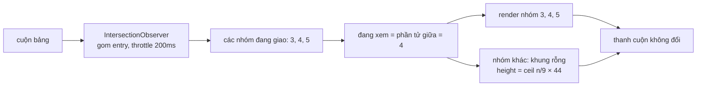

Bảng emoji của Telegram có vài nghìn emoji chia thành khoảng chục nhóm, bảng sticker còn nhiều hơn và mỗi sticker là một animation. Render tất cả mỗi lần mở bảng là hàng nghìn node DOM, và đúng lúc người dùng bấm mở thì animation trượt bảng lên bị giật.

Telegram không dùng thư viện virtual list. Cách của họ đơn giản hơn: biết trước chiều cao từng nhóm, chỉ đổ nội dung vào nhóm đang xem và hai nhóm kề nó, còn lại là các khung rỗng có đúng chiều cao.

> [!TIP]
> **Tóm tắt**
> - Chiều cao mỗi nhóm **tính trước** bằng `ceil(số emoji / số cột) × 44px` (ô 40px + khoảng cách 4px), nên thanh cuộn đúng ngay từ đầu dù chưa render gì.
> - Chỉ nhóm có chỉ số trong `[đang xem − 1, đang xem + 1]` mới render nội dung. Trong demo: 708 node thay vì 2.436.
> - "Nhóm đang xem" lấy bằng IntersectionObserver (throttle 200ms) và chọn **phần tử giữa** trong các nhóm đang giao với khung nhìn.
> - Sticker động bị **đóng băng** khi tab ẩn hoặc khi có animation nặng. Bản gốc dùng một cờ boolean chung cho mọi nguồn, nên nguồn này mở thì sticker chạy lại dù nguồn kia vẫn cần dừng. Bản viết lại đếm theo từng nguồn.

<iframe class="demo-frame" src="/demos/web-patterns/index.html?theme=dark#/tg-picker-window" title="Demo tg-picker-window" loading="lazy" style="height: 1180px"></iframe>

<p class="demo-links">▶ <a href="/demos/web-patterns/index.html#/tg-picker-window" target="_blank" rel="noopener">Mở demo toàn màn hình ↗</a> · <a href="https://stackblitz.com/github/hunghg255/blog-hunghg/tree/master/examples/web-patterns?file=src/lib/tgPickerWindow.ts" target="_blank" rel="noopener">Sửa code trên StackBlitz ↗</a> · <a href="https://github.com/hunghg255/blog-hunghg/blob/master/examples/web-patterns/src/lib/tgPickerWindow.ts" target="_blank" rel="noopener">Xem source trên GitHub ↗</a></p>

Trong demo: cuộn bảng emoji và xem số node DOM; bỏ chọn **Chỉ render nhóm đang xem ±1** để thấy con số nhảy lên. Phần đóng băng: ở chế độ **1 cờ boolean**, bật **Mở modal**, bật **Giả lập tab ẩn**, rồi tắt **Mở modal**: cả 12 sticker chạy lại dù tab vẫn đang "ẩn".

## Telegram làm thế nào?

### Chiều cao tính trước

[`components/middle/composer/EmojiCategory.tsx`](https://github.com/hunghg255/codebase/blob/main/web.telegram.org/src/components/middle/composer/EmojiCategory.tsx):

```ts
const EMOJIS_PER_ROW_ON_DESKTOP = 9;
const EMOJI_MARGIN = 4;
const MOBILE_CONTAINER_PADDING = 8;
const EMOJI_SIZE = 40;

const emojisPerRow = IS_SINGLE_COLUMN_LAYOUT
  ? Math.floor((windowSize.get().width - MOBILE_CONTAINER_PADDING) / (EMOJI_SIZE + EMOJI_MARGIN))
  : EMOJIS_PER_ROW_ON_DESKTOP;
const height = Math.ceil(category.emojis.length / emojisPerRow) * (EMOJI_SIZE + EMOJI_MARGIN);
// khung: style={`height: ${height}px;`}, nội dung: {shouldRender && category.emojis.map(…)}
```

Khung của mỗi nhóm luôn có mặt với chiều cao đúng, chỉ phần con bên trong là có hoặc không. Vì tổng chiều cao không đổi khi nhóm được render hay bị gỡ, thanh cuộn không nhảy và vị trí cuộn không trôi. Đây là điểm khác với lazy render "đến đâu nạp đến đó", vốn làm trang dài thêm mỗi lần nạp.

Sticker cũng làm tương tự trong `StickerSet.tsx`, với cùng `MOBILE_CONTAINER_PADDING = 8`.

### Chọn nhóm đang xem

[`components/middle/composer/EmojiPicker.tsx`](https://github.com/hunghg255/codebase/blob/main/web.telegram.org/src/components/middle/composer/EmojiPicker.tsx) gắn một IntersectionObserver lên mọi nhóm, với `throttleMs: 200` (`INTERSECTION_THROTTLE`):

```ts
const categoryIntersections: boolean[] = []; // biến cấp module

const { observe } = useIntersectionObserver({ rootRef: containerRef, throttleMs: INTERSECTION_THROTTLE }, (entries) => {
  entries.forEach((entry) => {
    const index = Number(entry.target.id.replace('emoji-category-', ''));
    categoryIntersections[index] = entry.isIntersecting;
  });

  const intersectingWithIndexes = categoryIntersections
    .map((isIntersecting, index) => ({ index, isIntersecting }))
    .filter(({ isIntersecting }) => isIntersecting);
  if (!intersectingWithIndexes.length) return;

  setActiveCategoryIndex(intersectingWithIndexes[Math.floor(intersectingWithIndexes.length / 2)].index);
});
```

Lấy phần tử **giữa** thay vì phần tử đầu là có lý do: nhóm đầu tiên đang giao thường chỉ còn vài pixel ở mép trên, nếu coi nó là "đang xem" thì tab nhóm trên thanh tiêu đề sẽ chậm một nhịp so với nội dung người dùng thật sự nhìn thấy.

Sau đó mỗi nhóm nhận `shouldRender={activeCategoryIndex >= i - 1 && activeCategoryIndex <= i + 1}`, và nội dung hiện ra bằng fade "slow" của `useShowTransition`. Thanh tab nhóm phía trên cũng tự cuộn ngang để tab đang chọn nằm giữa: `index × 42 − width/2 + 42/2` (42px là bề rộng một nút gồm margin), cuộn bằng `fastSmoothScrollHorizontal`.

`categoryIntersections` là mảng **cấp module**, dùng chung cho mọi lần mount của bảng emoji. Đóng bảng rồi mở lại, các giá trị `true` cũ vẫn nằm đó cho tới khi observer gửi entry mới. Thường thì entry đầu tiên sau khi mount ghi đè gần hết, nên hiếm khi thấy lỗi, nhưng để trạng thái này trong component thì an toàn hơn.

### Không làm giật animation mở bảng

Bảng emoji mở bằng một animation trượt (`MENU_TRANSITION_DURATION`). Dữ liệu emoji được nạp trong `setTimeout(…, OPEN_ANIMATION_DELAY = 200)` và phần nội dung chỉ render khi `useAsyncRendering` cho phép, tức là sau khi animation mở xong. Người dùng thấy bảng trượt lên mượt trước, nội dung hiện sau một nhịp.

### Đóng băng sticker động

[`components/common/AnimatedSticker.tsx`](https://github.com/hunghg255/codebase/blob/main/web.telegram.org/src/components/common/AnimatedSticker.tsx) và [`middle/message/hooks/usePauseOnInactive.ts`](https://github.com/hunghg255/codebase/blob/main/web.telegram.org/src/components/middle/message/hooks/usePauseOnInactive.ts) (cho video) cùng một khuôn:

```ts
// trích, rút gọn
const freezeAnimation = () => {
  isFrozen.current = true;
  if (!wasPlaying.current) wasPlaying.current = animation.isPlaying();
  animation.pause();
};
const unfreezeAnimation = () => {
  if (wasPlaying.current) animation.play();
  wasPlaying.current = false;
  isFrozen.current = false;
};

useHeavyAnimationCheck(freezeAnimation, unfreezeAnimation);       // nguồn 1: animation nặng
useBackgroundMode(freezeAnimation, unfreezeAnimationOnRaf);        // nguồn 2: tab mất focus
```

Hai chi tiết hay: nhớ `wasPlaying` để chỉ chạy lại sticker vốn đang chạy, và nếu prop `play` đổi trong lúc bị đóng băng thì chỉ cập nhật `wasPlaying` chứ không chạy ngay. Khi tab trở lại, việc chạy lại được hoãn tới frame sau (`fastRaf`), vì ghi chú trong code cho biết frame tạm dừng có thể chưa được vẽ khi tab còn ở nền.

Lỗi nằm ở chỗ **hai nguồn dùng chung một `isFrozen`**. Tab mất focus (nguồn 2) trong lúc đang có animation nặng (nguồn 1): khi animation nặng xong, `unfreezeAnimation` chạy và sticker chạy lại, dù tab vẫn đang ở nền. Demo tái hiện đúng chuỗi đó: 12/12 sticker chạy lại ở chế độ boolean, 0/12 khi đếm theo nguồn.

## Bên trong trình duyệt



- **Chi phí của node DOM** không chỉ là lúc tạo: mỗi lần layout, style recalc, hay đổi theme, trình duyệt đi qua tất cả. 2.436 nút emoji là 2.436 phần tử cần tính style; 708 thì nhẹ hơn hẳn.
- **IntersectionObserver chạy bất đồng bộ**, không chặn luồng cuộn, nên dùng nó để biết "đang xem nhóm nào" rẻ hơn nhiều so với nghe sự kiện `scroll` rồi gọi `getBoundingClientRect` cho từng nhóm.
- Có thể dùng **`content-visibility: auto`** để trình duyệt tự bỏ qua layout và paint của phần ngoài màn hình. Nhưng node vẫn phải tạo, nên chi phí tạo DOM lúc mở bảng vẫn còn nguyên.

## Viết lại

Chiều cao, cửa sổ render và chọn nhóm đang xem:

```ts title=src/lib/tgPickerWindow.ts
export function itemsPerRow(containerWidth: number, isMobile: boolean) {
  if (!isMobile) return DESKTOP_PER_ROW;
  return Math.max(1, Math.floor((containerWidth - MOBILE_PADDING) / (ITEM_SIZE + ITEM_MARGIN)));
}

/** Chiều cao phần thân của một nhóm: số hàng × (40 + 4). */
export const categoryBodyHeight = (count: number, perRow: number) =>
  Math.ceil(count / perRow) * (ITEM_SIZE + ITEM_MARGIN);

/** Nhóm i có được render nội dung không, khi đang xem nhóm `active`. */
export const shouldRenderCategory = (active: number, i: number, radius = 1) => Math.abs(active - i) <= radius;

/**
 * Chọn nhóm đang xem từ trạng thái giao cắt của các nhóm.
 * Không lấy nhóm đầu tiên đang giao (nó thường chỉ còn vài pixel ở mép trên) mà lấy nhóm giữa.
 */
export function pickActiveCategory(intersecting: ReadonlyMap<number, boolean>): number | undefined {
  const visible = [...intersecting].filter(([, v]) => v).map(([i]) => i).sort((a, b) => a - b);
  if (visible.length === 0) return undefined;
  return visible[Math.floor(visible.length / 2)];
}
```

Bộ đóng băng đếm theo nguồn:

```ts title=src/lib/tgPickerWindow.ts
export function createFreezer(target: Freezable) {
  const reasons = new Set<string>();
  let wasPlaying = false;
  /** prop `play` đổi trong lúc bị đóng băng: chỉ ghi nhận, chạy khi hết đóng băng */
  let wantPlay: boolean | undefined;

  return {
    freeze(reason: string) {
      if (reasons.size === 0) {
        wasPlaying = target.isPlaying();
        target.pause();
      }
      reasons.add(reason);
    },
    unfreeze(reason: string) {
      if (!reasons.delete(reason) || reasons.size > 0) return;
      const shouldPlay = wantPlay ?? wasPlaying;
      wantPlay = undefined;
      if (shouldPlay) target.play();
    },
    setPlay(play: boolean) {
      if (reasons.size > 0) {
        wantPlay = play;
        return;
      }
      if (play) target.play();
      else target.pause();
    },
    get frozenBy() {
      return [...reasons];
    },
  };
}
```

::: spoiler Xem toàn bộ src/lib/tgPickerWindow.ts

```ts title=src/lib/tgPickerWindow.ts
/**
 * Bảng emoji/sticker chỉ render nhóm đang xem (Telegram #17).
 *
 * Ba mẹo:
 * 1. Chiều cao từng nhóm TÍNH TRƯỚC từ số phần tử, nên thanh cuộn đúng ngay khi chưa render gì.
 * 2. Chỉ nhóm trong khoảng [active − 1, active + 1] mới render nội dung.
 * 3. "Nhóm đang xem" = phần tử GIỮA trong các nhóm đang giao với khung nhìn.
 * Kèm một bộ "đóng băng" animation dùng bộ đếm, để nhiều nguồn cùng tạm dừng mà không giẫm chân nhau.
 */

export const ITEM_SIZE = 40;
export const ITEM_MARGIN = 4;
export const DESKTOP_PER_ROW = 9;
export const MOBILE_PADDING = 8;

export function itemsPerRow(containerWidth: number, isMobile: boolean) {
  if (!isMobile) return DESKTOP_PER_ROW;
  return Math.max(1, Math.floor((containerWidth - MOBILE_PADDING) / (ITEM_SIZE + ITEM_MARGIN)));
}

/** Chiều cao phần thân của một nhóm: số hàng × (40 + 4). */
export const categoryBodyHeight = (count: number, perRow: number) =>
  Math.ceil(count / perRow) * (ITEM_SIZE + ITEM_MARGIN);

/** Nhóm i có được render nội dung không, khi đang xem nhóm `active`. */
export const shouldRenderCategory = (active: number, i: number, radius = 1) => Math.abs(active - i) <= radius;

/**
 * Chọn nhóm đang xem từ trạng thái giao cắt của các nhóm.
 * Không lấy nhóm đầu tiên đang giao (nó thường chỉ còn vài pixel ở mép trên) mà lấy nhóm giữa.
 */
export function pickActiveCategory(intersecting: ReadonlyMap<number, boolean>): number | undefined {
  const visible = [...intersecting].filter(([, v]) => v).map(([i]) => i).sort((a, b) => a - b);
  if (visible.length === 0) return undefined;
  return visible[Math.floor(visible.length / 2)];
}

/**
 * Cuộn thanh tab nhóm sao cho nút đang chọn nằm giữa.
 * Bản gốc: newLeft = index × 42 − width/2 + 42/2 (42 = bề rộng nút gồm margin).
 */
export function centeredHeaderScroll(index: number, headerWidth: number, buttonWidth = 42) {
  return Math.max(0, index * buttonWidth - headerWidth / 2 + buttonWidth / 2);
}

// ---------- Đóng băng animation ----------

export interface Freezable {
  isPlaying(): boolean;
  play(): void;
  pause(): void;
}

/**
 * Nhiều nguồn có thể cùng yêu cầu dừng: tab ẩn, đang có animation nặng (mở menu, cuộn nhanh), modal…
 * Bản gốc dùng MỘT cờ boolean `isFrozen` cho mọi nguồn: nguồn nào mở trước là animation chạy lại,
 * dù nguồn kia vẫn đang yêu cầu dừng. Ở đây mỗi nguồn được đếm riêng.
 */
export function createFreezer(target: Freezable) {
  const reasons = new Set<string>();
  let wasPlaying = false;
  /** prop `play` đổi trong lúc bị đóng băng: chỉ ghi nhận, chạy khi hết đóng băng */
  let wantPlay: boolean | undefined;

  return {
    freeze(reason: string) {
      if (reasons.size === 0) {
        wasPlaying = target.isPlaying();
        target.pause();
      }
      reasons.add(reason);
    },
    unfreeze(reason: string) {
      if (!reasons.delete(reason) || reasons.size > 0) return;
      const shouldPlay = wantPlay ?? wasPlaying;
      wantPlay = undefined;
      if (shouldPlay) target.play();
    },
    setPlay(play: boolean) {
      if (reasons.size > 0) {
        wantPlay = play;
        return;
      }
      if (play) target.play();
      else target.pause();
    },
    get frozenBy() {
      return [...reasons];
    },
  };
}

/** Bản giống gốc (một cờ boolean), để so sánh trong demo. */
export function createBooleanFreezer(target: Freezable) {
  let isFrozen = false;
  let wasPlaying = false;
  return {
    freeze(_reason: string) {
      isFrozen = true;
      if (!wasPlaying) wasPlaying = target.isPlaying();
      target.pause();
    },
    unfreeze(_reason: string) {
      if (wasPlaying) target.play();
      wasPlaying = false;
      isFrozen = false;
    },
    setPlay(play: boolean) {
      if (isFrozen) {
        wasPlaying = play;
        return;
      }
      if (play) target.play();
      else target.pause();
    },
    get frozenBy() {
      return isFrozen ? ['(1 cờ chung)'] : [];
    },
  };
}
```

:::

## Đi qua code

- **`itemsPerRow`**: desktop cố định 9 cột; mobile tính theo bề rộng khung trừ padding 8px. Kết quả này dùng cho cả chiều cao lẫn `grid-template-columns`, để hai phép tính không lệch nhau.
- **`categoryBodyHeight`**: số hàng × 44. Khung rỗng và khung đầy có cùng chiều cao.
- **`pickActiveCategory`** nhận một `Map` index → đang giao. Map nằm trong effect của component, không phải biến cấp module, nên mỗi lần mount bắt đầu sạch.
- **`createFreezer`** giữ một `Set` lý do. Chỉ lần đóng băng **đầu tiên** mới ghi `wasPlaying` và dừng; chỉ khi lý do **cuối cùng** được gỡ mới quyết định chạy lại. `setPlay` khi đang bị đóng băng chỉ ghi lại mong muốn, áp khi hết đóng băng.

**Khác bản gốc:** trạng thái giao cắt nằm trong component thay vì biến cấp module; đóng băng đếm theo từng nguồn thay vì một cờ boolean chung.

## Tại sao không làm cách khác?

- **Virtual list theo hàng (react-window, TanStack Virtual)?** Được, và cuộn hàng chục nghìn hàng thì nên dùng. Nhưng bảng emoji cần tiêu đề nhóm, cuộn tới nhóm khi bấm tab, và khung nhóm luôn có mặt cho IntersectionObserver. Cửa sổ theo nhóm đơn giản hơn, ít code hơn, và đủ nhanh với vài nghìn emoji.
- **Chỉ render nhóm đang xem (không ±1)?** Cuộn qua ranh giới hai nhóm sẽ thấy khung trống một lúc trước khi nội dung kịp hiện. Giữ thêm một nhóm mỗi phía là vùng đệm.
- **Đo chiều cao thật thay vì tính trước?** Phải render rồi mới đo được, tức là mất luôn lợi ích của việc không render.

## Edge case và cạm bẫy

- **Đổi bề rộng** (xoay màn hình, kéo cửa sổ) đổi số cột trên mobile, nên chiều cao mọi nhóm phải tính lại. Demo theo dõi bằng ResizeObserver. Bản gốc đọc `windowSize.get()` lúc render.
- **Bấm tab để nhảy tới nhóm xa**: đặt `active` ngay khi bấm, để nhóm đích render trước khi cuộn tới, không đợi IntersectionObserver báo.
- **Emoji không có trên máy**: ô vẫn chiếm 40px; Telegram thay bằng ảnh emoji khi thiết bị không hỗ trợ (`IS_EMOJI_SUPPORTED`).
- **Nhiều nguồn đóng băng**: lý do nào freeze thì phải unfreeze đúng lý do đó. Gọi `unfreeze` hai lần cho cùng một lý do là vô hại vì `Set.delete` trả `false` lần sau.

## Dùng trong dự án

```tsx
function Category({ index, active, items, perRow }: Props) {
  const render = shouldRenderCategory(active, index);
  return (
    <section data-index={index}>
      <h3>{items.title}</h3>
      <div style={{ height: categoryBodyHeight(items.list.length, perRow) }}>
        {render && items.list.map((item) => <Cell key={item.id} item={item} />)}
      </div>
    </section>
  );
}
```

Với sticker hay video: tạo một `createFreezer({ isPlaying, play, pause })` cho mỗi phần tử, gọi `freeze('hidden')`/`unfreeze('hidden')` trong `visibilitychange` và `freeze('heavy')`/`unfreeze('heavy')` quanh animation nặng; mỗi nguồn một tên.

::: spoiler Ví dụ test (bản phác, không có trong repo)

```ts
import { describe, expect, it } from 'vitest';
import {
  categoryBodyHeight, centeredHeaderScroll, createBooleanFreezer, createFreezer, itemsPerRow, pickActiveCategory,
  shouldRenderCategory,
} from './tgPickerWindow';

describe('cửa sổ render', () => {
  it('tính chiều cao trước', () => {
    expect(itemsPerRow(1200, false)).toBe(9);
    expect(itemsPerRow(375, true)).toBe(8);
    expect(categoryBodyHeight(80, 9)).toBe(9 * 44);
  });
  it('render nhóm đang xem ±1', () => {
    expect([0, 1, 2, 3, 4].filter((i) => shouldRenderCategory(2, i))).toEqual([1, 2, 3]);
  });
  it('chọn nhóm giữa trong các nhóm đang giao', () => {
    expect(pickActiveCategory(new Map([[3, true], [4, true], [5, true], [6, false]]))).toBe(4);
    expect(pickActiveCategory(new Map([[1, false]]))).toBeUndefined();
  });
  it('tab đang chọn nằm giữa thanh tiêu đề', () => {
    expect(centeredHeaderScroll(5, 300)).toBe(5 * 42 - 150 + 21);
    expect(centeredHeaderScroll(0, 300)).toBe(0);
  });
});

const fakeAnimation = () => {
  let playing = true;
  return { isPlaying: () => playing, play: () => (playing = true), pause: () => (playing = false), get playing() { return playing; } };
};

describe('đóng băng', () => {
  it('một cờ boolean: nguồn này mở là chạy lại dù nguồn kia còn', () => {
    const a = fakeAnimation();
    const f = createBooleanFreezer(a);
    f.freeze('heavy'); f.freeze('hidden'); f.unfreeze('heavy');
    expect(a.playing).toBe(true);
  });
  it('đếm theo nguồn: chỉ chạy lại khi mọi nguồn đã gỡ', () => {
    const a = fakeAnimation();
    const f = createFreezer(a);
    f.freeze('heavy'); f.freeze('hidden'); f.unfreeze('heavy');
    expect(a.playing).toBe(false);
    f.unfreeze('hidden');
    expect(a.playing).toBe(true);
  });
  it('setPlay(false) trong lúc đóng băng được giữ tới khi mở', () => {
    const a = fakeAnimation();
    const f = createFreezer(a);
    f.freeze('hidden'); f.setPlay(false); f.unfreeze('hidden');
    expect(a.playing).toBe(false);
  });
});
```

:::

## So với thư viện và chuẩn web

- **`content-visibility: auto`** kèm `contain-intrinsic-size` cho phép trình duyệt bỏ qua phần ngoài màn hình mà không cần JS; có ở mọi trình duyệt chính (Safari từ 18, xem [caniuse](https://caniuse.com/css-content-visibility)). Nó giảm chi phí layout và paint, không giảm số node.
- **emoji-mart** và các picker phổ biến dùng virtual list theo hàng hoặc lazy render theo nhóm, ý tưởng gần giống.
- **Web Animations API** (`element.animate()`) cho sẵn `play()`/`pause()`/`playState`, đúng giao diện mà bộ đóng băng cần; demo dùng nó thay cho Lottie.

Bài liên quan: [player khung hình của sticker](/blogs/telegram-lottie-player) (Telegram #12).

---

Bài này thuộc series **[Học từ mã nguồn Telegram](/series/telegram)** (25 bài, đọc theo thứ tự).

::: spoiler Xem nhanh danh sách bài trong series

*Mở đầu*

- [Mở đầu: bên trong Telegram Web A](/blogs/learn-from-telegram-source-code)

*Phần 1: dữ liệu và đồng bộ*

- [#1 Gửi tin lạc quan, khớp tin thật bằng randomId](/blogs/telegram-optimistic-send)
- [#2 Lịch sử tin nhắn chia hai đảo](/blogs/telegram-message-history-islands)
- [#3 Lưu global state lúc rảnh, chỉ giữ phần cần](/blogs/telegram-persist-global-state)
- [#4 Gom update realtime theo nhịp animation](/blogs/telegram-realtime-update-batching)
- [#5 Store tự viết và diff danh sách có key](/blogs/telegram-teactn-store-fast-list)

*Phần 2: animation và giao diện*

- [#6 Animation sắp xếp danh sách chat không đo DOM](/blogs/telegram-chat-list-flip)
- [#7 Ảnh bay giữa hai cây DOM trong media viewer](/blogs/telegram-media-viewer-ghost)
- [#8 Bố cục album chọn theo hàm chi phí](/blogs/telegram-album-layout)
- [#9 Giờ gửi nằm gọn trong bong bóng chat](/blogs/telegram-bubble-meta-spacer)
- [#10 Composer biến hình, Transition và gạch chân tab](/blogs/telegram-composer-morph-transition)

*Phần 3: media, mobile, thông báo*

- [#11 Thumbnail 100 byte và viền sticker nén](/blogs/telegram-tiny-thumbnails)
- [#12 Player sticker: DPR, hạ fps, cache khung](/blogs/telegram-lottie-player)
- [#13 Mobile: --vh, bàn phím ảo, nhấn giữ, số điện thoại](/blogs/telegram-mobile-viewport-touch)
- [#14 Web Push không trùng và đánh dấu đã đọc](/blogs/telegram-push-dedupe-read-receipts)

*Phần 4: soạn tin, media, chi tiết UI*

- [#15 Rich text ⇄ entities, thanh định dạng nổi, nháp theo chat](/blogs/telegram-rich-text-entities)
- [#16 Ô nhập tự giãn, emoji phóng to, gom tin theo ngày/người/album](/blogs/telegram-auto-grow-input-grouping)
- **#17 Bảng emoji/sticker chỉ render nhóm đang xem** (bài này)
- [#18 mediaLoader gộp request, ảnh mờ sang nét, spinner không chớp](/blogs/telegram-media-loader-blur-buffering)
- [#19 Trình phát audio toàn cục và playlist](/blogs/telegram-global-audio-player)
- [#20 UiLoader chạy đua 700ms, ba mức animation](/blogs/telegram-ui-loader-animation-levels)
- [#21 PanZoom bằng matrix() trong media viewer](/blogs/telegram-panzoom-matrix)
- [#22 Ngày dính khi cuộn, khoá cuộn, dừng momentum iOS](/blogs/telegram-sticky-date-scroll-lock)
- [#23 Vùng thả file, nén ảnh trước khi gửi, copy ảnh](/blogs/telegram-drop-zone-compress-copy)
- [#24 Tiêu đề nhấp nháy và favicon đếm tin mới](/blogs/telegram-title-favicon-unread)

:::

Code + demo: [`examples/web-patterns`](https://github.com/hunghg255/blog-hunghg/tree/master/examples/web-patterns) · [Mở trên StackBlitz](https://stackblitz.com/github/hunghg255/blog-hunghg/tree/master/examples/web-patterns)
