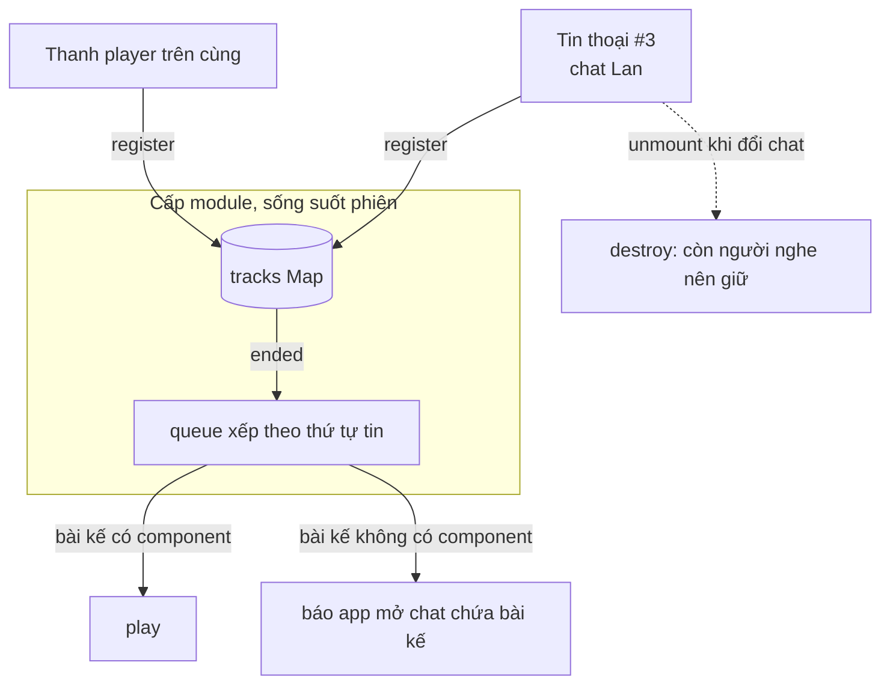

Bấm nghe một tin thoại dài trong nhóm, rồi chuyển sang chat khác trả lời ai đó. Telegram vẫn phát tiếp, thanh player trên cùng vẫn hiện tên người gửi và thời gian, và khi hết tin này thì tự chuyển sang tin thoại kế tiếp. Nếu tin kế tiếp nằm ở chat bạn vừa rời đi, Telegram mở lại player cho nó.

Trong React, cách viết tự nhiên là đặt `<audio>` trong component tin nhắn. Nhưng component tin nhắn bị gỡ ngay khi đổi chat, và tiếng tắt theo. Telegram Web A đặt các thẻ audio ở **cấp module**, ngoài cây component, và để component chỉ đăng ký nghe sự kiện.

> [!TIP]
> **Tóm tắt**
> - Mỗi track là một `Audio` trong `Map` cấp module. Component đăng ký handler; khi component cuối cùng gỡ handler thì track mới bị huỷ. Phát track mới thì track cũ tự dừng.
> - Hết bài (`ended`) thì phát bài kế trong danh sách. Bài kế chưa có component nào (đang ở chat khác) thì báo lên app để mở player cho nó.
> - Bản gốc xếp danh sách theo **thứ tự mount**. Cuộn lên tải tin cũ thì tin cũ bị xếp sau tin mới, và playlist dừng sai chỗ. Bản viết lại xếp theo thứ tự tin.
> - Nhả bộ nhớ thẻ media: `removeAttribute('src')` + `load()` thay vì `src = ''`, vì cách sau bắn một sự kiện `error` giả (đã đo trên Chromium).

<iframe class="demo-frame" src="/demos/web-patterns/index.html?theme=dark#/tg-audio-player" title="Demo tg-audio-player" loading="lazy" style="height: 1360px"></iframe>

<p class="demo-links">▶ <a href="/demos/web-patterns/index.html#/tg-audio-player" target="_blank" rel="noopener">Mở demo toàn màn hình ↗</a> · <a href="https://stackblitz.com/github/hunghg255/blog-hunghg/tree/master/examples/web-patterns?file=src/lib/tgAudioPlayer.ts" target="_blank" rel="noopener">Sửa code trên StackBlitz ↗</a> · <a href="https://github.com/hunghg255/blog-hunghg/blob/master/examples/web-patterns/src/lib/tgAudioPlayer.ts" target="_blank" rel="noopener">Xem source trên GitHub ↗</a></p>

Trong demo, ở chế độ **Thứ tự mount (bản gốc)**: bấm **Tải tin cũ hơn** trong chat Lan, phát tin #2. Danh sách là `#3 → #4 → #1 → #2`, nên hết #2 là dừng. Chuyển sang **Thứ tự tin** và làm lại: hết #2 thì sang #3. Đang phát #3 thì bấm sang chat Minh: tiếng vẫn chạy, thanh player vẫn hiện, hết #3 thì app tự mở lại chat Lan để phát #4.

## Telegram làm thế nào?

### Track sống ở cấp module

[`util/audioPlayer.ts`](https://github.com/hunghg255/codebase/blob/main/web.telegram.org/src/util/audioPlayer.ts) giữ ba thứ ở cấp module:

```ts
const tracks = new Map<string, Track>(); // trackId → { audio, proxy, handlers, onForcePlay }
let queue: string[] = [];
let currentTrackId: string | undefined;
```

`register(trackId, handler, onForcePlay)` tạo `Audio` nếu chưa có, đẩy `trackId` vào `queue`, thêm handler, rồi trả về một bộ điều khiển:

```ts
play(src) {
  if (currentTrackId && currentTrackId !== trackId) {
    tracks.get(currentTrackId)!.audio.pause(); // chỉ một track phát tại một thời điểm
  }
  currentTrackId = trackId;
  if (!audio.src) { audio.src = src; audio.preload = 'auto'; }
  safePlay(audio);
},
destroy(shouldRemoveFromQueue = false) {
  track.handlers = track.handlers.filter((h) => h !== handler);
  if (!track.handlers.length) {
    track.audio.pause();
    tracks.delete(trackId);
    if (shouldRemoveFromQueue) queue = queue.filter((id) => id !== trackId);
    if (trackId === currentTrackId) currentTrackId = undefined;
  }
},
```

Hook [`hooks/useAudioPlayer.ts`](https://github.com/hunghg255/codebase/blob/main/web.telegram.org/src/hooks/useAudioPlayer.ts) gọi `register` trong effect và `destroy(noPlaylist)` khi unmount. Thanh player trên cùng (`AudioPlayer`) cũng đăng ký như một handler nữa. Nhờ đó, khi đổi chat làm component tin nhắn bị gỡ, track vẫn còn một người nghe là thanh player, và tiếng không tắt.

### Sang bài kế, kể cả ở chat khác

```ts
audio.addEventListener('ended', () => {
  const nextTrackId = queue[queue.indexOf(trackId) + 1];
  if (!nextTrackId) return;

  if (!tracks.has(nextTrackId)) {
    // A bit hacky way to continue playlist when switching chat
    getDispatch().openAudioPlayer(parseMessageKey(nextTrackId));
    return;
  }

  const nextTrack = tracks.get(nextTrackId)!;
  nextTrack.onForcePlay?.();
  currentTrackId = nextTrackId;
  if (nextTrack.audio.src) safePlay(nextTrack.audio);
});
```

`trackId` là khoá tin nhắn (chat + id). Nếu track kế tiếp đã bị huỷ vì component của nó đã gỡ, code dispatch một action mở player cho tin đó; chính ghi chú trong code gọi đây là "cách hơi hacky". `onForcePlay` là callback của component để tự nạp `src` (cần tải file) rồi phát.

Hai giới hạn của `queue`:

- **Xếp theo thứ tự mount.** `queue.push(trackId)` chạy khi component đăng ký. Lần đầu mở chat, các tin mount theo thứ tự hiển thị nên đúng. Nhưng khi cuộn lên tải tin cũ hơn, tin cũ mount **sau**, nên bị đẩy xuống cuối hàng. Demo tái hiện: hàng là `#3 → #4 → #1 → #2`, phát #2 xong thì dừng thay vì sang #3.
- **Không bao giờ ngắn lại.** `destroy(noPlaylist)` chỉ xoá khỏi hàng khi `noPlaylist` là true, nên trong một phiên dài `queue` chứa mọi tin thoại từng được hiển thị.

### "Proxy chỉ đọc" không thật sự chỉ đọc

Component nhận `track.proxy` thay vì chính thẻ audio, với ý định chỉ cho đọc:

```ts
proxy: new Proxy(audio, {
  get: (origin, key) => origin[key],
}),
```

Proxy này chỉ có bẫy `get`. Không có bẫy `set` thì phép gán đi thẳng tới thao tác `[[Set]]` mặc định, với `this` là chính proxy. Setter của `HTMLMediaElement` kiểm tra `this` có phải phần tử thật không, và ném lỗi. Chạy thử trên Chromium:

| Thao tác qua proxy | Kết quả |
|---|---|
| `proxy.currentTime` (đọc) | `0`, chạy bình thường |
| `proxy.currentTime = 1` | `TypeError: Illegal invocation` |
| `proxy.volume = 0.5` | `TypeError: Illegal invocation` |
| `proxy.pause()` | `TypeError: Illegal invocation` |

Ghi vô tình bị chặn, nhưng gọi method cũng bị chặn luôn, và thông báo lỗi không nói gì về ý đồ "chỉ đọc". Một object chỉ có getter nói rõ ý đồ hơn và không có bất ngờ nào.

### Nhả bộ nhớ thẻ video

[`hooks/useVideoCleanup.ts`](https://github.com/hunghg255/codebase/blob/main/web.telegram.org/src/hooks/useVideoCleanup.ts):

```ts
// Fix for memory leak when unmounting video element
return () => {
  if (videoEl) {
    fastRaf(() => {
      videoEl.pause();
      videoEl.src = '';
      videoEl.load();
    });
  }
};
```

Thẻ `<video>` đã gỡ khỏi DOM vẫn có thể giữ bộ đệm giải mã cho tới khi bị thu gom. Gán `src` rồi `load()` buộc trình duyệt bỏ dữ liệu ngay. Nhưng gán **chuỗi rỗng** khác với gỡ thuộc tính: theo chuẩn HTML, `src` rỗng làm thuật toán chọn nguồn thất bại và bắn sự kiện `error`. Đo trên Chromium với một file WAV đã tải:

| Cách nhả | Sự kiện `error` | `networkState` sau đó |
|---|---|---|
| `src = ''` + `load()` | 1 | 3 (NETWORK_NO_SOURCE) |
| `removeAttribute('src')` + `load()` | 0 | 0 (NETWORK_EMPTY) |

Nếu component còn gắn `onError` để báo lỗi phát, cách đầu sẽ báo một lỗi không có thật.

### Poster video ngay ở client

Trước khi upload video, Telegram hiện ảnh xem trước lấy từ chính file. [`util/files.ts`](https://github.com/hunghg255/codebase/blob/main/web.telegram.org/src/util/files.ts):

```ts
export async function createPosterForVideo(url: string) {
  const video = await preloadVideo(url); // tạo <video>, volume 0, chờ loadedmetadata
  return Promise.race([
    pause(2000),
    new Promise((resolve, reject) => {
      video.onseeked = () => {
        if (!video.videoWidth || !video.videoHeight) {
          resolve(undefined);
        }
        const canvas = document.createElement('canvas');
        canvas.width = video.videoWidth;
        canvas.height = video.videoHeight;
        canvas.getContext('2d')!.drawImage(video, 0, 0);
        resolve(canvas.toDataURL('image/jpeg'));
      };
      video.onerror = reject;
      video.currentTime = Math.min(video.duration, 1);
    }),
  ]);
}
```

Tua tới giây thứ 1 (hoặc cuối video nếu ngắn hơn), chờ `seeked`, vẽ lên canvas. Thiếu `return` sau `resolve(undefined)`: với file không có hình (chỉ có tiếng), code vẫn chạy tiếp, tạo canvas 0×0 và gọi `toDataURL`. Kết quả cuối vẫn đúng vì Promise chỉ nhận lần `resolve` đầu tiên, nhưng đó là việc thừa. Thẻ `<video>` tạm cũng không được nhả sau khi xong.

## Bên trong trình duyệt



- Một `HTMLAudioElement` tạo bằng `new Audio()` **không cần nằm trong DOM** để phát. Đó là lý do có thể giữ nó ở cấp module.
- Chính sách autoplay: `play()` chỉ chắc chắn được phép khi xuất phát từ cử chỉ người dùng, hoặc trang đã có tương tác trước đó. Chuyển bài trong `ended` thường được phép vì trang đã có tương tác. Code vẫn nên `catch` Promise của `play()`, vì nó bị reject khi bị chặn hoặc khi bị `pause()` chen ngang.
- `canvas.toDataURL` chỉ đọc được frame video **cùng origin** hoặc có CORS; video từ `blob:` URL do chính trang tạo thì luôn đọc được.

## Viết lại

Sang bài kế (danh sách `queue` được sắp theo `order` mỗi khi có track mới đăng ký):

```ts title=src/lib/tgAudioPlayer.ts
  function playNext(afterId: string) {
    const index = queue.findIndex((q) => q.id === afterId);
    const next = queue[index + 1];
    if (!next) {
      setCurrent(undefined);
      return;
    }
    const track = tracks.get(next.id);
    if (!track) {
      onMissingNext?.(next.id);
      return;
    }
    track.onForcePlay?.();
    setCurrent(next.id);
    if (track.audio.src) void track.audio.play().catch(() => {});
  }
```

Nhả bộ nhớ thẻ media:

```ts title=src/lib/tgAudioPlayer.ts
// ---------- Nhả bộ nhớ thẻ media ----------

/**
 * Bản gốc: `pause(); src = ''; load()`. Gán chuỗi rỗng khiến trình duyệt chạy thuật toán chọn nguồn với
 * src rỗng và bắn sự kiện `error` (MEDIA_ERR_SRC_NOT_SUPPORTED) — listener onError nào còn gắn sẽ báo lỗi giả.
 * Gỡ hẳn thuộc tính rồi load() thì trình duyệt trả bộ đệm mà không bắn error.
 */
export function releaseMedia(media: HTMLMediaElement) {
  media.pause();
  media.removeAttribute('src');
  media.load();
}
```

Phần đăng ký/huỷ track và hàm `createPosterForVideo` đã sửa nằm trong bản đầy đủ.

::: spoiler Xem toàn bộ src/lib/tgAudioPlayer.ts

```ts title=src/lib/tgAudioPlayer.ts
/**
 * Trình phát audio toàn cục của Telegram (Telegram #19):
 * mỗi tin thoại/bài nhạc là một track sống ở cấp module, KHÔNG nằm trong component.
 * Component chỉ đăng ký nghe sự kiện; đổi chat (component unmount) thì nhạc vẫn phát,
 * và hết bài thì tự chuyển sang bài kế trong danh sách.
 * Kèm hai tiện ích: nhả bộ nhớ của thẻ media khi bỏ đi, và lấy ảnh poster của video ngay ở client.
 */

export type TrackEvent = 'play' | 'pause' | 'timeupdate' | 'ended' | 'loadeddata';
export type TrackHandler = (event: TrackEvent, audio: ReadonlyMedia) => void;

/** Những gì component được phép ĐỌC từ thẻ audio. */
export interface ReadonlyMedia {
  readonly currentTime: number;
  readonly duration: number;
  readonly paused: boolean;
  readonly src: string;
}

/**
 * Bản gốc đưa cho component một `new Proxy(audio, { get: (o, k) => o[k] })` với ý "chỉ đọc".
 * Proxy không có bẫy `set` nên phép gán vẫn đi tới đối tượng gốc — nhưng với receiver là proxy,
 * setter native của HTMLMediaElement ném "Illegal invocation"; gọi method qua proxy cũng ném lỗi tương tự.
 * Một object chỉ có getter nói rõ ý đồ hơn và không có bất ngờ đó.
 */
export function readonlyView(audio: HTMLMediaElement): ReadonlyMedia {
  return {
    get currentTime() {
      return audio.currentTime;
    },
    get duration() {
      return audio.duration;
    },
    get paused() {
      return audio.paused;
    },
    get src() {
      return audio.src;
    },
  };
}

interface Track {
  id: string;
  order: number;
  audio: HTMLAudioElement;
  view: ReadonlyMedia;
  handlers: Set<TrackHandler>;
  onForcePlay?: () => void;
  detach: () => void;
}

export interface AudioRegistryOptions {
  createAudio?: () => HTMLAudioElement;
  /** bài kế tiếp chưa có component nào đăng ký (đang ở chat khác): báo để app tự mở player cho nó */
  onMissingNext?: (trackId: string) => void;
  /** gọi mỗi khi track đang phát đổi, để vẽ thanh player toàn cục */
  onCurrentChange?: (trackId: string | undefined) => void;
  /** false = giữ thứ tự mount như bản gốc (chỉ để so sánh trong demo) */
  sortByOrder?: boolean;
}

export function createAudioRegistry({
  createAudio = () => new Audio(),
  onMissingNext,
  onCurrentChange,
  sortByOrder = true,
}: AudioRegistryOptions = {}) {
  const tracks = new Map<string, Track>();
  /**
   * Danh sách phát xếp theo `order` (thứ tự tin trong chat), không theo thứ tự component mount.
   * Bản gốc `queue.push(trackId)` lúc mount: cuộn ngược lên tin cũ là tin cũ bị xếp SAU tin mới.
   */
  let queue: { id: string; order: number }[] = [];
  let currentId: string | undefined;

  const setCurrent = (id: string | undefined) => {
    currentId = id;
    onCurrentChange?.(id);
  };

  const emit = (track: Track, event: TrackEvent) => track.handlers.forEach((h) => h(event, track.view));

  function playNext(afterId: string) {
    const index = queue.findIndex((q) => q.id === afterId);
    const next = queue[index + 1];
    if (!next) {
      setCurrent(undefined);
      return;
    }
    const track = tracks.get(next.id);
    if (!track) {
      onMissingNext?.(next.id);
      return;
    }
    track.onForcePlay?.();
    setCurrent(next.id);
    if (track.audio.src) void track.audio.play().catch(() => {});
  }

  function createTrack(id: string, order: number, onForcePlay?: () => void): Track {
    const audio = createAudio();
    const track = { id, order, audio, view: readonlyView(audio), handlers: new Set<TrackHandler>(), onForcePlay } as Track;
    const events: TrackEvent[] = ['play', 'pause', 'timeupdate', 'loadeddata'];
    const listeners = events.map((event) => {
      const listener = () => emit(track, event);
      audio.addEventListener(event, listener);
      return [event, listener] as const;
    });
    const onEnded = () => {
      emit(track, 'ended');
      playNext(id);
    };
    audio.addEventListener('ended', onEnded);
    track.detach = () => {
      listeners.forEach(([e, l]) => audio.removeEventListener(e, l));
      audio.removeEventListener('ended', onEnded);
    };
    return track;
  }

  return {
    register(id: string, handler: TrackHandler, { order, onForcePlay }: { order: number; onForcePlay?: () => void }) {
      let track = tracks.get(id);
      if (!track) {
        track = createTrack(id, order, onForcePlay);
        tracks.set(id, track);
      } else if (onForcePlay) {
        track.onForcePlay = onForcePlay;
      }
      if (!queue.some((q) => q.id === id)) {
        queue = [...queue, { id, order }];
        if (sortByOrder) queue.sort((a, b) => a.order - b.order);
      }
      track.handlers.add(handler);
      const t = track;

      return {
        view: t.view,
        play(src: string) {
          if (currentId && currentId !== id) tracks.get(currentId)?.audio.pause();
          setCurrent(id);
          if (!t.audio.src) {
            t.audio.src = src;
            t.audio.preload = 'auto';
          }
          void t.audio.play().catch(() => {});
        },
        pause() {
          if (currentId === id) t.audio.pause();
        },
        seek(time: number) {
          if (currentId === id) t.audio.currentTime = time;
        },
        /** component unmount: chỉ huỷ track khi KHÔNG còn ai nghe và nó không phải bài đang phát */
        destroy(removeFromQueue = false) {
          t.handlers.delete(handler);
          if (t.handlers.size > 0 || (currentId === id && !t.audio.paused)) return;
          t.detach();
          releaseMedia(t.audio);
          tracks.delete(id);
          if (removeFromQueue) queue = queue.filter((q) => q.id !== id);
          if (currentId === id) setCurrent(undefined);
        },
      };
    },
    get currentId() {
      return currentId;
    },
    get queue() {
      return queue.map((q) => q.id);
    },
    /** cho thanh player toàn cục: track đang phát, kể cả khi component của nó đã unmount */
    current(): ReadonlyMedia | undefined {
      return currentId ? tracks.get(currentId)?.view : undefined;
    },
    pauseCurrent() {
      if (currentId) tracks.get(currentId)?.audio.pause();
    },
  };
}

// ---------- Nhả bộ nhớ thẻ media ----------

/**
 * Bản gốc: `pause(); src = ''; load()`. Gán chuỗi rỗng khiến trình duyệt chạy thuật toán chọn nguồn với
 * src rỗng và bắn sự kiện `error` (MEDIA_ERR_SRC_NOT_SUPPORTED) — listener onError nào còn gắn sẽ báo lỗi giả.
 * Gỡ hẳn thuộc tính rồi load() thì trình duyệt trả bộ đệm mà không bắn error.
 */
export function releaseMedia(media: HTMLMediaElement) {
  media.pause();
  media.removeAttribute('src');
  media.load();
}

// ---------- Poster video ngay ở client ----------

export interface PosterOptions {
  /** giây cần lấy khung, mặc định 1 (hoặc cuối video nếu ngắn hơn) */
  at?: number;
  timeoutMs?: number;
  type?: string;
  quality?: number;
}

/**
 * Tải metadata, tua tới giây thứ 1, vẽ khung lên canvas. Hết hạn thì trả undefined.
 * Bản gốc thiếu `return` sau `resolve(undefined)` khi video không có hình (file chỉ có tiếng):
 * kết quả vẫn đúng (Promise chỉ nhận lần resolve đầu) nhưng code chạy tiếp vẽ một canvas 0×0.
 * Bản gốc cũng không dọn thẻ video tạm.
 */
export async function createPosterForVideo(url: string, { at = 1, timeoutMs = 2000, type = 'image/jpeg', quality = 0.8 }: PosterOptions = {}) {
  const video = document.createElement('video');
  video.muted = true;
  video.preload = 'metadata';
  let timer: ReturnType<typeof setTimeout> | undefined;

  const work = new Promise<string | undefined>((resolve, reject) => {
    video.onerror = () => reject(new Error('Không đọc được video'));
    video.onloadedmetadata = () => {
      if (!video.videoWidth || !video.videoHeight) {
        resolve(undefined);
        return;
      }
      video.onseeked = () => {
        const canvas = document.createElement('canvas');
        canvas.width = video.videoWidth;
        canvas.height = video.videoHeight;
        canvas.getContext('2d')!.drawImage(video, 0, 0);
        resolve(canvas.toDataURL(type, quality));
      };
      const duration = Number.isFinite(video.duration) ? video.duration : at;
      video.currentTime = Math.min(duration, at);
    };
    video.src = url;
  });

  const timeout = new Promise<undefined>((resolve) => {
    timer = setTimeout(() => resolve(undefined), timeoutMs);
  });

  try {
    return await Promise.race([work, timeout]);
  } finally {
    clearTimeout(timer);
    video.onseeked = video.onloadedmetadata = video.onerror = null;
    releaseMedia(video);
  }
}
```

:::

## Đi qua code

- **`queue`** là mảng `{ id, order }`, sắp lại mỗi khi có track mới. `order` là thứ tự tin trong chat (ở demo là id tin). `sortByOrder: false` giữ hành vi của bản gốc để so sánh.
- **`playNext`** tìm bài kế; nếu chưa có track (component chưa mount) thì gọi `onMissingNext` để app mở đúng chat, giống `openAudioPlayer` của bản gốc.
- **`destroy`** không huỷ track đang phát dở, kể cả khi handler cuối cùng đã gỡ. Bản gốc dựa vào thanh player toàn cục giữ một handler; điều kiện này phòng trường hợp app không có thanh player.
- **`readonlyView`** chỉ có getter; component muốn điều khiển thì đi qua `play`, `pause`, `seek` của bộ điều khiển.
- **`releaseMedia`** gỡ thuộc tính `src` thay vì gán chuỗi rỗng.
- **`createPosterForVideo`** `return` sớm khi không có hình, không tua nếu `duration` không hữu hạn (dùng mốc `at`), huỷ timer và nhả thẻ video trong `finally`.

**Khác bản gốc:** danh sách phát theo thứ tự tin; track đang phát không bị huỷ khi mất handler cuối; view chỉ đọc bằng getter thay vì Proxy; nhả media bằng `removeAttribute`; poster dọn dẹp đầy đủ. Bản viết lại không có bản vá Safari cho audio progressive mà bản gốc có (`patchSafariProgressiveAudio`).

## Tại sao không làm cách khác?

- **Đặt `<audio>` trong một component luôn mount (ví dụ ở layout gốc)?** Được nếu chỉ có một bài phát. Telegram cần nhiều track cùng tồn tại (mỗi tin thoại nhớ vị trí đã nghe dở), nên một `Map` track là tự nhiên hơn.
- **Một thẻ `<audio>` duy nhất, đổi `src` mỗi bài?** Ít bộ nhớ hơn, nhưng mất vị trí đã nghe dở của bài trước và phải tải lại khi quay lại.
- **Lưu trạng thái trong store toàn cục (Redux, Zustand)?** Store giữ được "đang phát bài nào", nhưng thẻ media vẫn phải sống ở đâu đó ngoài component. Cách của Telegram tách hai thứ: phần media ở module, phần hiển thị nghe sự kiện.

## Edge case và cạm bẫy

- **Hai tab cùng phát**: module chỉ sống trong một tab. Muốn tab này phát thì tab kia dừng, cần BroadcastChannel (xem [bầu tab chủ](/blogs/web-leader-tab-notifications)).
- **Danh sách vượt chat**: xếp theo id tin chỉ đúng **trong** một chat. Nếu playlist trải nhiều chat, khoá sắp xếp nên là (chat, id), hoặc mỗi chat một danh sách riêng.
- **Media Session API**: nên cập nhật `navigator.mediaSession.metadata` và các action `nexttrack`/`previoustrack` để phím media và màn hình khoá điều khiển được.
- **Poster của video không tua được** (một số WebM quay bằng MediaRecorder không có chỉ mục): `seeked` có thể không bao giờ tới; timeout 2 giây là lưới an toàn.

## Dùng trong dự án

```tsx
const audioRegistry = createAudioRegistry({
  onMissingNext: (trackId) => router.push(chatUrlForTrack(trackId)),
});

function VoiceMessage({ id, order, src }: { id: string; order: number; src: string }) {
  const [state, setState] = useState({ playing: false, time: 0 });
  const ctrl = useRef<ReturnType<typeof audioRegistry.register>>();
  useEffect(() => {
    const c = audioRegistry.register(id, (_e, media) => setState({ playing: !media.paused, time: media.currentTime }), {
      order,
      onForcePlay: () => c.play(src),
    });
    ctrl.current = c;
    return () => c.destroy();
  }, [id, order, src]);
  return <button onClick={() => (state.playing ? ctrl.current?.pause() : ctrl.current?.play(src))}>{state.playing ? '⏸' : '▶'}</button>;
}
```

::: spoiler Ví dụ test (bản phác, không có trong repo)

```ts
import { describe, expect, it, vi } from 'vitest';
import { createAudioRegistry, readonlyView, releaseMedia } from './tgAudioPlayer';

/** Audio giả: đủ cho logic registry, không cần phát thật. */
function fakeAudio() {
  const listeners = new Map<string, Set<() => void>>();
  const a = {
    src: '',
    preload: '',
    paused: true,
    currentTime: 0,
    duration: 1,
    play: vi.fn(async () => { a.paused = false; listeners.get('play')?.forEach((l) => l()); }),
    pause: vi.fn(() => { a.paused = true; }),
    addEventListener: (e: string, l: () => void) => { if (!listeners.has(e)) listeners.set(e, new Set()); listeners.get(e)!.add(l); },
    removeEventListener: (e: string, l: () => void) => listeners.get(e)?.delete(l),
    removeAttribute: vi.fn(),
    load: vi.fn(),
    end: () => listeners.get('ended')?.forEach((l) => l()),
  };
  return a;
}

describe('createAudioRegistry', () => {
  it('xếp theo thứ tự tin dù tin cũ mount sau', () => {
    const r = createAudioRegistry({ createAudio: () => fakeAudio() as unknown as HTMLAudioElement });
    for (const id of [3, 4, 1, 2]) r.register(`v${id}`, () => {}, { order: id });
    expect(r.queue).toEqual(['v1', 'v2', 'v3', 'v4']);
  });

  it('bản gốc (thứ tự mount) dừng sau #2', () => {
    const audios: ReturnType<typeof fakeAudio>[] = [];
    const r = createAudioRegistry({ sortByOrder: false, createAudio: () => { const a = fakeAudio(); audios.push(a); return a as never; } });
    const controls = [3, 4, 1, 2].map((id) => r.register(`v${id}`, () => {}, { order: id }));
    controls[3].play('x');
    audios[3].end();
    expect(r.currentId).toBeUndefined();
  });

  it('bài kế chưa mount thì báo onMissingNext', () => {
    const onMissingNext = vi.fn();
    const audios: ReturnType<typeof fakeAudio>[] = [];
    const r = createAudioRegistry({ onMissingNext, createAudio: () => { const a = fakeAudio(); audios.push(a); return a as never; } });
    const c1 = r.register('v1', () => {}, { order: 1 });
    const c2 = r.register('v2', () => {}, { order: 2 });
    c1.play('x');
    c2.destroy(); // component của v2 đã gỡ
    audios[0].end();
    expect(onMissingNext).toHaveBeenCalledWith('v2');
  });

  it('phát track mới thì track cũ dừng', () => {
    const audios: ReturnType<typeof fakeAudio>[] = [];
    const r = createAudioRegistry({ createAudio: () => { const a = fakeAudio(); audios.push(a); return a as never; } });
    const a = r.register('a', () => {}, { order: 1 });
    const b = r.register('b', () => {}, { order: 2 });
    a.play('x');
    b.play('y');
    expect(audios[0].pause).toHaveBeenCalled();
    expect(r.currentId).toBe('b');
  });
});

describe('tiện ích', () => {
  it('readonlyView chỉ có getter', () => {
    const a = fakeAudio();
    a.currentTime = 5;
    const view = readonlyView(a as never);
    expect(view.currentTime).toBe(5);
    expect(() => ((view as { currentTime: number }).currentTime = 1)).toThrow(TypeError);
  });
  it('releaseMedia gỡ thuộc tính src', () => {
    const a = fakeAudio();
    releaseMedia(a as never);
    expect(a.removeAttribute).toHaveBeenCalledWith('src');
    expect(a.load).toHaveBeenCalled();
  });
});
```

:::

## So với thư viện và chuẩn web

- **Howler.js** quản lý nhiều âm thanh cùng lúc và tự xử lý autoplay; với tin thoại thì `HTMLAudioElement` thuần là đủ.
- **Media Session API** (`navigator.mediaSession`) có ở mọi trình duyệt chính, cho phép hiện tên bài trên màn hình khoá và nhận phím next/previous.
- Phần poster: **`HTMLVideoElement.requestVideoFrameCallback()`** cho biết chính xác khi một frame đã sẵn sàng để vẽ, chắc hơn `seeked`. Chrome và Safari đã có, Firefox thêm từ bản 132 (xem [caniuse](https://caniuse.com/mdn-api_htmlvideoelement_requestvideoframecallback)).

Bài liên quan: [tin nhắn thoại: ghi âm, waveform realtime, nén 5-bit](/blogs/web-voice-message-waveform) (series web #58).

---

Bài này thuộc series **[Học từ mã nguồn Telegram](/series/telegram)** (25 bài, đọc theo thứ tự).

::: spoiler Xem nhanh danh sách bài trong series

*Mở đầu*

- [Mở đầu: bên trong Telegram Web A](/blogs/learn-from-telegram-source-code)

*Phần 1: dữ liệu và đồng bộ*

- [#1 Gửi tin lạc quan, khớp tin thật bằng randomId](/blogs/telegram-optimistic-send)
- [#2 Lịch sử tin nhắn chia hai đảo](/blogs/telegram-message-history-islands)
- [#3 Lưu global state lúc rảnh, chỉ giữ phần cần](/blogs/telegram-persist-global-state)
- [#4 Gom update realtime theo nhịp animation](/blogs/telegram-realtime-update-batching)
- [#5 Store tự viết và diff danh sách có key](/blogs/telegram-teactn-store-fast-list)

*Phần 2: animation và giao diện*

- [#6 Animation sắp xếp danh sách chat không đo DOM](/blogs/telegram-chat-list-flip)
- [#7 Ảnh bay giữa hai cây DOM trong media viewer](/blogs/telegram-media-viewer-ghost)
- [#8 Bố cục album chọn theo hàm chi phí](/blogs/telegram-album-layout)
- [#9 Giờ gửi nằm gọn trong bong bóng chat](/blogs/telegram-bubble-meta-spacer)
- [#10 Composer biến hình, Transition và gạch chân tab](/blogs/telegram-composer-morph-transition)

*Phần 3: media, mobile, thông báo*

- [#11 Thumbnail 100 byte và viền sticker nén](/blogs/telegram-tiny-thumbnails)
- [#12 Player sticker: DPR, hạ fps, cache khung](/blogs/telegram-lottie-player)
- [#13 Mobile: --vh, bàn phím ảo, nhấn giữ, số điện thoại](/blogs/telegram-mobile-viewport-touch)
- [#14 Web Push không trùng và đánh dấu đã đọc](/blogs/telegram-push-dedupe-read-receipts)

*Phần 4: soạn tin, media, chi tiết UI*

- [#15 Rich text ⇄ entities, thanh định dạng nổi, nháp theo chat](/blogs/telegram-rich-text-entities)
- [#16 Ô nhập tự giãn, emoji phóng to, gom tin theo ngày/người/album](/blogs/telegram-auto-grow-input-grouping)
- [#17 Bảng emoji/sticker chỉ render nhóm đang xem](/blogs/telegram-emoji-picker-virtualization)
- [#18 mediaLoader gộp request, ảnh mờ sang nét, spinner không chớp](/blogs/telegram-media-loader-blur-buffering)
- **#19 Trình phát audio toàn cục và playlist** (bài này)
- [#20 UiLoader chạy đua 700ms, ba mức animation](/blogs/telegram-ui-loader-animation-levels)
- [#21 PanZoom bằng matrix() trong media viewer](/blogs/telegram-panzoom-matrix)
- [#22 Ngày dính khi cuộn, khoá cuộn, dừng momentum iOS](/blogs/telegram-sticky-date-scroll-lock)
- [#23 Vùng thả file, nén ảnh trước khi gửi, copy ảnh](/blogs/telegram-drop-zone-compress-copy)
- [#24 Tiêu đề nhấp nháy và favicon đếm tin mới](/blogs/telegram-title-favicon-unread)

:::

Code + demo: [`examples/web-patterns`](https://github.com/hunghg255/blog-hunghg/tree/master/examples/web-patterns) · [Mở trên StackBlitz](https://stackblitz.com/github/hunghg255/blog-hunghg/tree/master/examples/web-patterns)
