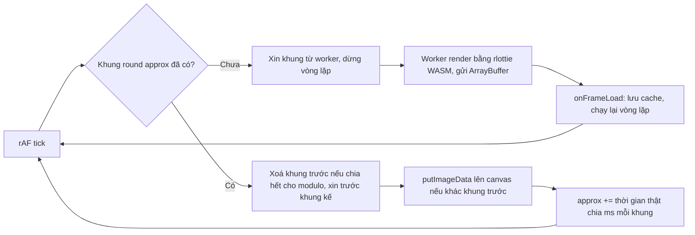

Mở bảng sticker của Telegram Web: vài chục sticker động cùng chạy, mỗi cái là một animation Lottie (vector, mô tả bằng JSON). Vẽ Lottie bằng thư viện JS trên main thread thì vài chục cái cùng lúc là đủ làm trang giật. Telegram Web không làm vậy: nó render từng khung bằng **rlottie** (thư viện C++ của Samsung, biên dịch sang WebAssembly) trong **4 Web Worker**, gửi khung đã render (một mảng điểm ảnh) về main thread, main thread chỉ việc **hẹn giờ, cache và vẽ** lên canvas.

Phần render trong worker là chuyện của rlottie. Phần đáng học nằm ở lớp điều phối trên main thread: [`lib/rlottie/RLottie.ts`](https://github.com/hunghg255/codebase/blob/main/web.telegram.org/src/lib/rlottie/RLottie.ts), khoảng 430 dòng. Bài này đọc nó, viết lại thành một "frame player" dùng được cho bất kỳ nguồn khung nào (Lottie, sprite, video đã giải mã), và sửa một lỗi làm animation chậm gấp đôi trên màn hình 30Hz.

> [!TIP]
> **Tóm tắt**
> - Độ phân giải canvas = `size × max(DPR × quality, 1)`: sticker phụ dùng `quality = 0.75`, nhưng **không bao giờ thấp hơn kích thước CSS**. Giảm chất lượng chỉ trên màn DPR cao, nơi mắt khó thấy.
> - Sticker ưu tiên thấp chạy **30fps** (bỏ một nửa số khung) nếu fps gốc chia hết cho 30.
> - Chỉ số khung là **số thực**, cộng theo thời gian thật giữa hai lần vẽ. Luôn xin trước khung kế tiếp; cứ 4 khung (Safari: 2) thì bỏ khung đứng trước để giới hạn bộ nhớ; pause thì chỉ giữ khung đang hiện.
> - Bản gốc chặn mỗi lần vẽ tiến **tối đa 1 khung**: màn 30Hz hay máy bận thì animation 60fps chạy **chậm gấp đôi**, và `setSpeed(2)` không có tác dụng. Tính theo thời gian thật thì giữ đúng thời lượng.

<iframe class="demo-frame" src="/demos/web-patterns/index.html?theme=dark#/tg-frame-player" title="Demo tg-frame-player" loading="lazy" style="height: 1000px"></iframe>

<p class="demo-links">▶ <a href="/demos/web-patterns/index.html#/tg-frame-player" target="_blank" rel="noopener">Mở demo toàn màn hình ↗</a> · <a href="https://stackblitz.com/github/hunghg255/blog-hunghg/tree/master/examples/web-patterns?file=src/lib/tgFramePlayer.ts" target="_blank" rel="noopener">Sửa code trên StackBlitz ↗</a> · <a href="https://github.com/hunghg255/blog-hunghg/blob/master/examples/web-patterns/src/lib/tgFramePlayer.ts" target="_blank" rel="noopener">Xem source trên GitHub ↗</a></p>

Demo có một sticker lớn (60fps, chất lượng đầy đủ) và sáu sticker nhỏ ưu tiên thấp (30fps, quality 0.75). Khung được tạo bởi một "worker" giả (canvas vẽ rồi trả `ImageData` sau vài mili giây). Bật "Giả lập màn hình 30Hz" rồi đổi qua lại hai cách tính khung: **theo thời gian thật** một vòng vẫn mất 2000ms; **tối đa 1 khung mỗi lần vẽ** (bản gốc) thì mất 4000ms. Bỏ 30Hz, chọn tốc độ 2×: bản gốc vẫn 2000ms, bản viết lại 1000ms.

## Telegram làm thế nào?

### Cấu hình: độ phân giải và fps

```ts
const HIGH_PRIORITY_QUALITY = IS_SINGLE_COLUMN_LAYOUT ? 0.75 : 1;
const LOW_PRIORITY_QUALITY = 0.75;
const HIGH_PRIORITY_MAX_FPS = 60;
const LOW_PRIORITY_MAX_FPS = 30;
const HIGH_PRIORITY_CACHE_MODULO = IS_SAFARI ? 2 : 4;
const LOW_PRIORITY_CACHE_MODULO = 0;

// initContainer()
// Reduced quality only looks acceptable on high DPR screens
const imgSize = Math.round(size * Math.max(DPR * quality, 1));

// initConfig()
const maxFps = isLowPriority ? LOW_PRIORITY_MAX_FPS : HIGH_PRIORITY_MAX_FPS;
const sourceFps = this.animationData.fr || maxFps;
this.reduceFactor = sourceFps % maxFps === 0 ? sourceFps / maxFps : 1;
this.msPerFrame = 1000 / (sourceFps / this.reduceFactor);
```

- **Độ phân giải**: sticker 160px CSS trên màn DPR 2 với quality 1 là canvas 320×320; quality 0.75 là 240×240 (trình duyệt phóng lên 320). Trên màn DPR 1: `max(1 × 0.75, 1) = 1`, vẫn đủ 160×160. Comment trong code nói rõ lý do: giảm chất lượng chỉ chấp nhận được trên màn DPR cao. Trên mobile (layout một cột) cả sticker chính cũng dùng 0.75.
- **Giảm fps**: Lottie của Telegram thường là 60fps. Sticker ưu tiên thấp (trong bảng sticker, gợi ý emoji…) có `reduceFactor = 2`: worker chỉ render khung chẵn, mỗi khung hiện lâu gấp đôi. Fps gốc không chia hết (vd. 50) thì giữ nguyên, tránh nhịp lệch.
- **`cacheModulo`**: sẽ nói ở phần cache.

Mỗi player được giao cho một trong 4 worker theo vòng tròn (`cycleRestrict(MAX_WORKERS, ++lastWorkerIndex)`).

### Vòng lặp vẽ

Phần chính của `doPlay()` (rút gọn, bỏ nhánh `stopFrameIndex` dùng cho `playSegment`):

```ts
animate(() => {
  const frameIndex = Math.round(this.approxFrameIndex);
  const chunkIndex = this.getChunkIndex(frameIndex);
  const chunk = this.chunks[chunkIndex];
  if (!chunk) {
    this.requestChunk(chunkIndex);
    this.isWaiting = true;
    return false; // dừng vòng lặp, onFrameLoad sẽ gọi doPlay() lại
  }
  if (this.cacheModulo && chunkIndex % this.cacheModulo === 0) this.cleanupPrevChunk(chunkIndex);
  this.requestNextChunk(chunkIndex);
  if (frameIndex !== this.prevFrameIndex) { /* putImageData */ }

  const now = Date.now();
  const currentSpeed = this.lastRenderAt ? this.msPerFrame / (now - this.lastRenderAt) : 1;
  const delta = Math.min(1, (this.direction * this.speed) / currentSpeed);
  // ... hết vòng thì approxFrameIndex = 0, không thì approxFrameIndex += delta
  return true;
});
```

`animate` là một vòng `requestAnimationFrame` chạy tới khi callback trả `false`. Ba ý đáng học:

1. **`approxFrameIndex` là số thực.** Mỗi lần vẽ cộng thêm "đã trôi bao nhiêu khung" (thời gian thật ÷ thời lượng một khung). Màn 120Hz chạy sticker 30fps thì mỗi lần vẽ chỉ cộng 0.25, cùng một khung được giữ 4 lần vẽ (và `frameIndex !== prevFrameIndex` tránh vẽ lại thừa).
2. **Khung chưa có thì dừng hẳn vòng lặp**, không quay rAF vô ích. Khung về (`onFrameLoad`) thì chạy lại.
3. **Khung được chia thành "chunk"** để có thể xin nhiều khung một lần, nhưng `CHUNK_SIZE = 1` và có comment `TODO Consider removing chunks`: thực tế mỗi chunk là một khung.

### Lỗi: tối đa một khung mỗi lần vẽ

Gộp hai dòng tính `delta` lại:

```ts
delta = Math.min(1, direction * speed * (now - lastRenderAt) / msPerFrame)
```

`Math.min(1, …)` nghĩa là **mỗi lần vẽ tiến tối đa 1 khung**. Trên màn 60Hz với sticker 60fps thì không sao (delta ≈ 1). Nhưng:

- **Màn hình 30Hz**, chế độ tiết kiệm pin, hoặc main thread bận làm rAF chỉ chạy 30 lần/giây: mỗi lần lẽ ra phải tiến 2 khung nhưng chỉ tiến 1. Animation chạy bằng **nửa tốc độ** (demo: 4000ms thay vì 2000ms một vòng).
- **`setSpeed(2)`** không có tác dụng trên màn 60Hz với sticker 60fps: delta muốn là 2 nhưng bị chặn còn 1.
- Chặn chỉ có **một chiều**: `Math.min(1, delta)` không chặn delta âm, nên chạy lùi (`playSegment` từ khung lớn về khung nhỏ) lại được nhảy nhiều khung. Hai chiều chạy với hai luật khác nhau.

Có lẽ việc chặn là cố ý: không cho nhảy khung thì không bao giờ phải chờ một khung chưa render (chỉ xin trước đúng một khung). Đổi lại, thời lượng animation phụ thuộc tốc độ màn hình.

### Cache khung

Mỗi khung là một mảng RGBA: `imgSize² × 4` byte. Sticker 160px trên màn DPR 2 là 320 × 320 × 4 = **400 KB mỗi khung**; một animation 3 giây ở 60fps có 180 khung, giữ hết là **72 MB** cho *một* sticker. Telegram giới hạn bằng ba cách:

```ts
private cleanupPrevChunk(chunkIndex: number) {
  if (this.chunksCount! < 3) return;
  const prevChunkIndex = cycleRestrict(this.chunksCount!, chunkIndex - 1);
  this.chunks[prevChunkIndex] = undefined;
}

pause() {
  // ...
  const currentChunkIndex = this.getChunkIndex(this.approxFrameIndex);
  this.chunks = this.chunks.map((chunk, i) => (i === currentChunkIndex ? chunk : undefined));
}
```

- **Xoá theo modulo**: đến khung chia hết cho 4 (Safari: 2) thì xoá khung *ngay trước nó*. Vòng sau, khung đó phải render lại. Kết quả: giữ khoảng 3/4 số khung (Safari 1/2), đổi một phần bộ nhớ lấy một phần CPU. Có lẽ Safari dùng 2 vì giới hạn bộ nhớ của tab trên Safari (nhất là iOS) chặt hơn.
- **Ưu tiên thấp thì giữ hết** (`LOW_PRIORITY_CACHE_MODULO = 0`): sticker nhỏ, 30fps, quality 0.75 nên mỗi khung đã nhỏ, số khung đã giảm một nửa.
- **Pause chỉ giữ khung đang hiện**: sticker cuộn khỏi màn hình hay bảng sticker đóng lại thì bộ nhớ được trả ngay.

## Bên trong trình duyệt: thời gian của một khung



Vài điều về các bước này:

- **`putImageData`** chép thẳng điểm ảnh vào canvas, không qua bước tổng hợp hình (không blend, không transform), nên rất nhanh với ảnh vài trăm pixel. Đổi lại nó không scale: canvas phải đúng `imgSize`, phần phóng to/thu nhỏ để CSS (`canvas.style.width`) lo.
- **Khung đi từ worker về main thread** là một `ArrayBuffer`. Gửi kèm trong danh sách transfer (`postMessage(data, [buffer])`) thì buffer được *chuyển* chứ không copy; Telegram Web dùng cơ chế RPC giữa main thread và worker (xem [bài Worker RPC trong series web](/blogs/web-worker-promise-rpc)).
- **rAF dừng ở tab ẩn**: trình duyệt không gọi `requestAnimationFrame` khi tab bị ẩn, nên sticker tự dừng. Khi quay lại, lần vẽ đầu có thể thấy "đã trôi" vài phút: bản gốc chặn delta ở 1 nên không sao; bản viết lại phải xử lý riêng (xem bên dưới).

## Viết lại

`FramePlayer` nhận một hàm `source(frameIndex, size) => Promise<ImageData>` thay cho worker rlottie, nên dùng được với bất kỳ nguồn khung nào. Cấu hình giữ nguyên công thức của Telegram:

```ts title=src/lib/tgFramePlayer.ts
    const { size, isLowPriority, dpr = window.devicePixelRatio || 1 } = options;
    const quality = options.quality ?? (isLowPriority ? 0.75 : 1);
    // Chất lượng giảm chỉ chấp nhận được trên màn DPR cao: DPR 1 thì vẫn giữ đủ size
    this.imgSize = Math.round(size * Math.max(dpr * quality, 1));
    canvas.width = this.imgSize;
    canvas.height = this.imgSize;
    canvas.style.width = `${size}px`;
    canvas.style.height = `${size}px`;
    this.ctx = canvas.getContext('2d')!;

    const maxFps = isLowPriority ? LOW_PRIORITY_MAX_FPS : HIGH_PRIORITY_MAX_FPS;
    // chỉ giảm khi chia hết (60 → 30 được, 50 → 30 thì giữ nguyên 50)
    this.reduceFactor = options.sourceFps % maxFps === 0 ? options.sourceFps / maxFps : 1;
    this.msPerFrame = 1000 / (options.sourceFps / this.reduceFactor);
    this.framesCount = Math.ceil(options.framesCount / this.reduceFactor);
```

Trong `tick()`, phần lấy khung, xoá khung theo modulo, xin trước khung kế và `putImageData` giống bản gốc (xem file đầy đủ). Khác biệt nằm ở đoạn tính khung tiếp theo:

```ts title=src/lib/tgFramePlayer.ts
    const now = this.now();
    // lần vẽ đầu chưa có mốc thời gian: coi như đúng 1 khung
    const elapsedFrames = this.lastRenderAt === undefined ? 1 : (now - this.lastRenderAt) / this.msPerFrame;
    this.lastRenderAt = now;
    let delta = this.direction * this.speed * elapsedFrames;
    if (this.options.timing === 'capped') {
      // bản gốc chỉ chặn chiều tiến: Math.min(1, delta). Chạy lùi thì không chặn (lệch hai chiều)
      delta = Math.min(1, delta);
    }
    if (Math.abs(delta) > 1) this.stats.skipped += Math.floor(Math.abs(delta)) - 1;

    let next = this.approxFrameIndex + delta;
    // so theo chỉ số SAU KHI làm tròn: 119.6 vẫn còn là khung 120 → đã hết vòng
    const rounded = Math.round(next);
    if (rounded > this.framesCount - 1 || rounded < 0) {
      if (this.options.loop === false) {
        this.playing = false;
        return;
      }
      // giữ phần lẻ để vòng sau vẫn đúng nhịp (bản gốc đặt thẳng về 0). Chia theo số vòng đã qua:
      // tab bị ẩn lâu rồi quay lại thì delta có thể dài nhiều vòng
      next -= Math.floor(rounded / this.framesCount) * this.framesCount;
      if (this.loopStartedAt !== undefined) this.options.onLoop?.(now - this.loopStartedAt);
      this.loopStartedAt = now;
    }
    this.approxFrameIndex = next;
```

::: spoiler Xem toàn bộ src/lib/tgFramePlayer.ts

```ts title=src/lib/tgFramePlayer.ts
/**
 * Trình phát khung hình kiểu RLottie của Telegram Web: khung được render ở nơi khác (worker),
 * main thread chỉ lo hẹn giờ, cache khung và vẽ lên canvas.
 *
 * - Độ phân giải canvas = size × max(DPR × quality, 1): giảm chất lượng chỉ trên màn DPR cao.
 * - Giảm fps cho sticker ưu tiên thấp: chỉ render 1/reduceFactor khung (60 → 30).
 * - Chỉ số khung là số thực, cộng theo thời gian thật giữa hai lần vẽ.
 * - Luôn xin trước khung kế tiếp; cứ `cacheModulo` khung thì bỏ khung đứng trước để giới hạn bộ nhớ.
 */

export type FrameSource = (frameIndex: number, size: number) => Promise<ImageData>;

export interface FramePlayerOptions {
  /** kích thước CSS (px) */
  size: number;
  /** số khung gốc và fps gốc của animation */
  framesCount: number;
  sourceFps: number;
  isLowPriority?: boolean;
  /** mặc định 1 (0.75 cho ưu tiên thấp như Telegram) */
  quality?: number;
  dpr?: number;
  loop?: boolean;
  /**
   * 'capped': như bản gốc, mỗi lần vẽ tiến tối đa 1 khung → máy/màn hình chậm thì animation chậm theo.
   * 'realtime': được nhảy nhiều khung để giữ đúng thời lượng (mặc định).
   */
  timing?: 'capped' | 'realtime';
  /** cứ N khung thì xoá khung đứng trước; 0 = giữ hết. Mặc định 4 (Telegram: Safari 2, nơi khác 4) */
  cacheModulo?: number;
  /** gọi mỗi khi hết một vòng, kèm thời gian thực của vòng đó (ms) */
  onLoop?: (durationMs: number) => void;
  now?: () => number;
  requestFrame?: (cb: () => void) => number;
  cancelFrame?: (id: number) => void;
}

const HIGH_PRIORITY_MAX_FPS = 60;
const LOW_PRIORITY_MAX_FPS = 30;

export class FramePlayer {
  readonly imgSize: number;
  readonly reduceFactor: number;
  readonly msPerFrame: number;
  /** số khung thật sự cần render sau khi giảm fps */
  readonly framesCount: number;

  private frames = new Map<number, ImageData>();
  private pending = new Set<number>();
  private ctx: CanvasRenderingContext2D;
  private approxFrameIndex = 0;
  private prevFrameIndex = -1;
  private lastRenderAt?: number;
  private rafId?: number;
  private waiting = false;
  private playing = false;
  private destroyed = false;
  private speed = 1;
  private direction: 1 | -1 = 1;
  private loopStartedAt?: number;

  /** số liệu cho demo */
  stats = { requested: 0, drawn: 0, skipped: 0, waits: 0 };

  constructor(
    readonly canvas: HTMLCanvasElement,
    private source: FrameSource,
    private options: FramePlayerOptions,
  ) {
    const { size, isLowPriority, dpr = window.devicePixelRatio || 1 } = options;
    const quality = options.quality ?? (isLowPriority ? 0.75 : 1);
    // Chất lượng giảm chỉ chấp nhận được trên màn DPR cao: DPR 1 thì vẫn giữ đủ size
    this.imgSize = Math.round(size * Math.max(dpr * quality, 1));
    canvas.width = this.imgSize;
    canvas.height = this.imgSize;
    canvas.style.width = `${size}px`;
    canvas.style.height = `${size}px`;
    this.ctx = canvas.getContext('2d')!;

    const maxFps = isLowPriority ? LOW_PRIORITY_MAX_FPS : HIGH_PRIORITY_MAX_FPS;
    // chỉ giảm khi chia hết (60 → 30 được, 50 → 30 thì giữ nguyên 50)
    this.reduceFactor = options.sourceFps % maxFps === 0 ? options.sourceFps / maxFps : 1;
    this.msPerFrame = 1000 / (options.sourceFps / this.reduceFactor);
    this.framesCount = Math.ceil(options.framesCount / this.reduceFactor);
  }

  get cacheSize() {
    return this.frames.size;
  }

  get bytesPerFrame() {
    return this.imgSize * this.imgSize * 4;
  }

  get isPlaying() {
    return this.playing;
  }

  /** chỉ số khung hiện tại theo animation gốc (trước khi giảm fps) */
  get currentSourceFrame() {
    return Math.round(this.approxFrameIndex) * this.reduceFactor;
  }

  setSpeed(speed: number) {
    this.speed = speed;
  }

  setTiming(timing: 'capped' | 'realtime') {
    this.options.timing = timing;
  }

  play(direction: 1 | -1 = 1) {
    this.direction = direction;
    if (this.playing) return;
    this.playing = true;
    this.lastRenderAt = undefined;
    this.loopStartedAt = undefined;
    this.schedule();
  }

  /** dừng và chỉ giữ khung đang hiện (bản gốc cũng giải phóng các khung khác khi pause) */
  pause() {
    this.playing = false;
    this.waiting = false;
    if (this.rafId !== undefined) this.cancel(this.rafId);
    this.rafId = undefined;
    const current = Math.round(this.approxFrameIndex);
    for (const index of [...this.frames.keys()]) if (index !== current) this.frames.delete(index);
  }

  destroy() {
    this.destroyed = true;
    this.pause();
    this.frames.clear();
  }

  private now() {
    return this.options.now?.() ?? performance.now();
  }

  private schedule() {
    const request = this.options.requestFrame ?? ((cb: () => void) => requestAnimationFrame(cb));
    this.rafId = request(() => this.tick());
  }

  private cancel(id: number) {
    (this.options.cancelFrame ?? cancelAnimationFrame)(id);
  }

  private tick() {
    this.rafId = undefined;
    if (!this.playing || this.destroyed) return;

    const frameIndex = Math.round(this.approxFrameIndex);
    const frame = this.frames.get(frameIndex);
    if (!frame) {
      // khung chưa về: dừng vòng lặp, onFrameLoad sẽ gọi lại
      this.request(frameIndex);
      this.waiting = true;
      this.stats.waits++;
      return;
    }

    const { cacheModulo = 4 } = this.options;
    if (cacheModulo && frameIndex % cacheModulo === 0 && this.framesCount >= 3) {
      this.frames.delete(this.wrap(frameIndex - 1));
    }
    this.request(this.wrap(frameIndex + this.direction));

    if (frameIndex !== this.prevFrameIndex) {
      this.ctx.putImageData(frame, 0, 0);
      this.stats.drawn++;
      this.prevFrameIndex = frameIndex;
    }

    const now = this.now();
    // lần vẽ đầu chưa có mốc thời gian: coi như đúng 1 khung
    const elapsedFrames = this.lastRenderAt === undefined ? 1 : (now - this.lastRenderAt) / this.msPerFrame;
    this.lastRenderAt = now;
    let delta = this.direction * this.speed * elapsedFrames;
    if (this.options.timing === 'capped') {
      // bản gốc chỉ chặn chiều tiến: Math.min(1, delta). Chạy lùi thì không chặn (lệch hai chiều)
      delta = Math.min(1, delta);
    }
    if (Math.abs(delta) > 1) this.stats.skipped += Math.floor(Math.abs(delta)) - 1;

    let next = this.approxFrameIndex + delta;
    // so theo chỉ số SAU KHI làm tròn: 119.6 vẫn còn là khung 120 → đã hết vòng
    const rounded = Math.round(next);
    if (rounded > this.framesCount - 1 || rounded < 0) {
      if (this.options.loop === false) {
        this.playing = false;
        return;
      }
      // giữ phần lẻ để vòng sau vẫn đúng nhịp (bản gốc đặt thẳng về 0). Chia theo số vòng đã qua:
      // tab bị ẩn lâu rồi quay lại thì delta có thể dài nhiều vòng
      next -= Math.floor(rounded / this.framesCount) * this.framesCount;
      if (this.loopStartedAt !== undefined) this.options.onLoop?.(now - this.loopStartedAt);
      this.loopStartedAt = now;
    }
    this.approxFrameIndex = next;

    const nextIndex = this.wrap(Math.round(next));
    if (!this.frames.has(nextIndex)) {
      this.request(nextIndex);
      this.waiting = true;
      this.stats.waits++;
      return;
    }
    this.schedule();
  }

  private wrap(index: number) {
    return ((index % this.framesCount) + this.framesCount) % this.framesCount;
  }

  private request(frameIndex: number) {
    if (this.frames.has(frameIndex) || this.pending.has(frameIndex)) return;
    this.pending.add(frameIndex);
    this.stats.requested++;
    this.source(frameIndex * this.reduceFactor, this.imgSize).then(
      (image) => this.onFrameLoad(frameIndex, image),
      () => this.pending.delete(frameIndex),
    );
  }

  private onFrameLoad(frameIndex: number, image: ImageData) {
    this.pending.delete(frameIndex);
    if (this.destroyed) return;
    this.frames.set(frameIndex, image);
    if (this.waiting && this.playing) {
      this.waiting = false;
      // thời gian chờ khung không tính vào animation (giống video đang buffer). Nếu tính, lần vẽ sau
      // sẽ nhảy xa tới khung chưa có, lại phải chờ, và cứ đuổi theo mãi
      this.lastRenderAt = undefined;
      this.schedule();
    }
  }
}
```

:::

## Đi qua code

- **`timing: 'realtime'`** (mặc định): `delta = speed × thời gian thật / msPerFrame`, không chặn. Màn 30Hz thì mỗi lần vẽ nhảy 2 khung (đếm vào "khung bị bỏ qua" trong demo), thời lượng vẫn đúng. **`'capped'`** giữ nguyên hành vi gốc để so sánh.
- **Hết vòng được xác định theo chỉ số *sau khi làm tròn***. Bản đầu tiên của chính bản viết lại so `next > last + 0.5`: với `next = 119.6`, phép so sai biên và báo hết vòng hai lần liên tiếp (demo đo được "1 vòng = 17ms"). So `Math.round(next) > last` thì đúng.
- **Giữ phần lẻ khi quay vòng** (`next -= số vòng × framesCount`) thay vì đặt về 0 như bản gốc: vòng sau không bị lệch nhịp vài mili giây. Chia theo *số vòng đã qua* để một delta rất lớn (tab bị ẩn lâu rồi quay lại) vẫn rơi về đúng một khung trong vòng.
- **Thời gian chờ khung không tính vào animation**: khi phải chờ worker, `lastRenderAt` bị xoá, lần vẽ sau coi như bắt đầu lại. Không làm vậy thì ở chế độ realtime, sau mỗi lần chờ, delta lớn nhảy tới một khung chưa có, lại phải chờ, và cứ đuổi theo mãi. Bản gốc không gặp vấn đề này nhờ chặn delta ở 1.
- **`pending`**: một khung đang được xin thì không xin lại. Bản gốc dùng chính mảng `chunks` (gán `[]` khi xin) cho việc này.
- **`requestFrame`/`now` truyền vào được**: demo giả lập màn 30Hz bằng cách bỏ qua một nửa số lần rAF; test truyền đồng hồ giả.

**Khác bản gốc:**

- Tính khung theo thời gian thật, đúng thời lượng trên màn 30Hz và với `setSpeed` khác 1. Chế độ `'capped'` giữ lại để so sánh.
- Bỏ "chunk" (bản gốc cũng chỉ dùng chunk 1 khung), bỏ `playSegment`/`goToAndStop`. Nguồn khung là một hàm bất kỳ thay vì 4 worker rlottie.
- Giữ phần lẻ khi quay vòng, và xử lý delta nhiều vòng.

## Tại sao không làm cách khác?

- **lottie-web trên main thread** (vẽ SVG hoặc canvas): một hai animation thì ổn, vài chục cùng lúc là main thread bận liên tục. Telegram chọn render trong worker vì cả bảng sticker chạy cùng lúc.
- **`OffscreenCanvas` vẽ thẳng trong worker** (worker vẽ lên canvas đã `transferControlToOffscreen`): không phải gửi điểm ảnh về main thread. Đây là cách hiện đại hơn và đã có ở các trình duyệt lớn (tính tới 10/2026, xem [caniuse](https://caniuse.com/offscreencanvas)); bản Telegram Web trong repo (khá cũ) chưa dùng, có lẽ vì lúc đó Safari chưa hỗ trợ. Đổi lại, mỗi sticker cần một canvas riêng nằm trong worker, khó cache khung dùng chung.
- **Video (WebM có kênh alpha) thay cho Lottie**: trình duyệt giải mã bằng phần cứng, nhẹ CPU. Telegram dùng định dạng này cho sticker video. Nhưng Lottie nhỏ hơn nhiều khi tải về và scale không vỡ.
- **Cache toàn bộ khung**: không giới hạn thì bộ nhớ tăng theo số sticker × số khung × độ phân giải² (72 MB cho một sticker lớn ở ví dụ trên). Phải có chính sách bỏ khung và giải phóng khi pause.

## Edge case và cạm bẫy

- **Chờ khung giữa chừng**: mỗi khung bị xoá theo modulo phải render lại ở vòng sau, và vì chỉ xin trước *một* khung, ta thường phải chờ một chút đúng ở khung đó (demo đếm khoảng 30 lần chờ mỗi vòng với modulo 4, mỗi lần bằng độ trễ của worker). Độ trễ của worker lớn hơn thời gian một khung thì sẽ thấy giật đúng nhịp. Cách sửa: xin trước 2–3 khung, hoặc chọn modulo lớn hơn.
- **Đổi DPR khi đang chạy** (kéo cửa sổ sang màn hình khác): `imgSize` tính một lần lúc tạo. Muốn sắc nét trên màn mới thì phải tạo lại player (nghe `matchMedia('(resolution: …dppx)')`).
- **Nhiều player, một nguồn khung**: sticker giống nhau xuất hiện nhiều lần (cùng một sticker gửi nhiều lần trong chat) có thể dùng chung cache. Telegram dùng key `${id}_${imgSize}` cho renderer trong worker.
- **Tab ẩn và `Date.now()`**: bản gốc dùng `Date.now()`, có thể nhảy khi người dùng đổi giờ hệ thống. `performance.now()` (bản viết lại) đơn điệu tăng.
- **`ImageData` cho mỗi khung**: bản gốc tạo `new ImageData(new Uint8ClampedArray(frame), …)` mỗi lần vẽ, một object mới mỗi khung cho bộ dọn rác. Bản viết lại cache luôn `ImageData`.

## Dùng trong dự án

```ts
import { FramePlayer } from './tgFramePlayer';

// nguồn khung: ở đây là một sprite sheet đã tải, cắt từng ô thành ImageData
const player = new FramePlayer(canvas, (frameIndex, size) => renderFrameInWorker(frameIndex, size), {
  size: 120,
  framesCount: 90,
  sourceFps: 60,
  isLowPriority: !isMainSticker, // sticker phụ: 30fps, quality 0.75, giữ hết khung
});

// chỉ chạy khi nhìn thấy, giải phóng khung khi khuất
const observer = new IntersectionObserver(([entry]) => (entry.isIntersecting ? player.play() : player.pause()));
observer.observe(canvas);
```

`renderFrameInWorker` là hàm của bạn: gọi worker (rlottie-wasm, lottie-web chạy trên `OffscreenCanvas`…) và trả `ImageData`.

## Kiểm thử

::: spoiler Ví dụ test (bản phác, không có trong repo)

```ts
import { describe, expect, it } from 'vitest';
import { FramePlayer } from './tgFramePlayer';

// jsdom không có canvas: dùng canvas giả chỉ cần putImageData
const fakeCanvas = () => ({ style: {}, getContext: () => ({ putImageData() {} }) }) as unknown as HTMLCanvasElement;
const instantSource = async (i: number) => ({ index: i }) as unknown as ImageData;

function run(timing: 'capped' | 'realtime', tickMs: number, speed = 1) {
  let now = 0;
  const queue: (() => void)[] = [];
  let loopMs = 0;
  const player = new FramePlayer(fakeCanvas(), instantSource, {
    size: 100, framesCount: 120, sourceFps: 60, dpr: 1, cacheModulo: 0, timing,
    now: () => now,
    requestFrame: (cb) => (queue.push(cb), 0),
    onLoop: (ms) => (loopMs = ms),
  });
  player.setSpeed(speed);
  player.play();
  return async () => {
    for (let i = 0; i < 2000; i++) {
      await Promise.resolve(); // để khung "về"
      now += tickMs;
      queue.shift()?.();
    }
    return loopMs;
  };
}

describe('FramePlayer', () => {
  it('màn 30Hz: bản gốc chậm gấp đôi, bản viết lại đúng 2 giây', async () => {
    expect(await run('capped', 1000 / 30)()).toBeCloseTo(4000, -2);
    expect(await run('realtime', 1000 / 30)()).toBeCloseTo(2000, -2);
  });

  it('tốc độ 2× chỉ có tác dụng khi không chặn', async () => {
    expect(await run('capped', 1000 / 60, 2)()).toBeCloseTo(2000, -2);
    expect(await run('realtime', 1000 / 60, 2)()).toBeCloseTo(1000, -2);
  });

  it('ưu tiên thấp: 60fps → 30fps, canvas không nhỏ hơn kích thước CSS', () => {
    const p = new FramePlayer(fakeCanvas(), instantSource, { size: 64, framesCount: 120, sourceFps: 60, isLowPriority: true, dpr: 1 });
    expect(p.reduceFactor).toBe(2);
    expect(p.framesCount).toBe(60);
    expect(p.imgSize).toBe(64); // max(1 × 0.75, 1) = 1
  });
});
```

:::

## So với thư viện

- **lottie-web** (Airbnb): đầy đủ tính năng Lottie, render ra SVG, canvas hoặc HTML, mặc định trên main thread.
- **dotLottie / ThorVG**: bộ render viết bằng C++ biên dịch sang WASM, cùng hướng với rlottie, có player web dựng sẵn.
- **rlottie** (Samsung): thứ Telegram dùng; bản thân nó chỉ render khung, phần "player" (hẹn giờ, cache, ưu tiên) là việc của ứng dụng, chính là phần bài này viết lại.

---

Bài này thuộc series **[Học từ mã nguồn Telegram](/series/telegram)** (25 bài, đọc theo thứ tự).

::: spoiler Xem nhanh danh sách bài trong series

*Mở đầu*

- [Mở đầu: bên trong Telegram Web A](/blogs/learn-from-telegram-source-code)

*Phần 1: dữ liệu và đồng bộ*

- [#1 Gửi tin lạc quan, khớp tin thật bằng randomId](/blogs/telegram-optimistic-send)
- [#2 Lịch sử tin nhắn chia hai đảo](/blogs/telegram-message-history-islands)
- [#3 Lưu global state lúc rảnh, chỉ giữ phần cần](/blogs/telegram-persist-global-state)
- [#4 Gom update realtime theo nhịp animation](/blogs/telegram-realtime-update-batching)
- [#5 Store tự viết và diff danh sách có key](/blogs/telegram-teactn-store-fast-list)

*Phần 2: animation và giao diện*

- [#6 Animation sắp xếp danh sách chat không đo DOM](/blogs/telegram-chat-list-flip)
- [#7 Ảnh bay giữa hai cây DOM trong media viewer](/blogs/telegram-media-viewer-ghost)
- [#8 Bố cục album chọn theo hàm chi phí](/blogs/telegram-album-layout)
- [#9 Giờ gửi nằm gọn trong bong bóng chat](/blogs/telegram-bubble-meta-spacer)
- [#10 Composer biến hình, Transition và gạch chân tab](/blogs/telegram-composer-morph-transition)

*Phần 3: media, mobile, thông báo*

- [#11 Thumbnail 100 byte và viền sticker nén](/blogs/telegram-tiny-thumbnails)
- **#12 Player sticker: DPR, hạ fps, cache khung** (bài này)
- [#13 Mobile: --vh, bàn phím ảo, nhấn giữ, số điện thoại](/blogs/telegram-mobile-viewport-touch)
- [#14 Web Push không trùng và đánh dấu đã đọc](/blogs/telegram-push-dedupe-read-receipts)

*Phần 4: soạn tin, media, chi tiết UI*

- [#15 Rich text ⇄ entities, thanh định dạng nổi, nháp theo chat](/blogs/telegram-rich-text-entities)
- [#16 Ô nhập tự giãn, emoji phóng to, gom tin theo ngày/người/album](/blogs/telegram-auto-grow-input-grouping)
- [#17 Bảng emoji/sticker chỉ render nhóm đang xem](/blogs/telegram-emoji-picker-virtualization)
- [#18 mediaLoader gộp request, ảnh mờ sang nét, spinner không chớp](/blogs/telegram-media-loader-blur-buffering)
- [#19 Trình phát audio toàn cục và playlist](/blogs/telegram-global-audio-player)
- [#20 UiLoader chạy đua 700ms, ba mức animation](/blogs/telegram-ui-loader-animation-levels)
- [#21 PanZoom bằng matrix() trong media viewer](/blogs/telegram-panzoom-matrix)
- [#22 Ngày dính khi cuộn, khoá cuộn, dừng momentum iOS](/blogs/telegram-sticky-date-scroll-lock)
- [#23 Vùng thả file, nén ảnh trước khi gửi, copy ảnh](/blogs/telegram-drop-zone-compress-copy)
- [#24 Tiêu đề nhấp nháy và favicon đếm tin mới](/blogs/telegram-title-favicon-unread)

:::

Code + demo: [`examples/web-patterns`](https://github.com/hunghg255/blog-hunghg/tree/master/examples/web-patterns) · [Mở trên StackBlitz](https://stackblitz.com/github/hunghg255/blog-hunghg/tree/master/examples/web-patterns)
