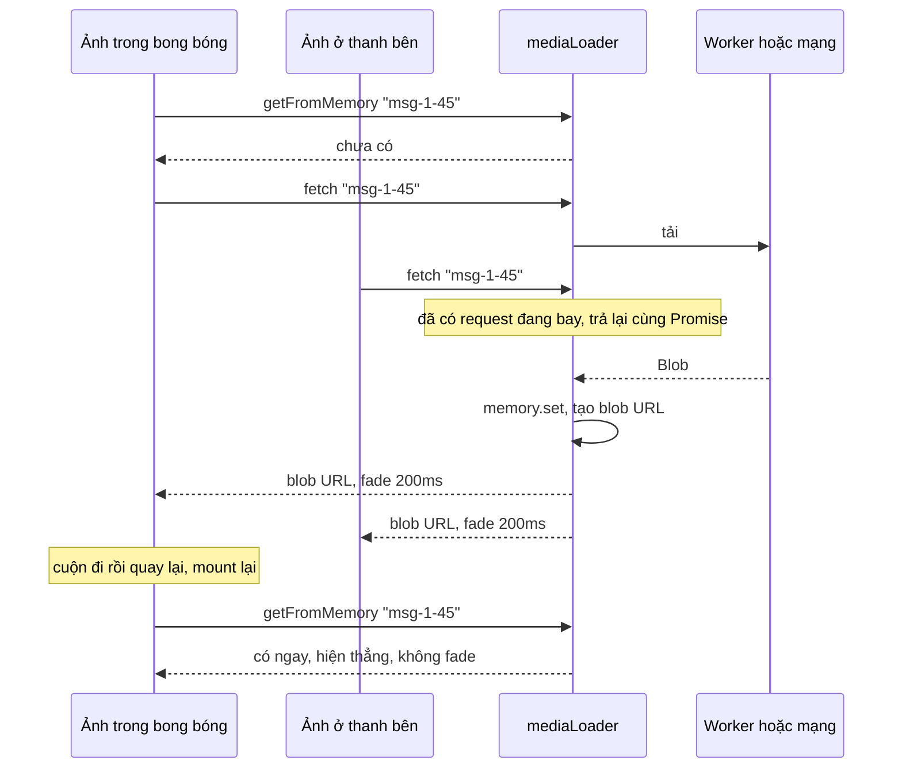

Một khung chat Telegram có thể hiện cùng một ảnh ở ba nơi cùng lúc: trong bong bóng tin, trong thanh "media đã chia sẻ" bên phải, và trong trình xem ảnh. Cuộn lên cuộn xuống thì component ảnh liên tục bị gỡ rồi mount lại. Nếu mỗi lần mount là một lần tải và một lần fade từ ảnh mờ sang ảnh nét, khung chat vừa tốn mạng vừa nhấp nháy.

Telegram Web A gom việc tải media vào một module nhỏ, `util/mediaLoader.ts`, và hai hook đi kèm. Kết quả: mỗi ảnh tải một lần, ảnh đã có hiện ngay không fade, còn spinner của video không chớp lên một frame mỗi khi remount.

> [!TIP]
> **Tóm tắt**
> - UI chỉ cầm một **chuỗi khoá** ngắn như `msg-100123-45` hoặc `avatar42?hash`. Object nặng của API nằm trong worker, và worker giải chuỗi đó ra.
> - Request trùng khoá được **gộp** vào một Promise. Có thêm một **bộ nhớ đọc đồng bộ** (`getFromMemory`), để component mount lại có ảnh ngay ở lần render đầu tiên.
> - Ảnh có sẵn lúc mount thì hiện thẳng; chỉ ảnh phải chờ mạng mới fade từ thumbnail mờ, và thumbnail được giữ thêm đúng bằng thời lượng fade rồi mới gỡ.
> - Spinner buffer chỉ đổi trạng thái khi trạng thái mới **giữ nguyên 200ms**. Bản gốc có ba giới hạn: người gọi thứ hai không nhận tiến độ, bộ nhớ không giới hạn, và thanh buffer chỉ đọc khoảng đã tải đầu tiên.

<iframe class="demo-frame" src="/demos/web-patterns/index.html?theme=dark#/tg-media-loader" title="Demo tg-media-loader" loading="lazy" style="height: 1120px"></iframe>

<p class="demo-links">▶ <a href="/demos/web-patterns/index.html#/tg-media-loader" target="_blank" rel="noopener">Mở demo toàn màn hình ↗</a> · <a href="https://stackblitz.com/github/hunghg255/blog-hunghg/tree/master/examples/web-patterns?file=src/lib/tgMediaLoader.ts" target="_blank" rel="noopener">Sửa code trên StackBlitz ↗</a> · <a href="https://github.com/hunghg255/blog-hunghg/blob/master/examples/web-patterns/src/lib/tgMediaLoader.ts" target="_blank" rel="noopener">Xem source trên GitHub ↗</a></p>

Trong demo: 8 ảnh hiện ở hai chỗ, tức 16 lần gọi `fetch`, nhưng chỉ có 8 request mạng. Bấm **Mount lại**: 16 lần đọc đồng bộ từ bộ nhớ, 0 lần fade. Bỏ chọn **Gộp request** rồi chờ: 16 request. Phần spinner: kịch bản **Remount video đã buffer** làm spinner chớp 1 lần nếu đổi ngay, 0 lần nếu debounce; **Mạng chập chờn** là 4 lần so với 2.

## Telegram làm thế nào?

### Khoá media là một chuỗi

Ảnh trong tin không được truyền qua props như object `Photo` của API. [`modules/helpers/messages.ts`](https://github.com/hunghg255/codebase/blob/main/web.telegram.org/src/modules/helpers/messages.ts) tạo khoá `msg${chatId}-${id}`, kèm hậu tố kích thước (`?size=m`) hoặc loại (`photo`, `document`); avatar có khoá `avatar${id}?${avatarHash}`. Lớp API trong worker (`api/gramjs/methods/media.ts`) giữ object MTProto thật trong `localDb` và giải chuỗi khoá thành lệnh tải.

Lợi ích: chuỗi so sánh được bằng `===`, dùng làm khoá `Map` và khoá Cache Storage, truyền qua `postMessage` không tốn gì. Component không bao giờ cầm object nặng của API.

### Gộp request, có bộ nhớ đồng bộ

[`util/mediaLoader.ts`](https://github.com/hunghg255/codebase/blob/main/web.telegram.org/src/util/mediaLoader.ts):

```ts
const memoryCache = new Map<string, ApiPreparedMedia>();
const fetchPromises = new Map<string, Promise<ApiPreparedMedia | undefined>>();

export function fetch(url, mediaFormat, onProgress) {
  if (!fetchPromises.has(url)) {
    const promise = fetchFromCacheOrRemote(url, mediaFormat, onProgress)
      .catch(() => undefined)
      .finally(() => fetchPromises.delete(url));
    fetchPromises.set(url, promise);
  }
  return fetchPromises.get(url);
}

export function getFromMemory(url) {
  return memoryCache.get(url);
}
```

`fetchFromCacheOrRemote` thử Cache Storage trước, rồi mới gọi worker tải. Media tải xong chỉ được ghi vào Cache Storage nếu không lớn hơn **512 KB** (`MEDIA_CACHE_MAX_BYTES`), để file lớn không chiếm hết hạn mức. Blob trả về được biến thành `blob:` URL; riêng blob có kiểu `text/html` thì bị thay bằng một pixel trong suốt, chặn kiểu tấn công nhét HTML vào file media. Trình duyệt không hỗ trợ Opus hay WebP thì file được đổi sang WAV hoặc PNG trước khi trả về.

Ba giới hạn đọc được từ code:

1. **Người gọi thứ hai không nhận tiến độ.** `onProgress` chỉ được truyền cho request đầu tiên. Hai component cùng chờ một ảnh thì chỉ một cái thấy thanh phần trăm chạy.
2. **Khoá gộp chỉ là `url`, không kèm `mediaFormat`.** Hai nơi xin cùng khoá với hai định dạng khác nhau sẽ nhận chung kết quả của request đầu.
3. **`memoryCache` không bao giờ bị dọn.** Mỗi mục là một `blob:` URL giữ Blob trong bộ nhớ cho tới khi `URL.revokeObjectURL`. Cuộn qua vài nghìn ảnh trong một phiên thì bộ nhớ chỉ tăng.

### Ảnh mờ → ảnh nét chỉ khi phải chờ

[`hooks/useTransitionForMedia.ts`](https://github.com/hunghg255/codebase/blob/main/web.telegram.org/src/hooks/useTransitionForMedia.ts):

```ts
const SPEED = { fast: 200, slow: 350 };

export default (mediaData, speed = 'fast', noAnimate = false) => {
  const isMediaLoaded = Boolean(mediaData);
  const willAnimate = !useRef(isMediaLoaded).current && !noAnimate; // chụp giá trị LÚC MOUNT
  const [shouldRenderThumb, setShouldRenderThumb] = useState(!isMediaLoaded);
  // … useShowTransition(isMediaLoaded, …, !willAnimate, speed), rồi:
  // có animate thì setTimeout(() => setShouldRenderThumb(false), SPEED[speed]), không thì gỡ thumbnail ngay
};
```

`useRef(isMediaLoaded).current` chỉ giữ giá trị của lần render **đầu tiên**. Ảnh đã có trong `memoryCache` lúc mount thì `willAnimate = false`: hiện thẳng, không fade, không có frame thumbnail nào. Ảnh phải chờ thì fade, và thumbnail mờ nằm lại thêm 200ms (hoặc 350ms) cho tới khi ảnh nét phủ kín, tránh lộ nền trống giữa chừng. `setTimeout` này không được huỷ khi unmount; React chỉ bỏ qua `setState` vô hại, nhưng huỷ thì sạch hơn.

[`hooks/useMediaWithDownloadProgress.ts`](https://github.com/hunghg255/codebase/blob/main/web.telegram.org/src/hooks/useMediaWithDownloadProgress.ts) thêm hai chi tiết. Tiến độ được throttle 500ms (`PROGRESS_THROTTLE`). Với media phát trực tiếp (stream), tiến độ thật không có ý nghĩa nên sau 1,5s thanh được đặt cứng ở 0,75. Tham số `delay` buộc ảnh **chờ đủ** một khoảng tối thiểu mới hiện, kể cả khi tải xong sớm (`setTimeout(forceUpdate, delay - spentTime)`), để ảnh không nhảy vào giữa animation mở trình xem ảnh.

### Spinner buffer không chớp

[`hooks/useBuffering.ts`](https://github.com/hunghg255/codebase/blob/main/web.telegram.org/src/hooks/useBuffering.ts):

```ts
const MIN_READY_STATE = 3;
// Avoid flickering when re-mounting previously buffered video
const DEBOUNCE = 200;

const handleBuffering = (e) => {
  const media = e.currentTarget;
  if (media.buffered.length) {
    setBufferedProgress(media.buffered.end(0) / media.duration);
  }
  setIsBufferedDebounced(media.readyState >= MIN_READY_STATE || media.currentTime > 0);
};

```

"Đã buffer" là `readyState >= 3` (HAVE_FUTURE_DATA) **hoặc** đã phát được một chút (`currentTime > 0`). Hàm được gắn vào sáu sự kiện, mỗi cái kèm ghi chú vì sao cần: `loadstart` ("Needed for Safari to start"), `pause` ("Needed for Chrome when seeking"), `timeupdate` cho tiến độ audio, `progress` cho tiến độ video, cùng `loadeddata` và `playing`. Debounce 200ms nuốt chuỗi `loadstart` (chưa có dữ liệu) → `loadeddata` (đủ dữ liệu) xảy ra trong vài chục ms khi remount một video đã có trong cache.

Giới hạn: `buffered.end(0)` chỉ đọc **khoảng đầu tiên**. Người dùng tua tới phút thứ 10 thì phần đã tải nằm ở khoảng thứ hai, nhưng thanh buffer vẫn chỉ phần đã tải ở đầu video.

## Bên trong trình duyệt



- **`blob:` URL giữ Blob sống** cho tới khi gọi `URL.revokeObjectURL` hoặc tài liệu bị huỷ. Đây là lý do một bộ nhớ đệm URL không giới hạn là rò rỉ bộ nhớ thật, không chỉ là một `Map` lớn.
- **Ảnh đã decode** còn tốn bộ nhớ hơn file nén: một ảnh 1280×960 khi giải nén là khoảng 4,9 MB (RGBA). Trình duyệt tự quản lý bộ đệm ảnh đã decode, nhưng chỉ giải phóng được khi không còn ai tham chiếu.
- **`readyState` của thẻ media**: 0 chưa có gì, 1 có metadata, 2 có frame hiện tại, 3 có thêm frame kế, 4 đủ để phát tới hết với tốc độ tải hiện tại.

## Viết lại

Loader gộp request, phát tiến độ cho mọi người gọi, giới hạn bộ nhớ:

```ts title=src/lib/tgMediaLoader.ts
export function createMediaLoader<T>({ download, maxItems = 200, onEvict }: MediaLoaderOptions<T>) {
  const memory = new Map<string, T>();
  const inflight = new Map<string, { promise: Promise<T | undefined>; listeners: Set<Progress> }>();
  const stats = { requests: 0, deduped: 0, memoryHits: 0 };

  const remember = (key: string, value: T) => {
    memory.delete(key);
    memory.set(key, value); // Map giữ thứ tự chèn: phần tử đầu là cũ nhất
    while (memory.size > maxItems) {
      const [oldKey, oldValue] = memory.entries().next().value as [string, T];
      memory.delete(oldKey);
      onEvict?.(oldKey, oldValue);
    }
  };

  return {
    /** Đọc đồng bộ, dùng ngay trong render. */
    getFromMemory(key: string): T | undefined {
      const value = memory.get(key);
      if (value !== undefined) {
        stats.memoryHits++;
        remember(key, value); // đánh dấu vừa dùng
      }
      return value;
    },

    fetch(key: string, onProgress?: Progress): Promise<T | undefined> {
      const cached = memory.get(key);
      if (cached !== undefined) return Promise.resolve(cached);

      const existing = inflight.get(key);
      if (existing) {
        // bản gốc: người gọi thứ hai không bao giờ nhận tiến độ vì callback chỉ gắn với request đầu
        if (onProgress) existing.listeners.add(onProgress);
        stats.deduped++;
        return existing.promise;
      }

      const listeners = new Set<Progress>(onProgress ? [onProgress] : []);
      stats.requests++;
      const promise = download(key, (p) => listeners.forEach((l) => l(p)))
        .then((value) => {
          remember(key, value);
          return value;
        })
        .catch(() => undefined) // lỗi thì trả undefined như bản gốc, UI tự hiện lại nút tải
        .finally(() => inflight.delete(key));
      inflight.set(key, { promise, listeners });
      return promise;
    },

    /** Người gọi rời đi (unmount): gỡ callback tiến độ của riêng họ. */
    cancelProgress(key: string, onProgress: Progress) {
      inflight.get(key)?.listeners.delete(onProgress);
    },

    clear() {
      memory.forEach((value, key) => onEvict?.(key, value));
      memory.clear();
    },

    stats,
  };
}
```

Phần quyết định fade (`planMediaTransition`), thanh buffer theo vị trí đang phát (`bufferedProgress`) và cờ debounce (`createDebouncedFlag`) nằm ở nửa sau file, xem bản đầy đủ.

::: spoiler Xem toàn bộ src/lib/tgMediaLoader.ts

```ts title=src/lib/tgMediaLoader.ts
/**
 * Tải media kiểu Telegram (Telegram #18):
 * - UI chỉ cầm một chuỗi khoá ngắn ("msg123-45?size=m"), không cầm object nặng của API.
 * - Request trùng khoá được gộp làm một; mọi nơi gọi đều nhận tiến độ.
 * - Có bộ nhớ đọc ĐỒNG BỘ (getFromMemory) để lần render đầu đã có ảnh, khỏi nháy thumbnail.
 * Kèm hai mảnh nhỏ: quyết định có animate ảnh mờ → nét không, và cờ "đang buffer" chống chớp.
 */

export type Progress = (fraction: number) => void;

export interface MediaLoaderOptions<T> {
  /** tải thật (mạng, worker…); gọi onProgress từ 0 → 1 */
  download(key: string, onProgress: Progress): Promise<T>;
  /** số mục tối đa giữ trong bộ nhớ; bản gốc không giới hạn */
  maxItems?: number;
  /** được gọi khi một mục bị đẩy khỏi bộ nhớ, ví dụ để URL.revokeObjectURL */
  onEvict?(key: string, value: T): void;
}

export function createMediaLoader<T>({ download, maxItems = 200, onEvict }: MediaLoaderOptions<T>) {
  const memory = new Map<string, T>();
  const inflight = new Map<string, { promise: Promise<T | undefined>; listeners: Set<Progress> }>();
  const stats = { requests: 0, deduped: 0, memoryHits: 0 };

  const remember = (key: string, value: T) => {
    memory.delete(key);
    memory.set(key, value); // Map giữ thứ tự chèn: phần tử đầu là cũ nhất
    while (memory.size > maxItems) {
      const [oldKey, oldValue] = memory.entries().next().value as [string, T];
      memory.delete(oldKey);
      onEvict?.(oldKey, oldValue);
    }
  };

  return {
    /** Đọc đồng bộ, dùng ngay trong render. */
    getFromMemory(key: string): T | undefined {
      const value = memory.get(key);
      if (value !== undefined) {
        stats.memoryHits++;
        remember(key, value); // đánh dấu vừa dùng
      }
      return value;
    },

    fetch(key: string, onProgress?: Progress): Promise<T | undefined> {
      const cached = memory.get(key);
      if (cached !== undefined) return Promise.resolve(cached);

      const existing = inflight.get(key);
      if (existing) {
        // bản gốc: người gọi thứ hai không bao giờ nhận tiến độ vì callback chỉ gắn với request đầu
        if (onProgress) existing.listeners.add(onProgress);
        stats.deduped++;
        return existing.promise;
      }

      const listeners = new Set<Progress>(onProgress ? [onProgress] : []);
      stats.requests++;
      const promise = download(key, (p) => listeners.forEach((l) => l(p)))
        .then((value) => {
          remember(key, value);
          return value;
        })
        .catch(() => undefined) // lỗi thì trả undefined như bản gốc, UI tự hiện lại nút tải
        .finally(() => inflight.delete(key));
      inflight.set(key, { promise, listeners });
      return promise;
    },

    /** Người gọi rời đi (unmount): gỡ callback tiến độ của riêng họ. */
    cancelProgress(key: string, onProgress: Progress) {
      inflight.get(key)?.listeners.delete(onProgress);
    },

    clear() {
      memory.forEach((value, key) => onEvict?.(key, value));
      memory.clear();
    },

    stats,
  };
}

// ---------- Ảnh mờ → ảnh nét ----------

export const TRANSITION_MS = { fast: 200, slow: 350 } as const;

/**
 * Quyết định lúc mount: ảnh ĐÃ có trong bộ nhớ thì hiện thẳng, không fade.
 * Chỉ ảnh phải chờ mạng mới được animate từ thumbnail mờ sang ảnh nét.
 */
export function planMediaTransition(isLoadedAtMount: boolean, speed: keyof typeof TRANSITION_MS = 'fast') {
  return {
    willAnimate: !isLoadedAtMount,
    /** giữ thumbnail thêm đúng bằng thời lượng fade rồi mới gỡ, để không lộ nền trống giữa chừng */
    keepThumbMs: isLoadedAtMount ? 0 : TRANSITION_MS[speed],
  };
}

/**
 * Ảnh về sớm hơn `minDelay` (ví dụ animation mở viewer chưa xong) thì chờ cho đủ rồi mới hiện.
 * Trả về số ms còn phải chờ.
 */
export const remainingDelay = (startedAt: number, now: number, minDelay = 0) => Math.max(0, minDelay - (now - startedAt));

// ---------- Spinner buffer không chớp ----------

export const MIN_READY_STATE = 3; // HAVE_FUTURE_DATA

export function isBufferedNow(media: Pick<HTMLMediaElement, 'readyState' | 'currentTime'>) {
  return media.readyState >= MIN_READY_STATE || media.currentTime > 0;
}

/**
 * Phần đã tải TÍNH TỪ vị trí đang phát. Bản gốc lấy `buffered.end(0) / duration`, tức chỉ khoảng
 * đầu tiên: sau khi tua tới giữa video, thanh buffer vẫn chỉ phần đã tải ở đầu.
 */
export function bufferedProgress(media: Pick<HTMLMediaElement, 'buffered' | 'currentTime' | 'duration'>) {
  const { buffered, currentTime, duration } = media;
  if (!duration || !Number.isFinite(duration)) return 0;
  for (let i = 0; i < buffered.length; i++) {
    if (buffered.start(i) <= currentTime + 0.1 && currentTime <= buffered.end(i)) {
      return buffered.end(i) / duration;
    }
  }
  return 0;
}

/**
 * Cờ debounce cả hai chiều: chỉ đổi khi giá trị mới giữ nguyên `ms` (bản gốc 200ms).
 * Nhờ vậy video đã buffer, khi remount bắn liền loadstart → playing, không làm spinner nháy một frame.
 */
export function createDebouncedFlag(initial: boolean, ms: number, onChange: (value: boolean) => void) {
  let current = initial;
  let pending: boolean | undefined;
  let timer: ReturnType<typeof setTimeout> | undefined;
  return {
    set(value: boolean) {
      if (value === current) {
        clearTimeout(timer);
        pending = undefined;
        return;
      }
      if (value === pending) return;
      pending = value;
      clearTimeout(timer);
      timer = setTimeout(() => {
        current = value;
        pending = undefined;
        onChange(value);
      }, ms);
    },
    get value() {
      return current;
    },
    dispose() {
      clearTimeout(timer);
    },
  };
}
```

:::

## Đi qua code

- **`remember`** dùng thứ tự chèn của `Map` làm LRU: xoá rồi chèn lại để đưa mục lên cuối, phần tử đầu là cũ nhất. Vượt `maxItems` thì gọi `onEvict`, nơi bạn `revokeObjectURL`.
- **`fetch`** trả ngay nếu có trong bộ nhớ; nếu có request đang bay thì **thêm callback tiến độ vào tập listener** rồi trả lại Promise cũ. Lỗi thì trả `undefined` như bản gốc, để UI hiện lại nút tải thay vì ném lỗi.
- **`cancelProgress(key, cb)`** chỉ gỡ callback của người gọi đó; request vẫn chạy cho những người còn chờ.
- **`planMediaTransition`** được gọi đúng một lần lúc mount (demo bọc trong `useRef(...).current`), giống mẹo `useRef(isMediaLoaded)` của bản gốc.
- **`bufferedProgress`** tìm khoảng đã tải **chứa vị trí đang phát**, thay vì luôn đọc khoảng 0.
- **`createDebouncedFlag`** debounce cả hai chiều: chỉ đổi khi giá trị mới giữ nguyên `ms`. Nếu giá trị quay về giá trị hiện tại trước khi hết hạn thì huỷ luôn lần đổi đang chờ.

**Khác bản gốc:** mọi người gọi đều nhận tiến độ; bộ nhớ có giới hạn và hàm dọn; thanh buffer theo vị trí đang phát. Phần đổi định dạng (Opus → WAV, WebP → PNG) và chặn HTML-in-media không viết lại ở đây.

## Tại sao không làm cách khác?

- **Để trình duyệt cache qua HTTP?** Media của Telegram đến qua MTProto trong worker, không phải qua URL HTTP thường, nên HTTP cache không áp dụng. Kể cả với HTTP, một `` mount lại vẫn có thể giải mã lại và nháy một frame; bộ nhớ `blob:` URL cộng với "không fade nếu có sẵn" thì không.
- **React Query / SWR?** Gộp request theo khoá là thứ các thư viện này làm sẵn. Cái chúng không có là đọc đồng bộ **trước** render đầu và quyết định fade dựa trên trạng thái lúc mount. Có thể dùng `queryClient.getQueryData(key)` cho vai trò `getFromMemory`.
- **Debounce chỉ chiều "hiện spinner"?** Làm vậy thì spinner xuất hiện trễ 200ms nhưng biến mất ngay. Debounce cả hai chiều giữ spinner ổn định khi mạng chập chờn quanh ngưỡng. Đổi lại, spinner tắt muộn 200ms sau khi video đã chạy.

## Edge case và cạm bẫy

- **Gỡ `blob:` URL đang hiển thị**: revoke một URL mà `` vẫn đang dùng thì ảnh đã tải xong vẫn hiện, nhưng một `` mới mount với cùng URL sẽ lỗi. Chọn `maxItems` đủ lớn so với số ảnh có thể hiện cùng lúc.
- **Request lỗi** bị xoá khỏi danh sách đang bay (`finally`), nên lần gọi sau thử lại. Không có backoff; nếu cần thì thêm ở `download`.
- **Remount trong lúc đang tải**: component mới gọi `fetch` và nhận lại Promise cũ. Component cũ phải `cancelProgress` khi unmount, nếu không callback của nó tiếp tục gọi `setState` trên component đã gỡ.
- **`duration` là `Infinity`** với một số stream; `bufferedProgress` trả 0 thay vì `NaN`.

## Dùng trong dự án

```tsx
const loader = createMediaLoader<string>({
  download: async (key, onProgress) => URL.createObjectURL(await downloadWithProgress(`/media/${key}`, onProgress)),
  maxItems: 300,
  onEvict: (_key, url) => URL.revokeObjectURL(url),
});

function Photo({ mediaKey, thumb }: { mediaKey: string; thumb: string }) {
  const [src, setSrc] = useState(() => loader.getFromMemory(mediaKey));
  const plan = useRef(planMediaTransition(Boolean(src))).current;
  useEffect(() => {
    if (src) return;
    let alive = true;
    loader.fetch(mediaKey).then((url) => alive && url && setSrc(url));
    return () => void (alive = false);
  }, [mediaKey, src]);
  return src ?  : ;
}
```

::: spoiler Ví dụ test (bản phác, không có trong repo)

```ts
import { describe, expect, it, vi } from 'vitest';
import { bufferedProgress, createDebouncedFlag, createMediaLoader, planMediaTransition, remainingDelay } from './tgMediaLoader';

describe('createMediaLoader', () => {
  it('gộp request trùng và phát tiến độ cho mọi người gọi', async () => {
    let report!: (p: number) => void;
    let finish!: (v: string) => void;
    const download = vi.fn((_k: string, onProgress: (p: number) => void) => {
      report = onProgress;
      return new Promise<string>((r) => (finish = r));
    });
    const loader = createMediaLoader({ download });
    const a = vi.fn();
    const b = vi.fn();
    const pa = loader.fetch('k', a);
    const pb = loader.fetch('k', b);
    report(0.5);
    finish('url');
    expect(await pa).toBe('url');
    expect(await pb).toBe('url');
    expect(download).toHaveBeenCalledTimes(1);
    expect(a).toHaveBeenCalledWith(0.5);
    expect(b).toHaveBeenCalledWith(0.5);
    expect(loader.getFromMemory('k')).toBe('url');
  });

  it('đẩy mục cũ nhất khi đầy và gọi onEvict', async () => {
    const onEvict = vi.fn();
    const loader = createMediaLoader({ download: async (k) => `url-${k}`, maxItems: 2, onEvict });
    await loader.fetch('a');
    await loader.fetch('b');
    loader.getFromMemory('a'); // a vừa dùng
    await loader.fetch('c');
    expect(onEvict).toHaveBeenCalledWith('b', 'url-b');
  });
});

describe('fade và spinner', () => {
  it('chỉ fade khi phải chờ', () => {
    expect(planMediaTransition(true)).toEqual({ willAnimate: false, keepThumbMs: 0 });
    expect(planMediaTransition(false, 'slow')).toEqual({ willAnimate: true, keepThumbMs: 350 });
    expect(remainingDelay(1000, 1100, 300)).toBe(200);
  });

  it('thanh buffer theo khoảng chứa vị trí đang phát', () => {
    const ranges = [[0, 10], [600, 640]];
    const buffered = { length: 2, start: (i: number) => ranges[i][0], end: (i: number) => ranges[i][1] } as TimeRanges;
    expect(bufferedProgress({ buffered, currentTime: 610, duration: 1000 })).toBe(0.64);
    expect(bufferedProgress({ buffered, currentTime: 5, duration: Infinity })).toBe(0);
  });

  it('debounce: trạng thái quay lại trong 200ms thì không đổi', () => {
    vi.useFakeTimers();
    const onChange = vi.fn();
    const flag = createDebouncedFlag(true, 200, onChange);
    flag.set(false);
    vi.advanceTimersByTime(40);
    flag.set(true);
    vi.advanceTimersByTime(500);
    expect(onChange).not.toHaveBeenCalled();
    flag.set(false);
    vi.advanceTimersByTime(200);
    expect(onChange).toHaveBeenCalledWith(false);
    vi.useRealTimers();
  });
});
```

:::

## So với thư viện và chuẩn web

- **TanStack Query** (`staleTime: Infinity`, `gcTime`) cho sẵn gộp request và cache có hạn; `getQueryData` đóng vai `getFromMemory`.
- **`` và `decoding="async"`** giúp trình duyệt tự hoãn tải và giải mã; không thay được việc gộp request khi media không đến từ URL HTTP.
- **`img.decode()`** trả về Promise khi ảnh đã giải mã xong, dùng để chỉ hiện ảnh nét khi chắc chắn không còn frame trống.

Bài liên quan: [thumbnail 100 byte và viền sticker nén](/blogs/telegram-tiny-thumbnails) (Telegram #11), [phát video qua service worker](/blogs/web-service-worker-range-streaming) (series web #39).

---

Bài này thuộc series **[Học từ mã nguồn Telegram](/series/telegram)** (25 bài, đọc theo thứ tự).

::: spoiler Xem nhanh danh sách bài trong series

*Mở đầu*

- [Mở đầu: bên trong Telegram Web A](/blogs/learn-from-telegram-source-code)

*Phần 1: dữ liệu và đồng bộ*

- [#1 Gửi tin lạc quan, khớp tin thật bằng randomId](/blogs/telegram-optimistic-send)
- [#2 Lịch sử tin nhắn chia hai đảo](/blogs/telegram-message-history-islands)
- [#3 Lưu global state lúc rảnh, chỉ giữ phần cần](/blogs/telegram-persist-global-state)
- [#4 Gom update realtime theo nhịp animation](/blogs/telegram-realtime-update-batching)
- [#5 Store tự viết và diff danh sách có key](/blogs/telegram-teactn-store-fast-list)

*Phần 2: animation và giao diện*

- [#6 Animation sắp xếp danh sách chat không đo DOM](/blogs/telegram-chat-list-flip)
- [#7 Ảnh bay giữa hai cây DOM trong media viewer](/blogs/telegram-media-viewer-ghost)
- [#8 Bố cục album chọn theo hàm chi phí](/blogs/telegram-album-layout)
- [#9 Giờ gửi nằm gọn trong bong bóng chat](/blogs/telegram-bubble-meta-spacer)
- [#10 Composer biến hình, Transition và gạch chân tab](/blogs/telegram-composer-morph-transition)

*Phần 3: media, mobile, thông báo*

- [#11 Thumbnail 100 byte và viền sticker nén](/blogs/telegram-tiny-thumbnails)
- [#12 Player sticker: DPR, hạ fps, cache khung](/blogs/telegram-lottie-player)
- [#13 Mobile: --vh, bàn phím ảo, nhấn giữ, số điện thoại](/blogs/telegram-mobile-viewport-touch)
- [#14 Web Push không trùng và đánh dấu đã đọc](/blogs/telegram-push-dedupe-read-receipts)

*Phần 4: soạn tin, media, chi tiết UI*

- [#15 Rich text ⇄ entities, thanh định dạng nổi, nháp theo chat](/blogs/telegram-rich-text-entities)
- [#16 Ô nhập tự giãn, emoji phóng to, gom tin theo ngày/người/album](/blogs/telegram-auto-grow-input-grouping)
- [#17 Bảng emoji/sticker chỉ render nhóm đang xem](/blogs/telegram-emoji-picker-virtualization)
- **#18 mediaLoader gộp request, ảnh mờ sang nét, spinner không chớp** (bài này)
- [#19 Trình phát audio toàn cục và playlist](/blogs/telegram-global-audio-player)
- [#20 UiLoader chạy đua 700ms, ba mức animation](/blogs/telegram-ui-loader-animation-levels)
- [#21 PanZoom bằng matrix() trong media viewer](/blogs/telegram-panzoom-matrix)
- [#22 Ngày dính khi cuộn, khoá cuộn, dừng momentum iOS](/blogs/telegram-sticky-date-scroll-lock)
- [#23 Vùng thả file, nén ảnh trước khi gửi, copy ảnh](/blogs/telegram-drop-zone-compress-copy)
- [#24 Tiêu đề nhấp nháy và favicon đếm tin mới](/blogs/telegram-title-favicon-unread)

:::

Code + demo: [`examples/web-patterns`](https://github.com/hunghg255/blog-hunghg/tree/master/examples/web-patterns) · [Mở trên StackBlitz](https://stackblitz.com/github/hunghg255/blog-hunghg/tree/master/examples/web-patterns)
