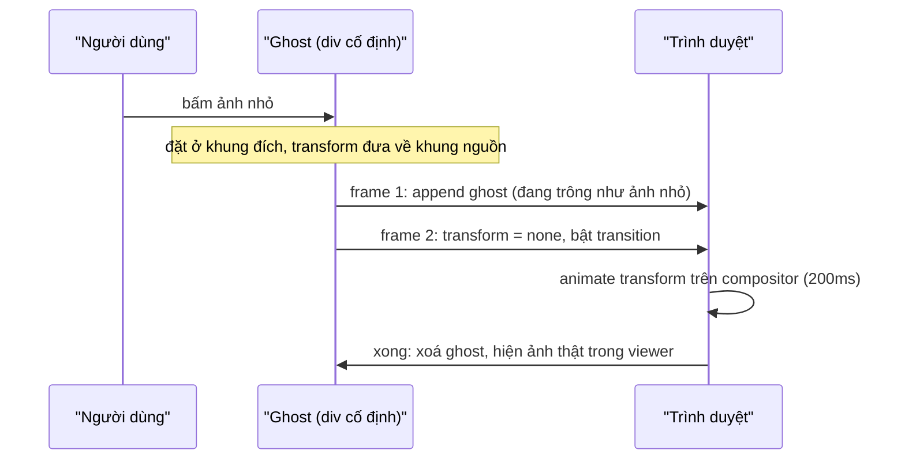

Bấm vào một ảnh trong cuộc trò chuyện, ảnh "nở" ra từ đúng chỗ của nó thành ảnh lớn ở giữa màn hình. Đóng lại, ảnh thu về đúng ô cũ. Hiệu ứng này giúp người dùng không mất phương hướng, nhưng làm thì khó hơn vẻ ngoài: ảnh nhỏ nằm trong danh sách tin nhắn, ảnh lớn nằm trong một overlay hoàn toàn khác, hai phần tử thuộc **hai cây DOM** khác nhau. Không có thuộc tính CSS nào animate một phần tử từ cây này sang cây kia.

Telegram Web A giải bằng một phần tử thứ ba: con **ma** (ghost).

> [!TIP]
> **Tóm tắt**
> - Tạo một `div.ghost` chứa ảnh, đặt sẵn ở vị trí và kích thước **đích**, dùng `transform` đưa nó về trông như đang ở vị trí **nguồn**, frame sau bỏ transform: trình duyệt tự chạy transition (FLIP).
> - Ảnh nguồn bị crop vuông (`object-fit: cover`) thì **mở rộng khung nguồn** về đúng tỉ lệ thật trước khi tính, nếu không ảnh sẽ méo lúc bay.
> - Lúc đóng, nếu ô ảnh gốc đã cuộn khỏi màn hình thì bay ra **mép trên hoặc dưới**; nếu chỉ thấy một phần thì vừa bay vừa mờ dần.
> - Đóng khi ghost đang bay dở: đọc vị trí **hiện tại** của nó và bay tiếp, không nhảy về điểm đầu.

<iframe class="demo-frame" src="/demos/web-patterns/index.html?theme=dark#/tg-ghost" title="Demo tg-ghost" loading="lazy" style="height: 640px"></iframe>

<p class="demo-links">▶ <a href="/demos/web-patterns/index.html#/tg-ghost" target="_blank" rel="noopener">Mở demo toàn màn hình ↗</a> · <a href="https://stackblitz.com/github/hunghg255/blog-hunghg/tree/master/examples/web-patterns?file=src/lib/tgGhostAnimation.ts" target="_blank" rel="noopener">Sửa code trên StackBlitz ↗</a> · <a href="https://github.com/hunghg255/blog-hunghg/blob/master/examples/web-patterns/src/lib/tgGhostAnimation.ts" target="_blank" rel="noopener">Xem source trên GitHub ↗</a></p>

Bấm một ảnh để mở, bấm "Đóng" để thu về. Bỏ chọn "uncover khung nguồn" rồi mở lại (nên bật "chậm"): ảnh 16:9 bị bóp méo trong lúc bay. Trong viewer, "Cuộn lưới rồi đóng" cuộn lưới cho ô ảnh khuất đi rồi mới đóng: ghost bay ra mép thay vì bay tới một chỗ không ai nhìn thấy.

## Telegram làm thế nào?

Toàn bộ nằm trong [`components/mediaViewer/helpers/ghostAnimation.ts`](https://github.com/hunghg255/codebase/blob/main/web.telegram.org/src/components/mediaViewer/helpers/ghostAnimation.ts) (362 dòng), gồm hai hàm `animateOpening` và `animateClosing`.

### Mở: FLIP với một phần tử mượn

```ts
const fromTranslateX = (fromLeft + fromWidth / 2) - (toLeft + toWidth / 2);
const fromTranslateY = (fromTop + fromHeight / 2) - (toTop + toHeight / 2);
const fromScaleX = fromWidth / toWidth;
const fromScaleY = fromHeight / toHeight;

const ghost = createGhost(bestImageData || fromImage);
applyStyles(ghost, {
  top: `${toTop}px`,
  left: `${toLeft}px`,
  width: `${toWidth}px`,
  height: `${toHeight}px`,
  transform: `translate3d(${fromTranslateX}px, ${fromTranslateY}px, 0) scale(${fromScaleX}, ${fromScaleY})`,
});
applyShape(ghost, origin);

document.body.classList.add('ghost-animating');

requestAnimationFrame(() => {
  document.body.appendChild(ghost);

  requestAnimationFrame(() => {
    ghost.style.transform = '';
    clearShape(ghost);
    // ... sau ANIMATION_DURATION + ANIMATION_END_DELAY thì xoá ghost
  });
});
```

Ghost được đặt ở khung **đích** (giữa màn hình, kích thước lớn), rồi `translate + scale` kéo nó về đúng khung ảnh nhỏ. Hai lần `requestAnimationFrame` lồng nhau đảm bảo trình duyệt đã vẽ ghost ở trạng thái "đang ở nguồn" trước khi bỏ transform; nếu bỏ ngay trong cùng frame, trình duyệt gộp hai thay đổi và không có gì để animate. CSS của `.ghost` chỉ có `transition: transform .2s ease, opacity .2s ease` và `will-change: transform, opacity`.

Trong lúc ghost bay, class `ghost-animating` trên `body` ẩn ảnh thật của viewer (`body.ghost-animating #MediaViewer > .pan-wrapper { display: none }`), để chỉ có một ảnh trên màn hình. `bestImageData` là ảnh tốt nhất đang có sẵn trong bộ nhớ: ảnh đầy đủ nếu đã tải, nếu không thì ảnh preview, cuối cùng là thumbnail nhỏ làm mờ (xem `MediaViewer.tsx`), để ghost không phải chờ mạng.

### Uncover: khung nguồn bị crop

Ảnh trong album hay trong mục "Shared media" được hiển thị vuông bằng `object-fit: cover`: một phần ảnh bị cắt. Bay từ khung vuông đó tới khung 16:9 nghĩa là `scaleX` và `scaleY` khác nhau, ảnh bị bóp méo suốt 200ms. Hàm `uncover` mở rộng khung nguồn về đúng tỉ lệ thật, căn giữa quanh ô:

```ts
function uncover(realWidth: number, realHeight: number, top: number, left: number, width: number, height: number) {
  if (realWidth === realHeight) {
    const size = Math.max(width, height) * (realWidth / realHeight);
    left -= (size - width) / 2;
    top -= (size - height) / 2;
    width = size;
    height = size;
  } else if (realWidth > realHeight) {
    const srcWidth = width;
    width = height * (realWidth / realHeight);
    left -= (width - srcWidth) / 2;
  } else if (realHeight > realWidth) {
    const srcHeight = height;
    height = width * (realHeight / realWidth);
    top -= (height - srcHeight) / 2;
  }
  // ...
}
```

Phần khung mở rộng nằm ngoài ô vuông chính là phần ảnh bị crop. Lúc bay bắt đầu, phần đó tràn ra ngoài ô một chút, nhưng tỉ lệ đúng nên mắt thấy ảnh "lớn dần" chứ không "kéo dãn".

### Đóng: ba tình huống

```ts
let toTop = targetTop;
if (!isElementInViewport(container)) {
  const { height: windowHeight } = windowSize.get();
  toTop = targetTop < fromTop ? -toHeight : windowHeight;
}
// ...
const shouldFadeOut = (
  [MediaViewerOrigin.Inline, MediaViewerOrigin.ScheduledInline].includes(origin)
  && !isMessageImageFullyVisible(container, toImage)
) || /* tương tự cho album */;
```

- Ô ảnh gốc còn nhìn thấy: bay về đúng ô.
- Ô ảnh đã cuộn khỏi màn hình (người dùng xem ảnh rồi lướt sang ảnh khác cách đó vài chục tin): bay ra **mép trên** hoặc **mép dưới**, tùy ô nằm phía nào.
- Ô chỉ thấy một phần: vẫn bay về nhưng **mờ dần**, để không có cảnh ảnh lớn đè lên header hay ô nhập tin.

Lúc mở, `clearShape` bỏ bo góc dần (ảnh trong bong bóng chat bo góc, ảnh trong viewer vuông); lúc đóng, `applyShape` gắn lại `rounded-corners` hay `circle` (avatar) để hình dạng đổi dần trong lúc bay.

### Đóng khi đang mở dở

Người dùng bấm nhầm và đóng ngay khi ảnh mới bay được nửa đường. `animateClosing` tìm ghost đang tồn tại và tiếp tục từ vị trí hiện tại của nó:

```ts
const existingGhost = document.getElementsByClassName('ghost')[0] as HTMLDivElement;
// ...
if (existingGhost) {
  const { top, left, width, height } = existingGhost.getBoundingClientRect();
  const scaleX = width / toWidth;
  const scaleY = height / toHeight;

  applyStyles(ghost, {
    transition: 'none',
    top: `${toTop}px`,
    left: `${toLeft}px`,
    transformOrigin: 'top left',
    transform: `translate3d(${left - toLeft}px, ${top - toTop}px, 0) scale(${scaleX}, ${scaleY})`,
    width: `${toWidth}px`,
    height: `${toHeight}px`,
  });
}
```

`getBoundingClientRect` trả về khung **đang hiển thị** (đã tính transform đang chạy). Đặt ghost về khung đích mới với transform đưa nó trùng khung hiện tại, tắt transition trong một frame, rồi bật lại. `transformOrigin: top left` cho phép tính translate thẳng từ góc trên trái, khỏi phải tính tâm.

### Hai điểm nhỏ trong bản gốc

- `clearShape` gán `style.objectFit = 'default'`. `default` không phải giá trị hợp lệ của `object-fit` (các giá trị là `fill`, `contain`, `cover`, `none`, `scale-down`), nên trình duyệt bỏ qua phép gán và giá trị cũ vẫn giữ nguyên. Hiệu ứng không hỏng chỉ vì CSS của `.ghost img` vốn đã là `object-fit: cover`.
- `uncover` giả định ô nguồn gần vuông: nhánh ảnh ngang luôn tính lại bề ngang từ chiều cao. Nếu ô nguồn đã rộng hơn tỉ lệ ảnh (ảnh ngang hiển thị trong ô còn ngang hơn), khung bị thu hẹp thay vì mở rộng. Bản viết lại so tỉ lệ ảnh với tỉ lệ ô trước khi quyết định mở rộng chiều nào.

## Bên trong trình duyệt



Chỉ `transform` và `opacity` thay đổi trong suốt quá trình bay, đúng hai thuộc tính trình duyệt có thể animate trên compositor. Kích thước thật của ghost (`width`/`height`) được đặt **một lần** ở khung đích, nên ảnh bên trong được giải mã và vẽ ở độ phân giải lớn ngay từ đầu, không bị mờ khi phóng to như khi animate `width` từ nhỏ lên lớn.

## Viết lại

Phần hình học tách thành các hàm thuần, dễ test:

```ts title=src/lib/tgGhostAnimation.ts
/**
 * Ảnh nguồn hiển thị kiểu `object-fit: cover` trong ô vuông thì bị cắt mất một phần. Nếu bay từ
 * khung ô vuông đó, ảnh sẽ méo trong lúc bay. `uncover` mở rộng khung nguồn ra đúng tỉ lệ thật của
 * ảnh, căn giữa quanh ô (phần thừa nằm ngoài ô, đúng như phần bị crop).
 */
export function uncover(source: Rect, realWidth: number, realHeight: number): Rect {
  const ratio = realWidth / realHeight;
  let { top, left, width, height } = source;
  if (ratio > width / height) {
    const newWidth = height * ratio;
    left -= (newWidth - width) / 2;
    width = newWidth;
  } else {
    const newHeight = width / ratio;
    top -= (newHeight - height) / 2;
    height = newHeight;
  }
  return { top, left, width, height };
}

/** Transform đưa một khung đặt ở `to` trông như đang nằm ở `from` (căn theo tâm). */
export function getFlipTransform(from: Rect, to: Rect) {
  const translateX = from.left + from.width / 2 - (to.left + to.width / 2);
  const translateY = from.top + from.height / 2 - (to.top + to.height / 2);
  const scaleX = from.width / to.width;
  const scaleY = from.height / to.height;
  return `translate3d(${translateX}px, ${translateY}px, 0) scale(${scaleX}, ${scaleY})`;
}

/** Kích thước lớn nhất giữ tỉ lệ, vừa trong vùng khả dụng (giống calculateDimensions của Telegram). */
export function fitInto(realWidth: number, realHeight: number, maxWidth: number, maxHeight: number) {
  const scale = Math.min(maxWidth / realWidth, maxHeight / realHeight, 1);
  return { width: realWidth * scale, height: realHeight * scale };
}
```

`animateClosing` (xem file đầy đủ bên dưới) bắt đầu bằng việc chọn cách đóng:

```ts title=src/lib/tgGhostAnimation.ts
export type CloseMode = 'return' | 'fly-off-top' | 'fly-off-bottom' | 'fade';

/** Quyết định cách đóng: về đúng chỗ, bay ra mép trên/dưới, hay mờ dần (ảnh chỉ thấy một phần). */
export function getCloseMode(target: Rect, viewport: Rect): CloseMode {
  const bottom = target.top + target.height;
  const viewportBottom = viewport.top + viewport.height;
  if (bottom <= viewport.top) return 'fly-off-top';
  if (target.top >= viewportBottom) return 'fly-off-bottom';
  if (target.top < viewport.top || bottom > viewportBottom) return 'fade';
  return 'return';
}
```

Phần còn lại giống bản gốc: dùng lại ghost đang bay nếu có, nếu không thì tạo ghost mới ở khung đích với transform đưa về khung ảnh lớn, rồi hai frame sau bỏ transform (thêm `opacity: 0` nếu cần mờ dần).

::: spoiler Xem toàn bộ src/lib/tgGhostAnimation.ts

```ts title=src/lib/tgGhostAnimation.ts
/**
 * "Ghost animation" khi mở/đóng trình xem ảnh, theo ý tưởng của Telegram Web A
 * (components/mediaViewer/helpers/ghostAnimation.ts):
 *
 * Ảnh nhỏ trong danh sách và ảnh lớn trong viewer là HAI cây DOM khác nhau, không thể animate
 * một phần tử từ cây này sang cây kia. Cách làm: tạo một phần tử "ma" (ghost) chứa ảnh, đặt sẵn
 * ở vị trí ĐÍCH với kích thước đích, rồi dùng transform đưa nó về trông như đang nằm ở vị trí
 * NGUỒN (FLIP). Frame sau bỏ transform: trình duyệt tự chạy transition. Xong thì xoá ghost.
 */

export interface Rect {
  top: number;
  left: number;
  width: number;
  height: number;
}

export type GhostShape = 'rounded' | 'circle' | 'cover' | 'none';

export interface GhostOptions {
  durationMs?: number;
  endDelayMs?: number;
  /** hình dạng của ảnh nguồn (bo góc, tròn, bị crop object-fit: cover) */
  shape?: GhostShape;
  /** z-index của ghost, phải nằm trên viewer */
  zIndex?: number;
}

const GHOST_CLASS = 'tg-ghost';

/**
 * Ảnh nguồn hiển thị kiểu `object-fit: cover` trong ô vuông thì bị cắt mất một phần. Nếu bay từ
 * khung ô vuông đó, ảnh sẽ méo trong lúc bay. `uncover` mở rộng khung nguồn ra đúng tỉ lệ thật của
 * ảnh, căn giữa quanh ô (phần thừa nằm ngoài ô, đúng như phần bị crop).
 */
export function uncover(source: Rect, realWidth: number, realHeight: number): Rect {
  const ratio = realWidth / realHeight;
  let { top, left, width, height } = source;
  if (ratio > width / height) {
    const newWidth = height * ratio;
    left -= (newWidth - width) / 2;
    width = newWidth;
  } else {
    const newHeight = width / ratio;
    top -= (newHeight - height) / 2;
    height = newHeight;
  }
  return { top, left, width, height };
}

/** Transform đưa một khung đặt ở `to` trông như đang nằm ở `from` (căn theo tâm). */
export function getFlipTransform(from: Rect, to: Rect) {
  const translateX = from.left + from.width / 2 - (to.left + to.width / 2);
  const translateY = from.top + from.height / 2 - (to.top + to.height / 2);
  const scaleX = from.width / to.width;
  const scaleY = from.height / to.height;
  return `translate3d(${translateX}px, ${translateY}px, 0) scale(${scaleX}, ${scaleY})`;
}

/** Kích thước lớn nhất giữ tỉ lệ, vừa trong vùng khả dụng (giống calculateDimensions của Telegram). */
export function fitInto(realWidth: number, realHeight: number, maxWidth: number, maxHeight: number) {
  const scale = Math.min(maxWidth / realWidth, maxHeight / realHeight, 1);
  return { width: realWidth * scale, height: realHeight * scale };
}

function createGhost(src: string, rect: Rect, zIndex: number) {
  const ghost = document.createElement('div');
  ghost.className = GHOST_CLASS;
  Object.assign(ghost.style, {
    position: 'fixed',
    top: `${rect.top}px`,
    left: `${rect.left}px`,
    width: `${rect.width}px`,
    height: `${rect.height}px`,
    zIndex: String(zIndex),
    overflow: 'hidden',
    pointerEvents: 'none',
    willChange: 'transform, opacity',
  });
  const img = new Image();
  img.src = src;
  img.alt = '';
  Object.assign(img.style, { width: '100%', height: '100%', objectFit: 'cover', display: 'block' });
  ghost.appendChild(img);
  return ghost;
}

function applyShape(ghost: HTMLElement, shape: GhostShape) {
  ghost.style.borderRadius = shape === 'circle' ? '50%' : shape === 'rounded' ? '12px' : '0';
}

function nextFrame() {
  return new Promise<void>((resolve) => requestAnimationFrame(() => resolve()));
}

/** Ghost đang bay (nếu có): đóng viewer giữa lúc đang mở thì dùng lại nó thay vì tạo mới. */
function findFlyingGhost() {
  return document.querySelector<HTMLElement>(`.${GHOST_CLASS}`);
}

export interface OpenParams {
  src: string;
  /** khung ảnh nguồn trên màn hình */
  from: Rect;
  /** khung ảnh lớn trong viewer */
  to: Rect;
  /** kích thước thật của ảnh, dùng để "uncover" khi nguồn bị crop */
  natural: { width: number; height: number };
}

export async function animateOpening({ src, from, to, natural }: OpenParams, options: GhostOptions = {}) {
  const { durationMs = 200, endDelayMs = 100, shape = 'cover', zIndex = 1000 } = options;
  const source = shape === 'cover' ? uncover(from, natural.width, natural.height) : from;

  findFlyingGhost()?.remove();
  const ghost = createGhost(src, to, zIndex);
  ghost.style.transform = getFlipTransform(source, to);
  applyShape(ghost, shape);

  document.body.classList.add('tg-ghost-animating');
  await nextFrame();
  document.body.appendChild(ghost);
  await nextFrame();
  ghost.style.transition = `transform ${durationMs}ms ease, opacity ${durationMs}ms ease, border-radius ${durationMs}ms ease`;
  ghost.style.transform = '';
  applyShape(ghost, 'none');

  await new Promise((resolve) => setTimeout(resolve, durationMs + endDelayMs));
  await nextFrame();
  // chỉ dọn nếu ghost này chưa bị lượt đóng lấy đi
  if (ghost.dataset.taken !== '1') {
    ghost.remove();
    document.body.classList.remove('tg-ghost-animating');
  }
}

export interface CloseParams {
  src: string;
  /** khung ảnh lớn đang hiển thị trong viewer */
  from: Rect;
  /** khung ảnh nguồn (có thể đã bị cuộn khỏi màn hình) */
  to: Rect;
  /** vùng nhìn thấy của danh sách chứa ảnh nguồn; mặc định là cả cửa sổ */
  viewport?: Rect;
}

export type CloseMode = 'return' | 'fly-off-top' | 'fly-off-bottom' | 'fade';

/** Quyết định cách đóng: về đúng chỗ, bay ra mép trên/dưới, hay mờ dần (ảnh chỉ thấy một phần). */
export function getCloseMode(target: Rect, viewport: Rect): CloseMode {
  const bottom = target.top + target.height;
  const viewportBottom = viewport.top + viewport.height;
  if (bottom <= viewport.top) return 'fly-off-top';
  if (target.top >= viewportBottom) return 'fly-off-bottom';
  if (target.top < viewport.top || bottom > viewportBottom) return 'fade';
  return 'return';
}

export async function animateClosing({ src, from, to, viewport }: CloseParams, options: GhostOptions = {}) {
  const { durationMs = 200, endDelayMs = 100, shape = 'cover', zIndex = 1000 } = options;
  const area = viewport ?? { top: 0, left: 0, width: window.innerWidth, height: window.innerHeight };
  const mode = getCloseMode(to, area);

  let target = to;
  if (mode === 'fly-off-top') target = { ...to, top: area.top - to.height };
  if (mode === 'fly-off-bottom') target = { ...to, top: area.top + area.height };

  const existing = findFlyingGhost();
  let ghost: HTMLElement;

  if (existing) {
    // Đang mở dở mà người dùng đóng ngay: lấy vị trí HIỆN TẠI của ghost (đang ở giữa đường bay),
    // tắt transition, đặt lại khung đích mới rồi bay tiếp từ đó. Không có cú nhảy về điểm đầu.
    existing.dataset.taken = '1';
    ghost = existing;
    const current = existing.getBoundingClientRect();
    Object.assign(ghost.style, {
      transition: 'none',
      top: `${target.top}px`,
      left: `${target.left}px`,
      width: `${target.width}px`,
      height: `${target.height}px`,
      transformOrigin: 'top left',
      transform: `translate3d(${current.left - target.left}px, ${current.top - target.top}px, 0) scale(${
        current.width / target.width
      }, ${current.height / target.height})`,
    });
  } else {
    ghost = createGhost(src, target, zIndex);
    // ảnh lớn có thể có tỉ lệ khác khung đích (bị crop): giữ tỉ lệ bằng cách lấy scale nhỏ hơn
    const scale = Math.min(from.width / target.width, from.height / target.height);
    const fromFitted = {
      width: target.width * scale,
      height: target.height * scale,
      left: from.left + (from.width - target.width * scale) / 2,
      top: from.top + (from.height - target.height * scale) / 2,
    };
    ghost.style.transform = getFlipTransform(fromFitted, target);
    document.body.appendChild(ghost);
  }

  document.body.classList.add('tg-ghost-animating');
  await nextFrame();
  await nextFrame();
  ghost.style.transition = `transform ${durationMs}ms ease, opacity ${durationMs}ms ease, border-radius ${durationMs}ms ease`;
  ghost.style.transform = '';
  if (mode === 'fade') ghost.style.opacity = '0';
  // về hình dạng của ảnh nguồn (ảnh crop trong ô vuông thì góc vuông)
  applyShape(ghost, shape === 'cover' ? 'none' : shape);

  await new Promise((resolve) => setTimeout(resolve, durationMs + endDelayMs));
  await nextFrame();
  ghost.remove();
  document.body.classList.remove('tg-ghost-animating');
  return mode;
}
```

:::

## Đi qua code

- **`uncover`** so `ratio` của ảnh với tỉ lệ của ô: ảnh "ngang hơn" ô thì mở rộng bề ngang, ngược lại mở rộng chiều cao. Khung mới luôn có đúng tỉ lệ ảnh và chứa trọn ô cũ.
- **`getFlipTransform`** tính theo **tâm** của hai khung (transform-origin mặc định là tâm), nên `translate` là khoảng cách giữa hai tâm và `scale` là tỉ lệ kích thước.
- **`getCloseMode`** so khung ô ảnh với khung nhìn của **danh sách chứa ảnh** (tham số `viewport`), không phải cả cửa sổ. Trong demo, lưới có thanh cuộn riêng; ô ảnh có thể khuất khỏi lưới dù vẫn nằm trong cửa sổ.
- **`dataset.taken`**: khi lượt đóng "lấy" ghost đang bay của lượt mở, lượt mở không được xoá nó khi hết giờ.
- **Lúc đóng**, khung nguồn (ảnh lớn) có tỉ lệ thật còn khung đích là ô vuông. Code lấy `scale` nhỏ hơn cho cả hai chiều, giống Telegram ép `fromScaleX = fromScaleY`, để ghost không méo.

**Khác bản gốc:** ghost dùng `position: fixed` (Telegram dùng `absolute` vì `body` của họ không cuộn); `uncover` tổng quát hơn; vùng nhìn được truyền vào thay vì tìm `.MessageList` bằng selector; hàm trả về `Promise` để biết khi nào xong.

## Tại sao không làm cách khác?

- **Animate chính ảnh nhỏ** (đổi `position: fixed`, phóng to): ảnh bị bứt khỏi luồng layout, danh sách tin nhắn nhảy; ảnh nhỏ thường là thumbnail độ phân giải thấp, phóng to sẽ vỡ.
- **Animate `width`, `height`, `top`, `left`**: mỗi frame tính lại layout và vẽ lại ảnh ở kích thước mới.
- **View Transitions API**: đây đúng là bài toán View Transitions sinh ra để giải (gán cùng `view-transition-name` cho ảnh nhỏ và ảnh lớn, trình duyệt tự FLIP giữa hai trạng thái). Với trình duyệt hỗ trợ (tính tới 10/2026 gồm Chromium, Safari và Firefox; xem [caniuse](https://caniuse.com/view-transitions)), đây là cách ít code nhất. Cách ghost vẫn hữu ích khi cần các xử lý riêng như bay ra mép khi ô đã khuất, hay tiếp tục từ giữa đường.

## Edge case và cạm bẫy

- **Ảnh chưa tải xong.** Ghost dùng ảnh tốt nhất đang có (thumbnail). Nếu ghost dùng URL ảnh lớn chưa tải, nó trống trong lúc bay.
- **Cuộn trong lúc bay.** Khung nguồn được đo một lần lúc bắt đầu. Danh sách cuộn trong 200ms đó thì ghost về chỗ cũ; với 200ms thì chấp nhận được, với animation dài hơn nên khóa cuộn.
- **`prefers-reduced-motion`.** Người dùng tắt hiệu ứng thì mở/đóng ngay. Telegram dùng `animationLevel` riêng (0, 1, 2) trong cài đặt.
- **Hai lần bấm nhanh.** Bấm mở ảnh khác khi ghost cũ chưa xong: xoá ghost cũ trước (`findFlyingGhost()?.remove()`), nếu không sẽ có hai ghost chồng nhau.

## Dùng trong dự án

Lightbox cho gallery, mở thẻ sản phẩm thành trang chi tiết, mở avatar thành ảnh lớn, mở thumbnail video thành player. Cách dùng tối thiểu:

```ts
const from = thumb.getBoundingClientRect();
const to = computeViewerRect(photo); // khung ảnh lớn
await animateOpening({ src: thumb.currentSrc, from, to, natural: { width: photo.w, height: photo.h } });
showRealViewerImage();
```

## Kiểm thử

::: spoiler Ví dụ test (bản phác, không có trong repo)

```ts
import { describe, expect, it } from 'vitest';
import { fitInto, getCloseMode, getFlipTransform, uncover } from './tgGhostAnimation';

describe('ghost geometry', () => {
  it('uncover mở rộng ô vuông về đúng tỉ lệ ảnh ngang, căn giữa', () => {
    const r = uncover({ top: 0, left: 100, width: 100, height: 100 }, 1600, 900);
    expect(r.height).toBe(100);
    expect(r.width).toBeCloseTo(177.78, 1);
    expect(r.left + r.width / 2).toBeCloseTo(150); // tâm không đổi
  });

  it('uncover với ảnh dọc mở rộng chiều cao', () => {
    const r = uncover({ top: 50, left: 0, width: 100, height: 100 }, 900, 1600);
    expect(r.width).toBe(100);
    expect(r.height).toBeCloseTo(177.78, 1);
    expect(r.top + r.height / 2).toBeCloseTo(100);
  });

  it('FLIP transform tính theo tâm', () => {
    const t = getFlipTransform({ top: 0, left: 0, width: 100, height: 50 }, { top: 100, left: 100, width: 400, height: 200 });
    expect(t).toBe('translate3d(-250px, -175px, 0) scale(0.25, 0.25)');
  });

  it('chọn cách đóng theo vùng nhìn', () => {
    const vp = { top: 0, left: 0, width: 300, height: 300 };
    expect(getCloseMode({ top: 10, left: 0, width: 50, height: 50 }, vp)).toBe('return');
    expect(getCloseMode({ top: -80, left: 0, width: 50, height: 50 }, vp)).toBe('fly-off-top');
    expect(getCloseMode({ top: 320, left: 0, width: 50, height: 50 }, vp)).toBe('fly-off-bottom');
    expect(getCloseMode({ top: 280, left: 0, width: 50, height: 50 }, vp)).toBe('fade');
  });

  it('fitInto giữ tỉ lệ và không phóng to ảnh nhỏ', () => {
    expect(fitInto(1600, 900, 800, 800)).toEqual({ width: 800, height: 450 });
    expect(fitInto(200, 100, 800, 800)).toEqual({ width: 200, height: 100 });
  });
});
```

:::

## So với thư viện và chuẩn web

- **View Transitions API** (`document.startViewTransition` + `view-transition-name`): chuẩn web cho đúng bài toán này, trình duyệt tự chụp và ghép.
- **PhotoSwipe**, **Fancybox**: thư viện lightbox có sẵn hiệu ứng phóng to từ thumbnail bằng kỹ thuật tương tự (một phần tử tạm + transform).
- **Framer Motion `layoutId`**: FLIP giữa hai component React có cùng `layoutId`, tự đo và tự ghép, trong phạm vi một app React.

---

Bài này thuộc series **[Học từ mã nguồn Telegram](/series/telegram)** (15 bài, đọc theo thứ tự).

::: spoiler Xem nhanh danh sách bài trong series

*Mở đầu*

- [Mở đầu: bên trong Telegram Web A](/blogs/learn-from-telegram-source-code)

*Phần 1: dữ liệu và đồng bộ*

- [#1 Gửi tin lạc quan, khớp tin thật bằng randomId](/blogs/telegram-optimistic-send)
- [#2 Lịch sử tin nhắn chia hai đảo](/blogs/telegram-message-history-islands)
- [#3 Lưu global state lúc rảnh, chỉ giữ phần cần](/blogs/telegram-persist-global-state)
- [#4 Gom update realtime theo nhịp animation](/blogs/telegram-realtime-update-batching)
- [#5 Store tự viết và diff danh sách có key](/blogs/telegram-teactn-store-fast-list)

*Phần 2: animation và giao diện*

- [#6 Animation sắp xếp danh sách chat không đo DOM](/blogs/telegram-chat-list-flip)
- **#7 Ảnh bay giữa hai cây DOM trong media viewer** (bài này)
- [#8 Bố cục album chọn theo hàm chi phí](/blogs/telegram-album-layout)
- [#9 Giờ gửi nằm gọn trong bong bóng chat](/blogs/telegram-bubble-meta-spacer)
- [#10 Composer biến hình, Transition và gạch chân tab](/blogs/telegram-composer-morph-transition)

*Phần 3: media, mobile, thông báo*

- [#11 Thumbnail 100 byte và viền sticker nén](/blogs/telegram-tiny-thumbnails)
- [#12 Player sticker: DPR, hạ fps, cache khung](/blogs/telegram-lottie-player)
- [#13 Mobile: --vh, bàn phím ảo, nhấn giữ, số điện thoại](/blogs/telegram-mobile-viewport-touch)
- [#14 Web Push không trùng và đánh dấu đã đọc](/blogs/telegram-push-dedupe-read-receipts)

:::

Code + demo: [`examples/web-patterns`](https://github.com/hunghg255/blog-hunghg/tree/master/examples/web-patterns) · [Mở trên StackBlitz](https://stackblitz.com/github/hunghg255/blog-hunghg/tree/master/examples/web-patterns)
