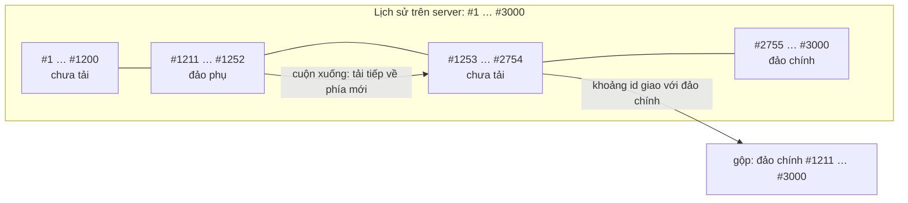

Một nhóm chat có 100 nghìn tin. Người dùng bấm vào một tin được trả lời (reply) từ ba tháng trước. App phải hiện tin đó ngay, cùng vài chục tin xung quanh. Không thể tải 100 nghìn tin, cũng không thể tải "tất cả từ tin mới nhất ngược về tin đó".

Vậy là trong bộ nhớ có **hai đoạn lịch sử không liền nhau**: đoạn mới nhất đang mở, và đoạn quanh tin ba tháng trước. Giữa hai đoạn là một khoảng trống mà app không biết có bao nhiêu tin. Nếu nhét chung vào một mảng `ids`, code cuộn sẽ tưởng hai đoạn liền nhau và bỏ qua cả khoảng trống.

Telegram Web A giải quyết bằng một cấu trúc dữ liệu đơn giản: lịch sử của mỗi cuộc trò chuyện là **tối đa hai "đảo"**, mỗi đảo là một mảng id **liền mạch**.

> [!TIP]
> **Tóm tắt**
> - `listedIds` là đảo chính, `outlyingIds` là đảo phụ tạo ra khi nhảy tới một tin ở xa. Mỗi đảo là một đoạn **liền mạch** của lịch sử thật.
> - Hai đoạn liền mạch có **khoảng id giao nhau** thì hợp của chúng cũng liền mạch: lúc đó gộp đảo phụ vào đảo chính.
> - `viewportIds` là cửa sổ con của một đảo. Còn đủ tin trong bộ nhớ thì hiện ngay, thiếu mới gọi API.
> - Sau mỗi lần cuộn, Telegram tải trước lát kế tiếp (**budget preload**) mà không đổi viewport, nên lần cuộn sau thường hiện ngay.

<iframe class="demo-frame" src="/demos/web-patterns/index.html?theme=dark#/tg-history-islands" title="Demo tg-history-islands" loading="lazy" style="height: 900px"></iframe>

<p class="demo-links">▶ <a href="/demos/web-patterns/index.html#/tg-history-islands" target="_blank" rel="noopener">Mở demo toàn màn hình ↗</a> · <a href="https://stackblitz.com/github/hunghg255/blog-hunghg/tree/master/examples/web-patterns?file=src/lib/tgHistoryIslands.ts" target="_blank" rel="noopener">Sửa code trên StackBlitz ↗</a> · <a href="https://github.com/hunghg255/blog-hunghg/blob/master/examples/web-patterns/src/lib/tgHistoryIslands.ts" target="_blank" rel="noopener">Xem source trên GitHub ↗</a></p>

Trong demo, lịch sử có khoảng 2.250 tin với id từ 1 tới 3000 (id có khoảng trống vì tin bị xoá, giống thật). Bấm **⬆ Cuộn lên** vài lần: lần đầu chờ mạng, các lần sau "hiện ngay từ bộ nhớ" nhờ lát kế tiếp đã được tải trước. Bấm **Nhảy tới tin 1234**: đảo phụ màu vàng xuất hiện tách biệt. Bấm **⬇ Cuộn xuống** liên tục: đảo phụ dài dần về phía phải, chạm đảo chính thì hai đảo gộp làm một.

## Telegram làm thế nào?

### Ba mảng id cho mỗi thread

Mỗi thread (cuộc trò chuyện chính hoặc một luồng bình luận) có ba mảng id, đều sắp tăng dần:

| Mảng | Ý nghĩa |
|---|---|
| `listedIds` | đảo chính: đoạn lịch sử liền mạch đầu tiên được tải và lớn dần khi cuộn |
| `outlyingIds` | đảo phụ: đoạn quanh một tin ở xa, chưa nối được với đảo chính |
| `viewportIds` | các tin đang được render, là một đoạn con của một trong hai đảo |

Tin nhắn thật nằm riêng trong `messages.byId`. Ba mảng chỉ giữ id, nên gộp hay cắt mảng rất rẻ.

Kích thước một lát (`MESSAGE_LIST_SLICE`) trong `config.ts` là 60 trên màn hình lớn, 40 trên màn hình nhỏ; viewport tối đa gấp đôi (`MESSAGE_LIST_VIEWPORT_LIMIT = MESSAGE_LIST_SLICE * 2`).

### Chọn đảo khi mở hoặc nhảy

Action `loadViewportMessages` trong [`modules/actions/api/messages.ts`](https://github.com/hunghg255/codebase/blob/main/web.telegram.org/src/modules/actions/api/messages.ts) bắt đầu bằng việc chọn đảo:

```ts
const offsetId = selectFocusedMessageId(global, chatId) || selectRealLastReadId(global, chatId, threadId);
const isOutlying = Boolean(offsetId && listedIds && !listedIds.includes(offsetId));
const historyIds = (isOutlying ? outlyingIds : listedIds) || [];
const { newViewportIds, areSomeLocal, areAllLocal } = getViewportSlice(historyIds, offsetId, LoadMoreDirection.Around);
```

Tin cần tới (tin đang được focus, hoặc tin chưa đọc đầu tiên) không nằm trong đảo chính thì nó thuộc đảo phụ. Trước mỗi lần nhảy, action `focusMessage` (trong `modules/actions/ui/messages.ts`) xoá đảo phụ cũ (`replaceThreadParam(…, 'outlyingIds', undefined)`), nên lúc nào cũng có **tối đa một** đảo phụ.

Một chi tiết UX: nếu bộ nhớ đã có sẵn ít nhất một lát quanh tin cần tới, viewport được thay ngay, rồi mới gọi API lấp phần còn thiếu.

### Gộp đảo khi chạm nhau

Sau mỗi lần tải xong, hàm `loadViewportMessages` (bản async, cùng file) kiểm tra:

```ts
if (isOutlying && listedIds && outlyingIds) {
  if (areSortedArraysIntersecting(listedIds, outlyingIds)) {
    global = updateListedIds(global, chatId, threadId, outlyingIds);
    listedIds = selectListedIds(global, chatId, threadId);
    global = replaceThreadParam(global, chatId, threadId, 'outlyingIds', undefined);
    isOutlying = false;
  }
}
```

Còn `areSortedArraysIntersecting` trong `util/iteratees.ts` chỉ so hai đầu mút: `array1[0] <= array2.at(-1) && array1.at(-1) >= array2[0]`.

Tại sao so khoảng là đủ, không cần tìm phần tử chung? Vì mỗi đảo là một đoạn **liền mạch** của lịch sử trên server. Hai đoạn liền mạch có khoảng `[đầu, cuối]` giao nhau thì không thể có tin nào của server "lọt" giữa chúng: hợp của hai đoạn cũng liền mạch. Bất biến "mỗi đảo liền mạch" biến một phép so sánh tập hợp thành hai phép so sánh số.

### Viewport từ bộ nhớ, và budget preload

`getViewportSlice` cắt một cửa sổ từ đảo quanh `offsetId` và trả về hai cờ: `areSomeLocal` (có ít nhất một phần trong bộ nhớ) và `areAllLocal` (đủ cả cửa sổ). Khi cuộn, phần có sẵn được hiện ngay; thiếu thì gọi API với `addOffset` tính sẵn: `-(SLICE/2 + 1)` khi tải quanh một tin, `-(SLICE + 1)` khi tải về phía mới hơn (MTProto lấy lịch sử theo `offset_id` + `add_offset`, số âm nghĩa là lấy cả tin mới hơn `offset_id`).

Phần thú vị nhất là hàm `loadWithBudget`:

```ts
async function loadWithBudget(actions, areAllLocal, isOutlying, isBudgetPreload, chat, threadId, direction, offsetId) {
  if (!areAllLocal) {
    await loadViewportMessages(chat, threadId, offsetId, direction, isOutlying, isBudgetPreload);
  }

  if (!isBudgetPreload) {
    // Let reducer return and update global
    await Promise.resolve();
    actions.loadViewportMessages({ chatId: chat.id, threadId, direction, isBudgetPreload: true });
  }
}
```

Sau khi lát hiện tại đã có, nó **gọi lại chính action đó** với `isBudgetPreload: true`. Ở lượt này, `getViewportSlice` tính từ viewport mới, thấy lát kế tiếp chưa có thì tải về, nhưng nhánh `if (!isBudgetPreload)` ở cuối bỏ qua bước thay viewport. Kết quả: người dùng cuộn thêm một lát nữa thì dữ liệu đã nằm sẵn. `await Promise.resolve()` để reducer hiện tại kịp trả `global` mới trước khi action kế tiếp đọc nó.

### Tin mới tới và giới hạn viewport

Khi có tin mới qua realtime, `updateListedAndViewportIds` (trong `modules/actions/apiUpdaters/messages.ts`) nối id vào `listedIds`, và nếu viewport đang ở cuối thì `addViewportId` nối vào viewport. Viewport vượt `SLICE * 2` thì bị cắt còn `SLICE / 2` tin cuối, để DOM không phình mãi khi một nhóm sôi động chạy suốt ngày.

### Hai chỗ đáng lưu ý trong bản gốc

- **Đảo chính không nhất thiết chạm tin mới nhất.** Mở một chat có nhiều tin chưa đọc, đảo chính được tải quanh tin chưa đọc đầu tiên. Tin mới tới vẫn được nối vào cuối `listedIds`, tạo ra một khoảng trống bên trong một mảng mà code coi là liền mạch. Theo code thì khoảng trống chỉ bị bỏ qua khi phía sau `offsetId` đã có đủ một lát trong bộ nhớ; mình chưa tái hiện được trên app thật, nên coi đây là suy luận từ code.
- **`areAllLocal` của hướng "Around" là `newViewportIds.length === MESSAGE_LIST_SLICE`**, trong khi cửa sổ có thể dài tới gần hai lát. Khi bộ nhớ đã có rất nhiều tin quanh `offsetId`, điều kiện này sai và action vẫn gọi API. Không làm hỏng dữ liệu (kết quả được gộp, bỏ trùng), chỉ tốn thêm một request.

## Bên trong: vì sao không phân trang theo trang số

Chat là nơi phân trang kiểu `?page=3` gãy nhanh nhất: tin mới đến liên tục, tin cũ bị xoá, "trang 3" của một phút trước khác "trang 3" bây giờ. Mọi app chat lớn đều phân trang theo **con trỏ** (cursor): "cho tôi 40 tin trước tin #9876". Con trỏ ổn định dù lịch sử thay đổi xung quanh.

Nhưng con trỏ chỉ trả lời "lát kế tiếp là gì". Khi người dùng nhảy lung tung, app cần thêm một lớp nữa: nhớ **những đoạn nào đã có** và đoạn nào **liền nhau**. Đó là việc của các đảo.



## Viết lại

Bản viết lại giữ ý tưởng nhưng thêm hai cờ cho mỗi đảo: `hasOldest` và `hasNewest` (server trả về đã chạm đầu hay cuối lịch sử chưa). Nhờ đó "đủ trong bộ nhớ" tính đúng ở hai mép, và tin mới chỉ được nối vào đảo thật sự chạm cuối.

Cắt viewport và tính "đủ hay chưa":

```ts title=src/lib/tgHistoryIslands.ts
export function getViewportSlice(island: Island, offsetId: number | undefined, direction: Direction, slice: number) {
  const { ids } = island;
  const index = offsetId === undefined ? ids.length - 1 : findClosestIndex(ids, offsetId);
  let from: number;
  let to: number; // không tính `to`
  if (direction === 'backwards') {
    from = index - slice;
    to = index + slice;
  } else if (direction === 'forwards') {
    from = index + 1 - slice;
    to = index + 1 + slice;
  } else if (offsetId === undefined) {
    // mở cuộc trò chuyện ở cuối: lát mới nhất
    from = ids.length - slice;
    to = ids.length;
  } else {
    from = index - Math.floor(slice / 2);
    to = index + Math.ceil(slice / 2);
  }
  const viewport = ids.slice(Math.max(0, from), Math.min(ids.length, to));
  const missingBefore = from < 0 && !island.hasOldest;
  const missingAfter = to > ids.length && !island.hasNewest;
  const isComplete =
    direction === 'backwards' ? !missingBefore : direction === 'forwards' ? !missingAfter : !missingBefore && !missingAfter;
  return { viewport, isComplete };
}
```

Cuộn kèm tải trước (gộp đảo nằm trong `fetchInto`, gọi `tryMergeIslands` sau mỗi lần tải xong):

```ts title=src/lib/tgHistoryIslands.ts
  /** Cuộn tới mép viewport. */
  async function scroll(direction: 'backwards' | 'forwards') {
    const edge = direction === 'backwards' ? state.viewport[0] : state.viewport[state.viewport.length - 1];
    if (edge === undefined) return;
    const islandName = state.viewportIsland;
    const { isComplete } = showSlice(direction, edge);
    if (!isComplete) {
      await fetchInto(islandName, direction, edge, false);
      showSlice(direction, edge);
    }
    // budget preload: tải trước lát kế tiếp theo cùng hướng, KHÔNG đổi viewport
    const island = islandOf(state.viewportIsland);
    if (!island) return;
    const nextEdge = direction === 'backwards' ? state.viewport[0] : state.viewport[state.viewport.length - 1];
    const ahead = getViewportSlice(island, nextEdge, direction, slice);
    if (!ahead.isComplete) {
      const islandEdge = direction === 'backwards' ? island.ids[0] : island.ids[island.ids.length - 1];
      void fetchInto(state.viewportIsland, direction, islandEdge, true);
    }
  }
```

::: spoiler Xem toàn bộ src/lib/tgHistoryIslands.ts

```ts title=src/lib/tgHistoryIslands.ts
/**
 * Lịch sử tin nhắn chia "đảo" (ý tưởng từ Telegram Web A: modules/actions/api/messages.ts,
 * modules/reducers/messages.ts).
 *
 * - Lịch sử được tải theo từng lát liền mạch. Đảo chính (`listed`) là đoạn tải đầu tiên và
 *   lớn dần khi cuộn. Nhảy tới một tin ở xa (reply, kết quả tìm kiếm) thì tải vào một đảo phụ
 *   (`outlying`) riêng, không trộn vào đảo chính vì giữa hai đoạn có khoảng trống.
 * - Hai đoạn liền mạch có khoảng id giao nhau thì hợp của chúng cũng liền mạch: lúc đó gộp đảo.
 * - Viewport là cửa sổ con của một đảo: còn đủ trong bộ nhớ thì hiện ngay, thiếu mới gọi API.
 * - Sau mỗi lần cuộn, tải trước lát kế tiếp ("budget preload") mà không đổi viewport.
 */

export type Direction = 'backwards' | 'forwards' | 'around';

export interface Island {
  /** id tăng dần, liền mạch theo lịch sử của server */
  ids: number[];
  /** đã chạm tin cũ nhất / mới nhất của cuộc trò chuyện */
  hasOldest: boolean;
  hasNewest: boolean;
}

export interface FetchResult {
  ids: number[];
  hasOldest: boolean;
  hasNewest: boolean;
}

export type FetchSlice = (args: { offsetId?: number; direction: Direction; limit: number }) => Promise<FetchResult>;

export interface HistoryState {
  listed?: Island;
  outlying?: Island;
  viewport: number[];
  /** viewport đang nằm trên đảo nào */
  viewportIsland: 'listed' | 'outlying';
}

/** Vị trí của offsetId trong mảng tăng dần, hoặc của id lớn nhất nhỏ hơn nó (Telegram: findClosestIndex). */
export function findClosestIndex(ids: number[], offsetId: number) {
  if (ids.length === 0) return -1;
  if (offsetId < ids[0]) return 0;
  if (offsetId > ids[ids.length - 1]) return ids.length - 1;
  let lo = 0;
  let hi = ids.length - 1;
  while (lo < hi) {
    const mid = (lo + hi + 1) >> 1;
    if (ids[mid] <= offsetId) lo = mid;
    else hi = mid - 1;
  }
  return lo;
}

/**
 * Cắt viewport từ một đảo. `isComplete` = cửa sổ đầy đủ từ bộ nhớ, không cần gọi API.
 * Cửa sổ dài tối đa 2 lát: một lát đã đọc + một lát theo hướng cuộn.
 */
export function getViewportSlice(island: Island, offsetId: number | undefined, direction: Direction, slice: number) {
  const { ids } = island;
  const index = offsetId === undefined ? ids.length - 1 : findClosestIndex(ids, offsetId);
  let from: number;
  let to: number; // không tính `to`
  if (direction === 'backwards') {
    from = index - slice;
    to = index + slice;
  } else if (direction === 'forwards') {
    from = index + 1 - slice;
    to = index + 1 + slice;
  } else if (offsetId === undefined) {
    // mở cuộc trò chuyện ở cuối: lát mới nhất
    from = ids.length - slice;
    to = ids.length;
  } else {
    from = index - Math.floor(slice / 2);
    to = index + Math.ceil(slice / 2);
  }
  const viewport = ids.slice(Math.max(0, from), Math.min(ids.length, to));
  const missingBefore = from < 0 && !island.hasOldest;
  const missingAfter = to > ids.length && !island.hasNewest;
  const isComplete =
    direction === 'backwards' ? !missingBefore : direction === 'forwards' ? !missingAfter : !missingBefore && !missingAfter;
  return { viewport, isComplete };
}

/** Hai đoạn liền mạch có khoảng id giao nhau. Telegram: areSortedArraysIntersecting. */
export function areRangesIntersecting(a: number[], b: number[]) {
  return a.length > 0 && b.length > 0 && a[0] <= b[b.length - 1] && a[a.length - 1] >= b[0];
}

/** Gộp hai mảng tăng dần, bỏ trùng, O(n + m). */
export function mergeSortedUnique(a: number[], b: number[]) {
  const out: number[] = [];
  let i = 0;
  let j = 0;
  while (i < a.length || j < b.length) {
    const next = j >= b.length || (i < a.length && a[i] <= b[j]) ? a[i++] : b[j++];
    if (out[out.length - 1] !== next) out.push(next);
  }
  return out;
}

function mergeIsland(island: Island | undefined, result: FetchResult): Island {
  if (!island) return { ...result, ids: [...result.ids] };
  return {
    ids: mergeSortedUnique(island.ids, result.ids),
    hasOldest: island.hasOldest || result.hasOldest,
    hasNewest: island.hasNewest || result.hasNewest,
  };
}

export interface MessageHistoryOptions {
  fetchSlice: FetchSlice;
  slice?: number;
  onChange?: (state: HistoryState) => void;
  onFetch?: (info: { direction: Direction; offsetId?: number; isPreload: boolean }) => void;
}

export function createMessageHistory({ fetchSlice, slice = 40, onChange, onFetch }: MessageHistoryOptions) {
  let state: HistoryState = { viewport: [], viewportIsland: 'listed' };
  // mỗi lần nhảy tới tin mới tăng generation: kết quả tải của lần nhảy trước bị bỏ
  let generation = 0;
  const inFlight = new Set<string>();

  const set = (next: Partial<HistoryState>) => {
    state = { ...state, ...next };
    onChange?.(state);
  };

  const islandOf = (name: HistoryState['viewportIsland']) => (name === 'listed' ? state.listed : state.outlying);

  /** Đảo phụ chạm đảo chính thì gộp làm một, viewport chuyển sang đảo chính. */
  function tryMergeIslands() {
    const { listed, outlying } = state;
    if (!listed || !outlying || !areRangesIntersecting(listed.ids, outlying.ids)) return;
    set({
      listed: mergeIsland(listed, outlying),
      outlying: undefined,
      viewportIsland: 'listed',
    });
  }

  async function fetchInto(
    islandName: HistoryState['viewportIsland'],
    direction: Direction,
    offsetId: number | undefined,
    isPreload: boolean,
  ) {
    const key = `${islandName}:${direction}:${offsetId}`;
    if (inFlight.has(key)) return false; // cùng một lát đang được tải
    inFlight.add(key);
    const myGeneration = generation;
    onFetch?.({ direction, offsetId, isPreload });
    try {
      const result = await fetchSlice({ offsetId, direction, limit: slice });
      if (myGeneration !== generation) return false;
      if (islandName === 'listed') set({ listed: mergeIsland(state.listed, result) });
      else set({ outlying: mergeIsland(state.outlying, result) });
      tryMergeIslands();
      return true;
    } finally {
      inFlight.delete(key);
    }
  }

  function showSlice(direction: Direction, offsetId: number | undefined) {
    const island = islandOf(state.viewportIsland);
    if (!island) return { isComplete: false };
    const { viewport, isComplete } = getViewportSlice(island, offsetId, direction, slice);
    if (viewport.length) set({ viewport });
    return { isComplete };
  }

  /** Mở cuộc trò chuyện, hoặc nhảy tới một tin (reply, tìm kiếm). */
  async function jumpTo(messageId?: number) {
    if (messageId !== undefined && state.viewport.includes(messageId)) return;
    generation++;
    const inListed = messageId === undefined
      ? Boolean(state.listed?.hasNewest)
      : Boolean(state.listed && messageId >= state.listed.ids[0] && messageId <= state.listed.ids[state.listed.ids.length - 1]);
    // Telegram cũng xoá đảo phụ cũ trước mỗi lần nhảy: chỉ giữ tối đa một đảo phụ
    set({ outlying: undefined, viewportIsland: inListed || !state.listed ? 'listed' : 'outlying' });
    const { isComplete } = showSlice('around', messageId);
    if (!isComplete) {
      await fetchInto(state.viewportIsland, 'around', messageId, false);
      showSlice('around', messageId);
    }
  }

  /** Cuộn tới mép viewport. */
  async function scroll(direction: 'backwards' | 'forwards') {
    const edge = direction === 'backwards' ? state.viewport[0] : state.viewport[state.viewport.length - 1];
    if (edge === undefined) return;
    const islandName = state.viewportIsland;
    const { isComplete } = showSlice(direction, edge);
    if (!isComplete) {
      await fetchInto(islandName, direction, edge, false);
      showSlice(direction, edge);
    }
    // budget preload: tải trước lát kế tiếp theo cùng hướng, KHÔNG đổi viewport
    const island = islandOf(state.viewportIsland);
    if (!island) return;
    const nextEdge = direction === 'backwards' ? state.viewport[0] : state.viewport[state.viewport.length - 1];
    const ahead = getViewportSlice(island, nextEdge, direction, slice);
    if (!ahead.isComplete) {
      const islandEdge = direction === 'backwards' ? island.ids[0] : island.ids[island.ids.length - 1];
      void fetchInto(state.viewportIsland, direction, islandEdge, true);
    }
  }

  /** Tin mới tới qua realtime: chỉ nối vào đảo đã chạm tin mới nhất. */
  function receiveNew(id: number) {
    for (const name of ['listed', 'outlying'] as const) {
      const island = name === 'listed' ? state.listed : state.outlying;
      if (island?.hasNewest) {
        const updated = { ...island, ids: mergeSortedUnique(island.ids, [id]) };
        set(name === 'listed' ? { listed: updated } : { outlying: updated });
        const last = state.viewport[state.viewport.length - 1];
        if (state.viewportIsland === name && last !== undefined && island.ids[island.ids.length - 1] === last) {
          set({ viewport: [...state.viewport.slice(-(slice * 2 - 1)), id] });
        }
        return true;
      }
    }
    return false; // không đảo nào chạm tin mới nhất: chỉ tăng bộ đếm "tin mới"
  }

  return { jumpTo, scroll, receiveNew, getState: () => state };
}

export type MessageHistory = ReturnType<typeof createMessageHistory>;
```

:::

## Đi qua code

- **`findClosestIndex` dùng tìm kiếm nhị phân.** Bản gốc dùng `findIndex` tuyến tính; với vài nghìn id thì không đáng kể, nhưng hàm này chạy ở mỗi lần cuộn.
- **`getViewportSlice` trả `isComplete`**, gộp hai cờ của bản gốc làm một theo hướng cuộn. Thiếu phía trước nhưng đảo đã chạm tin cũ nhất (`hasOldest`) thì vẫn là đủ: không còn gì để tải.
- **`mergeSortedUnique` gộp O(n + m).** Bản gốc nối mảng rồi `sort`, và lọc trùng bằng `includes` trong vòng lặp (O(n·m)).
- **`generation`** tăng mỗi lần nhảy. Kết quả của request bắt đầu trước lần nhảy bị bỏ, để một lát cũ về muộn không chèn vào đảo phụ mới.
- **`inFlight`** chặn hai request trùng cho cùng một lát (cuộn nhanh, bấm liên tục).
- **Budget preload** tính lát kế tiếp từ **mép của đảo**, không phải mép viewport, và không gọi `set({ viewport })`.
- **`receiveNew`** chỉ nối vào đảo có `hasNewest`; không đảo nào chạm cuối thì trả `false` để giao diện hiện bộ đếm "có tin mới", người dùng bấm vào thì `jumpTo()` tải đoạn mới nhất.

**Khác bản gốc:** thêm `hasOldest`/`hasNewest` cho mỗi đảo; tìm kiếm nhị phân và gộp tuyến tính; chống request trùng và kết quả cũ về muộn; tin mới không nối vào đảo chưa chạm cuối. Phần React (render, giữ vị trí cuộn khi chèn tin cũ lên trên) nằm ngoài thư viện; xem bài [khung chat không giật](/blogs/facebook-chat-scroller).

## Tại sao không làm cách khác?

**Một mảng duy nhất, đánh dấu chỗ trống bằng phần tử đặc biệt (`null`, "gap marker")?** Cũng là một cách dùng được. Nhưng mọi phép tính (cắt viewport, tìm vị trí, gộp) đều phải biết bỏ qua marker. Với tối đa hai đoạn, hai mảng riêng đơn giản hơn nhiều.

**Không giới hạn số đảo?** Nhảy tới 5 chỗ khác nhau thì giữ 5 đảo. Tổng quát hơn, nhưng đa số lần nhảy là "đi xem tin được trả lời rồi quay về". Telegram chọn bỏ đảo phụ cũ, giữ dữ liệu tin trong `byId` (lần nhảy lại hiện ngay nếu viewport cũ còn trong bộ nhớ). Đơn giản và đủ dùng.

**Tải hết từ tin mới nhất tới tin cần nhảy?** Với tin ba tháng trước trong nhóm sôi động là hàng chục nghìn tin, vài chục request. Người dùng sẽ bỏ cuộc trước khi tải xong.

**Virtual list có lo hết không?** Không. Virtual list (react-window, TanStack Virtual) chỉ quyết định **render** phần tử nào trong một danh sách đã có. Đảo và viewport quyết định **dữ liệu** nào nằm trong danh sách đó. Hai lớp bổ trợ nhau.

## Edge case và cạm bẫy

- **Tin bị xoá làm id không liền nhau.** Đừng kiểm tra "liền mạch" bằng `ids[i+1] === ids[i] + 1`. Chỉ server biết hai id có liền nhau trong lịch sử hay không; client tin vào việc mỗi lần tải trả về một đoạn liền mạch.
- **Hai đảo kề nhau nhưng không giao.** Đảo A kết thúc ở #1252, đảo B bắt đầu ở #1253 (không có tin nào giữa chúng). So khoảng không thấy giao, nên chưa gộp; lần cuộn kế tiếp tải thêm một lát và lúc đó mới gộp. Tốn một request nhưng an toàn.
- **Tin bị xoá khi đang xem.** Phải xoá id khỏi cả hai đảo và viewport. Bản gốc có xử lý trong `deleteChatMessages` (`modules/reducers/messages.ts`).
- **Id dạng chuỗi hoặc UUID.** Ý tưởng vẫn dùng được nếu bạn có một khoá sắp xếp được (thời gian tạo + id). Gộp và so khoảng phải dùng khoá đó.

## Dùng trong dự án

Với REST theo con trỏ:

```ts
const history = createMessageHistory({
  slice: 50,
  fetchSlice: async ({ offsetId, direction, limit }) => {
    const qs = new URLSearchParams({ limit: String(limit), direction, ...(offsetId && { cursor: String(offsetId) }) });
    const res = await fetch(`/api/chats/${chatId}/messages?${qs}`).then((r) => r.json());
    // server trả thêm hai cờ cho biết đã chạm đầu/cuối lịch sử
    return { ids: res.items.map((m: { id: number }) => m.id), hasOldest: res.hasOldest, hasNewest: res.hasNewest };
  },
  onChange: (state) => setViewport(state.viewport),
});

void history.jumpTo(); // mở chat ở cuối
// IntersectionObserver ở hai mép danh sách gọi history.scroll('backwards' | 'forwards')
// bấm vào tin được trả lời: history.jumpTo(replyToId)
```

Dữ liệu tin (nội dung, người gửi) để trong một store riêng theo id; thư viện này chỉ quản lý **id nào có trong bộ nhớ và id nào đang hiện**.

::: spoiler Ví dụ test (bản phác, không có trong repo)

```ts
import { describe, expect, it } from 'vitest';
import { areRangesIntersecting, createMessageHistory, getViewportSlice, mergeSortedUnique, type FetchSlice } from './tgHistoryIslands';

const ALL = Array.from({ length: 1000 }, (_, i) => i + 1);
const fakeServer = (calls: string[] = []): FetchSlice => async ({ offsetId, direction, limit }) => {
  calls.push(`${direction}:${offsetId}`);
  let from: number;
  if (offsetId === undefined) from = ALL.length - limit;
  else if (direction === 'backwards') from = offsetId - 1 - limit;
  else if (direction === 'forwards') from = offsetId;
  else from = offsetId - 1 - Math.floor(limit / 2);
  const start = Math.max(0, from);
  const end = Math.min(ALL.length, from + limit);
  return { ids: ALL.slice(start, end), hasOldest: start === 0, hasNewest: end === ALL.length };
};

describe('đảo lịch sử', () => {
  it('so khoảng và gộp không trùng', () => {
    expect(areRangesIntersecting([1, 5, 9], [9, 12])).toBe(true);
    expect(areRangesIntersecting([1, 5], [6, 9])).toBe(false);
    expect(mergeSortedUnique([1, 3, 5], [3, 4, 6])).toEqual([1, 3, 4, 5, 6]);
  });

  it('đảo đã chạm tin cũ nhất thì cuộn lên coi là đủ', () => {
    const island = { ids: [1, 2, 3, 4, 5], hasOldest: true, hasNewest: false };
    expect(getViewportSlice(island, 2, 'backwards', 10).isComplete).toBe(true);
  });

  it('nhảy tới tin xa tạo đảo phụ, cuộn tới khi chạm thì gộp', async () => {
    const history = createMessageHistory({ fetchSlice: fakeServer(), slice: 20 });
    await history.jumpTo();
    await history.jumpTo(900);
    expect(history.getState().outlying).toBeDefined();
    for (let i = 0; i < 10 && history.getState().outlying; i++) await history.scroll('forwards');
    const { listed, outlying } = history.getState();
    expect(outlying).toBeUndefined();
    expect(listed!.ids[0]).toBeLessThanOrEqual(900);
    expect(listed!.ids.at(-1)).toBe(1000);
    // đảo sau khi gộp vẫn liền mạch
    expect(listed!.ids.every((id, i, a) => i === 0 || id === a[i - 1] + 1)).toBe(true);
  });

  it('cuộn xong thì lát kế tiếp đã được tải trước', async () => {
    const calls: string[] = [];
    const history = createMessageHistory({ fetchSlice: fakeServer(calls), slice: 20 });
    await history.jumpTo();
    await history.scroll('backwards');
    await new Promise((r) => setTimeout(r, 0)); // chờ preload
    const before = calls.length;
    await history.scroll('backwards'); // dữ liệu đã có
    expect(calls.length).toBe(before + 1); // chỉ thêm request tải trước cho lát sau nữa
  });
});
```

:::

## So với thư viện

- **TanStack Query `useInfiniteQuery`** có `fetchPreviousPage` / `fetchNextPage` và từ v5 có `maxPages` để giới hạn số trang giữ trong bộ nhớ. Nó giả định các trang nối liền nhau từ một điểm bắt đầu; "nhảy tới tin ở xa" nghĩa là tạo một query mới với điểm bắt đầu khác, và tự bạn quyết định khi nào hai query nối được với nhau.
- **Apollo Client** với `fetchMore` + `relayStylePagination` lưu một danh sách edges liền mạch theo con trỏ; cũng không có khái niệm hai đoạn rời nhau.
- Các thư viện virtual list không quản lý dữ liệu. Phần đảo ở trên là lớp nằm giữa API và virtual list.

---

Bài này thuộc series **[Học từ mã nguồn Telegram](/series/telegram)** (15 bài, đọc theo thứ tự).

::: spoiler Xem nhanh danh sách bài trong series

*Mở đầu*

- [Mở đầu: bên trong Telegram Web A](/blogs/learn-from-telegram-source-code)

*Phần 1: dữ liệu và đồng bộ*

- [#1 Gửi tin lạc quan, khớp tin thật bằng randomId](/blogs/telegram-optimistic-send)
- **#2 Lịch sử tin nhắn chia hai đảo** (bài này)
- [#3 Lưu global state lúc rảnh, chỉ giữ phần cần](/blogs/telegram-persist-global-state)
- [#4 Gom update realtime theo nhịp animation](/blogs/telegram-realtime-update-batching)
- [#5 Store tự viết và diff danh sách có key](/blogs/telegram-teactn-store-fast-list)

*Phần 2: animation và giao diện*

- [#6 Animation sắp xếp danh sách chat không đo DOM](/blogs/telegram-chat-list-flip)
- [#7 Ảnh bay giữa hai cây DOM trong media viewer](/blogs/telegram-media-viewer-ghost)
- [#8 Bố cục album chọn theo hàm chi phí](/blogs/telegram-album-layout)
- [#9 Giờ gửi nằm gọn trong bong bóng chat](/blogs/telegram-bubble-meta-spacer)
- [#10 Composer biến hình, Transition và gạch chân tab](/blogs/telegram-composer-morph-transition)

*Phần 3: media, mobile, thông báo*

- [#11 Thumbnail 100 byte và viền sticker nén](/blogs/telegram-tiny-thumbnails)
- [#12 Player sticker: DPR, hạ fps, cache khung](/blogs/telegram-lottie-player)
- [#13 Mobile: --vh, bàn phím ảo, nhấn giữ, số điện thoại](/blogs/telegram-mobile-viewport-touch)
- [#14 Web Push không trùng và đánh dấu đã đọc](/blogs/telegram-push-dedupe-read-receipts)

:::

Code + demo: [`examples/web-patterns`](https://github.com/hunghg255/blog-hunghg/tree/master/examples/web-patterns) · [Mở trên StackBlitz](https://stackblitz.com/github/hunghg255/blog-hunghg/tree/master/examples/web-patterns)
