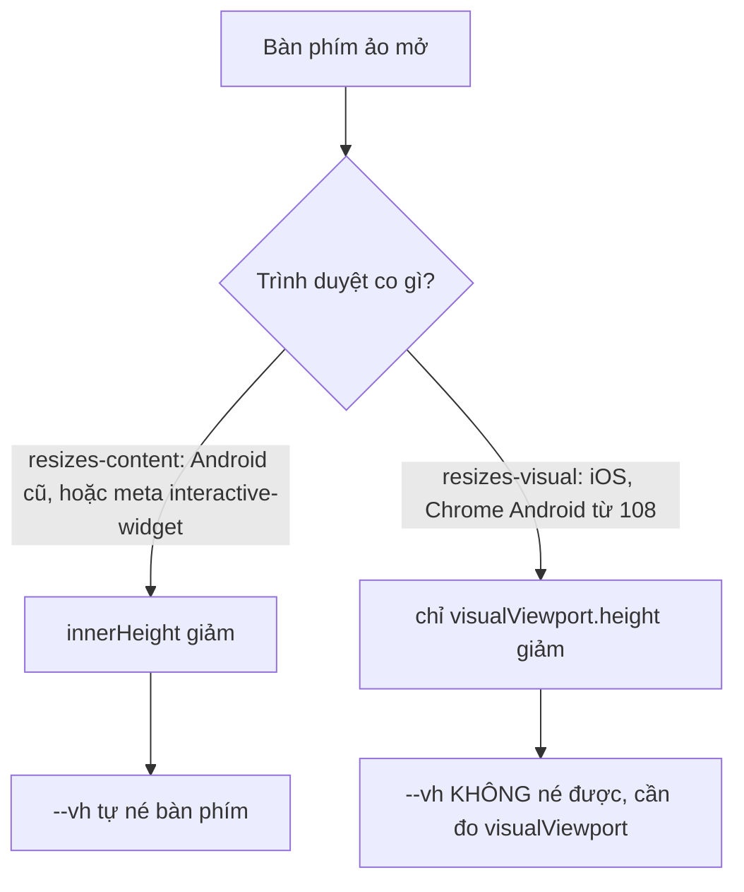

Mở một web app trên điện thoại là gặp ngay ba chuyện mà trên máy tính không ai để ý:

1. Ứng dụng đặt `height: 100vh`, nhưng ô nhập tin nhắn ở đáy lại **nằm dưới thanh địa chỉ** hoặc bị **bàn phím ảo** che mất.
2. Không có chuột phải. Muốn mở menu "Ghim / Tắt thông báo / Xoá" thì phải **nhấn giữ**, nhưng nhấn giữ xong nhấc tay lại thành một cú **chạm**, mở luôn cuộc trò chuyện bên dưới.
3. Ô nhập số điện thoại: người dùng gõ `84912345678`, ứng dụng nên hiện `+84 912 345-678` và tự nhận ra Việt Nam.

Telegram Web A xử lý cả ba bằng vài file nhỏ trong `src/util` và `src/hooks`. Bài này đọc từng file, chỉ ra chỗ còn sai, rồi viết lại.

> [!TIP]
> **Tóm tắt**
> - Ghi `--vh = innerHeight / 100` lên `:root` mỗi lần resize, CSS dùng `calc(var(--vh, 1vh) * 100)` thay cho `100vh`. Muốn né cả bàn phím thì đo thêm `visualViewport`.
> - Nhấn giữ: hẹn giờ 250ms ở `touchstart`, huỷ khi nhấc tay hoặc kéo; mở menu xong thì **nuốt cú click** sinh ra khi nhấc tay.
> - Số điện thoại: mỗi nước một dòng dữ liệu nén `US🇺🇸1United States334`, "334" là độ dài các nhóm số. Nhận nước bằng mã vùng **dài nhất** khớp.
> - Ngày nay CSS có `dvh`/`svh`, thẻ meta có `interactive-widget`, thư viện có libphonenumber; ý tưởng của Telegram vẫn đáng biết vì nó nhỏ và dễ kiểm soát.

<iframe class="demo-frame" src="/demos/web-patterns/index.html?theme=dark#/tg-mobile" title="Demo tg-mobile" loading="lazy" style="height: 1500px"></iframe>

<p class="demo-links">▶ <a href="/demos/web-patterns/index.html#/tg-mobile" target="_blank" rel="noopener">Mở demo toàn màn hình ↗</a> · <a href="https://stackblitz.com/github/hunghg255/blog-hunghg/tree/master/examples/web-patterns?file=src/lib/tgMobile.ts" target="_blank" rel="noopener">Sửa code trên StackBlitz ↗</a> · <a href="https://github.com/hunghg255/blog-hunghg/blob/master/examples/web-patterns/src/lib/tgMobile.ts" target="_blank" rel="noopener">Xem source trên GitHub ↗</a></p>

Thử trong demo: ở phần 1, bật "Bàn phím đang mở" và đổi qua lại hai chế độ của trình duyệt để thấy cách nào giữ được ô nhập. Ở phần 2, chọn "nhích là huỷ (0px)" rồi bấm "Giả lập: giữ 400ms, rung 3px": menu không mở mà chat lại mở. Ở phần 3, bấm `+120255501234` (thừa một số).

## Telegram làm thế nào?

### 1. `--vh` và bàn phím ảo: `util/windowSize.ts`

File [`src/util/windowSize.ts`](https://github.com/hunghg255/codebase/blob/main/web.telegram.org/src/util/windowSize.ts) chỉ có hơn 70 dòng. Phần quan trọng:

```ts
const initialHeight = window.innerHeight;

export function updateSizes() {
  document.documentElement.style.setProperty('--vh', `${window.innerHeight * 0.01}px`);
  // ...
}

const handleResize = throttle(() => {
  windowSize = updateSizes();
  if (!isRefreshDisabled && isMobileScreen() !== IS_SINGLE_COLUMN_LAYOUT /* hoặc đổi hướng */) {
    window.location.reload();
  }
}, 250, true);

// getIsKeyboardVisible: () => initialHeight > windowSize.height,
```

Ba ý:

- **`--vh`**: CSS của Telegram (ví dụ `Main.scss`, `UiLoader.scss`) viết `height: calc(var(--vh, 1vh) * 100)` trong `@media (max-width: 600px)`. `1vh` là giá trị dự phòng khi JS chưa chạy.
- **Reload khi đổi layout**: layout 1 cột hay 2 cột được tính **một lần lúc tải** (`IS_SINGLE_COLUMN_LAYOUT` trong `util/environment.ts`, ngưỡng 600px, hoặc nằm ngang thấp ≤ 950 × 450). Kéo cửa sổ qua ngưỡng thì Telegram **tải lại cả trang** thay vì đổi layout nóng. Đơn giản và an toàn, đổi lại người dùng mất trạng thái đang gõ. `MediaViewer.tsx` gọi `disableRefresh()` khi mở xem ảnh/video, để xoay máy xem video không làm trang tải lại.
- **Bàn phím ảo**: so chiều cao hiện tại với `initialHeight` lúc tải. Chỉ được dùng ở một chỗ: `Message.tsx`, trên Android, nếu bàn phím đang mở thì chờ bàn phím đóng rồi mới mở context menu.

Hàm `isLandscape()` có một chi tiết hay: trên Android, bàn phím ảo mở ra làm khung nhìn **thấp hơn rộng**, nên `(orientation: landscape)` khớp dù máy vẫn cầm dọc. Telegram thêm `min-device-aspect-ratio: 1/1` (tính theo kích thước **thiết bị**, không đổi khi bàn phím mở). Comment trong code ghi rõ tính năng này đã bị đánh dấu deprecated nhưng vẫn chạy.

### 2. Nhấn giữ 250ms: `hooks/useContextMenuHandlers.ts`

[`src/hooks/useContextMenuHandlers.ts`](https://github.com/hunghg255/codebase/blob/main/web.telegram.org/src/hooks/useContextMenuHandlers.ts):

```ts
const LONG_TAP_DURATION_MS = 250;

// đủ 250ms: mở menu, rồi chặn touchend kế tiếp để nhấc tay không thành click
element.addEventListener('touchend', function cancelClickOnce(e) {
  element.removeEventListener('touchend', cancelClickOnce, true);
  e.stopImmediatePropagation();
  e.preventDefault();
}, true);

element.addEventListener('touchstart', startLongPressTimer, { passive: true });
element.addEventListener('touchend', clearLongPressTimer, true);
element.addEventListener('touchmove', clearLongPressTimer, { passive: true });
```

- `touchstart` được đăng ký **passive**: không chặn cuộn trang, trình duyệt không phải chờ JS.
- Đủ 250ms thì gắn **một lần** một listener `touchend` ở pha capture, gọi `preventDefault()` trên nó. Trên trình duyệt di động, `preventDefault()` ở `touchend` ngăn trình duyệt sinh ra các sự kiện chuột giả lập, trong đó có `click`. Nhờ vậy nhấc tay lên không mở luôn chat.
- Class `no-selection` trên `body` để giữ lâu không bôi đen chữ.
- Với chuột phải, `handleBeforeContextMenu` thêm `no-selection` ngay ở `mousedown` (button 2), có lẽ để chuột phải không bôi đen chữ dưới con trỏ trước khi menu kịp mở.

### 3. Số điện thoại: `util/countries.ts` + `util/phoneNumber.ts`

Dữ liệu là **một chuỗi lớn** chép từ Telegram Desktop (`Telegram/Resources/numbers.txt`), mỗi dòng một nước:

```text
AF🇦🇫93Afghanistan333
AI🇦🇮1264Anguilla34
US🇺🇸1United States334
VN🇻🇳84Vietnam
```

Mã ISO 2 chữ, cờ (2 ký tự "regional indicator"), mã vùng, tên, và một dãy số cuối là **độ dài từng nhóm**. Nước không có dãy số cuối (như Việt Nam) dùng mẫu mặc định 3-3-3-3-3. Cách lưu này gọn hơn JSON nhiều: khoảng 240 nước gói trong vài KB.

Lúc khởi động, mỗi dãy độ dài được dựng thành một regex và cache lại:

```ts
const phoneNumberGroups = formatValue.split('').map(Number);
phoneNumberFormat = phoneNumberGroups.reduce((result, count, i) => {
  return `${result}(\\d{1,${count}})${i > 0 ? '?' : ''}`;
}, '');
formatsCache[formatValue] = new RegExp(`${phoneNumberFormat}${'()?'.repeat(5 - phoneNumberGroups.length)}`);
```

Mẹo `'()?'.repeat(5 - n)`: callback của `String.replace` được viết cố định 5 tham số `(_, p1, p2, p3, p4, p5)`, nên regex luôn phải có đủ 5 nhóm, nhóm thiếu thì bù bằng nhóm rỗng. Tìm nước thì lọc các nước có mã vùng là tiền tố của số, sắp theo độ dài mã và lấy **mã dài nhất**: `+1264…` là Anguilla chứ không phải Mỹ.

### Những chỗ chưa ổn trong bản gốc

1. **`initialHeight` chỉ đo một lần.** Tải trang khi đang cầm **ngang** rồi xoay dọc: mọi chiều cao dọc đều lớn hơn `initialHeight`, `getIsKeyboardVisible()` luôn trả `false`. Ngược lại, tải lúc thanh địa chỉ đang **thu gọn** rồi nó hiện ra: chiều cao giảm khoảng 50px, bị tưởng là bàn phím.
2. **Có lẽ không còn bắt được bàn phím trên Chrome Android mới.** Cách so `innerHeight` dựa vào việc bàn phím **co layout viewport**. Từ Chrome 108, Chrome trên Android mặc định chỉ co **visual viewport** (giống iOS), trừ khi trang khai báo `interactive-widget=resizes-content` trong thẻ meta viewport. Bản dump không có file HTML nên không kiểm tra được thẻ meta; nếu trang không khai báo, thì trên Chrome mới `innerHeight` có lẽ không đổi khi bàn phím mở và hàm này luôn trả `false`.
3. **Nhấn giữ bị huỷ bởi `touchmove` đầu tiên.** Ngón tay người không đứng yên tuyệt đối: chỉ cần trình duyệt báo một `touchmove` dịch 1px là huỷ. Kết quả là có lúc giữ mãi không ra menu, nhấc tay lại mở chat.
4. **Số gõ thừa bị dính vào nhóm cuối.** Regex không neo `^…$`, phần số không khớp được giữ nguyên ở đuôi: Mỹ mẫu `334` gõ 11 số thành `202 555-01234`.
5. **Mã vùng chung.** `+1` là cả Mỹ lẫn Canada, `+7` là Nga lẫn Kazakhstan. Bản gốc lấy nước **đứng sau** trong danh sách, kể cả khi người dùng vừa tự chọn nước kia.

## Bên trong trình duyệt: ba "chiều cao" khác nhau

Trên điện thoại có ba con số dễ nhầm:

| | Là gì | Đổi khi thanh địa chỉ ẩn/hiện | Đổi khi bàn phím mở |
|---|---|---|---|
| `100vh` (= `100lvh`) | khung nhìn **lớn nhất**, lúc thanh địa chỉ đã thu gọn | không | không |
| `window.innerHeight` | layout viewport | có | chỉ khi trình duyệt "resizes-content" |
| `visualViewport.height` | phần **thật sự nhìn thấy** | có | có |

`100vh` cố định để trang không "nhảy" mỗi lần thanh địa chỉ co giãn khi cuộn, nhưng vì vậy mà phần đáy bị che khi thanh địa chỉ đang hiện. `--vh` của Telegram bám theo `innerHeight`, nên né được thanh địa chỉ. Bàn phím thì tuỳ trình duyệt:



Demo phần 1 vẽ đúng bảng này: chọn "iOS, Chrome Android ≥ 108" và mở bàn phím, chỉ cách đo `visualViewport` giữ được ô nhập.

## Viết lại

Ba file: [`tgMobile.ts`](https://github.com/hunghg255/blog-hunghg/blob/master/examples/web-patterns/src/lib/tgMobile.ts) (khung nhìn), [`tgLongPress.ts`](https://github.com/hunghg255/blog-hunghg/blob/master/examples/web-patterns/src/lib/tgLongPress.ts) (nhấn giữ), [`tgPhone.ts`](https://github.com/hunghg255/blog-hunghg/blob/master/examples/web-patterns/src/lib/tgPhone.ts) (số điện thoại).

### Khung nhìn và bàn phím

Phát hiện bàn phím bằng cách nhớ chiều cao lớn nhất **theo từng hướng màn hình**:

```ts title=src/lib/tgMobile.ts
/**
 * Nhớ chiều cao lớn nhất đã thấy cho từng hướng màn hình.
 * Bản gốc chỉ nhớ `initialHeight` lúc tải: xoay ngang rồi xoay dọc lại vẫn đúng,
 * nhưng tải trang lúc ĐANG nằm ngang rồi xoay dọc thì mọi chiều cao dọc đều lớn hơn
 * initialHeight, nên không bao giờ thấy bàn phím.
 */
export function createKeyboardDetector(minHeight = KEYBOARD_MIN_HEIGHT): KeyboardDetector {
  const maxByOrientation = { portrait: 0, landscape: 0 };
  return {
    measure(width, height) {
      const orientation = width > height ? 'landscape' : 'portrait';
      if (height > maxByOrientation[orientation]) maxByOrientation[orientation] = height;
      const diff = maxByOrientation[orientation] - height;
      return diff >= minHeight ? diff : 0;
    },
  };
}
```

Mỗi lần resize (của `window` lẫn `visualViewport`), ghi ba biến CSS:

```ts title=src/lib/tgMobile.ts
    const vv = window.visualViewport;
    const innerHeight = window.innerHeight;
    const width = window.innerWidth;
    // phóng to bằng hai ngón cũng làm visualViewport.height nhỏ lại: khi đó bỏ qua nó
    const isZoomed = vv !== null && vv !== undefined && vv.scale > 1.01;
    const visibleHeight = vv && !isZoomed ? vv.height : innerHeight;
    // Android co innerHeight khi bàn phím mở, iOS chỉ co visualViewport: lấy số nhỏ hơn
    const keyboardHeight = detector.measure(width, Math.min(innerHeight, visibleHeight));

    target.style.setProperty('--vh', `${innerHeight * 0.01}px`);
    target.style.setProperty('--visible-vh', `${visibleHeight * 0.01}px`);
    target.style.setProperty('--keyboard-height', `${keyboardHeight}px`);
```

::: spoiler Xem toàn bộ src/lib/tgMobile.ts

```ts title=src/lib/tgMobile.ts
/**
 * Chiều cao viewport trên mobile và phát hiện bàn phím ảo
 * (ý tưởng từ util/windowSize.ts của Telegram Web A).
 *
 * - `100vh` trên mobile là chiều cao khi thanh địa chỉ ĐÃ thu gọn, nên phần đáy trang
 *   (ô nhập tin nhắn) bị che. Telegram ghi `--vh = innerHeight / 100` vào :root mỗi lần
 *   resize, CSS dùng `calc(var(--vh, 1vh) * 100)`.
 * - Bàn phím ảo: Telegram coi "chiều cao hiện tại < chiều cao lúc tải" là bàn phím đang mở.
 *   Bản này so với chiều cao lớn nhất đã thấy THEO TỪNG HƯỚNG màn hình, và dùng
 *   visualViewport nếu có (iOS không co innerHeight khi bàn phím mở).
 */

export type Layout = 'single-column' | 'two-columns';

/** Ngưỡng của Telegram: ≤ 600px rộng, hoặc nằm ngang thấp (≤ 950 × 450) là 1 cột. */
export const MOBILE_MAX_WIDTH = 600;
export const MOBILE_LANDSCAPE_MAX_WIDTH = 950;
export const MOBILE_LANDSCAPE_MAX_HEIGHT = 450;

export function getLayout(width: number, height: number): Layout {
  const isMobile =
    width <= MOBILE_MAX_WIDTH ||
    (width <= MOBILE_LANDSCAPE_MAX_WIDTH && height <= MOBILE_LANDSCAPE_MAX_HEIGHT);
  return isMobile ? 'single-column' : 'two-columns';
}

/** Bàn phím ảo hiếm khi thấp hơn ngần này; chênh ít hơn thì là thanh địa chỉ co giãn. */
export const KEYBOARD_MIN_HEIGHT = 150;

export interface ViewportState {
  /** chiều cao layout viewport (window.innerHeight) */
  innerHeight: number;
  /** chiều cao vùng thực sự nhìn thấy (visualViewport.height), iOS co lại khi bàn phím mở */
  visibleHeight: number;
  width: number;
  orientation: 'portrait' | 'landscape';
  layout: Layout;
  /** ước lượng chiều cao bàn phím ảo, 0 nếu đang đóng */
  keyboardHeight: number;
}

export interface KeyboardDetector {
  /** đưa vào số đo hiện tại, trả về chiều cao bàn phím ước lượng */
  measure(width: number, height: number): number;
}

/**
 * Nhớ chiều cao lớn nhất đã thấy cho từng hướng màn hình.
 * Bản gốc chỉ nhớ `initialHeight` lúc tải: xoay ngang rồi xoay dọc lại vẫn đúng,
 * nhưng tải trang lúc ĐANG nằm ngang rồi xoay dọc thì mọi chiều cao dọc đều lớn hơn
 * initialHeight, nên không bao giờ thấy bàn phím.
 */
export function createKeyboardDetector(minHeight = KEYBOARD_MIN_HEIGHT): KeyboardDetector {
  const maxByOrientation = { portrait: 0, landscape: 0 };
  return {
    measure(width, height) {
      const orientation = width > height ? 'landscape' : 'portrait';
      if (height > maxByOrientation[orientation]) maxByOrientation[orientation] = height;
      const diff = maxByOrientation[orientation] - height;
      return diff >= minHeight ? diff : 0;
    },
  };
}

export interface ViewportWatcherOptions {
  /** phần tử nhận biến CSS, mặc định <html> */
  target?: HTMLElement;
  /** gọi khi layout 1 cột ⇄ 2 cột đổi (Telegram thì reload cả trang) */
  onLayoutChange?: (layout: Layout, previous: Layout) => void;
  onChange?: (state: ViewportState) => void;
  throttleMs?: number;
}

/**
 * Ghi `--vh` (theo innerHeight, giống Telegram) và `--visible-vh`, `--keyboard-height`
 * (theo visualViewport) lên :root. Trả về hàm huỷ.
 */
export function watchViewport({
  target = document.documentElement,
  onLayoutChange,
  onChange,
  throttleMs = 100,
}: ViewportWatcherOptions = {}) {
  const detector = createKeyboardDetector();
  let layout = getLayout(window.innerWidth, window.innerHeight);
  let timer: ReturnType<typeof setTimeout> | undefined;

  const update = () => {
    timer = undefined;
    const vv = window.visualViewport;
    const innerHeight = window.innerHeight;
    const width = window.innerWidth;
    // phóng to bằng hai ngón cũng làm visualViewport.height nhỏ lại: khi đó bỏ qua nó
    const isZoomed = vv !== null && vv !== undefined && vv.scale > 1.01;
    const visibleHeight = vv && !isZoomed ? vv.height : innerHeight;
    // Android co innerHeight khi bàn phím mở, iOS chỉ co visualViewport: lấy số nhỏ hơn
    const keyboardHeight = detector.measure(width, Math.min(innerHeight, visibleHeight));

    target.style.setProperty('--vh', `${innerHeight * 0.01}px`);
    target.style.setProperty('--visible-vh', `${visibleHeight * 0.01}px`);
    target.style.setProperty('--keyboard-height', `${keyboardHeight}px`);

    const nextLayout = getLayout(width, innerHeight);
    if (nextLayout !== layout) {
      const previous = layout;
      layout = nextLayout;
      onLayoutChange?.(nextLayout, previous);
    }

    onChange?.({
      innerHeight,
      visibleHeight,
      width,
      orientation: width > innerHeight ? 'landscape' : 'portrait',
      layout,
      keyboardHeight,
    });
  };

  // throttle kiểu "chạy cuối": resize bắn hàng chục lần khi xoay máy
  const schedule = () => {
    if (timer === undefined) timer = setTimeout(update, throttleMs);
  };

  update();
  window.addEventListener('resize', schedule);
  window.visualViewport?.addEventListener('resize', schedule);

  return () => {
    clearTimeout(timer);
    window.removeEventListener('resize', schedule);
    window.visualViewport?.removeEventListener('resize', schedule);
  };
}
```

:::

### Nhấn giữ

Hẹn giờ ở `pointerdown`, huỷ ở `pointermove` (quá ngưỡng), `pointerup`, `pointercancel`. Phần khác Telegram nhiều nhất là cách nuốt click và chặn menu gốc:

```ts title=src/lib/tgLongPress.ts
  // Nuốt click ngay sau một lần nhấn giữ đã mở menu (pha capture: chặn trước mọi handler con)
  const onClickCapture = (event: MouseEvent) => {
    if (!fired) return;
    fired = false;
    event.preventDefault();
    event.stopPropagation();
  };

  // Android/Chrome tự bắn `contextmenu` khi giữ lâu (~500ms+): menu của mình đã mở rồi thì chặn
  const onContextMenu = (event: MouseEvent) => {
    if (fired || timer !== undefined) event.preventDefault();
  };
```

::: spoiler Xem toàn bộ src/lib/tgLongPress.ts

```ts title=src/lib/tgLongPress.ts
/**
 * Nhấn giữ để mở context menu trên màn hình cảm ứng
 * (ý tưởng từ hooks/useContextMenuHandlers.ts của Telegram Web A).
 *
 * - Chạm xuống thì hẹn giờ 250ms; nhấc tay, huỷ chạm hoặc kéo đi thì huỷ hẹn.
 * - Đủ 250ms thì mở menu tại điểm chạm, rồi NUỐT cú "click" sinh ra khi nhấc tay
 *   (nếu không, nhấc tay xong lại mở luôn tin nhắn/chat bên dưới menu).
 *
 * Khác bản gốc: dùng Pointer Events (một đường cho cả chạm lẫn bút), cho phép rung tay
 * trong `moveTolerance` px thay vì huỷ ngay ở `touchmove` đầu tiên, và chặn `contextmenu`
 * gốc của trình duyệt để menu không mở hai lần.
 */

export interface LongPressOptions {
  /** thời gian giữ, Telegram dùng 250ms */
  delay?: number;
  /** rung tay trong phạm vi này (px) vẫn tính là đang giữ; bản gốc là 0 */
  moveTolerance?: number;
  /** chỉ áp dụng cho các loại con trỏ này, mặc định chạm và bút */
  pointerTypes?: string[];
  onLongPress: (point: { x: number; y: number; target: EventTarget | null }) => void;
  /** gọi khi một lần giữ bị huỷ, kèm lý do (để demo/log) */
  onCancel?: (reason: 'move' | 'up' | 'cancel') => void;
}

export function attachLongPress(element: HTMLElement, options: LongPressOptions) {
  const { delay = 250, moveTolerance = 10, pointerTypes = ['touch', 'pen'], onLongPress, onCancel } = options;
  let timer: ReturnType<typeof setTimeout> | undefined;
  let start: { x: number; y: number; id: number } | undefined;
  let fired = false;

  const clear = (reason?: 'move' | 'up' | 'cancel') => {
    if (timer !== undefined) {
      clearTimeout(timer);
      timer = undefined;
      if (reason) onCancel?.(reason);
    }
    start = undefined;
  };

  const onPointerDown = (event: PointerEvent) => {
    // lần giữ trước mở menu nhưng không sinh click (vd. kéo tay ra ngoài rồi mới nhấc):
    // cờ cũ không được nuốt nhầm cú click mới
    fired = false;
    if (!pointerTypes.includes(event.pointerType) || !event.isPrimary) return;
    clear();
    start = { x: event.clientX, y: event.clientY, id: event.pointerId };
    const target = event.target;
    timer = setTimeout(() => {
      timer = undefined;
      fired = true;
      onLongPress({ x: start!.x, y: start!.y, target });
    }, delay);
  };

  const onPointerMove = (event: PointerEvent) => {
    if (!start || event.pointerId !== start.id) return;
    if (Math.hypot(event.clientX - start.x, event.clientY - start.y) > moveTolerance) clear('move');
  };

  const onPointerUp = (event: PointerEvent) => {
    if (start && event.pointerId === start.id) clear('up');
  };
  const onPointerCancel = (event: PointerEvent) => {
    // trình duyệt bắt đầu cuộn trang: không còn là nhấn giữ nữa
    if (start && event.pointerId === start.id) clear('cancel');
  };

  // Nuốt click ngay sau một lần nhấn giữ đã mở menu (pha capture: chặn trước mọi handler con)
  const onClickCapture = (event: MouseEvent) => {
    if (!fired) return;
    fired = false;
    event.preventDefault();
    event.stopPropagation();
  };

  // Android/Chrome tự bắn `contextmenu` khi giữ lâu (~500ms+): menu của mình đã mở rồi thì chặn
  const onContextMenu = (event: MouseEvent) => {
    if (fired || timer !== undefined) event.preventDefault();
  };

  element.addEventListener('pointerdown', onPointerDown);
  element.addEventListener('pointermove', onPointerMove);
  element.addEventListener('pointerup', onPointerUp);
  element.addEventListener('pointercancel', onPointerCancel);
  element.addEventListener('click', onClickCapture, true);
  element.addEventListener('contextmenu', onContextMenu);

  return () => {
    clear();
    element.removeEventListener('pointerdown', onPointerDown);
    element.removeEventListener('pointermove', onPointerMove);
    element.removeEventListener('pointerup', onPointerUp);
    element.removeEventListener('pointercancel', onPointerCancel);
    element.removeEventListener('click', onClickCapture, true);
    element.removeEventListener('contextmenu', onContextMenu);
  };
}
```

:::

### Số điện thoại

```ts title=src/lib/tgPhone.ts
export function formatNational(nationalDigits: string, country?: Country): FormatResult {
  const digits = onlyDigits(nationalDigits);
  const groups = country?.groups ?? DEFAULT_GROUPS;
  const separator = country?.id === 'GB' ? ' ' : '-';
  const parts: string[] = [];
  let index = 0;
  for (const size of groups) {
    if (index >= digits.length) break;
    parts.push(digits.slice(index, index + size));
    index += size;
  }
  const capacity = groups.reduce((sum, size) => sum + size, 0);
  const overflow = Math.max(0, digits.length - capacity);

  let text = parts[0] ?? '';
  if (parts[1]) text += ` ${parts[1]}`;
  for (const part of parts.slice(2)) text += `${separator}${part}`;
  if (overflow) text += ` ${digits.slice(capacity)}`;

  return { text, isComplete: Boolean(country?.groups) && digits.length === capacity, overflow };
```

::: spoiler Xem toàn bộ src/lib/tgPhone.ts

```ts title=src/lib/tgPhone.ts
/**
 * Định dạng số điện thoại theo quốc gia khi người dùng đang gõ
 * (ý tưởng từ util/countries.ts + util/phoneNumber.ts của Telegram Web A).
 *
 * Dữ liệu là một chuỗi nén, mỗi dòng một nước, lấy từ Telegram Desktop (numbers.txt):
 *   `US🇺🇸1United States334`  =  mã ISO + cờ + mã vùng + tên + độ dài các nhóm số
 * "334" nghĩa là: 3 số, cách, 3 số, gạch, 4 số  →  `202 555-0123`.
 * Nước không có đuôi số thì dùng mặc định 3-3-3-3-3.
 */

// Một phần nhỏ của bảng (31/~240 nước) để demo; bảng đầy đủ nằm trong mã nguồn Telegram.
export const PHONE_DATA = `AE🇦🇪971United Arab Emirates234
AI🇦🇮1264Anguilla34
AG🇦🇬1268Antigua and Barbuda34
AU🇦🇺61Australia333
BR🇧🇷55Brazil254
CA🇨🇦1Canada334
CN🇨🇳86China344
DE🇩🇪49Germany38
ES🇪🇸34Spain333
FR🇫🇷33France12222
GB🇬🇧44United Kingdom46
HK🇭🇰852Hong Kong
ID🇮🇩62Indonesia
IN🇮🇳91India55
IT🇮🇹39Italy334
JP🇯🇵81Japan244
KZ🇰🇿7Kazakhstan3322
KR🇰🇷82South Korea
MX🇲🇽52Mexico
MY🇲🇾60Malaysia
NL🇳🇱31Netherlands12222
PH🇵🇭63Philippines334
PL🇵🇱48Poland333
RU🇷🇺7Russia3322
SG🇸🇬65Singapore44
TH🇹🇭66Thailand144
TR🇹🇷90Turkey334
TW🇹🇼886Taiwan
UA🇺🇦380Ukraine2322
US🇺🇸1United States334
VN🇻🇳84Vietnam`;

export interface Country {
  id: string;
  flag: string;
  /** chỉ chữ số, không có dấu + */
  code: string;
  name: string;
  /** độ dài từng nhóm, undefined = dùng mặc định */
  groups?: number[];
}

const DEFAULT_GROUPS = [3, 3, 3, 3, 3];

// mã ISO, hai ký tự "regional indicator" ghép thành cờ, mã vùng, tên, độ dài nhóm (có thể rỗng)
const LINE_RE = /^([A-Z]{2})(\p{Regional_Indicator}{2})(\d+)(.*?)(\d*)$/u;

export function parsePhoneData(data: string): Country[] {
  return data.split('\n').flatMap((line) => {
    const match = LINE_RE.exec(line.trim());
    if (!match) return [];
    const [, id, flag, code, name, groups] = match;
    return [{ id, flag, code, name, groups: groups ? groups.split('').map(Number) : undefined }];
  });
}

export const COUNTRIES = parsePhoneData(PHONE_DATA);

export const onlyDigits = (input: string) => input.replace(/\D+/g, '');

/**
 * Tìm nước theo mã vùng ở đầu số: lấy mã DÀI nhất khớp (+1264 Anguilla thắng +1 Mỹ).
 * Nhiều nước chung mã (+1 Mỹ/Canada, +7 Nga/Kazakhstan): giữ nước người dùng đang chọn
 * nếu vẫn khớp, thay vì nhảy sang nước đứng sau trong danh sách như bản gốc.
 */
export function detectCountry(input: string, current?: Country, countries = COUNTRIES) {
  const digits = onlyDigits(input);
  const candidates = countries.filter((c) => digits.startsWith(c.code));
  if (candidates.length === 0) return undefined;
  const longest = Math.max(...candidates.map((c) => c.code.length));
  const best = candidates.filter((c) => c.code.length === longest);
  return (
    best.find((c) => c.id === current?.id) ??
    best.find((c) => c.id === PRIMARY_FOR_CODE[c.code]) ??
    best[0]
  );
}

/** Mã dùng chung nhiều nước: chưa chọn nước nào thì đoán nước đông dân nhất. */
const PRIMARY_FOR_CODE: Record<string, string> = { '1': 'US', '7': 'RU' };

export interface FormatResult {
  text: string;
  /** đã đủ số theo mẫu của nước (mẫu mặc định thì luôn false) */
  isComplete: boolean;
  /** số chữ số gõ thừa so với mẫu */
  overflow: number;
}

/**
 * Định dạng PHẦN SAU mã vùng. Nhóm 1 và 2 cách nhau dấu cách, các nhóm sau nối bằng `-`
 * (riêng Anh dùng dấu cách), giống Telegram.
 *
 * Khác bản gốc: bản gốc dùng regex không neo nên chữ số thừa bị dính liền vào nhóm cuối
 * (`202 555-01234`); ở đây số thừa được tách riêng và báo về qua `overflow`.
 */
export function formatNational(nationalDigits: string, country?: Country): FormatResult {
  const digits = onlyDigits(nationalDigits);
  const groups = country?.groups ?? DEFAULT_GROUPS;
  const separator = country?.id === 'GB' ? ' ' : '-';
  const parts: string[] = [];
  let index = 0;
  for (const size of groups) {
    if (index >= digits.length) break;
    parts.push(digits.slice(index, index + size));
    index += size;
  }
  const capacity = groups.reduce((sum, size) => sum + size, 0);
  const overflow = Math.max(0, digits.length - capacity);

  let text = parts[0] ?? '';
  if (parts[1]) text += ` ${parts[1]}`;
  for (const part of parts.slice(2)) text += `${separator}${part}`;
  if (overflow) text += ` ${digits.slice(capacity)}`;

  return { text, isComplete: Boolean(country?.groups) && digits.length === capacity, overflow };
}

/** Định dạng cả số có mã vùng: `+84912345678` → `+84 912 345-678`. */
export function formatInternational(input: string, current?: Country) {
  const digits = onlyDigits(input);
  const country = detectCountry(digits, current);
  if (!country) return { country, text: digits ? `+${digits}` : '', isComplete: false, overflow: 0 };
  const national = formatNational(digits.slice(country.code.length), country);
  return {
    country,
    ...national,
    text: national.text ? `+${country.code} ${national.text}` : `+${country.code}`,
  };
}

/**
 * Bản sao cách làm của Telegram, để demo so sánh: dựng regex từ mẫu
 * (`334` → `(\d{1,3})(\d{1,3})?(\d{1,4})?()?()?`), thêm `()?` cho đủ 5 nhóm vì
 * callback của `String.replace` được viết cố định 5 tham số.
 */
export function formatNationalLikeOriginal(nationalDigits: string, country?: Country) {
  const groups = country?.groups ?? DEFAULT_GROUPS;
  const pattern = groups.map((size, i) => `(\\d{1,${size}})${i > 0 ? '?' : ''}`).join('');
  const re = new RegExp(`${pattern}${'()?'.repeat(5 - groups.length)}`);
  const separator = country?.id === 'GB' ? ' ' : '-';
  return onlyDigits(nationalDigits).replace(re, (_m, p1, p2, p3, p4, p5) => {
    let out = p1 ?? '';
    if (p2) out += ` ${p2}`;
    if (p3) out += `${separator}${p3}`;
    if (p4) out += `${separator}${p4}`;
    if (p5) out += `${separator}${p5}`;
    return out;
  });
}
```

:::

## Đi qua code

**`createKeyboardDetector`.** Không so với một giá trị lúc tải mà với **giá trị lớn nhất đã thấy** cho hướng đó. Thanh địa chỉ thu gọn làm chiều cao tăng, mốc tự nâng lên. Ngưỡng 150px (`KEYBOARD_MIN_HEIGHT`) để chênh lệch do thanh địa chỉ (khoảng 50–60px) không bị tưởng là bàn phím. Bàn phím điện thoại thường cao hơn nhiều so với ngưỡng này.

**`watchViewport`.** Lấy số **nhỏ hơn** giữa `innerHeight` và `visualViewport.height`: trình duyệt nào co cái nào cũng bắt được. Khi người dùng phóng to bằng hai ngón (`visualViewport.scale > 1`), `visualViewport.height` cũng nhỏ đi, nên lúc đó bỏ qua nó. Biến `--vh` giữ đúng ý nghĩa như Telegram, thêm `--visible-vh` và `--keyboard-height` cho layout cần né bàn phím. Thay vì reload khi layout đổi, bản này gọi `onLayoutChange` để app tự quyết.

**`attachLongPress`.** Dùng Pointer Events thay cho Touch Events: một đường cho ngón tay, bút, và cả chuột nếu muốn (demo bật chuột để thử trên máy tính).

- `pointermove` chỉ huỷ khi lệch quá `moveTolerance` (mặc định 10px).
- `pointercancel` xảy ra khi trình duyệt quyết định đây là thao tác **cuộn**. Với `touch-action: pan-y` trên danh sách, kéo dọc vẫn cuộn bình thường và tự huỷ nhấn giữ.
- Để nuốt click, bản này không chặn `touchend` mà gắn listener `click` ở **pha capture** và chặn cú click đầu tiên sau khi menu đã mở. Cờ `fired` được xoá ở mọi `pointerdown` mới, để một lần giữ không sinh click (kéo tay ra ngoài rồi mới nhấc) không nuốt nhầm cú click sau đó.
- Chặn luôn `contextmenu` gốc: Chrome Android cũng tự bắn `contextmenu` khi giữ đủ lâu, không chặn thì menu mở hai lần.

**`formatNational`.** Không dùng regex nữa mà cắt chuỗi theo mảng độ dài nhóm. Số thừa được tách bằng một dấu cách và trả về `overflow`, để UI có thể báo "thừa số" thay vì im lặng hiện sai. `isComplete` chỉ đúng khi nước có mẫu riêng: mẫu mặc định 3-3-3-3-3 không nói lên độ dài thật.

**`detectCountry`.** Vẫn lấy mã dài nhất, nhưng khi nhiều nước chung mã thì ưu tiên **nước đang chọn**. Chưa chọn gì thì lấy nước "chính" của mã đó (Mỹ cho `+1`, Nga cho `+7`).

**Khác bản gốc:** dùng Pointer Events và ngưỡng rung tay; đo cả `visualViewport`; phát hiện bàn phím theo từng hướng; không reload trang; không dùng regex để định dạng; giữ nước người dùng đã chọn. Phần dữ liệu `PHONE_DATA` trong demo chỉ lấy 31 dòng của bảng Telegram (lấy từ Telegram Desktop).

## Tại sao không làm cách khác?

**Sao không dùng `100dvh`?** Ngày nay CSS có `svh` (nhỏ nhất), `lvh` (lớn nhất), `dvh` (động, bám theo thanh địa chỉ). `height: 100dvh` làm đúng việc `--vh` của Telegram mà không cần JS, và đã có ở cả Chrome, Safari, Firefox (xem [caniuse](https://caniuse.com/viewport-unit-variants)). Code của Telegram có trước khi các đơn vị này phổ biến. Nhưng `dvh` cũng **không** né bàn phím trên trình duyệt "resizes-visual", nên vẫn cần `visualViewport` (hoặc `interactive-widget`) cho ô nhập.

**Sao không khai báo `interactive-widget=resizes-content`?** Thêm vào thẻ meta viewport thì Chrome Android co cả layout viewport khi bàn phím mở, `100dvh` và `--vh` tự né bàn phím. Đây là cách gọn nhất nếu chỉ nhắm Chrome. Safari thì hỗ trợ ra sao bạn nên kiểm tra lại trên [caniuse](https://caniuse.com/?search=interactive-widget) trước khi dựa vào nó.

**Sao không dùng sự kiện `contextmenu` cho nhấn giữ?** Trên Android, giữ lâu có bắn `contextmenu`, nhưng thời gian giữ do trình duyệt quyết định (lâu hơn 250ms). iOS Safari thì không bắn `contextmenu` khi giữ. Muốn trải nghiệm giống nhau thì phải tự hẹn giờ như Telegram.

**Sao không dùng libphonenumber?** [libphonenumber](https://github.com/google/libphonenumber) (và bản JS `libphonenumber-js`) biết độ dài hợp lệ, đầu số theo vùng, số di động hay cố định: đúng hơn hẳn. Đổi lại, metadata đầy đủ nặng hàng trăm KB. Bảng nén của Telegram chỉ vài KB, đủ cho việc **hiện** số cho đẹp, còn kiểm tra số có thật hay không thì để server lo.

## Edge case và cạm bẫy

- **iOS giữ lâu bật menu "Sao chép / Tra cứu"** và kính lúp chọn chữ. Cần `-webkit-touch-callout: none` và `user-select: none` trên vùng nhấn giữ (Telegram dùng class `no-selection`).
- **`touch-action`**: không đặt gì thì kéo ngang/dọc vẫn cuộn và bắn `pointercancel` (đúng ý). Đặt `touch-action: none` thì trang không cuộn được ở vùng đó nữa.
- **Phóng to bằng hai ngón** làm `visualViewport.height` nhỏ lại: đừng nhầm với bàn phím.
- **Bàn phím có thanh gợi ý, bàn phím nổi trên iPad, bàn phím vật lý**: chiều cao rất khác nhau, ngưỡng 150px chỉ là ước lượng. Có những trường hợp không phát hiện được, nên UI không được *phụ thuộc* vào việc phát hiện bàn phím, chỉ dùng nó để chỉnh cho đẹp hơn.
- **Kazakhstan dùng `+7 7xx`**. Lấy "nước chính" cho `+7` là Nga thì số Kazakhstan bị nhận nhầm. Muốn đúng phải biết đầu số theo vùng, đó chính là thứ libphonenumber lưu.
- **Con trỏ trong ô nhập** nhảy về cuối mỗi lần định dạng lại. Demo xử lý trường hợp xoá trúng dấu cách/gạch (coi như xoá chữ số đứng trước), còn giữ đúng vị trí con trỏ khi sửa giữa số thì cần tính lại vị trí theo số chữ số đứng trước con trỏ.
- **Reload khi qua ngưỡng layout** (cách của Telegram) làm mất chữ đang gõ dở. Nếu giữ cách này, hãy lưu nháp trước khi reload.

## Dùng trong dự án

```css
/* đáy ứng dụng chat */
.app {
  height: 100vh; /* trình duyệt quá cũ */
  height: calc(var(--vh, 1vh) * 100); /* JS đã chạy */
  height: 100dvh; /* trình duyệt có dvh: dùng luôn */
}
.composer {
  /* né bàn phím trên trình duyệt chỉ co visual viewport */
  margin-bottom: var(--keyboard-height, 0px);
}
```

```ts
import { watchViewport } from './tgMobile';
import { attachLongPress } from './tgLongPress';

const stop = watchViewport({
  onLayoutChange: (layout) => store.setLayout(layout), // thay vì reload
});

const detach = attachLongPress(chatListEl, {
  onLongPress: ({ x, y, target }) => openChatMenu(target, x, y),
});
```

Trong React, gọi `attachLongPress` trong `useEffect` và trả về hàm huỷ.

::: spoiler Ví dụ test (bản phác, không có trong repo)

```ts
import { afterEach, beforeEach, describe, expect, it, vi } from 'vitest';
import { createKeyboardDetector } from './tgMobile';
import { attachLongPress } from './tgLongPress';
import { COUNTRIES, detectCountry, formatNational } from './tgPhone';

describe('createKeyboardDetector', () => {
  it('nhớ riêng từng hướng màn hình', () => {
    const d = createKeyboardDetector();
    d.measure(844, 390); // tải trang lúc đang nằm ngang
    expect(d.measure(390, 844)).toBe(0); // xoay dọc
    expect(d.measure(390, 520)).toBe(324); // bàn phím mở
    expect(d.measure(390, 800)).toBe(0); // thanh địa chỉ hiện: chênh 44px < 150px
  });
});

// jsdom chưa có đủ PointerEvent: tạo Event rồi gắn các trường cần dùng
function pointer(type: string, x = 0, y = 0) {
  const e = new Event(type, { bubbles: true, cancelable: true });
  Object.defineProperties(e, {
    pointerType: { value: 'touch' },
    isPrimary: { value: true },
    pointerId: { value: 1 },
    clientX: { value: x },
    clientY: { value: y },
  });
  return e;
}

describe('attachLongPress', () => {
  let el: HTMLElement;
  beforeEach(() => {
    vi.useFakeTimers();
    el = document.createElement('div');
    document.body.append(el);
  });
  afterEach(() => {
    vi.useRealTimers();
    el.remove();
  });

  it('giữ đủ 250ms thì mở menu và nuốt click ngay sau đó', () => {
    const onLongPress = vi.fn();
    const onClick = vi.fn();
    el.addEventListener('click', onClick);
    attachLongPress(el, { onLongPress });

    el.dispatchEvent(pointer('pointerdown', 10, 10));
    vi.advanceTimersByTime(250);
    expect(onLongPress).toHaveBeenCalledWith({ x: 10, y: 10, target: el });

    el.dispatchEvent(pointer('pointerup', 10, 10));
    el.click();
    expect(onClick).not.toHaveBeenCalled();
    el.click();
    expect(onClick).toHaveBeenCalledTimes(1);
  });

  it('rung trong ngưỡng vẫn tính, kéo quá ngưỡng thì huỷ', () => {
    const onLongPress = vi.fn();
    const onCancel = vi.fn();
    attachLongPress(el, { onLongPress, onCancel, moveTolerance: 10 });

    el.dispatchEvent(pointer('pointerdown', 0, 0));
    el.dispatchEvent(pointer('pointermove', 3, 4)); // lệch 5px
    vi.advanceTimersByTime(250);
    expect(onLongPress).toHaveBeenCalledTimes(1);

    el.dispatchEvent(pointer('pointerdown', 0, 0));
    el.dispatchEvent(pointer('pointermove', 30, 0));
    vi.advanceTimersByTime(250);
    expect(onLongPress).toHaveBeenCalledTimes(1);
    expect(onCancel).toHaveBeenCalledWith('move');
  });
});

describe('tgPhone', () => {
  const byId = (id: string) => COUNTRIES.find((c) => c.id === id)!;

  it('mã dài nhất thắng, nước đang chọn được giữ', () => {
    expect(detectCountry('+12645551234')?.id).toBe('AI');
    expect(detectCountry('+16135550123', byId('CA'))?.id).toBe('CA');
    expect(detectCountry('+16135550123')?.id).toBe('US');
  });

  it('định dạng theo mẫu, số thừa tách riêng', () => {
    expect(formatNational('2025550123', byId('US'))).toEqual({ text: '202 555-0123', isComplete: true, overflow: 0 });
    expect(formatNational('20255501234', byId('US'))).toEqual({ text: '202 555-0123 4', isComplete: false, overflow: 1 });
  });
});
```

:::

## So với chuẩn web và thư viện

- **Đơn vị `svh`/`lvh`/`dvh`**: thay được `--vh` cho bài toán thanh địa chỉ, không cần JS ([caniuse](https://caniuse.com/viewport-unit-variants)).
- **`visualViewport`**: API chuẩn để biết phần đang nhìn thấy, có ở các trình duyệt lớn. Đây là cách đo bàn phím trên iOS.
- **Meta `interactive-widget`**: chọn trình duyệt co gì khi bàn phím mở. Chrome Android hỗ trợ từ bản 108; Safari thì kiểm tra lại trên caniuse (tính tới 10/2026).
- **VirtualKeyboard API** (`navigator.virtualKeyboard`, biến CSS `keyboard-inset-height`): cho trang tự lo vùng bàn phím, hiện chỉ có ở trình duyệt nhân Chromium. Đừng coi là có sẵn ở mọi nơi.
- **Pointer Events**: có ở mọi trình duyệt hiện đại, gộp chuột/chạm/bút làm một. Bài [kéo, vuốt chung cho chuột và cảm ứng](/blogs/web-unified-pointer-gestures) trong series web đi sâu hơn vào chuyện này, cũng lấy ví dụ từ Telegram.
- **libphonenumber-js**: chọn khi cần kiểm tra số hợp lệ hoặc biết loại số. Bảng nén kiểu Telegram hợp khi chỉ cần hiện số cho đẹp và muốn bundle nhỏ.

---

Bài này thuộc series **[Học từ mã nguồn Telegram](/series/telegram)** (15 bài, đọc theo thứ tự).

::: spoiler Xem nhanh danh sách bài trong series

*Mở đầu*

- [Mở đầu: bên trong Telegram Web A](/blogs/learn-from-telegram-source-code)

*Phần 1: dữ liệu và đồng bộ*

- [#1 Gửi tin lạc quan, khớp tin thật bằng randomId](/blogs/telegram-optimistic-send)
- [#2 Lịch sử tin nhắn chia hai đảo](/blogs/telegram-message-history-islands)
- [#3 Lưu global state lúc rảnh, chỉ giữ phần cần](/blogs/telegram-persist-global-state)
- [#4 Gom update realtime theo nhịp animation](/blogs/telegram-realtime-update-batching)
- [#5 Store tự viết và diff danh sách có key](/blogs/telegram-teactn-store-fast-list)

*Phần 2: animation và giao diện*

- [#6 Animation sắp xếp danh sách chat không đo DOM](/blogs/telegram-chat-list-flip)
- [#7 Ảnh bay giữa hai cây DOM trong media viewer](/blogs/telegram-media-viewer-ghost)
- [#8 Bố cục album chọn theo hàm chi phí](/blogs/telegram-album-layout)
- [#9 Giờ gửi nằm gọn trong bong bóng chat](/blogs/telegram-bubble-meta-spacer)
- [#10 Composer biến hình, Transition và gạch chân tab](/blogs/telegram-composer-morph-transition)

*Phần 3: media, mobile, thông báo*

- [#11 Thumbnail 100 byte và viền sticker nén](/blogs/telegram-tiny-thumbnails)
- [#12 Player sticker: DPR, hạ fps, cache khung](/blogs/telegram-lottie-player)
- **#13 Mobile: --vh, bàn phím ảo, nhấn giữ, số điện thoại** (bài này)
- [#14 Web Push không trùng và đánh dấu đã đọc](/blogs/telegram-push-dedupe-read-receipts)

:::

Code + demo: [`examples/web-patterns`](https://github.com/hunghg255/blog-hunghg/tree/master/examples/web-patterns) · [Mở trên StackBlitz](https://stackblitz.com/github/hunghg255/blog-hunghg/tree/master/examples/web-patterns)
