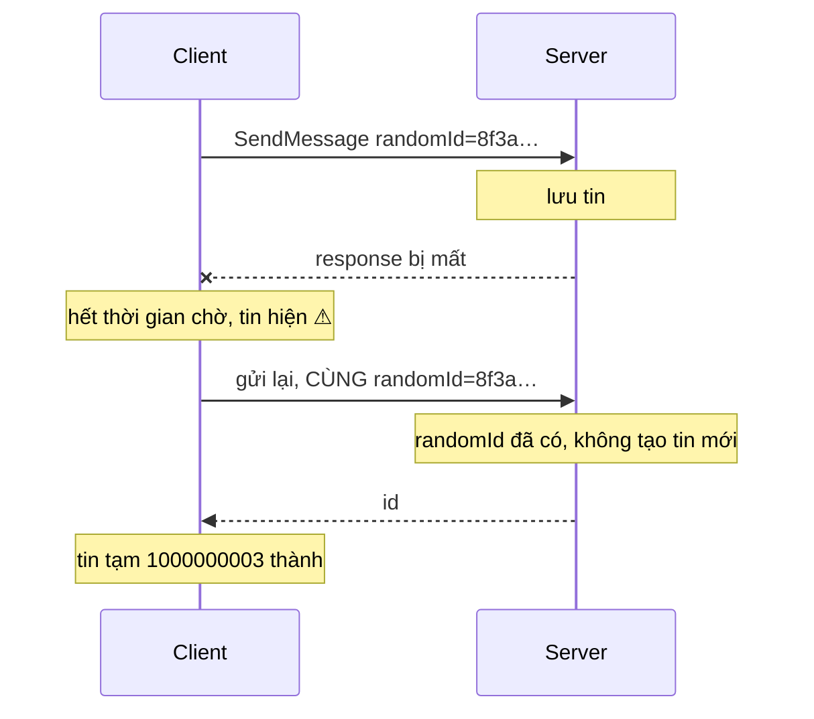

Bấm gửi trong một app chat, người dùng muốn thấy tin của mình **ngay lập tức**, không phải sau một vòng request tới server. Nhưng hiện ngay thì phát sinh cả loạt câu hỏi:

1. Tin chưa có id thật, vậy dùng id gì để hiển thị, để làm key cho React?
2. Server trả lời xong, làm sao biết tin nào ứng với xác nhận nào, nhất là khi gửi 5 tin liên tiếp?
3. Mạng nhanh thì icon "đang gửi" nháy lên rồi tắt ngay, trông như lỗi. Mạng chậm thì phải có icon. Ngưỡng ở đâu?
4. Gửi một ảnh 4MB rồi gõ thêm "Đẹp không?": ảnh còn đang upload, tin chữ có được gửi trước không?
5. Request tới server rồi nhưng response bị mất. Bấm gửi lại thì server có tạo **hai** tin không?

Telegram Web A (phiên bản web của Telegram, mã nguồn mở) trả lời cả năm câu bằng vài chục dòng code trong `api/gramjs/methods/messages.ts` và `api/gramjs/updater.ts`.

> [!TIP]
> **Tóm tắt**
> - Tin mới được đẩy vào UI ngay với **id tạm** bắt đầu từ `1e9`, khoảng id mà tin thật không bao giờ chạm tới.
> - Mỗi tin có một **`randomId`** 64 bit: vừa là **khoá idempotency** gửi lên server (gửi lại không tạo tin trùng), vừa là khoá để khớp xác nhận của server về đúng tin tạm.
> - Icon "đang gửi" chỉ hiện nếu **sau 1 giây** server chưa xác nhận. Mạng nhanh thì người dùng không bao giờ thấy nó.
> - **Upload chạy song song ngay**, nhưng lệnh gửi nối vào một **chuỗi promise** nên đi đúng thứ tự bấm.

<iframe class="demo-frame" src="/demos/web-patterns/index.html?theme=dark#/tg-optimistic-send" title="Demo tg-optimistic-send" loading="lazy" style="height: 900px"></iframe>

<p class="demo-links">▶ <a href="/demos/web-patterns/index.html#/tg-optimistic-send" target="_blank" rel="noopener">Mở demo toàn màn hình ↗</a> · <a href="https://stackblitz.com/github/hunghg255/blog-hunghg/tree/master/examples/web-patterns?file=src/lib/tgOptimisticSend.ts" target="_blank" rel="noopener">Sửa code trên StackBlitz ↗</a> · <a href="https://github.com/hunghg255/blog-hunghg/blob/master/examples/web-patterns/src/lib/tgOptimisticSend.ts" target="_blank" rel="noopener">Xem source trên GitHub ↗</a></p>

Thử ba việc trong demo:

- Đặt độ trễ 300ms rồi bấm **5 tin liên tiếp**: phần lớn tin không hiện 🕓. Hai tin cuối vẫn hiện, vì chúng phải xếp hàng sau ba tin trước nên tổng thời gian chờ vượt 1 giây (trên máy mình lúc viết bài: 2/5 tin).
- Bấm **Ảnh 4MB rồi 2 tin chữ**: thứ tự trên server luôn là ảnh → hai tin chữ. Bỏ chọn "Giữ thứ tự gửi" và bấm lại: hai tin chữ lên server trước ảnh.
- Kéo "Mất response" lên 60%: vài tin hiện ⚠. Kéo về 0 rồi bấm **Gửi lại**: server báo "đã có" và trả lại id cũ, không tin nào bị nhân đôi.

## Telegram làm thế nào?

Telegram Web A tách phần nói chuyện với server (thư viện GramJS, chạy giao thức MTProto) khỏi phần giao diện. Hàm `sendMessage` trong [`api/gramjs/methods/messages.ts`](https://github.com/hunghg255/codebase/blob/main/web.telegram.org/src/api/gramjs/methods/messages.ts) không trả về tin nhắn: nó phát ra các **update** (`newMessage`, `updateMessage`, `updateMessageSendSucceeded`…) để phần giao diện tự cập nhật state.

### Bước 1: id tạm và tin hiện ngay

```ts
const localMessage = buildLocalMessage(
  chat, text, entities, replyingTo, attachment, sticker, gif, poll, groupedId, scheduledAt, serverTimeOffset,
);
onUpdate({
  '@type': localMessage.isScheduled ? 'newScheduledMessage' : 'newMessage',
  id: localMessage.id,
  chatId: chat.id,
  message: localMessage,
});
```

`buildLocalMessage` (trong `api/gramjs/apiBuilders/messages.ts`) lấy id từ một bộ đếm `localMessageCounter = LOCAL_MESSAGE_ID_BASE`, mà `config.ts` khai báo `LOCAL_MESSAGE_ID_BASE = 1e9`. Id tin trong một cuộc trò chuyện là số nguyên tăng dần, thực tế không chạm tới một tỉ, nên mọi id ≥ `1e9` chắc chắn là tin tạm. Nhiều chỗ trong code dựa vào đúng quy ước này, ví dụ `selectIsViewportNewest` kiểm tra `lastMessageId >= LOCAL_MESSAGE_ID_BASE`.

### Bước 2: icon "đang gửi" sau 1 giây, và một mẹo nhỏ

```ts
const FAST_SEND_TIMEOUT = 1000;

// This is expected to arrive after `updateMessageSendSucceeded` which replaces the local ID,
// so in most cases this will be simply ignored
setTimeout(() => {
  onUpdate({
    '@type': localMessage.isScheduled ? 'updateScheduledMessage' : 'updateMessage',
    id: localMessage.id,
    chatId: chat.id,
    message: {
      sendingState: 'messageSendingStatePending',
    },
  });
}, FAST_SEND_TIMEOUT);
```

Điểm hay nằm ở comment: Telegram **không huỷ** timer khi server xác nhận. Thay vào đó, khi xác nhận về, reducer xoá tin mang id tạm và thêm tin mang id thật. Một giây sau, update `updateMessage` với id tạm tới nơi, reducer tìm không thấy tin đó (`if (!currentMessage) return;` trong `modules/actions/apiUpdaters/messages.ts`) nên bỏ qua. Không cần lưu handle của timer, không cần huỷ.

Tin tạm ban đầu không có `sendingState`, nên giao diện không vẽ icon nào. Chỉ khi update sau 1 giây thật sự áp vào (tức server chưa xác nhận) thì 🕓 mới hiện.

### Bước 3: randomId, khoá idempotency và khoá để khớp

```ts
const randomId = generateRandomBigInt();
localDb.localMessages[randomId.toString()] = localMessage;
```

`generateRandomBigInt()` lấy 8 byte ngẫu nhiên. Số này được gửi kèm lệnh `messages.SendMessage`. Phía server MTProto dùng `random_id` để nhận ra lệnh gửi trùng: client gửi lại cùng `random_id` thì server không tạo tin mới.

Khi server xác nhận, nó gửi update `UpdateMessageID` chứa cả `randomId` lẫn id thật. Bộ xử lý update trong [`api/gramjs/updater.ts`](https://github.com/hunghg255/codebase/blob/main/web.telegram.org/src/api/gramjs/updater.ts) tra ngược ra tin tạm:

```ts
const localMessage = randomId && localDb.localMessages[randomId.toString()];
// …
onUpdate({
  '@type': localMessage.isScheduled && !isAlreadySent
    ? 'updateScheduledMessageSendSucceeded'
    : 'updateMessageSendSucceeded',
  chatId: localMessage.chatId,
  localId: localMessage.id,
  message: { ...localMessage, id: update.id, sendingState: undefined },
});
```

Reducer xử lý `updateMessageSendSucceeded` xoá tin id tạm, thêm tin id thật và gắn `previousLocalId: localId`. Hàm `getMessageOriginalId(message)` trả `message.previousLocalId || message.id`, và `MessageListContent.tsx` dùng nó làm key. Nhờ vậy React không unmount bong bóng chat khi id đổi: animation "bay lên" của tin vừa gửi không bị chạy lại, ảnh đang hiện không bị tải lại.

Có một nhánh đặc biệt cho "Send When Online" (tin hẹn giờ gửi khi người nhận online): nếu `date` server trả về đã ở quá khứ thì coi như tin đã gửi luôn, không còn là tin hẹn giờ.

### Bước 4: upload song song, gửi tuần tự

```ts
let queue = Promise.resolve();

// trong sendMessage (rút gọn):
const prevQueue = queue;
queue = (async () => {
  const media = attachment ? await uploadMedia(localMessage, attachment, onProgress!) : undefined;
  await prevQueue;
  await invokeRequest(new RequestClass({ /* … */ randomId, media }), true);
})();
```

(Bản thật bọc `uploadMedia` trong `try/catch`: lỗi thì vẫn `await prevQueue` rồi mới `return`.)

Đây là một mẫu đáng nhớ: **phần chậm chạy ngay, phần cần thứ tự chờ tới lượt**. `uploadMedia` bắt đầu ngay khi tin được tạo. Chỉ lệnh gửi cuối cùng mới `await prevQueue`, tức chờ tin trước gửi xong. Gửi ảnh 4MB rồi gõ hai tin chữ: ba tin cùng hiện ngay, upload ảnh chạy, hai tin chữ đứng chờ sau ảnh, và server nhận đúng thứ tự người dùng bấm.

### Hai chỗ chưa ổn trong bản gốc

- **Không có trạng thái lỗi.** Kiểu `sendingState` có giá trị `'messageSendingStateFailed'`, nhưng trong bản dump mình không tìm thấy chỗ nào gán giá trị này. `invokeRequest` bắt lỗi rồi trả `undefined` (và phát update `error` để hiện thông báo chung); upload lỗi thì nhánh `catch` chỉ `return`. Tin vì thế đứng mãi với 🕓. Lúc mất kết nối, `invokeRequest` cũng trả `undefined` ngay mà không gửi.
- **`localDb.localMessages` không được dọn.** Tin tạm được ghi vào theo `randomId` nhưng không có chỗ nào `delete`. Mỗi tin chỉ vài trăm byte nên khó thấy, nhưng một tab mở cả tuần với nhóm chat sôi động sẽ tích lại.

## Bên trong: vì sao cần khoá idempotency

Một request HTTP hoặc MTProto có thể thất bại ở ba chỗ, và client không phân biệt được hai chỗ sau:



- Request không tới server: gửi lại là đúng.
- Request tới server, server lưu tin, **response bị mất**: gửi lại mà không có khoá thì thành hai tin.
- Server từ chối (sai quyền, bị chặn…): gửi lại vô ích.

Không biết trường hợp nào, client chỉ có thể an toàn nếu lệnh gửi **idempotent**: gửi bao nhiêu lần cũng chỉ tạo một tin. Cách phổ biến là client tự sinh một id duy nhất cho thao tác. Stripe dùng header `Idempotency-Key`, MTProto dùng `random_id`. Quan trọng là id phải được sinh **một lần khi tạo tin**, không phải mỗi lần gửi.

## Viết lại

Bản viết lại tách thành một hàm `createMessageSender` không phụ thuộc React hay GramJS. `transport` là hai hàm `upload` và `send` do bạn cung cấp; `onUpdate` nhận các sự kiện `new`, `progress`, `pending`, `succeeded`, `failed`.

Phần cốt lõi là hàng đợi gửi. `send` tạo tin tạm, phát `new`, hẹn timer 1 giây và bắt đầu upload ngay; sau đó giao cho `enqueue`:

```ts title=src/lib/tgOptimisticSend.ts
  function enqueue(message: OutgoingMessage, media: Promise<string | undefined>) {
    const prev = queue;
    const job = (async () => {
      let mediaId: string | undefined;
      try {
        mediaId = await media;
      } catch (error) {
        if (keepOrder) await prev;
        fail(message, error);
        return;
      }
      // upload đã chạy song song; tới đây mới chờ tin trước gửi xong
      if (keepOrder) await prev;
      try {
        const { id } = await transport.send({ randomId: message.randomId, text: message.text, media: mediaId });
        acknowledge(message.randomId, id);
      } catch (error) {
        // vẫn giữ trong `unconfirmed`: server có thể đã nhận, xác nhận có thể tới qua kênh realtime
        fail(message, error);
      }
    })();
    if (keepOrder) queue = job;
    return job;
  }
```

::: spoiler Xem toàn bộ src/lib/tgOptimisticSend.ts

```ts title=src/lib/tgOptimisticSend.ts
/**
 * Gửi tin nhắn lạc quan (ý tưởng từ Telegram Web A: api/gramjs/methods/messages.ts + updater.ts).
 *
 * - Tin hiện ngay với id tạm (>= 1e9, không bao giờ trùng id thật của server).
 * - Mỗi tin có một `randomId` ngẫu nhiên: vừa là khoá idempotency gửi lên server
 *   (gửi lại không tạo tin trùng), vừa là khoá để khớp xác nhận của server về đúng tin tạm.
 * - Icon "đang gửi" chỉ hiện nếu sau 1 giây server chưa xác nhận: mạng nhanh thì không nháy.
 * - Upload chạy song song ngay lập tức, nhưng lệnh gửi đi đúng thứ tự người dùng bấm.
 */

export type SendState = 'pending' | 'sent' | 'failed';

export interface OutgoingMessage {
  /** id hiển thị: id tạm lúc đầu, id thật sau khi server xác nhận */
  id: number;
  /** id tạm ban đầu, giữ lại để làm key ổn định cho UI (không remount khi đổi id) */
  localId: number;
  randomId: string;
  text: string;
  attachment?: { name: string; size: number };
  /** undefined = vừa tạo, chưa tới lúc hiện icon */
  state?: SendState;
  error?: string;
  /** tiến độ upload 0..1 */
  progress?: number;
}

export type SendUpdate =
  | { type: 'new'; message: OutgoingMessage }
  | { type: 'progress'; localId: number; progress: number }
  | { type: 'pending'; localId: number }
  | { type: 'succeeded'; localId: number; id: number }
  | { type: 'failed'; localId: number; error: string };

export interface SendTransport {
  /** tải file lên, trả về mã media để gắn vào lệnh gửi */
  upload(file: { name: string; size: number }, onProgress: (p: number) => void): Promise<string>;
  /** gửi tin; server dùng randomId để bỏ qua lệnh gửi trùng */
  send(req: { randomId: string; text: string; media?: string }): Promise<{ id: number }>;
}

export const LOCAL_ID_BASE = 1e9;

/** 8 byte ngẫu nhiên dạng hex (Telegram dùng bigint 64 bit). */
export function createRandomId() {
  const bytes = new Uint8Array(8);
  crypto.getRandomValues(bytes);
  return Array.from(bytes, (b) => b.toString(16).padStart(2, '0')).join('');
}

export interface MessageSenderOptions {
  transport: SendTransport;
  onUpdate: (update: SendUpdate) => void;
  /** chờ bao lâu mới hiện icon "đang gửi"; Telegram: FAST_SEND_TIMEOUT = 1000 */
  pendingDelayMs?: number;
  /** false = gửi ngay khi upload xong, không chờ tin trước (để so sánh trong demo) */
  keepOrder?: boolean;
}

export function createMessageSender({
  transport,
  onUpdate,
  pendingDelayMs = 1000,
  keepOrder = true,
}: MessageSenderOptions) {
  let localIdCounter = LOCAL_ID_BASE;
  // randomId -> tin tạm còn chờ xác nhận
  const unconfirmed = new Map<string, OutgoingMessage>();
  const pendingTimers = new Map<string, ReturnType<typeof setTimeout>>();
  // chuỗi promise giữ thứ tự gửi; không bao giờ reject
  let queue: Promise<void> = Promise.resolve();

  /** Xác nhận từ server: qua response của lệnh gửi hoặc qua kênh realtime. Gọi nhiều lần vẫn an toàn. */
  function acknowledge(randomId: string, id: number) {
    const message = unconfirmed.get(randomId);
    if (!message) return; // đã xác nhận rồi
    unconfirmed.delete(randomId);
    clearTimeout(pendingTimers.get(randomId));
    pendingTimers.delete(randomId);
    onUpdate({ type: 'succeeded', localId: message.localId, id });
  }

  function fail(message: OutgoingMessage, error: unknown) {
    clearTimeout(pendingTimers.get(message.randomId));
    pendingTimers.delete(message.randomId);
    onUpdate({ type: 'failed', localId: message.localId, error: String((error as Error)?.message ?? error) });
  }

  function armPendingTimer(message: OutgoingMessage) {
    pendingTimers.set(
      message.randomId,
      setTimeout(() => {
        pendingTimers.delete(message.randomId);
        if (unconfirmed.has(message.randomId)) onUpdate({ type: 'pending', localId: message.localId });
      }, pendingDelayMs),
    );
  }

  function enqueue(message: OutgoingMessage, media: Promise<string | undefined>) {
    const prev = queue;
    const job = (async () => {
      let mediaId: string | undefined;
      try {
        mediaId = await media;
      } catch (error) {
        if (keepOrder) await prev;
        fail(message, error);
        return;
      }
      // upload đã chạy song song; tới đây mới chờ tin trước gửi xong
      if (keepOrder) await prev;
      try {
        const { id } = await transport.send({ randomId: message.randomId, text: message.text, media: mediaId });
        acknowledge(message.randomId, id);
      } catch (error) {
        // vẫn giữ trong `unconfirmed`: server có thể đã nhận, xác nhận có thể tới qua kênh realtime
        fail(message, error);
      }
    })();
    if (keepOrder) queue = job;
    return job;
  }

  function send(text: string, attachment?: { name: string; size: number }) {
    const localId = localIdCounter++;
    const message: OutgoingMessage = { id: localId, localId, randomId: createRandomId(), text, attachment };
    unconfirmed.set(message.randomId, message);
    onUpdate({ type: 'new', message });
    armPendingTimer(message);

    // upload bắt đầu NGAY, không chờ hàng đợi
    const media = attachment
      ? transport.upload(attachment, (progress) => onUpdate({ type: 'progress', localId, progress }))
      : Promise.resolve(undefined);
    media.catch(() => {}); // lỗi được xử lý trong enqueue
    return enqueue(message, media);
  }

  /** Gửi lại tin lỗi với CÙNG randomId: nếu lần trước server đã nhận thì không sinh tin trùng. */
  function retry(localId: number) {
    const message = [...unconfirmed.values()].find((m) => m.localId === localId);
    if (!message) return Promise.resolve();
    onUpdate({ type: 'pending', localId });
    const media = message.attachment
      ? transport.upload(message.attachment, (progress) => onUpdate({ type: 'progress', localId, progress }))
      : Promise.resolve(undefined);
    media.catch(() => {});
    return enqueue(message, media);
  }

  function destroy() {
    pendingTimers.forEach(clearTimeout);
    pendingTimers.clear();
  }

  return { send, retry, acknowledge, destroy };
}

export type MessageSender = ReturnType<typeof createMessageSender>;

/** Reducer nhỏ cho danh sách tin, dùng chung cho demo và test. */
export function applySendUpdate(list: OutgoingMessage[], update: SendUpdate): OutgoingMessage[] {
  switch (update.type) {
    case 'new':
      return [...list, update.message];
    case 'progress':
      return list.map((m) => (m.localId === update.localId ? { ...m, progress: update.progress } : m));
    case 'pending':
      return list.map((m) => (m.localId === update.localId && m.state !== 'sent' ? { ...m, state: 'pending', error: undefined } : m));
    case 'succeeded':
      return list.map((m) => (m.localId === update.localId ? { ...m, id: update.id, state: 'sent', error: undefined } : m));
    case 'failed':
      return list.map((m) => (m.localId === update.localId ? { ...m, state: 'failed', error: update.error } : m));
    default:
      return list;
  }
}
```

:::

## Đi qua code

- **`unconfirmed` theo `randomId`.** Đây là bản tương đương `localDb.localMessages`. Khác bản gốc, tin được xoá khỏi map ngay khi xác nhận, nên không tích lại.
- **`acknowledge` gọi nhiều lần vẫn an toàn.** Trong app thật, xác nhận có thể tới hai đường: response của lệnh gửi và update đẩy qua WebSocket. Đường nào tới trước thì thắng, đường sau thấy `randomId` không còn trong map và bỏ qua.
- **Timer "đang gửi" được huỷ** khi xác nhận về (`clearTimeout`), thay vì để reducer lờ đi như Telegram. Cách của Telegram vẫn đúng và gọn khi store xoá tin cũ theo id. Bản này không biết store của bạn trông thế nào, nên tự dọn.
- **`enqueue` không bao giờ reject.** Mọi lỗi được bắt và chuyển thành sự kiện `failed`. Nếu chuỗi promise reject, `await prev` ở các tin sau sẽ ném theo và cả hàng đợi chết.
- **Gửi thất bại vẫn giữ tin trong `unconfirmed`.** Response mất không có nghĩa server chưa nhận; xác nhận có thể tới muộn qua kênh realtime. Nút **Gửi lại** (`retry`) dùng lại đúng `randomId` cũ.
- **`localId` làm key.** Reducer mẫu `applySendUpdate` đổi `id` nhưng giữ `localId`; demo dùng `key={m.localId}`, giống `previousLocalId` của Telegram.

**Khác bản gốc:** có trạng thái `failed` và nút gửi lại; timer được huỷ thay vì để reducer bỏ qua; tin đã xác nhận được dọn khỏi bộ nhớ; `randomId` là chuỗi hex 16 ký tự (JavaScript không có kiểu `long`, Telegram dùng `BigInt` qua thư viện).

## Tại sao không làm cách khác?

**Chờ server rồi mới hiện tin?** Đơn giản, nhưng mỗi tin trễ đúng bằng một vòng request. Trên 3G hoặc wifi quán cà phê, đó là 300ms đến vài giây cho mỗi lần bấm Enter. Chat là nơi người dùng cảm nhận độ trễ rõ nhất.

**Dùng id tạm là số âm hoặc chuỗi `"local-1"`?** Được, miễn là không trùng id thật. Telegram chọn số ≥ `1e9` để mọi nơi vẫn coi id là `number`, sắp xếp được cùng với id thật (tin tạm luôn nằm cuối danh sách, đúng chỗ của tin vừa gửi).

**Khớp xác nhận bằng nội dung tin?** Hai tin "ok" liên tiếp sẽ khớp nhầm. Bằng thứ tự gửi? Response có thể về không theo thứ tự, nhất là khi có retry. Chỉ một id do client sinh ra mới khớp chắc chắn.

**Hiện icon "đang gửi" ngay?** Thử trong demo: bỏ chọn "Chờ 1s mới hiện 🕓". Mạng tốt thì icon nhấp nháy ở mọi tin, người dùng tưởng app đang gặp vấn đề. Ngưỡng 1 giây cũng là con số quen thuộc trong nghiên cứu UX: dưới khoảng 1 giây người dùng vẫn thấy luồng thao tác liền mạch.

**Gửi song song tất cả cho nhanh?** Thứ tự trên server sẽ phụ thuộc tốc độ upload, không phải thứ tự bấm. Người nhận thấy "Đẹp không?" trước cả cái ảnh.

## Edge case và cạm bẫy

- **Tin tạm xếp hàng sau tin chậm.** Như trong demo, tin thứ 4, 5 chờ các tin trước nên vẫn có thể hiện 🕓 dù mạng nhanh. Đó là đánh đổi để giữ thứ tự. Telegram cũng vậy.
- **Một upload lỗi không được chặn hàng đợi.** Bản gốc `await prevQueue` rồi `return`: tin lỗi vẫn "giữ chỗ" tới lượt rồi mới bỏ, để tin sau không vượt lên. Bản viết lại làm giống thế.
- **Retry phải dùng lại `randomId`.** Sinh `randomId` mới khi retry là mất hết tác dụng idempotency.
- **Server phải nhớ `randomId` đủ lâu.** Idempotency chỉ có tác dụng trong khoảng thời gian server còn giữ bảng `randomId` đã thấy. Nếu bạn tự làm backend, lưu khoá này cùng với tin (unique index), đừng chỉ để trong cache vài phút.
- **Đổi id làm hỏng mọi thứ đang trỏ vào id tạm.** Trả lời (reply) một tin vừa gửi, đang upload tiến độ theo id tạm… Telegram giải quyết bằng `previousLocalId` ở nhiều selector (`getMessageOriginalId`, tiến độ upload theo `previousLocalId || id`). Nếu bạn làm tương tự, hãy tìm mọi chỗ dùng id làm khoá.
- **Nhiều tab.** Hai tab cùng tài khoản: tab A gửi, tab B nhận tin qua realtime với id thật, không bao giờ thấy id tạm. Chỉ tab gửi mới cần map `randomId`.

## Dùng trong dự án

Với REST và React Query (TanStack Query), ý tưởng giữ nguyên:

```ts
const sender = createMessageSender({
  transport: {
    upload: (file, onProgress) => uploadWithProgress('/api/upload', file, onProgress),
    send: ({ randomId, text, media }) =>
      fetch('/api/messages', {
        method: 'POST',
        headers: { 'Content-Type': 'application/json', 'Idempotency-Key': randomId },
        body: JSON.stringify({ text, media }),
      }).then((r) => (r.ok ? r.json() : Promise.reject(new Error(`HTTP ${r.status}`)))),
  },
  onUpdate: (update) => queryClient.setQueryData(['messages', chatId], (list = []) => applySendUpdate(list, update)),
});

// tin tới qua WebSocket kèm randomId của chính mình: xác nhận luôn
socket.on('message:created', (msg) => {
  if (msg.clientRandomId) sender.acknowledge(msg.clientRandomId, msg.id);
});
```

Phía server, lưu `Idempotency-Key` vào cột có unique index; gặp trùng thì trả lại bản ghi cũ với status 200 thay vì 409.

::: spoiler Ví dụ test (bản phác, không có trong repo)

```ts
import { describe, expect, it, vi } from 'vitest';
import { applySendUpdate, createMessageSender, type OutgoingMessage, type SendUpdate } from './tgOptimisticSend';

function setup(sendImpl: (req: { randomId: string; text: string; media?: string }) => Promise<{ id: number }>) {
  const updates: SendUpdate[] = [];
  let list: OutgoingMessage[] = [];
  const sender = createMessageSender({
    transport: { upload: async () => 'media', send: sendImpl },
    onUpdate: (u) => {
      updates.push(u);
      list = applySendUpdate(list, u);
    },
  });
  return { sender, updates, getList: () => list };
}

describe('createMessageSender', () => {
  it('không hiện "đang gửi" nếu server xác nhận trong 1 giây', async () => {
    vi.useFakeTimers();
    const { sender, updates } = setup(async () => ({ id: 1 }));
    await sender.send('hi');
    vi.advanceTimersByTime(2000);
    expect(updates.map((u) => u.type)).toEqual(['new', 'succeeded']);
    vi.useRealTimers();
  });

  it('gửi đúng thứ tự dù tin đầu có file upload chậm', async () => {
    const order: string[] = [];
    let releaseUpload!: () => void;
    const sender = createMessageSender({
      transport: {
        upload: () => new Promise((r) => (releaseUpload = () => r('m'))),
        send: async ({ text }) => (order.push(text), { id: order.length }),
      },
      onUpdate: () => {},
    });
    const a = sender.send('ảnh', { name: 'a.jpg', size: 1 });
    const b = sender.send('chữ');
    await Promise.resolve();
    expect(order).toEqual([]); // tin chữ chờ ảnh
    releaseUpload();
    await Promise.all([a, b]);
    expect(order).toEqual(['ảnh', 'chữ']);
  });

  it('gửi lại dùng cùng randomId', async () => {
    const seen: string[] = [];
    let fail = true;
    const { sender, getList } = setup(async ({ randomId }) => {
      seen.push(randomId);
      if (fail) throw new Error('lost');
      return { id: 9 };
    });
    await sender.send('x');
    expect(getList()[0].state).toBe('failed');
    fail = false;
    await sender.retry(getList()[0].localId);
    expect(seen[0]).toBe(seen[1]);
    expect(getList()[0]).toMatchObject({ id: 9, state: 'sent' });
  });

  it('acknowledge hai lần chỉ phát một succeeded', async () => {
    const { sender, updates } = setup(() => new Promise(() => {})); // response không bao giờ về
    void sender.send('x');
    const { message } = updates[0] as Extract<SendUpdate, { type: 'new' }>;
    sender.acknowledge(message.randomId, 5);
    sender.acknowledge(message.randomId, 5);
    expect(updates.filter((u) => u.type === 'succeeded')).toHaveLength(1);
  });
});
```

:::

## So với thư viện

- **TanStack Query** có hướng dẫn "optimistic updates" với `onMutate` / `onError` rollback, và từ v5 có thể dùng `variables` của mutation đang chạy để vẽ tin tạm. Thư viện lo phần cache và rollback; phần **idempotency key**, **thứ tự gửi** và **ngưỡng 1 giây** vẫn là việc của bạn.
- **React 19 `useOptimistic`** cho phép hiện giá trị tạm trong lúc một action đang chạy và tự quay về giá trị thật khi action xong. Hợp với form đơn lẻ; với hàng đợi nhiều tin, mỗi tin có vòng đời riêng (pending, failed, retry) thì một store riêng như trên dễ kiểm soát hơn.
- Header **`Idempotency-Key`** có bản nháp chuẩn hoá ở IETF (`draft-ietf-httpapi-idempotency-key-header`, xem trạng thái mới nhất trên datatracker.ietf.org); Stripe và nhiều API thanh toán đã dùng header này từ lâu.

---

Bài này thuộc series **[Học từ mã nguồn Telegram](/series/telegram)** (15 bài, đọc theo thứ tự).

::: spoiler Xem nhanh danh sách bài trong series

*Mở đầu*

- [Mở đầu: bên trong Telegram Web A](/blogs/learn-from-telegram-source-code)

*Phần 1: dữ liệu và đồng bộ*

- **#1 Gửi tin lạc quan, khớp tin thật bằng randomId** (bài này)
- [#2 Lịch sử tin nhắn chia hai đảo](/blogs/telegram-message-history-islands)
- [#3 Lưu global state lúc rảnh, chỉ giữ phần cần](/blogs/telegram-persist-global-state)
- [#4 Gom update realtime theo nhịp animation](/blogs/telegram-realtime-update-batching)
- [#5 Store tự viết và diff danh sách có key](/blogs/telegram-teactn-store-fast-list)

*Phần 2: animation và giao diện*

- [#6 Animation sắp xếp danh sách chat không đo DOM](/blogs/telegram-chat-list-flip)
- [#7 Ảnh bay giữa hai cây DOM trong media viewer](/blogs/telegram-media-viewer-ghost)
- [#8 Bố cục album chọn theo hàm chi phí](/blogs/telegram-album-layout)
- [#9 Giờ gửi nằm gọn trong bong bóng chat](/blogs/telegram-bubble-meta-spacer)
- [#10 Composer biến hình, Transition và gạch chân tab](/blogs/telegram-composer-morph-transition)

*Phần 3: media, mobile, thông báo*

- [#11 Thumbnail 100 byte và viền sticker nén](/blogs/telegram-tiny-thumbnails)
- [#12 Player sticker: DPR, hạ fps, cache khung](/blogs/telegram-lottie-player)
- [#13 Mobile: --vh, bàn phím ảo, nhấn giữ, số điện thoại](/blogs/telegram-mobile-viewport-touch)
- [#14 Web Push không trùng và đánh dấu đã đọc](/blogs/telegram-push-dedupe-read-receipts)

:::

Code + demo: [`examples/web-patterns`](https://github.com/hunghg255/blog-hunghg/tree/master/examples/web-patterns) · [Mở trên StackBlitz](https://stackblitz.com/github/hunghg255/blog-hunghg/tree/master/examples/web-patterns)
