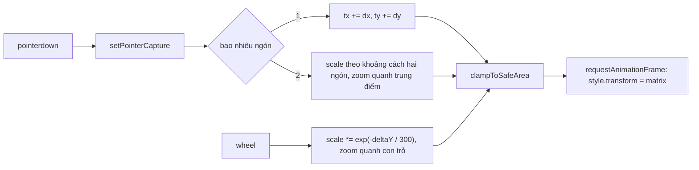

Xem ảnh trong Telegram Web A, bấm kính lúp hoặc kéo thanh zoom: ảnh to lên, kéo được sang các phía để xem chi tiết. Một component nhỏ tên `PanZoom` làm việc này bằng **một** thuộc tính CSS duy nhất: `transform: matrix(s, 0, 0, s, tx, ty)`.

Component này ngắn (khoảng 200 dòng), lấy từ thư viện `react-pan-zoom`, và có vài chi tiết đáng học: mức zoom phi tuyến, "vùng an toàn" để ảnh không bị kéo khuất hẳn. Nhưng nó cũng có ba lỗi dễ thấy khi đọc kỹ: công thức vùng an toàn **sai dấu**, transform được gán bằng **state cũ**, và thả chuột ngoài khung thì **kẹt** ở chế độ kéo.

> [!TIP]
> **Tóm tắt**
> - Gói zoom và dịch chuyển vào một `matrix(s, 0, 0, s, tx, ty)`: một thuộc tính, chạy trên compositor, không đụng layout.
> - Vùng an toàn: luôn chừa ít nhất 150px ảnh trong khung. Bản gốc trừ `x + W - 150` thay vì `x - (W - 150)`, nên ảnh bị ném ra hẳn ngoài khung.
> - Viết lại bằng Pointer Events + `setPointerCapture`: một đường code cho chuột, bút, ngón tay; thả ở đâu cũng nhận được `pointerup`.
> - Zoom quanh con trỏ: `tx' = px - (px - tx) * k`. Chụm hai ngón dùng đúng công thức đó với tâm là trung điểm hai ngón.

<iframe class="demo-frame" src="/demos/web-patterns/index.html?theme=dark#/tg-panzoom" title="Demo tg-panzoom" loading="lazy" style="height: 1180px"></iframe>

<p class="demo-links">▶ <a href="/demos/web-patterns/index.html#/tg-panzoom" target="_blank" rel="noopener">Mở demo toàn màn hình ↗</a> · <a href="https://stackblitz.com/github/hunghg255/blog-hunghg/tree/master/examples/web-patterns?file=src/lib/tgPanZoom.ts" target="_blank" rel="noopener">Sửa code trên StackBlitz ↗</a> · <a href="https://github.com/hunghg255/blog-hunghg/blob/master/examples/web-patterns/src/lib/tgPanZoom.ts" target="_blank" rel="noopener">Xem source trên GitHub ↗</a></p>

Thử trong demo: kéo thanh zoom lên 2, kéo ảnh ra hẳn ngoài khung rồi thả chuột ở ngoài; ảnh dừng ở mép vùng an toàn và con trỏ không còn ở chế độ kéo. Phần 2 so công thức vùng an toàn gốc và bản sửa trên cùng một tình huống.

## Telegram làm thế nào?

File [`components/mediaViewer/PanZoom.tsx`](https://github.com/hunghg255/codebase/blob/main/web.telegram.org/src/components/mediaViewer/PanZoom.tsx) mở đầu bằng ghi chú nguồn: `@source https://github.com/ajainarayanan/react-pan-zoom`. Đây là code thư viện được chép vào rồi sửa cho Teact.

### Mức zoom phi tuyến

`MediaViewer.tsx` giữ `zoomLevel` từ 1 tới 3 (thanh zoom, hoặc nút kính lúp để bật/tắt mức 1.5). `PanZoom` đổi mức đó sang scale thật qua một bảng:

```ts
const SCALE_VALUES = {
  1: 1,
  1.5: 1.5,
  2: 2.2,
  2.5: 3.3,
  3: 5.5,
};
const tunedZoomLevel = SCALE_VALUES[zoomLevel] || zoomLevel;
```

Nửa đầu thanh trượt tăng chậm (1 → 1.5), nửa sau tăng nhanh (3.3 → 5.5). Cảm giác zoom của người dùng gần với **tỉ lệ** hơn là hiệu số: từ 1x lên 2x "to gấp đôi", từ 4x lên 5x chỉ "to thêm một chút". Bảng này là một cách xấp xỉ thang logarit bằng tay.

### Một ma trận cho tất cả

State của component là mảng 6 số theo đúng thứ tự tham số của `matrix()`:

```ts
// [zoom, skew, skew, zoom, dx, dy] - see https://developer.mozilla.org/en-US/docs/Web/CSS/transform-function/matrix()
const [matrixData, setMatrixData] = useState<number[]>(INITIAL_MATRIX);

useEffect(() => {
  if (panContainerRef.current) {
    panContainerRef.current.style.transform = `matrix(${matrixData.toString()})`;
  }
}, [noWrap, matrixData]);
```

Kéo chuột thì đổi `[4]` và `[5]` (dịch chuyển), zoom thì đổi `[0]` và `[3]` (scale). Gán thẳng `style.transform` qua ref, không qua JSX.

### Vùng an toàn 150px

Khi zoom, Telegram kiểm tra ảnh có bị đẩy quá xa không:

```ts
const ZOOM_SAFE_AREA = 150;

const newImgX = (wrapperRect.width - newImgWidth) / 2 + matrixData[4];
// …
if (wrapperRect.width && wrapperRect.width - ZOOM_SAFE_AREA < newImgX) {
  matrixData[4] -= newImgX + wrapperRect.width - ZOOM_SAFE_AREA;
} else if (newImgWidth && newImgWidth + newImgX < ZOOM_SAFE_AREA) {
  matrixData[4] -= newImgWidth + newImgX - ZOOM_SAFE_AREA;
}
```

`newImgX` là mép trái của ảnh trong khung (transform-origin ở tâm nên phải cộng phần lệch `(W - w) / 2`). Hai nhánh:

- **Nhánh 2** (mép phải ảnh `x + w` lọt vào dải 150px bên trái): dịch sang phải `150 - (x + w)`. Đúng.
- **Nhánh 1** (mép trái ảnh vượt `W - 150`, tức ảnh gần như trôi hết sang phải): lẽ ra dịch sang trái `x - (W - 150)` để mép trái về đúng `W - 150`. Code lại trừ `x + W - 150`.

### Lỗi 1: sai dấu ở nhánh 1

Thay vào: mép trái mới = `x - (x + W - 150)` = **`150 - W`**, bất kể ảnh đang ở đâu. Khung rộng 1000px thì mép trái ảnh bị ném về **x = −850**. Ảnh rộng 720px (480px ở scale 1.5) thì mép phải ở −130: **ảnh biến mất khỏi khung**. Công thức đúng đặt mép trái ở 850, còn đúng 150px ảnh.

Demo phần 2 dựng đúng tình huống này: công thức gốc cho "còn thấy 0px ảnh", bản sửa cho "150px". Cùng lỗi lặp lại ở trục dọc (`matrixData[5] -= newImgY + wrapperRect.height - ZOOM_SAFE_AREA`).

Lỗi này khó gặp khi dùng thật vì nhánh 1 chỉ chạy lúc **zoom** (không chạy lúc kéo) và cần ảnh đã bị kéo gần hết sang phải từ trước. Nhưng khi gặp, người dùng thấy ảnh "biến mất" sau khi bấm zoom.

### Lỗi 2: gán transform bằng state cũ

```ts
const handleMouseMove = (e) => {
  if (isDragging) {
    const newMatrixData = getNewMatrixData(e.pageX, e.pageY);
    setMatrixData(newMatrixData);

    if (panContainerRef.current) {
      panContainerRef.current.style.transform = `matrix(${matrixData.toString()})`;
    }
  }
};
```

Dòng cuối dùng `matrixData`, là giá trị của lần render **trước**, không phải `newMatrixData` vừa tính. Hậu quả nhẹ vì `useEffect` ở trên sẽ gán lại đúng giá trị sau khi render, nhưng trong khoảng giữa, transform chạy chậm một nhịp và mỗi `mousemove` gây hai lần ghi style. Đây là bẫy kinh điển của React: state đọc trong handler là ảnh chụp của lần render đã tạo ra handler đó.

### Lỗi 3: thả chuột ngoài khung

`onMouseUp` gắn trên chính `.pan-wrapper`. Kéo ảnh, rê chuột ra ngoài khung (ví dụ lên thanh tiêu đề của viewer) rồi thả: wrapper không nhận `mouseup`, `isDragging` vẫn `true`. Rê chuột quay lại, ảnh **dính theo con trỏ** dù không nhấn nút nào.

Thêm vài giới hạn:
- `panDeltaX || matrixData[4]`: giá trị `0` là falsy, nên prop `panDeltaX = 0` không bao giờ đưa ảnh về giữa được.
- Chỉ có sự kiện chuột: trên màn hình cảm ứng không kéo được, không chụm hai ngón để zoom được.

## Bên trong trình duyệt

`matrix(a, b, c, d, e, f)` là cách viết gọn của ma trận biến đổi 2D:

```
| a c e |   | x |   | a·x + c·y + e |
| b d f | · | y | = | b·x + d·y + f |
| 0 0 1 |   | 1 |   |       1       |
```

Với `b = c = 0` và `a = d = s`, nó là "phóng to `s` lần rồi dịch `(e, f)`". Một thuộc tính thay cho `scale()` + `translate()`, và **thứ tự** đã cố định (scale trước, dịch sau), khỏi nhầm.

Đổi `transform` (và `opacity`) là trường hợp tốt nhất cho hiệu năng: trình duyệt không phải tính lại layout hay vẽ lại, chỉ ghép lớp (composite) với ma trận mới. Phần tử có `will-change: transform` được đưa lên lớp riêng từ trước, nên kéo ảnh 60 khung hình/giây không tốn gì cho main thread ngoài việc tính 6 con số.

**Pointer capture**: `element.setPointerCapture(pointerId)` báo trình duyệt "mọi sự kiện của con trỏ này, gửi cho tôi" tới khi `pointerup` hoặc `pointercancel`. Con trỏ ra khỏi phần tử, ra khỏi cửa sổ, vẫn gửi về phần tử đó. Đây là cách chuẩn để làm kéo-thả, thay cho mẹo "gắn `mousemove`/`mouseup` lên `document` lúc bắt đầu kéo".



## Viết lại

Quy ước khác bản gốc một chút cho toán gọn: `transform-origin: 0 0`, ảnh nằm ở góc trên trái khung khi `tx = ty = 0`. Khi đó mép trái ảnh **chính là** `tx`, mép phải là `tx + w·s`, không cần cộng phần lệch tâm.

Các hàm thuần, dễ test:

```ts title=src/lib/tgPanZoom.ts
export const SCALE_VALUES: Record<number, number> = { 1: 1, 1.5: 1.5, 2: 2.2, 2.5: 3.3, 3: 5.5 };

export function tuneZoom(level: number) {
  return SCALE_VALUES[level] ?? level;
}

/** Luôn chừa ít nhất `safe` px ảnh trong khung, để không kéo ảnh khuất hẳn. */
export function clampToSafeArea(m: Matrix, frame: Size, image: Size, safe = 150): Matrix {
  const w = image.width * m.scale;
  const h = image.height * m.scale;
  // mép trái không vượt quá (frame - safe); mép phải không nhỏ hơn safe
  const tx = Math.min(frame.width - safe, Math.max(safe - w, m.tx));
  const ty = Math.min(frame.height - safe, Math.max(safe - h, m.ty));
  return { scale: m.scale, tx, ty };
}

/** Ma trận để ảnh nằm giữa khung ở scale cho trước. */
export function centered(frame: Size, image: Size, scale: number): Matrix {
  return {
    scale,
    tx: (frame.width - image.width * scale) / 2,
    ty: (frame.height - image.height * scale) / 2,
  };
}

/** Đổi scale nhưng giữ nguyên điểm (px, py) trong khung, vd vị trí con trỏ khi lăn chuột. */
export function zoomAt(m: Matrix, scale: number, px: number, py: number): Matrix {
  const k = scale / m.scale;
  return { scale, tx: px - (px - m.tx) * k, ty: py - (py - m.ty) * k };
}

export const toCss = (m: Matrix) => `matrix(${m.scale}, 0, 0, ${m.scale}, ${m.tx}, ${m.ty})`;
```

Phần xử lý con trỏ (một ngón kéo, hai ngón chụm):

```ts title=src/lib/tgPanZoom.ts
  const onDown = (e: PointerEvent) => {
    // capture: thả chuột ở ngoài khung vẫn nhận pointerup (bản gốc nghe mouseup trên khung nên kẹt chế độ kéo)
    frame.setPointerCapture(e.pointerId);
    pointers.set(e.pointerId, local(e));
    if (pointers.size === 2) {
      const [a, b] = [...pointers.values()];
      pinchStart = { dist: Math.hypot(a.x - b.x, a.y - b.y), scale: m.scale };
    }
    frame.classList.add('is-dragging');
  };

  const onMove = (e: PointerEvent) => {
    const prev = pointers.get(e.pointerId);
    if (!prev) return;
    const now = local(e);
    pointers.set(e.pointerId, now);

    if (pointers.size === 2 && pinchStart) {
      const [a, b] = [...pointers.values()];
      const dist = Math.hypot(a.x - b.x, a.y - b.y);
      const scale = Math.min(maxScale, Math.max(minScale, (pinchStart.scale * dist) / pinchStart.dist));
      set(zoomAt(m, scale, (a.x + b.x) / 2, (a.y + b.y) / 2));
      return;
    }
    if (m.scale <= minScale) return; // ảnh vừa khung thì không cho kéo
    set({ ...m, tx: m.tx + now.x - prev.x, ty: m.ty + now.y - prev.y });
  };
```

::: spoiler Xem toàn bộ src/lib/tgPanZoom.ts

```ts title=src/lib/tgPanZoom.ts
/**
 * Phóng to / kéo ảnh trong media viewer bằng một `transform: matrix(s, 0, 0, s, tx, ty)`,
 * ý tưởng từ Telegram Web A (components/mediaViewer/PanZoom.tsx, vốn lấy từ react-pan-zoom).
 *
 * Quy ước ở đây: `transform-origin: 0 0`, ảnh nằm ở góc trên trái của khung khi tx = ty = 0.
 * Khi đó mép trái ảnh = tx, mép phải = tx + width * s. Toán đơn giản hơn origin ở tâm.
 */

export interface Matrix {
  scale: number;
  tx: number;
  ty: number;
}

export interface Size {
  width: number;
  height: number;
}

/** Mức zoom trên thanh trượt → scale thật. Telegram làm phi tuyến để mức cao "nhảy" xa hơn. */
export const SCALE_VALUES: Record<number, number> = { 1: 1, 1.5: 1.5, 2: 2.2, 2.5: 3.3, 3: 5.5 };

export function tuneZoom(level: number) {
  return SCALE_VALUES[level] ?? level;
}

/** Luôn chừa ít nhất `safe` px ảnh trong khung, để không kéo ảnh khuất hẳn. */
export function clampToSafeArea(m: Matrix, frame: Size, image: Size, safe = 150): Matrix {
  const w = image.width * m.scale;
  const h = image.height * m.scale;
  // mép trái không vượt quá (frame - safe); mép phải không nhỏ hơn safe
  const tx = Math.min(frame.width - safe, Math.max(safe - w, m.tx));
  const ty = Math.min(frame.height - safe, Math.max(safe - h, m.ty));
  return { scale: m.scale, tx, ty };
}

/** Ma trận để ảnh nằm giữa khung ở scale cho trước. */
export function centered(frame: Size, image: Size, scale: number): Matrix {
  return {
    scale,
    tx: (frame.width - image.width * scale) / 2,
    ty: (frame.height - image.height * scale) / 2,
  };
}

/** Đổi scale nhưng giữ nguyên điểm (px, py) trong khung, vd vị trí con trỏ khi lăn chuột. */
export function zoomAt(m: Matrix, scale: number, px: number, py: number): Matrix {
  const k = scale / m.scale;
  return { scale, tx: px - (px - m.tx) * k, ty: py - (py - m.ty) * k };
}

export const toCss = (m: Matrix) => `matrix(${m.scale}, 0, 0, ${m.scale}, ${m.tx}, ${m.ty})`;

export interface PanZoomOptions {
  image: Size;
  minScale?: number;
  maxScale?: number;
  safe?: number;
  onChange?: (m: Matrix) => void;
}

/**
 * Gắn kéo (chuột, bút, ngón tay), lăn chuột để zoom và chụm hai ngón vào `frame`.
 * `content` là phần tử được biến đổi. Trả về controller.
 */
export function createPanZoom(frame: HTMLElement, content: HTMLElement, opts: PanZoomOptions) {
  const { image, minScale = 1, maxScale = 5.5, safe = 150 } = opts;
  const frameSize = () => ({ width: frame.clientWidth, height: frame.clientHeight });
  let m = centered(frameSize(), image, 1);
  let frameId = 0;

  // Ghi transform một lần mỗi frame, luôn từ giá trị MỚI NHẤT
  // (bản gốc gán transform bằng state cũ trong handleMouseMove).
  const render = () => {
    if (frameId) return;
    frameId = requestAnimationFrame(() => {
      frameId = 0;
      content.style.transform = toCss(m);
    });
  };

  const set = (next: Matrix) => {
    m = clampToSafeArea(next, frameSize(), image, safe);
    render();
    opts.onChange?.(m);
  };

  const pointers = new Map<number, { x: number; y: number }>();
  let pinchStart: { dist: number; scale: number } | null = null;

  const local = (e: PointerEvent | WheelEvent) => {
    const r = frame.getBoundingClientRect();
    return { x: e.clientX - r.left, y: e.clientY - r.top };
  };

  const onDown = (e: PointerEvent) => {
    // capture: thả chuột ở ngoài khung vẫn nhận pointerup (bản gốc nghe mouseup trên khung nên kẹt chế độ kéo)
    frame.setPointerCapture(e.pointerId);
    pointers.set(e.pointerId, local(e));
    if (pointers.size === 2) {
      const [a, b] = [...pointers.values()];
      pinchStart = { dist: Math.hypot(a.x - b.x, a.y - b.y), scale: m.scale };
    }
    frame.classList.add('is-dragging');
  };

  const onMove = (e: PointerEvent) => {
    const prev = pointers.get(e.pointerId);
    if (!prev) return;
    const now = local(e);
    pointers.set(e.pointerId, now);

    if (pointers.size === 2 && pinchStart) {
      const [a, b] = [...pointers.values()];
      const dist = Math.hypot(a.x - b.x, a.y - b.y);
      const scale = Math.min(maxScale, Math.max(minScale, (pinchStart.scale * dist) / pinchStart.dist));
      set(zoomAt(m, scale, (a.x + b.x) / 2, (a.y + b.y) / 2));
      return;
    }
    if (m.scale <= minScale) return; // ảnh vừa khung thì không cho kéo
    set({ ...m, tx: m.tx + now.x - prev.x, ty: m.ty + now.y - prev.y });
  };

  const onUp = (e: PointerEvent) => {
    pointers.delete(e.pointerId);
    if (pointers.size < 2) pinchStart = null;
    if (pointers.size === 0) frame.classList.remove('is-dragging');
  };

  const onWheel = (e: WheelEvent) => {
    e.preventDefault();
    const scale = Math.min(maxScale, Math.max(minScale, m.scale * Math.exp(-e.deltaY / 300)));
    const p = local(e);
    set(scale === minScale ? centered(frameSize(), image, scale) : zoomAt(m, scale, p.x, p.y));
  };

  frame.style.touchAction = 'none'; // để pointermove của ngón tay không bị trình duyệt cướp đi cuộn/zoom trang
  content.style.transformOrigin = '0 0';
  frame.addEventListener('pointerdown', onDown);
  frame.addEventListener('pointermove', onMove);
  frame.addEventListener('pointerup', onUp);
  frame.addEventListener('pointercancel', onUp);
  frame.addEventListener('wheel', onWheel, { passive: false });
  render();

  return {
    get matrix() {
      return m;
    },
    /** Đặt mức zoom từ thanh trượt, zoom quanh tâm khung. */
    setZoomLevel(level: number) {
      const scale = tuneZoom(level);
      const f = frameSize();
      set(scale <= minScale ? centered(f, image, scale) : zoomAt(m, scale, f.width / 2, f.height / 2));
    },
    set,
    destroy() {
      cancelAnimationFrame(frameId);
      frame.removeEventListener('pointerdown', onDown);
      frame.removeEventListener('pointermove', onMove);
      frame.removeEventListener('pointerup', onUp);
      frame.removeEventListener('pointercancel', onUp);
      frame.removeEventListener('wheel', onWheel);
    },
  };
}
```

:::

## Đi qua code

- **`clampToSafeArea`** viết bằng `min`/`max` thay vì `if` hai nhánh: mép trái không lớn hơn `W - safe` (ảnh không trôi hết sang phải), và không nhỏ hơn `safe - w` (mép phải không lọt vào dải `safe` bên trái). Một dòng mỗi trục, khó sai dấu hơn.
- **`zoomAt(m, scale, px, py)`**: điểm `(px, py)` trong khung tương ứng với điểm `((px - tx) / s, …)` trên ảnh. Muốn điểm đó đứng yên sau khi đổi scale thì `tx' = px - (px - tx) · k`, với `k = scale / s`. Dùng cho lăn chuột (tâm là con trỏ), chụm ngón (tâm là trung điểm hai ngón) và thanh zoom (tâm là giữa khung).
- **`render` gom theo frame**: mọi thay đổi chỉ cập nhật biến `m`, việc ghi `style.transform` dồn vào một `requestAnimationFrame`. Mười sự kiện `pointermove` trong một frame chỉ ghi style một lần, luôn bằng giá trị mới nhất. Lỗi state cũ không còn chỗ để xảy ra.
- **`touch-action: none`** trên khung: không có dòng này, trình duyệt cảm ứng sẽ coi cú kéo là cuộn trang và gửi `pointercancel` ngay sau vài pixel.
- **Lăn chuột**: `scale · exp(-deltaY / 300)` cho zoom đều theo tỉ lệ (lăn 3 nấc lên rồi 3 nấc xuống quay về đúng chỗ cũ). Về mức nhỏ nhất thì căn giữa lại cho gọn.
- `wheel` gắn với `{ passive: false }` vì cần `preventDefault()` để trang không cuộn theo.

**Khác bản gốc:** origin ở `0 0` thay vì tâm; Pointer Events thay cho Mouse Events, có chụm hai ngón và lăn chuột; transform ghi qua rAF thay vì state + effect; vùng an toàn áp ở **mọi** thay đổi (cả lúc kéo), bản gốc chỉ áp lúc zoom.

## Tại sao không làm cách khác?

- **Đổi `width`/`height` của ảnh để zoom**: mỗi lần đổi là một lần tính layout và vẽ lại ảnh lớn, giật thấy rõ. `transform` chỉ ghép lớp.
- **`scale()` + `translate()` riêng**: được, nhưng thứ tự viết quyết định kết quả (`translate(…) scale(…)` khác `scale(…) translate(…)`) và dễ nhầm. Ma trận ghi rõ một nghĩa.
- **Thư viện (panzoom, react-zoom-pan-pinch)**: nên dùng nếu cần đủ quán tính, double-tap, giới hạn theo nội dung. Bài này cho thấy phần lõi chỉ vài chục dòng; tự viết có lợi khi muốn kiểm soát vùng an toàn và cách zoom theo ý mình.
- **`mousemove` trên `document`**: cách cổ điển để không mất sự kiện khi chuột ra khỏi phần tử. `setPointerCapture` làm việc đó gọn hơn và tự dọn khi thả.

## Edge case và cạm bẫy

- **Kích thước "scale 1"**: ảnh gốc 4000px không thể hiện ở scale 1. Hãy coi kích thước **vừa khung** là scale 1 (demo thu ảnh theo khung lúc mount), rồi zoom tương đối với nó.
- **Xoay màn hình / đổi kích thước khung**: vùng an toàn tính theo kích thước khung hiện tại. Sau `resize` nên áp lại `clampToSafeArea`.
- **`pointercancel`**: trình duyệt có thể huỷ con trỏ (cử chỉ hệ thống, cảnh báo). Luôn xử lý như `pointerup`, nếu không bộ đếm ngón tay lệch.
- **Ảnh trong `` kéo được**: thêm `draggable={false}`, nếu không trình duyệt bắt đầu kéo-thả ảnh (ghost image) và nuốt luôn chuỗi pointer.
- **Bàn rê (trackpad) chụm hai ngón** trên Chrome/Edge phát `wheel` có `ctrlKey = true`. Code ở đây coi mọi `wheel` là zoom nên vẫn chạy, nhưng nếu khung còn cần cuộn thường thì tách theo `ctrlKey`.

## Dùng trong dự án

```tsx
function ImageViewer({ src, natural }: { src: string; natural: { width: number; height: number } }) {
  const frameRef = useRef<HTMLDivElement>(null);
  const imgRef = useRef<HTMLImageElement>(null);

  useEffect(() => {
    const frame = frameRef.current!;
    const k = Math.min(1, frame.clientWidth / natural.width, frame.clientHeight / natural.height);
    const fit = { width: natural.width * k, height: natural.height * k };
    imgRef.current!.style.width = `${fit.width}px`;
    imgRef.current!.style.height = `${fit.height}px`;
    const pz = createPanZoom(frame, imgRef.current!, { image: fit, maxScale: 5.5 });
    return () => pz.destroy();
  }, [src, natural.width, natural.height]);

  return (
    <div ref={frameRef} className='viewer'>
      
    </div>
  );
}
```

::: spoiler Ví dụ test (bản phác, không có trong repo)

```ts
import { describe, expect, it } from 'vitest';
import { clampToSafeArea, centered, tuneZoom, zoomAt } from './tgPanZoom';

const frame = { width: 1000, height: 400 };
const image = { width: 480, height: 320 };

describe('clampToSafeArea', () => {
  it('ảnh lệch quá sang phải: chỉ đẩy về đủ 150px trong khung', () => {
    expect(clampToSafeArea({ scale: 1.5, tx: 900, ty: 40 }, frame, image).tx).toBe(850);
  });
  it('ảnh lệch quá sang trái: kéo lại để mép phải còn 150px', () => {
    const m = clampToSafeArea({ scale: 1.5, tx: -700, ty: 40 }, frame, image);
    expect(m.tx + image.width * 1.5).toBe(150);
  });
  it('ảnh nằm trong vùng hợp lệ thì giữ nguyên', () => {
    expect(clampToSafeArea({ scale: 2, tx: -100, ty: -50 }, frame, image)).toEqual({ scale: 2, tx: -100, ty: -50 });
  });
});

describe('zoom', () => {
  it('mức zoom phi tuyến', () => {
    expect([1, 2, 3].map(tuneZoom)).toEqual([1, 2.2, 5.5]);
  });
  it('zoomAt giữ nguyên điểm dưới con trỏ', () => {
    const m = centered(frame, image, 1);
    const [px, py] = [300, 120];
    const before = { x: (px - m.tx) / m.scale, y: (py - m.ty) / m.scale };
    const z = zoomAt(m, 3, px, py);
    expect((px - z.tx) / z.scale).toBeCloseTo(before.x);
    expect((py - z.ty) / z.scale).toBeCloseTo(before.y);
  });
});
```

:::

## So với cách làm hiện đại

- **Pointer Events** và `setPointerCapture` được mọi trình duyệt lớn hỗ trợ ([caniuse](https://caniuse.com/pointer)); không còn lý do viết riêng cho chuột và cảm ứng. Bài [Học từ web lớn #28](/blogs/web-unified-pointer-gestures) đi sâu hơn về chuyện này với `captureEvents` của chính Telegram.
- **`touch-action: pinch-zoom`** cho phép trình duyệt tự xử lý chụm hai ngón (zoom cả trang). Muốn zoom riêng ảnh thì phải `touch-action: none` và tự tính như ở trên.
- Viewer ảnh của các thư viện lớn (PhotoSwipe chẳng hạn) cũng dựa trên một `transform` duy nhất cho mỗi ảnh và có thêm quán tính khi thả tay.

---

Bài này thuộc series **[Học từ mã nguồn Telegram](/series/telegram)** (25 bài, đọc theo thứ tự).

::: spoiler Xem nhanh danh sách bài trong series

*Mở đầu*

- [Mở đầu: bên trong Telegram Web A](/blogs/learn-from-telegram-source-code)

*Phần 1: dữ liệu và đồng bộ*

- [#1 Gửi tin lạc quan, khớp tin thật bằng randomId](/blogs/telegram-optimistic-send)
- [#2 Lịch sử tin nhắn chia hai đảo](/blogs/telegram-message-history-islands)
- [#3 Lưu global state lúc rảnh, chỉ giữ phần cần](/blogs/telegram-persist-global-state)
- [#4 Gom update realtime theo nhịp animation](/blogs/telegram-realtime-update-batching)
- [#5 Store tự viết và diff danh sách có key](/blogs/telegram-teactn-store-fast-list)

*Phần 2: animation và giao diện*

- [#6 Animation sắp xếp danh sách chat không đo DOM](/blogs/telegram-chat-list-flip)
- [#7 Ảnh bay giữa hai cây DOM trong media viewer](/blogs/telegram-media-viewer-ghost)
- [#8 Bố cục album chọn theo hàm chi phí](/blogs/telegram-album-layout)
- [#9 Giờ gửi nằm gọn trong bong bóng chat](/blogs/telegram-bubble-meta-spacer)
- [#10 Composer biến hình, Transition và gạch chân tab](/blogs/telegram-composer-morph-transition)

*Phần 3: media, mobile, thông báo*

- [#11 Thumbnail 100 byte và viền sticker nén](/blogs/telegram-tiny-thumbnails)
- [#12 Player sticker: DPR, hạ fps, cache khung](/blogs/telegram-lottie-player)
- [#13 Mobile: --vh, bàn phím ảo, nhấn giữ, số điện thoại](/blogs/telegram-mobile-viewport-touch)
- [#14 Web Push không trùng và đánh dấu đã đọc](/blogs/telegram-push-dedupe-read-receipts)

*Phần 4: soạn tin, media, chi tiết UI*

- [#15 Rich text ⇄ entities, thanh định dạng nổi, nháp theo chat](/blogs/telegram-rich-text-entities)
- [#16 Ô nhập tự giãn, emoji phóng to, gom tin theo ngày/người/album](/blogs/telegram-auto-grow-input-grouping)
- [#17 Bảng emoji/sticker chỉ render nhóm đang xem](/blogs/telegram-emoji-picker-virtualization)
- [#18 mediaLoader gộp request, ảnh mờ sang nét, spinner không chớp](/blogs/telegram-media-loader-blur-buffering)
- [#19 Trình phát audio toàn cục và playlist](/blogs/telegram-global-audio-player)
- [#20 UiLoader chạy đua 700ms, ba mức animation](/blogs/telegram-ui-loader-animation-levels)
- **#21 PanZoom bằng matrix() trong media viewer** (bài này)
- [#22 Ngày dính khi cuộn, khoá cuộn, dừng momentum iOS](/blogs/telegram-sticky-date-scroll-lock)
- [#23 Vùng thả file, nén ảnh trước khi gửi, copy ảnh](/blogs/telegram-drop-zone-compress-copy)
- [#24 Tiêu đề nhấp nháy và favicon đếm tin mới](/blogs/telegram-title-favicon-unread)

:::

Code + demo: [`examples/web-patterns`](https://github.com/hunghg255/blog-hunghg/tree/master/examples/web-patterns) · [Mở trên StackBlitz](https://stackblitz.com/github/hunghg255/blog-hunghg/tree/master/examples/web-patterns)
