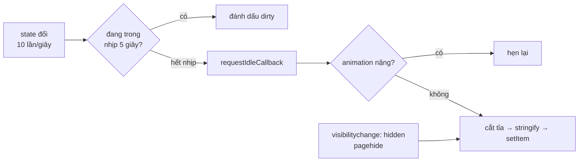

Mở Telegram Web, danh sách chat và tin nhắn của cuộc trò chuyện gần nhất hiện ra gần như tức thì, trong khi app vẫn đang kết nối tới server (phải dựng kênh MTProto, xác thực, đồng bộ). Phần "tức thì" đó không đến từ mạng: nó là một bản sao **đã cắt tỉa** của global state, được lưu vào `localStorage` ở lần mở trước.

Nghe thì đơn giản: `localStorage.setItem('state', JSON.stringify(state))`. Làm thật thì gặp ngay mấy vấn đề:

- State đổi hàng chục lần mỗi giây (trạng thái online, đang gõ, tin mới…). Ghi mỗi lần là `JSON.stringify` vài trăm KB liên tục trên main thread.
- State đầy đủ có thể vượt giới hạn khoảng 5 triệu ký tự của `localStorage`.
- Ghi đúng lúc đang chạy animation mở chat là làm giật khung hình.
- Bản cache từ phiên bản cũ của app thiếu field mới; đọc lên là `undefined` ở chỗ không ngờ.

> [!TIP]
> **Tóm tắt**
> - Không ghi mỗi lần state đổi: **gom trong 5 giây** (throttle), rồi chờ **lúc trình duyệt rảnh** (`requestIdleCallback`) mới ghi.
> - **Bỏ qua lượt ghi khi đang có animation nặng**, ghi ngay khi tab mất focus hoặc trang sắp đóng.
> - **Cắt tỉa trước khi ghi**: 30 chat đầu, tối đa 5000 user, mỗi chat chỉ giữ những tin đang hiện trên màn hình. Cache chỉ để vẽ màn hình đầu, không phải bản sao dữ liệu.
> - Khi đọc, **trộn giá trị mặc định** vào các object con để cache cũ thiếu field vẫn chạy. Bản viết lại thêm số phiên bản và bắt lỗi vượt quota.

<iframe class="demo-frame" src="/demos/web-patterns/index.html?theme=dark#/tg-persist-state" title="Demo tg-persist-state" loading="lazy" style="height: 980px"></iframe>

<p class="demo-links">▶ <a href="/demos/web-patterns/index.html#/tg-persist-state" target="_blank" rel="noopener">Mở demo toàn màn hình ↗</a> · <a href="https://stackblitz.com/github/hunghg255/blog-hunghg/tree/master/examples/web-patterns?file=src/lib/tgPersistState.ts" target="_blank" rel="noopener">Sửa code trên StackBlitz ↗</a> · <a href="https://github.com/hunghg255/blog-hunghg/blob/master/examples/web-patterns/src/lib/tgPersistState.ts" target="_blank" rel="noopener">Xem source trên GitHub ↗</a></p>

Trong demo: bấm **▶ Luồng tin mới** (10 lần đổi state mỗi giây) và nhìn hai con số "lần state đổi" với "lần ghi thật". Bấm **↻ Mở lại app**: danh sách chat hiện sau chưa tới 1ms từ cache, trong khi "server" mất 1,5 giây. Bỏ chọn **Cắt tỉa** rồi bấm **Ẩn tab (ghi ngay)**: state đầy đủ khoảng 5,4 triệu ký tự, trình duyệt từ chối với `QuotaExceededError` (đo trên Chromium lúc viết bài; bản cắt tỉa chỉ khoảng 89 nghìn ký tự).

## Telegram làm thế nào?

Toàn bộ nằm trong một file: [`global/cache.ts`](https://github.com/hunghg255/codebase/blob/main/web.telegram.org/src/global/cache.ts), khoảng 280 dòng.

### Khi nào ghi

```ts
const UPDATE_THROTTLE = 5000;

const updateCacheThrottled = throttle(() => onIdle(updateCache), UPDATE_THROTTLE, false);

function setupCaching() {
  isCaching = true;
  unsubscribeFromBeforeUnload = onBeforeUnload(updateCache, true);
  window.addEventListener('blur', updateCache);
  addCallback(updateCacheThrottled);
}
```

- `addCallback` đăng ký vào store tự viết của Telegram (teactn, sẽ có bài riêng): mỗi lần global state đổi, callback được gọi.
- `throttle(…, 5000, false)` trong `util/schedulers.ts`: tham số thứ ba `false` nghĩa là **không chạy ngay lần đầu**, chỉ chạy ở cuối mỗi nhịp 5 giây nếu trong nhịp đó có thay đổi.
- `onIdle` dùng `requestIdleCallback` nếu có, không thì rơi về một microtask.
- Ghi ngay (không chờ) ở hai thời điểm: cửa sổ mất focus (`blur`) và trang sắp đóng (`beforeunload`). Tham số `true` của `onBeforeUnload` đưa callback này xuống **cuối** danh sách, để các module khác kịp cập nhật state trước khi nó được chụp lại.

Caching chỉ bật khi đã đăng nhập (reducer `saveSession`), và tắt hẳn kèm xoá cache khi đăng xuất (reducer `reset`).

### Không ghi lúc đang có animation nặng

```ts
function updateCache() {
  if (!isCaching || isHeavyAnimating) {
    return;
  }
  // …
}

function setupHeavyAnimationListeners() {
  document.addEventListener(ANIMATION_START_EVENT, () => { isHeavyAnimating = true; });
  document.addEventListener(ANIMATION_END_EVENT, () => { isHeavyAnimating = false; });
}
```

Hai sự kiện này do hook `useHeavyAnimationCheck` phát ra quanh các animation lớn (mở chat, chuyển panel, cuộn nhanh). `JSON.stringify` vài trăm KB tốn vài mili giây; rơi vào đúng frame của animation là thấy khựng.

### Cắt tỉa: chỉ giữ những gì màn hình đầu cần

```ts
const reducedGlobal: GlobalState = {
  ...INITIAL_STATE,
  ...pick(global, ['authState', 'currentUserId', 'contactList', 'recentEmojis', /* … */]),
  users: reduceUsers(global),
  chats: reduceChats(global),
  messages: reduceMessages(global),
  settings: reduceSettings(global),
  chatFolders: reduceChatFolders(global),
};
```

Mỗi hàm `reduce*` cắt một nhánh:

- **`reduceChats`** giữ 30 chat đầu danh sách (`GLOBAL_STATE_CACHE_CHAT_LIST_LIMIT = 30` trong `config.ts`) cộng chat đang mở, xoá cờ `isFullyLoaded`.
- **`reduceUsers`** giữ user của các chat riêng trong 30 chat đó, rồi tới các user khác, tối đa 5000.
- **`reduceMessages`** là phần tinh tế nhất: với mỗi chat được giữ, chỉ lưu những tin có id nằm trong `viewportIds` của thread chính, tức đúng những tin đang (hoặc vừa) hiện trên màn hình.

```ts
byChatId[chatId] = {
  byId: pick(current.byId, mainThread.viewportIds),
  threadsById: { [MAIN_THREAD_ID]: mainThread },
};
```

- **Trạng thái giao diện phụ thuộc màn hình** bị bỏ khi màn hẹp: `isChatInfoShown` và `users.selectedId` chỉ giữ nếu `window.innerWidth > MIN_SCREEN_WIDTH_FOR_STATIC_RIGHT_COLUMN`; danh sách chat đang mở (`messageLists`) bị bỏ trên layout một cột. Mở lại trên điện thoại thì bắt đầu ở danh sách chat, không nhảy thẳng vào một cuộc trò chuyện.
- `privacy`, `notifyExceptions` bị làm rỗng; thư mục chat về thư mục 0.

Sau khi kết nối xong, action đồng bộ trong `modules/actions/api/sync.ts` thay dữ liệu tin nhắn bằng bản mới tải từ server. Cache vì thế chỉ cần **đủ để vẽ màn hình đầu**, không cần đúng hay đầy đủ.

### Đọc: trộn giá trị mặc định

```ts
if (cached) {
  // Pre-fill defaults in nested objects which may be missing in older cache
  cached.settings.byKey = { ...initialState.settings.byKey, ...cached.settings.byKey };
  cached.settings.themes = { ...initialState.settings.themes, ...cached.settings.themes };
  cached.chatFolders = { ...initialState.chatFolders, ...cached.chatFolders };
  if (!cached.messages.messageLists) {
    cached.messages.messageLists = initialState.messages.messageLists;
  }
}
return { ...initialState, ...cached };
```

Spread ở cấp ngoài cùng (`{ ...initialState, ...cached }`) chỉ bổ sung field cấp một. Một setting mới thêm vào `settings.byKey` sẽ bị bản cache cũ ghi đè thành "không tồn tại", nên phải trộn thủ công từng object con. Đây là một kiểu **migration nhẹ**: không có số phiên bản, chỉ dựa vào việc "thêm field mới thì có giá trị mặc định".

### Ba điểm yếu của bản gốc

- **Lượt bị bỏ vì animation thì mất luôn.** `throttle` chỉ chạy lại khi có lần gọi mới. State đổi đúng lúc đang animate, sau đó yên lặng, thì thay đổi đó chỉ được ghi ở lần `blur` hoặc `beforeunload` tiếp theo.
- **Không bắt lỗi.** `localStorage.setItem` ném `QuotaExceededError` khi đầy, `JSON.parse` ném khi chuỗi hỏng. Cả hai không nằm trong `try/catch`: lỗi lúc ghi chỉ làm hỏng lượt ghi đó, nhưng lỗi lúc đọc nằm trên đường khởi động app.
- **`beforeunload` không đáng tin trên mobile.** Vuốt tắt tab trên điện thoại thường không bắn `beforeunload`. `visibilitychange` (chuyển sang `hidden`) và `pagehide` là hai tín hiệu nên dùng; mình đã nói kỹ trong bài [gom log và sendBeacon](/blogs/facebook-batch-logger).

## Bên trong trình duyệt: cái giá của localStorage

`localStorage` là API **đồng bộ**: `setItem` chặn main thread tới khi dữ liệu được chép vào bộ nhớ của tiến trình trình duyệt. Chrome giới hạn khoảng 5 triệu ký tự UTF-16 cho mỗi origin (tính cả key lẫn value); Firefox và Safari có con số tương tự. Bên trên đó là `JSON.stringify`, cũng đồng bộ, tỉ lệ với kích thước state.



Vì vậy ba kỹ thuật bổ trợ nhau: **throttle** giảm số lần ghi, **cắt tỉa** giảm chi phí mỗi lần, **idle + tránh animation** chọn đúng lúc để trả chi phí đó.

## Viết lại

Bản viết lại là một hàm `createStatePersister` không phụ thuộc store. Bạn đưa vào `getState`, hàm `reduce` (cắt tỉa) và `restore` (dựng lại từ cache), rồi gọi `schedule()` mỗi khi state đổi.

Phần ghi và hẹn ghi:

```ts title=src/lib/tgPersistState.ts
  function write(reason: string, force = false) {
    timer = undefined;
    if (!enabled || !storage || !dirty) return;
    if (!force && isBusy?.()) {
      // bản gốc bỏ lượt ghi này; ở đây hẹn lại để thay đổi không bị mất
      schedule();
      return;
    }
    const start = performance.now();
    let json: string | undefined;
    try {
      const envelope: Envelope<C> = { v: version, savedAt: Date.now(), data: reduce(getState()) };
      json = JSON.stringify(envelope);
      storage.setItem(key, json);
      dirty = false;
      onWrite?.({ chars: json.length, ms: performance.now() - start, reason });
    } catch (error) {
      // QuotaExceededError, state có vòng tham chiếu…: không làm hỏng app
      onError?.(error, json === undefined ? undefined : { chars: json.length });
    }
  }

  /** Gọi mỗi khi state đổi. Gom lại: tối đa một lần ghi mỗi `throttleMs`, và chỉ lúc rảnh. */
  function schedule() {
    dirty = true;
    if (timer !== undefined) return;
    timer = setTimeout(() => requestIdle(() => write('throttle')), throttleMs);
  }

  /** Ghi ngay (tab sắp bị ẩn hoặc đóng). */
  function flush(reason = 'flush') {
    if (timer !== undefined) clearTimeout(timer);
    timer = undefined;
    // sắp mất trang thì vẫn phải ghi, dù đang có animation
    write(reason, true);
  }
```

::: spoiler Xem toàn bộ src/lib/tgPersistState.ts

```ts title=src/lib/tgPersistState.ts
/**
 * Lưu global state xuống localStorage để lần mở sau hiện ngay
 * (ý tưởng từ Telegram Web A: global/cache.ts).
 *
 * - Không ghi mỗi lần state đổi: gom trong 5 giây, rồi chờ lúc trình duyệt rảnh mới ghi.
 * - Không ghi lúc đang có animation nặng (JSON.stringify chạy trên main thread).
 * - Cắt tỉa trước khi ghi: chỉ giữ phần cần để vẽ màn hình đầu (30 chat, tin đang hiện…).
 * - Khi đọc: trộn giá trị mặc định cho các field mà bản cache cũ chưa có.
 *
 * Khác bản gốc: có số phiên bản (version), lần bị hoãn vì animation được hẹn lại thay vì bỏ,
 * ghi khi tab bị ẩn (pagehide/visibilitychange) thay vì blur/beforeunload, bắt lỗi quota.
 */

export interface PersistOptions<S, C> {
  key: string;
  /** đổi số này khi định dạng cache không còn tương thích: cache cũ bị bỏ */
  version: number;
  /** cắt state thành phần cần lưu */
  reduce: (state: S) => C;
  /** dựng lại state từ cache + state mặc định */
  restore: (cached: C, initial: S) => S;
  getState: () => S;
  storage?: Pick<Storage, 'getItem' | 'setItem' | 'removeItem'>;
  throttleMs?: number;
  /** true = đang bận (animation nặng…), hoãn ghi */
  isBusy?: () => boolean;
  /** `chars`: số ký tự JSON (giới hạn localStorage tính theo ký tự, khoảng 5 triệu mỗi origin) */
  onWrite?: (info: { chars: number; ms: number; reason: string }) => void;
  /** `chars` có khi lỗi xảy ra lúc setItem (thường là vượt quota) */
  onError?: (error: unknown, info?: { chars: number }) => void;
}

interface Envelope<C> {
  v: number;
  savedAt: number;
  data: C;
}

const requestIdle: (cb: () => void) => void =
  typeof requestIdleCallback === 'function'
    ? (cb) => requestIdleCallback(cb, { timeout: 2000 })
    : (cb) => setTimeout(cb, 1);

export function createStatePersister<S, C>(options: PersistOptions<S, C>) {
  const { key, version, reduce, restore, getState, throttleMs = 5000, isBusy, onWrite, onError } = options;
  const storage = options.storage ?? (typeof localStorage !== 'undefined' ? localStorage : undefined);
  let timer: ReturnType<typeof setTimeout> | undefined;
  let dirty = false;
  let enabled = true;

  function write(reason: string, force = false) {
    timer = undefined;
    if (!enabled || !storage || !dirty) return;
    if (!force && isBusy?.()) {
      // bản gốc bỏ lượt ghi này; ở đây hẹn lại để thay đổi không bị mất
      schedule();
      return;
    }
    const start = performance.now();
    let json: string | undefined;
    try {
      const envelope: Envelope<C> = { v: version, savedAt: Date.now(), data: reduce(getState()) };
      json = JSON.stringify(envelope);
      storage.setItem(key, json);
      dirty = false;
      onWrite?.({ chars: json.length, ms: performance.now() - start, reason });
    } catch (error) {
      // QuotaExceededError, state có vòng tham chiếu…: không làm hỏng app
      onError?.(error, json === undefined ? undefined : { chars: json.length });
    }
  }

  /** Gọi mỗi khi state đổi. Gom lại: tối đa một lần ghi mỗi `throttleMs`, và chỉ lúc rảnh. */
  function schedule() {
    dirty = true;
    if (timer !== undefined) return;
    timer = setTimeout(() => requestIdle(() => write('throttle')), throttleMs);
  }

  /** Ghi ngay (tab sắp bị ẩn hoặc đóng). */
  function flush(reason = 'flush') {
    if (timer !== undefined) clearTimeout(timer);
    timer = undefined;
    // sắp mất trang thì vẫn phải ghi, dù đang có animation
    write(reason, true);
  }

  /** Đọc cache. Không có, hỏng hoặc khác phiên bản thì trả state mặc định. */
  function load(initial: S): { state: S; fromCache: boolean; savedAt?: number } {
    if (!storage) return { state: initial, fromCache: false };
    try {
      const json = storage.getItem(key);
      if (!json) return { state: initial, fromCache: false };
      const envelope = JSON.parse(json) as Envelope<C>;
      if (envelope.v !== version) {
        storage.removeItem(key);
        return { state: initial, fromCache: false };
      }
      return { state: restore(envelope.data, initial), fromCache: true, savedAt: envelope.savedAt };
    } catch (error) {
      onError?.(error);
      return { state: initial, fromCache: false };
    }
  }

  const onHidden = () => {
    if (document.visibilityState === 'hidden') flush('hidden');
  };
  const onPageHide = () => flush('pagehide');
  if (typeof document !== 'undefined') {
    document.addEventListener('visibilitychange', onHidden);
    window.addEventListener('pagehide', onPageHide);
  }

  /** Đăng xuất: xoá cache và ngừng ghi. */
  function clear() {
    enabled = false;
    if (timer !== undefined) clearTimeout(timer);
    storage?.removeItem(key);
  }

  function destroy() {
    if (timer !== undefined) clearTimeout(timer);
    if (typeof document !== 'undefined') {
      document.removeEventListener('visibilitychange', onHidden);
      window.removeEventListener('pagehide', onPageHide);
    }
  }

  return { schedule, flush, load, clear, destroy };
}

/** Trộn giá trị mặc định vào các object con mà cache cũ có thể thiếu field. Telegram làm tay từng field. */
export function withDefaults<T extends object>(initial: T, cached: Partial<T>, nestedKeys: (keyof T)[]): T {
  const result = { ...initial, ...cached } as T;
  for (const k of nestedKeys) {
    const base = initial[k];
    const saved = cached[k];
    if (base && typeof base === 'object' && saved && typeof saved === 'object') {
      result[k] = { ...(base as object), ...(saved as object) } as T[keyof T];
    }
  }
  return result;
}

/** Lấy các key có trong danh sách, giữ đúng thứ tự (Telegram: pick). */
export function pick<V>(record: Record<string | number, V>, keys: (string | number)[]) {
  const out: Record<string, V> = {};
  for (const k of keys) if (k in record) out[k] = record[k];
  return out;
}
```

:::

## Đi qua code

- **`dirty` + một `timer` duy nhất.** `schedule()` gọi bao nhiêu lần trong 5 giây cũng chỉ có một lần ghi ở cuối nhịp. Khác `throttle` của Telegram một chút: không có "chạy ngay lần đầu", vì ghi ngay khi app vừa khởi động là đúng lúc app bận nhất.
- **`requestIdleCallback(cb, { timeout: 2000 })`.** Có `timeout` để trang không bao giờ "rảnh" (ví dụ một animation chạy liên tục) vẫn được ghi sau tối đa 2 giây. Không phải trình duyệt nào cũng có `requestIdleCallback` (Safari là trường hợp cần kiểm tra, xem [caniuse](https://caniuse.com/requestidlecallback)), nên có nhánh `setTimeout` dự phòng.
- **Bận thì hẹn lại, không bỏ.** Sửa điểm yếu thứ nhất của bản gốc.
- **`flush(reason)` ép ghi** kể cả khi đang bận: tab sắp bị ẩn hoặc đóng, mất một frame còn hơn mất dữ liệu.
- **Envelope `{ v, savedAt, data }`.** `version` khác thì bỏ cache. Trộn mặc định (`withDefaults`) lo các thay đổi tương thích (thêm field); đổi version lo các thay đổi phá vỡ (đổi cấu trúc).
- **`try/catch` cả đọc lẫn ghi**, báo lỗi kèm kích thước qua `onError`. Chuỗi hỏng thì coi như không có cache.
- **`clear()`** cho lúc đăng xuất: xoá cache và tắt hẳn việc ghi, để một lượt ghi đang hẹn không lưu lại dữ liệu của người vừa đăng xuất.

**Khác bản gốc:** có số phiên bản; hẹn lại thay vì bỏ khi bận; `visibilitychange`/`pagehide` thay cho `blur`/`beforeunload`; bắt lỗi quota và JSON hỏng; `requestIdleCallback` có `timeout`.

## Tại sao không làm cách khác?

**IndexedDB?** Bất đồng bộ, dung lượng lớn hơn nhiều, không chặn main thread khi ghi. Nhưng đọc cũng bất đồng bộ: phải chờ ít nhất một vòng event loop (thường vài chục mili giây khi mở database lần đầu) trước khi vẽ được gì. Với mục tiêu "màn hình đầu hiện ngay", đọc đồng bộ từ `localStorage` ngay trong lúc khởi tạo store là lợi thế. Telegram dùng Cache Storage cho media và gói ngôn ngữ (`util/cacheApi.ts`), nhưng global state thì để trong `localStorage`.

**Lưu toàn bộ state, nén lại?** Thử trong demo: bỏ cắt tỉa thì 5,4 triệu ký tự, vượt quota. Nén (ví dụ `CompressionStream`) giảm kích thước nhưng thêm thời gian CPU và là API bất đồng bộ. Cắt tỉa giải quyết gốc rễ: màn hình đầu chỉ cần vài chục chat.

**Ghi trong Web Worker?** Worker không truy cập được `localStorage`. Có thể chuyển state sang worker (bằng `postMessage`, bản thân việc này cũng phải serialize) rồi ghi IndexedDB ở đó; phức tạp hơn nhiều cho một lợi ích nhỏ khi đã cắt tỉa.

**Ghi ở mỗi action bằng middleware (kiểu redux-persist)?** redux-persist có tuỳ chọn `throttle` và cho phép `whitelist`/`blacklist` theo key cấp một. Nhưng phần cắt tỉa sâu ("chỉ tin trong viewport của 30 chat đầu") vẫn phải tự viết bằng transform.

## Edge case và cạm bẫy

- **Đăng xuất trên máy dùng chung.** Cache chứa tin nhắn riêng tư. Xoá cache trong cùng tick với việc xoá session, và chặn mọi lượt ghi đang hẹn (`clear()` đặt `enabled = false`).
- **Nhiều tab.** Hai tab cùng ghi một key: tab ghi sau thắng. Với cache "màn hình đầu" thì chấp nhận được. Nếu không, gắn `savedAt` và chỉ ghi khi bản của mình mới hơn, hoặc chỉ cho tab chủ ghi (xem bài [bầu tab chủ](/blogs/web-leader-tab-notifications)).
- **Dữ liệu nhạy cảm hơn mức cần.** Token xác thực, khoá mã hoá không nên nằm trong cache này. Telegram lưu session riêng (`util/sessions.ts`) và chỉ bật cache khi có session.
- **Chế độ riêng tư, iframe sandbox.** Truy cập `localStorage` có thể ném lỗi ngay ở dòng đầu tiên. Demo bọc một lớp thử trước, lỗi thì dùng bộ nhớ tạm.
- **Đồng hồ máy sai.** `savedAt` chỉ để hiển thị hoặc so sánh tương đối; đừng dùng nó để quyết định cache "hết hạn" theo giờ thật.

## Dùng trong dự án

Với Zustand:

```ts
const persister = createStatePersister<AppState, CachedState>({
  key: 'app-cache',
  version: 3,
  getState: () => useAppStore.getState(),
  reduce: (s) => ({ chats: s.chats.slice(0, 30), settings: s.settings }),
  restore: (cached, initial) => ({ ...initial, ...cached, settings: { ...initial.settings, ...cached.settings } }),
  isBusy: () => document.body.classList.contains('is-animating'),
  onError: (e, info) => reportError(e, info),
});

const { state: initialState } = persister.load(defaultState);
export const useAppStore = create<AppState>(() => initialState);
useAppStore.subscribe(() => persister.schedule());
```

Đọc cache **trước** khi tạo store (đồng bộ), để lần render đầu tiên đã có dữ liệu, không có frame trống.

::: spoiler Ví dụ test (bản phác, không có trong repo)

```ts
import { afterEach, beforeEach, describe, expect, it, vi } from 'vitest';
import { createStatePersister, withDefaults } from './tgPersistState';

type S = { list: number[]; settings: { a: number; b?: number } };

function memoryStorage(limit = Infinity) {
  const map = new Map<string, string>();
  return {
    getItem: (k: string) => map.get(k) ?? null,
    setItem: (k: string, v: string) => {
      if (v.length > limit) throw Object.assign(new Error('quota'), { name: 'QuotaExceededError' });
      map.set(k, v);
    },
    removeItem: (k: string) => void map.delete(k),
    map,
  };
}

describe('createStatePersister', () => {
  beforeEach(() => vi.useFakeTimers());
  afterEach(() => vi.useRealTimers());

  it('gom nhiều lần đổi thành một lần ghi, chỉ lưu phần đã cắt tỉa', () => {
    const storage = memoryStorage();
    let state: S = { list: [], settings: { a: 1 } };
    const writes: number[] = [];
    const p = createStatePersister<S, S>({
      key: 'k', version: 1, storage, throttleMs: 5000,
      getState: () => state,
      reduce: (s) => ({ ...s, list: s.list.slice(-2) }),
      restore: (c, i) => withDefaults(i, c, ['settings']),
      onWrite: ({ chars }) => writes.push(chars),
    });
    for (let i = 0; i < 50; i++) {
      state = { ...state, list: [...state.list, i] };
      p.schedule();
    }
    vi.advanceTimersByTime(5000);
    vi.runAllTimers(); // nhánh setTimeout dự phòng của requestIdleCallback trong jsdom
    expect(writes).toHaveLength(1);
    expect(JSON.parse(storage.map.get('k')!).data.list).toEqual([48, 49]);
  });

  it('đang bận thì hẹn lại, không bỏ', () => {
    const storage = memoryStorage();
    let busy = true;
    const p = createStatePersister<S, S>({
      key: 'k', version: 1, storage, throttleMs: 1000,
      getState: () => ({ list: [1], settings: { a: 1 } }),
      reduce: (s) => s, restore: (c) => c, isBusy: () => busy,
    });
    p.schedule();
    vi.advanceTimersByTime(1500);
    expect(storage.map.has('k')).toBe(false);
    busy = false;
    vi.advanceTimersByTime(1500);
    expect(storage.map.has('k')).toBe(true);
  });

  it('khác version thì bỏ cache; cache cũ thiếu field thì trộn mặc định', () => {
    const storage = memoryStorage();
    storage.setItem('k', JSON.stringify({ v: 1, savedAt: 0, data: { list: [7], settings: { a: 5 } } }));
    const make = (version: number) =>
      createStatePersister<S, S>({
        key: 'k', version, storage, getState: () => ({ list: [], settings: { a: 0 } }),
        reduce: (s) => s, restore: (c, i) => withDefaults(i, c, ['settings']),
      });
    const initial: S = { list: [], settings: { a: 0, b: 2 } };
    expect(make(1).load(initial).state).toEqual({ list: [7], settings: { a: 5, b: 2 } });
    expect(make(2).load(initial)).toMatchObject({ fromCache: false });
  });

  it('vượt quota thì báo lỗi, không ném', () => {
    const errors: unknown[] = [];
    const p = createStatePersister<S, S>({
      key: 'k', version: 1, storage: memoryStorage(10),
      getState: () => ({ list: [1, 2, 3], settings: { a: 1 } }),
      reduce: (s) => s, restore: (c) => c, onError: (e) => errors.push(e),
    });
    p.schedule();
    expect(() => p.flush()).not.toThrow();
    expect((errors[0] as Error).name).toBe('QuotaExceededError');
  });
});
```

:::

## So với thư viện

- **redux-persist** và **Zustand `persist` middleware** đều có `version` + `migrate`, chọn storage (localStorage, IndexedDB qua adapter) và chọn key cần lưu. Chúng không tự biết "chỉ giữ tin trong viewport": phần cắt tỉa luôn là code của bạn (`partialize` trong Zustand, `transforms` trong redux-persist).
- Zustand `persist` ghi **mỗi lần** state đổi theo mặc định; với state đổi liên tục, nên bọc storage bằng một lớp throttle giống `schedule()` ở trên.
- **`requestIdleCallback`** có trên Chrome, Edge, Firefox; với Safari hãy kiểm tra [caniuse](https://caniuse.com/requestidlecallback) cho phiên bản bạn hỗ trợ. Luôn có nhánh dự phòng.

---

Bài này thuộc series **[Học từ mã nguồn Telegram](/series/telegram)** (25 bài, đọc theo thứ tự).

::: spoiler Xem nhanh danh sách bài trong series

*Mở đầu*

- [Mở đầu: bên trong Telegram Web A](/blogs/learn-from-telegram-source-code)

*Phần 1: dữ liệu và đồng bộ*

- [#1 Gửi tin lạc quan, khớp tin thật bằng randomId](/blogs/telegram-optimistic-send)
- [#2 Lịch sử tin nhắn chia hai đảo](/blogs/telegram-message-history-islands)
- **#3 Lưu global state lúc rảnh, chỉ giữ phần cần** (bài này)
- [#4 Gom update realtime theo nhịp animation](/blogs/telegram-realtime-update-batching)
- [#5 Store tự viết và diff danh sách có key](/blogs/telegram-teactn-store-fast-list)

*Phần 2: animation và giao diện*

- [#6 Animation sắp xếp danh sách chat không đo DOM](/blogs/telegram-chat-list-flip)
- [#7 Ảnh bay giữa hai cây DOM trong media viewer](/blogs/telegram-media-viewer-ghost)
- [#8 Bố cục album chọn theo hàm chi phí](/blogs/telegram-album-layout)
- [#9 Giờ gửi nằm gọn trong bong bóng chat](/blogs/telegram-bubble-meta-spacer)
- [#10 Composer biến hình, Transition và gạch chân tab](/blogs/telegram-composer-morph-transition)

*Phần 3: media, mobile, thông báo*

- [#11 Thumbnail 100 byte và viền sticker nén](/blogs/telegram-tiny-thumbnails)
- [#12 Player sticker: DPR, hạ fps, cache khung](/blogs/telegram-lottie-player)
- [#13 Mobile: --vh, bàn phím ảo, nhấn giữ, số điện thoại](/blogs/telegram-mobile-viewport-touch)
- [#14 Web Push không trùng và đánh dấu đã đọc](/blogs/telegram-push-dedupe-read-receipts)

*Phần 4: soạn tin, media, chi tiết UI*

- [#15 Rich text ⇄ entities, thanh định dạng nổi, nháp theo chat](/blogs/telegram-rich-text-entities)
- [#16 Ô nhập tự giãn, emoji phóng to, gom tin theo ngày/người/album](/blogs/telegram-auto-grow-input-grouping)
- [#17 Bảng emoji/sticker chỉ render nhóm đang xem](/blogs/telegram-emoji-picker-virtualization)
- [#18 mediaLoader gộp request, ảnh mờ sang nét, spinner không chớp](/blogs/telegram-media-loader-blur-buffering)
- [#19 Trình phát audio toàn cục và playlist](/blogs/telegram-global-audio-player)
- [#20 UiLoader chạy đua 700ms, ba mức animation](/blogs/telegram-ui-loader-animation-levels)
- [#21 PanZoom bằng matrix() trong media viewer](/blogs/telegram-panzoom-matrix)
- [#22 Ngày dính khi cuộn, khoá cuộn, dừng momentum iOS](/blogs/telegram-sticky-date-scroll-lock)
- [#23 Vùng thả file, nén ảnh trước khi gửi, copy ảnh](/blogs/telegram-drop-zone-compress-copy)
- [#24 Tiêu đề nhấp nháy và favicon đếm tin mới](/blogs/telegram-title-favicon-unread)

:::

Code + demo: [`examples/web-patterns`](https://github.com/hunghg255/blog-hunghg/tree/master/examples/web-patterns) · [Mở trên StackBlitz](https://stackblitz.com/github/hunghg255/blog-hunghg/tree/master/examples/web-patterns)
