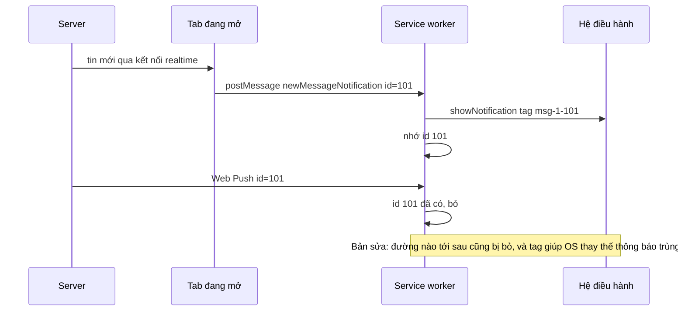

Hai việc nghe rất bình thường của một app chat, nhưng làm sai thì người dùng nhận ra ngay:

- **Đã đọc**: khi nào thì một tin được tính là "đã đọc"? Lúc nó vừa ló ra mép màn hình? Lúc người dùng đang ở tab khác? Mỗi tin một request lên server?
- **Thông báo**: tab đang mở biết có tin mới qua kết nối realtime, server cũng gửi Web Push cho cùng tin đó. Không xử lý thì điện thoại rung hai lần, hai thông báo giống hệt nhau.

Telegram Web A giải quyết cả hai bằng vài chục dòng: một hook dùng IntersectionObserver và một service worker biết "tin này tab đã báo rồi". Bài này đọc code, chỉ ra ba lỗi nhỏ (một trong số đó làm app gọi API thừa mỗi lần cuộn qua một mention cũ) và viết lại.

> [!TIP]
> **Tóm tắt**
> - Theo dõi một **marker mỏng ở đáy** mỗi tin thay vì cả tin: tin chỉ tính là đã đọc khi đáy của nó lọt vào khung nhìn. Gửi lên server **một mốc** `maxId`, không gửi danh sách id.
> - Gom entry của IntersectionObserver lại, **đóng băng** khi cửa sổ không còn focus và xử lý một lần khi người dùng quay lại. Gửi API được throttle 1 giây.
> - Hai đường báo tin (tab và push) ghi chung một tập id đã hiện; đường tới sau bị bỏ. Dùng thêm `tag` của Notification để hệ điều hành tự thay thông báo cũ.
> - Bấm thông báo khi chưa mở tab: mở tab mới, **giữ dữ liệu** tới khi tab báo `clientReady` rồi mới nhảy tới tin nhắn.

<iframe class="demo-frame" src="/demos/web-patterns/index.html?theme=dark#/tg-read-receipts" title="Demo tg-read-receipts" loading="lazy" style="height: 1450px"></iframe>

<p class="demo-links">▶ <a href="/demos/web-patterns/index.html#/tg-read-receipts" target="_blank" rel="noopener">Mở demo toàn màn hình ↗</a> · <a href="https://stackblitz.com/github/hunghg255/blog-hunghg/tree/master/examples/web-patterns?file=src/lib/tgReadReceipts.ts" target="_blank" rel="noopener">Sửa code trên StackBlitz ↗</a> · <a href="https://github.com/hunghg255/blog-hunghg/blob/master/examples/web-patterns/src/lib/tgReadReceipts.ts" target="_blank" rel="noopener">Xem source trên GitHub ↗</a></p>

Trong demo: cuộn khung chat xuống, số "chưa đọc" giảm và log chỉ có vài lần gọi API dù bạn cuộn qua 15 tin. Bấm "Đóng băng" rồi cuộn: không gửi gì; bấm "Mở băng": gửi một lần. Cuộn lại qua tin #20 và #27 sau khi đã đọc: ô "bản gốc gọi mention thừa" tăng, bản viết lại thì không. Phần 2 cho thấy kịch bản "push tới trước, tab báo sau" hiện hai thông báo ở bản gần với Telegram.

## Telegram làm thế nào?

### Đã đọc: `useMessageObservers`

Mỗi tin nhắn có một `div.bottom-marker` rỗng ở đáy, mang id tin ([`Message.tsx`](https://github.com/hunghg255/codebase/blob/main/web.telegram.org/src/components/middle/message/Message.tsx)):

```tsx
<div
  ref={bottomMarkerRef}
  className="bottom-marker"
  data-message-id={messageId}
  data-last-message-id={album ? album.messages[album.messages.length - 1].id : undefined}
  data-has-unread-mention={message.hasUnreadMention}
/>
```

Album (nhiều ảnh gộp một bong bóng) mang thêm id của ảnh **cuối**. Hook [`useMessageObservers.ts`](https://github.com/hunghg255/codebase/blob/main/web.telegram.org/src/components/middle/hooks/useMessageObservers.ts) quan sát các marker này:

```ts
const { observe, freeze, unfreeze } = useIntersectionObserver({ rootRef: containerRef }, (entries) => {
  let maxId = 0;
  const mentionIds: number[] = [];
  entries.forEach(({ isIntersecting, target }) => {
    if (!isIntersecting) return;
    const { dataset } = target as HTMLDivElement;
    const messageId = Number(dataset.lastMessageId || dataset.messageId);
    if (messageId > maxId) maxId = messageId;
    if (dataset.hasUnreadMention) mentionIds.push(messageId);
  });
  if (memoFirstUnreadIdRef.current && maxId >= memoFirstUnreadIdRef.current) {
    markMessageListRead({ maxId });
  }
  if (mentionIds.length) markMessagesRead({ messageIds: mentionIds });
});

useBackgroundMode(freeze, unfreeze);
```

Ba điểm đáng học:

- **Một mốc thay cho danh sách.** Server của Telegram hiểu "đọc tới `maxId`" là mọi tin ≤ `maxId` đã đọc. Client chỉ cần tìm id lớn nhất đang thấy, và chỉ gửi khi nó chạm tin chưa đọc đầu tiên.
- **Mention đi đường riêng.** Tin nhắc tên bạn (`@ban`) có trạng thái "mention chưa đọc" riêng, phải báo bằng danh sách id (`markMessagesRead`).
- **Đóng băng khi ở nền.** [`useBackgroundMode`](https://github.com/hunghg255/codebase/blob/main/web.telegram.org/src/hooks/useBackgroundMode.ts) gọi `freeze` ở sự kiện `blur` của `window`, `unfreeze` ở `focus`.

`freeze` nằm trong hook dùng chung [`useIntersectionObserver.ts`](https://github.com/hunghg255/codebase/blob/main/web.telegram.org/src/hooks/useIntersectionObserver.ts). Entry được gom vào một `Map` theo element; đang đóng băng thì không xử lý mà nhớ một hàm `onUnfreeze`, mở băng mới chạy. `freeze` là bộ đếm, vì cùng hook đó còn bị đóng băng khi có animation nặng (`useHeavyAnimationCheck`), hai lý do có thể chồng nhau.

Còn API thì được throttle ở reducer ([`modules/actions/api/messages.ts`](https://github.com/hunghg255/codebase/blob/main/web.telegram.org/src/modules/actions/api/messages.ts)):

```ts
const runThrottledForMarkRead = throttle((cb) => cb(), 1000, true);
```

### Thông báo: tab và service worker

Khi tab nhận tin qua kết nối realtime, [`util/notifications.ts`](https://github.com/hunghg255/codebase/blob/main/web.telegram.org/src/util/notifications.ts) không tự gọi `new Notification()` mà nhờ service worker hiện:

```ts
navigator.serviceWorker.controller.postMessage({
  type: 'newMessageNotification',
  payload: { title, body, icon, chatId: chat.id, messageId: message.id },
});
```

Service worker ([`serviceWorker/pushNotification.ts`](https://github.com/hunghg255/codebase/blob/main/web.telegram.org/src/serviceWorker/pushNotification.ts)) hiện thông báo và ghi nhớ id. Khi push từ server tới cho cùng tin thì bỏ:

```ts
let lastSyncAt = new Date().valueOf();
const shownNotifications = new Set();

export function handlePush(e: PushEvent) {
  if (new Date().valueOf() - lastSyncAt < 3000) return; // vừa mở trình duyệt
  // ... bỏ push bị tắt tiếng
  if (shownNotifications.has(notification.messageId)) {
    shownNotifications.delete(notification.messageId);
    return;
  }
  e.waitUntil(showNotification(notification));
}
```

Thêm vài chi tiết:

- **3 giây yên lặng**: `lastSyncAt` được gán lúc script service worker chạy. Mở trình duyệt sau một đêm, đống push tồn đọng ập tới cùng lúc; Telegram bỏ hết những push tới trong 3 giây đầu.
- **Âm thanh**: service worker không phát được âm thanh, nên nó `postMessage` nhờ tab phát. Tab dùng `debounce` 1 giây và một `Set` id giữ 3 giây để không kêu hai lần.
- **Bấm thông báo**: có tab thì `postMessage({ type: 'focusMessage' })` rồi `client.focus()`. Không có tab thì `clients.openWindow()` và lưu dữ liệu vào `clickBuffer[newClient.id]`; khi tab mới tải xong và gửi `clientReady` ([`util/setupServiceWorker.ts`](https://github.com/hunghg255/codebase/blob/main/web.telegram.org/src/util/setupServiceWorker.ts)), service worker mới bảo nó nhảy tới tin.

### Những chỗ chưa ổn trong bản gốc

1. **Mention đã đọc vẫn bị gửi lại.** Khi mention được đọc, `hasUnreadMention` thành `false` (không phải `undefined`). Teact gán thuộc tính `data-*` bằng `setAttribute`, nên DOM có `data-has-unread-mention="false"`. Mà `dataset.hasUnreadMention` là **chuỗi** `"false"`, chuỗi khác rỗng là truthy. Kết quả: mỗi lần cuộn qua một tin từng nhắc tên bạn, app lại gọi `markMessagesRead` cho nó.
2. **Push tới trước tab thì vẫn trùng.** Chỉ đường "tab báo" ghi id vào `shownNotifications`; đường push chỉ xoá. Nếu push tới trước (mạng realtime chậm hơn push), cả hai đều hiện. `showNotification` cũng không đặt `tag`, nên hệ điều hành xếp chồng hai thông báo.
3. **Id không bao giờ hết hạn.** Tab báo mà push không tới (người dùng tắt push, server không gửi), id nằm mãi trong `Set` cho tới khi service worker bị dừng.
4. **Tìm tab bằng so sánh tuyệt đối.** `client.url === self.registration.scope`: tab đang ở `…/z/#-100123` (đang mở một chat) không khớp, bị coi như không có tab, bấm thông báo lại mở tab mới.
5. **"3 giây đầu" có lẽ rộng hơn ý định.** Service worker bị trình duyệt dừng khi rảnh, và được khởi động lại **chính bởi** push tới. Lúc đó script vừa chạy, `lastSyncAt` vừa được gán, nên push đánh thức nó cũng rơi vào 3 giây đầu và bị bỏ. Phần đăng ký `push` listener không có trong bản dump nên mình không kiểm chứng được trên trình duyệt; đây là suy luận từ code.
6. Nhỏ hơn: throttle của Telegram chạy **lần gọi cuối** trong mỗi khoảng 1 giây, nên nếu người dùng cuộn xuống rồi cuộn lên trong 1 giây, mốc gửi đi có thể thấp hơn mốc đã thấy (server có lẽ bỏ qua mốc thấp hơn, nhưng đó vẫn là một request thừa).

## Bên trong trình duyệt

**Vì sao marker ở đáy?** IntersectionObserver báo khi phần tử **giao** với khung nhìn, dù chỉ 1px. Quan sát cả bong bóng thì một tin dài 2 màn hình được tính là đã đọc khi mới ló dòng đầu. Marker cao 1px ở đáy biến câu hỏi thành "người dùng đã thấy **cuối** tin chưa". Không cần `threshold` phức tạp.

**Vì sao gom entry?** Callback của IntersectionObserver chỉ nhận các entry **vừa đổi trạng thái**, không phải mọi thứ đang hiện. Gom vào `Map<Element, Entry>` (entry mới đè entry cũ của cùng element) cho phép hoãn xử lý mà không mất thông tin: lúc mở băng, mỗi marker có đúng trạng thái mới nhất. Tin nào lướt qua rồi ra khỏi màn hình trong lúc đóng băng sẽ có `isIntersecting: false`, không bị tính là đã đọc.

**Hai đường của một thông báo:**



## Viết lại

Hai file: [`tgReadReceipts.ts`](https://github.com/hunghg255/blog-hunghg/blob/master/examples/web-patterns/src/lib/tgReadReceipts.ts) (đã đọc) và [`tgPushDedupe.ts`](https://github.com/hunghg255/blog-hunghg/blob/master/examples/web-patterns/src/lib/tgPushDedupe.ts) (phần logic quyết định của service worker, tách thành hàm thuần để chạy được cả trong demo).

### Đã đọc

Phần xử lý một lô entry:

```ts title=src/lib/tgReadReceipts.ts
  const process = () => {
    let maxId = 0;
    const mentionIds: number[] = [];
    accumulator.forEach((entry) => {
      if (!entry.isIntersecting) return;
      const { dataset } = entry.target as HTMLElement;
      // album: marker mang id của ảnh CUỐI trong album
      const id = Number(dataset.lastMessageId || dataset.messageId);
      if (id > maxId) maxId = id;
      // Bản gốc viết `if (dataset.hasUnreadMention)`: thuộc tính bị render thành chuỗi "false"
      // sau khi mention đã đọc, mà chuỗi "false" vẫn là truthy. So sánh đúng giá trị:
      if (dataset.hasUnreadMention === 'true') mentionIds.push(id);
    });
    accumulator.clear();

    const firstUnreadId = getFirstUnreadId();
    if (firstUnreadId !== undefined && maxId >= firstUnreadId) sendRead(maxId);
    if (mentionIds.length) onMentionsSeen?.(mentionIds);
  };
```

Throttle "gửi ngay lần đầu, sau đó tối đa một lần mỗi giây", nhưng luôn gửi **mốc lớn nhất** và không bao giờ gửi lùi:

```ts title=src/lib/tgReadReceipts.ts
  const flushRead = () => {
    throttleTimer = undefined;
    // không bao giờ gửi mốc lùi lại: server coi maxId là "đã đọc tới đây"
    if (queuedMaxId > lastSentMaxId) {
      lastSentMaxId = queuedMaxId;
      onReadUpTo(queuedMaxId);
      throttleTimer = setTimeout(flushRead, throttleMs);
    }
  };
  const sendRead = (maxId: number) => {
    queuedMaxId = Math.max(queuedMaxId, maxId);
    if (throttleTimer === undefined) flushRead();
  };
```

::: spoiler Xem toàn bộ src/lib/tgReadReceipts.ts

```ts title=src/lib/tgReadReceipts.ts
/**
 * Đánh dấu "đã đọc" bằng IntersectionObserver
 * (ý tưởng từ components/middle/hooks/useMessageObservers.ts + hooks/useIntersectionObserver.ts
 * của Telegram Web A).
 *
 * - Không theo dõi cả bong bóng tin nhắn mà theo dõi một "bottom marker" mỏng ở đáy mỗi tin:
 *   tin chỉ tính là đã đọc khi ĐÁY của nó lọt vào khung nhìn.
 * - Mỗi lô callback lấy `maxId` của các marker đang hiện; chỉ gửi lên server khi
 *   `maxId >= firstUnreadId` (đọc theo "mốc", server tự hiểu mọi tin ≤ maxId đã đọc).
 * - Khi cửa sổ mất focus (hoặc tab bị ẩn), observer "đóng băng": entry vẫn được gom lại,
 *   tới lúc quay lại mới xử lý một lần.
 * - Gửi lên server được throttle 1 giây.
 */

export interface ReadTrackerOptions {
  /** khung cuộn chứa danh sách tin */
  root: HTMLElement;
  /** id tin chưa đọc đầu tiên tại thời điểm hiện tại (đọc mỗi lần cần) */
  getFirstUnreadId: () => number | undefined;
  /** gửi "đã đọc tới maxId" (đã throttle) */
  onReadUpTo: (maxId: number) => void;
  /** các tin có mention chưa đọc vừa được thấy */
  onMentionsSeen?: (ids: number[]) => void;
  throttleMs?: number;
  /** đóng băng khi cửa sổ mất focus như Telegram (true) hay chỉ khi tab bị ẩn (false) */
  freezeOnBlur?: boolean;
}

export interface ReadTracker {
  observe(marker: HTMLElement): () => void;
  freeze(): void;
  unfreeze(): void;
  isFrozen(): boolean;
  destroy(): void;
}

export function createReadTracker({
  root,
  getFirstUnreadId,
  onReadUpTo,
  onMentionsSeen,
  throttleMs = 1000,
  freezeOnBlur = true,
}: ReadTrackerOptions): ReadTracker {
  // entry mới nhất của từng marker, gom lại giữa các lần xử lý (và trong lúc đóng băng)
  const accumulator = new Map<Element, IntersectionObserverEntry>();
  let freezeCount = 0;
  let pendingWhileFrozen = false;

  // ---- throttle gửi lên server: chạy ngay lần đầu, sau đó tối đa 1 lần / throttleMs ----
  let lastSentMaxId = 0;
  let queuedMaxId = 0;
  let throttleTimer: ReturnType<typeof setTimeout> | undefined;
  const flushRead = () => {
    throttleTimer = undefined;
    // không bao giờ gửi mốc lùi lại: server coi maxId là "đã đọc tới đây"
    if (queuedMaxId > lastSentMaxId) {
      lastSentMaxId = queuedMaxId;
      onReadUpTo(queuedMaxId);
      throttleTimer = setTimeout(flushRead, throttleMs);
    }
  };
  const sendRead = (maxId: number) => {
    queuedMaxId = Math.max(queuedMaxId, maxId);
    if (throttleTimer === undefined) flushRead();
  };

  const process = () => {
    let maxId = 0;
    const mentionIds: number[] = [];
    accumulator.forEach((entry) => {
      if (!entry.isIntersecting) return;
      const { dataset } = entry.target as HTMLElement;
      // album: marker mang id của ảnh CUỐI trong album
      const id = Number(dataset.lastMessageId || dataset.messageId);
      if (id > maxId) maxId = id;
      // Bản gốc viết `if (dataset.hasUnreadMention)`: thuộc tính bị render thành chuỗi "false"
      // sau khi mention đã đọc, mà chuỗi "false" vẫn là truthy. So sánh đúng giá trị:
      if (dataset.hasUnreadMention === 'true') mentionIds.push(id);
    });
    accumulator.clear();

    const firstUnreadId = getFirstUnreadId();
    if (firstUnreadId !== undefined && maxId >= firstUnreadId) sendRead(maxId);
    if (mentionIds.length) onMentionsSeen?.(mentionIds);
  };

  const observer = new IntersectionObserver(
    (entries) => {
      entries.forEach((entry) => accumulator.set(entry.target, entry));
      if (freezeCount > 0) {
        pendingWhileFrozen = true;
        return;
      }
      process();
    },
    { root },
  );

  const freeze = () => {
    freezeCount++;
  };
  const unfreeze = () => {
    if (freezeCount === 0) return;
    freezeCount--;
    if (freezeCount === 0 && pendingWhileFrozen) {
      pendingWhileFrozen = false;
      process();
    }
  };

  // ---- nền: blur/focus như Telegram, hoặc visibilitychange ----
  let frozenByBackground = false;
  const syncBackground = () => {
    const inBackground = freezeOnBlur ? !document.hasFocus() || document.hidden : document.hidden;
    if (inBackground && !frozenByBackground) {
      frozenByBackground = true;
      freeze();
    } else if (!inBackground && frozenByBackground) {
      frozenByBackground = false;
      unfreeze();
    }
  };
  syncBackground();
  window.addEventListener('blur', syncBackground);
  window.addEventListener('focus', syncBackground);
  document.addEventListener('visibilitychange', syncBackground);

  return {
    observe(marker) {
      observer.observe(marker);
      return () => {
        observer.unobserve(marker);
        accumulator.delete(marker);
      };
    },
    freeze,
    unfreeze,
    isFrozen: () => freezeCount > 0,
    destroy() {
      observer.disconnect();
      clearTimeout(throttleTimer);
      window.removeEventListener('blur', syncBackground);
      window.removeEventListener('focus', syncBackground);
      document.removeEventListener('visibilitychange', syncBackground);
    },
  };
}
```

:::

### Thông báo không trùng

Cả hai đường đi qua cùng một hàm `decide`:

```ts title=src/lib/tgPushDedupe.ts
  const decide = (n: IncomingNotification, source: 'tab' | 'push'): Decision => {
    sweep();
    if (source === 'push' && now() - startedAt < quietAfterStartMs) return { action: 'drop', reason: 'startup' };
    if (n.muted) return { action: 'drop', reason: 'muted' };
    if (n.messageId === undefined) return { action: 'show' };
    if (seen.has(n.messageId)) return { action: 'drop', reason: 'duplicate' };
    seen.set(n.messageId, now());
    return { action: 'show', tag: `msg-${n.chatId ?? 0}-${n.messageId}` };
  };
```

::: spoiler Xem toàn bộ src/lib/tgPushDedupe.ts

```ts title=src/lib/tgPushDedupe.ts
/**
 * Thông báo không trùng giữa tab đang mở và service worker
 * (ý tưởng từ serviceWorker/pushNotification.ts + util/notifications.ts của Telegram Web A).
 *
 * Một tin nhắn mới có thể tới bằng HAI đường:
 *   1. tab đang mở nhận qua kết nối realtime → nhờ SW hiện thông báo (`newMessageNotification`)
 *   2. server gửi Web Push → SW tự hiện thông báo
 * Không xử lý thì người dùng thấy hai thông báo cho cùng một tin.
 *
 * Phần logic quyết định "hiện hay bỏ" được tách thành hàm thuần ở đây để chạy được trong
 * service worker thật lẫn trong demo (không cần server push).
 */

export interface IncomingNotification {
  messageId?: number;
  chatId?: number;
  title: string;
  body: string;
  muted?: boolean;
}

export type Decision =
  | { action: 'show'; tag?: string }
  | { action: 'drop'; reason: 'startup' | 'muted' | 'duplicate' };

export interface GateOptions {
  /** bỏ mọi push trong khoảng này sau khi SW khởi động (đống push tồn đọng lúc mở trình duyệt) */
  quietAfterStartMs?: number;
  /** nhớ id đã hiện trong bao lâu (bản gốc nhớ tới khi push trùng tới, không hết hạn) */
  rememberMs?: number;
  now?: () => number;
}

/** Bản gần với Telegram: chỉ đường "tab báo" ghi id, đường push xoá id khi gặp. */
export function createOriginalGate({ quietAfterStartMs = 3000, now = Date.now }: GateOptions = {}) {
  const startedAt = now();
  const shown = new Set<number | undefined>();
  return {
    fromTab(n: IncomingNotification): Decision {
      shown.add(n.messageId);
      return { action: 'show' };
    },
    fromPush(n: IncomingNotification): Decision {
      if (now() - startedAt < quietAfterStartMs) return { action: 'drop', reason: 'startup' };
      if (n.muted) return { action: 'drop', reason: 'muted' };
      if (shown.has(n.messageId)) {
        shown.delete(n.messageId);
        return { action: 'drop', reason: 'duplicate' };
      }
      return { action: 'show' };
    },
    size: () => shown.size,
  };
}

/**
 * Bản sửa:
 * - cả hai đường đều ghi id, đường tới SAU bị bỏ (bản gốc: push tới trước tab thì vẫn hiện 2 lần)
 * - id hết hạn sau `rememberMs` (bản gốc: tab báo mà push không bao giờ tới thì id nằm mãi)
 * - trả về `tag` theo messageId: dù lọt lưới, hệ điều hành cũng THAY thông báo cũ chứ không xếp chồng
 */
export function createNotificationGate({
  quietAfterStartMs = 3000,
  rememberMs = 60_000,
  now = Date.now,
}: GateOptions = {}) {
  const startedAt = now();
  const seen = new Map<number, number>(); // messageId -> thời điểm thấy

  const sweep = () => {
    const limit = now() - rememberMs;
    seen.forEach((at, id) => {
      if (at < limit) seen.delete(id);
    });
  };

  const decide = (n: IncomingNotification, source: 'tab' | 'push'): Decision => {
    sweep();
    if (source === 'push' && now() - startedAt < quietAfterStartMs) return { action: 'drop', reason: 'startup' };
    if (n.muted) return { action: 'drop', reason: 'muted' };
    if (n.messageId === undefined) return { action: 'show' };
    if (seen.has(n.messageId)) return { action: 'drop', reason: 'duplicate' };
    seen.set(n.messageId, now());
    return { action: 'show', tag: `msg-${n.chatId ?? 0}-${n.messageId}` };
  };

  return {
    fromTab: (n: IncomingNotification) => decide(n, 'tab'),
    fromPush: (n: IncomingNotification) => decide(n, 'push'),
    size: () => seen.size,
  };
}

/**
 * Chọn tab của app trong danh sách client của SW.
 * Bản gốc so sánh `client.url === registration.scope` (bằng tuyệt đối): tab đang ở
 * `/#/chat/123` hay `/?foo` bị coi như không có tab nào, nên bấm thông báo lại mở tab mới.
 */
export function findAppClients<T extends { url: string }>(clients: T[], scope: string) {
  return clients.filter((client) => client.url.startsWith(scope));
}

/**
 * Bộ đệm click: bấm thông báo khi chưa có tab → mở tab mới, giữ dữ liệu tới khi tab báo
 * `clientReady` rồi mới bảo nó nhảy tới tin nhắn.
 */
export function createClickBuffer<T>() {
  const pending = new Map<string, T>();
  return {
    hold(clientId: string, data: T) {
      pending.set(clientId, data);
    },
    /** gọi khi nhận `clientReady`; trả về dữ liệu cần xử lý (nếu có) và xoá khỏi bộ đệm */
    release(clientId: string) {
      const data = pending.get(clientId);
      pending.delete(clientId);
      return data;
    },
    size: () => pending.size,
  };
}
```

:::

## Đi qua code

**`createReadTracker`** không phụ thuộc React. Truyền vào khung cuộn, hàm lấy id chưa đọc đầu tiên, và hai callback gửi API. `observe(marker)` trả về hàm huỷ để dùng trong `useEffect` hay khi tin bị xoá.

- `process` giống Telegram: lấy `maxId` trong các marker đang giao, gửi khi `maxId >= firstUnreadId`. Mention được so `=== 'true'` thay vì truthy.
- `getFirstUnreadId` là một **hàm** chứ không phải giá trị: nó được đọc lúc xử lý, nên không bao giờ dùng giá trị cũ (Telegram dùng `memoFirstUnreadIdRef` cho cùng mục đích).
- `freeze`/`unfreeze` là bộ đếm như Telegram, để nhiều lý do đóng băng chồng nhau được.
- `freezeOnBlur`: `true` thì giống Telegram (mất focus là đóng băng), `false` thì chỉ đóng băng khi tab bị ẩn (`visibilitychange`). Demo để mặc định `false` vì demo nằm trong iframe: chưa bấm vào iframe là nó chưa có focus.

**`createNotificationGate`** gom hai đường vào một hàm `decide`: đường nào tới trước thì hiện và ghi id kèm thời điểm, đường tới sau thì bỏ. `sweep` xoá id cũ hơn `rememberMs` mỗi lần gọi. Kết quả `show` kèm `tag` theo chat và tin: đặt vào `showNotification(title, { tag })`, hệ điều hành sẽ **thay** thông báo cùng tag thay vì thêm cái mới. Đây là lưới an toàn thứ hai khi hai service worker (hoặc hai lần khởi động) không chung bộ nhớ.

**`findAppClients`** so tiền tố URL với scope. **`createClickBuffer`** chỉ là một `Map` với `hold`/`release`, và `release` xoá luôn dữ liệu. Telegram còn một chi tiết: ở nhánh **đã có tab**, dữ liệu cũng được đưa vào `clickBuffer`, và tab gửi `clientReady` mỗi lần cửa sổ nhận focus (`setupServiceWorker.ts`), nên tin được focus thêm một lần khi cửa sổ thật sự lên trước. Có lẽ là cố ý, để chắc chắn tin được mở dù `client.focus()` bị trình duyệt từ chối.

**Khác bản gốc:** so sánh mention đúng kiểu; gửi mốc lớn nhất thay vì mốc cuối; cả tab lẫn push đều ghi id; id hết hạn; có `tag`; tìm tab theo tiền tố. Phần "3 giây đầu" được giữ để so sánh với Telegram, nhưng xem mục cạm bẫy bên dưới trước khi dùng.

## Tại sao không làm cách khác?

**Sao không gửi từng id đã thấy?** Một lần cuộn qua 50 tin là 50 id, và thứ tự tới server có thể lộn. Một mốc `maxId` vừa nhỏ vừa **idempotent**: gửi lại mốc cũ không làm sai gì. Đổi lại, cách này giả định đọc theo thứ tự thời gian, nên mention (có thể nằm rải rác) phải đi đường riêng.

**Sao không dùng `threshold: 1` trên cả bong bóng?** Tin cao hơn khung nhìn không bao giờ đạt tỉ lệ 1, nên không bao giờ "đã đọc". Marker đáy không có vấn đề này.

**Sao không đơn giản là chỉ dùng push, tab không báo?** Push đi qua server push của trình duyệt, có thể chậm vài giây hoặc bị gộp. Tab đang mở thì đã có tin ngay; Telegram ưu tiên đường nhanh rồi dùng id để bỏ đường chậm.

**Sao không chỉ dựa vào `tag`?** `tag` làm hệ điều hành thay thông báo, nhưng mỗi lần thay vẫn có thể rung/kêu lại (tuỳ `renotify` và tuỳ nền tảng), và âm thanh do tab phát thì `tag` không chặn được. Lọc bằng id trước, `tag` làm lưới an toàn sau.

## Edge case và cạm bẫy

- **Iframe và focus.** Dùng `blur`/`focus` của `window` để đóng băng thì một app nhúng trong iframe sẽ bị đóng băng cho tới khi người dùng bấm vào nó. Mở hai cửa sổ cạnh nhau cũng vậy: cửa sổ không focus vẫn **nhìn thấy** được nhưng không đánh dấu đã đọc. Đó là lựa chọn có chủ ý của Telegram (chưa tương tác thì chưa chắc đã đọc), nhưng nên biết.
- **Thuộc tính `data-*` luôn là chuỗi.** Đừng `if (dataset.x)` với giá trị boolean; hoặc chỉ render thuộc tính khi `true`, hoặc so `=== 'true'`.
- **Tin đang gửi** (id tạm, xem [bài #1](/blogs/telegram-optimistic-send)) không nên có marker, nếu không `maxId` có thể là một id tạm rất lớn.
- **Bỏ push trong 3 giây đầu** chỉ an toàn nếu bạn chắc rằng push đánh thức service worker không bị bỏ nhầm. Telegram đăng ký push với `userVisibleOnly: true` (Chrome bắt buộc), nghĩa là mỗi push nên hiện một thông báo; không hiện thì Chrome có thể tự hiện một thông báo chung chung kiểu "trang này vừa cập nhật ở nền". Cách an toàn hơn là bỏ theo **thời điểm gửi** của tin (server đính kèm), ví dụ bỏ push của tin cũ hơn vài phút.
- **Blob URL làm icon.** Tab gửi `icon` là blob URL của avatar cho service worker. Blob URL gắn với document tạo ra nó; tab đóng thì URL hết hiệu lực, thông báo có thể mất icon.
- **Service worker không có bộ nhớ lâu dài.** `Set`, `Map` trong service worker mất khi nó bị dừng. Cần chắc chắn hơn thì lưu id vào IndexedDB, hoặc dựa vào `tag`.

## Dùng trong dự án

```ts
// trong component danh sách tin
useEffect(() => {
  const tracker = createReadTracker({
    root: listRef.current!,
    getFirstUnreadId: () => store.getState().firstUnreadId,
    onReadUpTo: (maxId) => api.markRead(chatId, maxId),
    onMentionsSeen: (ids) => api.markMentionsRead(chatId, ids),
  });
  const stops = markers.current.map((m) => tracker.observe(m));
  return () => {
    stops.forEach((stop) => stop());
    tracker.destroy();
  };
}, [chatId]);
```

```ts
// trong service worker; listener `message` (tab báo) làm y hệt với gate.fromTab
const gate = createNotificationGate();

self.addEventListener('push', (event) => {
  const n = parsePush(event);
  const decision = gate.fromPush(n);
  if (decision.action === 'show') {
    event.waitUntil(self.registration.showNotification(n.title, { body: n.body, tag: decision.tag }));
  }
});
```

::: spoiler Ví dụ test (bản phác, không có trong repo)

```ts
import { afterEach, beforeEach, describe, expect, it, vi } from 'vitest';
import { createReadTracker } from './tgReadReceipts';
import { createNotificationGate, createOriginalGate, findAppClients } from './tgPushDedupe';

// IntersectionObserver giả: giữ callback để test tự bắn entry
let fire: (entries: Partial<IntersectionObserverEntry>[]) => void = () => {};
class FakeIO {
  constructor(cb: IntersectionObserverCallback) {
    fire = (entries) => cb(entries as IntersectionObserverEntry[], this as unknown as IntersectionObserver);
  }
  observe() {}
  unobserve() {}
  disconnect() {}
}

function marker(id: number, mention?: 'true' | 'false') {
  const el = document.createElement('div');
  el.dataset.messageId = String(id);
  if (mention) el.dataset.hasUnreadMention = mention;
  return el;
}
const seen = (...els: HTMLElement[]) => fire(els.map((target) => ({ target, isIntersecting: true })));

describe('createReadTracker', () => {
  beforeEach(() => {
    vi.useFakeTimers();
    vi.stubGlobal('IntersectionObserver', FakeIO);
    vi.spyOn(document, 'hasFocus').mockReturnValue(true);
  });
  afterEach(() => {
    vi.useRealTimers();
    vi.unstubAllGlobals();
    vi.restoreAllMocks();
  });

  const setup = () => {
    const onReadUpTo = vi.fn();
    const onMentionsSeen = vi.fn();
    const tracker = createReadTracker({ root: document.body, getFirstUnreadId: () => 10, onReadUpTo, onMentionsSeen });
    return { tracker, onReadUpTo, onMentionsSeen };
  };

  it('chỉ gửi khi chạm tin chưa đọc đầu tiên, throttle và không gửi lùi', () => {
    const { onReadUpTo } = setup();
    seen(marker(8), marker(9));
    expect(onReadUpTo).not.toHaveBeenCalled();
    seen(marker(12));
    seen(marker(14));
    seen(marker(13));
    expect(onReadUpTo).toHaveBeenCalledTimes(1);
    vi.advanceTimersByTime(1000);
    expect(onReadUpTo).toHaveBeenLastCalledWith(14);
  });

  it('đóng băng thì gom lại, mở băng mới xử lý', () => {
    const { tracker, onReadUpTo } = setup();
    tracker.freeze();
    seen(marker(20));
    expect(onReadUpTo).not.toHaveBeenCalled();
    tracker.unfreeze();
    expect(onReadUpTo).toHaveBeenCalledWith(20);
  });

  it('chuỗi "false" không phải mention chưa đọc', () => {
    const { onMentionsSeen } = setup();
    seen(marker(5, 'false'), marker(6, 'true'));
    expect(onMentionsSeen).toHaveBeenCalledWith([6]);
  });
});

describe('notification gate', () => {
  let t = 0;
  const now = () => t;
  const n = (messageId: number) => ({ messageId, chatId: 1, title: 'A', body: 'b' });

  it('bản gốc: push tới trước tab thì hiện hai lần; bản sửa thì không', () => {
    t = 0;
    const original = createOriginalGate({ now });
    const fixed = createNotificationGate({ now });
    t = 5000;
    expect(original.fromPush(n(1)).action).toBe('show');
    expect(original.fromTab(n(1)).action).toBe('show');
    expect(fixed.fromPush(n(1))).toEqual({ action: 'show', tag: 'msg-1-1' });
    expect(fixed.fromTab(n(1))).toEqual({ action: 'drop', reason: 'duplicate' });
  });

  it('id hết hạn sau rememberMs', () => {
    t = 0;
    const g = createNotificationGate({ now, rememberMs: 10_000 });
    t = 5000;
    g.fromTab(n(4));
    t = 20_000;
    g.fromTab(n(5));
    expect(g.size()).toBe(1);
  });

  it('tìm tab theo tiền tố', () => {
    const clients = [{ url: 'https://x.org/z/#-1' }, { url: 'https://x.org/k/' }];
    expect(findAppClients(clients, 'https://x.org/z/')).toEqual([clients[0]]);
  });
});
```

:::

## So với chuẩn web và thư viện

- **IntersectionObserver** là cách chuẩn cho "đã thấy chưa", có ở mọi trình duyệt hiện đại. Series này đã có [bài dùng chung một observer cho cả trang](/blogs/facebook-shared-intersection-observer) và [đo thời gian thực sự được xem](/blogs/facebook-use-viewport-duration) của Facebook, cùng họ với kỹ thuật ở đây.
- **IntersectionObserver v2** (`trackVisibility`) báo cả việc phần tử có bị che hay mờ không, hiện chỉ có ở trình duyệt nhân Chromium (tính tới 10/2026). Không cần cho bài toán "đã đọc", nhưng hữu ích nếu đếm impression quảng cáo.
- **Notification `tag`/`renotify`** là chuẩn của Notifications API; hành vi rung/kêu khi thay thế phụ thuộc hệ điều hành.
- **Bầu tab chủ**: nếu không có service worker, có thể để **một** tab lo thông báo như [bài bầu tab chủ](/blogs/web-leader-tab-notifications) trong series web (HubSpot và chính Telegram).

---

Bài này thuộc series **[Học từ mã nguồn Telegram](/series/telegram)** (25 bài, đọc theo thứ tự).

::: spoiler Xem nhanh danh sách bài trong series

*Mở đầu*

- [Mở đầu: bên trong Telegram Web A](/blogs/learn-from-telegram-source-code)

*Phần 1: dữ liệu và đồng bộ*

- [#1 Gửi tin lạc quan, khớp tin thật bằng randomId](/blogs/telegram-optimistic-send)
- [#2 Lịch sử tin nhắn chia hai đảo](/blogs/telegram-message-history-islands)
- [#3 Lưu global state lúc rảnh, chỉ giữ phần cần](/blogs/telegram-persist-global-state)
- [#4 Gom update realtime theo nhịp animation](/blogs/telegram-realtime-update-batching)
- [#5 Store tự viết và diff danh sách có key](/blogs/telegram-teactn-store-fast-list)

*Phần 2: animation và giao diện*

- [#6 Animation sắp xếp danh sách chat không đo DOM](/blogs/telegram-chat-list-flip)
- [#7 Ảnh bay giữa hai cây DOM trong media viewer](/blogs/telegram-media-viewer-ghost)
- [#8 Bố cục album chọn theo hàm chi phí](/blogs/telegram-album-layout)
- [#9 Giờ gửi nằm gọn trong bong bóng chat](/blogs/telegram-bubble-meta-spacer)
- [#10 Composer biến hình, Transition và gạch chân tab](/blogs/telegram-composer-morph-transition)

*Phần 3: media, mobile, thông báo*

- [#11 Thumbnail 100 byte và viền sticker nén](/blogs/telegram-tiny-thumbnails)
- [#12 Player sticker: DPR, hạ fps, cache khung](/blogs/telegram-lottie-player)
- [#13 Mobile: --vh, bàn phím ảo, nhấn giữ, số điện thoại](/blogs/telegram-mobile-viewport-touch)
- **#14 Web Push không trùng và đánh dấu đã đọc** (bài này)

*Phần 4: soạn tin, media, chi tiết UI*

- [#15 Rich text ⇄ entities, thanh định dạng nổi, nháp theo chat](/blogs/telegram-rich-text-entities)
- [#16 Ô nhập tự giãn, emoji phóng to, gom tin theo ngày/người/album](/blogs/telegram-auto-grow-input-grouping)
- [#17 Bảng emoji/sticker chỉ render nhóm đang xem](/blogs/telegram-emoji-picker-virtualization)
- [#18 mediaLoader gộp request, ảnh mờ sang nét, spinner không chớp](/blogs/telegram-media-loader-blur-buffering)
- [#19 Trình phát audio toàn cục và playlist](/blogs/telegram-global-audio-player)
- [#20 UiLoader chạy đua 700ms, ba mức animation](/blogs/telegram-ui-loader-animation-levels)
- [#21 PanZoom bằng matrix() trong media viewer](/blogs/telegram-panzoom-matrix)
- [#22 Ngày dính khi cuộn, khoá cuộn, dừng momentum iOS](/blogs/telegram-sticky-date-scroll-lock)
- [#23 Vùng thả file, nén ảnh trước khi gửi, copy ảnh](/blogs/telegram-drop-zone-compress-copy)
- [#24 Tiêu đề nhấp nháy và favicon đếm tin mới](/blogs/telegram-title-favicon-unread)

:::

Code + demo: [`examples/web-patterns`](https://github.com/hunghg255/blog-hunghg/tree/master/examples/web-patterns) · [Mở trên StackBlitz](https://stackblitz.com/github/hunghg255/blog-hunghg/tree/master/examples/web-patterns)
