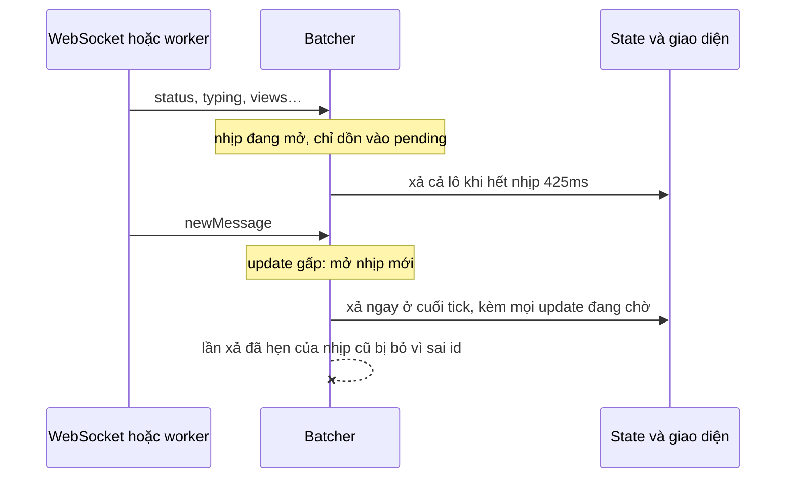

Một tài khoản Telegram vào vài chục nhóm lớn nhận update liên tục: ai đó vừa online, ai đó đang gõ, lượt xem của một bài trong kênh tăng, tin được đánh dấu đã đọc… Lúc cao điểm là hàng chục update mỗi giây, mỗi cái tới riêng lẻ qua kết nối realtime.

Áp từng update vào state ngay khi nó tới nghĩa là mỗi update một lần tính lại giao diện. Phần lớn các lần đó vô ích: không ai nhìn kịp chấm "online" đổi màu 30 lần mỗi giây. Nhưng gom lại thì phải trả lời hai câu hỏi: gom bao lâu, và **tin nhắn mới** có phải chờ cùng không?

Telegram Web A trả lời bằng khoảng 30 dòng trong `api/gramjs/provider.ts`.

> [!TIP]
> **Tóm tắt**
> - Update từ server dồn vào một mảng, **xả theo throttle 425ms**: con số này là trung bình thời lượng animation cuộn khi gửi tin (250–600ms), để không đổ update vào giữa animation.
> - Lần đầu sau một khoảng yên lặng thì **xả ngay** (leading edge), không bắt chờ.
> - Update **gấp** (tin mới, xoá tin, xoá lịch sử) mở một **nhịp mới**: xả ngay lập tức, các lần xả đã hẹn của nhịp cũ bị bỏ qua nhờ một id ngẫu nhiên.
> - Mỗi lần xả chạy ở **cuối tick** (microtask), nên các update tới trong cùng một tick đi chung một lần.

<iframe class="demo-frame" src="/demos/web-patterns/index.html?theme=dark#/tg-update-batching" title="Demo tg-update-batching" loading="lazy" style="height: 860px"></iframe>

<p class="demo-links">▶ <a href="/demos/web-patterns/index.html#/tg-update-batching" target="_blank" rel="noopener">Mở demo toàn màn hình ↗</a> · <a href="https://stackblitz.com/github/hunghg255/blog-hunghg/tree/master/examples/web-patterns?file=src/lib/tgUpdateBatcher.ts" target="_blank" rel="noopener">Sửa code trên StackBlitz ↗</a> · <a href="https://github.com/hunghg255/blog-hunghg/blob/master/examples/web-patterns/src/lib/tgUpdateBatcher.ts" target="_blank" rel="noopener">Xem source trên GitHub ↗</a></p>

Trong demo, kéo tốc độ lên 100 update/giây. Bỏ chọn **Gom 425ms**: khoảng 90 lần cập nhật giao diện mỗi giây, mỗi lần tốn 3ms giả lập, tức khoảng 280ms CPU mỗi giây chỉ để vẽ lại. Bật lại: còn khoảng 2–3 lần mỗi giây, dưới 10ms CPU. Bấm **✉ Tin mới**: tin hiện gần như ngay (dưới 1ms sau khi tới). Bỏ chọn **Tin mới mở nhịp mới**: tin mới phải chờ nhịp, trung bình khoảng 200–250ms (số đo trên Chromium lúc viết bài).

## Telegram làm thế nào?

### 30 dòng trong provider.ts

[`api/gramjs/provider.ts`](https://github.com/hunghg255/codebase/blob/main/web.telegram.org/src/api/gramjs/provider.ts) là nơi mọi update từ lớp GramJS (thư viện MTProto) đi qua trước khi tới phần giao diện:

```ts
const flushUpdatesOnTickEnd = throttleWithTickEnd(flushUpdates);

let flushUpdatesThrottled: typeof flushUpdatesOnTickEnd | undefined;
let currentThrottleId: number | undefined;

let pendingUpdates: ApiUpdate[] | undefined;

function handleUpdate(update: ApiUpdate) {
  (pendingUpdates ??= []).push(update); // bản gốc viết bằng if/else

  if (!flushUpdatesThrottled || API_THROTTLE_RESET_UPDATES.has(update['@type'])) {
    flushUpdatesThrottled = throttle(flushUpdatesOnTickEnd, API_UPDATE_THROTTLE, true);
    currentThrottleId = Math.random();
  }

  flushUpdatesThrottled(currentThrottleId!);
}

function flushUpdates(throttleId: number) {
  if (!pendingUpdates || throttleId !== currentThrottleId) {
    return;
  }

  const currentUpdates = pendingUpdates!;
  pendingUpdates = undefined;
  currentUpdates.forEach(onUpdate);
}
```

Và hai hằng số trong `config.ts`:

```ts
export const API_UPDATE_THROTTLE = Math.round((FAST_SMOOTH_MIN_DURATION + FAST_SMOOTH_MAX_DURATION) / 2);
export const API_THROTTLE_RESET_UPDATES = new Set([
  'newMessage', 'newScheduledMessage', 'deleteMessages', 'deleteScheduledMessages', 'deleteHistory',
]);
```

`FAST_SMOOTH_MIN_DURATION = 250` và `FAST_SMOOTH_MAX_DURATION = 600` là thời lượng tối thiểu và tối đa của animation cuộn mượt (đã phân tích trong bài [fastSmoothScroll](/blogs/web-telegram-fast-smooth-scroll)). Trung bình là 425ms. Cách chọn nhịp này có lẽ nhằm để mỗi lần đổ update vào giao diện cách nhau xấp xỉ một animation, giảm khả năng chen vào giữa animation (suy đoán từ cách đặt tên; code không có comment giải thích thêm).

### Ba lớp hẹn giờ lồng nhau

Đọc kỹ thì có ba cơ chế xếp chồng:

1. **`throttle(fn, 425, true)`** trong `util/schedulers.ts`: lần gọi đầu chạy `fn` ngay (tham số `true`), rồi mở một `setInterval` 425ms. Mỗi nhịp, nếu có lần gọi mới trong nhịp thì chạy `fn` với tham số mới nhất; nếu không thì `clearInterval` và dừng hẳn.
2. **`throttleWithTickEnd(flushUpdates)`**: dù được gọi bao nhiêu lần trong một tick, `flushUpdates` chỉ chạy một lần ở `Promise.resolve().then(…)`, tức cuối tick hiện tại. Mười update tới trong cùng một khối xử lý của WebSocket đi chung một lần xả.
3. **`currentThrottleId`**: mỗi update gấp tạo một **throttle hoàn toàn mới** với id ngẫu nhiên mới. Throttle mới chưa có interval nên lần gọi đầu chạy ngay. Interval của throttle cũ vẫn còn chạy thêm một nhịp, nhưng nếu nó gọi `flushUpdates(idCũ)` thì bị chặn ở dòng `throttleId !== currentThrottleId`.

Mẹo ở lớp 3 đáng học: thay vì viết một throttle có hàm "huỷ và chạy ngay", Telegram **bỏ hẳn** throttle cũ và để nó tự chết. Không cần giữ handle của interval, không có race giữa "huỷ" và "đang chạy".

Không có update nào bị mất khi đổi nhịp: `pendingUpdates` là biến dùng chung, nên lần xả ngay của nhịp mới mang theo cả các update cũ đang chờ, đúng thứ tự tới.

### Vì sao chỉ năm loại update là "gấp"

Năm loại trong `API_THROTTLE_RESET_UPDATES` đều làm **danh sách tin nhắn** thay đổi: thêm tin, xoá tin, xoá lịch sử. Đó là những thay đổi người dùng đang nhìn và chờ đợi (vừa có người nhắn, vừa xoá một tin). Trạng thái online, "đang gõ", lượt xem… trễ 400ms không ai nhận ra.

### Chỗ chạy: trong worker

`provider.ts` nằm trong thư mục `api/gramjs/`, phần chạy MTProto trong Web Worker (bên phía main thread chỉ có `api/gramjs/worker/provider.ts` nhận update qua `postMessage`). File worker entry đã biên dịch không có trong bản dump nên mình không xác minh được 100%, nhưng theo cấu trúc thư mục thì việc gom diễn ra **trước** khi update vượt ranh giới worker. Gom ở đó giảm cả số lần `postMessage` (mỗi lần đều phải structured clone dữ liệu) lẫn số lần cập nhật state ở main thread.

## Bên trong trình duyệt: vì sao React không tự gom giúp

React 18 trở đi có **automatic batching**: nhiều `setState` trong cùng một task (cùng một event handler, cùng một callback `setTimeout`, cùng một `then`) chỉ gây một lần render. Nhưng mỗi message WebSocket, mỗi `postMessage` từ worker là **một task riêng**. Mười update tới trong mười task là mười lần render, React không gom qua ranh giới task.



Gom ở tầng dữ liệu (trước khi gọi `setState`) là cách duy nhất để số lần render không tỉ lệ với số update.

## Viết lại

Bản viết lại gói cả ba lớp vào một hàm `createUpdateBatcher`, không dùng `setInterval`, và dùng `generation` (số tăng dần) thay cho `Math.random()`:

```ts title=src/lib/tgUpdateBatcher.ts
  function flushNow(gen: number) {
    if (gen !== generation || pending.length === 0) return;
    const batch = pending;
    pending = [];
    flush(batch);
  }

  /** Xả ở cuối tick hiện tại: update tới cùng tick đi chung một lần. */
  function flushOnTickEnd() {
    if (microtaskQueued) return;
    microtaskQueued = true;
    const gen = generation;
    queueMicrotask(() => {
      microtaskQueued = false;
      flushNow(gen);
    });
  }

  function startWindow() {
    timer = setTimeout(function tick() {
      if (!hasTrailing) {
        timer = undefined; // yên lặng cả một nhịp: dừng hẳn
        return;
      }
      hasTrailing = false;
      flushOnTickEnd();
      timer = setTimeout(tick, intervalMs);
    }, intervalMs);
  }

  function push(update: U) {
    pending.push(update);
    if (isUrgent(update)) {
      // nhịp mới: huỷ lịch cũ, xả ngay ở cuối tick
      generation++;
      clearTimeout(timer);
      timer = undefined;
      hasTrailing = false;
      microtaskQueued = false;
    }
    if (timer === undefined) {
      flushOnTickEnd(); // leading edge
      startWindow();
    } else {
      hasTrailing = true;
    }
  }
```

::: spoiler Xem toàn bộ src/lib/tgUpdateBatcher.ts

```ts title=src/lib/tgUpdateBatcher.ts
/**
 * Gom update realtime theo nhịp (ý tưởng từ Telegram Web A: api/gramjs/provider.ts).
 *
 * - Update từ server (trạng thái online, đang gõ, lượt xem…) dồn vào một mảng, xả theo
 *   throttle 425ms: con số này là trung bình thời lượng animation cuộn khi gửi tin
 *   (250–600ms), để không đổ update vào giữa animation.
 * - Lần đầu sau một khoảng yên lặng thì xả ngay (leading edge), không bắt chờ.
 * - Update "gấp" (tin mới, xoá tin) mở một nhịp MỚI: xả ngay lập tức, các lần xả đã hẹn
 *   của nhịp cũ mang generation cũ nên bị bỏ qua.
 * - Xả ở cuối tick (microtask) để mọi update tới trong cùng một tick đi chung một lần.
 */

export interface BatcherOptions<U> {
  flush: (updates: U[]) => void;
  /** update loại nào cần hiện ngay */
  isUrgent?: (update: U) => boolean;
  /** Telegram: API_UPDATE_THROTTLE = round((250 + 600) / 2) = 425 */
  intervalMs?: number;
}

export function createUpdateBatcher<U>({ flush, isUrgent = () => false, intervalMs = 425 }: BatcherOptions<U>) {
  let pending: U[] = [];
  let generation = 0;
  let timer: ReturnType<typeof setTimeout> | undefined;
  // có update tới sau lần xả gần nhất của nhịp hiện tại
  let hasTrailing = false;
  let microtaskQueued = false;

  function flushNow(gen: number) {
    if (gen !== generation || pending.length === 0) return;
    const batch = pending;
    pending = [];
    flush(batch);
  }

  /** Xả ở cuối tick hiện tại: update tới cùng tick đi chung một lần. */
  function flushOnTickEnd() {
    if (microtaskQueued) return;
    microtaskQueued = true;
    const gen = generation;
    queueMicrotask(() => {
      microtaskQueued = false;
      flushNow(gen);
    });
  }

  function startWindow() {
    timer = setTimeout(function tick() {
      if (!hasTrailing) {
        timer = undefined; // yên lặng cả một nhịp: dừng hẳn
        return;
      }
      hasTrailing = false;
      flushOnTickEnd();
      timer = setTimeout(tick, intervalMs);
    }, intervalMs);
  }

  function push(update: U) {
    pending.push(update);
    if (isUrgent(update)) {
      // nhịp mới: huỷ lịch cũ, xả ngay ở cuối tick
      generation++;
      clearTimeout(timer);
      timer = undefined;
      hasTrailing = false;
      microtaskQueued = false;
    }
    if (timer === undefined) {
      flushOnTickEnd(); // leading edge
      startWindow();
    } else {
      hasTrailing = true;
    }
  }

  function destroy() {
    clearTimeout(timer);
    timer = undefined;
    pending = [];
    generation++;
  }

  return { push, destroy, getPendingCount: () => pending.length };
}

export type UpdateBatcher<U> = ReturnType<typeof createUpdateBatcher<U>>;
```

:::

## Đi qua code

- **`push`** luôn đưa update vào `pending` trước, nên update gấp không bao giờ "vượt" update thường tới trước nó.
- **Update gấp** tăng `generation`, huỷ timer của nhịp cũ và quên trạng thái của nó. Vì `timer` lúc này là `undefined`, nhánh dưới chạy y như lần đầu: xả ngay ở cuối tick và mở nhịp mới.
- **`flushOnTickEnd`** dùng `queueMicrotask`, cùng ý nghĩa với `Promise.resolve().then` của bản gốc. Cờ `microtaskQueued` đảm bảo mỗi tick chỉ có một microtask.
- **`flushNow(gen)`** so `gen` với `generation` hiện tại, giống `throttleId !== currentThrottleId` của Telegram. Ở bản này timer cũ đã bị `clearTimeout` nên phép so chủ yếu chặn microtask đã xếp hàng từ trước khi đổi nhịp.
- **`startWindow`** dùng chuỗi `setTimeout` thay `setInterval`: hết nhịp mà không có gì mới thì dừng, không để interval chạy không.
- **`destroy`** tăng `generation` để mọi microtask đang chờ thành vô hiệu, rồi xoá `pending`.

**Khác bản gốc:** huỷ timer cũ thay vì để interval cũ tự chết; `generation` tuần tự thay `Math.random()` (về lý thuyết hai số ngẫu nhiên có thể trùng, dù xác suất không đáng kể); `isUrgent` là tham số thay cho một `Set` tên update cố định.

## Tại sao không làm cách khác?

**Debounce thay vì throttle?** Debounce chờ tới khi update **ngừng** tới. Với luồng update không bao giờ ngừng (nhóm lớn lúc cao điểm), debounce không bao giờ xả. Throttle đảm bảo xả đều đặn.

**`requestAnimationFrame` làm nhịp?** Tối đa 60 lần mỗi giây (hoặc 120 trên màn hình 120Hz), vẫn quá nhiều cho update trạng thái; và rAF dừng hẳn khi tab ở nền, update dồn lại không giới hạn. 425ms là nhịp thưa hơn nhiều, có chủ đích.

**Không gom, để React/Vue tự tối ưu?** Như phần trên: framework chỉ gom trong một task. Ngoài render, mỗi update còn đi qua reducer, selector, so sánh props của mọi component đang kết nối store. Giảm số lần xả là giảm toàn bộ chuỗi đó.

**Gom cả tin mới?** Thử trong demo: tin mới trễ trung bình khoảng nửa nhịp, tức 200ms. Với chat, đó là độ trễ người dùng cảm nhận được khi hai người nhắn qua lại.

## Edge case và cạm bẫy

- **Bão update gấp.** Trong nhóm cực sôi động, tin mới tới liên tục, mỗi tin mở một nhịp mới và xả ngay. Throttle gần như mất tác dụng đúng lúc tải cao nhất. Nếu gặp tình huống này, có thể giới hạn: update gấp chỉ được mở nhịp mới nếu lần xả gần nhất đã cách ít nhất 50–100ms.
- **Thứ tự update phải được giữ.** Đừng tách hàng đợi riêng cho update gấp và update thường: một `deleteMessages` xả trước `newMessage` của chính tin đó sẽ để lại tin "ma". Một mảng `pending` duy nhất tránh được điều này.
- **Tab ở nền.** Trình duyệt kẹp `setTimeout` ở tab nền tối thiểu 1 giây (Chrome còn kẹp mạnh hơn sau vài phút). Update vẫn dồn đủ, chỉ xả thưa hơn. Với số lượng rất lớn, cân nhắc gộp các update cùng loại cùng đối tượng (chỉ giữ trạng thái online mới nhất của mỗi user) trước khi xả.
- **Lỗi trong `flush`.** Nếu hàm áp update ném lỗi, lô đó mất. Bọc `flush` trong `try/catch` hoặc báo lỗi cho từng update, đừng để một update hỏng làm mất cả lô.

## Dùng trong dự án

Với WebSocket và một store bất kỳ:

```ts
type ServerEvent = { type: 'presence' | 'typing' | 'message:new' | 'message:deleted'; payload: unknown };

const batcher = createUpdateBatcher<ServerEvent>({
  intervalMs: 400,
  isUrgent: (e) => e.type === 'message:new' || e.type === 'message:deleted',
  flush: (events) => {
    // một lần cập nhật store cho cả lô
    store.setState((state) => events.reduce(applyEvent, state));
  },
});

socket.addEventListener('message', (e) => batcher.push(JSON.parse(e.data)));
```

`applyEvent` là reducer thuần cho từng sự kiện. Lô được áp bằng một lần `setState`, nên mọi subscriber của store chỉ được báo một lần.

::: spoiler Ví dụ test (bản phác, không có trong repo)

```ts
import { afterEach, beforeEach, describe, expect, it, vi } from 'vitest';
import { createUpdateBatcher } from './tgUpdateBatcher';

type U = { type: 'status' | 'new'; n: number };
const tick = () => Promise.resolve();

describe('createUpdateBatcher', () => {
  beforeEach(() => vi.useFakeTimers());
  afterEach(() => vi.useRealTimers());

  it('lần đầu xả ngay ở cuối tick, các update cùng tick đi chung', async () => {
    const batches: U[][] = [];
    const b = createUpdateBatcher<U>({ flush: (x) => batches.push(x) });
    b.push({ type: 'status', n: 1 });
    b.push({ type: 'status', n: 2 });
    expect(batches).toHaveLength(0);
    await tick();
    expect(batches).toEqual([[{ type: 'status', n: 1 }, { type: 'status', n: 2 }]]);
  });

  it('trong nhịp thì dồn, hết nhịp mới xả', async () => {
    const batches: U[][] = [];
    const b = createUpdateBatcher<U>({ flush: (x) => batches.push(x), intervalMs: 425 });
    b.push({ type: 'status', n: 1 });
    await tick();
    for (let i = 2; i <= 10; i++) {
      vi.advanceTimersByTime(40);
      b.push({ type: 'status', n: i });
    }
    await tick();
    expect(batches).toHaveLength(1);
    vi.advanceTimersByTime(425);
    await tick();
    expect(batches).toHaveLength(2);
    expect(batches[1].map((u) => u.n)).toEqual([2, 3, 4, 5, 6, 7, 8, 9, 10]);
  });

  it('update gấp xả ngay, mang theo update đang chờ, và lịch cũ không xả lại', async () => {
    const batches: U[][] = [];
    const b = createUpdateBatcher<U>({ flush: (x) => batches.push(x), isUrgent: (u) => u.type === 'new' });
    b.push({ type: 'status', n: 1 });
    await tick();
    vi.advanceTimersByTime(100);
    b.push({ type: 'status', n: 2 });
    b.push({ type: 'new', n: 3 });
    await tick();
    expect(batches[1].map((u) => u.n)).toEqual([2, 3]);
    vi.advanceTimersByTime(1000);
    await tick();
    expect(batches).toHaveLength(2);
  });

  it('yên lặng cả một nhịp thì dừng hẳn, update sau đó lại được xả ngay', async () => {
    const batches: U[][] = [];
    const b = createUpdateBatcher<U>({ flush: (x) => batches.push(x) });
    b.push({ type: 'status', n: 1 });
    await tick();
    vi.advanceTimersByTime(2000);
    b.push({ type: 'status', n: 2 });
    await tick();
    expect(batches).toHaveLength(2);
  });
});
```

:::

## So với thư viện

- **RxJS** có `bufferTime(425)` (xả theo chu kỳ, kể cả lô rỗng) và `throttleTime` với cấu hình `{ leading, trailing }`. Kết hợp "update gấp mở nhịp mới" thì cần thêm `switchMap` hoặc tự viết operator; logic trên ngắn hơn khi chỉ có một luồng.
- **lodash `throttle`** có `leading`/`trailing` và hàm `.flush()`, `.cancel()`. Có thể dựng lại hành vi trên bằng `throttled.flush()` khi gặp update gấp, nhưng không có bước "gom về cuối tick".
- **`scheduler.postTask`** (có trên Chromium, tính tới 10/2026 chưa có trên mọi trình duyệt) cho phép đặt độ ưu tiên `user-blocking` / `background` cho từng tác vụ. Nó giúp quyết định **khi nào** chạy lần xả, không thay được việc **gom** update.

---

Bài này thuộc series **[Học từ mã nguồn Telegram](/series/telegram)** (15 bài, đọc theo thứ tự).

::: spoiler Xem nhanh danh sách bài trong series

*Mở đầu*

- [Mở đầu: bên trong Telegram Web A](/blogs/learn-from-telegram-source-code)

*Phần 1: dữ liệu và đồng bộ*

- [#1 Gửi tin lạc quan, khớp tin thật bằng randomId](/blogs/telegram-optimistic-send)
- [#2 Lịch sử tin nhắn chia hai đảo](/blogs/telegram-message-history-islands)
- [#3 Lưu global state lúc rảnh, chỉ giữ phần cần](/blogs/telegram-persist-global-state)
- **#4 Gom update realtime theo nhịp animation** (bài này)
- [#5 Store tự viết và diff danh sách có key](/blogs/telegram-teactn-store-fast-list)

*Phần 2: animation và giao diện*

- [#6 Animation sắp xếp danh sách chat không đo DOM](/blogs/telegram-chat-list-flip)
- [#7 Ảnh bay giữa hai cây DOM trong media viewer](/blogs/telegram-media-viewer-ghost)
- [#8 Bố cục album chọn theo hàm chi phí](/blogs/telegram-album-layout)
- [#9 Giờ gửi nằm gọn trong bong bóng chat](/blogs/telegram-bubble-meta-spacer)
- [#10 Composer biến hình, Transition và gạch chân tab](/blogs/telegram-composer-morph-transition)

*Phần 3: media, mobile, thông báo*

- [#11 Thumbnail 100 byte và viền sticker nén](/blogs/telegram-tiny-thumbnails)
- [#12 Player sticker: DPR, hạ fps, cache khung](/blogs/telegram-lottie-player)
- [#13 Mobile: --vh, bàn phím ảo, nhấn giữ, số điện thoại](/blogs/telegram-mobile-viewport-touch)
- [#14 Web Push không trùng và đánh dấu đã đọc](/blogs/telegram-push-dedupe-read-receipts)

:::

Code + demo: [`examples/web-patterns`](https://github.com/hunghg255/blog-hunghg/tree/master/examples/web-patterns) · [Mở trên StackBlitz](https://stackblitz.com/github/hunghg255/blog-hunghg/tree/master/examples/web-patterns)
