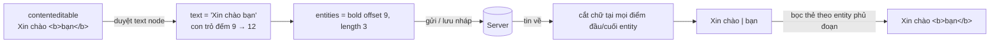

Ô soạn tin của Telegram trông như một ô chữ bình thường, nhưng bôi đen một từ thì hiện thanh định dạng **B** _I_ U ~~S~~ `</>`; gõ `**đậm**` thì chữ tự đậm; bỏ dở một tin, chuyển chat rồi quay lại thì nháp vẫn còn, kể cả trên máy khác.

Phía sau, Telegram **không lưu và không gửi HTML**. Server chỉ nhận chữ thuần cộng một danh sách "entity": đoạn nào đậm, đoạn nào là link, tính bằng `offset` và `length`. Ô soạn tin là `contenteditable`, nên app phải đổi qua lại hai chiều mỗi lần gửi, mỗi lần lưu nháp và mỗi lần hiển thị tin.

> [!TIP]
> **Tóm tắt**
> - Định dạng của tin nhắn Telegram là `{ text, entities: [{ type, offset, length }] }`, không phải HTML. Chiều đi: duyệt cây DOM của ô soạn tin để tính entity. Chiều về: cắt chữ theo entity để dựng lại HTML.
> - Bản gốc tính offset bằng `indexOf` trên chữ đã cắt, và regex markdown `__nghiêng__` bị chép nhầm từ nhánh `**` nên `__a__ và __b__` thành **một** đoạn nghiêng dài. Bản viết lại đếm offset trực tiếp khi duyệt và sửa regex.
> - Thanh định dạng nổi: lấy `getBoundingClientRect()` của vùng chọn, đặt ở tâm, kẹp trong `[90, width − 90]` để không tràn mép.
> - Nháp lưu theo debounce, nhưng callback **kiểm tra chat lúc chạy** còn trùng chat lúc gõ không; rời chat, ẩn tab, đóng trang thì lưu ngay.

<iframe class="demo-frame" src="/demos/web-patterns/index.html?theme=dark#/tg-entities" title="Demo tg-entities" loading="lazy" style="height: 1120px"></iframe>

<p class="demo-links">▶ <a href="/demos/web-patterns/index.html#/tg-entities" target="_blank" rel="noopener">Mở demo toàn màn hình ↗</a> · <a href="https://stackblitz.com/github/hunghg255/blog-hunghg/tree/master/examples/web-patterns?file=src/lib/tgEntities.ts" target="_blank" rel="noopener">Sửa code trên StackBlitz ↗</a> · <a href="https://github.com/hunghg255/blog-hunghg/blob/master/examples/web-patterns/src/lib/tgEntities.ts" target="_blank" rel="noopener">Xem source trên GitHub ↗</a></p>

Trong demo: gõ `Xin chào **bạn** nhé`, bôi đen "nhé" rồi bấm _I_ và xem JSON bên phải. Phần **Nháp theo chat**: gõ trong _Mẹ_ rồi chuyển ngay sang _Nhóm dự án_; bỏ chọn ô "có kiểm tra chat" là nháp của Mẹ bị lưu vào nhóm.

## Telegram làm thế nào?

### Định dạng của một tin nhắn

API MTProto mô tả tin nhắn là chữ thuần và một mảng `MessageEntity`. Web A dùng kiểu `ApiFormattedText`:

```ts
interface ApiFormattedText {
  text: string;
  entities?: ApiMessageEntity[]; // { type, offset, length, url?, userId? }
}
```

`offset` và `length` tính theo đơn vị UTF-16, giống `String.prototype.length` trong JS. Một emoji như 😀 chiếm 2 đơn vị, nên mọi phép tính offset phải dùng đúng đơn vị đó.

Cách lưu này có lợi thật: server không phải lọc HTML độc hại, mọi client (iOS, Android, desktop, web) hiển thị giống nhau, và tìm kiếm chạy trên chữ thuần.

### Chiều đi: HTML → entities

[`components/middle/composer/helpers/parseMessageInput.ts`](https://github.com/hunghg255/codebase/blob/main/web.telegram.org/src/components/middle/composer/helpers/parseMessageInput.ts) làm ba bước:

1. **Chuẩn hoá HTML** bằng chuỗi regex: bỏ `<span>`, đổi `&nbsp;` thành dấu cách, `<div><br></div>` (Safari) và `<br>` thành `\n`, rồi áp markdown nhanh.
2. Lấy `innerText`, `trim()`, bỏ zero-width space, cắt còn **4096** ký tự (`MAX_MESSAGE_LENGTH`).
3. Duyệt cây DOM, sâu tối đa 3 tầng (`MAX_TAG_DEEPNESS`). Mỗi thẻ như `B`, `STRONG`, `I`, `CODE`, `PRE`, `A`… thành một entity, với offset tìm bằng `indexOf`:

```ts
// trích, đã rút gọn
const rawIndex = rawText.indexOf(node.textContent, textIndex);
const index = rawIndex >= 0 ? rawIndex : textIndex;
const offset = rawText.substring(0, index).length; // thực ra chính là index
```

Vì chữ đã bị `trim()` và bỏ ký tự ở bước 2, vị trí trong DOM không còn khớp với vị trí trong chuỗi, nên code phải **tìm lại** đoạn chữ của thẻ. Cách này chạy được trong đa số trường hợp, nhưng gặp đoạn chữ lặp lại thì có thể gán nhầm chỗ: lúc đó `indexOf` chỉ dựa vào con trỏ `textIndex` để không bắt nhầm lần xuất hiện trước. Bước 3 cũng chỉ đi sâu 3 tầng, nên thẻ lồng sâu hơn (đậm trong nghiêng trong link trong trích dẫn) bị bỏ qua.

### Bug trong markdown nhanh

Năm regex markdown nằm liền nhau:

```ts
parsedHtml = parsedHtml.replace(/[*]{2}([^*\n]+)[*]{2}/g, '<b>$1</b>');
parsedHtml = parsedHtml.replace(/[_]{2}([^*\n]+)[_]{2}/g, '<i>$1</i>');
parsedHtml = parsedHtml.replace(/[~]{2}([^~\n]+)[~]{2}/g, '<s>$1</s>');
```

Dòng thứ hai là bản chép của dòng đầu, nhưng quên đổi `[^*\n]` thành `[^_\n]`. Hệ quả chạy thử bằng Node:

| Gõ | Bản gốc | Đúng ra |
|---|---|---|
| `__a__ và __b__` | `<i>a__ và __b</i>` | `<i>a</i> và <i>b</i>` |
| `__x*y__` | không đổi gì | `<i>x*y</i>` |

Dòng đầu hỏng vì `[^*\n]+` cho phép cả dấu `_`, nên phần giữa nuốt luôn cặp `__` đóng của đoạn thứ nhất và cặp mở của đoạn thứ hai. Dòng sau hỏng vì dấu `*` bị cấm sai chỗ.

### Chiều về: entities → HTML

[`components/common/helpers/renderMessageText.tsx`](https://github.com/hunghg255/codebase/blob/main/web.telegram.org/src/components/common/helpers/renderMessageText.tsx) có hàm `organizeEntities` biến danh sách phẳng thành cây: entity nào có `offset` nằm trong khoảng của entity trước thì thành con của nó. Sau đó `renderEntity` đệ quy, cắt chữ trước, trong và sau mỗi entity, và xoá dấu `\n` ngay sau khối `<pre>` (vì `<pre>` đã là một khối riêng).

Cách dựng cây giả định entity **lồng nhau gọn gàng**. Telegram cho phép entity chồng lệch (đậm 0–5, nghiêng 3–8, do client khác gửi lên); khi đó entity "con" thò ra ngoài cha và phần thò ra không được tính đúng. Cách tìm con cũng là `filter` + `indexOf` lồng nhau, tức O(n²) theo số entity. Với tin thường có vài entity thì không sao.

### Thanh định dạng nổi

[`MessageInput.tsx`](https://github.com/hunghg255/codebase/blob/main/web.telegram.org/src/components/middle/composer/MessageInput.tsx) mở thanh định dạng khi `mouseup` hoặc `keyup` để lại một vùng chọn khác rỗng, nằm trong ô nhập (đi ngược tối đa 5 cha, `helpers/selection.ts`) và không phải chuỗi toàn emoji. Vị trí ngang là tâm vùng chọn, kẹp trong `[90, width − 90]` (`TEXT_FORMATTER_SAFE_AREA_PX = 90`) để thanh không tràn ra ngoài ô.

[`TextFormatter.tsx`](https://github.com/hunghg255/codebase/blob/main/web.telegram.org/src/components/middle/composer/TextFormatter.tsx) dùng `document.execCommand`: `bold`, `italic`, `underline`, và `insertHTML` cho `<del>`, `<code>`, link. Một mẹo nhỏ: bôi lần hai để bỏ đậm không ăn trên mọi trình duyệt, nên code gọi `removeFormat` rồi áp lại các định dạng còn lại. Link được chèn với `encodeURI(url)` và tiền tố `http://` nếu thiếu.

Cùng file có một bug nhỏ (ngoài phạm vi định dạng): khi mở menu chuột phải, hai listener đóng menu được gắn vào `document` với sự kiện `mousedown`/`keydown`, nhưng lại gỡ ở `window` với `mouseup`/`keydown`. Gỡ ở chỗ khác với chỗ gắn thì không bao giờ gỡ được, nên mỗi lần chuột phải lại để thừa hai listener.

### Nháp theo từng chat

[`hooks/useDraft.ts`](https://github.com/hunghg255/codebase/blob/main/web.telegram.org/src/components/middle/composer/hooks/useDraft.ts) lưu nháp ở dạng `{ text, entities }` (qua chính `parseMessageInput`), không phải HTML. Có bốn lúc lưu:

- khi gõ: debounce (`DRAFT_DEBOUNCE`);
- khi xoá trắng: lưu ngay (xoá nháp);
- khi đổi chat: trong hàm dọn dẹp của effect;
- khi tab ẩn (`useBackgroundMode`) và khi đóng trang (`useBeforeUnload`).

Chỗ khéo là hai biến **cấp module** `currentChatId`/`currentThreadId`. Callback debounce được hẹn lúc đang ở chat A; nếu người dùng đã chuyển sang B trước khi nó chạy, callback thấy `currentChatId !== chatId` và bỏ qua. Không có kiểm tra này thì nội dung của A có thể bị lưu nhầm vào B, như demo cho thấy.

## Bên trong trình duyệt: offset tính theo gì



Ba chi tiết của trình duyệt quyết định cách viết:

- **`contenteditable` không có định dạng chuẩn.** Chrome bọc dòng mới trong `<div>`, Safari thêm `<div><br></div>` cho dòng trống và để lại `<br>` khi xoá hết chữ; `execCommand('bold')` có thể sinh `<b>` hoặc `<span style="font-weight:bold">` tuỳ trình duyệt. Code đọc HTML phải chấp nhận cả mấy dạng.
- **`innerText` khác `textContent`.** `innerText` phụ thuộc layout: thêm `\n` cho khối, bỏ chữ bị ẩn. Lấy `innerText` rồi đi tìm lại vị trí bằng `textContent` của từng thẻ, như bản gốc, là ghép hai hệ đếm khác nhau.
- **`execCommand` đã bị đánh dấu deprecated** nhưng vẫn là cách duy nhất để có undo/redo tự nhiên trong `contenteditable` mà không tự viết editor (tính tới 10/2026 chưa có API thay thế chuẩn).

## Viết lại

Chiều đi: đếm offset ngay khi duyệt, không tìm lại bằng `indexOf`.

```ts title=src/lib/tgEntities.ts
// ---------- HTML → { text, entities } ----------

/**
 * Duyệt cây DOM và tính offset bằng một con trỏ chạy theo từng text node.
 * Bản gốc lấy `innerText` trước rồi tìm lại vị trí bằng `indexOf(node.textContent)`,
 * dễ gán nhầm khi cùng một đoạn chữ lặp lại; ở đây offset luôn đúng vì đếm trực tiếp.
 */
export function parseEditorHtml(root: HTMLElement): FormattedText {
  let text = '';
  const entities: MessageEntity[] = [];

  const walk = (node: Node) => {
    if (node.nodeType === Node.TEXT_NODE) {
      // &nbsp; của contenteditable thành dấu cách thường; bỏ zero-width space
      text += (node.textContent ?? '').replace(/ /g, ' ').replace(/​/g, '');
      return;
    }
    if (!(node instanceof HTMLElement)) return;

    if (node.tagName === 'BR') {
      text += '\n';
      return;
    }

    // Chrome bọc mỗi dòng mới trong <div>; Safari dùng <div><br></div> cho dòng trống
    const isBlock = node.tagName === 'DIV' || node.tagName === 'P';
    if (isBlock && text.length > 0 && !text.endsWith('\n')) text += '\n';

    const type = TYPE_BY_TAG[node.tagName];
    const start = text.length;
    node.childNodes.forEach(walk);
    const length = text.length - start;

    if (type && length > 0) {
      const entity: MessageEntity = { type, offset: start, length };
      if (type === 'link') entity.url = (node as HTMLAnchorElement).href;
      entities.push(entity);
    }
  };

  root.childNodes.forEach(walk);
  return trimFormattedText({ text, entities });
}
```

Markdown nhanh giữ nguyên năm regex của bản gốc, chỉ sửa nhánh `__` thành `/_{2}([^_\n]+)_{2}/g` (regex gốc vẫn được export để demo so sánh).

Chiều về: thay vì dựng cây, cắt chữ tại **mọi** điểm đầu/cuối entity. Mỗi đoạn biết những entity nào phủ nó, rồi bọc thẻ tương ứng. Cách này chịu được entity chồng lệch.

```ts title=src/lib/tgEntities.ts
/**
 * Cắt chữ thành các đoạn tại MỌI điểm đầu/cuối entity, mỗi đoạn biết những entity nào phủ nó.
 * Cách này chịu được entity chồng lệch (đậm 0–5, nghiêng 3–8), thứ mà cây lồng nhau của
 * bản gốc (organizeEntities) giả định là không có.
 */
export function toSegments({ text, entities }: FormattedText) {
  const cuts = new Set([0, text.length]);
  for (const e of entities) {
    cuts.add(Math.max(0, Math.min(text.length, e.offset)));
    cuts.add(Math.max(0, Math.min(text.length, e.offset + e.length)));
  }
  const points = [...cuts].sort((a, b) => a - b);
  const segments: { text: string; entities: MessageEntity[] }[] = [];
  for (let i = 0; i < points.length - 1; i++) {
    const [from, to] = [points[i], points[i + 1]];
    segments.push({
      text: text.slice(from, to),
      entities: entities.filter((e) => e.offset <= from && e.offset + e.length >= to),
    });
  }
  return segments;
}

export function renderFormattedHtml(formatted: FormattedText): string {
  return toSegments(formatted)
    .map(({ text, entities }) => {
      const body = escapeHtml(text).replace(/\n/g, '<br>');
      // entity dài hơn bọc ngoài, để <a> không bị cắt vụn khi có đậm bên trong
      const sorted = [...entities].sort((a, b) => b.length - a.length);
      return sorted.map((e) => OPEN[e.type](e)).join('') + body + sorted.map((e) => CLOSE[e.type]).reverse().join('');
    })
    .join('');
}
```

Nháp với debounce có kiểm tra chat nằm ở cuối file (`createDraftStore`), xem trong phần đầy đủ bên dưới.

::: spoiler Xem toàn bộ src/lib/tgEntities.ts

```ts title=src/lib/tgEntities.ts
/**
 * Rich text ⇄ { text, entities } kiểu Telegram (Telegram #15).
 *
 * Tin nhắn Telegram không lưu HTML. Server nhận chữ thuần + danh sách entity
 * `{ type, offset, length }` (offset tính theo UTF-16, giống String.length của JS).
 * Ô soạn tin là contenteditable nên phải đổi qua lại hai chiều:
 *   HTML của editor  → parse → { text, entities } → gửi / lưu nháp
 *   { text, entities } → render → HTML để hiện trong bong bóng hoặc khôi phục nháp
 */

export type EntityType = 'bold' | 'italic' | 'underline' | 'strike' | 'code' | 'pre' | 'link';

export interface MessageEntity {
  type: EntityType;
  offset: number;
  length: number;
  url?: string;
}

export interface FormattedText {
  text: string;
  entities: MessageEntity[];
}

export const MAX_MESSAGE_LENGTH = 4096;

const TYPE_BY_TAG: Record<string, EntityType> = {
  B: 'bold',
  STRONG: 'bold',
  I: 'italic',
  EM: 'italic',
  U: 'underline',
  S: 'strike',
  STRIKE: 'strike',
  DEL: 'strike',
  CODE: 'code',
  PRE: 'pre',
  A: 'link',
};

// ---------- Markdown nhanh: gõ **đậm**, __nghiêng__, ~~gạch~~, `code` ----------

/** Regex của bản gốc: nhánh `__` chép từ nhánh `**` nên vẫn loại trừ `*` thay vì `_`. */
export const ORIGINAL_ITALIC_RE = /[_]{2}([^*\n]+)[_]{2}/g;
/** Đã sửa: bên trong không được chứa `_`, nên không nuốt từ cặp `__` này sang cặp sau. */
export const FIXED_ITALIC_RE = /_{2}([^_\n]+)_{2}/g;

export function applyQuickMarkdown(text: string, italicRe: RegExp = FIXED_ITALIC_RE): string {
  return text
    .replace(/`{3}([^`]+)`{3}/g, '<pre>$1</pre>')
    .replace(/`([^`\n]+)`/g, '<code>$1</code>')
    .replace(/\*{2}([^*\n]+)\*{2}/g, '<b>$1</b>')
    .replace(italicRe, '<i>$1</i>')
    .replace(/~{2}([^~\n]+)~{2}/g, '<s>$1</s>');
}

// ---------- HTML → { text, entities } ----------

/**
 * Duyệt cây DOM và tính offset bằng một con trỏ chạy theo từng text node.
 * Bản gốc lấy `innerText` trước rồi tìm lại vị trí bằng `indexOf(node.textContent)`,
 * dễ gán nhầm khi cùng một đoạn chữ lặp lại; ở đây offset luôn đúng vì đếm trực tiếp.
 */
export function parseEditorHtml(root: HTMLElement): FormattedText {
  let text = '';
  const entities: MessageEntity[] = [];

  const walk = (node: Node) => {
    if (node.nodeType === Node.TEXT_NODE) {
      // &nbsp; của contenteditable thành dấu cách thường; bỏ zero-width space
      text += (node.textContent ?? '').replace(/ /g, ' ').replace(/​/g, '');
      return;
    }
    if (!(node instanceof HTMLElement)) return;

    if (node.tagName === 'BR') {
      text += '\n';
      return;
    }

    // Chrome bọc mỗi dòng mới trong <div>; Safari dùng <div><br></div> cho dòng trống
    const isBlock = node.tagName === 'DIV' || node.tagName === 'P';
    if (isBlock && text.length > 0 && !text.endsWith('\n')) text += '\n';

    const type = TYPE_BY_TAG[node.tagName];
    const start = text.length;
    node.childNodes.forEach(walk);
    const length = text.length - start;

    if (type && length > 0) {
      const entity: MessageEntity = { type, offset: start, length };
      if (type === 'link') entity.url = (node as HTMLAnchorElement).href;
      entities.push(entity);
    }
  };

  root.childNodes.forEach(walk);
  return trimFormattedText({ text, entities });
}

/** Cắt khoảng trắng hai đầu và giới hạn 4096 ký tự, dời offset của entity theo. */
export function trimFormattedText({ text, entities }: FormattedText): FormattedText {
  const lead = text.length - text.trimStart().length;
  const trimmed = text.trim().slice(0, MAX_MESSAGE_LENGTH);
  const result: MessageEntity[] = [];
  for (const entity of entities) {
    const start = Math.max(0, entity.offset - lead);
    const end = Math.min(trimmed.length, entity.offset + entity.length - lead);
    if (end > start) result.push({ ...entity, offset: start, length: end - start });
  }
  result.sort((a, b) => a.offset - b.offset || b.length - a.length);
  return { text: trimmed, entities: result };
}

// ---------- { text, entities } → HTML ----------

const escapeHtml = (s: string) =>
  s.replace(/&/g, '&amp;').replace(/</g, '&lt;').replace(/>/g, '&gt;').replace(/"/g, '&quot;');

const OPEN: Record<EntityType, (e: MessageEntity) => string> = {
  bold: () => '<b>',
  italic: () => '<i>',
  underline: () => '<u>',
  strike: () => '<s>',
  code: () => '<code>',
  pre: () => '<pre>',
  link: (e) => `<a href="${escapeHtml(safeUrl(e.url))}" target="_blank" rel="noopener noreferrer">`,
};
const CLOSE: Record<EntityType, string> = {
  bold: '</b>',
  italic: '</i>',
  underline: '</u>',
  strike: '</s>',
  code: '</code>',
  pre: '</pre>',
  link: '</a>',
};

function safeUrl(url = '') {
  try {
    const { protocol } = new URL(url, 'https://example.invalid');
    return protocol === 'http:' || protocol === 'https:' || protocol === 'mailto:' || protocol === 'tel:'
      ? url
      : '#';
  } catch {
    return '#';
  }
}

/**
 * Cắt chữ thành các đoạn tại MỌI điểm đầu/cuối entity, mỗi đoạn biết những entity nào phủ nó.
 * Cách này chịu được entity chồng lệch (đậm 0–5, nghiêng 3–8), thứ mà cây lồng nhau của
 * bản gốc (organizeEntities) giả định là không có.
 */
export function toSegments({ text, entities }: FormattedText) {
  const cuts = new Set([0, text.length]);
  for (const e of entities) {
    cuts.add(Math.max(0, Math.min(text.length, e.offset)));
    cuts.add(Math.max(0, Math.min(text.length, e.offset + e.length)));
  }
  const points = [...cuts].sort((a, b) => a - b);
  const segments: { text: string; entities: MessageEntity[] }[] = [];
  for (let i = 0; i < points.length - 1; i++) {
    const [from, to] = [points[i], points[i + 1]];
    segments.push({
      text: text.slice(from, to),
      entities: entities.filter((e) => e.offset <= from && e.offset + e.length >= to),
    });
  }
  return segments;
}

export function renderFormattedHtml(formatted: FormattedText): string {
  return toSegments(formatted)
    .map(({ text, entities }) => {
      const body = escapeHtml(text).replace(/\n/g, '<br>');
      // entity dài hơn bọc ngoài, để <a> không bị cắt vụn khi có đậm bên trong
      const sorted = [...entities].sort((a, b) => b.length - a.length);
      return sorted.map((e) => OPEN[e.type](e)).join('') + body + sorted.map((e) => CLOSE[e.type]).reverse().join('');
    })
    .join('');
}

// ---------- Thanh định dạng nổi ----------

export const TOOLBAR_SAFE_AREA = 90;

/** Vị trí x (tâm thanh công cụ) tính theo khung ô nhập, kẹp trong [90, width − 90]. */
export function getToolbarAnchor(selection: DOMRect, input: DOMRect, safeArea = TOOLBAR_SAFE_AREA) {
  const center = selection.left + selection.width / 2 - input.left;
  const x = Math.min(Math.max(center, safeArea), input.width - safeArea);
  return { x, y: selection.top - input.top };
}

/** Vùng chọn có nằm trong ô nhập không (bản gốc chỉ đi ngược tối đa 5 cha). */
export function isSelectionInside(range: Range, input: HTMLElement) {
  return input.contains(range.commonAncestorContainer);
}

// ---------- Nháp theo chat ----------

export interface DraftStore {
  /** gọi mỗi lần nội dung ô nhập đổi (đã debounce bên trong) */
  change(chatId: string, draft: FormattedText): void;
  /** gọi khi rời chat, ẩn tab, đóng trang: lưu ngay, không chờ debounce */
  flush(chatId: string, draft: FormattedText): void;
  get(chatId: string): FormattedText | undefined;
  setActiveChat(chatId: string): void;
  dispose(): void;
}

/**
 * Debounce lưu nháp mà không bao giờ ghi nhầm chat: callback nhớ chat lúc được hẹn
 * và tự bỏ nếu người dùng đã chuyển chat (giống biến `currentChatId` cấp module của bản gốc).
 */
export function createDraftStore(
  save: (chatId: string, draft: FormattedText | undefined) => void,
  debounceMs = 5000,
): DraftStore {
  const drafts = new Map<string, FormattedText>();
  let activeChat: string | undefined;
  let timer: ReturnType<typeof setTimeout> | undefined;

  const write = (chatId: string, draft: FormattedText) => {
    if (draft.text.length === 0) {
      drafts.delete(chatId);
      save(chatId, undefined);
    } else {
      drafts.set(chatId, draft);
      save(chatId, draft);
    }
  };

  return {
    change(chatId, draft) {
      clearTimeout(timer);
      // xoá trắng thì xoá nháp ngay, không đợi
      if (draft.text.length === 0) {
        write(chatId, draft);
        return;
      }
      timer = setTimeout(() => {
        if (chatId !== activeChat) return; // chat đã đổi trong lúc chờ
        write(chatId, draft);
      }, debounceMs);
    },
    flush(chatId, draft) {
      clearTimeout(timer);
      write(chatId, draft);
    },
    get: (chatId) => drafts.get(chatId),
    setActiveChat(chatId) {
      activeChat = chatId;
    },
    dispose() {
      clearTimeout(timer);
    },
  };
}
```

:::

## Đi qua code

- **`parseEditorHtml`** đệ quy qua từng node. Text node cộng chữ vào `text`; thẻ `<br>` cộng `\n`; thẻ khối (`DIV`, `P`) thêm `\n` nếu trước đó chưa có. Với thẻ định dạng, ghi lại `start = text.length` trước khi duyệt con và `length = text.length − start` sau khi duyệt xong. Không cần tìm lại gì, và không giới hạn độ sâu.
- **`trimFormattedText`** làm việc `trim()` và cắt 4096 ký tự **sau** khi đã có entity, rồi dời offset theo số ký tự bị cắt ở đầu, cắt ngắn entity bị lẹm ở cuối.
- **`toSegments`** gom mọi điểm cắt vào một `Set`, sắp xếp, rồi tạo đoạn giữa hai điểm liên tiếp. Entity phủ đoạn là entity có `offset ≤ from` và `offset + length ≥ to`.
- **`renderFormattedHtml`** escape chữ trước rồi mới bọc thẻ; entity dài hơn bọc ngoài. Link chỉ nhận `http`, `https`, `mailto`, `tel`, giao thức khác thành `#`.
- **`createDraftStore`** nhớ `activeChat` và chỉ ghi nếu chat lúc hẹn vẫn là chat đang mở. `flush` dùng khi rời chat, ẩn tab, đóng trang.

**Khác bản gốc:** offset đếm trực tiếp thay vì `indexOf`; không giới hạn 3 tầng; render theo đoạn thay vì cây nên chịu được entity chồng lệch; regex `__` đã sửa; link được lọc giao thức khi render.

## Tại sao không làm cách khác?

- **Lưu HTML cho nhanh?** Server sẽ phải lọc HTML độc hại cho mọi client, và mỗi nền tảng (iOS, Android) lại phải parse HTML để hiển thị. Entity là định dạng trung lập, dễ kiểm tra: chỉ cần `0 ≤ offset ≤ offset + length ≤ text.length`.
- **Dùng thư viện editor (Lexical, ProseMirror, Tiptap)?** Hợp lý nếu cần soạn thảo phức tạp. Ô chat của Telegram chỉ có vài kiểu định dạng, và bundle Web A rất chú trọng kích thước. Một editor đầy đủ nặng hơn nhiều so với vài trăm dòng tự viết.
- **Tự xử lý `beforeinput` để không dùng `execCommand`?** Được, nhưng phải tự làm undo/redo. `execCommand` vẫn cho undo của trình duyệt miễn phí.

## Edge case và cạm bẫy

- **Emoji và offset.** `'😀'.length === 2`. Server tính theo UTF-16 nên giữ nguyên đơn vị JS là đúng; đừng "sửa" bằng `Array.from(text).length`.
- **Dán từ trang khác** mang theo `<span style>`, `<font>`, class lạ. Bản viết lại chỉ nhận thẻ trong `TYPE_BY_TAG`, còn lại chỉ lấy chữ. Bản gốc thì bỏ `<span>` bằng regex trước khi parse.
- **Markdown trên HTML.** Áp regex lên `innerHTML` nghĩa là `**` nằm trong thuộc tính thẻ cũng bị đổi. Áp lên text node an toàn hơn; ở đây giữ cách của bản gốc cho gọn và chỉ áp khi vừa gõ xong cặp ký hiệu.
- **Con trỏ sau khi đổi HTML.** Gán lại `innerHTML` làm mất vị trí con trỏ. Demo đặt con trỏ về cuối và thêm một zero-width space sau thẻ vừa tạo, để chữ gõ tiếp không bị dính vào `<b>`. Zero-width space bị bỏ khi parse.
- **Nháp khi đang sửa tin cũ.** Bản gốc không lưu nháp khi đang ở chế độ sửa (`editedMessage`), vì nội dung trong ô là tin cũ chứ không phải tin mới.

## Dùng trong dự án

```tsx
const store = useMemo(() => createDraftStore((chatId, draft) => api.saveDraft(chatId, draft), 5000), []);

useEffect(() => {
  store.setActiveChat(chatId);
  const el = inputRef.current!;
  el.innerHTML = renderFormattedHtml(store.get(chatId) ?? { text: '', entities: [] });
  return () => store.flush(chatId, parseEditorHtml(el)); // rời chat: lưu ngay
}, [chatId, store]);

const onInput = () => store.change(chatId, parseEditorHtml(inputRef.current!));
const onSend = () => api.sendMessage(chatId, parseEditorHtml(inputRef.current!));
```

Hiển thị tin đến: `dangerouslySetInnerHTML={{ __html: renderFormattedHtml(message) }}`. Hàm đã escape chữ và lọc link, nên an toàn hơn nối chuỗi tay.

::: spoiler Ví dụ test (bản phác, không có trong repo)

```ts
import { describe, expect, it, vi } from 'vitest';
import {
  ORIGINAL_ITALIC_RE, applyQuickMarkdown, createDraftStore, parseEditorHtml, renderFormattedHtml, toSegments,
} from './tgEntities';

const html = (s: string) => {
  const div = document.createElement('div');
  div.innerHTML = s;
  return div;
};

describe('parseEditorHtml', () => {
  it('đếm offset trực tiếp, kể cả khi chữ lặp lại', () => {
    expect(parseEditorHtml(html('ab <b>ab</b> ab'))).toEqual({
      text: 'ab ab ab',
      entities: [{ type: 'bold', offset: 3, length: 2 }],
    });
  });
  it('dời offset khi cắt khoảng trắng đầu', () => {
    expect(parseEditorHtml(html('  <i>hi</i>')).entities).toEqual([{ type: 'italic', offset: 0, length: 2 }]);
  });
  it('xuống dòng theo <div> và <br>', () => {
    expect(parseEditorHtml(html('a<div>b</div><div><br></div>c')).text).toBe('a\nb\n\nc');
  });
});

describe('markdown nhanh', () => {
  it('bản gốc nuốt hai đoạn nghiêng thành một', () => {
    expect(applyQuickMarkdown('__a__ và __b__', ORIGINAL_ITALIC_RE)).toBe('<i>a__ và __b</i>');
    expect(applyQuickMarkdown('__a__ và __b__')).toBe('<i>a</i> và <i>b</i>');
  });
});

describe('render', () => {
  it('chịu được entity chồng lệch', () => {
    const f = { text: 'abcdefgh', entities: [
      { type: 'bold' as const, offset: 0, length: 5 },
      { type: 'italic' as const, offset: 3, length: 5 },
    ] };
    expect(toSegments(f).map((s) => s.text)).toEqual(['abc', 'de', 'fgh']);
    expect(renderFormattedHtml(f)).toBe('<b>abc</b><b><i>de</i></b><i>fgh</i>');
  });
  it('escape chữ và chặn javascript: trong link', () => {
    const out = renderFormattedHtml({ text: '<x>', entities: [{ type: 'link', offset: 0, length: 3, url: 'javascript:alert(1)' }] });
    expect(out).toBe('<a href="#" target="_blank" rel="noopener noreferrer">&lt;x&gt;</a>');
  });
});

describe('createDraftStore', () => {
  it('không lưu nhầm sang chat mới', () => {
    vi.useFakeTimers();
    const save = vi.fn();
    const store = createDraftStore(save, 1000);
    store.setActiveChat('A');
    store.change('A', { text: 'hello', entities: [] });
    store.setActiveChat('B');
    vi.advanceTimersByTime(1000);
    expect(save).not.toHaveBeenCalled();
    vi.useRealTimers();
  });
});
```

:::

## So với thư viện và chuẩn web

- **Lexical, ProseMirror, Tiptap** đều có mô hình tài liệu riêng và tự xuất ra JSON. Nếu backend của bạn dùng định dạng kiểu entity (Telegram, Slack Block Kit), bạn vẫn phải viết bước chuyển đổi tương tự `parseEditorHtml`/`renderFormattedHtml`.
- **`beforeinput` + `getTargetRanges()`** (Input Events Level 2) cho phép chặn và tự xử lý từng thao tác gõ, là nền của các editor hiện đại. Hỗ trợ đầy đủ ở Chrome, Edge, Safari và Firefox từ bản 87 (xem [caniuse](https://caniuse.com/input-event)).
- Với `contenteditable="plaintext-only"` (đã có ở các trình duyệt chính, tính tới 10/2026), ô nhập chỉ nhận chữ thuần, hợp với các ô không cần định dạng.

Bài liên quan: [autocomplete ngay tại con trỏ trong contenteditable](/blogs/web-caret-autocomplete-contenteditable) (series web #21).

---

Bài này thuộc series **[Học từ mã nguồn Telegram](/series/telegram)** (25 bài, đọc theo thứ tự).

::: spoiler Xem nhanh danh sách bài trong series

*Mở đầu*

- [Mở đầu: bên trong Telegram Web A](/blogs/learn-from-telegram-source-code)

*Phần 1: dữ liệu và đồng bộ*

- [#1 Gửi tin lạc quan, khớp tin thật bằng randomId](/blogs/telegram-optimistic-send)
- [#2 Lịch sử tin nhắn chia hai đảo](/blogs/telegram-message-history-islands)
- [#3 Lưu global state lúc rảnh, chỉ giữ phần cần](/blogs/telegram-persist-global-state)
- [#4 Gom update realtime theo nhịp animation](/blogs/telegram-realtime-update-batching)
- [#5 Store tự viết và diff danh sách có key](/blogs/telegram-teactn-store-fast-list)

*Phần 2: animation và giao diện*

- [#6 Animation sắp xếp danh sách chat không đo DOM](/blogs/telegram-chat-list-flip)
- [#7 Ảnh bay giữa hai cây DOM trong media viewer](/blogs/telegram-media-viewer-ghost)
- [#8 Bố cục album chọn theo hàm chi phí](/blogs/telegram-album-layout)
- [#9 Giờ gửi nằm gọn trong bong bóng chat](/blogs/telegram-bubble-meta-spacer)
- [#10 Composer biến hình, Transition và gạch chân tab](/blogs/telegram-composer-morph-transition)

*Phần 3: media, mobile, thông báo*

- [#11 Thumbnail 100 byte và viền sticker nén](/blogs/telegram-tiny-thumbnails)
- [#12 Player sticker: DPR, hạ fps, cache khung](/blogs/telegram-lottie-player)
- [#13 Mobile: --vh, bàn phím ảo, nhấn giữ, số điện thoại](/blogs/telegram-mobile-viewport-touch)
- [#14 Web Push không trùng và đánh dấu đã đọc](/blogs/telegram-push-dedupe-read-receipts)

*Phần 4: soạn tin, media, chi tiết UI*

- **#15 Rich text ⇄ entities, thanh định dạng nổi, nháp theo chat** (bài này)
- [#16 Ô nhập tự giãn, emoji phóng to, gom tin theo ngày/người/album](/blogs/telegram-auto-grow-input-grouping)
- [#17 Bảng emoji/sticker chỉ render nhóm đang xem](/blogs/telegram-emoji-picker-virtualization)
- [#18 mediaLoader gộp request, ảnh mờ sang nét, spinner không chớp](/blogs/telegram-media-loader-blur-buffering)
- [#19 Trình phát audio toàn cục và playlist](/blogs/telegram-global-audio-player)
- [#20 UiLoader chạy đua 700ms, ba mức animation](/blogs/telegram-ui-loader-animation-levels)
- [#21 PanZoom bằng matrix() trong media viewer](/blogs/telegram-panzoom-matrix)
- [#22 Ngày dính khi cuộn, khoá cuộn, dừng momentum iOS](/blogs/telegram-sticky-date-scroll-lock)
- [#23 Vùng thả file, nén ảnh trước khi gửi, copy ảnh](/blogs/telegram-drop-zone-compress-copy)
- [#24 Tiêu đề nhấp nháy và favicon đếm tin mới](/blogs/telegram-title-favicon-unread)

:::

Code + demo: [`examples/web-patterns`](https://github.com/hunghg255/blog-hunghg/tree/master/examples/web-patterns) · [Mở trên StackBlitz](https://stackblitz.com/github/hunghg255/blog-hunghg/tree/master/examples/web-patterns)
