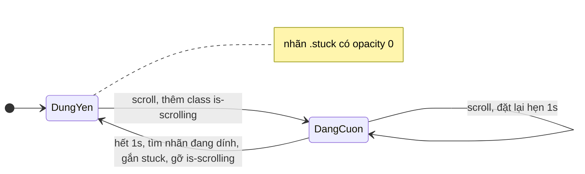

Ba chi tiết cuộn trong Telegram Web A mà ít ai để ý, cho tới khi app của mình làm sai:

1. Kéo khung chat, một nhãn "Hôm qua" dính ở đỉnh cho biết đang ở ngày nào. **Dừng tay 1 giây, nhãn mờ đi**, không che tin nhắn đầu tiên.
2. Mở hồ sơ một người, cuộn xuống tới thanh tab "Ảnh / Link / File", đổi từ tab dài sang tab ngắn: thanh tab **không tụt xuống**, nội dung **không xô ngang** trong lúc trượt.
3. Trên iPhone, đang vuốt mạnh danh sách mà app gán `scrollTop` (ví dụ sau khi tải thêm tin), quán tính cuộn **không ghi đè** lại vị trí app vừa đặt.

Mỗi mẹo chỉ vài dòng, nằm trong `useStickyDates.ts`, `useTransitionFixes.ts` và `resetScroll.ts`. Bài này đọc từng file, sửa hai lỗi nhỏ, rồi viết lại.

> [!TIP]
> **Tóm tắt**
> - Nhãn ngày: `position: sticky` + một class "đang cuộn". Đứng yên 1 giây (debounce) thì tìm nhãn đang dính ở đỉnh, gắn `.stuck` để CSS cho `opacity: 0`.
> - Đổi tab: tắt cuộn trong lúc trượt và bù đúng bề rộng thanh cuộn bằng `margin-right`; đặt `min-height` cho vùng nội dung để tab ngắn không làm khung co lại.
> - iOS: gán `overflow: hidden` → `scrollTop` → bỏ `overflow` để dừng quán tính đang chạy.
> - Bản gốc trả `overflow-y` về `scroll` cố định (thanh cuộn luôn hiện) và tính bề rộng thanh cuộn gồm cả viền; bản viết lại khôi phục giá trị cũ và trừ viền.

<iframe class="demo-frame" src="/demos/web-patterns/index.html?theme=dark#/tg-sticky-date" title="Demo tg-sticky-date" loading="lazy" style="height: 1460px"></iframe>

<p class="demo-links">▶ <a href="/demos/web-patterns/index.html#/tg-sticky-date" target="_blank" rel="noopener">Mở demo toàn màn hình ↗</a> · <a href="https://stackblitz.com/github/hunghg255/blog-hunghg/tree/master/examples/web-patterns?file=src/lib/tgStickyDate.ts" target="_blank" rel="noopener">Sửa code trên StackBlitz ↗</a> · <a href="https://github.com/hunghg255/blog-hunghg/blob/master/examples/web-patterns/src/lib/tgStickyDate.ts" target="_blank" rel="noopener">Xem source trên GitHub ↗</a></p>

Thử trong demo: cuộn khung chat rồi dừng tay, nhãn đang dính mờ đi sau 1 giây. Phần 2: cuộn hồ sơ xuống tới khi thanh tab chạm đỉnh, đổi qua "Link (ngắn)" ở từng chế độ; log ghi lại nội dung xô ngang bao nhiêu px và thanh tab dịch bao nhiêu.

## Telegram làm thế nào?

### 1. Nhãn ngày chỉ hiện khi đang cuộn

[`components/middle/hooks/useStickyDates.ts`](https://github.com/hunghg255/codebase/blob/main/web.telegram.org/src/components/middle/hooks/useStickyDates.ts) (59 dòng):

```ts
const DEBOUNCE = 1000;
const STICKY_TOP = 10;
const STICKY_TOP_WITH_TOOLS = 60;

const updateStickyDates = useCallback((container, hasTools) => {
  markIsScrolled();

  if (!document.body.classList.contains('is-scrolling-messages')) {
    fastRaf(() => document.body.classList.add('is-scrolling-messages'));
  }

  runDebounced(() => {
    fastRaf(() => {
      const currentStuck = document.querySelector('.stuck');
      if (currentStuck) currentStuck.classList.remove('stuck');

      const stuckDateEl = findStuckDate(container, hasTools);
      if (stuckDateEl) stuckDateEl.classList.add('stuck');

      document.body.classList.remove('is-scrolling-messages');
    });
  });
}, [markIsScrolled, runDebounced]);
```

`findStuckDate` tìm nhãn có `-offsetHeight ≤ offsetTop - scrollTop ≤ 10` (60 khi có thanh công cụ ghim tin phía trên), tức là nhãn đang nằm sát đỉnh khung, vị trí mà `position: sticky` giữ nó lại.

CSS trong `MessageList.scss` làm phần còn lại:

```css
.MessageList .sticky-date { pointer-events: none; opacity: 1; transition: opacity .3s ease; }
body:not(.is-scrolling-messages) .MessageList .sticky-date.stuck { opacity: 0; }
.MessageList.scrolled:not(.is-animating) .sticky-date { position: sticky; top: 0.625rem; }
.has-header-tools .MessageList .sticky-date { top: 3.75rem; }
```

Ba chi tiết hay:

- **Chỉ nhãn đang dính bị ẩn.** Các nhãn ngày nằm giữa danh sách (không dính) vẫn hiện như vách ngăn giữa các ngày.
- **`position: sticky` chỉ bật sau lần cuộn đầu** (class `.scrolled`). Comment trong hook giải thích: không ẩn đồng bộ được nhãn đang dính ngay lúc mở chat từ `useLayoutEffect`, nên tránh hẳn tình huống đó; đổi lại lần hiện đầu tiên không có animation.
- **`is-animating` tắt sticky** trong lúc chuyển chat để nhãn không nhảy theo animation.

### 2. Đổi tab mà không xô layout

[`components/right/hooks/useTransitionFixes.ts`](https://github.com/hunghg255/codebase/blob/main/web.telegram.org/src/components/right/hooks/useTransitionFixes.ts) dùng trong `Profile.tsx`:

```ts
// Set `min-height` for shared media container to prevent jumping when switching tabs
function setMinHeight() {
  const container = containerRef.current!;
  const transitionEl = container.querySelector('.Transition.shared-media-transition');
  const tabsEl = container.querySelector('.TabList');
  if (transitionEl && tabsEl) {
    transitionEl.style.minHeight = `${container.offsetHeight - tabsEl.offsetHeight}px`;
  }
}

// Workaround for scrollable content flickering during animation.
const applyTransitionFix = useCallback(() => {
  const container = containerRef.current!;
  if (container.style.overflowY !== 'hidden') {
    const scrollBarWidth = container.offsetWidth - container.clientWidth;
    container.style.overflowY = 'hidden';
    container.style.marginRight = `${scrollBarWidth}px`;
  }
}, [containerRef]);

const releaseTransitionFix = useCallback(() => {
  const container = containerRef.current!;
  container.style.overflowY = 'scroll';
  container.style.marginRight = '0';
}, [containerRef]);
```

- **`min-height`**: hồ sơ gồm phần thông tin, thanh tab, rồi nội dung tab, tất cả trong một khung cuộn. Đang cuộn xuống (thanh tab ở đỉnh), đổi sang tab chỉ có 2 link: tổng chiều cao co lại, trình duyệt kẹp `scrollTop`, thanh tab tụt xuống giữa màn. Đặt `min-height = khung - thanh tab` thì nội dung luôn đủ cao để thanh tab ở lại đỉnh. Demo đo được thanh tab dịch **123px** khi không có `min-height`, 0px khi có.
- **Khoá cuộn trong lúc trượt**: component `Transition` trượt tab cũ ra, tab mới vào. Comment ghi "scrollable content flickering": có lẽ trong lúc hai tab cùng tồn tại, chiều cao nội dung đổi liên tục làm thanh cuộn hiện/ẩn và nội dung giật. Tắt `overflow-y` thì hết giật, nhưng thanh cuộn biến mất làm vùng nội dung **rộng thêm** đúng bề rộng thanh cuộn, nội dung xô sang phải. Bù lại bằng `margin-right` đúng bằng chừng đó.

Hai lỗi nhỏ:

- `releaseTransitionFix` gán `overflowY = 'scroll'` **cố định**, không trả lại giá trị trước khi khoá. Nếu CSS ban đầu là `auto`, sau lần đổi tab đầu tiên thanh cuộn luôn hiện kể cả khi nội dung ngắn. (Có thể CSS của Telegram vốn là `scroll` nên không thấy; nhưng hàm như vậy không dùng lại được ở chỗ khác.)
- `offsetWidth - clientWidth` gồm cả **viền** trái phải. Khung có `border: 1px` thì margin bù dư 2px. Khung của Telegram không có viền nên không lộ.

### 3. Dừng quán tính iOS

[`util/resetScroll.ts`](https://github.com/hunghg255/codebase/blob/main/web.telegram.org/src/util/resetScroll.ts):

```ts
export default (container: HTMLDivElement, scrollTop?: number) => {
  if (IS_IOS) container.style.overflow = 'hidden';
  if (scrollTop !== undefined) container.scrollTop = scrollTop;
  if (IS_IOS) container.style.overflow = '';
};
```

Được gọi ở `InfiniteScroll.tsx` (sau khi đổi vị trí cuộn để giữ chỗ đang đọc) và `useScrollHooks.ts` **ngay trước khi tải thêm tin** (`resetScroll(containerRef.current!)` không có `scrollTop`). Trường hợp sau chỉ để dừng quán tính: người dùng vuốt mạnh tới đỉnh, app chèn 50 tin cũ lên trên rồi đặt lại `scrollTop`; nếu quán tính còn chạy, Safari tiếp tục cuộn theo vận tốc cũ và đè lên vị trí vừa đặt.

## Bên trong trình duyệt

- **`position: sticky`** giữ phần tử trong luồng bình thường cho tới khi nó chạm ngưỡng `top` của khung cuộn gần nhất, sau đó dính lại, nhưng **không ra khỏi khối cha**. Mỗi nhóm ngày là một khối riêng (nhãn + tin của ngày đó), nên nhãn "Thứ Ba" dính tới khi hết tin thứ Ba thì bị nhãn "Thứ Tư" đẩy lên. Không cần JS để tính chuyện đó.
- **Thanh cuộn chiếm chỗ hay không** tuỳ hệ điều hành: Windows và Linux mặc định thanh cuộn "cổ điển" chiếm khoảng 15–17px; macOS và mobile dùng thanh cuộn nổi rộng 0px. Mẹo bù `margin-right` chỉ có tác dụng ở loại thứ nhất. (Demo cố định thanh cuộn 12px bằng `::-webkit-scrollbar` để thấy rõ trên mọi máy chạy Chromium; Playwright mặc định ẩn thanh cuộn, phải tắt cờ `--hide-scrollbars` mới đo được.)
- **`scrollTop` bị kẹp** vào `[0, scrollHeight - clientHeight]`. Nội dung co lại thì trình duyệt tự giảm `scrollTop`; đó là lý do thanh tab tụt.
- **Quán tính trên iOS** là animation do trình duyệt điều khiển, không có API dừng. Đổi `overflow` sang `hidden` làm phần tử tạm hết là khung cuộn, Safari huỷ animation cuộn của nó.



## Viết lại

Nhãn ngày, chỉ tìm trong khung của mình:

```ts title=src/lib/tgStickyDate.ts
/**
 * Gọi ở mỗi sự kiện scroll của `container`. Khi cuộn: nhãn ngày hiện bình thường.
 * Đứng yên `idleMs`: nhãn đang dính ở đỉnh được gắn `.stuck` (CSS cho mờ đi) để không che tin nhắn.
 */
export function createStickyDates(container: HTMLElement, opts: StickyDatesOptions = {}) {
  const { selector = '.sticky-date', idleMs = 1000, stickyTop = 10, scrollingClass = 'is-scrolling' } = opts;
  let timer: ReturnType<typeof setTimeout> | undefined;

  const findStuck = () => {
    const top = container.getBoundingClientRect().top;
    return Array.from(container.querySelectorAll<HTMLElement>(selector)).find((el) => {
      const r = el.getBoundingClientRect();
      const offset = r.top - top;
      return -r.height <= offset && offset <= stickyTop;
    });
  };

  const onScroll = () => {
    if (!container.classList.contains(scrollingClass)) {
      requestAnimationFrame(() => container.classList.add(scrollingClass));
    }
    clearTimeout(timer);
    timer = setTimeout(() => {
      requestAnimationFrame(() => {
        // chỉ tìm trong container này (bản gốc dùng document.querySelector('.stuck'), trúng cả list khác)
        container.querySelector(`${selector}.stuck`)?.classList.remove('stuck');
        findStuck()?.classList.add('stuck');
        container.classList.remove(scrollingClass);
      });
    }, idleMs);
  };

  container.addEventListener('scroll', onScroll, { passive: true });
  return () => {
    clearTimeout(timer);
    container.removeEventListener('scroll', onScroll);
  };
}
```

Khoá cuộn khi chuyển tab:

```ts title=src/lib/tgStickyDate.ts
export function lockScrollForTransition(container: HTMLElement) {
  if (container.dataset.scrollLocked) return () => {};
  const prevOverflow = container.style.overflowY;
  const prevMargin = container.style.marginRight;
  // offsetWidth - clientWidth gồm cả viền; trừ viền ra để còn đúng bề rộng thanh cuộn
  const cs = getComputedStyle(container);
  const scrollbarWidth =
    container.offsetWidth - container.clientWidth - parseFloat(cs.borderLeftWidth) - parseFloat(cs.borderRightWidth);
  container.dataset.scrollLocked = '1';
  container.style.overflowY = 'hidden';
  container.style.marginRight = `${scrollbarWidth}px`;
  // Trả lại đúng giá trị cũ. Bản gốc ép `overflowY = 'scroll'`, nên sau lần đầu
  // thanh cuộn luôn hiện kể cả khi nội dung ngắn.
  return () => {
    container.style.overflowY = prevOverflow;
    container.style.marginRight = prevMargin;
    delete container.dataset.scrollLocked;
  };
}
```

::: spoiler Xem toàn bộ src/lib/tgStickyDate.ts

```ts title=src/lib/tgStickyDate.ts
/**
 * Ba mẹo cuộn nhỏ từ Telegram Web A:
 * 1. Nhãn ngày "dính" chỉ hiện khi đang cuộn (components/middle/hooks/useStickyDates.ts)
 * 2. Khoá cuộn trong lúc chuyển tab mà layout không xô (components/right/hooks/useTransitionFixes.ts)
 * 3. Dừng quán tính cuộn trên iOS trước khi gán scrollTop (util/resetScroll.ts)
 */

// ---------------------------------------------------------------- 1. nhãn ngày dính

export interface StickyDatesOptions {
  /** phần tử nhãn ngày, CSS cho nó `position: sticky; top: …` */
  selector?: string;
  /** đứng yên bao lâu thì ẩn nhãn đang dính, Telegram dùng 1000ms */
  idleMs?: number;
  /** nhãn coi là "đang dính" nếu cách đỉnh khung ≤ giá trị này (10px, 60px khi có thanh công cụ) */
  stickyTop?: number;
  /** class gắn lên `container` khi đang cuộn (Telegram gắn `is-scrolling-messages` lên body) */
  scrollingClass?: string;
}

/**
 * Gọi ở mỗi sự kiện scroll của `container`. Khi cuộn: nhãn ngày hiện bình thường.
 * Đứng yên `idleMs`: nhãn đang dính ở đỉnh được gắn `.stuck` (CSS cho mờ đi) để không che tin nhắn.
 */
export function createStickyDates(container: HTMLElement, opts: StickyDatesOptions = {}) {
  const { selector = '.sticky-date', idleMs = 1000, stickyTop = 10, scrollingClass = 'is-scrolling' } = opts;
  let timer: ReturnType<typeof setTimeout> | undefined;

  const findStuck = () => {
    const top = container.getBoundingClientRect().top;
    return Array.from(container.querySelectorAll<HTMLElement>(selector)).find((el) => {
      const r = el.getBoundingClientRect();
      const offset = r.top - top;
      return -r.height <= offset && offset <= stickyTop;
    });
  };

  const onScroll = () => {
    if (!container.classList.contains(scrollingClass)) {
      requestAnimationFrame(() => container.classList.add(scrollingClass));
    }
    clearTimeout(timer);
    timer = setTimeout(() => {
      requestAnimationFrame(() => {
        // chỉ tìm trong container này (bản gốc dùng document.querySelector('.stuck'), trúng cả list khác)
        container.querySelector(`${selector}.stuck`)?.classList.remove('stuck');
        findStuck()?.classList.add('stuck');
        container.classList.remove(scrollingClass);
      });
    }, idleMs);
  };

  container.addEventListener('scroll', onScroll, { passive: true });
  return () => {
    clearTimeout(timer);
    container.removeEventListener('scroll', onScroll);
  };
}

// ---------------------------------------------------------------- 2. khoá cuộn khi chuyển tab

/**
 * Trong lúc animation chuyển tab: tắt cuộn để nội dung không giật, và bù đúng bề rộng
 * thanh cuộn vừa mất bằng `margin-right` để layout không xô sang phải.
 */
export function lockScrollForTransition(container: HTMLElement) {
  if (container.dataset.scrollLocked) return () => {};
  const prevOverflow = container.style.overflowY;
  const prevMargin = container.style.marginRight;
  // offsetWidth - clientWidth gồm cả viền; trừ viền ra để còn đúng bề rộng thanh cuộn
  const cs = getComputedStyle(container);
  const scrollbarWidth =
    container.offsetWidth - container.clientWidth - parseFloat(cs.borderLeftWidth) - parseFloat(cs.borderRightWidth);
  container.dataset.scrollLocked = '1';
  container.style.overflowY = 'hidden';
  container.style.marginRight = `${scrollbarWidth}px`;
  // Trả lại đúng giá trị cũ. Bản gốc ép `overflowY = 'scroll'`, nên sau lần đầu
  // thanh cuộn luôn hiện kể cả khi nội dung ngắn.
  return () => {
    container.style.overflowY = prevOverflow;
    container.style.marginRight = prevMargin;
    delete container.dataset.scrollLocked;
  };
}

/**
 * Đặt `min-height` cho vùng nội dung tab = chiều cao khung - thanh tab.
 * Đổi từ tab dài sang tab ngắn thì khung không bị co lại, scrollTop không tụt.
 */
export function keepTabMinHeight(container: HTMLElement, content: HTMLElement, tabs: HTMLElement) {
  const update = () => {
    content.style.minHeight = `${container.offsetHeight - tabs.offsetHeight}px`;
  };
  update();
  const ro = new ResizeObserver(update);
  ro.observe(container);
  return () => ro.disconnect();
}

// ---------------------------------------------------------------- 3. dừng quán tính iOS

export const IS_IOS =
  typeof navigator !== 'undefined' &&
  (/iPad|iPhone|iPod/.test(navigator.userAgent) || (navigator.platform === 'MacIntel' && navigator.maxTouchPoints > 1));

/**
 * Trên iOS, gán scrollTop trong lúc còn quán tính thì cú vuốt dang dở ghi đè lại.
 * Tắt overflow một nhịp làm Safari dừng quán tính, rồi bật lại.
 */
export function resetScroll(container: HTMLElement, scrollTop?: number, isIOS = IS_IOS) {
  if (isIOS) container.style.overflow = 'hidden';
  if (scrollTop !== undefined) container.scrollTop = scrollTop;
  if (isIOS) container.style.overflow = '';
}
```

:::

## Đi qua code

- **`createStickyDates`** gắn listener `scroll` (passive) ngay vào khung, thay vì để component gọi `updateStickyDates` ở mỗi lần cuộn. Class "đang cuộn" gắn lên **khung**, không lên `body`, nên hai danh sách trên cùng trang không ảnh hưởng nhau. Bản gốc gọi `document.querySelector('.stuck')`: có lớp `.stuck` nào khác trong trang (một component khác dùng cùng tên) là bị gỡ nhầm.
- **`findStuck`** dùng `getBoundingClientRect` so với đỉnh khung thay vì `offsetTop - scrollTop`. `offsetTop` tính theo `offsetParent`, chỉ đúng khi khung cuộn chính là `offsetParent` của nhãn; vị trí trên màn hình thì luôn đúng.
- Việc thêm class đi qua `requestAnimationFrame`, giống `fastRaf` của Telegram: nhiều sự kiện scroll trong một frame chỉ đổi DOM một lần.
- **`lockScrollForTransition`** trả về hàm mở khoá, đóng gói đúng giá trị cũ của `overflowY` và `marginRight`. Gọi khoá hai lần liên tiếp (hai lần đổi tab nhanh) thì lần sau không làm gì, để không "nhớ" nhầm `hidden` là giá trị gốc.
- **`keepTabMinHeight`** dùng `ResizeObserver` trên khung thay vì `window.resize`: khung đổi cao vì lý do khác (bàn phím ảo, panel bên cạnh) cũng được cập nhật.

**Khác bản gốc:** class "đang cuộn" gắn lên khung; tìm nhãn bằng `getBoundingClientRect`; khôi phục `overflow-y` cũ; trừ viền khi tính bề rộng thanh cuộn; `min-height` theo `ResizeObserver`.

## Tại sao không làm cách khác?

- **Ẩn nhãn bằng JS ở mỗi lần cuộn** (tính vị trí, đặt `opacity`): tốn hơn và dễ giật. Class + debounce chỉ đụng DOM hai lần cho cả một lượt cuộn.
- **`scrollbar-gutter: stable`** giữ sẵn chỗ cho thanh cuộn kể cả khi không cuộn, nên tắt `overflow` không làm nội dung xô. Đây là cách hiện đại nên dùng nếu chấp nhận một dải trống bên phải. Telegram Web A ra đời trước khi thuộc tính này phổ biến.
- **Đặt `height` cố định cho nội dung tab**: tab dài sẽ phải cuộn riêng (cuộn lồng cuộn), khó dùng trên mobile. `min-height` chỉ chặn chiều co, không chặn chiều giãn.
- **`overscroll-behavior` hay `scroll-behavior`** không dừng được quán tính đang chạy; chúng chỉ quyết định cuộn có lan ra ngoài và có mượt không.

## Edge case và cạm bẫy

- **Nhãn đầu tiên lúc mở chat**: nếu bật `sticky` ngay, nhãn ngày của tin cuối có thể đang dính ở đỉnh và hiện rõ khi chat vừa mở. Telegram chỉ bật `sticky` sau lần cuộn đầu.
- **Debounce 1 giây và cuộn bằng bàn phím**: phím `End`/`PageDown` cũng phát `scroll`, nên vẫn chạy đúng. Cuộn bằng code (`scrollTo`) cũng phát `scroll`, nên nhãn hiện lên trong 1 giây dù người dùng không cuộn; nếu không muốn thì tạm gỡ listener.
- **Thanh cuộn nổi** (macOS, mobile): `offsetWidth - clientWidth = 0`, mẹo bù không làm gì và cũng không cần.
- **`overflow: hidden` làm mất `scrollTop`?** Không: phần tử vẫn giữ `scrollTop` và vẫn là khung cuộn của các phần tử `sticky` bên trong, chỉ người dùng không cuộn được.
- **`resetScroll` trên trình duyệt không phải iOS**: không làm gì thêm. Dò iOS bằng user agent dễ sai với iPad (Safari iPadOS báo là Mac); bản viết lại kiểm thêm `maxTouchPoints > 1`.

## Dùng trong dự án

```tsx
function MessageList({ groups }: { groups: DayGroup[] }) {
  const ref = useRef<HTMLDivElement>(null);
  useEffect(() => createStickyDates(ref.current!, { stickyTop: 10 }), []);

  return (
    <div ref={ref} className='message-list'>
      {groups.map((g) => (
        <section key={g.day}>
          <div className='sticky-date'><span>{g.label}</span></div>
          {g.messages.map((m) => <Message key={m.id} {...m} />)}
        </section>
      ))}
    </div>
  );
}
```

```css
.message-list .sticky-date { position: sticky; top: 8px; transition: opacity .3s; pointer-events: none; }
.message-list:not(.is-scrolling) .sticky-date.stuck { opacity: 0; }
```

::: spoiler Ví dụ test (bản phác, không có trong repo)

```ts
import { describe, expect, it, vi } from 'vitest';
import { createStickyDates, lockScrollForTransition, resetScroll } from './tgStickyDate';

describe('lockScrollForTransition', () => {
  it('khoá rồi trả lại đúng style cũ (không ép overflow: scroll)', () => {
    const el = document.createElement('div');
    el.style.overflowY = 'auto';
    const release = lockScrollForTransition(el);
    expect(el.style.overflowY).toBe('hidden');
    release();
    expect(el.style.overflowY).toBe('auto');
    expect(el.style.marginRight).toBe('');
  });
});

describe('resetScroll', () => {
  it('trên iOS tắt overflow trong lúc gán scrollTop', () => {
    const el = document.createElement('div');
    const seen: string[] = [];
    Object.defineProperty(el, 'scrollTop', { set: () => seen.push(el.style.overflow), get: () => 0 });
    resetScroll(el, 100, true);
    expect(seen).toEqual(['hidden']);
    expect(el.style.overflow).toBe('');
  });
});

describe('createStickyDates', () => {
  it('đang cuộn có class, đứng yên 1s thì gỡ class và đánh dấu nhãn đang dính', async () => {
    vi.useFakeTimers();
    const box = document.createElement('div');
    box.innerHTML = '<div class="sticky-date"></div><div class="sticky-date"></div>';
    document.body.appendChild(box);
    const [a, b] = box.querySelectorAll<HTMLElement>('.sticky-date');
    box.getBoundingClientRect = () => ({ top: 100 }) as DOMRect;
    a.getBoundingClientRect = () => ({ top: 105, height: 20 }) as DOMRect; // đang dính ở đỉnh
    b.getBoundingClientRect = () => ({ top: 300, height: 20 }) as DOMRect;
    createStickyDates(box);
    box.dispatchEvent(new Event('scroll'));
    await vi.advanceTimersByTimeAsync(20);
    expect(box.classList.contains('is-scrolling')).toBe(true);
    await vi.advanceTimersByTimeAsync(1020);
    expect(box.classList.contains('is-scrolling')).toBe(false);
    expect(a.classList.contains('stuck')).toBe(true);
    expect(b.classList.contains('stuck')).toBe(false);
    vi.useRealTimers();
  });
});
```

:::

## So với cách làm hiện đại

- **`scrollbar-gutter: stable`**: giữ chỗ cho thanh cuộn, giải quyết tận gốc chuyện xô ngang khi tắt cuộn ([caniuse](https://caniuse.com/mdn-css_properties_scrollbar-gutter)). Safari hỗ trợ muộn hơn các trình duyệt khác; xem bảng trước khi dùng.
- **Scroll-driven animations** (`animation-timeline: scroll()`) cho phép làm hiệu ứng theo vị trí cuộn bằng CSS, nhưng chưa có cách thuần CSS để biết "đang cuộn hay đứng yên". Sự kiện `scrollend` (xem [caniuse](https://caniuse.com/mdn-api_element_scrollend_event) để biết trình duyệt nào đã hỗ trợ) giúp bỏ debounce, nhưng nó bắn ngay khi cuộn dừng chứ không chờ 1 giây.
- Bài [Học từ Facebook #16](/blogs/facebook-chat-scroller) bàn về giữ vị trí khi chèn tin cũ, phần còn lại của câu chuyện cuộn trong khung chat.

---

Bài này thuộc series **[Học từ mã nguồn Telegram](/series/telegram)** (25 bài, đọc theo thứ tự).

::: spoiler Xem nhanh danh sách bài trong series

*Mở đầu*

- [Mở đầu: bên trong Telegram Web A](/blogs/learn-from-telegram-source-code)

*Phần 1: dữ liệu và đồng bộ*

- [#1 Gửi tin lạc quan, khớp tin thật bằng randomId](/blogs/telegram-optimistic-send)
- [#2 Lịch sử tin nhắn chia hai đảo](/blogs/telegram-message-history-islands)
- [#3 Lưu global state lúc rảnh, chỉ giữ phần cần](/blogs/telegram-persist-global-state)
- [#4 Gom update realtime theo nhịp animation](/blogs/telegram-realtime-update-batching)
- [#5 Store tự viết và diff danh sách có key](/blogs/telegram-teactn-store-fast-list)

*Phần 2: animation và giao diện*

- [#6 Animation sắp xếp danh sách chat không đo DOM](/blogs/telegram-chat-list-flip)
- [#7 Ảnh bay giữa hai cây DOM trong media viewer](/blogs/telegram-media-viewer-ghost)
- [#8 Bố cục album chọn theo hàm chi phí](/blogs/telegram-album-layout)
- [#9 Giờ gửi nằm gọn trong bong bóng chat](/blogs/telegram-bubble-meta-spacer)
- [#10 Composer biến hình, Transition và gạch chân tab](/blogs/telegram-composer-morph-transition)

*Phần 3: media, mobile, thông báo*

- [#11 Thumbnail 100 byte và viền sticker nén](/blogs/telegram-tiny-thumbnails)
- [#12 Player sticker: DPR, hạ fps, cache khung](/blogs/telegram-lottie-player)
- [#13 Mobile: --vh, bàn phím ảo, nhấn giữ, số điện thoại](/blogs/telegram-mobile-viewport-touch)
- [#14 Web Push không trùng và đánh dấu đã đọc](/blogs/telegram-push-dedupe-read-receipts)

*Phần 4: soạn tin, media, chi tiết UI*

- [#15 Rich text ⇄ entities, thanh định dạng nổi, nháp theo chat](/blogs/telegram-rich-text-entities)
- [#16 Ô nhập tự giãn, emoji phóng to, gom tin theo ngày/người/album](/blogs/telegram-auto-grow-input-grouping)
- [#17 Bảng emoji/sticker chỉ render nhóm đang xem](/blogs/telegram-emoji-picker-virtualization)
- [#18 mediaLoader gộp request, ảnh mờ sang nét, spinner không chớp](/blogs/telegram-media-loader-blur-buffering)
- [#19 Trình phát audio toàn cục và playlist](/blogs/telegram-global-audio-player)
- [#20 UiLoader chạy đua 700ms, ba mức animation](/blogs/telegram-ui-loader-animation-levels)
- [#21 PanZoom bằng matrix() trong media viewer](/blogs/telegram-panzoom-matrix)
- **#22 Ngày dính khi cuộn, khoá cuộn, dừng momentum iOS** (bài này)
- [#23 Vùng thả file, nén ảnh trước khi gửi, copy ảnh](/blogs/telegram-drop-zone-compress-copy)
- [#24 Tiêu đề nhấp nháy và favicon đếm tin mới](/blogs/telegram-title-favicon-unread)

:::

Code + demo: [`examples/web-patterns`](https://github.com/hunghg255/blog-hunghg/tree/master/examples/web-patterns) · [Mở trên StackBlitz](https://stackblitz.com/github/hunghg255/blog-hunghg/tree/master/examples/web-patterns)
