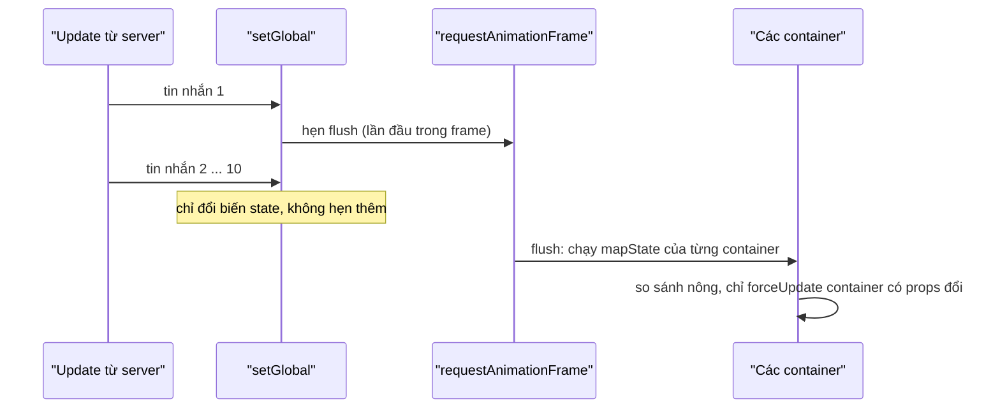

Telegram Web A không dùng React. Nhóm phát triển tự viết một thư viện tên **Teact** (API giống React: component hàm, hook, JSX) và một store toàn cục tên **TeactN** (giống Redux + `connect`). Toàn bộ nằm trong `src/lib/teact/`, vài trăm dòng.

Tự viết lại React nghe như một quyết định khó hiểu, nhưng nó cho họ toàn quyền với hai việc mà ứng dụng chat cần nhất: **khi nào giao diện được cập nhật**, và **cập nhật danh sách dài với ít thao tác DOM nhất**. Bài này đọc hai phần đó.

> [!TIP]
> **Tóm tắt**
> - `setGlobal` chỉ đổi tham chiếu state; việc báo cho component được gom lại, chạy **một lần mỗi frame** (requestAnimationFrame). Mười tin nhắn tới trong cùng một frame chỉ gây một lần tính lại.
> - Mỗi component nối vào store bằng một hàm `mapState`; kết quả được **so sánh nông**, chỉ component có props đổi mới render. Cảnh báo khi `mapState` trả `NaN`, vì `NaN !== NaN` làm so sánh nông luôn báo "đã đổi".
> - Danh sách có key: node mới liền nhau được chèn **một lần** bằng `DocumentFragment`; node cũ chỉ di chuyển khi thật sự cần.
> - Với React: `useSyncExternalStore` + selector so sánh nông (vd. `useShallow` của zustand) cho kết quả tương tự phần store.

<iframe class="demo-frame" src="/demos/web-patterns/index.html?theme=dark#/tg-store" title="Demo tg-store" loading="lazy" style="height: 1240px"></iframe>

<p class="demo-links">▶ <a href="/demos/web-patterns/index.html#/tg-store" target="_blank" rel="noopener">Mở demo toàn màn hình ↗</a> · <a href="https://stackblitz.com/github/hunghg255/blog-hunghg/tree/master/examples/web-patterns?file=src/lib/tgStore.ts" target="_blank" rel="noopener">Sửa code trên StackBlitz ↗</a> · <a href="https://github.com/hunghg255/blog-hunghg/blob/master/examples/web-patterns/src/lib/tgStore.ts" target="_blank" rel="noopener">Xem source trên GitHub ↗</a></p>

Trong demo, bấm "10 tin nhắn liền nhau": bảng bên dưới cho thấy chỉ có **1 lần flush**, `HeaderBadge` và ba `ChatRow` có tin mới render một lần, hai `ChatRow` còn lại và `Typing` không render. Bật "Flush đồng bộ" rồi bấm lại: 10 lần flush, `HeaderBadge` render 10 lần.

## Telegram làm thế nào?

### Store: một biến, một danh sách container

Toàn bộ store nằm trong [`src/lib/teact/teactn.tsx`](https://github.com/hunghg255/codebase/blob/main/web.telegram.org/src/lib/teact/teactn.tsx) (236 dòng). State là một biến module, `setGlobal` chỉ đổi biến đó rồi hẹn lịch:

```ts
let currentGlobal = {} as GlobalState;
const callbacks: Function[] = [updateContainers];

const runCallbacksThrottled = throttleWithRaf(runCallbacks);

// `noThrottle = true` is used as a workaround for iOS gesture history navigation
export function setGlobal(newGlobal?: GlobalState, noThrottle = false) {
  if (typeof newGlobal === 'object' && newGlobal !== currentGlobal) {
    currentGlobal = newGlobal;
    if (!noThrottle) {
      runCallbacksThrottled();
    } else {
      runCallbacks();
    }
  }
}
```

`throttleWithRaf` (trong `util/schedulers.ts`) đảm bảo `runCallbacks` chạy tối đa một lần mỗi frame, qua `fastRaf`: một hàng đợi gom mọi callback muốn chạy ở frame kế tiếp vào **một** lời gọi `requestAnimationFrame`. Ngoại lệ `noThrottle` dành cho cử chỉ vuốt để quay lại trên iOS: lúc đó giao diện phải đổi ngay, cùng nhịp với animation của hệ điều hành.

Mỗi component dùng `withGlobal(mapStateToProps)` được ghi vào một `Map` tên `containers`. Khi flush, `updateContainers` chạy lại `mapStateToProps` của **mọi** container và chỉ gọi `forceUpdate()` nếu kết quả khác cũ theo so sánh nông:

```ts
for (const container of containers.values()) {
  // ...
  try {
    newMappedProps = {
      ...mapStateToProps(currentGlobal, ownProps),
      ...mapReducersToProps(setGlobal, actions),
    };
  } catch (err) {
    handleError(err);

    return;
  }
  // ...
  if (Object.keys(newMappedProps).length && !arePropsShallowEqual(mappedProps!, newMappedProps)) {
    container.mappedProps = newMappedProps;
    container.areMappedPropsChanged = true;
    container.DEBUG_updates++;

    forceUpdate();
  }
}
```

Đây chính là mô hình `connect` của react-redux, chỉ khác ở chỗ lịch flush do store tự quyết.

### Công cụ debug nhỏ mà hữu ích

Trong chế độ `DEBUG`, store làm thêm ba việc:

- **Cảnh báo `NaN`**: nếu một giá trị trong props map ra là `NaN` (vd. `unread / total` khi `total = 0`), so sánh `!==` luôn đúng nên component render lại ở **mọi** lần flush. Store in cảnh báo kèm tên component.
- **Cảnh báo flush chậm**: đo `performance.now()` quanh vòng lặp, quá **7ms** thì cảnh báo. Ở 60fps một frame có khoảng 16,7ms; dành gần nửa frame chỉ để tính props là có vấn đề.
- **Double-click ở bất kỳ đâu** in bảng các container sắp theo số lần render (`DEBUG_updates`). Bật thêm `DEBUG_MORE` thì mỗi lần render còn in lý do, tức danh sách props đã đổi (`getUnequalProps`).

### Hai lỗi nhỏ trong bản gốc

1. **Một `mapState` lỗi chặn cả vòng lặp.** Trong đoạn trên, `catch` gọi `return` chứ không phải `continue`. Một component có `mapStateToProps` ném lỗi (vd. đọc thuộc tính của chat vừa bị xoá) làm mọi container **phía sau** nó trong `Map` không được cập nhật ở lần flush đó. Bản viết lại dùng `continue`.
2. **Id container sinh lại ở mỗi lần render và rò bộ nhớ.** Container lấy id bằng `useState(generateIdFor(containers))`. Đối số của `useState` được tính ở **mọi** lần render (chỉ lần đầu được dùng), và `util/generateIdFor.ts` mỗi lần gọi lại ghi thêm một id vào một `Map` cấp module không bao giờ được dọn:

   ```ts
   const store = new Map<string, any>();

   export default () => {
     let id;

     do {
       id = String(Math.random()).replace('0.', 'id');
       store.set(id, true);
     } while (store.hasOwnProperty(id));

     return id;
   };
   ```

   Hàm này còn bỏ qua đối số `containers`, và `store.hasOwnProperty(id)` trên một `Map` luôn là `false` (khoá của `Map` không phải thuộc tính của object), nên vòng chống trùng không làm gì. Lỗi trùng id khó xảy ra vì id ngẫu nhiên, nhưng `Map` cứ phình theo số lần render của mọi component nối store. Cách sửa trong React là dùng `useRef` (hoặc `useState(() => …)` với hàm khởi tạo).

### Danh sách có key: `teactFastList`

Phần thứ hai nằm trong renderer [`src/lib/teact/teact-dom.ts`](https://github.com/hunghg255/codebase/blob/main/web.telegram.org/src/lib/teact/teact-dom.ts). Một phần tử có prop `teactFastList` thì con của nó được cập nhật bằng hàm `renderFastListChildren`, theo ba bước:

1. Xoá các con có `key` không còn trong danh sách mới.
2. Duyệt danh sách mới. Con **mới** (chưa có key cũ) chưa chèn ngay mà xếp vào hàng đợi; gặp một con cũ thì chèn cả hàng đợi một lần: một phần tử thì `insertBefore`, nhiều phần tử thì gom vào `DocumentFragment` (`flushFragmentQueue`).
3. Con cũ chỉ bị di chuyển khi **vừa lệch vị trí vừa đổi `teactOrderKey`**:

```ts
// This is a "magic" `teactOrderKey` property that tells us the element is updated
const order = 'props' in $newChild ? $newChild.props.teactOrderKey : undefined;
const shouldMoveNode = currentChildInfo.index !== currentPreservedIndex && currentChildInfo.order !== order;
const isMovingDown = shouldMoveNode && currentPreservedIndex > currentChildInfo.index;

// When the node goes down, preserved indexing actually breaks, so the "magic" should help.
if (!shouldMoveNode || isMovingDown) {
  currentPreservedIndex++;
}
```

Điều kiện `order !== order` có một hệ quả thú vị: nếu không truyền `teactOrderKey` thì `undefined !== undefined` là `false`, **node không bao giờ bị di chuyển**. Danh sách chat dùng đúng điều này: mỗi dòng đặt bằng `position: absolute; top: i * 72px` (bài #6), nên thứ tự trong DOM không ảnh hưởng gì tới thứ tự hiển thị, không cần tốn công di chuyển node.

## Bên trong trình duyệt: vì sao gom theo frame

Trình duyệt chỉ vẽ lại tối đa một lần mỗi frame. Nếu mười update tới trong cùng một frame (WebSocket hay đẩy cả loạt tin), tính lại giao diện mười lần thì chín lần đầu là phí: người dùng chỉ thấy kết quả cuối.



React 18 có automatic batching: các `setState` trong **cùng một task** (cùng một event handler, cùng một callback `setTimeout`) được gộp thành một lần render. Mười tin nhắn tới qua mười message WebSocket là mười task riêng, nên vẫn có thể thành nhiều lần render. Gom theo frame thì gộp được cả những update tới từ các task khác nhau trong cùng khoảng 16ms. Đổi lại, giao diện trễ tối đa một frame so với state.

## Viết lại

### Store

Phần flush gần như giữ nguyên ý tưởng, sửa `return` thành `continue`:

```ts title=src/lib/tgStore.ts
  function flush() {
    flushScheduled = false;
    flushCount++;
    const startedAt = performance.now();

    for (const container of containers.values()) {
      const next = safeMap(container, true);
      // Bản gốc `return` ở đây, nên MỘT mapper lỗi làm mọi container phía sau không được cập nhật.
      if (!next) continue;

      if (Object.values(next).some((value) => Number.isNaN(value))) {
        // NaN !== NaN: store so sánh bằng !== (như bản gốc) sẽ render thừa mỗi lần flush.
        // shallowEqual ở đây dùng Object.is nên không bị, nhưng NaN thường là dấu hiệu tính sai.
        onDebug({ type: 'nan', message: `${container.name}: mapState trả về NaN (với so sánh !== sẽ render lại mỗi lần)` });
      }

      if (!shallowEqual(container.mapped, next)) {
        container.mapped = next;
        container.updates++;
        container.forceUpdate();
      }
    }

    const duration = performance.now() - startedAt;
    if (duration > slowFlushMs) {
      onDebug({ type: 'slow', message: `flush chậm: ${duration.toFixed(1)}ms cho ${containers.size} container` });
    }
    listeners.forEach((listener) => listener());
  }

  /**
   * Đổi state. Mặc định gom theo frame; `sync: true` flush ngay (Telegram dùng cho cử chỉ
   * vuốt back trên iOS, nơi giao diện phải đổi đồng bộ với animation của hệ điều hành).
   */
  function setGlobal(next: S, { sync = false } = {}) {
    if (next === current) return;
    current = next;
    if (sync) {
      flush();
      return;
    }
    if (!flushScheduled) {
      flushScheduled = true;
      schedule(flush);
    }
  }
```

Hook `useGlobal` (xem file đầy đủ) tạo container **một lần** cho mỗi instance bằng `useRef` thay cho `generateIdFor`, đăng ký vào `containers` trong `useLayoutEffect`, xoá khi unmount, và trả về props đã map.

::: spoiler Xem toàn bộ src/lib/tgStore.ts

```ts title=src/lib/tgStore.ts
import { useLayoutEffect, useReducer, useRef } from 'react';

/**
 * Store toàn cục tối giản theo ý tưởng teactn của Telegram Web A (lib/teact/teactn.tsx):
 * - `setGlobal` chỉ đổi tham chiếu state; việc báo cho component được gom lại, chạy
 *   MỘT lần trong requestAnimationFrame kế tiếp (nhiều action trong một frame = một lần tính lại).
 * - Mỗi component đăng ký một "container" với hàm `mapState`. Khi flush, chạy lại mọi
 *   mapState và so sánh nông (shallow) với kết quả cũ, chỉ component có props đổi mới render.
 * - Công cụ debug: cảnh báo mapState trả NaN, cảnh báo flush chậm, đếm số lần render.
 *
 * Khác bản gốc: một mapState ném lỗi không làm dừng việc cập nhật các container khác,
 * và id container không bị sinh lại ở mỗi lần render (xem bài viết).
 */

type Mapper<S, P> = (state: S) => P;

interface Container<S> {
  id: number;
  name: string;
  mapState: Mapper<S, Record<string, unknown>>;
  mapped: Record<string, unknown>;
  forceUpdate: () => void;
  updates: number;
}

export interface StoreDebugEvent {
  type: 'nan' | 'slow' | 'error' | 'flush';
  message: string;
}

export interface StoreOptions {
  /** ngưỡng cảnh báo flush chậm (ms), Telegram dùng 7ms */
  slowFlushMs?: number;
  /** nơi nhận cảnh báo debug, mặc định console.warn */
  onDebug?: (event: StoreDebugEvent) => void;
  /** hàm lên lịch flush, mặc định requestAnimationFrame (để test có thể truyền hàm đồng bộ) */
  schedule?: (cb: () => void) => void;
}

export function shallowEqual(a: Record<string, unknown>, b: Record<string, unknown>) {
  if (a === b) return true;
  const aKeys = Object.keys(a);
  if (aKeys.length !== Object.keys(b).length) return false;
  return aKeys.every((key) => Object.is(a[key], b[key]));
}

/** Liệt kê props khác nhau, để biết "vì sao component này render lại". */
export function diffProps(a: Record<string, unknown>, b: Record<string, unknown>) {
  const keys = new Set([...Object.keys(a), ...Object.keys(b)]);
  return [...keys].filter((key) => !Object.is(a[key], b[key]));
}

export function createGlobalStore<S>(initial: S, options: StoreOptions = {}) {
  const {
    slowFlushMs = 7,
    onDebug = (event) => console.warn(`[store] ${event.message}`),
    schedule = (cb) => requestAnimationFrame(cb),
  } = options;

  let current = initial;
  let flushScheduled = false;
  let nextContainerId = 1;
  let flushCount = 0;
  const containers = new Map<number, Container<S>>();
  const listeners = new Set<() => void>();

  /**
   * Chạy mapState có bắt lỗi: lỗi trong một component không được làm sập cả app.
   * Chỉ báo lỗi khi flush; trong lúc render thì im lặng giữ props cũ (báo ở đó dễ thành vòng lặp
   * nếu chính việc báo lỗi làm component render lại).
   */
  function safeMap(container: Container<S>, report = false) {
    try {
      return container.mapState(current);
    } catch (error) {
      if (report) onDebug({ type: 'error', message: `${container.name}: mapState lỗi (${String(error)})` });
      return undefined;
    }
  }

  function flush() {
    flushScheduled = false;
    flushCount++;
    const startedAt = performance.now();

    for (const container of containers.values()) {
      const next = safeMap(container, true);
      // Bản gốc `return` ở đây, nên MỘT mapper lỗi làm mọi container phía sau không được cập nhật.
      if (!next) continue;

      if (Object.values(next).some((value) => Number.isNaN(value))) {
        // NaN !== NaN: store so sánh bằng !== (như bản gốc) sẽ render thừa mỗi lần flush.
        // shallowEqual ở đây dùng Object.is nên không bị, nhưng NaN thường là dấu hiệu tính sai.
        onDebug({ type: 'nan', message: `${container.name}: mapState trả về NaN (với so sánh !== sẽ render lại mỗi lần)` });
      }

      if (!shallowEqual(container.mapped, next)) {
        container.mapped = next;
        container.updates++;
        container.forceUpdate();
      }
    }

    const duration = performance.now() - startedAt;
    if (duration > slowFlushMs) {
      onDebug({ type: 'slow', message: `flush chậm: ${duration.toFixed(1)}ms cho ${containers.size} container` });
    }
    listeners.forEach((listener) => listener());
  }

  /**
   * Đổi state. Mặc định gom theo frame; `sync: true` flush ngay (Telegram dùng cho cử chỉ
   * vuốt back trên iOS, nơi giao diện phải đổi đồng bộ với animation của hệ điều hành).
   */
  function setGlobal(next: S, { sync = false } = {}) {
    if (next === current) return;
    current = next;
    if (sync) {
      flush();
      return;
    }
    if (!flushScheduled) {
      flushScheduled = true;
      schedule(flush);
    }
  }

  function getGlobal() {
    return current;
  }

  /** Tạo action: reducer nhận state hiện tại, trả state mới (hoặc undefined nếu không đổi). */
  function action<A extends unknown[]>(reducer: (state: S, ...args: A) => S | void) {
    return (...args: A) => {
      const next = reducer(current, ...args);
      if (next) setGlobal(next);
    };
  }

  /**
   * Hook nối component với store. `mapState` có thể là hàm inline: kết quả được so sánh nông,
   * nên trả về object mới mỗi lần cũng không sao, miễn các giá trị bên trong giữ tham chiếu.
   */
  function useGlobal<P extends Record<string, unknown>>(mapState: Mapper<S, P>, name = 'Component'): P {
    const [, forceUpdate] = useReducer((n: number) => n + 1, 0);
    const containerRef = useRef<Container<S> | null>(null);

    // Tạo container một lần cho mỗi instance. (Bản gốc gọi generateIdFor() ở mỗi lần render.)
    if (!containerRef.current) {
      containerRef.current = {
        id: nextContainerId++,
        name,
        mapState: mapState as Mapper<S, Record<string, unknown>>,
        mapped: {},
        forceUpdate,
        updates: 0,
      };
      containerRef.current.mapped = safeMap(containerRef.current) ?? {};
    }
    const container = containerRef.current;
    // Luôn dùng mapState mới nhất: nó có thể đóng gói props của component (vd. chatId), nên
    // khi component render lại vì props đổi thì phải tính lại (bản gốc làm khi ownProps đổi).
    if (container.mapState !== mapState) {
      container.mapState = mapState as Mapper<S, Record<string, unknown>>;
      const fresh = safeMap(container);
      if (fresh && !shallowEqual(container.mapped, fresh)) container.mapped = fresh;
    }

    useLayoutEffect(() => {
      containers.set(container.id, container);
      // state có thể đã đổi giữa lúc render và lúc đăng ký
      const latest = safeMap(container);
      if (latest && !shallowEqual(container.mapped, latest)) {
        container.mapped = latest;
        forceUpdate();
      }
      return () => {
        containers.delete(container.id);
      };
    }, [container]);

    return container.mapped as P;
  }

  /** Bảng "ai render bao nhiêu lần", giống double-click debug của Telegram. */
  function getRenderStats() {
    return [...containers.values()]
      .map(({ name, updates }) => ({ name, updates }))
      .sort((a, b) => b.updates - a.updates);
  }

  return {
    getGlobal,
    setGlobal,
    action,
    useGlobal,
    getRenderStats,
    getFlushCount: () => flushCount,
    /** gọi sau mỗi lần flush (dùng cho công cụ debug, devtools) */
    onFlush(listener: () => void) {
      listeners.add(listener);
      return () => {
        listeners.delete(listener);
      };
    },
  };
}

export type GlobalStore<S> = ReturnType<typeof createGlobalStore<S>>;
```

:::

### Danh sách có key

Bản viết lại làm việc thẳng trên DOM (không có virtual DOM), nhận một mảng item và các hàm `getKey`, `getOrder`, `create`:

```ts title=src/lib/tgFastList.ts
  // 2 + 3. Duyệt danh sách mới.
  items.forEach((item, i) => {
    const key = getKey(item);
    const info = remaining.get(key);
    if (!info) {
      if (queue.length === 0) queueIndex = i;
      queue.push({ item, key, index: i });
      return;
    }
    flushQueue();

    const order = getOrder?.(item, i);
    const shouldMove = info.index !== preservedIndex && info.order !== order;
    const isMovingDown = shouldMove && preservedIndex > info.index;
    // Khi node đi xuống, các node phía sau "dồn lên" nên chỉ số giữ chỗ vẫn tăng.
    if (!shouldMove || isMovingDown) preservedIndex++;

    if (shouldMove) {
      const reference = parent.children[isMovingDown ? i + 1 : i] ?? null;
      if (reference !== info.node) {
        parent.insertBefore(info.node, reference);
        ops.moved++;
      }
    }
    update?.(info.node, item);
    next.set(key, { node: info.node, order });
  });
  flushQueue();

  renderedByParent.set(parent, next);
  return ops;
}
```

::: spoiler Xem toàn bộ src/lib/tgFastList.ts

```ts title=src/lib/tgFastList.ts
/**
 * Cập nhật một danh sách DOM có key với ít thao tác DOM nhất, theo ý tưởng `teactFastList`
 * trong renderer tự viết của Telegram Web A (lib/teact/teact-dom.ts):
 *
 * 1. Xoá các node có key không còn trong danh sách mới.
 * 2. Duyệt danh sách mới. Các item MỚI nằm liền nhau được gom vào một DocumentFragment và
 *    chèn một lần (tải thêm 50 tin = 1 lần chèn thay vì 50).
 * 3. Node cũ chỉ bị di chuyển khi vị trí lệch VÀ `order` của nó đổi. Không có `order`
 *    thì không bao giờ di chuyển: Telegram dùng chế độ này khi vị trí hiển thị do CSS quyết định
 *    (vd. `top: i * 72px` trong danh sách chat), thứ tự trong DOM không còn quan trọng.
 */

export interface DomOps {
  inserted: number;
  moved: number;
  removed: number;
  /** số lần chèn bằng fragment (mỗi lần có thể chứa nhiều node) */
  fragments: number;
}

export interface KeyedListOptions<T> {
  getKey: (item: T) => string;
  /** "thứ tự" của item; đổi thì node mới được phép di chuyển trong DOM */
  getOrder?: (item: T, index: number) => number | string | undefined;
  create: (item: T) => HTMLElement;
  update?: (node: HTMLElement, item: T) => void;
}

interface Rendered {
  node: HTMLElement;
  order: number | string | undefined;
}

const renderedByParent = new WeakMap<HTMLElement, Map<string, Rendered>>();

function adoptChildren(parent: HTMLElement) {
  const adopted = new Map<string, Rendered>();
  for (const child of Array.from(parent.children) as HTMLElement[]) {
    if (child.dataset.key !== undefined) adopted.set(child.dataset.key, { node: child, order: undefined });
    else child.remove();
  }
  return adopted;
}

export function renderKeyedList<T>(parent: HTMLElement, items: T[], options: KeyedListOptions<T>): DomOps {
  const { getKey, getOrder, create, update } = options;
  const ops: DomOps = { inserted: 0, moved: 0, removed: 0, fragments: 0 };
  // Lần đầu (hoặc DOM do code khác dựng): nhận các node đã có `data-key` làm trạng thái cũ.
  const previous = renderedByParent.get(parent) ?? adoptChildren(parent);
  const newKeys = new Set(items.map(getKey));

  // 1. Xoá node không còn, ghi lại vị trí (theo thứ tự DOM) của các node còn lại.
  const remaining = new Map<string, Rendered & { index: number }>();
  let remainingIndex = 0;
  for (const [key, rendered] of previous) {
    if (!newKeys.has(key)) {
      rendered.node.remove();
      ops.removed++;
    }
  }
  // thứ tự DOM thật sau khi xoá (Map giữ thứ tự chèn, nhưng node có thể đã bị di chuyển)
  for (const child of Array.from(parent.children) as HTMLElement[]) {
    const key = child.dataset.key;
    const rendered = key !== undefined ? previous.get(key) : undefined;
    if (key !== undefined && rendered && newKeys.has(key)) {
      remaining.set(key, { ...rendered, index: remainingIndex++ });
    }
  }

  const next = new Map<string, Rendered>();
  let queue: { item: T; key: string; index: number }[] = [];
  let queueIndex = 0;
  let preservedIndex = 0;

  const flushQueue = () => {
    if (queue.length === 0) return;
    const reference = parent.children[queueIndex] ?? null;
    if (queue.length === 1) {
      const { item, key, index } = queue[0];
      const node = createNode(item, key, index);
      parent.insertBefore(node, reference);
    } else {
      const fragment = document.createDocumentFragment();
      queue.forEach(({ item, key, index }) => fragment.appendChild(createNode(item, key, index)));
      parent.insertBefore(fragment, reference);
      ops.fragments++;
    }
    ops.inserted += queue.length;
    queue = [];
  };

  const createNode = (item: T, key: string, index: number) => {
    const node = create(item);
    node.dataset.key = key;
    next.set(key, { node, order: getOrder?.(item, index) });
    return node;
  };

  // 2 + 3. Duyệt danh sách mới.
  items.forEach((item, i) => {
    const key = getKey(item);
    const info = remaining.get(key);
    if (!info) {
      if (queue.length === 0) queueIndex = i;
      queue.push({ item, key, index: i });
      return;
    }
    flushQueue();

    const order = getOrder?.(item, i);
    const shouldMove = info.index !== preservedIndex && info.order !== order;
    const isMovingDown = shouldMove && preservedIndex > info.index;
    // Khi node đi xuống, các node phía sau "dồn lên" nên chỉ số giữ chỗ vẫn tăng.
    if (!shouldMove || isMovingDown) preservedIndex++;

    if (shouldMove) {
      const reference = parent.children[isMovingDown ? i + 1 : i] ?? null;
      if (reference !== info.node) {
        parent.insertBefore(info.node, reference);
        ops.moved++;
      }
    }
    update?.(info.node, item);
    next.set(key, { node: info.node, order });
  });
  flushQueue();

  renderedByParent.set(parent, next);
  return ops;
}

/** Cách ngây thơ để so sánh: dựng lại toàn bộ danh sách mỗi lần. */
export function renderByRebuild<T>(parent: HTMLElement, items: T[], options: KeyedListOptions<T>): DomOps {
  const removed = parent.children.length;
  const fragment = document.createDocumentFragment();
  items.forEach((item) => {
    const node = options.create(item);
    node.dataset.key = options.getKey(item);
    fragment.appendChild(node);
  });
  parent.replaceChildren(fragment);
  renderedByParent.delete(parent);
  return { inserted: items.length, moved: 0, removed, fragments: 1 };
}

/** Cách "có key nhưng không khéo": giữ node cũ nhưng appendChild lại tất cả theo thứ tự mới. */
export function renderByReappend<T>(parent: HTMLElement, items: T[], options: KeyedListOptions<T>): DomOps {
  const ops: DomOps = { inserted: 0, moved: 0, removed: 0, fragments: 0 };
  const byKey = new Map<string, HTMLElement>();
  for (const child of Array.from(parent.children) as HTMLElement[]) {
    if (child.dataset.key !== undefined) byKey.set(child.dataset.key, child);
  }
  const keys = new Set(items.map(options.getKey));
  for (const [key, node] of byKey) {
    if (!keys.has(key)) {
      node.remove();
      ops.removed++;
    }
  }
  items.forEach((item) => {
    const key = options.getKey(item);
    let node = byKey.get(key);
    if (!node) {
      node = options.create(item);
      node.dataset.key = key;
      ops.inserted++;
    } else {
      options.update?.(node, item);
      ops.moved++;
    }
    parent.appendChild(node);
  });
  renderedByParent.delete(parent);
  return ops;
}
```

:::

## Đi qua code

- **`flushScheduled`** là cờ chống hẹn lịch hai lần. `setGlobal` gọi 10 lần thì chỉ lần đầu gọi `schedule(flush)`.
- **`safeMap(container, report)`** bắt lỗi của `mapState`. Trong lúc flush thì báo lỗi rồi bỏ qua container đó; trong lúc render thì im lặng giữ props cũ. Phiên bản đầu tiên của mình báo lỗi cả trong lúc render và gặp ngay một vòng lặp vô tận: báo lỗi làm khung log render lại, khung log render lại làm component lỗi render lại, component render lại thì báo lỗi tiếp.
- **`mapState` inline**: `useGlobal((s) => ({ total: … }))` tạo hàm mới mỗi lần render. Hook so sánh tham chiếu hàm để biết khi nào cần tính lại (props của component có thể đã đổi), và so sánh nông kết quả nên object mới mỗi lần không gây render thừa.
- **`preservedIndex`** trong `renderKeyedList` đếm số node cũ đã "đứng đúng chỗ". Node đi lên (vd. dòng cuối lên đầu) được chèn trước `children[i]` và không làm tăng bộ đếm; node đi xuống thì tăng, vì các node phía sau nó dồn lên một bậc.
- **`adoptChildren`**: lần đầu gặp một container đã có node mang `data-key` (do code khác dựng), hàm nhận các node đó làm trạng thái cũ thay vì chèn trùng.

**Khác bản gốc:**
- Store: `continue` thay cho `return`; id container nằm trong `useRef`. So sánh nông dùng `Object.is` thay cho `!==`: vì `Object.is(NaN, NaN)` là `true`, bản viết lại **không** render thừa khi gặp `NaN`. Cảnh báo vẫn được giữ, vì `NaN` trong props thường là dấu hiệu của một phép tính sai (demo: bảng đếm của `NanProbe` đứng yên dù cảnh báo hiện ra).
- Danh sách: làm trên DOM thật, đánh dấu bằng `data-key`; bỏ phần xử lý con không có key.

## Tại sao không làm cách khác?

- **Dựng lại toàn bộ danh sách** (`replaceChildren`) là đơn giản nhất, nhưng mỗi lần tải thêm 50 tin thì 400 node cũ bị xoá rồi tạo lại: mất vị trí cuộn, mất focus, ảnh đang tải bị hủy. Demo đếm được khoảng 800 node bị đụng.
- **Giữ node cũ nhưng `appendChild` lại tất cả theo thứ tự mới** không tạo node mới, nhưng mọi node đều bị gỡ ra rồi gắn lại: khoảng 780 node bị đụng chỉ để đưa một dòng lên đầu. Cách của Telegram: 2 (một lần gỡ, một lần gắn).
- **Dùng React.** Thuật toán của React (`reconcileChildrenArray`) cũng dùng key, nhưng nó chỉ đi từ trái sang phải với một mốc `lastPlacedIndex`: node nào có vị trí cũ nhỏ hơn mốc thì bị di chuyển. Đưa phần tử **cuối lên đầu** làm mốc nhảy lên cuối ngay, nên **mọi** phần tử còn lại đều bị di chuyển. Telegram có hướng `up/down` nên chỉ di chuyển một node. Với danh sách vài chục phần tử thì không đáng lo; với danh sách chat vài trăm dòng thì đáng.

## Edge case và cạm bẫy

- **Di chuyển node làm mất focus.** `insertBefore` một node đang chứa phần tử được focus sẽ làm nó mất focus (node bị gỡ khỏi DOM rồi gắn lại). Đây là một lý do để hạn chế di chuyển node. Tính tới 10/2026, Chromium đã có `Element.moveBefore()` để di chuyển mà giữ trạng thái; các trình duyệt khác chưa có, nên vẫn phải dùng `insertBefore`.
- **Thứ tự DOM khác thứ tự hiển thị.** Khi không truyền `order`, node không bao giờ di chuyển: chỉ dùng khi vị trí do CSS quyết định (`top`, `order` của flex/grid). Trình đọc màn hình và phím Tab đi theo thứ tự DOM, nên cách này có cái giá về trợ năng.
- **Gom theo frame làm trễ một frame.** Đo layout ngay sau `setGlobal` sẽ thấy giao diện cũ. Code cần giao diện mới ngay (như cử chỉ iOS) phải dùng `sync`.
- **`mapState` nặng.** Mỗi lần flush chạy lại `mapState` của **mọi** container. Có 500 container mà mỗi cái lọc một mảng 1.000 chat là 500.000 phép so sánh mỗi frame. Cảnh báo 7ms là để bắt đúng trường hợp này; cách chữa là chọn dữ liệu thật hẹp (đọc `chatsById[id]` thay vì `chats.find`) hoặc memo selector.

## Dùng trong dự án

Với React, phần store nên dựa vào `useSyncExternalStore`, vì nó lo các trường hợp concurrent rendering mà hook tự viết ở trên không lo. Ý tưởng gom theo frame vẫn áp dụng được: cho `subscribe` gọi listener trong rAF thay vì ngay lập tức:

```ts
function createFrameStore<S>(initial: S) {
  let state = initial;
  const listeners = new Set<() => void>();
  let scheduled = false;
  return {
    getState: () => state,
    setState(next: S) {
      state = next;
      if (scheduled) return;
      scheduled = true;
      requestAnimationFrame(() => {
        scheduled = false;
        listeners.forEach((l) => l());
      });
    },
    subscribe(listener: () => void) {
      listeners.add(listener);
      return () => listeners.delete(listener);
    },
  };
}
```

Selector trả object thì kết hợp với `useShallow` (zustand) hoặc tự memo kết quả theo so sánh nông, nếu không `useSyncExternalStore` sẽ báo snapshot đổi liên tục.

Phần danh sách hữu ích khi bạn tự quản DOM: widget nhúng không dùng framework, log hiển thị realtime, bảng dữ liệu cập nhật từ WebSocket.

## Kiểm thử

::: spoiler Ví dụ test (bản phác, không có trong repo)

```ts
// vitest + jsdom
import { describe, expect, it, vi } from 'vitest';
import { createGlobalStore } from './tgStore';
import { renderKeyedList } from './tgFastList';

describe('createGlobalStore', () => {
  it('gom nhiều setGlobal thành một lần flush', () => {
    const queued: (() => void)[] = [];
    const store = createGlobalStore({ n: 0 }, { schedule: (cb) => queued.push(cb), onDebug: () => {} });
    for (let i = 1; i <= 10; i++) store.setGlobal({ n: i });
    expect(queued).toHaveLength(1);
    queued[0]();
    expect(store.getFlushCount()).toBe(1);
    expect(store.getGlobal().n).toBe(10);
  });

  it('sync: flush ngay', () => {
    const store = createGlobalStore({ n: 0 }, { schedule: () => {}, onDebug: () => {} });
    store.setGlobal({ n: 1 }, { sync: true });
    store.setGlobal({ n: 2 }, { sync: true });
    expect(store.getFlushCount()).toBe(2);
  });

  it('action không đổi state thì không hẹn flush', () => {
    const schedule = vi.fn();
    const store = createGlobalStore({ n: 0 }, { schedule, onDebug: () => {} });
    store.action(() => undefined)();
    expect(schedule).not.toHaveBeenCalled();
  });
});

describe('renderKeyedList', () => {
  const opts = {
    getKey: (n: number) => String(n),
    getOrder: (_n: number, i: number) => i,
    create: (n: number) => Object.assign(document.createElement('div'), { textContent: String(n) }),
  };
  const texts = (el: HTMLElement) => Array.from(el.children, (c) => c.textContent);

  it('chèn nhiều item mới liền nhau bằng một fragment', () => {
    const el = document.createElement('div');
    renderKeyedList(el, [1, 2, 3], opts);
    const ops = renderKeyedList(el, [7, 8, 9, 1, 2, 3], opts);
    expect(texts(el)).toEqual(['7', '8', '9', '1', '2', '3']);
    expect(ops).toMatchObject({ inserted: 3, moved: 0, fragments: 1 });
  });

  it('đưa phần tử cuối lên đầu: chỉ một lần di chuyển', () => {
    const el = document.createElement('div');
    renderKeyedList(el, [1, 2, 3, 4, 5], opts);
    const ops = renderKeyedList(el, [5, 1, 2, 3, 4], opts);
    expect(texts(el)).toEqual(['5', '1', '2', '3', '4']);
    expect(ops.moved).toBe(1);
  });

  it('đưa phần tử đầu xuống cuối', () => {
    const el = document.createElement('div');
    renderKeyedList(el, [1, 2, 3, 4], opts);
    renderKeyedList(el, [2, 3, 4, 1], opts);
    expect(texts(el)).toEqual(['2', '3', '4', '1']);
  });

  it('không có order: không bao giờ di chuyển node', () => {
    const el = document.createElement('div');
    const noOrder = { ...opts, getOrder: undefined };
    renderKeyedList(el, [1, 2, 3], noOrder);
    const ops = renderKeyedList(el, [3, 1, 2], noOrder);
    expect(ops.moved).toBe(0);
    expect(texts(el)).toEqual(['1', '2', '3']); // thứ tự hiển thị phải do CSS lo
  });
});
```

:::

## So với thư viện và chuẩn web

- **Redux + react-redux** dùng đúng mô hình container + so sánh nông; khác ở chỗ lịch cập nhật đi theo React (đồng bộ trong `useSyncExternalStore`), không gom theo frame.
- **zustand, jotai, valtio** đều dựa trên `useSyncExternalStore`; muốn gom theo frame thì tự bọc `subscribe` như đoạn trên.
- **Danh sách có key**: React, Vue, Solid, lit-html đều có thuật toán riêng. Vue 3 tính dãy con tăng dài nhất (longest increasing subsequence) để biết node nào đứng yên, nên số lần di chuyển là ít nhất; React chọn thuật toán đơn giản hơn như đã nói ở trên.

---

Bài này thuộc series **[Học từ mã nguồn Telegram](/series/telegram)** (15 bài, đọc theo thứ tự).

::: spoiler Xem nhanh danh sách bài trong series

*Mở đầu*

- [Mở đầu: bên trong Telegram Web A](/blogs/learn-from-telegram-source-code)

*Phần 1: dữ liệu và đồng bộ*

- [#1 Gửi tin lạc quan, khớp tin thật bằng randomId](/blogs/telegram-optimistic-send)
- [#2 Lịch sử tin nhắn chia hai đảo](/blogs/telegram-message-history-islands)
- [#3 Lưu global state lúc rảnh, chỉ giữ phần cần](/blogs/telegram-persist-global-state)
- [#4 Gom update realtime theo nhịp animation](/blogs/telegram-realtime-update-batching)
- **#5 Store tự viết và diff danh sách có key** (bài này)

*Phần 2: animation và giao diện*

- [#6 Animation sắp xếp danh sách chat không đo DOM](/blogs/telegram-chat-list-flip)
- [#7 Ảnh bay giữa hai cây DOM trong media viewer](/blogs/telegram-media-viewer-ghost)
- [#8 Bố cục album chọn theo hàm chi phí](/blogs/telegram-album-layout)
- [#9 Giờ gửi nằm gọn trong bong bóng chat](/blogs/telegram-bubble-meta-spacer)
- [#10 Composer biến hình, Transition và gạch chân tab](/blogs/telegram-composer-morph-transition)

*Phần 3: media, mobile, thông báo*

- [#11 Thumbnail 100 byte và viền sticker nén](/blogs/telegram-tiny-thumbnails)
- [#12 Player sticker: DPR, hạ fps, cache khung](/blogs/telegram-lottie-player)
- [#13 Mobile: --vh, bàn phím ảo, nhấn giữ, số điện thoại](/blogs/telegram-mobile-viewport-touch)
- [#14 Web Push không trùng và đánh dấu đã đọc](/blogs/telegram-push-dedupe-read-receipts)

:::

Code + demo: [`examples/web-patterns`](https://github.com/hunghg255/blog-hunghg/tree/master/examples/web-patterns) · [Mở trên StackBlitz](https://stackblitz.com/github/hunghg255/blog-hunghg/tree/master/examples/web-patterns)
