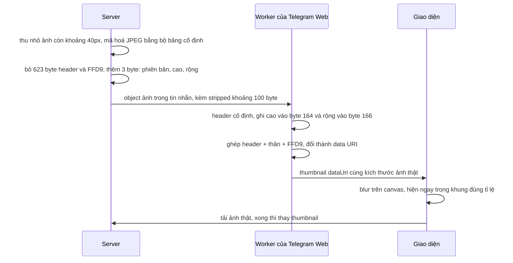

Cuộn một nhóm chat Telegram nhiều ảnh trên mạng chậm: ảnh chưa tải xong nhưng chỗ của nó **không trống**. Ở đó đã có một bản mờ đúng màu, đúng bố cục của ảnh thật. Sticker cũng vậy: trước khi sticker động hiện ra, đã có một bóng mờ đúng hình dáng của nó.

Bản xem trước đó **đi kèm luôn trong dữ liệu tin nhắn**, không phải tải thêm request nào. Muốn nhét được vào tin nhắn, nó phải rất nhỏ: với ảnh khoảng 100 byte, với sticker khoảng 100–200 byte. Bài này xem Telegram làm điều đó thế nào, rồi viết lại cả hai phía: phía client ghép lại ảnh, và một encoder JPEG nhỏ để tự tạo được thumbnail đúng định dạng.

> [!TIP]
> **Tóm tắt**
> - Một JPEG nhỏ phần lớn là **header** (bảng lượng tử, bảng Huffman): 623 byte trong định dạng của Telegram, giống hệt nhau ở mọi ảnh. Server chỉ gửi phần thân (khoảng 100 byte) kèm 3 byte phiên bản và kích thước; client **ghép header cố định vào** là ra JPEG hợp lệ, trình duyệt tự giải mã.
> - Mẹo chỉ chạy khi bên mã hoá dùng **đúng bảng trong header cố định**. Encoder của trình duyệt (`canvas.toBlob`) tự tối ưu bảng cho từng ảnh nên không dùng được.
> - Viền sticker là một **SVG path nén 1 byte mỗi token**: lệnh path tra bảng 64 ký tự, số 0–63 gói vào 1 byte kèm cả dấu `,`/`-` đứng trước.
> - Thumbnail mờ hiển thị bằng canvas `blur()` trên ảnh vẽ **rộng ra** mỗi bên để mép không bị tối.

<iframe class="demo-frame" src="/demos/web-patterns/index.html?theme=dark#/tg-tiny-thumb" title="Demo tg-tiny-thumb" loading="lazy" style="height: 1250px"></iframe>

<p class="demo-links">▶ <a href="/demos/web-patterns/index.html#/tg-tiny-thumb" target="_blank" rel="noopener">Mở demo toàn màn hình ↗</a> · <a href="https://stackblitz.com/github/hunghg255/blog-hunghg/tree/master/examples/web-patterns?file=src/lib/tgTinyThumb.ts" target="_blank" rel="noopener">Sửa code trên StackBlitz ↗</a> · <a href="https://github.com/hunghg255/blog-hunghg/blob/master/examples/web-patterns/src/lib/tgTinyThumb.ts" target="_blank" rel="noopener">Xem source trên GitHub ↗</a></p>

Trong demo, mỗi "ảnh chụp" 640px được thu nhỏ còn 40×26, mã hoá thành stripped thumbnail **79–109 byte**. Client ghép với header 623 byte thành JPEG khoảng 700 byte, hiện mờ ngay, rồi 1,4 giây sau ảnh thật mới xuất hiện. Phần dưới là viền sticker: path 240 ký tự nén còn 128 byte, giải mã lại khớp từng ký tự.

## Telegram làm thế nào?

### Ảnh: `PhotoStrippedSize`

Trong API của Telegram, mỗi ảnh có một danh sách kích thước (`sizes`). Bên cạnh các bản thật (`PhotoSize` loại `m`, `x`, `y`…) có một bản đặc biệt `PhotoStrippedSize`: vài chục tới vài trăm byte, đi kèm luôn trong object ảnh của tin nhắn.

Telegram Web A dựng thumbnail ở [`api/gramjs/apiBuilders/common.ts`](https://github.com/hunghg255/codebase/blob/main/web.telegram.org/src/api/gramjs/apiBuilders/common.ts) (chạy trong Web Worker, nơi xử lý giao thức MTProto):

```ts
const thumb = sizes.find((s: any): s is GramJs.PhotoStrippedSize => s instanceof GramJs.PhotoStrippedSize);
// khung hiển thị lấy kích thước của bản thật lớn nhất, để không nhảy layout khi ảnh thật tải xong
const realSizes = sizes.filter((s): s is GramJs.PhotoSize => s instanceof GramJs.PhotoSize);
const { w, h } = realSizes && realSizes.length ? realSizes[realSizes.length - 1] : DEFAULT_THUMB_SIZE;
const dataUri = bytesToDataUri(!mimeType || mimeType === 'image/jpeg' ? strippedPhotoToJpg(thumb.bytes) : thumb.bytes, undefined, mimeType);
```

Hàm ghép `strippedPhotoToJpg` nằm trong `lib/gramjs/Utils.js`. GramJS là thư viện MTProto cho JavaScript (port từ Telethon của Python), code **vendored**, không phải do đội Telegram Web viết:

```js
function strippedPhotoToJpg(stripped) {
    // Note: Changes here should update _stripped_real_length
    if (stripped.length < 3 || stripped[0] !== 1) {
        return stripped;
    }
    const header = Buffer.from(JPEG_HEADER);
    header[164] = stripped[1];
    header[166] = stripped[2];
    return Buffer.concat([header, stripped.slice(3), JPEG_FOOTER]);
}
```

`JPEG_HEADER` là một chuỗi hex 623 byte, `JPEG_FOOTER` là `ff d9` (marker kết thúc ảnh). Byte 0 của dữ liệu stripped là phiên bản (luôn là 1), byte 1 và 2 được ghi đè vào vị trí 164 và 166 của header, phần còn lại là thân ảnh.

Phân tích header bằng cách tìm các marker `FF xx`, ta thấy đúng cấu trúc của một JPEG baseline:

| Vị trí | Marker | Nội dung |
|---|---|---|
| 0 | `FF D8` (SOI) | bắt đầu ảnh |
| 2 | `FF E0` (APP0) | khối JFIF |
| 20, 89 | `FF DB` (DQT) | 2 bảng lượng tử: độ sáng, màu |
| 158 | `FF C0` (SOF0) | độ chính xác 8 bit, **cao ở 163–164, rộng ở 165–166**, 3 kênh, kênh Y lấy mẫu 2×2 (4:2:0) |
| 177–426 | `FF C4` (DHT) | 4 bảng Huffman, đúng các bảng mẫu trong phụ lục K của chuẩn JPEG |
| 609 | `FF DA` (SOS) | bắt đầu dữ liệu ảnh |

Vậy `header[164]` và `header[166]` là **byte thấp** của chiều cao và chiều rộng (byte cao để 0): thumbnail tối đa 255px, thực tế Telegram dùng cỡ khoảng 40px.

Hiển thị thì dùng hai hook. [`hooks/useBlurSync.ts`](https://github.com/hunghg255/codebase/blob/main/web.telegram.org/src/hooks/useBlurSync.ts) thử làm mờ **đồng bộ ngay trong lúc render**:

```ts
const img = new Image();
img.src = dataUri;
if (!img.width) {
  return;
}

const canvas = imgToCanvas(img);
fastBlur(canvas.getContext('2d'), 0, 0, canvas.width, canvas.height, RADIUS, ITERATIONS);
blurredRef.current = canvas.toDataURL();
```

Comment trong code: *"Sometimes `Image` do not manage to load synchronously, so we fall back the non-blurred variant and prepare the async one at least for the next time"*. Demo đo đúng hiện tượng này trên Chromium: lần đầu `img.width` là **0** (ảnh chưa giải mã), bấm "Tải lại" với cùng data URI thì `img.width` là **40** ngay lập tức, vì ảnh đã nằm trong cache bộ nhớ của trình duyệt. Còn `hooks/useCanvasBlur.ts` (dùng cho ảnh trong tin nhắn) vẽ thẳng lên canvas, dùng `ctx.filter = 'blur(2px)'` nếu có, không thì chạy box blur bằng JS:

```ts
ctx.drawImage(img, -RADIUS * 2, -RADIUS * 2, canvas.width + RADIUS * 4, canvas.height + RADIUS * 4);
```

Ảnh được vẽ **rộng ra mỗi bên 2×bán kính**. Blur một ảnh vẽ vừa khít thì ở mép, bộ lọc trộn điểm ảnh với vùng trống bên ngoài canvas và mép bị tối hoặc nhạt đi. Vẽ tràn ra ngoài thì vùng mép có dữ liệu thật để trộn.

### Sticker: `PhotoPathSize` → SVG path

Sticker không có ảnh xem trước dạng JPEG mà có **viền** (outline): một SVG path mô tả hình dáng. [`api/gramjs/apiBuilders/pathBytesToSvg.ts`](https://github.com/hunghg255/codebase/blob/main/web.telegram.org/src/api/gramjs/apiBuilders/pathBytesToSvg.ts) (code của Telegram Web) giải nén:

```ts
const LOOKUP = 'AACAAAAHAAALMAAAQASTAVAAAZaacaaaahaaalmaaaqastava.az0123456789-,';

function buildPath(bytes: Buffer) {
  let path = 'M';
  for (let i = 0; i < bytes.length; i++) {
    const num = bytes[i];
    if (num >= 128 + 64) {
      path += LOOKUP[num - 128 - 64];
    } else {
      if (num >= 128) {
        path += ',';
      } else if (num >= 64) {
        path += '-';
      }
      path += String(num & 63);
    }
  }
  path += 'z';
  return path;
}
```

Mỗi byte là một "token":

- **≥ 192**: một ký tự tra trong bảng `LOOKUP` 64 ký tự. Bảng được sắp để vị trí của chữ hoa = mã chữ − `'A'`, chữ thường = 26 + (mã − `'a'`); ô của chữ không phải lệnh path thì điền `A`/`a` (ở vị trí của `x` có dấu `.`). Sau đó là 10 chữ số, `-` và `,`.
- **128–191**: dấu `,` rồi số `byte & 63` (0–63).
- **64–127**: dấu `-` rồi số 0–63.
- **< 64**: số 0–63.

Path luôn bắt đầu bằng `M` và kết thúc bằng `z` nên hai ký tự này không cần lưu. Viền sticker thường được vẽ bằng lệnh *tương đối* (`l`, `c` chữ thường) nên phần lớn số nhỏ: `,23` hay `-17` chỉ tốn **1 byte** thay vì 3. Kết quả được nhét vào `<path fill-opacity="0.1" d="…">` và hiển thị bằng data URI SVG, ngay khi tin nhắn có sticker xuất hiện.

## Bên trong trình duyệt: vì sao header to hơn cả ảnh?

Một JPEG gồm hai phần:

- **Bảng**: bảng lượng tử (DQT, 64 số cho mỗi kênh, quyết định chất lượng) và bảng Huffman (DHT, quyết định cách mã hoá bit). Với ảnh lớn, vài trăm byte này không đáng kể.
- **Dữ liệu ảnh**: các khối 8×8 điểm ảnh sau DCT, lượng tử và mã hoá Huffman. Ảnh 40×26 với lấy mẫu 4:2:0 chỉ có 6 "MCU" (khối 16×16), mỗi MCU 6 khối 8×8. Ảnh mờ, ít chi tiết thì hầu hết hệ số bằng 0, mỗi khối chỉ còn vài bit.

Nên với ảnh 40px, **phần bảng chiếm 85–90% file**. Nếu mọi thumbnail đều mã hoá bằng **cùng một bộ bảng**, ta tách bộ bảng ra làm hằng số dùng chung, chỉ gửi phần dữ liệu. Giống hệt nén có từ điển dùng chung: client có sẵn từ điển.



Điều kiện "cùng một bộ bảng" mới là phần khó. Demo thử với encoder của trình duyệt: mã hoá 4 ảnh 40px bằng `canvas.toBlob('image/jpeg', 0.4)` trên Chromium, đem so header của chúng (đã xoá phần kích thước) thì **3 ảnh còn lại đều có header khác ảnh đầu**, vì encoder tự tối ưu bảng Huffman cho từng ảnh. Cũng vì thế mà demo không thể dùng `toBlob`: phải có encoder riêng, đọc bảng từ chính header cố định.

## Viết lại

Phía client, thứ bạn cần trong một app thật, chỉ có hai hàm:

```ts title=src/lib/tgTinyThumb.ts
/** stripped → JPEG đầy đủ. Không đúng định dạng thì trả nguyên bytes (như Telegram). */
export function strippedToJpeg(stripped: Uint8Array): Uint8Array {
  if (stripped.length < 3 || stripped[0] !== 1) return stripped;
  const header = STRIPPED_HEADER.slice();
  header[HEIGHT_OFFSET] = stripped[1];
  header[WIDTH_OFFSET] = stripped[2];
  const out = new Uint8Array(header.length + stripped.length - 3 + JPEG_FOOTER.length);
  out.set(header, 0);
  out.set(stripped.subarray(3), header.length);
  out.set(JPEG_FOOTER, out.length - JPEG_FOOTER.length);
  return out;
}
```

```ts title=src/lib/tgTinyThumb.ts
/**
 * Làm mờ ảnh nhỏ lên canvas. Vẽ ảnh rộng ra mỗi bên 2×radius rồi mới blur
 * (giống useCanvasBlur của Telegram): nếu không, mép ảnh bị "ăn" màu trong suốt và tối đi.
 * Trả false nếu trình duyệt không hỗ trợ ctx.filter: khi đó cho phần tử CSS `filter: blur()`
 * (Telegram thì chạy box blur bằng JS, thư viện "Superfast Blur").
 */
export function drawBlurred(canvas: HTMLCanvasElement, img: CanvasImageSource, width: number, height: number, radius = 2) {
  canvas.width = width;
  canvas.height = height;
  const ctx = canvas.getContext('2d', { alpha: false })!;
  const supported = 'filter' in ctx;
  if (supported) ctx.filter = `blur(${radius}px)`;
  ctx.drawImage(img, -radius * 2, -radius * 2, width + radius * 4, height + radius * 4);
  if (supported) ctx.filter = 'none';
  return supported;
}
```

Phía mã hoá (thường chạy trên server; ở đây viết bằng TypeScript khoảng 200 dòng để demo chạy được trên trình duyệt) nằm trong file đầy đủ bên dưới: `readTables` đọc bảng từ header, `encodeStripped` mã hoá baseline JPEG theo đúng các bảng đó.

Giải mã viền sticker:

```ts title=src/lib/tgStickerPath.ts
export function decodePathBytes(bytes: Uint8Array): string {
  let path = 'M';
  for (const byte of bytes) {
    if (byte >= 192) {
      path += LOOKUP[byte - 192];
    } else {
      if (byte >= 128) path += ',';
      else if (byte >= 64) path += '-';
      path += String(byte & 63);
    }
  }
  return `${path}z`;
}
```

::: spoiler Xem toàn bộ src/lib/tgTinyThumb.ts (gồm encoder JPEG)

```ts title=src/lib/tgTinyThumb.ts
/**
 * Thumbnail "stripped" kiểu Telegram: ảnh JPEG nhỏ (≤ 40px) mà server chỉ gửi phần thân,
 * vì phần header (bảng lượng tử, bảng Huffman…) giống hệt nhau ở mọi ảnh.
 *
 * Định dạng stripped: [1 (phiên bản), chiều cao, chiều rộng, ...thân JPEG không có FFD9]
 * Client ghép lại: HEADER cố định (ghi kích thước vào SOF0) + thân + FFD9 → JPEG hợp lệ.
 *
 * Để mẹo này chạy được, bên mã hoá PHẢI dùng đúng bảng trong header cố định. Encoder trình duyệt
 * (canvas.toBlob) tự tối ưu bảng Huffman cho từng ảnh nên không dùng được; file này có một encoder
 * JPEG baseline nhỏ đọc bảng thẳng từ header.
 */

// Header 623 byte của định dạng stripped (hằng số của giao thức, client Telegram nào cũng có).
// Gồm: SOI, APP0/JFIF, 2 bảng DQT, SOF0 (3 kênh, 4:2:0), 4 bảng DHT chuẩn (Annex K), SOS.
// prettier-ignore
const STRIPPED_HEADER_HEX =
  'ffd8ffe000104a46494600010100000100010000ffdb004300281c1e231e19282321232d2b28303c64413c37373c7b585d4964918099968f808c8aa0b4e6c3a0aadaad8a8cc8ffcbdaeef5ffffff9bc1fffffffaffe6fdfff8ffdb0043012b2d2d3c353c76414176f8a58ca5f8f8f8f8f8f8f8f8f8f8f8f8f8f8f8f8f8f8f8f8f8f8f8f8f8f8f8f8f8f8f8f8f8f8f8f8f8f8f8f8f8f8f8f8f8f8f8f8f8f8ffc00011080000000003012200021101031101ffc4001f0000010501010101010100000000000000000102030405060708090a0bffc400b5100002010303020403050504040000017d01020300041105122131410613516107227114328191a1082342b1c11552d1f02433627282090a161718191a25262728292a3435363738393a434445464748494a535455565758595a636465666768696a737475767778797a838485868788898a92939495969798999aa2a3a4a5a6a7a8a9aab2b3b4b5b6b7b8b9bac2c3c4c5c6c7c8c9cad2d3d4d5d6d7d8d9dae1e2e3e4e5e6e7e8e9eaf1f2f3f4f5f6f7f8f9faffc4001f0100030101010101010101010000000000000102030405060708090a0bffc400b51100020102040403040705040400010277000102031104052131061241510761711322328108144291a1b1c109233352f0156272d10a162434e125f11718191a262728292a35363738393a434445464748494a535455565758595a636465666768696a737475767778797a82838485868788898a92939495969798999aa2a3a4a5a6a7a8a9aab2b3b4b5b6b7b8b9bac2c3c4c5c6c7c8c9cad2d3d4d5d6d7d8d9dae2e3e4e5e6e7e8e9eaf2f3f4f5f6f7f8f9faffda000c03010002110311003f00';

export const STRIPPED_HEADER = hexToBytes(STRIPPED_HEADER_HEX);
const JPEG_FOOTER = new Uint8Array([0xff, 0xd9]);

// Vị trí trong header: SOF0 bắt đầu ở byte 158 (FF C0), sau đó là độ dài (2), độ chính xác (1),
// chiều cao (2 byte, big-endian) ở 163–164 và chiều rộng ở 165–166.
// Telegram chỉ ghi byte thấp (164, 166) nên kích thước tối đa là 255px.
export const HEIGHT_OFFSET = 164;
export const WIDTH_OFFSET = 166;
export const MAX_STRIPPED_SIZE = 255;

// ---- Phía client: ghép lại ----

/** stripped → JPEG đầy đủ. Không đúng định dạng thì trả nguyên bytes (như Telegram). */
export function strippedToJpeg(stripped: Uint8Array): Uint8Array {
  if (stripped.length < 3 || stripped[0] !== 1) return stripped;
  const header = STRIPPED_HEADER.slice();
  header[HEIGHT_OFFSET] = stripped[1];
  header[WIDTH_OFFSET] = stripped[2];
  const out = new Uint8Array(header.length + stripped.length - 3 + JPEG_FOOTER.length);
  out.set(header, 0);
  out.set(stripped.subarray(3), header.length);
  out.set(JPEG_FOOTER, out.length - JPEG_FOOTER.length);
  return out;
}

export function bytesToDataUri(bytes: Uint8Array, mime = 'image/jpeg') {
  let binary = '';
  for (let i = 0; i < bytes.length; i++) binary += String.fromCharCode(bytes[i]);
  return `data:${mime};base64,${btoa(binary)}`;
}

/**
 * Làm mờ ảnh nhỏ lên canvas. Vẽ ảnh rộng ra mỗi bên 2×radius rồi mới blur
 * (giống useCanvasBlur của Telegram): nếu không, mép ảnh bị "ăn" màu trong suốt và tối đi.
 * Trả false nếu trình duyệt không hỗ trợ ctx.filter: khi đó cho phần tử CSS `filter: blur()`
 * (Telegram thì chạy box blur bằng JS, thư viện "Superfast Blur").
 */
export function drawBlurred(canvas: HTMLCanvasElement, img: CanvasImageSource, width: number, height: number, radius = 2) {
  canvas.width = width;
  canvas.height = height;
  const ctx = canvas.getContext('2d', { alpha: false })!;
  const supported = 'filter' in ctx;
  if (supported) ctx.filter = `blur(${radius}px)`;
  ctx.drawImage(img, -radius * 2, -radius * 2, width + radius * 4, height + radius * 4);
  if (supported) ctx.filter = 'none';
  return supported;
}

// ---- Phía server (hoặc demo): mã hoá bằng đúng bảng trong header ----

interface HuffmanTable {
  codes: Uint16Array; // mã theo giá trị symbol
  sizes: Uint8Array; // độ dài mã (bit)
}

interface Tables {
  quant: Uint8Array[]; // theo thứ tự zigzag, như lưu trong file
  dc: HuffmanTable[];
  ac: HuffmanTable[];
}

let cachedTables: Tables | undefined;

/** Đọc DQT và DHT từ header: encoder không tự chọn bảng nào cả. */
function readTables(): Tables {
  if (cachedTables) return cachedTables;
  const quant: Uint8Array[] = [];
  const dc: HuffmanTable[] = [];
  const ac: HuffmanTable[] = [];
  const h = STRIPPED_HEADER;
  let i = 2;
  while (i < h.length) {
    const marker = h[i + 1];
    const length = (h[i + 2] << 8) | h[i + 3];
    const segment = h.subarray(i + 4, i + 2 + length);
    if (marker === 0xdb) {
      for (let p = 0; p < segment.length; p += 65) quant[segment[p] & 15] = segment.slice(p + 1, p + 65);
    } else if (marker === 0xc4) {
      let p = 0;
      while (p < segment.length) {
        const tableClass = segment[p] >> 4;
        const id = segment[p] & 15;
        const counts = segment.subarray(p + 1, p + 17);
        const total = counts.reduce((a, b) => a + b, 0);
        const symbols = segment.subarray(p + 17, p + 17 + total);
        (tableClass === 0 ? dc : ac)[id] = buildHuffman(counts, symbols);
        p += 17 + total;
      }
    }
    if (marker === 0xda) break;
    i += 2 + length;
  }
  cachedTables = { quant, dc, ac };
  return cachedTables;
}

/** Sinh mã Huffman chính tắc (canonical) từ số lượng mã mỗi độ dài, như JPEG quy định. */
function buildHuffman(counts: Uint8Array, symbols: Uint8Array): HuffmanTable {
  const codes = new Uint16Array(256);
  const sizes = new Uint8Array(256);
  let code = 0;
  let k = 0;
  for (let length = 1; length <= 16; length++) {
    for (let n = 0; n < counts[length - 1]; n++) {
      codes[symbols[k]] = code;
      sizes[symbols[k]] = length;
      code++;
      k++;
    }
    code <<= 1;
  }
  return { codes, sizes };
}

// prettier-ignore
const ZIGZAG = [
  0, 1, 8, 16, 9, 2, 3, 10, 17, 24, 32, 25, 18, 11, 4, 5, 12, 19, 26, 33, 40, 48, 41, 34, 27, 20, 13, 6, 7, 14, 21,
  28, 35, 42, 49, 56, 57, 50, 43, 36, 29, 22, 15, 23, 30, 37, 44, 51, 58, 59, 52, 45, 38, 31, 39, 46, 53, 60, 61,
  54, 47, 55, 62, 63,
];

const COS = Array.from({ length: 64 }, (_, i) => Math.cos(((2 * (i >> 3) + 1) * (i & 7) * Math.PI) / 16));

/** DCT 8×8 thẳng theo định nghĩa: chậm nhưng ảnh 40px chỉ có vài chục khối. */
function forwardDct(block: Float32Array, out: Float32Array) {
  for (let v = 0; v < 8; v++) {
    for (let u = 0; u < 8; u++) {
      let sum = 0;
      for (let y = 0; y < 8; y++) {
        for (let x = 0; x < 8; x++) {
          sum += block[y * 8 + x] * COS[x * 8 + u] * COS[y * 8 + v];
        }
      }
      const cu = u === 0 ? Math.SQRT1_2 : 1;
      const cv = v === 0 ? Math.SQRT1_2 : 1;
      out[v * 8 + u] = 0.25 * cu * cv * sum;
    }
  }
}

class BitWriter {
  private bytes: number[] = [];
  private buffer = 0;
  private count = 0;

  write(code: number, size: number) {
    for (let i = size - 1; i >= 0; i--) {
      this.buffer = (this.buffer << 1) | ((code >> i) & 1);
      if (++this.count === 8) this.flushByte();
    }
  }

  private flushByte() {
    this.bytes.push(this.buffer);
    // 0xFF trong dữ liệu ảnh phải chèn thêm 0x00 phía sau (byte stuffing), nếu không sẽ bị hiểu là marker
    if (this.buffer === 0xff) this.bytes.push(0);
    this.buffer = 0;
    this.count = 0;
  }

  finish() {
    // phần bit lẻ cuối cùng được đệm bằng bit 1
    if (this.count > 0) this.write((1 << (8 - this.count)) - 1, 8 - this.count);
    return new Uint8Array(this.bytes);
  }
}

/** Số bit cần để biểu diễn |value| (category trong JPEG) và phần bit bổ sung. */
function category(value: number) {
  const abs = Math.abs(value);
  let size = 0;
  while (abs >> size) size++;
  const bits = value >= 0 ? value : value + (1 << size) - 1;
  return { size, bits };
}

function encodeBlock(
  pixels: Float32Array,
  quant: Uint8Array,
  dcTable: HuffmanTable,
  acTable: HuffmanTable,
  prevDc: number,
  writer: BitWriter,
) {
  const coeffs = new Float32Array(64);
  forwardDct(pixels, coeffs);
  const q = new Int32Array(64);
  for (let k = 0; k < 64; k++) q[k] = Math.round(coeffs[ZIGZAG[k]] / quant[k]);

  const diff = q[0] - prevDc;
  const dc = category(diff);
  writer.write(dcTable.codes[dc.size], dcTable.sizes[dc.size]);
  if (dc.size) writer.write(dc.bits, dc.size);

  let run = 0;
  for (let k = 1; k < 64; k++) {
    if (q[k] === 0) {
      run++;
      continue;
    }
    while (run > 15) {
      writer.write(acTable.codes[0xf0], acTable.sizes[0xf0]); // ZRL: 16 số 0 liên tiếp
      run -= 16;
    }
    const ac = category(q[k]);
    const symbol = (run << 4) | ac.size;
    writer.write(acTable.codes[symbol], acTable.sizes[symbol]);
    writer.write(ac.bits, ac.size);
    run = 0;
  }
  if (run > 0) writer.write(acTable.codes[0], acTable.sizes[0]); // EOB
  return q[0];
}

/**
 * ImageData (≤ 255px) → stripped bytes. Lấy mẫu màu 4:2:0 như SOF0 trong header quy định:
 * mỗi khối 16×16 (MCU) gồm 4 khối Y, 1 khối Cb, 1 khối Cr.
 */
export function encodeStripped(image: ImageData): Uint8Array {
  const { width, height, data } = image;
  if (width > MAX_STRIPPED_SIZE || height > MAX_STRIPPED_SIZE) {
    throw new RangeError(`Stripped thumbnail tối đa ${MAX_STRIPPED_SIZE}px`);
  }
  const { quant, dc, ac } = readTables();
  const writer = new BitWriter();
  const prev = [0, 0, 0];
  const block = new Float32Array(64);

  const sample = (x: number, y: number, channel: 0 | 1 | 2) => {
    const px = Math.min(x, width - 1);
    const py = Math.min(y, height - 1);
    const i = (py * width + px) * 4;
    const r = data[i];
    const g = data[i + 1];
    const b = data[i + 2];
    if (channel === 0) return 0.299 * r + 0.587 * g + 0.114 * b;
    if (channel === 1) return -0.168736 * r - 0.331264 * g + 0.5 * b + 128;
    return 0.5 * r - 0.418688 * g - 0.081312 * b + 128;
  };

  for (let my = 0; my < height; my += 16) {
    for (let mx = 0; mx < width; mx += 16) {
      // 4 khối độ sáng (Y)
      for (const [bx, by] of [
        [0, 0],
        [8, 0],
        [0, 8],
        [8, 8],
      ]) {
        for (let y = 0; y < 8; y++) {
          for (let x = 0; x < 8; x++) block[y * 8 + x] = sample(mx + bx + x, my + by + y, 0) - 128;
        }
        prev[0] = encodeBlock(block, quant[0], dc[0], ac[0], prev[0], writer);
      }
      // Cb rồi Cr: mỗi điểm là trung bình 2×2 điểm ảnh
      for (const channel of [1, 2] as const) {
        for (let y = 0; y < 8; y++) {
          for (let x = 0; x < 8; x++) {
            const sx = mx + x * 2;
            const sy = my + y * 2;
            const avg =
              (sample(sx, sy, channel) +
                sample(sx + 1, sy, channel) +
                sample(sx, sy + 1, channel) +
                sample(sx + 1, sy + 1, channel)) /
              4;
            block[y * 8 + x] = avg - 128;
          }
        }
        prev[channel] = encodeBlock(block, quant[1], dc[1], ac[1], prev[channel], writer);
      }
    }
  }

  const body = writer.finish();
  const out = new Uint8Array(3 + body.length);
  out[0] = 1;
  out[1] = height;
  out[2] = width;
  out.set(body, 3);
  return out;
}

function hexToBytes(hex: string) {
  const out = new Uint8Array(hex.length / 2);
  for (let i = 0; i < out.length; i++) out[i] = parseInt(hex.slice(i * 2, i * 2 + 2), 16);
  return out;
}
```

:::

::: spoiler Xem toàn bộ src/lib/tgStickerPath.ts (gồm hàm mã hoá ngược)

```ts title=src/lib/tgStickerPath.ts
/**
 * Viền sticker nén thành bytes (PhotoPathSize của Telegram) ⇄ SVG path.
 *
 * Mỗi byte là một token:
 * - byte ≥ 192: một ký tự tra trong bảng LOOKUP 64 ký tự (lệnh path, '.', chữ số, '-', ',')
 * - 128–191:   ',' + (byte & 63)   → số 0–63 đứng sau dấu phẩy
 * - 64–127:    '-' + (byte & 63)   → số âm 0–63
 * - < 64:      số 0–63
 * Path luôn bắt đầu bằng 'M' và kết thúc bằng 'z' nên hai ký tự đó không cần lưu.
 */

// Vị trí = mã ký tự - 'A' (chữ hoa) hoặc 26 + (mã - 'a') (chữ thường); ô không dùng điền 'A'/'a'.
// Có hai chỗ lạ: vị trí của 'x' là '.', của 'y' là 'a'.
const LOOKUP = 'AACAAAAHAAALMAAAQASTAVAAAZaacaaaahaaalmaaaqastava.az0123456789-,';

export function decodePathBytes(bytes: Uint8Array): string {
  let path = 'M';
  for (const byte of bytes) {
    if (byte >= 192) {
      path += LOOKUP[byte - 192];
    } else {
      if (byte >= 128) path += ',';
      else if (byte >= 64) path += '-';
      path += String(byte & 63);
    }
  }
  return `${path}z`;
}

/**
 * Chiều ngược lại (Telegram không cần vì server đã mã hoá sẵn). Dùng cho demo và test:
 * số nguyên 0–63 (có thể kèm ',' hoặc '-' đứng trước) gói vào 1 byte, còn lại mỗi ký tự 1 byte.
 */
export function encodePath(path: string): Uint8Array {
  const body = normalizePath(path).replace(/^M/, '').replace(/z$/, '');
  const out: number[] = [];
  const re = /([,-]?)(\d+)|(.)/g;
  for (let match = re.exec(body); match; match = re.exec(body)) {
    const [, sign, digits, char] = match;
    if (digits !== undefined) {
      const value = Number(digits);
      // số lớn hơn 63 hoặc có số 0 ở đầu (vd "05") phải viết từng chữ số để giải mã ra đúng chuỗi
      if (value <= 63 && String(value) === digits) {
        out.push((sign === ',' ? 128 : sign === '-' ? 64 : 0) + value);
        continue;
      }
      for (const c of sign + digits) out.push(lookupByte(c));
      continue;
    }
    out.push(lookupByte(char));
  }
  return new Uint8Array(out);
}

function lookupByte(char: string) {
  // lần xuất hiện đầu tiên luôn là vị trí đúng: 'A' ở 0, 'a' ở 26, các ô trống đứng sau
  const index = LOOKUP.indexOf(char);
  if (index === -1) throw new SyntaxError(`Ký tự "${char}" không có trong bảng`);
  return 192 + index;
}

/** Bỏ khoảng trắng: số liền nhau ngăn bằng ',' (bảng không có ký tự cách). */
export function normalizePath(path: string) {
  return path
    .trim()
    .replace(/\s*([A-Za-z])\s*/g, '$1')
    .replace(/\s+-/g, '-')
    .replace(/\s+/g, ',')
    .replace(/Z$/, 'z'); // định dạng luôn kết thúc bằng 'z' thường
}

export function pathToSvgDataUri(path: string, width: number, height: number) {
  const svg =
    `<svg xmlns="http://www.w3.org/2000/svg" viewBox="0 0 ${width} ${height}">` +
    `<path fill-opacity="0.1" d="${path}"/></svg>`;
  // encodeURIComponent: Telegram nhét thẳng chuỗi vào "data:image/svg+xml;utf8,…" — chạy được vì path
  // không có '#' hay '%', nhưng mã hoá đầy đủ thì an toàn hơn
  return `data:image/svg+xml;charset=utf-8,${encodeURIComponent(svg)}`;
}
```

:::

## Đi qua code

- **`strippedToJpeg`**: copy header (không sửa hằng số dùng chung), ghi hai byte kích thước, nối thân và `FF D9`. Không đúng định dạng (byte đầu khác 1) thì trả nguyên bytes như Telegram, để định dạng mới sau này (phiên bản 2) không làm vỡ client cũ một cách khó hiểu.
- **`readTables`**: duyệt các segment `FF xx` của header. DQT lưu 64 số **theo thứ tự zigzag**; DHT lưu số lượng mã cho mỗi độ dài 1–16 bit rồi danh sách symbol, từ đó sinh mã Huffman chính tắc (`buildHuffman`). Encoder không tự chọn bảng nào, nên chắc chắn khớp với header bên client.
- **`encodeStripped`**: đổi RGB sang YCbCr, chia ảnh thành MCU 16×16: 4 khối Y, 1 khối Cb và 1 khối Cr (mỗi điểm màu là trung bình 2×2 điểm ảnh), đúng như SOF0 của header yêu cầu. Mỗi khối: DCT 8×8, chia cho bảng lượng tử, mã hoá hệ số DC (chênh lệch so với khối trước) và chuỗi AC (cặp "số số 0 đứng trước, độ lớn"), kết thúc bằng `EOB`. Ảnh không chia hết cho 16 thì lặp lại điểm ở mép; bộ giải mã tự cắt theo kích thước trong SOF0.
- **`BitWriter`**: ghi từng bit; gặp byte `0xFF` trong dữ liệu thì chèn `0x00` phía sau (byte stuffing), nếu không bộ giải mã tưởng đó là marker. Hết dữ liệu thì đệm bit 1 cho tròn byte.
- **DCT viết thẳng theo định nghĩa** (4 vòng lặp lồng nhau): chậm với ảnh lớn, nhưng ảnh 40px chỉ có 36 khối, chạy dưới 1ms.
- **`decodePathBytes`**: chép đúng thuật toán của Telegram. Hàm ngược `encodePath` (Telegram không cần, vì server mã hoá sẵn) tách path thành token: số nguyên 0–63 kèm dấu đứng trước thành 1 byte, số lớn hơn hoặc có số 0 ở đầu thì viết từng chữ số.

**Khác bản gốc:**

- Có thêm phía mã hoá (encoder JPEG và `encodePath`) để demo tự sinh dữ liệu; Telegram chỉ có phía giải mã.
- `drawBlurred` báo lại trình duyệt có hỗ trợ `ctx.filter` không, để bên gọi dùng CSS `filter: blur()` thay thế; Telegram thì chạy box blur bằng JS ("Superfast Blur" của Mario Klingemann, code vendored).
- Data URI của SVG được `encodeURIComponent`. Telegram ghép thẳng chuỗi vào `data:image/svg+xml;utf8,…`; vẫn chạy vì path chỉ có chữ, số, `.`, `,`, `-`, nhưng mã hoá đầy đủ thì không phải lo ký tự `#` hay `%`.

## Tại sao không làm cách khác?

- **Gửi JPEG nhỏ bình thường**: khoảng 900 byte cho ảnh 40px (demo đo bằng `toBlob`), gấp gần 10 lần stripped. Nhân với hàng trăm ảnh trong một lần tải lịch sử chat thì khác biệt đáng kể.
- **BlurHash / ThumbHash**: chỉ vài chục byte, nhưng đó là các hệ số màu thô; client phải có thuật toán giải mã riêng bằng JS rồi vẽ ra canvas. Stripped JPEG thì trình duyệt tự giải mã (bằng code native, có thể chạy ngoài main thread), và định dạng này đã có trong giao thức Telegram từ trước.
- **Màu trung bình** (một ô màu phẳng): rẻ nhất, nhưng mất bố cục. Với ảnh chụp người hay phong cảnh, bản mờ đúng bố cục giúp người xem nhận ra ảnh trước khi nó tải xong.
- **Ảnh xem trước tải riêng** (`` với bản nhỏ): thêm một request mỗi ảnh. Gửi kèm trong dữ liệu tin nhắn thì có ngay khi tin nhắn có.

## Edge case và cạm bẫy

- **Header phải khớp tuyệt đối** với encoder phía server. Đổi chất lượng (bảng lượng tử) ở server là mọi client cũ hiện ảnh sai màu hoặc vỡ. Đó là lý do có byte phiên bản: đổi định dạng thì tăng phiên bản.
- **Chỉ ghi byte thấp của kích thước**: thumbnail trên 255px sẽ sai. `encodeStripped` ném lỗi thay vì âm thầm cắt.
- **Giải mã đồng bộ không đáng tin**: `img.width` ngay sau khi gán `src` chỉ có khi ảnh đã ở trong cache. Luôn có đường dự phòng bất đồng bộ (`await img.decode()` hoặc `onload`), như `useBlurSync` làm.
- **Khung phải đúng tỉ lệ ảnh thật**: lấy kích thước từ bản lớn nhất (Telegram làm vậy), không phải từ thumbnail 40px, nếu không layout nhảy khi ảnh thật về.
- **Viền sticker trên nền tối**: `fill-opacity="0.1"` với màu đen mặc định gần như vô hình trên nền tối. Demo đảo màu bằng CSS ở giao diện tối.
- **Path có số thập phân hay số lớn**: vẫn mã hoá được (từng chữ số một byte), chỉ kém gọn hơn. Viền dùng lệnh tương đối và số nguyên nhỏ thì gọn nhất.

## Dùng trong dự án

Nếu bạn tự làm server ảnh, quy trình là:

1. Server: thu nhỏ ảnh còn khoảng 40px, mã hoá JPEG baseline 4:2:0 **bằng một bộ bảng cố định** (trong Node có thể dùng chính `encodeStripped`, hoặc thư viện JPEG cho phép truyền bảng lượng tử và tắt tối ưu Huffman). Lưu `[1, cao, rộng, …thân]` cạnh metadata ảnh, trả kèm trong API dạng base64.
2. Client: `strippedToJpeg` → `bytesToDataUri` → vẽ lên canvas có blur, đặt trong khung có `aspect-ratio` của ảnh thật; ảnh thật tải xong thì đè lên.

```tsx
function PhotoWithPreview({ stripped, src, width, height }: { stripped: Uint8Array; src: string; width: number; height: number }) {
  const canvasRef = useRef<HTMLCanvasElement>(null);
  const [loaded, setLoaded] = useState(false);
  useEffect(() => {
    const img = new Image();
    img.src = bytesToDataUri(strippedToJpeg(stripped));
    img.decode().then(() => canvasRef.current && drawBlurred(canvasRef.current, img, img.width, img.height));
  }, [stripped]);
  return (
    <div style={{ position: 'relative', aspectRatio: `${width} / ${height}` }}>
      <canvas ref={canvasRef} style={{ position: 'absolute', inset: 0, width: '100%', height: '100%' }} />
       setLoaded(true)} style={{ position: 'absolute', inset: 0, opacity: loaded ? 1 : 0 }} alt="" />
    </div>
  );
}
```

## Kiểm thử

::: spoiler Ví dụ test (bản phác, không có trong repo)

```ts
import { describe, expect, it } from 'vitest';
import { STRIPPED_HEADER, strippedToJpeg } from './tgTinyThumb';
import { decodePathBytes, encodePath, normalizePath } from './tgStickerPath';

describe('strippedToJpeg', () => {
  it('ghép header, ghi kích thước vào byte 164/166 và thêm FFD9', () => {
    const stripped = new Uint8Array([1, 26, 40, 0xaa, 0xbb]);
    const jpeg = strippedToJpeg(stripped);
    expect(jpeg.length).toBe(STRIPPED_HEADER.length + 2 + 2);
    expect(jpeg[164]).toBe(26);
    expect(jpeg[166]).toBe(40);
    expect([...jpeg.slice(-4)]).toEqual([0xaa, 0xbb, 0xff, 0xd9]);
    expect(STRIPPED_HEADER[164]).toBe(0); // không sửa hằng số dùng chung
  });

  it('phiên bản lạ thì trả nguyên', () => {
    const other = new Uint8Array([2, 1, 1, 9]);
    expect(strippedToJpeg(other)).toBe(other);
  });
});

describe('sticker path', () => {
  it('giải mã đúng từng loại token', () => {
    // 'l' (vị trí 37), ',' + 5, '-' + 3, số 12
    expect(decodePathBytes(new Uint8Array([192 + 37, 128 + 5, 64 + 3, 12]))).toBe('Ml,5-312z');
  });

  it('mã hoá rồi giải mã lại ra đúng path đã chuẩn hoá', () => {
    const path = 'M256 40 l31,39 c1.5 -2 100 200 5 6 z';
    expect(decodePathBytes(encodePath(path))).toBe(normalizePath(path));
  });
});

// Encoder JPEG: test trong trình duyệt thật (jsdom không giải mã ảnh). Mã hoá một ImageData,
// ghép bằng strippedToJpeg, `await img.decode()`, vẽ lại lên canvas và so điểm ảnh với ảnh gốc:
// sai số trung bình mỗi kênh phải nhỏ (vài đơn vị trên 255).
```

:::

## So với cách khác

- **BlurHash** ([blurha.sh](https://blurha.sh)) và **ThumbHash** ([evanw.github.io/thumbhash](https://evanw.github.io/thumbhash/)): chuỗi ngắn hơn, có thư viện cho mọi nền tảng, nhưng cần JS giải mã. ThumbHash giữ được cả tỉ lệ khung và độ trong suốt.
- **LQIP** (low-quality image placeholder) dạng JPEG/WebP base64 nhúng thẳng trong HTML: đơn giản, nhưng mỗi ảnh mang theo header riêng.
- **CSS `background` màu chủ đạo**: rẻ nhất, xem thêm cách lấy màu từ ảnh ở [bài #56 của series web](/blogs/web-colors-from-images).

Telegram chọn stripped JPEG vì giao thức đã có sẵn, trình duyệt giải mã native, và chi phí chỉ là một hằng số 623 byte trong client.

---

Bài này thuộc series **[Học từ mã nguồn Telegram](/series/telegram)** (15 bài, đọc theo thứ tự).

::: spoiler Xem nhanh danh sách bài trong series

*Mở đầu*

- [Mở đầu: bên trong Telegram Web A](/blogs/learn-from-telegram-source-code)

*Phần 1: dữ liệu và đồng bộ*

- [#1 Gửi tin lạc quan, khớp tin thật bằng randomId](/blogs/telegram-optimistic-send)
- [#2 Lịch sử tin nhắn chia hai đảo](/blogs/telegram-message-history-islands)
- [#3 Lưu global state lúc rảnh, chỉ giữ phần cần](/blogs/telegram-persist-global-state)
- [#4 Gom update realtime theo nhịp animation](/blogs/telegram-realtime-update-batching)
- [#5 Store tự viết và diff danh sách có key](/blogs/telegram-teactn-store-fast-list)

*Phần 2: animation và giao diện*

- [#6 Animation sắp xếp danh sách chat không đo DOM](/blogs/telegram-chat-list-flip)
- [#7 Ảnh bay giữa hai cây DOM trong media viewer](/blogs/telegram-media-viewer-ghost)
- [#8 Bố cục album chọn theo hàm chi phí](/blogs/telegram-album-layout)
- [#9 Giờ gửi nằm gọn trong bong bóng chat](/blogs/telegram-bubble-meta-spacer)
- [#10 Composer biến hình, Transition và gạch chân tab](/blogs/telegram-composer-morph-transition)

*Phần 3: media, mobile, thông báo*

- **#11 Thumbnail 100 byte và viền sticker nén** (bài này)
- [#12 Player sticker: DPR, hạ fps, cache khung](/blogs/telegram-lottie-player)
- [#13 Mobile: --vh, bàn phím ảo, nhấn giữ, số điện thoại](/blogs/telegram-mobile-viewport-touch)
- [#14 Web Push không trùng và đánh dấu đã đọc](/blogs/telegram-push-dedupe-read-receipts)

:::

Code + demo: [`examples/web-patterns`](https://github.com/hunghg255/blog-hunghg/tree/master/examples/web-patterns) · [Mở trên StackBlitz](https://stackblitz.com/github/hunghg255/blog-hunghg/tree/master/examples/web-patterns)
