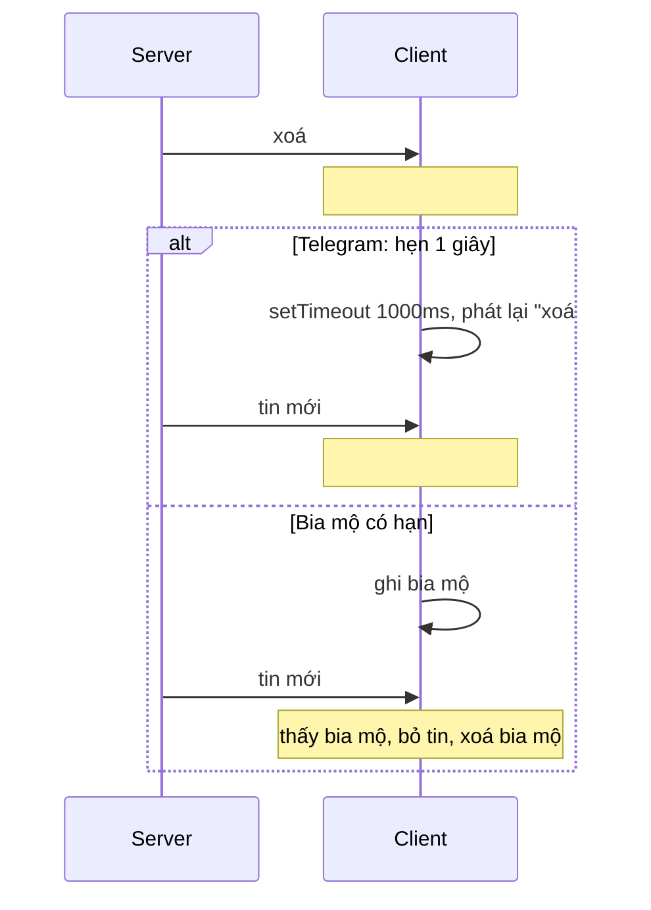

Bạn để Telegram Web A ở một tab, chuyển sang làm việc khác. Có người nhắn tin: tiêu đề tab bắt đầu nhấp nháy "1 notification" ↔ "Telegram", favicon đổi sang bản có chấm đỏ. Quay lại tab thì mọi thứ trở về như cũ.

Tính năng này nằm gọn trong `components/main/Main.tsx`, khoảng 40 dòng. Nó có một chi tiết hiếm thấy (gán `document.title` trùng giá trị cũng tốn bộ nhớ) và một lỗi logic: số tin mới được tính bằng **hiệu số tổng tin chưa đọc**, nên nếu bạn đọc vài tin trên điện thoại trong lúc vắng mặt, tab sẽ **không báo gì** dù có tin mới.

Phần hai của bài là một mẹo nhỏ khác trong lớp nhận update realtime: lệnh "xoá tin" đôi khi tới **trước** chính tin đó.

> [!TIP]
> **Tóm tắt**
> - Lúc rời tab (blur): bắt đầu một interval 1 giây, nhịp chẵn hiện "N notifications" + favicon unread, nhịp lẻ trả lại tiêu đề gốc. Quay lại (focus): dừng và trả lại.
> - Chỉ gán `document.title` khi giá trị **khác**; gán trùng vẫn tạo node mới trong DOM (Telegram có ghi chú về bộ đếm DOM Nodes của Chrome).
> - Bản gốc đếm `tổng chưa đọc hiện tại − tổng lúc rời tab`; đọc tin ở thiết bị khác làm hiệu số âm và tin mới bị nuốt. Bản viết lại đếm thẳng từng tin tới.
> - Lệnh xoá tới trước tin: Telegram hẹn 1 giây rồi xoá lại; tin tới trễ hơn thì thành "tin ma". Bản viết lại giữ "bia mộ" có hạn cho id đã bị xoá.

<iframe class="demo-frame" src="/demos/web-patterns/index.html?theme=dark#/tg-unread" title="Demo tg-unread" loading="lazy" style="height: 1300px"></iframe>

<p class="demo-links">▶ <a href="/demos/web-patterns/index.html#/tg-unread" target="_blank" rel="noopener">Mở demo toàn màn hình ↗</a> · <a href="https://stackblitz.com/github/hunghg255/blog-hunghg/tree/master/examples/web-patterns?file=src/lib/tgUnreadIndicator.ts" target="_blank" rel="noopener">Sửa code trên StackBlitz ↗</a> · <a href="https://github.com/hunghg255/blog-hunghg/blob/master/examples/web-patterns/src/lib/tgUnreadIndicator.ts" target="_blank" rel="noopener">Xem source trên GitHub ↗</a></p>

Thử trong demo: bấm "Rời tab", rồi "Đọc 5 tin trên điện thoại", rồi "+3 tin mới". Tab kiểu bản gốc đứng yên, tab bản sửa nhấp nháy "3 tin nhắn mới". Mở demo toàn màn hình và bật "Áp bản sửa vào tab thật" để thấy trên tab thật của trình duyệt. Phần 2 kéo thời gian tin #42 tới lên 1500ms.

## Telegram làm thế nào?

### Nhấp nháy tiêu đề

Trong [`components/main/Main.tsx`](https://github.com/hunghg255/codebase/blob/main/web.telegram.org/src/components/main/Main.tsx):

```ts
const NOTIFICATION_INTERVAL = 1000;
let notificationInterval: number | undefined;

const handleBlur = useCallback(() => {
  updateIsOnline(false);

  const initialUnread = selectCountNotMutedUnread(getGlobal());
  let index = 0;

  clearInterval(notificationInterval);
  notificationInterval = window.setInterval(() => {
    if (document.title.includes(INACTIVE_MARKER)) {
      updateIcon(false);
      return;
    }

    if (index % 2 === 0) {
      const newUnread = selectCountNotMutedUnread(getGlobal()) - initialUnread;
      if (newUnread > 0) {
        updatePageTitle(`${newUnread} notification${newUnread > 1 ? 's' : ''}`);
        updateIcon(true);
      }
    } else {
      updatePageTitle(PAGE_TITLE);
      updateIcon(false);
    }

    index++;
  }, NOTIFICATION_INTERVAL);
}, [updateIsOnline]);

const handleFocus = useCallback(() => {
  updateIsOnline(true);
  clearInterval(notificationInterval);
  notificationInterval = undefined;
  if (!document.title.includes(INACTIVE_MARKER)) updatePageTitle(PAGE_TITLE);
  updateIcon(false);
}, [updateIsOnline]);

useBackgroundMode(handleBlur, handleFocus);
useBeforeUnload(handleBlur);
```

Mấy chi tiết:

- **Một handler, hai việc**: blur cũng báo server "đang offline" (`updateIsOnline(false)`), focus báo "online". Trạng thái "online" của bạn trong mắt người khác gắn với việc bạn có đang nhìn tab hay không.
- **`selectCountNotMutedUnread`**: chỉ đếm chat **không tắt thông báo**. Nhóm 5000 người đã tắt tiếng không làm tab nhấp nháy.
- **`INACTIVE_MARKER = ' [Inactive]'`**: khi mở Telegram ở tab thứ hai, tab cũ bị đánh dấu "Inactive" (`App.tsx` gán `document.title = PAGE_TITLE + INACTIVE_MARKER`) (xem [Học từ web lớn #14](/blogs/web-leader-tab-notifications) về `activeTabMonitor`). Tab inactive thì không nhấp nháy.
- `useBackgroundMode` dựa trên sự kiện `blur`/`focus` của cửa sổ, nên chỉ cần chuyển sang **cửa sổ khác** (tab vẫn hiện) cũng tính là vắng mặt.

### Favicon và tiêu đề

```ts
function updateIcon(asUnread: boolean) {
  document.querySelectorAll<HTMLLinkElement>('link[rel="icon"]').forEach((link) => {
    if (asUnread) {
      if (!link.href.includes('favicon-unread')) {
        link.href = link.href.replace('favicon', 'favicon-unread');
      }
    } else {
      link.href = link.href.replace('favicon-unread', 'favicon');
    }
  });
}

// For some reason setting `document.title` to the same value
// causes increment of Chrome Dev Tools > Performance Monitor > DOM Nodes counter
function updatePageTitle(nextTitle: string) {
  if (document.title !== nextTitle) {
    document.title = nextTitle;
  }
}
```

Favicon là **file tĩnh có sẵn**, đổi bằng cách thay chuỗi `favicon` thành `favicon-unread` trong `href` của mọi `<link rel="icon">` (trang thường khai báo nhiều kích thước icon). Bản dump không có `index.html` hay file icon nên mình chỉ biết tên file qua đoạn code này. Ghi chú về `document.title` có cơ sở: theo spec HTML, gán `document.title` là **thay toàn bộ con** của thẻ `<title>` bằng một text node mới, kể cả khi chữ y hệt. Với interval chạy mỗi giây suốt nhiều giờ, kiểm tra trước khi gán là thói quen tốt.

### Lỗi: đếm bằng hiệu số

Số hiện trên tab là `tổng chưa đọc hiện tại − initialUnread`. Kịch bản:

1. Lúc rời tab có **12** tin chưa đọc.
2. Bạn đọc 5 tin trên điện thoại: tổng còn **7**.
3. Có 3 tin mới: tổng thành **10**. Hiệu số = 10 − 12 = **−2**, điều kiện `newUnread > 0` sai, tab im lặng.

Ngược lại, bạn đọc tin ở thiết bị khác sau khi tab đã báo "3 notifications" thì con số giảm theo, thậm chí tắt hẳn, dù 3 tin đó vẫn là tin mới với tab này. Con số "tổng chưa đọc" trộn lẫn hai thứ: tin **mới tới** và tin **đã đọc** ở nơi khác. Muốn biết "có bao nhiêu tin mới kể từ lúc tôi rời đi" thì phải đếm sự kiện tin tới, không phải trừ hai ảnh chụp.

Demo phần 1 chạy đúng kịch bản trên: "Rời tab" (12), "Đọc 5 tin trên điện thoại", "+3 tin mới". Tab kiểu bản gốc giữ nguyên "Telegram", tab bản sửa nhấp nháy "3 tin nhắn mới".

Thêm hai điểm nhỏ:

- `useBeforeUnload(handleBlur)` gọi cả `handleBlur` lúc trang sắp đóng, tức là **khởi động một interval mới** ngay trước khi trang bị huỷ. Vô hại nhưng thừa; có lẽ mục đích chính là `updateIsOnline(false)`.
- Interval chạy trong tab nền: Chrome giới hạn timer của tab ẩn tối đa 1 lần/giây, và tab ẩn lâu (khoảng 5 phút trở lên) có thể bị giới hạn chặt hơn nữa, nên nhịp nhấp nháy có thể chậm lại. Không ảnh hưởng tính đúng.

### Lệnh xoá tới trước tin mới

Trong [`api/gramjs/updater.ts`](https://github.com/hunghg255/codebase/blob/main/web.telegram.org/src/api/gramjs/updater.ts), khi nhận `UpdateDeleteChannelMessages`:

```ts
const DELETE_MISSING_CHANNEL_MESSAGE_DELAY = 1000;

const existingIds = ids.filter((id) => localDb.messages[`${chatId}-${id}`]);
const missingIds = ids.filter((id) => !localDb.messages[`${chatId}-${id}`]);

if (existingIds.length) {
  onUpdate({ '@type': 'deleteMessages', ids: existingIds, chatId });
}

// For some reason delete message update sometimes comes before new message update
if (missingIds.length) {
  setTimeout(() => {
    onUpdate({ '@type': 'deleteMessages', ids: missingIds, chatId });
  }, DELETE_MISSING_CHANNEL_MESSAGE_DELAY);
}
```

Comment nói thẳng vấn đề: server đôi khi gửi "xoá tin #42" **trước** "tin mới #42" (hai update đi qua hai đường khác nhau, hoặc một bot gửi rồi xoá ngay). Nếu xử lý theo thứ tự tới, lệnh xoá không làm gì (chưa có #42), rồi #42 tới và nằm lại vĩnh viễn: một "tin ma" mà người khác không thấy.

Cách của Telegram: id chưa thấy thì **phát lại lệnh xoá sau 1 giây**. Đơn giản và đúng cho đa số trường hợp, nhưng có hai giới hạn: tin tới trễ hơn 1 giây thì vẫn thành tin ma (demo: kéo thời gian lên 1500ms), và id "chưa thấy" có thể chỉ là tin cũ chưa được tải về máy, lệnh xoá phát lại là thừa (vô hại).

## Bên trong trình duyệt

- **Tab ẩn và cửa sổ mất focus là hai chuyện khác nhau.** `document.visibilityState` chuyển sang `hidden` khi đổi tab hoặc thu nhỏ cửa sổ. `window` nhận `blur` khi người dùng bấm sang **cửa sổ** khác (tab có thể vẫn hiện trên màn hình phụ). Telegram dùng blur/focus, rộng hơn. Bản viết lại nghe cả hai.
- **Favicon đổi được bất cứ lúc nào** bằng cách đổi `href` của `<link rel="icon">`; trình duyệt tải lại icon. Dùng data URL (vẽ bằng canvas) thì không cần file có sẵn và vẽ được cả con số.
- **Thứ tự update realtime không được đảm bảo** khi chúng đi qua các kênh khác nhau (WebSocket chính, kết quả của một request, push). Mọi client realtime đều phải chọn: xử lý theo thứ tự tới và chấp nhận lệch, hoặc đánh số phiên bản (`pts` trong giao thức của Telegram) và sắp lại, hoặc giữ trạng thái "đã bị xoá" như bia mộ.



## Viết lại

Bộ đếm tin mới:

```ts title=src/lib/tgUnreadIndicator.ts
  let away = false;
  let count = 0;
  let tick = 0;
  let timer: ReturnType<typeof setInterval> | undefined;

  const stopBlink = () => {
    clearInterval(timer);
    timer = undefined;
  };

  const startBlink = () => {
    if (timer !== undefined) return;
    tick = 0;
    timer = setInterval(() => {
      if (count === 0) return;
      const showCount = tick++ % 2 === 0;
      setTitle(showCount ? label(count) : baseTitle);
      setBadge(showCount ? count : null);
    }, interval);
  };

  return {
    /** gọi khi tab ẩn / cửa sổ mất focus */
    leave() {
      // blur và visibilitychange có thể bắn liền nhau: chỉ reset ở lần rời đầu tiên
      if (away) return;
      away = true;
      count = 0;
    },
    /** gọi khi người dùng quay lại */
    back() {
      if (!away) return;
      away = false;
      count = 0;
      stopBlink();
      setTitle(baseTitle);
      setBadge(null);
    },
    /** gọi mỗi khi có tin mới (đã lọc chat bị tắt thông báo) */
    incoming(n = 1) {
      if (!away) return;
      count += n;
      startBlink();
    },
    get count() {
      return count;
    },
    get isAway() {
      return away;
    },
    destroy: stopBlink,
  };
}
```

Bia mộ cho lệnh xoá tới sớm:

```ts title=src/lib/tgUnreadIndicator.ts
// ---------------------------------------------------------------- xoá tới trước tin mới

export interface MessageStore {
  has(id: number): boolean;
  add(id: number): void;
  remove(id: number): void;
}

/**
 * Update "xoá tin" tới cho một id chưa từng thấy: có thể tin đó chưa về (update lệch thứ tự).
 * Telegram hẹn 1 giây rồi phát lại lệnh xoá; tin về trễ hơn 1 giây thì vẫn hiện ra như "tin ma".
 * Ở đây giữ một danh sách "bia mộ" có hạn: tin nào về sau mà id nằm trong danh sách thì bỏ luôn.
 */
export function createDeleteBuffer(store: MessageStore, ttlMs = 60_000, now = () => Date.now()) {
  const tombstones = new Map<number, number>();

  const prune = () => {
    const t = now();
    for (const [id, expires] of tombstones) if (expires <= t) tombstones.delete(id);
  };

  return {
    onDelete(ids: number[]) {
      prune();
      for (const id of ids) {
        if (store.has(id)) store.remove(id);
        else tombstones.set(id, now() + ttlMs);
      }
    },
    /** trả về false nếu tin đã bị xoá từ trước khi tới */
    onNewMessage(id: number) {
      prune();
      if (tombstones.delete(id)) return false;
      store.add(id);
      return true;
    },
    get pending() {
      return tombstones.size;
    },
  };
}
```

::: spoiler Xem toàn bộ src/lib/tgUnreadIndicator.ts

```ts title=src/lib/tgUnreadIndicator.ts
/**
 * Báo tin mới trên tab trình duyệt khi người dùng đang ở tab/cửa sổ khác, theo ý tưởng của
 * Telegram Web A (components/main/Main.tsx): tiêu đề nhấp nháy "3 notifications" ↔ "Telegram",
 * favicon đổi sang bản có chấm đỏ.
 *
 * Kèm theo: hoãn xoá tin chưa thấy (api/gramjs/updater.ts), vì update "xoá" đôi khi tới trước update "tin mới".
 */

export interface UnreadIndicatorOptions {
  baseTitle: string;
  /** chu kỳ nhấp nháy, Telegram dùng 1000ms */
  interval?: number;
  setTitle?: (title: string) => void;
  /** null = favicon thường */
  setBadge?: (count: number | null) => void;
  label?: (n: number) => string;
}

/**
 * Đếm tin MỚI tới trong lúc người dùng vắng mặt. Bản gốc lấy
 * `tổng chưa đọc hiện tại - tổng chưa đọc lúc rời tab`; người dùng đọc vài tin trên điện thoại
 * thì hiệu số âm và tin mới không bao giờ được báo. Ở đây đếm thẳng từng tin tới.
 */
export function createUnreadIndicator({
  baseTitle,
  interval = 1000,
  setTitle = (t) => {
    // Gán document.title trùng giá trị vẫn tạo node mới (Telegram ghi chú: bộ đếm DOM Nodes của Chrome tăng)
    if (document.title !== t) document.title = t;
  },
  setBadge = () => {},
  label = (n) => `${n} tin nhắn mới`,
}: UnreadIndicatorOptions) {
  let away = false;
  let count = 0;
  let tick = 0;
  let timer: ReturnType<typeof setInterval> | undefined;

  const stopBlink = () => {
    clearInterval(timer);
    timer = undefined;
  };

  const startBlink = () => {
    if (timer !== undefined) return;
    tick = 0;
    timer = setInterval(() => {
      if (count === 0) return;
      const showCount = tick++ % 2 === 0;
      setTitle(showCount ? label(count) : baseTitle);
      setBadge(showCount ? count : null);
    }, interval);
  };

  return {
    /** gọi khi tab ẩn / cửa sổ mất focus */
    leave() {
      // blur và visibilitychange có thể bắn liền nhau: chỉ reset ở lần rời đầu tiên
      if (away) return;
      away = true;
      count = 0;
    },
    /** gọi khi người dùng quay lại */
    back() {
      if (!away) return;
      away = false;
      count = 0;
      stopBlink();
      setTitle(baseTitle);
      setBadge(null);
    },
    /** gọi mỗi khi có tin mới (đã lọc chat bị tắt thông báo) */
    incoming(n = 1) {
      if (!away) return;
      count += n;
      startBlink();
    },
    get count() {
      return count;
    },
    get isAway() {
      return away;
    },
    destroy: stopBlink,
  };
}

/** Nối vào `visibilitychange` + `blur`/`focus` của cửa sổ. Trả về hàm gỡ. */
export function bindPageVisibility(indicator: { leave(): void; back(): void }) {
  const update = () => {
    if (document.visibilityState === 'hidden' || !document.hasFocus()) indicator.leave();
    else indicator.back();
  };
  const onBlur = () => indicator.leave();
  const onFocus = () => indicator.back();
  document.addEventListener('visibilitychange', update);
  window.addEventListener('blur', onBlur);
  window.addEventListener('focus', onFocus);
  return () => {
    document.removeEventListener('visibilitychange', update);
    window.removeEventListener('blur', onBlur);
    window.removeEventListener('focus', onFocus);
  };
}

/** Vẽ favicon có chấm đỏ kèm số bằng canvas, trả về data URL (Telegram đổi sang file favicon-unread có sẵn). */
export function drawBadgeFavicon(count: number | null, size = 32, base = '#2aabee') {
  const c = document.createElement('canvas');
  c.width = size;
  c.height = size;
  const ctx = c.getContext('2d')!;
  ctx.fillStyle = base;
  ctx.beginPath();
  ctx.arc(size / 2, size / 2, size / 2, 0, Math.PI * 2);
  ctx.fill();
  ctx.fillStyle = '#fff';
  ctx.beginPath();
  ctx.moveTo(size * 0.22, size * 0.5);
  ctx.lineTo(size * 0.75, size * 0.28);
  ctx.lineTo(size * 0.62, size * 0.74);
  ctx.closePath();
  ctx.fill();
  if (count) {
    const r = size * 0.3;
    ctx.fillStyle = '#e53935';
    ctx.beginPath();
    ctx.arc(size - r, r, r, 0, Math.PI * 2);
    ctx.fill();
    ctx.fillStyle = '#fff';
    ctx.font = `bold ${Math.round(r * 1.3)}px sans-serif`;
    ctx.textAlign = 'center';
    ctx.textBaseline = 'middle';
    ctx.fillText(count > 9 ? '9+' : String(count), size - r, r + 1);
  }
  return c.toDataURL('image/png');
}

// ---------------------------------------------------------------- xoá tới trước tin mới

export interface MessageStore {
  has(id: number): boolean;
  add(id: number): void;
  remove(id: number): void;
}

/**
 * Update "xoá tin" tới cho một id chưa từng thấy: có thể tin đó chưa về (update lệch thứ tự).
 * Telegram hẹn 1 giây rồi phát lại lệnh xoá; tin về trễ hơn 1 giây thì vẫn hiện ra như "tin ma".
 * Ở đây giữ một danh sách "bia mộ" có hạn: tin nào về sau mà id nằm trong danh sách thì bỏ luôn.
 */
export function createDeleteBuffer(store: MessageStore, ttlMs = 60_000, now = () => Date.now()) {
  const tombstones = new Map<number, number>();

  const prune = () => {
    const t = now();
    for (const [id, expires] of tombstones) if (expires <= t) tombstones.delete(id);
  };

  return {
    onDelete(ids: number[]) {
      prune();
      for (const id of ids) {
        if (store.has(id)) store.remove(id);
        else tombstones.set(id, now() + ttlMs);
      }
    },
    /** trả về false nếu tin đã bị xoá từ trước khi tới */
    onNewMessage(id: number) {
      prune();
      if (tombstones.delete(id)) return false;
      store.add(id);
      return true;
    },
    get pending() {
      return tombstones.size;
    },
  };
}
```

:::

## Đi qua code

- **`incoming(n)`** chỉ đếm khi `away`. Nơi nhận update realtime gọi nó cho mỗi tin mới thuộc chat không tắt tiếng; đọc tin ở thiết bị khác **không** đi qua đây, nên bộ đếm không bị kéo xuống.
- **`leave()` chỉ reset lần đầu**: `blur` và `visibilitychange` thường bắn liền nhau khi chuyển tab. Nếu lần thứ hai cũng reset, tin tới giữa hai sự kiện bị mất. `back()` cũng tương tự.
- **Nhịp nhấp nháy** chỉ bắt đầu khi có tin đầu tiên (`startBlink` trong `incoming`), và bỏ qua nhịp khi `count === 0`. Không có tin thì không có interval nào chạy trong tab nền.
- **`setTitle` mặc định** kiểm tra trùng trước khi gán, giữ đúng bài học của Telegram. `setBadge` để trống mặc định: demo dùng `drawBadgeFavicon` vẽ chấm đỏ có số bằng canvas.
- **`createDeleteBuffer`**: id đã có thì xoá ngay; chưa có thì ghi bia mộ kèm hạn (`ttlMs`, mặc định 60 giây). `onNewMessage(id)` trả `false` nếu id nằm trong bia mộ, nghĩa là "đừng hiện tin này". Bia mộ hết hạn được dọn mỗi lần gọi, nên bộ nhớ không phình.
- `now` truyền vào được để test không cần đợi thời gian thật.

**Khác bản gốc:** đếm theo sự kiện thay vì hiệu số; nghe cả `visibilitychange`; favicon vẽ bằng canvas thay vì đổi file; xoá tới sớm dùng bia mộ có hạn thay vì hẹn 1 giây.

## Tại sao không làm cách khác?

- **Hiện tổng số chưa đọc** (như nhiều app email làm, "Inbox (12)"): hợp lý cho app không có "vắng mặt" rõ ràng. Telegram chọn "tin mới kể từ lúc bạn rời đi" vì đó là câu hỏi người dùng thật sự cần trả lời khi liếc qua tab.
- **Web Notifications API**: hiện thông báo hệ điều hành, cần xin quyền, và nhiều người từ chối. Tiêu đề và favicon không cần quyền gì. Telegram dùng cả hai (xem [Học từ Telegram #14](/blogs/telegram-push-dedupe-read-receipts)).
- **App Badging API** (`navigator.setAppBadge`): hiện số trên icon của PWA đã cài. Không thay được favicon trên tab thường.
- **Chờ lâu hơn thay vì 1 giây** cho lệnh xoá: tăng thời gian chờ chỉ dời ngưỡng, không xoá được trường hợp tin tới trễ. Bia mộ xử lý mọi độ trễ trong khoảng TTL, và TTL có thể để lớn vì mỗi bia mộ chỉ là một số.

## Edge case và cạm bẫy

- **Nhiều tab cùng mở**: mỗi tab tự nhấp nháy. Nếu app không có cơ chế tab chủ, hai tab nền cùng nhấp nháy là chuyện bình thường; tab nào đang inactive thì nên tắt hẳn như Telegram.
- **Người dùng đọc tin ngay trong tab** (tab vẫn hiện nhưng cửa sổ mất focus, ví dụ đang gõ ở ứng dụng khác bên cạnh): theo blur thì đang "vắng mặt", tin mới vẫn được đếm dù người dùng có thể đang liếc thấy. Chấp nhận được.
- **Favicon trên Safari**: Safari (đặc biệt bản cũ) cache favicon mạnh và có thể không đổi khi `href` đổi; data URL thường đổi được. Thử trên trình duyệt thật.
- **Bia mộ và id tái sử dụng**: nếu server có thể cấp lại một id đã xoá cho tin khác (Telegram thì không, id tin trong một chat tăng dần), bia mộ sẽ nuốt nhầm tin mới. Giữ TTL ngắn hoặc gắn thêm thông tin phiên bản.
- **Lệnh xoá cho tin cũ chưa tải**: bia mộ ghi lại id đó, hết hạn sau TTL, không hại gì. Nếu sau đó người dùng cuộn lên và tin cũ được tải từ server thì server đã không còn trả tin đó.

## Dùng trong dự án

```ts
const indicator = createUnreadIndicator({
  baseTitle: 'Chat',
  setBadge: (n) => setFavicon(drawBadgeFavicon(n)),
});
bindPageVisibility(indicator);

const deletes = createDeleteBuffer(messageStore);

socket.on('message:new', (msg) => {
  if (!deletes.onNewMessage(msg.id)) return; // đã bị xoá trước khi tới
  if (!isMuted(msg.chatId)) indicator.incoming();
});
socket.on('message:delete', ({ ids }) => deletes.onDelete(ids));
```

::: spoiler Ví dụ test (bản phác, không có trong repo)

```ts
import { describe, expect, it, vi } from 'vitest';
import { createDeleteBuffer, createUnreadIndicator } from './tgUnreadIndicator';

describe('createUnreadIndicator', () => {
  it('đếm tin tới trong lúc vắng mặt, nhấp nháy, quay lại thì trả tiêu đề gốc', () => {
    vi.useFakeTimers();
    const titles: string[] = [];
    const ind = createUnreadIndicator({ baseTitle: 'Telegram', setTitle: (t) => titles.push(t) });
    ind.incoming(2); // đang xem tab: không đếm
    ind.leave();
    ind.incoming(1);
    ind.leave(); // blur + visibilitychange liền nhau không reset bộ đếm
    ind.incoming(2);
    expect(ind.count).toBe(3);
    vi.advanceTimersByTime(2000);
    expect(titles).toEqual(['3 tin nhắn mới', 'Telegram']);
    ind.back();
    vi.advanceTimersByTime(3000);
    expect(titles.length).toBe(3);
    expect(titles.at(-1)).toBe('Telegram');
    vi.useRealTimers();
  });
});

describe('createDeleteBuffer', () => {
  const makeStore = () => {
    const ids = new Set<number>([40, 41]);
    return {
      ids,
      store: { has: (id: number) => ids.has(id), add: (id: number) => void ids.add(id), remove: (id: number) => void ids.delete(id) },
    };
  };

  it('xoá tới trước tin mới: tin về sau bị bỏ, dù trễ bao lâu trong TTL', () => {
    let now = 0;
    const { ids, store } = makeStore();
    const buf = createDeleteBuffer(store, 60_000, () => now);
    buf.onDelete([42]);
    now = 5_000;
    expect(buf.onNewMessage(42)).toBe(false);
    expect(ids.has(42)).toBe(false);
  });

  it('bia mộ hết hạn thì tin về vẫn được thêm', () => {
    let now = 0;
    const { ids, store } = makeStore();
    const buf = createDeleteBuffer(store, 1_000, () => now);
    buf.onDelete([42]);
    now = 2_000;
    expect(buf.onNewMessage(42)).toBe(true);
    expect(ids.has(42)).toBe(true);
  });
});
```

:::

## So với cách làm hiện đại

- **Page Visibility API** (`visibilitychange`, `document.visibilityState`) là cách chuẩn để biết tab có đang hiện không, mọi trình duyệt đều có. Kết hợp với `document.hasFocus()` để biết cửa sổ có đang được dùng.
- **App Badging API** cho PWA đã cài (`navigator.setAppBadge(n)`); hỗ trợ khác nhau giữa các nền tảng, xem [caniuse](https://caniuse.com/mdn-api_navigator_setappbadge).
- **Giữ thứ tự update**: giao thức của Telegram có số thứ tự `pts` cho mỗi update; client thấy lỗ hổng thì gọi lấy phần thiếu (`getDifference`). Bia mộ là lớp bảo vệ rẻ cho app không có cơ chế đó.

---

Bài này thuộc series **[Học từ mã nguồn Telegram](/series/telegram)** (25 bài, đọc theo thứ tự).

::: spoiler Xem nhanh danh sách bài trong series

*Mở đầu*

- [Mở đầu: bên trong Telegram Web A](/blogs/learn-from-telegram-source-code)

*Phần 1: dữ liệu và đồng bộ*

- [#1 Gửi tin lạc quan, khớp tin thật bằng randomId](/blogs/telegram-optimistic-send)
- [#2 Lịch sử tin nhắn chia hai đảo](/blogs/telegram-message-history-islands)
- [#3 Lưu global state lúc rảnh, chỉ giữ phần cần](/blogs/telegram-persist-global-state)
- [#4 Gom update realtime theo nhịp animation](/blogs/telegram-realtime-update-batching)
- [#5 Store tự viết và diff danh sách có key](/blogs/telegram-teactn-store-fast-list)

*Phần 2: animation và giao diện*

- [#6 Animation sắp xếp danh sách chat không đo DOM](/blogs/telegram-chat-list-flip)
- [#7 Ảnh bay giữa hai cây DOM trong media viewer](/blogs/telegram-media-viewer-ghost)
- [#8 Bố cục album chọn theo hàm chi phí](/blogs/telegram-album-layout)
- [#9 Giờ gửi nằm gọn trong bong bóng chat](/blogs/telegram-bubble-meta-spacer)
- [#10 Composer biến hình, Transition và gạch chân tab](/blogs/telegram-composer-morph-transition)

*Phần 3: media, mobile, thông báo*

- [#11 Thumbnail 100 byte và viền sticker nén](/blogs/telegram-tiny-thumbnails)
- [#12 Player sticker: DPR, hạ fps, cache khung](/blogs/telegram-lottie-player)
- [#13 Mobile: --vh, bàn phím ảo, nhấn giữ, số điện thoại](/blogs/telegram-mobile-viewport-touch)
- [#14 Web Push không trùng và đánh dấu đã đọc](/blogs/telegram-push-dedupe-read-receipts)

*Phần 4: soạn tin, media, chi tiết UI*

- [#15 Rich text ⇄ entities, thanh định dạng nổi, nháp theo chat](/blogs/telegram-rich-text-entities)
- [#16 Ô nhập tự giãn, emoji phóng to, gom tin theo ngày/người/album](/blogs/telegram-auto-grow-input-grouping)
- [#17 Bảng emoji/sticker chỉ render nhóm đang xem](/blogs/telegram-emoji-picker-virtualization)
- [#18 mediaLoader gộp request, ảnh mờ sang nét, spinner không chớp](/blogs/telegram-media-loader-blur-buffering)
- [#19 Trình phát audio toàn cục và playlist](/blogs/telegram-global-audio-player)
- [#20 UiLoader chạy đua 700ms, ba mức animation](/blogs/telegram-ui-loader-animation-levels)
- [#21 PanZoom bằng matrix() trong media viewer](/blogs/telegram-panzoom-matrix)
- [#22 Ngày dính khi cuộn, khoá cuộn, dừng momentum iOS](/blogs/telegram-sticky-date-scroll-lock)
- [#23 Vùng thả file, nén ảnh trước khi gửi, copy ảnh](/blogs/telegram-drop-zone-compress-copy)
- **#24 Tiêu đề nhấp nháy và favicon đếm tin mới** (bài này)

:::

Code + demo: [`examples/web-patterns`](https://github.com/hunghg255/blog-hunghg/tree/master/examples/web-patterns) · [Mở trên StackBlitz](https://stackblitz.com/github/hunghg255/blog-hunghg/tree/master/examples/web-patterns)
