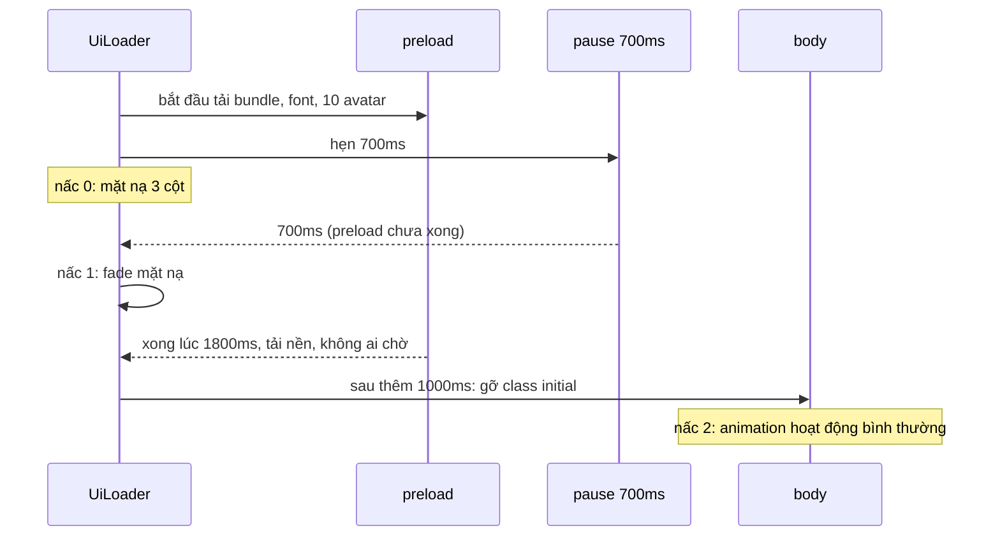

Mở một web app nặng, có hai cách tệ để xử lý lúc tải:

1. **Hiện app ngay**: chữ nhảy font, avatar hiện dần từng cái, danh sách chat trượt vào lả tả. Trông như đang vỡ.
2. **Chờ tải xong mọi thứ**: font, bundle chính, ảnh đại diện. Mạng chậm thì người dùng nhìn spinner 3 giây.

Telegram Web A chọn cách thứ ba: **chờ, nhưng không quá 700ms**. Trong lúc chờ, một lớp mặt nạ vẽ đúng bố cục 3 cột của app (cột trái, nền chat, cột phải nếu đang mở) để chuyển sang app thật không bị giật. Sau đó app còn một nấc "initial" kéo dài thêm 1 giây, trong đó các animation lần đầu bị chặn.

Bài này đọc `UiLoader.tsx`, chỉ ra một lỗi nhỏ khi người dùng rời trang lúc đang tải, rồi xem cách Telegram cho người dùng chọn **ba mức animation** chỉ bằng một class trên `body`.

> [!TIP]
> **Tóm tắt**
> - `Promise.race([pause(700), preload()])`: preload xong sớm thì mở sớm, chậm thì vẫn mở sau 700ms, phần còn lại tải nền.
> - Mặt nạ vẽ lại **bố cục** của app (không phải spinner), nên lúc gỡ mặt nạ người dùng không thấy khung hình nhảy.
> - Ba nấc sẵn sàng: 0 (mặt nạ), 1 (gỡ mặt nạ), 2 (sau thêm 1 giây, gỡ `body.initial` để bật lại animation).
> - Mức animation là một class `animation-level-0/1/2` trên `body`; CSS viết luật theo class đó. Bản gốc không đọc `prefers-reduced-motion`, bản viết lại có.

<iframe class="demo-frame" src="/demos/web-patterns/index.html?theme=dark#/tg-ui-loader" title="Demo tg-ui-loader" loading="lazy" style="height: 1500px"></iframe>

<p class="demo-links">▶ <a href="/demos/web-patterns/index.html#/tg-ui-loader" target="_blank" rel="noopener">Mở demo toàn màn hình ↗</a> · <a href="https://stackblitz.com/github/hunghg255/blog-hunghg/tree/master/examples/web-patterns?file=src/lib/tgUiLoader.ts" target="_blank" rel="noopener">Sửa code trên StackBlitz ↗</a> · <a href="https://github.com/hunghg255/blog-hunghg/blob/master/examples/web-patterns/src/lib/tgUiLoader.ts" target="_blank" rel="noopener">Xem source trên GitHub ↗</a></p>

Thử trong demo: kéo "Preload mất" lên 1800ms, bấm **Mở app** ở hai chế độ. Chế độ đua gỡ mặt nạ ở 700ms, chế độ chờ hết gỡ ở 1800ms. Phần 2 chạy kịch bản rời trang khi đang tải.

## Telegram làm thế nào?

### Đua với 700ms

Toàn bộ nằm trong [`components/common/UiLoader.tsx`](https://github.com/hunghg255/codebase/blob/main/web.telegram.org/src/components/common/UiLoader.tsx). Mỗi trang có một danh sách việc cần tải trước:

```ts
const MAX_PRELOAD_DELAY = 700;
const SECOND_STATE_DELAY = 1000;
const AVATARS_TO_PRELOAD = 10;

const preloadTasks = {
  main: () => Promise.all([
    loadModule(Bundles.Main, 'Main').then(preloadFonts),
    preloadAvatars(),            // 10 chat đầu trong danh sách
  ]),
  authPhoneNumber: () => Promise.all([preloadFonts(), preloadImage(telegramLogoPath)]),
  authCode: () => preloadImage(monkeyPath),   // con khỉ che mắt ở màn nhập mã
  authPassword: () => preloadImage(monkeyPath),
  authQrCode: preloadFonts,
};
```

Rồi trong `useEffect`:

```ts
Promise.race([
  pause(MAX_PRELOAD_DELAY),
  safePreload(),            // try/catch, lỗi thì coi như xong
]).then(() => {
  markReady();
  setIsUiReady({ uiReadyState: 1 });

  timeout = window.setTimeout(() => {
    setIsUiReady({ uiReadyState: 2 });
  }, SECOND_STATE_DELAY);
});

return () => {
  if (timeout) clearTimeout(timeout);
  setIsUiReady({ uiReadyState: 0 });
};
```

Ba ý đáng học:

- **Hạn chờ cứng**. 700ms không phải con số ngẫu nhiên: quá ngưỡng khoảng 1 giây người dùng bắt đầu thấy app "đứng". Mạng tốt thì preload (bundle chính đã được cache, font, avatar) thường xong trước 700ms, người dùng thấy app hiện ra đầy đủ một lần. Mạng chậm thì app vẫn mở, avatar hiện sau.
- **Preload lỗi không chặn app**: `safePreload` nuốt lỗi. Font 404 thì vẫn mở app bằng font dự phòng.
- **Preload chọn lọc**: chỉ 10 avatar đầu (đúng phần màn hình đầu tiên thấy), chỉ ảnh con khỉ ở màn nhập mã. Không tải trước thứ người dùng chưa nhìn thấy.

### Mặt nạ là bố cục giả, không phải spinner

Phần render vẽ mặt nạ đè lên app thật:

```tsx
{shouldRenderMask && !shouldSkipHistoryAnimations && (
  <div className={buildClassName('mask', transitionClassNames)}>
    {page === 'main' ? (
      <>
        <div className="left" />
        <div className={buildClassName('middle', hasCustomBackground && 'custom-bg-image', /* … */)} />
        {isRightColumnShown && <div className="right" />}
      </>
    ) : <div className="blank" />}
  </div>
)}
```

CSS trong `UiLoader.scss` cho `.left` cùng độ rộng với cột danh sách chat (`min-width: 15.5rem; max-width: 26.5rem`), `.middle` có **ảnh nền chat** (hoặc màu nền tối ở theme tối), `.right` có độ rộng `--right-column-width`. Nghĩa là mặt nạ trông gần giống hệt app, chỉ chưa có chữ. Khi `useShowTransition` fade mặt nạ đi, mắt người chỉ thấy chữ và avatar "hiện lên" trong khung đã đứng yên.

Đây là ý tưởng giống skeleton screen, nhưng thô hơn và rẻ hơn: không cần vẽ từng dòng chat giả, chỉ cần đúng các khối lớn.

### Nấc 2: gỡ `body.initial`

Reducer `setIsUiReady` trong [`modules/actions/ui/initial.ts`](https://github.com/hunghg255/codebase/blob/main/web.telegram.org/src/modules/actions/ui/initial.ts):

```ts
addReducer('setIsUiReady', (global, actions, payload) => {
  const { uiReadyState } = payload!;
  if (uiReadyState === 2) {
    document.body.classList.remove('initial');
  }
  return { ...global, uiReadyState };
});
```

Class `initial` được gắn lúc khởi động (`init`). Trong lúc app còn `initial`, CSS có thể tắt các hiệu ứng mà lẽ ra chỉ nên chạy khi người dùng thao tác: danh sách chat vừa tải xong không nên "trượt vào", nền chat không nên fade. Ví dụ ngay trong `UiLoader.scss`, ảnh nền của mặt nạ chỉ hiện khi `body:not(.initial)` hoặc ở theme sáng, còn theme tối lúc `initial` dùng màu `#0f0f0f` cho khỏi loé sáng.

Vì sao chờ thêm 1 giây sau khi gỡ mặt nạ mới gỡ `initial`? Có lẽ để những gì render trong lúc mặt nạ đang fade (300ms) và ngay sau đó (tin nhắn của chat đang mở, avatar về muộn) không kích hoạt animation.

### Lỗi nhỏ: rời trang khi đang tải

Nhìn lại đoạn `useEffect`. Cleanup đặt `uiReadyState` về 0 và huỷ `timeout` **nếu đã có**. Nhưng `.then` của `Promise.race` không kiểm tra component đã unmount chưa:

1. Màn `authPhoneNumber` mount, bắt đầu preload font và logo.
2. 300ms sau người dùng chuyển màn (ví dụ quét QR thành công), cleanup chạy: `uiReadyState = 0`, `timeout` còn `undefined` nên không có gì để huỷ.
3. Tới 700ms, race xong, `.then` vẫn chạy: `setIsUiReady(1)`, rồi hẹn `setIsUiReady(2)` sau 1 giây. Hẹn này **không ai huỷ**.

Kết quả: global state nhận nấc 1 và nấc 2 từ một màn đã biến mất, có thể ghi đè trạng thái của màn mới (màn mới cũng đang ở nấc 0, chờ preload của nó). Demo phần 2 tái hiện đúng chuỗi này: log hiện "đặt nấc 1 SAU khi đã rời trang" ở 700ms và "nấc 2" ở 1700ms. Trong app thật hậu quả nhẹ (có lẽ chỉ là `body.initial` bị gỡ sớm), nhưng đây là kiểu lỗi "async không biết mình đã bị huỷ" rất hay gặp.

### Ba mức animation

Cài đặt "Animation Level" trong Telegram Web A có 3 mức. Lúc khởi động:

```ts
document.body.classList.add(`animation-level-${animationLevel}`);
```

và khi người dùng đổi trong Settings (`SettingsGeneral.tsx`):

```ts
ANIMATION_LEVEL_OPTIONS.forEach((_, i) => {
  document.body.classList.toggle(`animation-level-${i}`, newLevel === i);
});
```

Phần còn lại là CSS. Đếm trong toàn bộ file `.scss` của bản dump: **62 luật** viết cho `animation-level-0`, 15 cho mức 1, 3 cho mức 2. Ví dụ trong `Button.scss`:

```css
body.animation-level-0 .Button { transition: none !important; }
body.animation-level-0 .Button.primary:not(.disabled):active { background: var(--color-primary-shade-darker); }
```

Dòng thứ hai đáng chú ý: tắt animation **không** có nghĩa là bỏ phản hồi. Nút vẫn đổi màu khi bấm, chỉ là đổi ngay thay vì có hiệu ứng gợn sóng.

Một số chỗ cần quyết định trong JS chứ không chỉ CSS: component `Transition` (`animationLevel === 0` thì đổi màn ngay), `Chat.tsx` (không chạy animation sắp xếp danh sách chat), `switchTheme` (chỉ nội suy màu khi ở mức cao nhất). Chúng đọc `global.settings.byKey.animationLevel`.

**Thiếu sót**: không chỗ nào đọc `prefers-reduced-motion` (grep cả bản dump không thấy). Người dùng đã bật "Giảm chuyển động" trong hệ điều hành vẫn nhận mức 2 mặc định (`ANIMATION_LEVEL_DEFAULT = ANIMATION_LEVEL_MAX` trong `config.ts`).

## Bên trong trình duyệt

Vì sao "một class trên body" lại hiệu quả?

- Đổi class trên `body` làm trình duyệt **tính lại style** cho cả cây (style recalc), nhưng chỉ một lần. So với việc mỗi component tự đọc setting rồi render lại, chi phí nhỏ hơn nhiều và không cần React biết gì.
- Luật CSS dạng `body.animation-level-0 .Button` có độ đặc hiệu (specificity) cao hơn `.Button`, nên ghi đè được `transition` mà không cần sửa luật gốc.
- `transition: none` có hiệu lực ngay cho lần đổi style **tiếp theo**. Animation đang chạy dở (`@keyframes`) thì bị cắt khi `animation-name` đổi thành `none`.

Còn `Promise.race` thì cần nhớ: race **không huỷ** promise thua. Preload vẫn chạy tiếp sau 700ms, font vẫn tải xong và trình duyệt tự vẽ lại chữ (đổi font lúc đó gây "nháy" nhỏ, chấp nhận được). Muốn huỷ thật thì phải truyền `AbortSignal` vào từng việc tải.



## Viết lại

Phần cốt lõi, có thêm cờ `cancelled`:

```ts title=src/lib/tgUiLoader.ts
/** Bắt đầu tải. Trả về hàm huỷ (gọi khi unmount hoặc đổi trang). */
export function startUiLoader({
  preload,
  maxDelay = 700,
  secondStateDelay = 1000,
  onReadyState,
}: UiLoaderOptions): () => void {
  const startedAt = performance.now();
  let cancelled = false;
  let secondTimer: ReturnType<typeof setTimeout> | undefined;

  // lỗi preload không được chặn app: coi như xong, app tự tải phần thiếu sau
  const safePreload = preload().then(
    () => 'done' as const,
    () => 'error' as const,
  );

  onReadyState(0, { elapsed: 0 });

  void Promise.race([pause(maxDelay), safePreload]).then((outcome) => {
    // Bản gốc thiếu kiểm tra này: unmount trước khi race xong thì vẫn
    // đặt nấc 1 rồi hẹn nấc 2, sau khi cleanup đã đặt về 0.
    if (cancelled) return;
    onReadyState(1, { outcome, elapsed: performance.now() - startedAt });
    secondTimer = setTimeout(() => {
      if (!cancelled) onReadyState(2, { elapsed: performance.now() - startedAt });
    }, secondStateDelay);
  });

  return () => {
    cancelled = true;
    clearTimeout(secondTimer);
  };
}
```

Phần ba mức animation chỉ là `classList.toggle` cho 3 class và một hàm `resolveAnimationLevel` đọc `prefers-reduced-motion` khi người dùng chưa chọn (xem trong file đầy đủ).

::: spoiler Xem toàn bộ src/lib/tgUiLoader.ts

```ts title=src/lib/tgUiLoader.ts
/**
 * Màn tải đầu tiên kiểu Telegram Web A (components/common/UiLoader.tsx):
 * chạy preload (bundle, font, vài avatar) nhưng KHÔNG chờ quá `maxDelay` ms.
 * Hết giờ thì vẫn bỏ mặt nạ, preload tiếp tục chạy nền.
 *
 * Trạng thái sẵn sàng có 3 nấc:
 *   0: đang tải, mặt nạ (khung 3 cột giả) phủ lên app
 *   1: bỏ mặt nạ (fade)
 *   2: thêm `secondStateDelay` ms nữa, gỡ class "initial" để bật lại các animation lần đầu
 */

export type ReadyState = 0 | 1 | 2;
export type PreloadOutcome = 'done' | 'timeout' | 'error';

export interface UiLoaderOptions {
  preload: () => Promise<unknown>;
  /** thời gian chờ tối đa trước khi bỏ mặt nạ, Telegram dùng 700ms */
  maxDelay?: number;
  /** khoảng cách giữa nấc 1 và nấc 2, Telegram dùng 1000ms */
  secondStateDelay?: number;
  onReadyState: (state: ReadyState, info: { outcome?: PreloadOutcome; elapsed: number }) => void;
}

const pause = (ms: number) => new Promise<'timeout'>((resolve) => setTimeout(() => resolve('timeout'), ms));

/** Bắt đầu tải. Trả về hàm huỷ (gọi khi unmount hoặc đổi trang). */
export function startUiLoader({
  preload,
  maxDelay = 700,
  secondStateDelay = 1000,
  onReadyState,
}: UiLoaderOptions): () => void {
  const startedAt = performance.now();
  let cancelled = false;
  let secondTimer: ReturnType<typeof setTimeout> | undefined;

  // lỗi preload không được chặn app: coi như xong, app tự tải phần thiếu sau
  const safePreload = preload().then(
    () => 'done' as const,
    () => 'error' as const,
  );

  onReadyState(0, { elapsed: 0 });

  void Promise.race([pause(maxDelay), safePreload]).then((outcome) => {
    // Bản gốc thiếu kiểm tra này: unmount trước khi race xong thì vẫn
    // đặt nấc 1 rồi hẹn nấc 2, sau khi cleanup đã đặt về 0.
    if (cancelled) return;
    onReadyState(1, { outcome, elapsed: performance.now() - startedAt });
    secondTimer = setTimeout(() => {
      if (!cancelled) onReadyState(2, { elapsed: performance.now() - startedAt });
    }, secondStateDelay);
  });

  return () => {
    cancelled = true;
    clearTimeout(secondTimer);
  };
}

// ---- Ba mức animation bằng class trên phần tử gốc ----

export type AnimationLevel = 0 | 1 | 2;

export const ANIMATION_LEVELS: Record<AnimationLevel, string> = {
  0: 'Tắt hết',
  1: 'Vừa phải',
  2: 'Đầy đủ',
};

/** Đặt đúng một class `animation-level-N` trên `root` (Telegram dùng `document.body`). */
export function applyAnimationLevel(level: AnimationLevel, root: HTMLElement = document.body) {
  for (const l of [0, 1, 2] as const) {
    root.classList.toggle(`animation-level-${l}`, l === level);
  }
}

/**
 * Mức mặc định: người dùng đã chọn thì theo lựa chọn đó, chưa chọn thì
 * tôn trọng `prefers-reduced-motion` (bản gốc không đọc media query này).
 */
export function resolveAnimationLevel(saved: AnimationLevel | undefined, fallback: AnimationLevel = 2): AnimationLevel {
  if (saved !== undefined) return saved;
  if (typeof matchMedia === 'function' && matchMedia('(prefers-reduced-motion: reduce)').matches) return 0;
  return fallback;
}
```

:::

## Đi qua code

- `safePreload` chuyển kết quả thành chuỗi `'done' | 'error'`, cạnh `pause` trả `'timeout'`. Nhờ vậy `onReadyState(1, { outcome })` biết vì sao mặt nạ được gỡ, tiện cho đo đạc (bao nhiêu % người dùng chạm hạn 700ms?).
- Cờ `cancelled` được kiểm tra ở **cả hai** chỗ: trong `.then` của race và trong `setTimeout` của nấc 2. Hàm huỷ cũng `clearTimeout` cho chắc, nhưng chỉ `clearTimeout` là không đủ vì lúc huỷ timer có thể chưa được tạo.
- `applyAnimationLevel` nhận `root` thay vì cứng `document.body`. Trong demo, mỗi phần có một phần tử gốc riêng để không ảnh hưởng nhau.
- `resolveAnimationLevel(saved)`: lựa chọn của người dùng luôn thắng. Chỉ khi chưa chọn mới dùng `prefers-reduced-motion`.

**Khác bản gốc:** bản viết lại không gắn với global state, gọi `onReadyState` thay cho `setIsUiReady`; có cờ huỷ; mức animation mặc định theo `prefers-reduced-motion`. Mặt nạ trong demo là JSX bình thường (bản gốc dùng `useShowTransition` để giữ mặt nạ trong DOM tới khi fade xong).

## Tại sao không làm cách khác?

- **Spinner toàn màn hình**: người dùng không biết app sẽ trông thế nào, và khoảnh khắc spinner biến mất là một cú thay đổi toàn bộ khung hình. Mặt nạ đúng bố cục cho cảm giác app "đã ở đó", chỉ đang hiện chữ.
- **Chờ tới khi xong hết**: tốt trên mạng nhanh, tệ trên 3G. Hạn 700ms giới hạn trường hợp xấu nhất.
- **Không chờ gì**: cú "nháy font" (FOUT) và avatar hiện lần lượt làm app trông chưa hoàn thiện ở 0,5 giây đầu, đúng lúc người dùng đánh giá nhiều nhất.
- **Mỗi component tự đọc setting animation**: phải truyền setting đi khắp nơi, và mỗi lần đổi setting thì cả cây render lại. Class trên body để CSS làm việc đó.

## Edge case và cạm bẫy

- **`pause(Infinity)`**: muốn "chờ vô hạn" đừng truyền `Infinity` cho `setTimeout`, trình duyệt coi nó là 0 và chạy ngay. Demo dùng `1e9`.
- **Race không huỷ preload**: nếu preload tốn băng thông lớn (ví dụ tải trước cả bundle phụ), sau 700ms nó vẫn tranh băng thông với các request app cần ngay. Telegram giữ preload nhỏ nên không sao.
- **Mặt nạ khác bố cục thật**: nếu mặt nạ tính sai độ rộng cột (ví dụ media query khác app), lúc gỡ mặt nạ vẫn thấy giật. Mặt nạ phải dùng chung biến CSS với app (`--right-column-width`).
- **Lớp `initial` gỡ quá sớm**: animation lần đầu (danh sách chat trượt vào) có thể chạy đúng lúc mặt nạ đang fade, trông rối. Telegram chờ thêm 1 giây.
- **Mức 0 không phải "tắt phản hồi"**: nút vẫn phải đổi màu khi bấm, focus vẫn phải thấy được. Viết luật mức 0 để thay hiệu ứng bằng trạng thái tĩnh, đừng chỉ `display: none` các lớp hiệu ứng.

## Dùng trong dự án

```tsx
function AppShell({ children }: { children: React.ReactNode }) {
  const [state, setState] = useState<ReadyState>(0);

  useEffect(() => {
    applyAnimationLevel(resolveAnimationLevel(loadSavedLevel()));
    return startUiLoader({
      preload: () => Promise.all([import('./MainScreen'), document.fonts.ready]),
      onReadyState: (s, info) => {
        setState(s);
        if (s === 1) analytics.track('first_paint_mask_removed', info);
      },
    });
  }, []);

  return (
    <div className={state < 2 ? 'initial' : ''}>
      {children}
      {state === 0 && <LayoutMask />}
    </div>
  );
}
```

`document.fonts.ready` là promise sẵn có của trình duyệt, xong khi các font đang dùng đã tải.

::: spoiler Ví dụ test (bản phác, không có trong repo)

```ts
import { describe, expect, it, vi, afterEach } from 'vitest';
import { applyAnimationLevel, resolveAnimationLevel, startUiLoader } from './tgUiLoader';

afterEach(() => vi.useRealTimers());

describe('startUiLoader', () => {
  it('bỏ mặt nạ sau 700ms dù preload chưa xong, nấc 2 sau thêm 1000ms', async () => {
    vi.useFakeTimers();
    const states: [number, string | undefined][] = [];
    startUiLoader({
      preload: () => new Promise((r) => setTimeout(r, 5000)),
      onReadyState: (s, info) => states.push([s, info.outcome]),
    });
    await vi.advanceTimersByTimeAsync(699);
    expect(states).toEqual([[0, undefined]]);
    await vi.advanceTimersByTimeAsync(1);
    expect(states.at(-1)).toEqual([1, 'timeout']);
    await vi.advanceTimersByTimeAsync(1000);
    expect(states.at(-1)).toEqual([2, undefined]);
  });

  it('huỷ trước khi race xong thì không đặt nấc 1, 2', async () => {
    vi.useFakeTimers();
    const states: number[] = [];
    const cancel = startUiLoader({
      preload: () => new Promise((r) => setTimeout(r, 1500)),
      onReadyState: (s) => states.push(s),
    });
    await vi.advanceTimersByTimeAsync(300);
    cancel();
    await vi.advanceTimersByTimeAsync(3000);
    expect(states).toEqual([0]);
  });
});

describe('animation level', () => {
  it('chỉ một class animation-level-N trên phần tử gốc', () => {
    const el = document.createElement('div');
    applyAnimationLevel(2, el);
    applyAnimationLevel(0, el);
    expect(el.className).toBe('animation-level-0');
  });

  it('chưa chọn thì theo prefers-reduced-motion', () => {
    vi.stubGlobal('matchMedia', (q: string) => ({ matches: q.includes('reduce') }));
    expect(resolveAnimationLevel(undefined)).toBe(0);
    expect(resolveAnimationLevel(1)).toBe(1);
    vi.unstubAllGlobals();
  });
});
```

:::

## So với cách làm hiện đại

- **Skeleton screen** trong các framework (Suspense fallback của React, `loading.tsx` của Next.js App Router) là cùng ý tưởng mặt nạ, chỉ là gắn vào ranh giới dữ liệu thay vì toàn trang. Hạn chờ kiểu 700ms thì phải tự làm.
- **`font-display: optional`** cho phép trình duyệt bỏ web font nếu không tải kịp (khoảng 100ms) và dùng font hệ thống cho cả phiên, tránh nháy font mà không cần preload. Đổi lại, lần đầu người dùng có thể không thấy font thiết kế.
- **`prefers-reduced-motion`**: media query được mọi trình duyệt lớn hỗ trợ ([caniuse](https://caniuse.com/prefers-reduced-motion)). Nên là giá trị mặc định cho mức animation, như bản viết lại.
- Telegram Web A là mã nguồn mở (GPL); bản viết lại ở đây viết từ đầu, chỉ giữ ý tưởng.

---

Bài này thuộc series **[Học từ mã nguồn Telegram](/series/telegram)** (25 bài, đọc theo thứ tự).

::: spoiler Xem nhanh danh sách bài trong series

*Mở đầu*

- [Mở đầu: bên trong Telegram Web A](/blogs/learn-from-telegram-source-code)

*Phần 1: dữ liệu và đồng bộ*

- [#1 Gửi tin lạc quan, khớp tin thật bằng randomId](/blogs/telegram-optimistic-send)
- [#2 Lịch sử tin nhắn chia hai đảo](/blogs/telegram-message-history-islands)
- [#3 Lưu global state lúc rảnh, chỉ giữ phần cần](/blogs/telegram-persist-global-state)
- [#4 Gom update realtime theo nhịp animation](/blogs/telegram-realtime-update-batching)
- [#5 Store tự viết và diff danh sách có key](/blogs/telegram-teactn-store-fast-list)

*Phần 2: animation và giao diện*

- [#6 Animation sắp xếp danh sách chat không đo DOM](/blogs/telegram-chat-list-flip)
- [#7 Ảnh bay giữa hai cây DOM trong media viewer](/blogs/telegram-media-viewer-ghost)
- [#8 Bố cục album chọn theo hàm chi phí](/blogs/telegram-album-layout)
- [#9 Giờ gửi nằm gọn trong bong bóng chat](/blogs/telegram-bubble-meta-spacer)
- [#10 Composer biến hình, Transition và gạch chân tab](/blogs/telegram-composer-morph-transition)

*Phần 3: media, mobile, thông báo*

- [#11 Thumbnail 100 byte và viền sticker nén](/blogs/telegram-tiny-thumbnails)
- [#12 Player sticker: DPR, hạ fps, cache khung](/blogs/telegram-lottie-player)
- [#13 Mobile: --vh, bàn phím ảo, nhấn giữ, số điện thoại](/blogs/telegram-mobile-viewport-touch)
- [#14 Web Push không trùng và đánh dấu đã đọc](/blogs/telegram-push-dedupe-read-receipts)

*Phần 4: soạn tin, media, chi tiết UI*

- [#15 Rich text ⇄ entities, thanh định dạng nổi, nháp theo chat](/blogs/telegram-rich-text-entities)
- [#16 Ô nhập tự giãn, emoji phóng to, gom tin theo ngày/người/album](/blogs/telegram-auto-grow-input-grouping)
- [#17 Bảng emoji/sticker chỉ render nhóm đang xem](/blogs/telegram-emoji-picker-virtualization)
- [#18 mediaLoader gộp request, ảnh mờ sang nét, spinner không chớp](/blogs/telegram-media-loader-blur-buffering)
- [#19 Trình phát audio toàn cục và playlist](/blogs/telegram-global-audio-player)
- **#20 UiLoader chạy đua 700ms, ba mức animation** (bài này)
- [#21 PanZoom bằng matrix() trong media viewer](/blogs/telegram-panzoom-matrix)
- [#22 Ngày dính khi cuộn, khoá cuộn, dừng momentum iOS](/blogs/telegram-sticky-date-scroll-lock)
- [#23 Vùng thả file, nén ảnh trước khi gửi, copy ảnh](/blogs/telegram-drop-zone-compress-copy)
- [#24 Tiêu đề nhấp nháy và favicon đếm tin mới](/blogs/telegram-title-favicon-unread)

:::

Code + demo: [`examples/web-patterns`](https://github.com/hunghg255/blog-hunghg/tree/master/examples/web-patterns) · [Mở trên StackBlitz](https://stackblitz.com/github/hunghg255/blog-hunghg/tree/master/examples/web-patterns)
