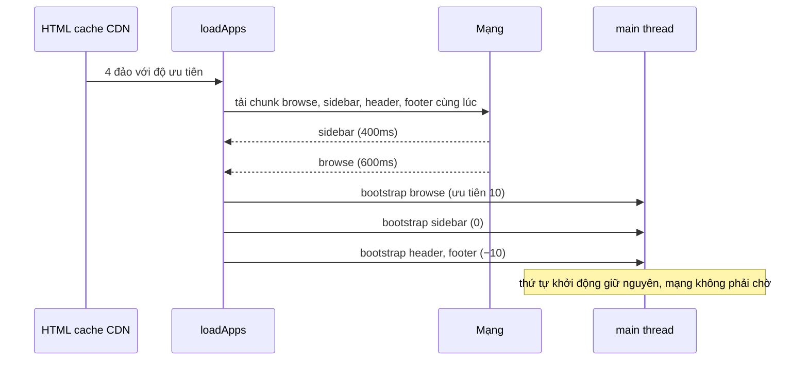

Trang của Udemy không phải một SPA duy nhất. Django render HTML, trong đó có nhiều "đảo" (island): header, footer, khối duyệt khoá học, khối giỏ hàng… Mỗi đảo là một app React riêng, nạp bằng một chunk JS riêng. Trang chủ và trang khoá học được **cache công khai** ở CDN: mọi người nhận cùng một HTML, phần thuộc về người đang xem (tên, giỏ hàng, giá theo vùng) được lấy sau bằng API.

Bài này đọc ba mảnh hạ tầng giữ cho cách làm đó chạy được:

1. `udAppLoader`: tìm các đảo trong HTML, nạp chunk và khởi động theo **độ ưu tiên**.
2. `registry` của trang học bài: component ở nhánh này tạo store, component ở nhánh khác dùng.
3. `createUDProxy`: object `UD.me` mà đọc sớm sẽ **ném lỗi**, để code không lỡ dùng dữ liệu người dùng khi nó chưa tới.

> [!TIP]
> **Tóm tắt**
> - Đánh dấu đảo bằng `<div class="ud-app-loader" data-module-id data-module-args data-module-priority>`. Ưu tiên cao khởi động trước: trang (10) trước, header/footer (−10) sau.
> - Bản gốc chỉ **bắt đầu tải chunk** của nhóm sau khi nhóm trước đã khởi động xong, thành thác nước: demo 1303ms so với 601ms nếu tải song song mà chỉ khởi động theo thứ tự.
> - App lỗi thì kẹt class `ud-app-loading`, nạp lại cũng bỏ qua. Registry gỡ store theo tên, không biết ai đăng ký. `/contexts/me/` lỗi thì cờ "đang tải" không bao giờ tắt.
> - HTML cache công khai + dữ liệu người dùng tới sau là cách rẻ để có trang nhanh cho mọi người; cái giá là mọi chỗ đọc dữ liệu người dùng phải xử lý trạng thái "chưa có".

<iframe class="demo-frame" src="/demos/web-patterns/index.html?theme=dark#/ud-app-loader" title="Demo ud-app-loader" loading="lazy" style="height: 1700px"></iframe>

<p class="demo-links">▶ <a href="/demos/web-patterns/index.html#/ud-app-loader" target="_blank" rel="noopener">Mở demo toàn màn hình ↗</a> · <a href="https://stackblitz.com/github/hunghg255/blog-hunghg/tree/master/examples/web-patterns?file=src/lib/udAppLoader.ts" target="_blank" rel="noopener">Sửa code trên StackBlitz ↗</a> · <a href="https://github.com/hunghg255/blog-hunghg/blob/master/examples/web-patterns/src/lib/udAppLoader.ts" target="_blank" rel="noopener">Xem source trên GitHub ↗</a></p>

Thử trong demo: bấm **Nạp** ở hai chế độ và so dòng thời gian. Bật "sidebar lỗi lần đầu", bấm Nạp rồi "Nạp lại phần còn thiếu". Phần 2: mở player B rồi đóng A. Phần 3: trang tải với lần gọi `/contexts/me/` đầu tiên bị lỗi.

## Udemy làm thế nào?

### udAppLoader: đảo app và độ ưu tiên

Điểm vào của mọi trang là [`entry/main.js`](https://github.com/hunghg255/codebase/blob/main/udemy.com/webpack---/src/udemy/js/entry/main.js). Comment đầu file nói rõ một quyết định về kích thước: những thứ dùng ở mọi trang đặt ở đây, nhưng "header và footer tương đối lớn nên không import ở đây", vì file càng to thì trình duyệt càng mất nhiều thời gian parse trước khi chạy tới `udAppLoader`.

[`loaders/ud-app-loader.js`](https://github.com/hunghg255/codebase/blob/main/udemy.com/webpack---/src/udemy/js/loaders/ud-app-loader.js) quét DOM và gom phần tử theo độ ưu tiên:

```js
export default function udAppLoader(container = document, callback = noop) {
  const appContainers = {};
  Array.from(container.querySelectorAll('.ud-app-loader')).forEach((elem) => {
    const priority = Number(elem.dataset.modulePriority || 0);
    appContainers[priority] = appContainers[priority] || [];
    appContainers[priority].push(elem);
  });
  // (...) thêm các phần tử khớp selector cố định (trang admin của Django, không sửa được HTML)

  const orderedAppContainers = [];
  Object.keys(appContainers)
    .sort((a, b) => (Number(a) < Number(b) ? 1 : -1))     // ưu tiên cao trước
    .forEach((key) => orderedAppContainers.push(appContainers[key]));
```

Comment trong file mô tả quy ước: app cắt ngang mọi trang (header, footer) có ưu tiên âm để "các app khác được nạp trước", app chính của trang (như `browse`) dùng 10, còn lại 0.

Nạp một phần tử:

```js
function load(elem) {
  const moduleId = elem.dataset.moduleId;
  const moduleArgs = elem.dataset.moduleArgs ? JSON.parse(elem.dataset.moduleArgs) : {};
  if (elem.classList.contains('ud-app-loading') || elem.classList.contains('ud-app-loaded')) {
    return Promise.resolve([]);          // idempotent: gọi lại loader không nạp trùng
  }
  elem.classList.add('ud-app-loading');
  return _importApp(moduleId)            // dynamic import + đo thời gian bằng udPerf
    .then((appModule) => {
      appModule.default(elem, moduleArgs);   // bootstrap: thường là render React vào elem
      elem.classList.remove('ud-app-loading');
      elem.classList.add('ud-app-loaded');
    })
    .catch((error) => Raven.captureException(error));
}

orderedAppContainers
  .reduce((chain, elems) => chain.then(() => Promise.all(elems.map(load))), Promise.resolve())
  .then(callback);

return function udAppUnloader() { /* dispatch UNLOAD_APP_EVENT lên mọi phần tử */ };
```

Vài điểm đáng học:
- **HTML là nguồn sự thật**: server quyết định trang có những app nào, ở đâu, với tham số gì (`data-module-args` là JSON đã escape). Client không cần router để biết phải render gì.
- **Idempotent** nhờ class trạng thái: nội dung tải thêm bằng AJAX có đảo mới thì gọi `udAppLoader(container)` lần nữa, đảo cũ không bị nạp lại.
- **Gỡ app** bằng một custom event (`ud-app-loader.unload`) thay vì giữ tham chiếu tới từng root React; mỗi helper bootstrap tự nghe event để gỡ phần của mình. Hàm gỡ được trả về **ngay**, trước khi nạp xong, để có thể gỡ cả những app đã chạy trong lúc các app khác còn đang tải.
- Mỗi lần nạp được đo bằng `udPerf.start/end` với tên `_<module>_app`, nên biểu đồ hiệu năng thấy được app nào nạp chậm.

### Registry: store đi qua hai nhánh cây

Trang học bài có video, ghi chú, hỏi đáp, giáo trình… nằm ở các nhánh khác nhau của cây component, nhưng cần dùng chung store (vd: ghi chú cần biết thời điểm của video). [`course-taking/registry/`](https://github.com/hunghg255/codebase/blob/main/udemy.com/webpack---/src/udemy/js/course-taking/registry/root.js) giải quyết bằng ba decorator:

```js
// root: đặt một Registry (MobX observable) vào Provider ở gốc trang
// registers('videoStore'): component TẠO store, đăng ký nó khi có ref
getStoresFromComponent(ref) {
  const stores = storeNames.reduce((acc, storeName) => {
    acc[storeName] = ref[storeName];      // store là một thuộc tính của instance component
    return acc;
  }, {});
  this.props.registry.registerStores(stores);
}
componentWillUnmount() {
  this.props.registry.unregisterStores(storeNames);
}

// requires('videoStore'): component DÙNG store, chưa có thì render null
render() {
  for (const {name, optional} of stores) {
    if (!optional && !registry[name]) return null;
    injectedStores[name] = registry[name];
  }
  return <Component {...injectedStores} {...props} />;
}
```

Chi tiết tinh tế nằm ở `addStorePlaceholders`: component `requires` được tạo **trước** khi store tồn tại, mà MobX (bản Udemy dùng) không theo dõi được thuộc tính chưa có trên object. Nên `requires` gọi `addStorePlaceholders` trong constructor: thêm thuộc tính với giá trị `undefined` qua `extendObservable`, để khi store được đăng ký sau, component tự render lại.

### createUDProxy: HTML cache công khai, `UD.me` tới sau

[`utils/create-ud-proxy.js`](https://github.com/hunghg255/codebase/blob/main/udemy.com/webpack---/src/udemy/js/utils/create-ud-proxy.js):

```js
export default function createUDProxy(key, propertiesKey) {
  if (UD[key] && !UD[key].isLoading) {
    return UD[key];      // trang không cache: Django đã nhúng sẵn dữ liệu
  }
  const proxy = {...UD[key]};
  Object.defineProperty(proxy, 'isLoading', {get: () => UD.isGlobalMeContextLoading});
  UD[propertiesKey].forEach((prop) => {
    Object.defineProperty(proxy, prop, {
      get: () => {
        if (serverOrClient.isServer) throw new Error(`UD.${key}.${prop} should not be accessed by Node.js`);
        if (proxy.isLoading) throw new Error(`UD.${key}.${prop} has not loaded yet- ...`);
        return UD[key][prop];
      },
    });
  });
  return proxy;
}
```

Danh sách thuộc tính (`UD.meProperties`) được server nhúng sẵn, nên proxy biết trước tên các trường dù chưa có giá trị. Đọc một trường khi chưa tải (hoặc khi đang render ở server) thì **ném lỗi** ngay, với thông báo chỉ cách sửa: kiểm `!udMe.isLoading`, hoặc `await when(() => !udMe.isLoading)`. Comment giải thích tại sao không dùng ES6 `Proxy`: lúc viết, một số trình duyệt mobile chưa hỗ trợ.

Dữ liệu tới từ `loadGlobalMeContext` ([`utils/load-global-context.js`](https://github.com/hunghg255/codebase/blob/main/udemy.com/webpack---/src/udemy/js/utils/load-global-context.js)): một request `/contexts/me/` lấy về `me`, `visiting`, `request`, `Config`, `experiment`… rồi gán vào `UD` và đặt `UD.isGlobalMeContextLoading = false` trong một `runInAction`.

## Ba chỗ hở

**1. Thác nước khi tải chunk.** `load(elem)` vừa tải chunk vừa khởi động, và chỉ được gọi khi nhóm ưu tiên trước đã xong. Chunk của header (ưu tiên −10) chỉ bắt đầu tải sau khi `browse` (10) và `sidebar` (0) đã tải **và** khởi động. Thứ tự khởi động là có chủ đích (để app chính chiếm main thread trước), nhưng thứ tự tải thì không cần: mạng rảnh trong lúc chờ. Demo với chunk 600/400/300ms: kiểu Udemy xong sau **1303ms**, tải song song và chỉ khởi động theo thứ tự xong sau **601ms**.

**2. App lỗi kẹt vĩnh viễn.** Lỗi (mất mạng giữa chừng, chunk đổi tên sau deploy) đi vào `catch` và chỉ báo Sentry. Phần tử vẫn giữ `ud-app-loading`, nên lần gọi `udAppLoader` sau coi nó "đang nạp" và bỏ qua. Demo: sidebar lỗi lần đầu, bấm "Nạp lại phần còn thiếu", kiểu Udemy vẫn `ud-app-loading`.

**3. Registry gỡ theo tên.** `unregisterStores(storeNames)` gán `undefined` cho tên đó, không cần biết ai đang giữ nó. Hai component cùng đăng ký một tên (player thường và player chế độ rạp, hay hai tab cùng loại), component cũ unmount sẽ gỡ luôn store của component mới. Demo: mở player B, đóng A, khung ghi chú mất store dù B vẫn đang chạy.

Và một chỗ ở context tới muộn: `loadGlobalMeContext` không có `catch`. `/contexts/me/` lỗi thì `UD.isGlobalMeContextLoading` ở `true` mãi; mọi chỗ kiểm `isLoading` hiện spinner vô thời hạn, chỗ nào lỡ đọc thì ném lỗi. Demo phần 3: cột "Kiểu Udemy" quay mãi.

## Bên trong trình duyệt



Dynamic import tạo một request cho chunk; trình duyệt tải song song nhiều chunk mà không tốn main thread. Phần tốn main thread là **khởi động**: chạy module, render React lần đầu. Vì vậy hợp lý là: tải sớm hết, khởi động theo ưu tiên. Có thể đi xa hơn bằng `<link rel="modulepreload">` (hoặc `prefetch`) do server in vào HTML, để trình duyệt tải chunk ngay khi parse HTML, trước cả khi `main.js` chạy.

## Viết lại

Tải song song, khởi động theo ưu tiên, lỗi thì cho thử lại:

```ts title=src/lib/udAppLoader.ts
  const groups = groupByPriority(root);
  const imports = new Map<HTMLElement, Promise<AppModule>>();
  const startImport = (el: HTMLElement) => {
    if (!imports.has(el)) {
      const id = el.dataset.moduleId!;
      emit(id, 'import-start');
      const p = importApp(id).then((m) => (emit(id, 'import-end'), m));
      p.catch(() => {}); // lỗi được xử lý ở bước bootstrap
      imports.set(el, p);
    }
    return imports.get(el)!;
  };

  const pending = (el: HTMLElement) =>
    !el.classList.contains('ud-app-loading') && !el.classList.contains('ud-app-loaded');

  if (prefetchAll) groups.flat().filter(pending).forEach(startImport);

  async function boot(el: HTMLElement) {
    if (!pending(el)) return;
    const id = el.dataset.moduleId!;
    el.classList.remove('ud-app-failed');
    el.classList.add('ud-app-loading');
    try {
      const mod = await startImport(el);
      mod.bootstrap(el, el.dataset.moduleArgs ? JSON.parse(el.dataset.moduleArgs) : {});
      el.classList.replace('ud-app-loading', 'ud-app-loaded');
      emit(id, 'bootstrap');
    } catch {
      el.classList.replace('ud-app-loading', 'ud-app-failed'); // lần gọi loadApps sau sẽ thử lại
      emit(id, 'error');
    }
  }

  const done = groups.reduce<Promise<unknown>>(
    (chain, els) => chain.then(() => Promise.all(els.map(boot))),
    Promise.resolve(),
  );
```

Registry nhớ ai đã đăng ký:

```ts title=src/lib/udAppLoader.ts
  return {
    /** Đăng ký store, trả hàm gỡ chỉ gỡ đúng bản mình đã đăng ký. */
    register<K extends keyof Stores>(name: K, store: Stores[K]) {
      const owner = Symbol(String(name));
      stores.set(name, { store, owner });
      notify();
      return () => {
        if (stores.get(name)?.owner !== owner) return; // đã có component khác đăng ký đè
        stores.delete(name);
        notify();
      };
    },
```

::: spoiler Xem toàn bộ src/lib/udAppLoader.ts

```ts title=src/lib/udAppLoader.ts
/**
 * Ba mảnh hạ tầng dựng trang (ý tưởng từ udAppLoader, course-taking/registry và
 * createUDProxy của Udemy):
 * 1. `loadApps`: tìm các "đảo" app trong HTML, nạp chunk và khởi động theo độ ưu tiên.
 * 2. `createRegistry`: component ở nhánh này tạo store, component ở nhánh khác dùng.
 * 3. `createLateContext`: object dữ liệu người dùng tới SAU khi HTML (được cache công khai) đã hiện.
 *
 * Khác bản gốc:
 * - Tải chunk của mọi app NGAY, chỉ có bước khởi động (bootstrap) là đi theo thứ tự ưu tiên.
 *   Bản gốc chờ nhóm trước khởi động xong mới bắt đầu tải chunk của nhóm sau (thác nước).
 * - App lỗi được đánh dấu `ud-app-failed` để lần gọi sau thử lại; bản gốc kẹt ở `ud-app-loading`.
 * - Registry nhớ ai đăng ký store: component cũ unmount không xoá store của component mới.
 * - Context lỗi thì chuyển sang trạng thái `error` (có thể thử lại), không treo "đang tải" mãi.
 */

export interface AppModule {
  bootstrap: (el: HTMLElement, args: unknown) => void;
}

export interface LoadAppsOptions {
  importApp: (moduleId: string) => Promise<AppModule>;
  /** Bản gốc: false (tải chunk theo từng nhóm ưu tiên). */
  prefetchAll?: boolean;
  onEvent?: (event: { moduleId: string; type: 'import-start' | 'import-end' | 'bootstrap' | 'error'; at: number }) => void;
}

export const UNLOAD_APP_EVENT = 'ud-app-loader.unload';

/** Nhóm các phần tử `.ud-app-loader` theo `data-module-priority`, ưu tiên cao chạy trước. */
export function groupByPriority(root: ParentNode): HTMLElement[][] {
  const groups = new Map<number, HTMLElement[]>();
  root.querySelectorAll<HTMLElement>('.ud-app-loader').forEach((el) => {
    const p = Number(el.dataset.modulePriority || 0);
    if (!groups.has(p)) groups.set(p, []);
    groups.get(p)!.push(el);
  });
  return [...groups.entries()].sort(([a], [b]) => b - a).map(([, els]) => els);
}

export function loadApps(root: ParentNode, { importApp, prefetchAll = true, onEvent }: LoadAppsOptions) {
  const t0 = performance.now();
  const emit = (moduleId: string, type: Parameters<NonNullable<typeof onEvent>>[0]['type']) =>
    onEvent?.({ moduleId, type, at: Math.round(performance.now() - t0) });

  const groups = groupByPriority(root);
  const imports = new Map<HTMLElement, Promise<AppModule>>();
  const startImport = (el: HTMLElement) => {
    if (!imports.has(el)) {
      const id = el.dataset.moduleId!;
      emit(id, 'import-start');
      const p = importApp(id).then((m) => (emit(id, 'import-end'), m));
      p.catch(() => {}); // lỗi được xử lý ở bước bootstrap
      imports.set(el, p);
    }
    return imports.get(el)!;
  };

  const pending = (el: HTMLElement) =>
    !el.classList.contains('ud-app-loading') && !el.classList.contains('ud-app-loaded');

  if (prefetchAll) groups.flat().filter(pending).forEach(startImport);

  async function boot(el: HTMLElement) {
    if (!pending(el)) return;
    const id = el.dataset.moduleId!;
    el.classList.remove('ud-app-failed');
    el.classList.add('ud-app-loading');
    try {
      const mod = await startImport(el);
      mod.bootstrap(el, el.dataset.moduleArgs ? JSON.parse(el.dataset.moduleArgs) : {});
      el.classList.replace('ud-app-loading', 'ud-app-loaded');
      emit(id, 'bootstrap');
    } catch {
      el.classList.replace('ud-app-loading', 'ud-app-failed'); // lần gọi loadApps sau sẽ thử lại
      emit(id, 'error');
    }
  }

  const done = groups.reduce<Promise<unknown>>(
    (chain, els) => chain.then(() => Promise.all(els.map(boot))),
    Promise.resolve(),
  );

  // trả hàm gỡ NGAY (không chờ nạp xong), để có thể gỡ cả những app đã chạy trước
  const unload = () => groups.flat().forEach((el) => el.dispatchEvent(new Event(UNLOAD_APP_EVENT)));
  return { done, unload };
}

// ---------------------------------------------------------------- registry store

export function createRegistry<Stores extends Record<string, unknown>>() {
  const stores = new Map<keyof Stores, { store: unknown; owner: symbol }>();
  const listeners = new Set<() => void>();
  const notify = () => listeners.forEach((l) => l());

  return {
    /** Đăng ký store, trả hàm gỡ chỉ gỡ đúng bản mình đã đăng ký. */
    register<K extends keyof Stores>(name: K, store: Stores[K]) {
      const owner = Symbol(String(name));
      stores.set(name, { store, owner });
      notify();
      return () => {
        if (stores.get(name)?.owner !== owner) return; // đã có component khác đăng ký đè
        stores.delete(name);
        notify();
      };
    },
    get<K extends keyof Stores>(name: K) {
      return stores.get(name)?.store as Stores[K] | undefined;
    },
    subscribe(listener: () => void) {
      listeners.add(listener);
      return () => listeners.delete(listener);
    },
  };
}

// ---------------------------------------------------------------- context tới muộn

export type LateState = 'loading' | 'loaded' | 'error';

/**
 * Trước khi dữ liệu về, đọc bất kỳ thuộc tính nào cũng ném lỗi rõ ràng (giống bản gốc),
 * để code lỡ dùng sớm bị phát hiện ngay thay vì âm thầm nhận `undefined`.
 */
export function createLateContext<T extends object>(name: string, load: () => Promise<T>) {
  let state: LateState = 'loading';
  let data: T | null = null;
  let error = '';
  const listeners = new Set<() => void>();
  const notify = () => listeners.forEach((l) => l());

  const run = () => {
    state = 'loading';
    notify();
    return load().then(
      (d) => {
        data = d;
        state = 'loaded';
        notify();
      },
      (e: unknown) => {
        error = String(e);
        state = 'error';
        notify();
      },
    );
  };

  const proxy = new Proxy({} as T, {
    get(_, prop) {
      if (state !== 'loaded') throw new Error(`${name}.${String(prop)} chưa có: kiểm tra state trước khi đọc`);
      return (data as Record<PropertyKey, unknown>)[prop];
    },
  });

  return {
    data: proxy,
    get state() {
      return state;
    },
    get error() {
      return error;
    },
    start: run,
    retry: run,
    subscribe(listener: () => void) {
      listeners.add(listener);
      return () => listeners.delete(listener);
    },
  };
}
```

:::

## Đi qua code

- `startImport` tạo promise tải chunk **một lần** cho mỗi phần tử và giữ trong `imports`. Bật `prefetchAll` thì mọi phần tử chưa nạp đều bắt đầu tải ngay; `boot` sau đó chỉ `await` promise đã có.
- `p.catch(() => {})` tránh cảnh báo "unhandled rejection" cho chunk lỗi khi chưa tới lượt khởi động; lỗi thật được xử lý trong `boot`.
- `boot` chuyển class `ud-app-loading` → `ud-app-loaded` hoặc `ud-app-failed`. `pending` chỉ bỏ qua hai trạng thái đầu, nên gọi `loadApps` lần nữa sẽ thử lại phần tử lỗi (với `imports` mới, tức là tải lại chunk).
- Chuỗi `reduce` giữ đúng ngữ nghĩa của bản gốc: nhóm sau chỉ khởi động khi nhóm trước xong (kể cả lỗi).
- `register` trả về hàm gỡ đóng gói `owner` (một `Symbol` riêng cho mỗi lần đăng ký). Gỡ chỉ có tác dụng nếu mình vẫn là chủ. Hợp với `useEffect(() => registry.register('player', store), [store])`.
- `createLateContext` dùng `Proxy` thật (giờ mọi trình duyệt đều có) thay cho `defineProperty` từng trường, nên không cần danh sách thuộc tính trước. Lỗi tải chuyển sang `state = 'error'` và có `retry`.

**Khác bản gốc:** không dùng MobX (registry và context tự có `subscribe`); không có bảng "selector cố định → module" cho trang admin; registry là một map đơn giản, không phải object observable có placeholder.

## Tại sao không làm cách khác?

- **Một SPA cho cả site.** Một router, một bundle gốc, chia chunk theo route. Udemy có lịch sử Django lâu năm và nhiều trang render ở server (SEO, cache CDN); đảo app cho phép thay dần từng phần trang mà không viết lại toàn bộ.
- **Mọi đảo khởi động cùng lúc.** Đơn giản, nhưng footer và header tranh main thread với khối chính đúng lúc người dùng đang nhìn vào khối chính. Ưu tiên giúp phần quan trọng tương tác được sớm hơn.
- **React context cho store dùng chung.** Context đi từ trên xuống: store phải được tạo ở tổ tiên chung. Registry cho phép store **được tạo ở một nhánh con** (component sở hữu video) và dùng ở nhánh khác, đổi lại phải xử lý trạng thái "chưa có".
- **Nhúng `UD.me` vào HTML** như các trang không cache. Đúng và đơn giản, nhưng HTML không cache chung được nữa: mỗi người một bản, CDN chỉ còn tác dụng với file tĩnh.

## Edge case và cạm bẫy

- **Thứ tự khởi động khi có lỗi.** Bản viết lại (giống bản gốc) vẫn chạy nhóm sau khi nhóm trước lỗi. Nếu một app phụ thuộc app khác (header cần giỏ hàng), phải tự kiểm trạng thái chứ đừng dựa vào thứ tự.
- **Chunk lỗi sau deploy.** Tên chunk có hash; tab mở từ trước deploy xin chunk cũ đã bị xoá và lỗi 404. Thử lại không giúp; cần reload trang (xem [Facebook #20](/blogs/facebook-spa-router-resilient-loading) và [SPA tự cập nhật](/blogs/web-spa-self-update-strategies)).
- **Registry không phải stack.** B đăng ký đè A, rồi **B** unmount trước: store bị gỡ dù A còn sống. Cần hành vi "quay về A" thì giữ một danh sách theo thứ tự đăng ký thay vì một giá trị.
- **Đọc sớm trong code không phải render.** Proxy ném lỗi là để phát hiện sớm trong lúc phát triển; ở production nên bắt lỗi đó ở error boundary của đảo, để một chỗ đọc sớm không làm sập cả trang.
- **Dữ liệu người dùng và SEO.** Phần render ở server không bao giờ có `UD.me` (bản gốc ném lỗi riêng cho trường hợp này). Đừng đặt nội dung cần SEO phụ thuộc vào dữ liệu người dùng.

## Dùng trong dự án

```html
<!-- server render, cache chung cho mọi người -->
<div class="ud-app-loader" data-module-id="course-list" data-module-priority="10"
     data-module-args='{"category":"web"}'></div>
<div class="ud-app-loader" data-module-id="header" data-module-priority="-10"></div>
```

```ts
const apps: Record<string, () => Promise<AppModule>> = {
  'course-list': () => import('./apps/course-list'),
  header: () => import('./apps/header'),
};

export const me = createLateContext('me', () => fetch('/api/me').then((r) => r.json()));
void me.start();

const { done } = loadApps(document, { importApp: (id) => apps[id]() });
done.then(() => performance.mark('apps-ready'));
```

Trong component:

```tsx
function Greeting() {
  const state = useSyncExternalStore(me.subscribe, () => me.state);
  if (state === 'loading') return <Skeleton width={120} />;
  if (state === 'error') return <button onClick={me.retry}>Đăng nhập</button>;
  return <span>Xin chào, {me.data.name}</span>;
}
```

::: spoiler Ví dụ test (bản phác, không có trong repo)

```ts
import { describe, expect, it } from 'vitest';
import { createLateContext, createRegistry, loadApps } from './udAppLoader';

const delay = (ms: number) => new Promise((r) => setTimeout(r, ms));

function page() {
  document.body.innerHTML = `
    <div class="ud-app-loader" data-module-id="header" data-module-priority="-10"></div>
    <div class="ud-app-loader" data-module-id="browse" data-module-priority="10"></div>`;
  return document.body;
}

describe('loadApps', () => {
  it('tải song song nhưng khởi động theo ưu tiên', async () => {
    const started: string[] = [];
    const booted: string[] = [];
    const { done } = loadApps(page(), {
      importApp: async (id) => {
        started.push(id);
        await delay(id === 'browse' ? 30 : 5);   // header tải xong trước
        return { bootstrap: () => booted.push(id) };
      },
    });
    expect(started.sort()).toEqual(['browse', 'header']);   // cả hai bắt đầu ngay
    await done;
    expect(booted).toEqual(['browse', 'header']);           // nhưng browse khởi động trước
  });

  it('app lỗi được đánh dấu failed và lần nạp sau thử lại', async () => {
    const root = page();
    let fail = true;
    const importApp = async (id: string) => {
      if (id === 'header' && fail) throw new Error('ChunkLoadError');
      return { bootstrap: () => {} };
    };
    await loadApps(root, { importApp }).done;
    const header = root.querySelector('[data-module-id=header]')!;
    expect(header.classList.contains('ud-app-failed')).toBe(true);
    fail = false;
    await loadApps(root, { importApp }).done;
    expect(header.classList.contains('ud-app-loaded')).toBe(true);
  });
});

describe('createRegistry', () => {
  it('chủ cũ gỡ không làm mất store của chủ mới', () => {
    const r = createRegistry<{ player: string }>();
    const offA = r.register('player', 'A');
    r.register('player', 'B');
    offA();
    expect(r.get('player')).toBe('B');
  });
});

describe('createLateContext', () => {
  it('đọc sớm thì ném lỗi, lỗi tải thì retry được', async () => {
    let fail = true;
    const ctx = createLateContext('me', async () => {
      if (fail) throw new Error('503');
      return { name: 'Lan' };
    });
    expect(() => ctx.data.name).toThrow(/chưa có/);
    await ctx.start();
    expect(ctx.state).toBe('error');
    fail = false;
    await ctx.retry();
    expect(ctx.data.name).toBe('Lan');
  });
});
```

:::

## So với cách làm hiện đại

- **Islands architecture** (Astro, Fresh, Eleventy + is-land…) chính là ý tưởng của `udAppLoader`, cộng thêm chỉ thị khi nào khởi động: `client:load`, `client:idle`, `client:visible`. Thay cho độ ưu tiên số, đảo ở dưới màn hình chỉ khởi động khi cuộn tới.
- **React Server Components** đưa phần "server quyết định trang gồm những gì" vào chính React; ranh giới client là `"use client"` thay vì `data-module-id`.
- **HTML cache chung + dữ liệu cá nhân tới sau** ngày nay thường làm bằng edge rendering hoặc streaming (gửi khung trang ngay, phần cá nhân stream sau). Ý tưởng không đổi: đừng để dữ liệu của một người làm hỏng khả năng cache của mọi người.

---

Bài này thuộc series **[Học từ mã nguồn Udemy](/series/udemy)** (21 bài, đọc theo thứ tự).

::: spoiler Xem nhanh danh sách bài trong series

*Mở đầu*

- [Mở đầu: bên trong frontend của Udemy](/blogs/learn-from-udemy-source-code)

*Phần 1: video và học bài*

- [#1 DRM đa hệ: Widevine, PlayReady, FairPlay](/blogs/udemy-drm-multi-key-system)
- [#2 URL ký và license hết hạn: tự làm mới, tải trước bài kế](/blogs/udemy-expiring-media-urls)
- [#3 Ghi tiến độ xem theo bucket, tự hoàn thành, backoff lỗi](/blogs/udemy-watch-progress-buckets)
- [#4 Thumbnail sprite từ WebVTT và slide trên seekbar](/blogs/udemy-sprite-thumbnails-vtt)
- [#5 Phụ đề: tự chọn ngôn ngữ và editor có phím tắt](/blogs/udemy-captions-auto-select-editor)
- [#6 Đo băng thông, autoplay Safari, iPad giả làm Mac](/blogs/udemy-video-quirks-autoplay)

*Phần 2: bài tập, bài thi, lab*

- [#7 Preview code HTML/React trong iframe sandbox](/blogs/udemy-code-preview-sandbox)
- [#8 Bài thi có giờ: tạm dừng khi rảnh, autosave theo dấu vân tay](/blogs/udemy-timed-exam)
- [#9 Chấm code realtime: đăng ký kênh trước, có đường dự phòng](/blogs/udemy-realtime-grading)
- [#10 Mở lab không bị chặn popup, heartbeat, xung đột phiên](/blogs/udemy-lab-launcher)

*Phần 3: editor và nội dung*

- [#11 ProseMirror: schema theo flag, NodeView React, HTML cho email](/blogs/udemy-prosemirror-integration)
- [#12 Parse HTML an toàn bằng document tách rời](/blogs/udemy-safe-html-parse)
- [#13 Sinh file .ics có VTIMEZONE tự dò giờ mùa hè](/blogs/udemy-ics-vtimezone)
- [#14 Đọc Open Badges giấu trong ảnh PNG và SVG](/blogs/udemy-open-badges-image)

*Phần 4: hạ tầng và trải nghiệm*

- [#15 Pipeline tracking: batch, sendBeacon, bfcache, HTTP 207](/blogs/udemy-event-tracking-pipeline)
- [#16 Gợi ý tính năng mới qua nhiều phiên bằng máy trạng thái](/blogs/udemy-feature-discoverability)
- [#17 Kéo cạnh để resize và mép cuộn mờ dần](/blogs/udemy-resizer-gradient-scroll)
- [#18 Gom request giá khoá học, cập nhật một phần khi áp coupon](/blogs/udemy-price-dataloader-partial-update)
- [#19 Trả lời lạc quan có rollback, autocomplete hai tầng cache](/blogs/udemy-optimistic-reply-autocomplete)
- **#20 Nạp app theo ưu tiên, registry store, HTML cache công khai** (bài này)

:::

Code + demo: [`examples/web-patterns`](https://github.com/hunghg255/blog-hunghg/tree/master/examples/web-patterns) · [Mở trên StackBlitz](https://stackblitz.com/github/hunghg255/blog-hunghg/tree/master/examples/web-patterns)
