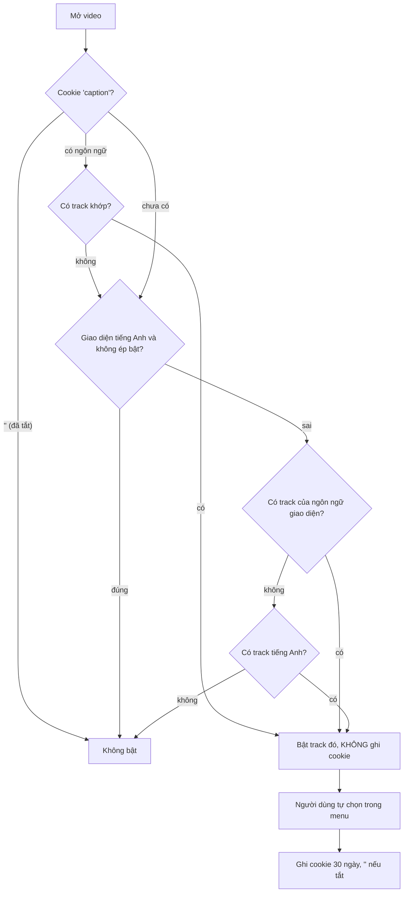

Khoá học trên Udemy thường có nhiều track phụ đề: tiếng Anh gốc, vài bản dịch tay, và cả chục bản dịch máy. Khi một học viên mở video lần đầu, player phải tự quyết định: bật phụ đề không, và bật track nào? Chọn sai thì người Đài Loan thấy chữ giản thể, người Philippines thấy tiếng Phần Lan. Tắt phụ đề rồi mà video sau lại tự bật thì cũng khó chịu.

Phía giảng viên thì có bài toán khác: sửa phụ đề sinh tự động trong lúc video đang chạy. Tay phải gõ, mắt phải nghe, nên editor cần phím tắt để tua và chuyển câu mà không rời bàn phím, và cần dừng video khi người dùng bắt đầu gõ.

> [!TIP]
> **Tóm tắt**
> - Thứ tự chọn phụ đề của Udemy: lựa chọn đã lưu trong cookie → ngôn ngữ giao diện (chỉ khi không phải tiếng Anh) → tiếng Anh. Đã chủ động tắt thì tôn trọng, và lựa chọn tự động không được ghi vào cookie.
> - Bản gốc so ngôn ngữ bằng 2 ký tự đầu của locale, nên `zh_CN`/`zh_TW` gộp làm một và `fil` (Filipino) thành `fi` (tiếng Phần Lan). So khớp locale đầy đủ trước, rồi mới tới ngôn ngữ.
> - Editor phụ đề: phím tắt luôn đi với Shift (Shift+Space, Shift+mũi tên) để không đụng việc gõ chữ, tự dừng video khi gõ, cảnh báo khi độ tin cậy của phụ đề máy ≤ 0.43.
> - Bản viết lại thêm: bỏ qua phím khi đang gõ IME, tuỳ chọn tự phát lại sau khi ngừng gõ.

<iframe class="demo-frame" src="/demos/web-patterns/index.html?theme=dark#/ud-captions" title="Demo ud-captions" loading="lazy" style="height: 1180px"></iframe>

<p class="demo-links">▶ <a href="/demos/web-patterns/index.html#/ud-captions" target="_blank" rel="noopener">Mở demo toàn màn hình ↗</a> · <a href="https://stackblitz.com/github/hunghg255/blog-hunghg/tree/master/examples/web-patterns?file=src/lib/udCaptions.ts" target="_blank" rel="noopener">Sửa code trên StackBlitz ↗</a> · <a href="https://github.com/hunghg255/blog-hunghg/blob/master/examples/web-patterns/src/lib/udCaptions.ts" target="_blank" rel="noopener">Xem source trên GitHub ↗</a></p>

## Udemy làm thế nào?

### Chọn track khi mở video

Logic nằm trong `shaka-video-player/captions/captions.mobx-store.ts` (và bản cũ hơn cho video.js ở `video-player/captions/captions.mobx-store.js`, gần như giống hệt). Phần cốt lõi là một computed `autoSelectedCaption`, rút gọn:

```ts
// shaka-video-player/captions/captions.mobx-store.ts (rút gọn)
const languageCookie = Cookies.get(CAPTION_COOKIE_KEY);      // 'caption'
if (languageCookie !== undefined) {
  if (!languageCookie) return null;                          // '' = người dùng đã tắt
  cookieCaptionLanguage = languageCookie;
}
const userLanguage = udRequest.locale.substr(0, 2);
if (userLanguage !== 'en' || this.isDefaultCaptionOn) {
  userCaptionLanguage = userLanguage;
  defaultCaptionLanguage = 'en';
}
this.captions.forEach((caption) => {
  if (cookieCaptionLanguage && caption.language === cookieCaptionLanguage) cookieCaption = caption;
  else if (userCaptionLanguage && caption.language === userCaptionLanguage) userCaption = caption;
  else if (defaultCaptionLanguage && caption.language === defaultCaptionLanguage) defaultCaption = caption;
});
return cookieCaption ?? userCaption ?? defaultCaption;
```

Mấy quyết định đáng học:

- **Ba trạng thái của cookie.** `undefined` là chưa từng chọn, chuỗi rỗng là *đã chủ động tắt*, còn lại là ngôn ngữ đã chọn. Người dùng tắt phụ đề một lần thì mọi video sau cũng tắt, không bị "bật lại giùm".
- **Người dùng giao diện tiếng Anh không bị bật phụ đề tự động.** Chỉ khi giao diện là ngôn ngữ khác (học viên có lẽ không nghe tốt tiếng Anh) thì mới bật, và rơi về phụ đề tiếng Anh nếu không có bản dịch. Cờ `isDefaultCaptionOn` cho phép ép bật cả với giao diện tiếng Anh.
- **Tự chọn thì không ghi cookie.** `autoSelectCaption()` gọi `setActiveCaption(caption, false)`, tham số thứ hai là `persist`. Chỉ khi người dùng tự bấm chọn trong menu thì mới lưu (30 ngày). Nhờ vậy lựa chọn tự động không "dính" thành sở thích của người dùng.

### Chỗ sai: so ngôn ngữ bằng 2 ký tự

Ngôn ngữ của từng track được tính ở `caption/caption.mobx-model.js`:

```js
this.locale = apiData.locale_id || (apiData.locale && apiData.locale.locale);
this.language = this.locale ? this.locale.slice(0, 2) : undefined;
```

Và ngôn ngữ người dùng là `udRequest.locale.substr(0, 2)`. Cắt cứng 2 ký tự gây hai lỗi, demo bên trên tái hiện cả hai:

1. **Hai track tiếng Trung thành một.** `zh_CN` và `zh_TW` đều là `zh`. Vòng `forEach` ghi đè biến `userCaption` mỗi lần khớp, nên track *đứng sau* trong danh sách luôn thắng. Người dùng giao diện `zh_CN` có thể nhận phụ đề phồn thể, và cookie lưu `'zh'` cũng không phân biệt được hai bản. Điều tương tự xảy ra với `pt_BR`/`pt_PT`, `es_ES`/`es_MX` nếu có cả hai track.
2. **Mã 3 chữ bị cắt sai.** `fil_PH` (Filipino) cắt thành `fi`, trùng mã tiếng Phần Lan. Udemy có hỗ trợ tiếng Filipino hay không thì mình không kiểm chứng được từ bản dump, nhưng phép cắt này sai với mọi mã ISO 639 dài 3 ký tự.

Thêm một chi tiết nhỏ trong cùng file: `sortedCaptions` là một `@computed` nhưng gọi `this.captions.sort(...)`, tức là **sắp xếp tại chỗ** một mảng observable bên trong computed. MobX khuyên computed không có tác dụng phụ; ở đây nó chạy được vì lần sắp sau cho cùng kết quả, nhưng dễ gây vòng phản ứng nếu ai đó quan sát thứ tự của `captions`.

### Editor phụ đề

Editor nằm ở `caption-editor/caption-edit.mobx-store.js`. Nó dùng chính player của khoá học, cộng một danh sách câu (cue) bên cạnh và một ô sửa.

::: spoiler Xem đoạn code gốc (rút gọn)

```js
// caption-editor/caption-edit.mobx-store.js (rút gọn)
keyMap = [
  { name: gettext('Play / Pause'),        key: 'shift+space', fn: this.toggleVideoPlayPause },
  { name: gettext('Go forward one second'), key: 'shift+right', fn: this.skipVideoPlayerTime.bind(this, 1) },
  { name: gettext('Go back one second'),    key: 'shift+left',  fn: this.skipVideoPlayerTime.bind(this, -1) },
  { name: gettext('Edit next caption'),     key: 'shift+down',  fn: this.selectNextCue },
  { name: gettext('Edit previous caption'), key: 'shift+up',    fn: this.selectPrevCue },
];

onCueContentChange(cue, newText) {
  this.isDirty = true;
  cue.setText(newText);
  if (this.pauseWhenTyping) this.isVideoPlaying = false;
}
```

:::

- **Mọi phím tắt đều có Shift.** Ô sửa là textarea; nếu dùng Space hay mũi tên trần thì không gõ chữ hay di con trỏ được nữa. Shift+mũi tên vẫn là "chọn chữ" trong textarea, nên mỗi hàm gọi `event.preventDefault()` để chặn (comment trong code ghi rõ "Prevent the selection of text").
- **Dừng khi gõ.** Mỗi lần nội dung câu đổi, nếu bật `pauseWhenTyping` (lưu theo người dùng qua `userSettings`), video dừng. Bản gốc *không* tự phát lại; người dùng phải bấm Shift+Space.
- **Chọn câu đang phát thì không tua.** `selectCue` chỉ tua video tới đầu câu nếu câu đó không nằm trong `playingCueIds`, tránh việc bấm vào câu đang nghe làm video giật lùi.
- **Cảnh báo phụ đề máy.** Track có trường `confidence_threshold`; nếu ≤ `LOW_CONFIDENCE_THRESHOLD = 0.43` thì hiện thông báo "These captions have been auto-generated and may have a significant amount of errors". Ngưỡng này áp cho **cả file**, không phải từng câu: API (`'fields[caption]': '@default,confidence_threshold'`) chỉ trả một con số.

Một chỗ có lẽ gây khó chịu: Shift+Space chạy kể cả khi người dùng đang gõ nhanh một chữ in hoa rồi Space mà chưa kịp nhả Shift. Video bị dừng/phát và dấu cách bị nuốt. Đây là suy luận từ code, mình không đo trên editor thật.



## Viết lại

### Chọn track

```ts title=src/lib/udCaptions.ts
/** 'zh_TW' -> 'zh', 'fil_PH' -> 'fil' (cắt theo dấu gạch, KHÔNG cắt 2 ký tự). */
export const languageOf = (locale: string) => locale.split(/[_-]/)[0].toLowerCase();

const normalize = (locale: string) => locale.replace('-', '_').toLowerCase();

/** Tìm track khớp locale: khớp đầy đủ trước (zh_TW), rồi mới khớp theo ngôn ngữ (zh). */
export function findTrack(captions: CaptionTrack[], wanted: string): CaptionTrack | null {
  const full = normalize(wanted);
  const exact = captions.find((c) => normalize(c.locale) === full);
  if (exact) return exact;
  const lang = languageOf(wanted);
  return captions.find((c) => languageOf(c.locale) === lang) ?? null;
}

/**
 * Thứ tự ưu tiên: lựa chọn đã lưu → ngôn ngữ của người dùng (nếu không phải tiếng Anh,
 * hoặc khi `defaultOn`) → tiếng Anh. Đã chủ động tắt thì tôn trọng, không tự bật lại.
 */
export function autoSelectCaption({
  captions,
  saved,
  userLocale,
  defaultOn = false,
}: AutoSelectInput): AutoSelectResult {
  if (saved === '') return { caption: null, reason: 'saved-off' };
  if (saved) {
    const track = findTrack(captions, saved);
    if (track) return { caption: track, reason: 'saved' };
  }
  const isEnglishUi = languageOf(userLocale) === 'en';
  if (isEnglishUi && !defaultOn) return { caption: null, reason: 'none' };
  if (!isEnglishUi) {
    const track = findTrack(captions, userLocale);
    if (track) return { caption: track, reason: 'user-locale' };
  }
  const en = findTrack(captions, 'en_US');
  return en ? { caption: en, reason: 'fallback-en' } : { caption: null, reason: 'none' };
}
```

**Khác bản gốc:** so khớp locale đầy đủ trước (`zh_TW` chỉ khớp `zh_TW`), không có mới tới ngôn ngữ, và ngôn ngữ được cắt theo dấu gạch dưới chứ không cắt 2 ký tự. `findTrack` trả track *đầu tiên* khớp, nên thứ tự track từ server không âm thầm quyết định kết quả. Hàm thuần, không đọc cookie hay biến toàn cục: phần lưu/đọc cookie để ở lớp ngoài.

### Phím tắt và dừng khi gõ

```ts title=src/lib/udCaptions.ts
const keyName = (event: KeyboardEvent) => (event.key === ' ' ? 'space' : event.key.toLowerCase());

/** Đổi KeyboardEvent thành lệnh của editor, hoặc null nếu không phải phím tắt. */
export function commandFromKey(event: KeyboardEvent): EditorCommand | null {
  // Đang gõ bằng bộ gõ IME (tiếng Việt Telex trên một số bộ gõ, tiếng Nhật…): bỏ qua.
  if (event.isComposing || event.ctrlKey || event.metaKey || event.altKey || !event.shiftKey) {
    return null;
  }
  const combo = `shift+${keyName(event)}`;
  return EDITOR_KEYMAP.find((entry) => entry.key === combo)?.command ?? null;
}
```

`createPauseWhenTyping({ pause, resume, resumeAfterMs })` trả ba hàm: `onInput(isPlaying)` gọi trong `onChange` của ô sửa, `onManualToggle()` gọi khi người dùng tự bấm phát/dừng, `dispose()` khi unmount.

**Khác bản gốc:** bỏ qua phím khi `isComposing` (đang soạn bằng bộ gõ IME) và khi có Ctrl/Alt/Meta; dừng khi gõ có thêm tuỳ chọn tự phát lại sau 1,5 giây không gõ, và chỉ phát lại nếu chính việc gõ đã dừng video (người dùng tự dừng thì không tự phát).

::: spoiler Xem toàn bộ src/lib/udCaptions.ts

```ts title=src/lib/udCaptions.ts
/**
 * Phụ đề video kiểu Udemy: tự chọn ngôn ngữ phụ đề lúc mở video, và editor phụ đề
 * có phím tắt + tự dừng video khi đang gõ.
 *
 * Ý tưởng từ `shaka-video-player/captions/captions.mobx-store.ts` và
 * `caption-editor/caption-edit.mobx-store.js` của Udemy, viết lại từ đầu.
 */

export interface CaptionTrack {
  id: string;
  /** locale đầy đủ, vd 'vi_VN', 'zh_TW', 'fil_PH' */
  locale: string;
  label: string;
}

export interface AutoSelectInput {
  captions: CaptionTrack[];
  /**
   * Giá trị đã lưu khi người dùng TỰ chọn phụ đề:
   * - undefined: chưa từng chọn
   * - '': đã chủ động tắt phụ đề
   * - 'vi_VN' / 'vi'…: đã chọn ngôn ngữ đó
   */
  saved: string | undefined;
  /** locale giao diện của người dùng, vd 'vi_VN' */
  userLocale: string;
  /** bật phụ đề mặc định kể cả khi giao diện là tiếng Anh */
  defaultOn?: boolean;
}

export type AutoSelectReason = 'saved-off' | 'saved' | 'user-locale' | 'fallback-en' | 'none';

export interface AutoSelectResult {
  caption: CaptionTrack | null;
  reason: AutoSelectReason;
}

/** 'zh_TW' -> 'zh', 'fil_PH' -> 'fil' (cắt theo dấu gạch, KHÔNG cắt 2 ký tự). */
export const languageOf = (locale: string) => locale.split(/[_-]/)[0].toLowerCase();

const normalize = (locale: string) => locale.replace('-', '_').toLowerCase();

/** Tìm track khớp locale: khớp đầy đủ trước (zh_TW), rồi mới khớp theo ngôn ngữ (zh). */
export function findTrack(captions: CaptionTrack[], wanted: string): CaptionTrack | null {
  const full = normalize(wanted);
  const exact = captions.find((c) => normalize(c.locale) === full);
  if (exact) return exact;
  const lang = languageOf(wanted);
  return captions.find((c) => languageOf(c.locale) === lang) ?? null;
}

/**
 * Thứ tự ưu tiên: lựa chọn đã lưu → ngôn ngữ của người dùng (nếu không phải tiếng Anh,
 * hoặc khi `defaultOn`) → tiếng Anh. Đã chủ động tắt thì tôn trọng, không tự bật lại.
 */
export function autoSelectCaption({
  captions,
  saved,
  userLocale,
  defaultOn = false,
}: AutoSelectInput): AutoSelectResult {
  if (saved === '') return { caption: null, reason: 'saved-off' };
  if (saved) {
    const track = findTrack(captions, saved);
    if (track) return { caption: track, reason: 'saved' };
  }
  const isEnglishUi = languageOf(userLocale) === 'en';
  if (isEnglishUi && !defaultOn) return { caption: null, reason: 'none' };
  if (!isEnglishUi) {
    const track = findTrack(captions, userLocale);
    if (track) return { caption: track, reason: 'user-locale' };
  }
  const en = findTrack(captions, 'en_US');
  return en ? { caption: en, reason: 'fallback-en' } : { caption: null, reason: 'none' };
}

/** Sắp menu phụ đề: ngôn ngữ người dùng lên đầu, còn lại theo nhãn. Không sửa mảng gốc. */
export function sortCaptions(captions: CaptionTrack[], userLocale: string): CaptionTrack[] {
  const lang = languageOf(userLocale);
  return [...captions].sort((a, b) => {
    const pa = languageOf(a.locale) === lang ? 0 : 1;
    const pb = languageOf(b.locale) === lang ? 0 : 1;
    return pa - pb || a.label.localeCompare(b.label);
  });
}

// ---------------------------------------------------------------------------
// Editor phụ đề

export interface EditableCue {
  id: number;
  start: number;
  end: number;
  text: string;
}

/** Ngưỡng Udemy dùng cho phụ đề sinh tự động (ASR): độ tin cậy ≤ 0.43 thì cảnh báo. */
export const LOW_CONFIDENCE_THRESHOLD = 0.43;

export const isLowQuality = (confidence: number | null | undefined) =>
  confidence != null && confidence <= LOW_CONFIDENCE_THRESHOLD;

export type EditorCommand = 'toggle-play' | 'seek-back' | 'seek-forward' | 'prev-cue' | 'next-cue';

/** Phím tắt của editor: luôn đi kèm Shift để không đụng việc gõ chữ trong ô nhập. */
export const EDITOR_KEYMAP: ReadonlyArray<{ key: string; command: EditorCommand; label: string }> = [
  { key: 'shift+space', command: 'toggle-play', label: 'Phát / dừng' },
  { key: 'shift+arrowleft', command: 'seek-back', label: 'Lùi 1 giây' },
  { key: 'shift+arrowright', command: 'seek-forward', label: 'Tới 1 giây' },
  { key: 'shift+arrowup', command: 'prev-cue', label: 'Sửa câu trước' },
  { key: 'shift+arrowdown', command: 'next-cue', label: 'Sửa câu sau' },
];

const keyName = (event: KeyboardEvent) => (event.key === ' ' ? 'space' : event.key.toLowerCase());

/** Đổi KeyboardEvent thành lệnh của editor, hoặc null nếu không phải phím tắt. */
export function commandFromKey(event: KeyboardEvent): EditorCommand | null {
  // Đang gõ bằng bộ gõ IME (tiếng Việt Telex trên một số bộ gõ, tiếng Nhật…): bỏ qua.
  if (event.isComposing || event.ctrlKey || event.metaKey || event.altKey || !event.shiftKey) {
    return null;
  }
  const combo = `shift+${keyName(event)}`;
  return EDITOR_KEYMAP.find((entry) => entry.key === combo)?.command ?? null;
}

/** Vị trí câu đang phát tại thời điểm `time` (giây), -1 nếu không có. */
export const cueIndexAt = (cues: EditableCue[], time: number) =>
  cues.findIndex((cue) => time >= cue.start && time < cue.end);

export interface PauseWhenTypingOptions {
  /** gọi khi cần dừng video */
  pause: () => void;
  /** gọi khi cần phát lại; không truyền thì không tự phát lại (giống Udemy) */
  resume?: () => void;
  /** im lặng bao lâu (ms) thì phát lại, mặc định 1500 */
  resumeAfterMs?: number;
}

/**
 * Dừng video ngay khi người dùng gõ vào ô phụ đề. Udemy dừng và để người dùng tự bấm
 * phát lại; bản này có thêm tuỳ chọn tự phát lại sau một lúc không gõ.
 */
export function createPauseWhenTyping({ pause, resume, resumeAfterMs = 1500 }: PauseWhenTypingOptions) {
  let timer: ReturnType<typeof setTimeout> | undefined;
  let pausedByTyping = false;
  return {
    onInput(isPlaying: boolean) {
      if (isPlaying) {
        pause();
        pausedByTyping = true;
      }
      if (!resume) return;
      clearTimeout(timer);
      timer = setTimeout(() => {
        // chỉ phát lại nếu chính việc gõ đã dừng video, không phát lại video người dùng tự dừng
        if (pausedByTyping) resume();
        pausedByTyping = false;
      }, resumeAfterMs);
    },
    /** người dùng tự bấm phát/dừng: huỷ mọi lịch phát lại */
    onManualToggle() {
      clearTimeout(timer);
      pausedByTyping = false;
    },
    dispose() {
      clearTimeout(timer);
    },
  };
}
```

:::

## Đi qua code

- `autoSelectCaption` trả cả `reason` (`saved`, `user-locale`, `fallback-en`…). Thông tin này hữu ích cho analytics: biết bao nhiêu người xem phụ đề vì được bật tự động, bao nhiêu người tự chọn.
- `sortCaptions` sao chép mảng trước khi sắp, nên gọi được trong computed/`useMemo` mà không đổi dữ liệu gốc.
- `commandFromKey` chuẩn hoá phím (`' '` thành `space`, `ArrowLeft` thành `arrowleft`) rồi so với bảng `EDITOR_KEYMAP`. Bảng này cũng là nguồn để hiện danh sách phím tắt trên giao diện, như Udemy làm với overlay phím tắt (`isHotkeyOverlayVisible`).
- `createPauseWhenTyping` giữ một timer duy nhất. Mỗi lần gõ thì hẹn lại; `onManualToggle` huỷ hẹn để không "giành" quyền điều khiển với người dùng.

## Tại sao không làm cách khác?

- **Dùng `navigator.languages` thay cho locale tài khoản?** Udemy ưu tiên locale giao diện người dùng đã chọn trên site, hợp lý hơn ngôn ngữ trình duyệt (máy công ty thường để tiếng Anh). Có thể dùng `navigator.languages` làm dự phòng cho người chưa đăng nhập.
- **Bật phụ đề cho mọi người?** Người nghe tốt tiếng gốc thấy phụ đề che hình là phiền. Quy tắc "chỉ bật khi giao diện không phải tiếng Anh" là một phỏng đoán hợp lý về nhu cầu, kèm lối thoát rõ ràng (tắt một lần là nhớ).
- **Lưu lựa chọn trong localStorage thay vì cookie?** Cookie đi theo request, nên server render trang có thể biết trước track sẽ bật (có lẽ đó là lý do dùng cookie). Nếu không cần SSR, localStorage gọn hơn và không phình header.
- **Phím tắt không có Shift, chỉ khi focus ngoài textarea?** Người sửa phụ đề gần như luôn ở trong ô sửa; bắt họ thoát focus để tua là chậm. Modifier là cách đơn giản nhất.

## Edge case và cạm bẫy

- **Track có cùng ngôn ngữ, khác vùng:** luôn so locale đầy đủ trước. Lưu vào cookie cũng nên lưu locale đầy đủ (`zh_TW`), không lưu `zh`.
- **Mã 3 ký tự** (`fil`, `haw`, `yue`): đừng `slice(0, 2)`; tách theo `_`/`-`. Nếu cần chuẩn hoá BCP 47 đầy đủ, `Intl.Locale` làm được (`new Intl.Locale('fil-PH').language === 'fil'`).
- **Cookie lưu ngôn ngữ không còn track:** rơi tiếp xuống ngôn ngữ giao diện, đừng trả "tắt".
- **IME:** với tiếng Việt Telex trên một số bộ gõ, tiếng Nhật, tiếng Trung, phím có thể đến khi đang soạn. Kiểm tra `event.isComposing` trước khi coi là phím tắt.
- **Ngưỡng tin cậy cho cả file** chỉ nói "file này nhìn chung kém". Nếu API trả độ tin cậy theo từng câu (nhiều dịch vụ ASR có), tô màu câu kém sẽ giúp người sửa đi thẳng tới chỗ cần sửa.

## Dùng trong dự án

```tsx
const saved = getCookie('caption'); // undefined | '' | 'vi_VN'
const { caption } = autoSelectCaption({ captions: tracks, saved, userLocale: user.locale });
player.setTextTrack(caption?.id ?? null); // tự chọn: KHÔNG ghi cookie

function onUserPick(track: CaptionTrack | null) {
  player.setTextTrack(track?.id ?? null);
  setCookie('caption', track?.locale ?? '', { days: 30 }); // chỉ ghi khi người dùng tự chọn
}
```

Với editor, gắn `commandFromKey` vào `onKeyDown` của ô sửa và `createPauseWhenTyping` vào `onChange`, như demo.

## Kiểm thử

::: spoiler Ví dụ test (bản phác, không có trong repo)

```ts
import { describe, expect, it, vi } from 'vitest';
import { autoSelectCaption, commandFromKey, createPauseWhenTyping, languageOf } from './udCaptions';

const tracks = [
  { id: 'en', locale: 'en_US', label: 'English' },
  { id: 'cn', locale: 'zh_CN', label: '简体' },
  { id: 'tw', locale: 'zh_TW', label: '繁體' },
  { id: 'fi', locale: 'fi_FI', label: 'Suomi' },
];

describe('autoSelectCaption', () => {
  it('khớp locale đầy đủ trước ngôn ngữ', () => {
    expect(autoSelectCaption({ captions: tracks, saved: undefined, userLocale: 'zh_CN' }).caption?.id).toBe('cn');
  });
  it('fil không bị nhầm thành fi', () => {
    expect(languageOf('fil_PH')).toBe('fil');
    expect(autoSelectCaption({ captions: tracks, saved: undefined, userLocale: 'fil_PH' }).caption?.id).toBe('en');
  });
  it('đã tắt thì không bật lại', () => {
    expect(autoSelectCaption({ captions: tracks, saved: '', userLocale: 'zh_TW' }).reason).toBe('saved-off');
  });
  it('giao diện tiếng Anh thì không tự bật', () => {
    expect(autoSelectCaption({ captions: tracks, saved: undefined, userLocale: 'en_US' }).caption).toBeNull();
  });
});

describe('editor', () => {
  it('chỉ nhận phím có Shift và bỏ qua IME', () => {
    const key = (init: KeyboardEventInit) => new KeyboardEvent('keydown', init);
    expect(commandFromKey(key({ key: ' ', shiftKey: true }))).toBe('toggle-play');
    expect(commandFromKey(key({ key: ' ' }))).toBeNull();
    expect(commandFromKey(key({ key: ' ', shiftKey: true, isComposing: true }))).toBeNull();
  });
  it('dừng khi gõ, tự phát lại sau khi ngừng gõ', () => {
    vi.useFakeTimers();
    const pause = vi.fn();
    const resume = vi.fn();
    const t = createPauseWhenTyping({ pause, resume, resumeAfterMs: 1000 });
    t.onInput(true);
    t.onInput(false);
    vi.advanceTimersByTime(999);
    expect(resume).not.toHaveBeenCalled();
    vi.advanceTimersByTime(1);
    expect(pause).toHaveBeenCalledTimes(1);
    expect(resume).toHaveBeenCalledTimes(1);
  });
});
```

:::

## So với chuẩn web

- Thẻ `<track>` có thuộc tính `default` và `srclang`, nhưng việc chọn track nào theo ngôn ngữ người dùng thì trình duyệt không làm thay bạn; `textTracks[i].mode = 'showing'` là cách bật bằng JS.
- `Intl.Locale` (có trên mọi trình duyệt lớn, tính tới 10/2026) tách `language`, `script`, `region` đúng chuẩn BCP 47, thay cho cắt chuỗi bằng tay.
- Phần "sửa phụ đề cạnh video" có thể đọc thêm bài [WebVTT và bôi chọn transcript](/blogs/web-webvtt-transcript-selection) trong series web, nơi có cách Udemy kiểm tra file `.vtt` trước khi upload.

---

Bài này thuộc series **[Học từ mã nguồn Udemy](/series/udemy)** (21 bài, đọc theo thứ tự).

::: spoiler Xem nhanh danh sách bài trong series

*Mở đầu*

- [Mở đầu: bên trong frontend của Udemy](/blogs/learn-from-udemy-source-code)

*Phần 1: video và học bài*

- [#1 DRM đa hệ: Widevine, PlayReady, FairPlay](/blogs/udemy-drm-multi-key-system)
- [#2 URL ký và license hết hạn: tự làm mới, tải trước bài kế](/blogs/udemy-expiring-media-urls)
- [#3 Ghi tiến độ xem theo bucket, tự hoàn thành, backoff lỗi](/blogs/udemy-watch-progress-buckets)
- [#4 Thumbnail sprite từ WebVTT và slide trên seekbar](/blogs/udemy-sprite-thumbnails-vtt)
- **#5 Phụ đề: tự chọn ngôn ngữ và editor có phím tắt** (bài này)
- [#6 Đo băng thông, autoplay Safari, iPad giả làm Mac](/blogs/udemy-video-quirks-autoplay)

*Phần 2: bài tập, bài thi, lab*

- [#7 Preview code HTML/React trong iframe sandbox](/blogs/udemy-code-preview-sandbox)
- [#8 Bài thi có giờ: tạm dừng khi rảnh, autosave theo dấu vân tay](/blogs/udemy-timed-exam)
- [#9 Chấm code realtime: đăng ký kênh trước, có đường dự phòng](/blogs/udemy-realtime-grading)
- [#10 Mở lab không bị chặn popup, heartbeat, xung đột phiên](/blogs/udemy-lab-launcher)

*Phần 3: editor và nội dung*

- [#11 ProseMirror: schema theo flag, NodeView React, HTML cho email](/blogs/udemy-prosemirror-integration)
- [#12 Parse HTML an toàn bằng document tách rời](/blogs/udemy-safe-html-parse)
- [#13 Sinh file .ics có VTIMEZONE tự dò giờ mùa hè](/blogs/udemy-ics-vtimezone)
- [#14 Đọc Open Badges giấu trong ảnh PNG và SVG](/blogs/udemy-open-badges-image)

*Phần 4: hạ tầng và trải nghiệm*

- [#15 Pipeline tracking: batch, sendBeacon, bfcache, HTTP 207](/blogs/udemy-event-tracking-pipeline)
- [#16 Gợi ý tính năng mới qua nhiều phiên bằng máy trạng thái](/blogs/udemy-feature-discoverability)
- [#17 Kéo cạnh để resize và mép cuộn mờ dần](/blogs/udemy-resizer-gradient-scroll)
- [#18 Gom request giá khoá học, cập nhật một phần khi áp coupon](/blogs/udemy-price-dataloader-partial-update)
- [#19 Trả lời lạc quan có rollback, autocomplete hai tầng cache](/blogs/udemy-optimistic-reply-autocomplete)
- [#20 Nạp app theo ưu tiên, registry store, HTML cache công khai](/blogs/udemy-app-loader-registry)

:::

Code + demo: [`examples/web-patterns`](https://github.com/hunghg255/blog-hunghg/tree/master/examples/web-patterns) · [Mở trên StackBlitz](https://stackblitz.com/github/hunghg255/blog-hunghg/tree/master/examples/web-patterns)
