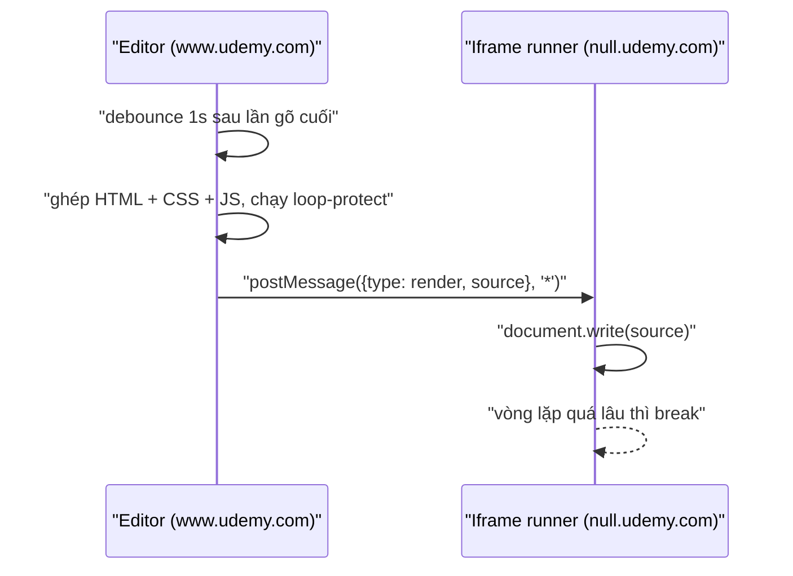

Bài tập code HTML/CSS/JS và React trên Udemy có một khung "Preview": gõ code bên trái, kết quả hiện bên phải sau một giây. Nghe đơn giản, nhưng đây là chỗ một trang web chạy **code tuỳ ý do người khác viết** ngay cạnh phiên đăng nhập của bạn. Cần ba thứ:

1. Code chạy ở nơi không đọc được cookie, localStorage hay DOM của udemy.com.
2. `while (true) {}` không được làm treo cả tab.
3. Nhiều file (`index.html`, `style.css`, `app.js`, `App.jsx`) được ghép đúng thành một trang.

Udemy làm tốt điều 1 và 2, nhưng cách ghép ở bước 3 để lọt vài lỗi đáng học, trong đó có một lỗi làm mất tác dụng của chính sandbox.

> [!TIP]
> **Tóm tắt**
> - Iframe trỏ tới `null.udemy.com` (subdomain riêng, khác origin với `www.udemy.com`), nhận code qua `postMessage`. Code chạy qua `loop-protect` để vòng lặp quá lâu tự `break`.
> - Lỗi 1: HTML người dùng được gán vào `innerHTML` của một phần tử tạo từ `document` trang chính. Ảnh được tải ngay và `onerror` chạy **ở udemy.com**, trước khi tới iframe.
> - Lỗi 2: nhóm file `.js` và `.jsx` nối với nhau không có ký tự phân cách; lỗi 3: regex xoá `import` cắt cụt mọi dòng có chữ `import ` trong chuỗi.
> - Cách đúng: parse bằng `DOMParser` (tài liệu "trơ"), nối file bằng `;\n`, iframe `sandbox="allow-scripts"` không có `allow-same-origin`.

<iframe class="demo-frame" src="/demos/web-patterns/index.html?theme=dark#/ud-code-preview" title="Demo ud-code-preview" loading="lazy" style="height: 1000px"></iframe>

<p class="demo-links">▶ <a href="/demos/web-patterns/index.html#/ud-code-preview" target="_blank" rel="noopener">Mở demo toàn màn hình ↗</a> · <a href="https://stackblitz.com/github/hunghg255/blog-hunghg/tree/master/examples/web-patterns?file=src/lib/udCodePreview.ts" target="_blank" rel="noopener">Sửa code trên StackBlitz ↗</a> · <a href="https://github.com/hunghg255/blog-hunghg/blob/master/examples/web-patterns/src/lib/udCodePreview.ts" target="_blank" rel="noopener">Xem source trên GitHub ↗</a></p>

## Udemy làm thế nào?

Component nằm ở `instructor/coding-exercise-preview/preview.react-component.tsx`, được dùng cả ở trang giảng viên lẫn trang học (`course-taking/quiz-view/coding-exercise-ide-like/preview-area/`). Template cho từng ngôn ngữ ở `instructor/code-editor/language-settings.js`.

### Iframe ở origin khác

```tsx
// preview.react-component.tsx (rút gọn)
// Use a different subdomain for security purposes.
<iframe
  src="https://null.udemy.com/staticx/udemy/js/other-libs/jsbin/iframe.html"
  sandbox="allow-pointer-lock allow-same-origin allow-modals allow-forms allow-popups allow-scripts"
  onLoad={this.generatePreview}
/>
```

`null.udemy.com` là origin khác `www.udemy.com`, nên dù sandbox có `allow-same-origin`, code trong iframe chỉ "cùng origin" với `null.udemy.com`, không với trang chính. Trang `iframe.html` là runner lấy từ JS Bin (thư mục `jsbin`): nó nghe `message`, nhận nguyên mã HTML rồi ghi đè vào tài liệu của mình.

```ts
this.previewIframe.contentWindow?.postMessage(
  JSON.stringify({ type: 'render', data: { source: this.computeIframeContent(), options: { requested: true } } }),
  '*',
);
```

Preview được dựng lại bằng `debounce(generatePreview, PREVIEW_DELAY)` với `PREVIEW_DELAY = 1000`, theo dõi nội dung file bằng `reaction` của MobX.

### Chặn vòng lặp vô hạn

```ts
loopProtect.alias = 'window.runnerWindow.protect';
try { jsx = loopProtect(jsx); } catch (err) { /* empty */ }
```

[loop-protect](https://github.com/jsbin/loop-protect) (cũng từ JS Bin) viết lại code: chèn một lời gọi kiểm tra vào mỗi vòng `for`/`while`/`do`; vòng nào chạy quá lâu thì `break`. `alias` trỏ tới hàm kiểm tra mà runner định nghĩa sẵn. Nếu loop-protect ném lỗi (code không parse được) thì khối `catch` rỗng nuốt luôn, và code chạy **không có bảo vệ**.

### Template React: Babel ngay trong trình duyệt

Với bài React, `index.html` hệ thống nạp React, ReactDOM, Babel standalone 7.8.7 (từ bucket `udemy-npm-packages`) và một đoạn shim:

::: spoiler Xem đoạn shim trong template

```html
<script type="text/javascript">
window.exports = window;
var require = (module) => {
  if (module === "react") return React;
  if (module === "react-dom") return ReactDOM;
};
</script>
```

:::

Code của học viên có `import React from 'react'`, nhưng chạy trong `<script type="text/babel">` không có bundler. Shim `require` cộng plugin `remove-import-export` biến nó thành code chạy được. Vì plugin "isn't removing them" (theo comment), component còn xoá `import`/`export` bằng regex trước:

```ts
jsx = jsx.replace(/import(?:["'\s]*([\w*{}\n, ]+)from\s*)?["'\s].*([@\w/_-]+)["'\s].*/g, '');
jsx = jsx.replace(/export default class/g, 'class');
```

### Ba chỗ hở khi ghép trang

```ts
// computeIframeContent (rút gọn)
const iframeContent = document.createElement('html');
iframeContent.innerHTML = this.htmlFile?.content ?? '';
// … thêm <style> từ file .css …
let jsx = this._mergeFilesWithExtension('js') + this._mergeFilesWithExtension('jsx');
```

1. **`innerHTML` trên phần tử của trang chính.** `document.createElement('html')` tạo phần tử thuộc *tài liệu của udemy.com*. Dù chưa gắn vào cây DOM, gán `innerHTML` vẫn làm trình duyệt tải `` và chạy thuộc tính `onerror`/`onload` trong ngữ cảnh trang chính (script `<script>` thì không chạy). Demo tái hiện trên Chromium: ở chế độ "kiểu gốc", `onerror` báo `location.origin` là origin của trang chứa demo, không phải `null`. Vì file HTML ban đầu của bài tập do giảng viên viết và preview cũng hiện ở trang học, mình đoán đây là đường để HTML của giảng viên chạy JS ở udemy.com trong trình duyệt học viên. Mình chỉ suy ra từ code, không thử trên udemy.com.
2. **Nối file không có phân cách.** `_mergeFilesWithExtension` nối các file *cùng đuôi* bằng `'\n'`, nhưng nhóm `.js` và nhóm `.jsx` thì nối trực tiếp. File `config.js` kết thúc bằng `const greeting = 'Xin chào'` (không có xuống dòng cuối) ghép với `App.jsx` bắt đầu bằng `document…` thành `'Xin chào'document`, lỗi cú pháp, cả preview trắng. Demo có ví dụ này.
3. **Regex xoá `import` chạy trên cả chuỗi.** Thử bằng Node: `import {\n useState \n} from 'react'` nhiều dòng thì xoá đúng. Nhưng `const msg = 'import this'; console.log(msg)` thành `const msg = '` vì regex khớp từ chữ `import` tới hết dòng. Bất kỳ chuỗi hay comment nào chứa "import " theo sau là khoảng trắng hoặc dấu nháy đều có thể làm hỏng code.

Thêm hai điểm nhỏ: `postMessage(..., '*')` gửi mã nguồn tới bất kỳ trang nào đang ở trong iframe (nếu iframe bị điều hướng đi chỗ khác thì người khác nhận code); và sandbox mở `allow-popups`, `allow-pointer-lock` cho mọi bài tập, kể cả bài không cần.



## Viết lại

Bản viết lại bỏ runner riêng: mỗi lần dựng lại, đặt `srcdoc` của một iframe `sandbox="allow-scripts allow-modals allow-forms"` (không có `allow-same-origin`), nên tài liệu chạy ở origin "null" mà không cần subdomain. Console được chuyển ra ngoài bằng `postMessage`, và trang cha chỉ nhận tin từ đúng `iframe.contentWindow`.

### Chặn vòng lặp

```ts title=src/lib/udCodePreview.ts
  while (i < n) {
    const after = skipLiteral(i);
    if (after !== i) {
      out += code.slice(i, after);
      i = after;
      continue;
    }
    const match = /^(for|while|do)\b/.exec(code.slice(i, i + 6));
    if (match && !isIdent(code[i - 1]) && code[i - 1] !== '.') {
      const keyword = match[1];
      const j = keyword === 'do' ? i + 2 : skipParens(i + keyword.length);
      if (j !== -1) {
        let k = j;
        while (k < n && /\s/.test(code[k])) k++;
        if (code[k] === '{') {
          id++;
          out += code.slice(i, k + 1) + ` if (${LOOP_GUARD}(${id})) break;`;
          i = k + 1;
          continue;
        }
      }
    }
    out += code[i];
    i++;
  }
  return { code: out, loops: id };
}
```

Hàm `__loopGuard` được định nghĩa trong iframe (`loopGuardRuntime`, xem file đầy đủ bên dưới).

### Ghép trang

```ts title=src/lib/udCodePreview.ts
/**
 * Ghép HTML + CSS + JS thành một tài liệu hoàn chỉnh để chạy trong iframe.
 * - HTML được parse bằng DOMParser: tài liệu "trơ", không tải ảnh, không chạy onerror,
 *   khác với cách gán innerHTML vào một phần tử của trang chính.
 * - Các file JS nối bằng ';\n' để file trước không "dính" vào file sau.
 */
export function buildPreviewDocument(files: CodeFile[], { loopLimitMs = 1000 }: BuildOptions = {}) {
  const html = byExtension(files, 'html', 'htm')[0]?.content ?? '';
  const doc = new DOMParser().parseFromString(html, 'text/html');

  const style = doc.createElement('style');
  style.textContent = byExtension(files, 'css').map((f) => f.content).join('\n');
  doc.head.appendChild(style);

  const guard = doc.createElement('script');
  guard.textContent = CONSOLE_BRIDGE + loopGuardRuntime(loopLimitMs);
  doc.head.prepend(guard);

  const jsFiles = byExtension(files, 'js', 'jsx');
  const { code, loops } = protectLoops(jsFiles.map((f) => `// ${f.name}\n${f.content}`).join(';\n'));
  const script = doc.createElement('script');
  script.textContent = code;
  doc.body.appendChild(script);

  return { html: '<!doctype html>' + doc.documentElement.outerHTML, loops };
}
```

**Khác bản gốc:** parse HTML bằng `DOMParser` (tài liệu không có browsing context, không tải ảnh, không chạy handler); nối file JS bằng `;\n` kèm comment tên file; không có bước Babel (demo chỉ chạy JS thuần, file `.jsx` cũng được coi là JS); bộ chặn vòng lặp tự viết, quét chữ chứ không dùng parser, nên không hiểu regex literal chứa `{` và bỏ qua vòng lặp không có ngoặc nhọn.

::: spoiler Xem toàn bộ src/lib/udCodePreview.ts

```ts title=src/lib/udCodePreview.ts
/**
 * Preview code HTML/CSS/JS do người dùng viết, chạy trong iframe sandbox origin khác,
 * có chặn vòng lặp vô hạn. Ý tưởng từ `instructor/coding-exercise-preview/preview.react-component.tsx`
 * và `instructor/code-editor/language-settings.js` của Udemy, viết lại từ đầu.
 */

export interface CodeFile {
  name: string;
  content: string;
}

export const extensionOf = (name: string) => name.slice(name.lastIndexOf('.') + 1).toLowerCase();

const byExtension = (files: CodeFile[], ...exts: string[]) =>
  files.filter((f) => exts.includes(extensionOf(f.name)));

// ---------------------------------------------------------------------------
// Chặn vòng lặp vô hạn

/** Tên hàm kiểm tra được chèn vào thân vòng lặp. Định nghĩa trong runtime của iframe. */
export const LOOP_GUARD = '__loopGuard';

/**
 * Chèn `if (__loopGuard(id)) break;` vào đầu thân mọi vòng `for`, `while`, `do` có dấu `{`.
 * Bộ quét bỏ qua chuỗi, template literal và comment. Giới hạn (giống mọi công cụ dựa trên
 * quét chữ): không hiểu regex literal chứa `{`, và vòng lặp không có ngoặc nhọn thì không được bảo vệ.
 * Trả về code đã chèn và số vòng lặp đã bảo vệ.
 */
export function protectLoops(code: string): { code: string; loops: number } {
  let out = '';
  let i = 0;
  let id = 0;
  const n = code.length;
  const isIdent = (ch: string | undefined) => !!ch && /[\w$]/.test(ch);

  /** chép nguyên một chuỗi / comment bắt đầu ở i, trả về vị trí ngay sau nó */
  const skipLiteral = (start: number): number => {
    const ch = code[start];
    if (ch === '/' && code[start + 1] === '/') {
      const end = code.indexOf('\n', start);
      return end === -1 ? n : end;
    }
    if (ch === '/' && code[start + 1] === '*') {
      const end = code.indexOf('*/', start + 2);
      return end === -1 ? n : end + 2;
    }
    if (ch === '"' || ch === "'" || ch === '`') {
      let j = start + 1;
      while (j < n && code[j] !== ch) j += code[j] === '\\' ? 2 : 1;
      return j + 1;
    }
    return start;
  };

  /** từ vị trí j (ngay sau từ khoá), bỏ qua khoảng trắng + cụm (...) cân bằng; trả vị trí sau đó */
  const skipParens = (j: number): number => {
    while (j < n && /\s/.test(code[j])) j++;
    if (code[j] !== '(') return -1;
    let depth = 0;
    while (j < n) {
      const after = skipLiteral(j);
      if (after !== j) {
        j = after;
        continue;
      }
      if (code[j] === '(') depth++;
      else if (code[j] === ')' && --depth === 0) return j + 1;
      j++;
    }
    return -1;
  };

  while (i < n) {
    const after = skipLiteral(i);
    if (after !== i) {
      out += code.slice(i, after);
      i = after;
      continue;
    }
    const match = /^(for|while|do)\b/.exec(code.slice(i, i + 6));
    if (match && !isIdent(code[i - 1]) && code[i - 1] !== '.') {
      const keyword = match[1];
      const j = keyword === 'do' ? i + 2 : skipParens(i + keyword.length);
      if (j !== -1) {
        let k = j;
        while (k < n && /\s/.test(code[k])) k++;
        if (code[k] === '{') {
          id++;
          out += code.slice(i, k + 1) + ` if (${LOOP_GUARD}(${id})) break;`;
          i = k + 1;
          continue;
        }
      }
    }
    out += code[i];
    i++;
  }
  return { code: out, loops: id };
}

/**
 * Runtime của guard, chạy TRONG iframe. Mỗi vòng lặp được đếm thời gian từ lần đầu chạm
 * guard trong lượt chạy đồng bộ hiện tại; quá `limitMs` thì break và báo ra ngoài.
 * Lượt chạy kết thúc (trả quyền cho event loop) thì bộ đếm reset.
 */
export const loopGuardRuntime = (limitMs: number) => `
(function () {
  var first = Object.create(null), scheduled = false;
  window.${LOOP_GUARD} = function (id) {
    var now = Date.now();
    if (!scheduled) { scheduled = true; setTimeout(function () { first = Object.create(null); scheduled = false; }, 0); }
    if (first[id] === undefined) first[id] = now;
    if (now - first[id] > ${limitMs}) {
      first[id] = now;
      console.error('Vòng lặp #' + id + ' chạy quá ${limitMs}ms, đã dừng (có thể là vòng lặp vô hạn)');
      return true;
    }
    return false;
  };
})();`;

// ---------------------------------------------------------------------------
// Ghép file thành một trang

export interface BuildOptions {
  /** giới hạn mỗi vòng lặp (ms), mặc định 1000 */
  loopLimitMs?: number;
}

/**
 * Ghép HTML + CSS + JS thành một tài liệu hoàn chỉnh để chạy trong iframe.
 * - HTML được parse bằng DOMParser: tài liệu "trơ", không tải ảnh, không chạy onerror,
 *   khác với cách gán innerHTML vào một phần tử của trang chính.
 * - Các file JS nối bằng ';\n' để file trước không "dính" vào file sau.
 */
export function buildPreviewDocument(files: CodeFile[], { loopLimitMs = 1000 }: BuildOptions = {}) {
  const html = byExtension(files, 'html', 'htm')[0]?.content ?? '';
  const doc = new DOMParser().parseFromString(html, 'text/html');

  const style = doc.createElement('style');
  style.textContent = byExtension(files, 'css').map((f) => f.content).join('\n');
  doc.head.appendChild(style);

  const guard = doc.createElement('script');
  guard.textContent = CONSOLE_BRIDGE + loopGuardRuntime(loopLimitMs);
  doc.head.prepend(guard);

  const jsFiles = byExtension(files, 'js', 'jsx');
  const { code, loops } = protectLoops(jsFiles.map((f) => `// ${f.name}\n${f.content}`).join(';\n'));
  const script = doc.createElement('script');
  script.textContent = code;
  doc.body.appendChild(script);

  return { html: '<!doctype html>' + doc.documentElement.outerHTML, loops };
}

// ---------------------------------------------------------------------------
// Cầu nối console từ iframe ra trang cha

export type PreviewMessage =
  | { source: 'ud-preview'; type: 'console'; level: 'log' | 'warn' | 'error'; text: string }
  | { source: 'ud-preview'; type: 'loaded' };

/**
 * Script chạy đầu tiên trong iframe: chuyển console.log/warn/error và lỗi chưa bắt ra trang
 * cha bằng postMessage. Gửi với targetOrigin '*' vì iframe origin "null" không biết chắc
 * origin của trang cha; dữ liệu chỉ là log của chính code người dùng.
 */
export const CONSOLE_BRIDGE = `
(function () {
  function post(msg) { msg.source = 'ud-preview'; parent.postMessage(msg, '*'); }
  ['log', 'warn', 'error'].forEach(function (level) {
    var orig = console[level];
    console[level] = function () {
      var text = Array.prototype.map.call(arguments, function (a) {
        if (typeof a === 'string') return a;
        try { return JSON.stringify(a); } catch (e) { return String(a); }
      }).join(' ');
      post({ type: 'console', level: level, text: text });
      orig.apply(console, arguments);
    };
  });
  window.addEventListener('error', function (e) { post({ type: 'console', level: 'error', text: String(e.message) }); });
  window.addEventListener('load', function () { post({ type: 'loaded' }); });
})();`;

/**
 * Quyền tối thiểu cho iframe preview. KHÔNG có `allow-same-origin`, nên code chạy ở origin
 * "null": không đọc được cookie, localStorage hay DOM của trang cha.
 */
export const PREVIEW_SANDBOX = 'allow-scripts allow-modals allow-forms';
```

:::

## Đi qua code

- `protectLoops` chép nguyên chuỗi, template literal và comment, nên `"while(true){"` trong chuỗi không bị đụng. Gặp `for`/`while`/`do` đứng riêng (không phải `.do` hay một phần của `doSomething`), nó bỏ qua cụm `(...)` cân bằng rồi chèn `if (__loopGuard(id)) break;` ngay sau `{`. `do { } while (x);` chỉ được chèn một lần vì `while` ở cuối không có `{` theo sau.
- Không chèn gì *trước* vòng lặp, nên nhãn (`outer: for …`) vẫn đúng.
- `loopGuardRuntime` đo thời gian từ lần đầu một vòng chạm guard trong lượt chạy hiện tại; `setTimeout(0)` reset bộ đếm khi code trả quyền cho event loop. Vòng vô hạn không bao giờ trả quyền, nên chắc chắn bị dừng sau `limitMs`. Đo bằng Node: vòng `while (true)` bị dừng sau 201 ms với giới hạn 200 ms.
- `buildPreviewDocument` đưa cầu nối console và guard lên đầu `<head>`, để chúng có trước mọi script của người dùng.

## Tại sao không làm cách khác?

- **Chạy code trong Web Worker?** An toàn và dễ `terminate()` khi treo, nhưng Worker không có DOM; bài HTML/CSS cần render thật.
- **Không chặn vòng lặp, chỉ `terminate` iframe khi treo?** Iframe cùng tiến trình với trang cha (thường là vậy nếu không bật site isolation cho origin đó) thì vòng lặp vô hạn trong iframe làm treo cả trang cha; trang cha không chạy được code để gỡ iframe. Chèn guard vào code là cách chắc ăn nhất.
- **Subdomain riêng hay `srcdoc` + sandbox không `allow-same-origin`?** Subdomain cho phép runner dùng localStorage, cookie riêng và (có lẽ) chạy trong tiến trình khác nhờ site isolation. `srcdoc` gọn hơn, nhưng code người dùng không dùng được `localStorage` (origin "null" ném lỗi khi truy cập).

## Edge case và cạm bẫy

- **Đừng parse HTML không tin cậy bằng `innerHTML` của phần tử thuộc trang chính**, kể cả khi phần tử chưa gắn vào cây DOM. Dùng `DOMParser` hoặc `document.implementation.createHTMLDocument()`.
- **`allow-scripts` + `allow-same-origin` cùng origin với trang cha** thì sandbox vô dụng: code trong iframe xoá được chính thuộc tính `sandbox`. Udemy tránh được nhờ subdomain khác.
- **`postMessage`:** bên nhận luôn kiểm tra `event.source` (và `event.origin` nếu biết); bên gửi nên ghi rõ targetOrigin thay vì `'*'` khi dữ liệu là mã nguồn của người dùng.
- **Bộ chặn vòng lặp dựa trên quét chữ** có giới hạn: đệ quy vô hạn, `setInterval` bận, hay vòng `while` không có ngoặc nhọn đều lọt. Đệ quy thì trình duyệt tự ném `RangeError`.

## Dùng trong dự án

```tsx
const { html } = buildPreviewDocument(files, { loopLimitMs: 500 });
<iframe sandbox={PREVIEW_SANDBOX} srcDoc={html} title='Kết quả' />;

window.addEventListener('message', (e) => {
  if (e.source !== iframe.contentWindow || e.data?.source !== 'ud-preview') return;
  if (e.data.type === 'console') appendConsole(e.data);
});
```

## Kiểm thử

::: spoiler Ví dụ test (bản phác, không có trong repo)

```ts
import { describe, expect, it } from 'vitest';
import { buildPreviewDocument, protectLoops } from './udCodePreview';

describe('protectLoops', () => {
  it('bảo vệ for, while, do và bỏ qua chuỗi/comment', () => {
    const { code, loops } = protectLoops('const s = "while(true){" // for(;;){\nfor (;;) { a() } do { b() } while (c);');
    expect(loops).toBe(2);
    expect(code).toContain('const s = "while(true){"');
  });
  it('giữ nhãn', () => {
    const { code } = protectLoops('outer: for (;;) { break outer; }');
    expect(code.startsWith('outer: for (;;) { if (__loopGuard(1)) break;')).toBe(true);
  });
});

describe('buildPreviewDocument', () => {
  it('file js không dính nhau', () => {
    const { html } = buildPreviewDocument([
      { name: 'a.js', content: "const x = 'a'" },
      { name: 'b.jsx', content: 'console.log(x)' },
    ]);
    expect(html).toContain(";\n// b.jsx");
  });
  it('không tải ảnh trong lúc ghép', () => {
    let fired = false;
    (window as any).__hit = () => (fired = true);
    buildPreviewDocument([{ name: 'index.html', content: '' }]);
    expect(fired).toBe(false);
  });
});
```

:::

## So với chuẩn web

- Thuộc tính `sandbox` của iframe và `srcdoc` có trên mọi trình duyệt lớn (tính tới 10/2026). Muốn chặn cả việc tải tài nguyên bên ngoài thì đặt thêm thẻ `<meta http-equiv="Content-Security-Policy">` trong tài liệu preview.
- `DOMParser.parseFromString(html, 'text/html')` tạo tài liệu không chạy script, không tải tài nguyên; đây là cách chuẩn để xử lý HTML không tin cậy trước khi đưa đi đâu đó.
- Các sản phẩm như CodePen, CodeSandbox, StackBlitz đều chạy preview ở domain riêng; StackBlitz còn dùng WebContainers chạy Node ngay trong trình duyệt.

---

Bài này thuộc series **[Học từ mã nguồn Udemy](/series/udemy)** (21 bài, đọc theo thứ tự).

::: spoiler Xem nhanh danh sách bài trong series

*Mở đầu*

- [Mở đầu: bên trong frontend của Udemy](/blogs/learn-from-udemy-source-code)

*Phần 1: video và học bài*

- [#1 DRM đa hệ: Widevine, PlayReady, FairPlay](/blogs/udemy-drm-multi-key-system)
- [#2 URL ký và license hết hạn: tự làm mới, tải trước bài kế](/blogs/udemy-expiring-media-urls)
- [#3 Ghi tiến độ xem theo bucket, tự hoàn thành, backoff lỗi](/blogs/udemy-watch-progress-buckets)
- [#4 Thumbnail sprite từ WebVTT và slide trên seekbar](/blogs/udemy-sprite-thumbnails-vtt)
- [#5 Phụ đề: tự chọn ngôn ngữ và editor có phím tắt](/blogs/udemy-captions-auto-select-editor)
- [#6 Đo băng thông, autoplay Safari, iPad giả làm Mac](/blogs/udemy-video-quirks-autoplay)

*Phần 2: bài tập, bài thi, lab*

- **#7 Preview code HTML/React trong iframe sandbox** (bài này)
- [#8 Bài thi có giờ: tạm dừng khi rảnh, autosave theo dấu vân tay](/blogs/udemy-timed-exam)
- [#9 Chấm code realtime: đăng ký kênh trước, có đường dự phòng](/blogs/udemy-realtime-grading)
- [#10 Mở lab không bị chặn popup, heartbeat, xung đột phiên](/blogs/udemy-lab-launcher)

*Phần 3: editor và nội dung*

- [#11 ProseMirror: schema theo flag, NodeView React, HTML cho email](/blogs/udemy-prosemirror-integration)
- [#12 Parse HTML an toàn bằng document tách rời](/blogs/udemy-safe-html-parse)
- [#13 Sinh file .ics có VTIMEZONE tự dò giờ mùa hè](/blogs/udemy-ics-vtimezone)
- [#14 Đọc Open Badges giấu trong ảnh PNG và SVG](/blogs/udemy-open-badges-image)

*Phần 4: hạ tầng và trải nghiệm*

- [#15 Pipeline tracking: batch, sendBeacon, bfcache, HTTP 207](/blogs/udemy-event-tracking-pipeline)
- [#16 Gợi ý tính năng mới qua nhiều phiên bằng máy trạng thái](/blogs/udemy-feature-discoverability)
- [#17 Kéo cạnh để resize và mép cuộn mờ dần](/blogs/udemy-resizer-gradient-scroll)
- [#18 Gom request giá khoá học, cập nhật một phần khi áp coupon](/blogs/udemy-price-dataloader-partial-update)
- [#19 Trả lời lạc quan có rollback, autocomplete hai tầng cache](/blogs/udemy-optimistic-reply-autocomplete)
- [#20 Nạp app theo ưu tiên, registry store, HTML cache công khai](/blogs/udemy-app-loader-registry)

:::

Code + demo: [`examples/web-patterns`](https://github.com/hunghg255/blog-hunghg/tree/master/examples/web-patterns) · [Mở trên StackBlitz](https://stackblitz.com/github/hunghg255/blog-hunghg/tree/master/examples/web-patterns)
