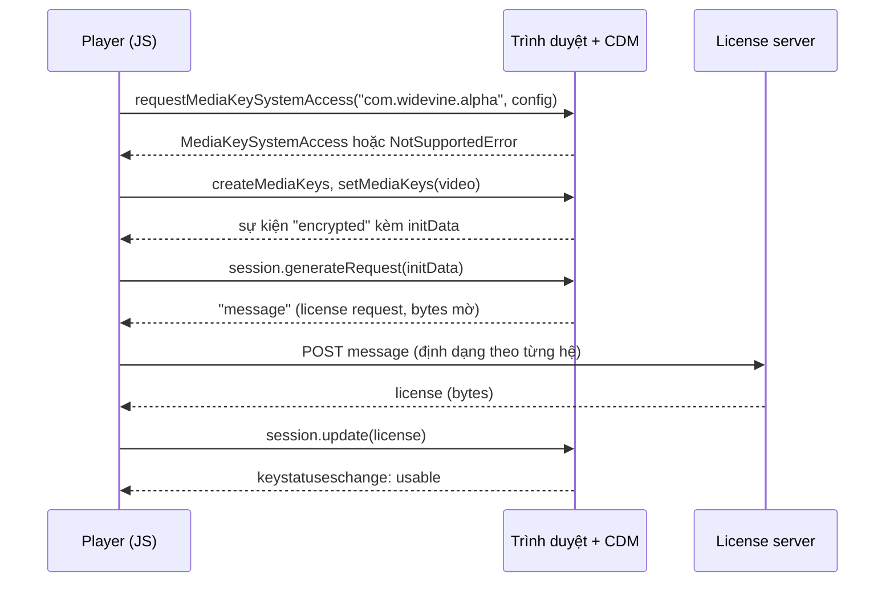

Khoá học trả phí trên Udemy là tài sản của giảng viên, nên video được mã hoá: tải file `.mp4` hay segment HLS về cũng không xem được nếu không có khoá. Trình duyệt giải mã qua **EME (Encrypted Media Extensions)**, nhưng mỗi nhà sản xuất lại dùng một hệ DRM riêng:

| Trình duyệt | Hệ DRM | Định dạng nguồn |
|---|---|---|
| Chrome, Firefox, Edge mới, Android | Widevine (`com.widevine.alpha`) | DASH |
| Safari macOS, iOS | FairPlay (`com.apple.fps.1_0`) | HLS |
| Edge cũ, Xbox, một số Smart TV | PlayReady (`com.microsoft.playready`) | DASH |

Một player phải trả lời ba câu: trình duyệt này hỗ trợ hệ nào, nên phát nguồn nào, và **gửi gì cho license server**, vì ba hệ nói ba "ngôn ngữ" khác nhau. File `shaka-video-player/drm.ts` của Udemy (khoảng 290 dòng) cùng phần cấu hình trong `shaka-video-player.mobx-store.ts` làm đúng ba việc đó.

> [!TIP]
> **Tóm tắt**
> - Dò hệ hỗ trợ bằng `navigator.requestMediaKeySystemAccess(keySystem, [config])` và **nhớ kết quả**: lần dò sau lấy từ cache.
> - Udemy ưu tiên **Widevine → FairPlay → PlayReady**. FairPlay đi với HLS, hai hệ còn lại đi với DASH.
> - License request khác nhau: Widevine gửi bytes thô, PlayReady phải bóc `<Challenge>` khỏi XML UTF-16LE, FairPlay gửi form `spc=<base64>&assetId=<id>` và nhận base64.
> - Bản gốc có ba chỗ sai: key `advanced` viết thành chuỗi `"WIDEVINE_KEY_SYSTEM"`, đọc content id FairPlay từ `ArrayBuffer` nên ra chuỗi rỗng, và không dò được hệ nào vẫn cố dùng Widevine.

<iframe class="demo-frame" src="/demos/web-patterns/index.html?theme=dark#/ud-drm" title="Demo ud-drm" loading="lazy" style="height: 1250px"></iframe>

<p class="demo-links">▶ <a href="/demos/web-patterns/index.html#/ud-drm" target="_blank" rel="noopener">Mở demo toàn màn hình ↗</a> · <a href="https://stackblitz.com/github/hunghg255/blog-hunghg/tree/master/examples/web-patterns?file=src/lib/udDrm.ts" target="_blank" rel="noopener">Sửa code trên StackBlitz ↗</a> · <a href="https://github.com/hunghg255/blog-hunghg/blob/master/examples/web-patterns/src/lib/udDrm.ts" target="_blank" rel="noopener">Xem source trên GitHub ↗</a></p>

Trong demo, phần 1 dò **thật** trên trình duyệt của bạn. Mở bằng Chrome trên máy thường sẽ thấy Widevine được hỗ trợ. Chromium không có Widevine (như trình duyệt headless mình dùng để test) chỉ còn ClearKey, và hai cách chọn bắt đầu khác nhau. Phần 2 và 3 mô phỏng định dạng request, không có license server thật.

## Bên trong trình duyệt: EME làm gì

EME tách việc giải mã ra khỏi JavaScript. Trang web không bao giờ thấy khoá: nó chỉ chuyển tin nhắn qua lại giữa **CDM** (Content Decryption Module, phần mềm đóng của Google/Apple/Microsoft nằm trong trình duyệt) và **license server** của bên bán nội dung.



Bước khác nhau giữa các hệ nằm ở mũi tên "POST message": cùng là bytes CDM đưa ra, nhưng server Widevine nhận nguyên bytes, server PlayReady muốn SOAP challenge, còn FairPlay có quy ước riêng của từng nhà cung cấp.

Một chi tiết hay bị quên: `requestMediaKeySystemAccess` nhận **danh sách cấu hình** (codec, robustness, init data type). Trình duyệt có thể hỗ trợ hệ đó nhưng không hỗ trợ cấu hình bạn xin, ví dụ robustness phần cứng trên máy ảo. Vì vậy dò phải kèm đúng cấu hình sẽ dùng.

## Udemy làm thế nào?

### Dò hệ và nhớ kết quả

```ts
export const supportKeySystem = memoize(async (keySystem: any, requiredConfigs: any) => {
    if (typeof window.navigator.requestMediaKeySystemAccess === 'function') {
        return new Promise((resolve) => {
            window.navigator
                .requestMediaKeySystemAccess(keySystem, [requiredConfigs])
                .then(resolve)
                .catch(() => resolve(false));
        });
    } else if (typeof window.MSMediaKeys === 'function') {
        return window.MSMediaKeys.isTypeSupported(keySystem);
    }
    return false;
});
```

`memoize` của Udemy (`utils/memoize`) lấy `JSON.stringify(args)` làm khoá, nên cùng hệ + cùng cấu hình chỉ dò một lần mỗi phiên. Nhánh `MSMediaKeys` dành cho IE11/Edge cũ, trình duyệt có EME tiền chuẩn. Cấu hình xin là AAC `mp4a.40.2` + H.264 với `robustness: 'SW_SECURE_CRYPTO'`: mức bảo vệ phần mềm, thấp nhất nhưng chạy được trên mọi máy.

### Thứ tự ưu tiên

```ts
_createVideoPlayerConfiguration = async () => {
    if (!this.mediaLicenseToken) {
        this._createVideoPlayerConfigurationForNonEncryptedSources();
        return;
    }
    const isWidevineSupported = await supportKeySystem(WIDEVINE_KEY_SYSTEM, DASH_CONFIGS);
    if (isWidevineSupported) { this._createVideoPlayerConfigurationForWideVine(); return; }
    const isFairPlaySupported = await supportKeySystem(FAIRPLAY_KEY_SYSTEM, HLS_CONFIGS);
    if (isFairPlaySupported) { await this._createVideoPlayerConfigurationForFairPlay(); return; }
    const isPlayReadySupported = await supportKeySystem(PLAYREADY_KEY_SYSTEM, DASH_CONFIGS);
    if (isPlayReadySupported) { this._createVideoPlayerConfigurationForPlayReady(); return; }

    // TODO: notify DD the browser name and that no key system was detected.
    // Make last ditch attempt at using the most widely used key system:
    this._createVideoPlayerConfigurationForWideVine();
};
```

Không có `mediaLicenseToken` nghĩa là bài học không mã hoá (bài xem thử miễn phí), không cần DRM. Có token thì dò lần lượt. Widevine đứng đầu vì phủ nhiều trình duyệt nhất. Edge mới hỗ trợ cả Widevine lẫn PlayReady và sẽ lấy Widevine.

Việc chọn **nguồn** nằm ở chỗ khác: Safari lấy bản HLS, còn lại lấy bản DASH. Phần code này được đánh dấu `BEGIN TEMP POC CODE` và dò Safari bằng regex user agent `/^((?!chrome|android).)*safari/i`, tức không dựa trên kết quả dò hệ DRM.

### License request: ba kiểu cho ba hệ

Udemy có hai đường phát: player cũ dựa trên video.js (`drm.ts`, qua plugin `videojs-contrib-eme`) và player mới dựa trên shaka-player (`shaka-video-player.mobx-store.ts`). Cả hai đều phải "dịch" request cho từng hệ.

**Widevine** đơn giản nhất: POST nguyên bytes, header `application/octet-stream`, nhận bytes.

**PlayReady**: CDM đưa ra một XML (UTF-16LE), trong đó `<Challenge>` là SOAP request đã base64, kèm danh sách `<HttpHeaders>` CDM muốn gửi theo:

::: spoiler Xem hàm parsePlayReadyKeyMessage của Udemy

```ts
function parsePlayReadyKeyMessage(keyMessage: any) {
    const messageXml = new window.DOMParser().parseFromString(
        String.fromCharCode.apply(null, keyMessage as []),
        'application/xml',
    );
    const headerElement = messageXml.getElementsByTagName('HttpHeaders')[0];
    const headers = [];
    // … đọc từng <name>/<value> vào headers …
    const challengeElement = messageXml.getElementsByTagName('Challenge')[0];
    const challenge = challengeElement ? window.atob(challengeElement.childNodes[0].nodeValue) : undefined;
    return { headers, challenge };
}
```

:::

Sau đó POST `challenge` với `Content-Type: application/octet-stream`. Header CDM yêu cầu (thường là `Content-Type: text/xml` và `SOAPAction`) được parse vào biến `headers` nhưng **không dùng tới**. Có lẽ license server của Udemy (nhà cung cấp BuyDRM, theo một comment trong code) không cần chúng, nhưng một server PlayReady chuẩn sẽ cần.

**FairPlay** là trường hợp lạ nhất. Apple không quy định giao thức với license server, nên mỗi nhà cung cấp tự đặt. Bên Udemy dùng là form `spc=<base64>&assetId=<content id>`, response là base64 dạng text:

```ts
this._videoPlayer?.getNetworkingEngine()?.registerRequestFilter((type: any, request: any) => {
    if (type == shaka.net.NetworkingEngine.RequestType.LICENSE) {
        request.headers['Content-Type'] = 'text/plain';
        const originalPayload = new Uint8Array(request.body);
        const base64Payload = shaka.util.Uint8ArrayUtils.toStandardBase64(originalPayload);
        const params = `spc=${base64Payload}&assetId=${contentId}`;
        request.body = shaka.util.StringUtils.toUTF8(params);
    }
});
this._videoPlayer?.getNetworkingEngine()?.registerResponseFilter((type: any, response: any) => {
    if (type == shaka.net.NetworkingEngine.RequestType.LICENSE) {
        let responseText = shaka.util.StringUtils.fromUTF8(response.data);
        responseText = responseText.trim();
        response.data = shaka.util.Uint8ArrayUtils.fromBase64(responseText).buffer;
    }
});
```

SPC (Server Playback Context) là request CDM của Apple sinh ra. Content id lấy từ URI `skd://<32 ký tự>` trong playlist HLS. `trim()` ở response filter là để bỏ ký tự xuống dòng mà server gửi kèm: base64 có `\n` ở cuối sẽ làm hàm decode lỗi.

Bản video.js còn ghi rõ vì sao không mã hoá tham số:

```ts
// BuyDRM doesn't support encoded parameters! Shame!
const requestBody = `spc=${spc}&assetId=${contentId}`;
```

Base64 chuẩn có ký tự `+` và `/`. Theo chuẩn `application/x-www-form-urlencoded`, `+` nghĩa là dấu cách. Server đọc body theo chuẩn form sẽ biến mọi `+` thành dấu cách và SPC hỏng. Server của Udemy đọc chuỗi thô nên không mã hoá mới đúng. Demo phần 2 cho bạn bật/tắt hai yếu tố này: không mã hoá mà server đọc chuẩn form thì SPC thành `    ECD//j4Af/g/` thay vì `++++ECD//j4Af/g/`.

### Ba chỗ sai trong bản gốc

**1. Key của `advanced` là một chuỗi chữ.** Cấu hình Widevine cho shaka:

```ts
advanced: {
    WIDEVINE_KEY_SYSTEM: {
        videoRobustness: 'SW_SECURE_CRYPTO',
        audioRobustness: 'SW_SECURE_CRYPTO',
    },
},
```

Trong object literal, `WIDEVINE_KEY_SYSTEM:` tạo key là **chữ** `"WIDEVINE_KEY_SYSTEM"`, không phải giá trị của hằng (`'com.widevine.alpha'`). Muốn dùng giá trị phải viết `[WIDEVINE_KEY_SYSTEM]:`. Shaka tìm cấu hình nâng cao theo tên hệ thật nên không thấy, robustness bị bỏ qua. Ngay phía trên, phần `servers` lại viết đúng `[WIDEVINE_KEY_SYSTEM]: …`, nên đây có lẽ là lỗi gõ. Hệ quả thực tế không lớn: thiếu robustness thì shaka dùng mặc định và vẫn phát được. Nhưng nếu ai đó sửa cấu hình này để đòi robustness phần cứng, thay đổi sẽ không có tác dụng.

**2. Content id FairPlay luôn rỗng ở đường video.js.**

```ts
export const getContentIdForFairPlay = function (emeOptions: any, initData: any) {
    const initDataString = String.fromCharCode.apply(null, initData.buffer as []);
    const match = initDataString.match(HLS_DRM_CONTENT_ID_REGEX);
    if (!match) {
        throw new Error('Invalid content ID format');
    }
    return match[1];
};
```

`initData.buffer` là một `ArrayBuffer`. `Function.prototype.apply` đọc đối số thứ hai như một "array-like": cần thuộc tính `length`, mà `ArrayBuffer` chỉ có `byteLength`. Kết quả là chuỗi rỗng, regex không khớp, hàm luôn ném lỗi (demo phần 3 chạy đúng dòng đó). Kể cả khi đọc từng byte, init data FairPlay là chuỗi **UTF-16**, mỗi ký tự cách nhau một byte `\0`, regex `skd://(\w{32})` vẫn không khớp. Cách đúng là đọc qua `Uint16Array`, như hàm mặc định của chính `videojs-contrib-eme`. Đường shaka dùng `shaka.util.FairPlayUtils.defaultGetContentId` nên không dính lỗi. Có lẽ đây là lý do Udemy chuyển Safari sang shaka, nhưng mình không tìm thấy ghi chú nào nói vậy.

**3. Không dò được hệ nào vẫn "thử nốt" Widevine.** Comment `TODO: notify DD` cho thấy họ biết trường hợp này có xảy ra (trình duyệt cũ, chế độ riêng tư chặn DRM, Linux thiếu CDM). Cấu hình Widevine trên máy không có Widevine sẽ không phát được: người xem chờ tới khi player báo lỗi giải mã chung chung, thay vì được báo ngay "trình duyệt không hỗ trợ video có bản quyền".

## Viết lại

Bản viết lại tách thành các hàm thuần, không phụ thuộc player, để dùng được với shaka, video.js hay EME tự viết.

```ts title=src/lib/udDrm.ts
/**
 * Chọn hệ đầu tiên được hỗ trợ theo thứ tự ưu tiên. Udemy khi không dò được hệ nào vẫn
 * "thử nốt" Widevine; ở đây trả về null để UI báo lỗi rõ ràng thay vì đợi lỗi giải mã.
 */
export function chooseKeySystem(
  probes: ProbeResult[],
  order: KeySystem[] = [WIDEVINE, FAIRPLAY, PLAYREADY],
): DrmChoice {
  for (const keySystem of order) {
    if (probes.find((p) => p.keySystem === keySystem)?.supported) {
      return {
        keySystem,
        manifest: keySystem === FAIRPLAY ? 'hls' : 'dash',
        reason: `hệ đầu tiên được hỗ trợ theo thứ tự ${order.map(shortName).join(' → ')}`,
      };
    }
  }
  return { keySystem: null, manifest: null, reason: 'không có hệ DRM nào; nên báo lỗi hoặc phát bản không mã hoá nếu có' };
}
```

```ts title=src/lib/udDrm.ts
/**
 * FairPlay: body dạng form `spc=<base64>&assetId=<contentId>`.
 * `encode` = true thì mã hoá theo chuẩn form (`+` → `%2B`); Udemy cố ý KHÔNG mã hoá
 * vì license server của họ đọc chuỗi thô ("BuyDRM doesn't support encoded parameters").
 */
export function fairPlayRequest(spc: Uint8Array, contentId: string, encode = false): LicenseRequest {
  const spcBase64 = bytesToBase64(spc);
  const body = encode
    ? new URLSearchParams({ spc: spcBase64, assetId: contentId }).toString()
    : `spc=${spcBase64}&assetId=${contentId}`;
  return { headers: { 'Content-Type': 'application/x-www-form-urlencoded' }, body };
}
```

::: spoiler Xem toàn bộ src/lib/udDrm.ts

```ts title=src/lib/udDrm.ts
/**
 * Chọn hệ DRM theo trình duyệt và định dạng license request/response cho từng hệ
 * (ý tưởng từ shaka-video-player/drm.ts của Udemy, viết lại từ đầu).
 *
 * - Dò hệ hỗ trợ bằng navigator.requestMediaKeySystemAccess, nhớ kết quả theo (hệ, cấu hình).
 * - Thứ tự ưu tiên giống Udemy: Widevine → FairPlay → PlayReady.
 * - Mỗi hệ một kiểu license request: Widevine/PlayReady gửi bytes thô, FairPlay gửi form
 *   `spc=<base64>&assetId=<id>` và nhận về base64.
 */

export const WIDEVINE = 'com.widevine.alpha';
export const PLAYREADY = 'com.microsoft.playready';
export const FAIRPLAY = 'com.apple.fps.1_0';
export const CLEARKEY = 'org.w3.clearkey';

export type KeySystem = typeof WIDEVINE | typeof PLAYREADY | typeof FAIRPLAY | typeof CLEARKEY;

/** Cấu hình tối thiểu giống Udemy: AAC + H.264, robustness phần mềm. */
export const DASH_CONFIG: MediaKeySystemConfiguration = {
  initDataTypes: ['cenc'],
  audioCapabilities: [{ contentType: 'audio/mp4; codecs="mp4a.40.2"', robustness: 'SW_SECURE_CRYPTO' }],
  videoCapabilities: [{ contentType: 'video/mp4; codecs="avc1.64001F"', robustness: 'SW_SECURE_CRYPTO' }],
};

export const HLS_CONFIG: MediaKeySystemConfiguration = {
  initDataTypes: ['sinf', 'skd'],
  audioCapabilities: [{ contentType: 'audio/mp4; codecs="mp4a.40.2"' }],
  videoCapabilities: [{ contentType: 'video/mp4; codecs="avc1.640828"' }],
};

/** ClearKey không có robustness, dùng làm mốc so sánh trong demo. */
export const CLEARKEY_CONFIG: MediaKeySystemConfiguration = {
  initDataTypes: ['cenc', 'keyids'],
  videoCapabilities: [{ contentType: 'video/mp4; codecs="avc1.64001F"' }],
};

export interface ProbeResult {
  keySystem: KeySystem;
  supported: boolean;
  /** cấu hình trình duyệt chấp nhận (có thể khác cấu hình mình xin) */
  accepted?: MediaKeySystemConfiguration;
  error?: string;
  ms: number;
  cached: boolean;
}

type Requester = (keySystem: string, configs: MediaKeySystemConfiguration[]) => Promise<MediaKeySystemAccess>;

const defaultRequester: Requester | undefined =
  typeof navigator !== 'undefined' && typeof navigator.requestMediaKeySystemAccess === 'function'
    ? navigator.requestMediaKeySystemAccess.bind(navigator)
    : undefined;

/**
 * Dò một hệ DRM. Kết quả được nhớ theo (hệ + cấu hình) vì requestMediaKeySystemAccess
 * có thể mất vài chục ms và trên một số trình duyệt còn hiện hộp thoại xin quyền.
 */
export function createKeySystemProber(request: Requester | undefined = defaultRequester) {
  const cache = new Map<string, Promise<Omit<ProbeResult, 'ms' | 'cached'>>>();

  return async function probe(keySystem: KeySystem, config: MediaKeySystemConfiguration): Promise<ProbeResult> {
    const key = `${keySystem}|${JSON.stringify(config)}`;
    const started = performance.now();
    const cached = cache.has(key);
    if (!cached) {
      const job = (async () => {
        if (!request) return { keySystem, supported: false, error: 'EME không có trên trình duyệt này' };
        try {
          const access = await request(keySystem, [config]);
          return { keySystem, supported: true, accepted: access.getConfiguration() };
        } catch (error) {
          return { keySystem, supported: false, error: (error as Error).name || String(error) };
        }
      })();
      cache.set(key, job);
    }
    const result = await cache.get(key)!;
    return { ...result, ms: performance.now() - started, cached };
  };
}

export interface DrmChoice {
  keySystem: KeySystem | null;
  /** nguồn nên phát: FairPlay đi với HLS, Widevine/PlayReady đi với DASH */
  manifest: 'dash' | 'hls' | null;
  reason: string;
}

/**
 * Chọn hệ đầu tiên được hỗ trợ theo thứ tự ưu tiên. Udemy khi không dò được hệ nào vẫn
 * "thử nốt" Widevine; ở đây trả về null để UI báo lỗi rõ ràng thay vì đợi lỗi giải mã.
 */
export function chooseKeySystem(
  probes: ProbeResult[],
  order: KeySystem[] = [WIDEVINE, FAIRPLAY, PLAYREADY],
): DrmChoice {
  for (const keySystem of order) {
    if (probes.find((p) => p.keySystem === keySystem)?.supported) {
      return {
        keySystem,
        manifest: keySystem === FAIRPLAY ? 'hls' : 'dash',
        reason: `hệ đầu tiên được hỗ trợ theo thứ tự ${order.map(shortName).join(' → ')}`,
      };
    }
  }
  return { keySystem: null, manifest: null, reason: 'không có hệ DRM nào; nên báo lỗi hoặc phát bản không mã hoá nếu có' };
}

export function shortName(keySystem: string) {
  if (keySystem === WIDEVINE) return 'Widevine';
  if (keySystem === PLAYREADY) return 'PlayReady';
  if (keySystem === FAIRPLAY) return 'FairPlay';
  if (keySystem === CLEARKEY) return 'ClearKey';
  return keySystem;
}

/**
 * Cấu hình kiểu shaka-player. Chú ý key của `advanced` phải là TÊN HỆ THẬT
 * ('com.widevine.alpha'); viết `{ WIDEVINE: … }` sẽ tạo key là chữ "WIDEVINE" và bị bỏ qua.
 */
export function buildPlayerDrmConfig(keySystem: KeySystem, licenseUrl: string) {
  return {
    drm: {
      servers: { [keySystem]: licenseUrl },
      advanced:
        keySystem === WIDEVINE
          ? { [WIDEVINE]: { videoRobustness: 'SW_SECURE_CRYPTO', audioRobustness: 'SW_SECURE_CRYPTO' } }
          : {},
    },
  };
}

export function buildLicenseUrl(template: string, drmType: string, token: string, baseUrl = '') {
  return template
    .replace('{drm_type}', encodeURIComponent(drmType))
    .replace('{auth_token}', encodeURIComponent(token))
    .replace('{base_url}', baseUrl);
}

// ---- base64 không cần Buffer (Udemy dùng polyfill Buffer của Node trong trình duyệt) ----

export function bytesToBase64(bytes: Uint8Array): string {
  let binary = '';
  for (let i = 0; i < bytes.length; i += 0x8000) {
    binary += String.fromCharCode(...bytes.subarray(i, i + 0x8000));
  }
  return btoa(binary);
}

export function base64ToBytes(text: string): Uint8Array {
  const binary = atob(text.trim());
  const out = new Uint8Array(binary.length);
  for (let i = 0; i < binary.length; i++) out[i] = binary.charCodeAt(i);
  return out;
}

export interface LicenseRequest {
  headers: Record<string, string>;
  body: Uint8Array | string;
}

/** Widevine: gửi nguyên message của CDM, nhận về bytes license. */
export function widevineRequest(message: Uint8Array): LicenseRequest {
  return { headers: { 'Content-Type': 'application/octet-stream' }, body: message };
}

/**
 * PlayReady: message của CDM là XML UTF-16LE bọc challenge base64 và danh sách HttpHeaders.
 * Lấy challenge ra gửi, và GIỮ các header CDM yêu cầu (Udemy parse header nhưng không gửi).
 */
export function playReadyRequest(message: Uint8Array): LicenseRequest {
  const xmlText = decodeXmlBytes(message);
  const doc = new DOMParser().parseFromString(xmlText, 'application/xml');
  const headers: Record<string, string> = {};
  const headerRoot = doc.getElementsByTagName('HttpHeaders')[0];
  if (headerRoot) {
    for (const header of Array.from(headerRoot.getElementsByTagName('HttpHeader'))) {
      const name = header.getElementsByTagName('name')[0]?.textContent;
      const value = header.getElementsByTagName('value')[0]?.textContent;
      if (name && value != null) headers[name] = value;
    }
  }
  const challenge = doc.getElementsByTagName('Challenge')[0]?.textContent;
  if (!challenge) throw new Error('PlayReady message không có <Challenge>');
  return { headers: { 'Content-Type': 'text/xml; charset=utf-8', ...headers }, body: base64ToBytes(challenge) };
}

/** XML của PlayReady là UTF-16LE (byte thứ hai của ký tự ASCII là 0); phòng hờ cả UTF-8. */
function decodeXmlBytes(bytes: Uint8Array) {
  const looksUtf16 = bytes.length > 1 && bytes[1] === 0;
  return new TextDecoder(looksUtf16 ? 'utf-16le' : 'utf-8').decode(bytes);
}

/**
 * FairPlay: body dạng form `spc=<base64>&assetId=<contentId>`.
 * `encode` = true thì mã hoá theo chuẩn form (`+` → `%2B`); Udemy cố ý KHÔNG mã hoá
 * vì license server của họ đọc chuỗi thô ("BuyDRM doesn't support encoded parameters").
 */
export function fairPlayRequest(spc: Uint8Array, contentId: string, encode = false): LicenseRequest {
  const spcBase64 = bytesToBase64(spc);
  const body = encode
    ? new URLSearchParams({ spc: spcBase64, assetId: contentId }).toString()
    : `spc=${spcBase64}&assetId=${contentId}`;
  return { headers: { 'Content-Type': 'application/x-www-form-urlencoded' }, body };
}

/** Response FairPlay là base64 dạng text, thường kèm xuống dòng ở cuối: trim rồi decode. */
export function fairPlayResponse(text: string): Uint8Array {
  return base64ToBytes(text.trim());
}

/**
 * Lấy content id từ init data `skd://<32 ký tự>` của FairPlay. Init data là chuỗi UTF-16,
 * nên phải đọc theo Uint16Array; đọc từng byte sẽ xen ký tự \0 giữa các chữ.
 */
export function fairPlayContentId(initData: Uint8Array): string {
  const even = initData.byteLength - (initData.byteLength % 2);
  const units = new Uint16Array(initData.buffer.slice(initData.byteOffset, initData.byteOffset + even));
  const text = String.fromCharCode(...units);
  const match = /skd:\/\/(\w{32})/i.exec(text);
  if (!match) throw new Error('init data không có skd://<content id>');
  return match[1];
}
```

:::

**Khác bản gốc:**

- Cache lưu **promise**, nên hai chỗ cùng dò một lúc dùng chung một lời gọi (memoize của Udemy cũng lưu promise, ở điểm này hai bên giống nhau). Kết quả có thêm `accepted`: cấu hình trình duyệt thật sự chấp nhận, hữu ích để log.
- `chooseKeySystem` trả `null` khi không có hệ nào, để UI báo lỗi ngay.
- PlayReady giữ header CDM yêu cầu và tự nhận biết UTF-16LE/UTF-8 thay vì giả định kiểu dữ liệu đầu vào.
- FairPlay có tham số `encode` cho server đọc chuẩn form, mặc định `false` để tương thích kiểu BuyDRM.
- Base64 dùng `btoa`/`atob` thay cho polyfill `Buffer` của Node (Udemy gọi `new Buffer(...)` trong trình duyệt, kéo theo cả gói polyfill vào bundle).

## Đi qua code

- `createKeySystemProber` nhận `request` làm tham số (mặc định là `navigator.requestMediaKeySystemAccess`), nên test được bằng hàm giả. Khoá cache là `hệ|JSON(cấu hình)`, cùng ý với Udemy.
- `chooseKeySystem` gắn luôn loại manifest: FairPlay → HLS, còn lại → DASH. Gộp hai quyết định vào một chỗ tránh tình huống của bản gốc, nơi nguồn chọn theo user agent còn hệ DRM chọn theo kết quả dò, và hai cách có thể không khớp nhau.
- `buildPlayerDrmConfig` dùng `[keySystem]` ở cả `servers` lẫn `advanced`.
- `playReadyRequest` đọc `HttpHeader` theo từng cặp `name`/`value`. Bản gốc lấy hai danh sách `name` và `value` riêng rồi ghép theo chỉ số, sai nếu XML có thêm thẻ `name` ở chỗ khác.
- `fairPlayContentId` cắt `initData.buffer` theo `byteOffset`: `Uint8Array` có thể là view vào giữa một buffer lớn, đọc thẳng `.buffer` sẽ lẫn dữ liệu khác.

## Tại sao không làm cách khác?

**Sao không dò theo user agent?** Vì user agent nói trình duyệt là gì, không nói nó **có** CDM hay không. Chromium build tự do không có Widevine. Firefox cho tắt DRM trong cài đặt. Trình duyệt nhúng trong app có thể không có CDM nào. `requestMediaKeySystemAccess` hỏi thẳng câu cần hỏi.

**Sao không dùng một DRM cho tất cả?** Không có hệ nào chạy trên mọi trình duyệt: Safari chỉ có FairPlay, Chrome không có FairPlay. Muốn phủ hết phải mã hoá nội dung theo chuẩn CENC (Common Encryption): một bản nội dung, nhiều hệ cùng giải được. Với scheme `cbcs`, các bản Widevine và PlayReady mới cũng giải được, nên về nguyên tắc có thể dùng chung một bản nội dung cho cả ba hệ (cần kiểm tra trên từng thiết bị mục tiêu). Udemy vẫn giữ song song DASH và HLS.

**Sao không bỏ ưu tiên, cứ đưa cả ba cho player tự chọn?** Shaka và video.js-contrib-eme đều làm được việc đó. Nhưng mỗi hệ cần filter request/response riêng, nên dù sao cũng phải biết hệ nào được chọn. Biết trước còn có lợi cho đo đạc: Udemy ghi `PlayerGlobalData.drmTechUsed` để log hệ thật sự được dùng.

## Edge case và cạm bẫy

- **Chế độ riêng tư / chính sách doanh nghiệp** có thể làm `requestMediaKeySystemAccess` reject với `NotSupportedError` dù trình duyệt "có" Widevine. Cache theo phiên là đúng; đừng cache vào `localStorage`, vì người dùng có thể đổi cài đặt.
- **Iframe khác origin**: Permissions Policy `encrypted-media` mặc định chỉ cho chính origin của trang, nên player nhúng trong iframe khác origin cần `allow="encrypted-media"`, nếu không sẽ dò ra "không hỗ trợ".
- **HTTP**: EME chỉ chạy trong secure context (HTTPS hoặc localhost).
- **Robustness**: xin mức cao hơn mức máy có thì nhận `NotSupportedError`. Nên thử từ cao xuống thấp nếu nội dung có nhiều mức chất lượng theo robustness (ví dụ 4K chỉ cho phần cứng).
- **Response base64 có xuống dòng**: luôn `trim()` trước khi decode, như Udemy làm.
- **`String.fromCharCode(...bytes)` với mảng lớn** vượt giới hạn số đối số (khoảng 65k tuỳ engine). `bytesToBase64` chia thành khúc 32k.

## Dùng trong dự án

```ts
import { DASH_CONFIG, HLS_CONFIG, WIDEVINE, FAIRPLAY, PLAYREADY, createKeySystemProber, chooseKeySystem, buildPlayerDrmConfig } from './udDrm';

const probe = createKeySystemProber();
const results = await Promise.all([
  probe(WIDEVINE, DASH_CONFIG),
  probe(FAIRPLAY, HLS_CONFIG),
  probe(PLAYREADY, DASH_CONFIG),
]);
const choice = chooseKeySystem(results);
if (!choice.keySystem) {
  showError('Trình duyệt này không phát được video có bản quyền. Thử Chrome, Edge, Firefox hoặc Safari.');
} else {
  const source = choice.manifest === 'hls' ? lecture.hlsUrl : lecture.dashUrl;
  player.configure(buildPlayerDrmConfig(choice.keySystem, licenseUrlFor(choice.keySystem)));
  await player.load(source);
}
```

Với shaka-player, filter FairPlay của bạn chỉ còn một dòng gọi `fairPlayRequest`/`fairPlayResponse` trong `registerRequestFilter`/`registerResponseFilter`.

::: spoiler Ví dụ test (bản phác, không có trong repo)

```ts
import { describe, expect, it } from 'vitest';
import {
  WIDEVINE, FAIRPLAY, PLAYREADY, DASH_CONFIG,
  createKeySystemProber, chooseKeySystem, fairPlayRequest, fairPlayResponse, fairPlayContentId, buildPlayerDrmConfig,
} from './udDrm';

describe('createKeySystemProber', () => {
  it('chỉ gọi trình duyệt một lần cho cùng hệ + cấu hình', async () => {
    let calls = 0;
    const probe = createKeySystemProber(async () => {
      calls++;
      return { getConfiguration: () => DASH_CONFIG } as MediaKeySystemAccess;
    });
    const a = await probe(WIDEVINE, DASH_CONFIG);
    const b = await probe(WIDEVINE, DASH_CONFIG);
    expect(calls).toBe(1);
    expect(a.supported && b.supported).toBe(true);
    expect(b.cached).toBe(true);
  });

  it('reject thì supported = false kèm tên lỗi', async () => {
    const probe = createKeySystemProber(async () => {
      throw new DOMException('nope', 'NotSupportedError');
    });
    expect((await probe(WIDEVINE, DASH_CONFIG)).error).toBe('NotSupportedError');
  });
});

describe('chooseKeySystem', () => {
  const r = (keySystem: string, supported: boolean) => ({ keySystem, supported, ms: 0, cached: false }) as any;
  it('ưu tiên Widevine, FairPlay đi với HLS', () => {
    expect(chooseKeySystem([r(WIDEVINE, true), r(FAIRPLAY, true)]).keySystem).toBe(WIDEVINE);
    expect(chooseKeySystem([r(WIDEVINE, false), r(FAIRPLAY, true)]).manifest).toBe('hls');
  });
  it('không có hệ nào thì trả null, không đoán Widevine', () => {
    expect(chooseKeySystem([r(WIDEVINE, false), r(PLAYREADY, false)]).keySystem).toBeNull();
  });
});

describe('FairPlay', () => {
  const spc = new Uint8Array([0xfb, 0xef, 0xbe]); // base64 "++++"
  it('không encode giữ nguyên "+", encode thành %2B', () => {
    expect(fairPlayRequest(spc, 'abc').body).toBe('spc=++++&assetId=abc');
    expect(fairPlayRequest(spc, 'abc', true).body).toBe('spc=%2B%2B%2B%2B&assetId=abc');
  });
  it('response có xuống dòng vẫn decode được', () => {
    expect(Array.from(fairPlayResponse('AQID\n'))).toEqual([1, 2, 3]);
  });
  it('đọc content id từ init data UTF-16LE', () => {
    const text = 'skd://0123456789abcdef0123456789abcdef';
    const bytes = new Uint8Array(text.length * 2);
    [...text].forEach((c, i) => (bytes[i * 2] = c.charCodeAt(0)));
    expect(fairPlayContentId(bytes)).toBe('0123456789abcdef0123456789abcdef');
  });
});

it('advanced dùng tên hệ thật làm key', () => {
  const cfg = buildPlayerDrmConfig(WIDEVINE, 'https://lic');
  expect(Object.keys(cfg.drm.advanced)).toEqual(['com.widevine.alpha']);
});
```

:::

## So với thư viện

- **shaka-player** có sẵn `drm.servers`, `drm.advanced`, filter request/response và `FairPlayUtils` (dùng đúng như Udemy), và tự chọn một hệ khả dụng trong số các hệ có cấu hình server. Phần bạn vẫn phải tự viết là định dạng request theo nhà cung cấp license.
- **video.js + videojs-contrib-eme** cho callback `getLicense`, `getContentId` theo từng hệ. Đây là đường `drm.ts` cũ của Udemy.
- **hls.js** có tuỳ chọn `emeEnabled` và `drmSystems`; **dash.js** có `protectionData` theo hệ.
- Nhà cung cấp DRM (BuyDRM, EZDRM, Axinom, PallyCon…) thường có SDK hoặc ví dụ filter riêng cho FairPlay. Đọc kỹ tài liệu xem server đọc form chuẩn hay chuỗi thô: đây chính là chỗ comment "Shame!" của Udemy.

---

Bài này thuộc series **[Học từ mã nguồn Udemy](/series/udemy)** (21 bài, đọc theo thứ tự).

::: spoiler Xem nhanh danh sách bài trong series

*Mở đầu*

- [Mở đầu: bên trong frontend của Udemy](/blogs/learn-from-udemy-source-code)

*Phần 1: video và học bài*

- **#1 DRM đa hệ: Widevine, PlayReady, FairPlay** (bài này)
- [#2 URL ký và license hết hạn: tự làm mới, tải trước bài kế](/blogs/udemy-expiring-media-urls)
- [#3 Ghi tiến độ xem theo bucket, tự hoàn thành, backoff lỗi](/blogs/udemy-watch-progress-buckets)
- [#4 Thumbnail sprite từ WebVTT và slide trên seekbar](/blogs/udemy-sprite-thumbnails-vtt)
- [#5 Phụ đề: tự chọn ngôn ngữ và editor có phím tắt](/blogs/udemy-captions-auto-select-editor)
- [#6 Đo băng thông, autoplay Safari, iPad giả làm Mac](/blogs/udemy-video-quirks-autoplay)

*Phần 2: bài tập, bài thi, lab*

- [#7 Preview code HTML/React trong iframe sandbox](/blogs/udemy-code-preview-sandbox)
- [#8 Bài thi có giờ: tạm dừng khi rảnh, autosave theo dấu vân tay](/blogs/udemy-timed-exam)
- [#9 Chấm code realtime: đăng ký kênh trước, có đường dự phòng](/blogs/udemy-realtime-grading)
- [#10 Mở lab không bị chặn popup, heartbeat, xung đột phiên](/blogs/udemy-lab-launcher)

*Phần 3: editor và nội dung*

- [#11 ProseMirror: schema theo flag, NodeView React, HTML cho email](/blogs/udemy-prosemirror-integration)
- [#12 Parse HTML an toàn bằng document tách rời](/blogs/udemy-safe-html-parse)
- [#13 Sinh file .ics có VTIMEZONE tự dò giờ mùa hè](/blogs/udemy-ics-vtimezone)
- [#14 Đọc Open Badges giấu trong ảnh PNG và SVG](/blogs/udemy-open-badges-image)

*Phần 4: hạ tầng và trải nghiệm*

- [#15 Pipeline tracking: batch, sendBeacon, bfcache, HTTP 207](/blogs/udemy-event-tracking-pipeline)
- [#16 Gợi ý tính năng mới qua nhiều phiên bằng máy trạng thái](/blogs/udemy-feature-discoverability)
- [#17 Kéo cạnh để resize và mép cuộn mờ dần](/blogs/udemy-resizer-gradient-scroll)
- [#18 Gom request giá khoá học, cập nhật một phần khi áp coupon](/blogs/udemy-price-dataloader-partial-update)
- [#19 Trả lời lạc quan có rollback, autocomplete hai tầng cache](/blogs/udemy-optimistic-reply-autocomplete)
- [#20 Nạp app theo ưu tiên, registry store, HTML cache công khai](/blogs/udemy-app-loader-registry)

:::

Code + demo: [`examples/web-patterns`](https://github.com/hunghg255/blog-hunghg/tree/master/examples/web-patterns) · [Mở trên StackBlitz](https://stackblitz.com/github/hunghg255/blog-hunghg/tree/master/examples/web-patterns)
