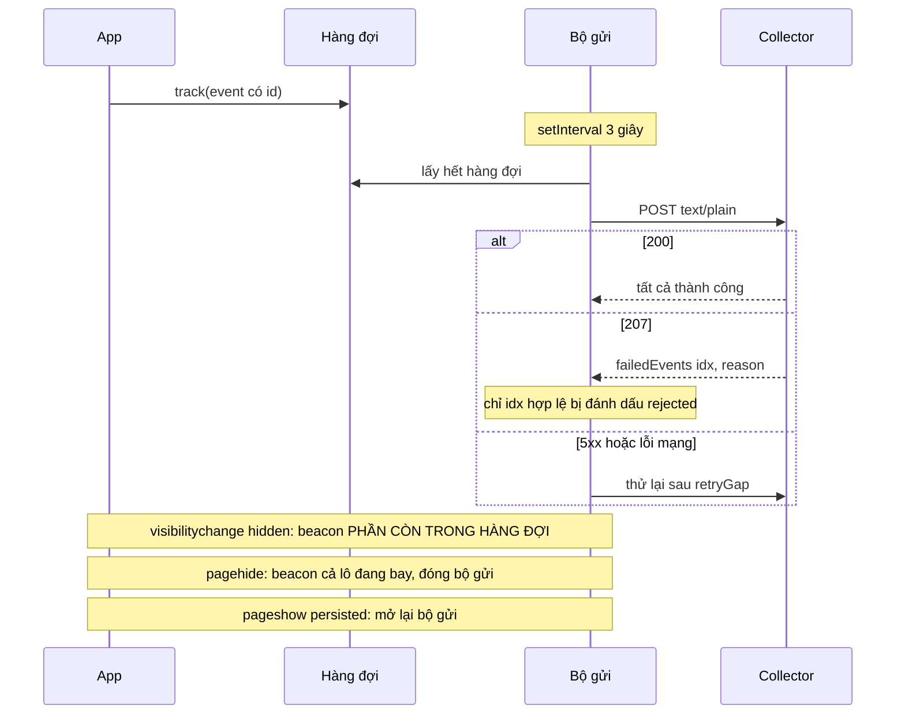

Mỗi lần bạn mở bài học, tua video hay tìm kiếm trên Udemy, trình duyệt ghi lại một sự kiện. Tất cả đi qua một module nhỏ: `tracker/sender.ts`, khoảng 360 dòng. Nó phải làm được bốn việc cùng lúc: không bắn mỗi sự kiện một request, không làm mất sự kiện khi người dùng đóng tab, không gửi trùng, và báo được sự kiện nào server từ chối.

Series Facebook đã có bài về [Banzai, hệ thống gom log của Facebook](/blogs/facebook-batch-logger) với hàng đợi theo mức ưu tiên và backoff. Bài này đi vào những phần Udemy làm khác: phản hồi **HTTP 207** (thành công một phần), **bfcache**, và hai lỗi trong cách khoá lần gửi cùng cách dùng `sendBeacon`.

> [!TIP]
> **Tóm tắt**
> - Udemy gom sự kiện, gửi mỗi 3 giây (lô đầu sau 250ms), dùng `Content-Type: text/plain` để không cần preflight CORS, thử lại khi gặp 5xx hoặc lỗi mạng.
> - Server trả **207** kèm danh sách `failedEvents[{idx, reason}]`: chỉ những sự kiện đó lỗi, phần còn lại thành công.
> - Rời trang thì gửi bằng `sendBeacon`; trang quay lại từ bfcache (`pageshow.persisted`) thì mở lại bộ gửi.
> - Hai lỗi: một 207 có body sai định dạng làm **khoá gửi kẹt vĩnh viễn**, và khi ẩn tab, Udemy beacon lại cả lô đang bay nên **server nhận trùng**. Bản viết lại sửa cả hai và chia beacon dưới 64KB.

<iframe class="demo-frame" src="/demos/web-patterns/index.html?theme=dark#/ud-tracker" title="Demo ud-tracker" loading="lazy" style="height: 820px"></iframe>

<p class="demo-links">▶ <a href="/demos/web-patterns/index.html#/ud-tracker" target="_blank" rel="noopener">Mở demo toàn màn hình ↗</a> · <a href="https://stackblitz.com/github/hunghg255/blog-hunghg/tree/master/examples/web-patterns?file=src/lib/udTracker.ts" target="_blank" rel="noopener">Sửa code trên StackBlitz ↗</a> · <a href="https://github.com/hunghg255/blog-hunghg/blob/master/examples/web-patterns/src/lib/udTracker.ts" target="_blank" rel="noopener">Xem source trên GitHub ↗</a></p>

## Udemy làm thế nào?

Code nằm ở `udemy.com/webpack---/src/tracker/` gồm `sender.ts`, `helpers.ts`, `tracker.ts`, `constants.ts`. Các hằng số ở đầu `sender.ts`: gửi mỗi 3 giây (`queueFlushPeriod: 3000`), lô đầu tiên sau 250ms, timeout request 20 giây, thử lại cách nhau 3 giây.

Mỗi sự kiện được đẩy vào mảng `queue`. Một `setInterval` 3 giây gọi `queueFlusher`. Request dùng axios với header `text/plain`: body vẫn là JSON nhưng content type thuộc nhóm "CORS-safelisted", nên trình duyệt không cần gửi preflight `OPTIONS` khi collector nằm ở domain khác.

### Không gửi chồng, và thử lại có chọn lọc

`helpers.ts` có hai decorator nhỏ:

```ts
export function preventOverlappingCall(fn) {
    let awaiting = false;
    return async function (...args) {
        if (awaiting) return;
        awaiting = true;
        const result = await fn(...args);
        awaiting = false;
        return result;
    };
}
```

`makeRetryingFunction(send, 3, 3000, shouldRetry)` thử lại khi lỗi mạng (không có status) hoặc 5xx. Lỗi 4xx thì dừng ngay, vì gửi lại cũng vô ích. Chú thích nói `retryCount` là "số lần thử lại sau lần đầu", nhưng vòng lặp thật chỉ chạy tổng cộng 3 lần, tức 2 lần thử lại.

### HTTP 207: thành công một phần

Collector kiểm tra từng sự kiện theo schema. Lô 50 sự kiện có 1 sự kiện sai thì server không từ chối cả lô, mà trả `207 Multi-Status`:

```ts
// sender.ts (rút gọn)
if (response && response.status === 207) {
    _handlePartialSuccess(eventsInFlight, response);
}

function _handlePartialSuccess(events, response) {
    response.data.failedEvents.forEach((responseElem) => {
        const failedEvent = events[responseElem.idx].eventData;
        publishHook(failedEvent, EventStatus.FAILURE, responseElem.reason);
    });
    // ...các sự kiện còn lại: SUCCESS
}
```

`publishHook` báo trạng thái từng sự kiện cho công cụ debug (`tracker-debugger.mobx-store.ts`) và cho các hook bên ngoài. Sự kiện bị từ chối không được gửi lại: lỗi schema thì gửi lần nữa vẫn sai.

### Rời trang và bfcache

`_setupBeacon` gắn ba listener: `pagehide` → `closeSender`, `pageshow` với `event.persisted` → `reopenSender` (trang về từ bfcache), `visibilitychange` → ghi sự kiện ẩn/hiện, và nếu ẩn thì `sendWithBeacon`:

```ts
export const sendWithBeacon = () => {
    const events = [];
    // Request ajax bị huỷ khi trang unload, beacon thì không. Có thể trùng, nhưng
    // server bỏ trùng được nếu cần.
    if (eventsInFlight?.length) events.push(...eventsInFlight);
    events.push(..._popEventsFromQueue());
    if (events.length > 0) {
        const status = navigator.sendBeacon(collectorUrl, JSON.stringify(events));
        _handleBeaconOutcome(status, events);
    }
};
```

`closeSender` đặt `senderClosed = true` để `setInterval` không gửi tiếp, gọi các "close listener" (để module khác kịp đẩy sự kiện cuối, ví dụ thời gian xem video), rồi `sendWithBeacon`. Nếu trang chỉ được cất vào bfcache rồi quay lại khi người dùng bấm Back, thì `pageshow` với `persisted = true` mở lại bộ gửi. Rất nhiều tracker quên bước này và im lặng luôn sau khi người dùng bấm Back.

### Hai lỗi

**1. Khoá gửi kẹt vĩnh viễn.** Trong `preventOverlappingCall`, dòng `awaiting = false` nằm **sau** `await`. Nếu `fn` ném lỗi, dòng đó không bao giờ chạy và mọi lần gọi sau đều `return` ngay. `_flush` đã bắt lỗi của `send`, nhưng `_handlePartialSuccess` thì không được bọc: một 207 có body thiếu `failedEvents` (ví dụ proxy trả lỗi dạng khác), hoặc `idx` vượt quá số sự kiện, đều ném `TypeError`. Từ lúc đó tracker không gửi gì nữa, sự kiện chỉ chất đống trong `queue` và chỉ được gửi khi tab bị ẩn.

Trong demo: chọn "207 nhưng body hỏng", bấm "+5 sự kiện" rồi "Gửi ngay". Sau đó chuyển về "200 OK" và đợi: cột Udemy báo "Khoá gửi: đang khoá", hàng đợi tăng mãi.

**2. Gửi trùng khi ẩn tab.** Chú thích nói rõ lý do gửi lại `eventsInFlight`: request thường bị huỷ khi trang **unload**. Nhưng `sendWithBeacon` được gọi cả khi `visibilitychange → hidden`, và lúc đó trang chưa unload. Người dùng chỉ chuyển sang tab khác, nên request thường vẫn chạy tiếp và thành công. Kết quả là lô đang bay được nhận hai lần: một qua beacon, một qua request thường. Mỗi sự kiện có `eventId` (UUID rút gọn còn 22 ký tự, tạo trong `event-common.ts`), nên server bỏ trùng được, và chú thích cũng viết "nếu cần". Nhưng ở đây bản trùng sinh ra không cần thiết: chỉ cần chuyển tab đúng lúc một lô đang gửi, chuyện xảy ra rất thường xuyên.

Demo "Ẩn tab khi đang gửi": server của cột Udemy nhận trùng 3 sự kiện, cột viết lại 0.

Ngoài ra còn hai điểm nhỏ: beacon gửi tất cả trong một payload, nên vượt ~64KB thì `sendBeacon` trả `false` và cả lô bị đánh dấu thất bại. Và `_shouldRetryRequest` đọc `exception.request.status`, nên sẽ ném `TypeError` nếu lỗi xảy ra trước khi request được tạo.

## Bên trong trình duyệt



- **`visibilitychange → hidden`** là tín hiệu cuối đáng tin trên mobile: người dùng vuốt tắt app thì có thể không có `pagehide`. Ở thời điểm này trang vẫn sống, request đang chạy vẫn sẽ hoàn thành.
- **`pagehide`** báo trang sắp bị bỏ, hoặc bị cất vào bfcache (`event.persisted`). Request thường đang chạy có thể bị huỷ, beacon thì không.
- **`sendBeacon`** và `fetch(..., {keepalive: true})` dùng chung hạn mức khoảng 64KB cho dữ liệu đang chờ gửi. Vượt quá thì `sendBeacon` trả `false` ngay.
- **207 Multi-Status** vốn thuộc WebDAV (RFC 4918). Dùng lại nó cho "thành công một phần" là quy ước giữa client và collector của Udemy. Client cần đọc body một cách phòng thủ.

## Viết lại

Gửi một lô, đọc 207, và khoá luôn được mở trong `finally`:

```ts title=src/lib/udTracker.ts
  async function doFlush() {
    const batch = queue.splice(0, queue.length);
    if (!batch.length) return;
    const now = Date.now();
    batch.forEach((e) => (e.sendTime = now));
    inFlight = batch;
    try {
      const res = await postWithRetry(JSON.stringify(batch));
      if (inFlight !== batch) return; // lô này đã được beacon lúc pagehide
      const failed = res.status === 207 ? parsePartialFailures(res.body, batch.length) : new Map();
      batch.forEach((e, i) =>
        failed.has(i) ? onStatus(e, 'rejected', failed.get(i)) : onStatus(e, 'sent'),
      );
    } catch (e) {
      if (inFlight !== batch) return;
      const reason = e instanceof Error ? e.message : String(e);
      batch.forEach((ev) => onStatus(ev, e instanceof HttpError && !retryable(e) ? 'rejected' : 'failed', reason));
    } finally {
      if (inFlight === batch) inFlight = [];
    }
  }

  /** Không chạy chồng: đang gửi thì trả về chính promise đó. Khoá tự mở kể cả khi có lỗi. */
  function flush(): Promise<void> {
    if (closed) return Promise.resolve();
    flushing ??= doFlush().finally(() => {
      flushing = null;
    });
    return flushing;
  }
```

Ba sự kiện vòng đời trang:

```ts title=src/lib/udTracker.ts
    /** visibilitychange → hidden: tab có thể bị đóng mà không có pagehide (mobile). */
    onHidden() {
      sendBeacon(queue.splice(0, queue.length));
    },
    /** pagehide: request đang bay sẽ bị huỷ nên gửi cả lô đó qua beacon (server bỏ trùng theo id). */
    onPageHide() {
      closed = true;
      const events = [...inFlight, ...queue.splice(0, queue.length)];
      inFlight = [];
      sendBeacon(events);
    },
    /** pageshow với persisted = true: trang được khôi phục từ bfcache. */
    onPageShow(persisted: boolean) {
      if (persisted) closed = false;
    },
```

`parsePartialFailures` (đọc body 207 phòng thủ) và `splitForBeacon` (chia beacon theo byte) nằm trong file đầy đủ.

::: spoiler Xem toàn bộ src/lib/udTracker.ts

```ts title=src/lib/udTracker.ts
/**
 * Pipeline gửi sự kiện tracking, ý tưởng từ tracker/sender.ts của Udemy, viết lại với các sửa lỗi:
 * - gom theo lô 3 giây (lô đầu sau 250ms), không chồng hai lần gửi; khoá luôn được mở trong `finally`;
 * - HTTP 207: chỉ sự kiện server từ chối mới bị đánh dấu lỗi, đọc body phòng thủ;
 * - chỉ thử lại khi lỗi mạng, 5xx hoặc 429, cách nhau `retryGap`;
 * - tab ẩn: beacon phần còn trong hàng đợi (KHÔNG gửi lại lô đang bay → không nhân đôi);
 *   pagehide: beacon cả lô đang bay vì request thường sẽ bị huỷ; pageshow từ bfcache: mở lại;
 * - beacon chia nhỏ dưới giới hạn ~64KB; mỗi sự kiện có id để server bỏ trùng.
 */

export interface TrackEvent {
  id: string;
  type: string;
  data?: Record<string, unknown>;
  clientTime: number;
  sendTime?: number;
}

export type EventStatus = 'sent' | 'beacon' | 'rejected' | 'failed';

export interface TransportResponse {
  status: number;
  body?: unknown;
}

export interface Transport {
  /** reject (ném lỗi không có status) khi lỗi mạng */
  post(url: string, body: string): Promise<TransportResponse>;
  beacon(url: string, body: string): boolean;
}

export interface TrackerOptions {
  endpoint: string;
  transport: Transport;
  flushInterval?: number;
  initialDelay?: number;
  /** số lần thử lại SAU lần gửi đầu */
  retries?: number;
  retryGap?: number;
  beaconMaxBytes?: number;
  onStatus?: (event: TrackEvent, status: EventStatus, reason?: string) => void;
}

const sleep = (ms: number) => new Promise<void>((r) => setTimeout(r, ms));
const newId = () =>
  typeof crypto !== 'undefined' && 'randomUUID' in crypto
    ? crypto.randomUUID()
    : `${Date.now().toString(36)}-${Math.random().toString(36).slice(2)}`;

export class HttpError extends Error {
  constructor(public status: number) {
    super(`HTTP ${status}`);
  }
}

const retryable = (e: unknown) =>
  !(e instanceof HttpError) || e.status >= 500 || e.status === 429;

/** Đọc body của 207: chỉ tin những idx hợp lệ, phần còn lại coi như thành công. */
export function parsePartialFailures(body: unknown, count: number): Map<number, string> {
  const failed = new Map<number, string>();
  const list = (body as { failedEvents?: unknown })?.failedEvents;
  if (!Array.isArray(list)) return failed;
  for (const item of list) {
    const idx = (item as { idx?: unknown })?.idx;
    if (Number.isInteger(idx) && (idx as number) >= 0 && (idx as number) < count) {
      failed.set(idx as number, String((item as { reason?: unknown }).reason ?? 'rejected'));
    }
  }
  return failed;
}

/** Chia mảng sự kiện thành các payload JSON không vượt `maxBytes` (tính theo UTF-8). */
export function splitForBeacon(events: TrackEvent[], maxBytes: number): string[] {
  const enc = new TextEncoder();
  const payloads: string[] = [];
  let current: TrackEvent[] = [];
  let size = 2; // "[]"
  for (const e of events) {
    const n = enc.encode(JSON.stringify(e)).length + 1;
    if (current.length && size + n > maxBytes) {
      payloads.push(JSON.stringify(current));
      current = [];
      size = 2;
    }
    current.push(e);
    size += n;
  }
  if (current.length) payloads.push(JSON.stringify(current));
  return payloads;
}

export function createTracker(options: TrackerOptions) {
  const {
    endpoint,
    transport,
    flushInterval = 3000,
    initialDelay = 250,
    retries = 2,
    retryGap = 3000,
    beaconMaxBytes = 60_000,
    onStatus = () => {},
  } = options;

  const queue: TrackEvent[] = [];
  let inFlight: TrackEvent[] = [];
  let flushing: Promise<void> | null = null;
  let closed = false;

  async function postWithRetry(body: string) {
    for (let attempt = 0; ; attempt++) {
      try {
        const res = await transport.post(endpoint, body);
        if (res.status >= 400) throw new HttpError(res.status);
        return res;
      } catch (e) {
        if (attempt >= retries || !retryable(e)) throw e;
        await sleep(retryGap);
      }
    }
  }

  async function doFlush() {
    const batch = queue.splice(0, queue.length);
    if (!batch.length) return;
    const now = Date.now();
    batch.forEach((e) => (e.sendTime = now));
    inFlight = batch;
    try {
      const res = await postWithRetry(JSON.stringify(batch));
      if (inFlight !== batch) return; // lô này đã được beacon lúc pagehide
      const failed = res.status === 207 ? parsePartialFailures(res.body, batch.length) : new Map();
      batch.forEach((e, i) =>
        failed.has(i) ? onStatus(e, 'rejected', failed.get(i)) : onStatus(e, 'sent'),
      );
    } catch (e) {
      if (inFlight !== batch) return;
      const reason = e instanceof Error ? e.message : String(e);
      batch.forEach((ev) => onStatus(ev, e instanceof HttpError && !retryable(e) ? 'rejected' : 'failed', reason));
    } finally {
      if (inFlight === batch) inFlight = [];
    }
  }

  /** Không chạy chồng: đang gửi thì trả về chính promise đó. Khoá tự mở kể cả khi có lỗi. */
  function flush(): Promise<void> {
    if (closed) return Promise.resolve();
    flushing ??= doFlush().finally(() => {
      flushing = null;
    });
    return flushing;
  }

  function sendBeacon(events: TrackEvent[]) {
    if (!events.length) return;
    for (const payload of splitForBeacon(events, beaconMaxBytes)) {
      const part: TrackEvent[] = JSON.parse(payload);
      const ok = transport.beacon(endpoint, payload);
      const ids = new Set(part.map((e) => e.id));
      events.filter((e) => ids.has(e.id)).forEach((e) => onStatus(e, ok ? 'beacon' : 'failed', ok ? undefined : 'beacon bị từ chối'));
    }
  }

  const timer = setInterval(() => void flush(), flushInterval);
  const firstTimer = setTimeout(() => void flush(), initialDelay);

  return {
    track(type: string, data?: Record<string, unknown>) {
      const event: TrackEvent = { id: newId(), type, data, clientTime: Date.now() };
      queue.push(event);
      return event;
    },
    flush,
    /** visibilitychange → hidden: tab có thể bị đóng mà không có pagehide (mobile). */
    onHidden() {
      sendBeacon(queue.splice(0, queue.length));
    },
    /** pagehide: request đang bay sẽ bị huỷ nên gửi cả lô đó qua beacon (server bỏ trùng theo id). */
    onPageHide() {
      closed = true;
      const events = [...inFlight, ...queue.splice(0, queue.length)];
      inFlight = [];
      sendBeacon(events);
    },
    /** pageshow với persisted = true: trang được khôi phục từ bfcache. */
    onPageShow(persisted: boolean) {
      if (persisted) closed = false;
    },
    /** Gắn vào sự kiện vòng đời thật của trang. */
    attach(win: Window = window, doc: Document = document) {
      const onVis = () => doc.visibilityState === 'hidden' && this.onHidden();
      const onHide = () => this.onPageHide();
      const onShow = (e: PageTransitionEvent) => this.onPageShow(e.persisted);
      doc.addEventListener('visibilitychange', onVis);
      win.addEventListener('pagehide', onHide);
      win.addEventListener('pageshow', onShow);
      return () => {
        doc.removeEventListener('visibilitychange', onVis);
        win.removeEventListener('pagehide', onHide);
        win.removeEventListener('pageshow', onShow);
      };
    },
    get queueSize() {
      return queue.length;
    },
    get inFlightSize() {
      return inFlight.length;
    },
    get isFlushing() {
      return flushing !== null;
    },
    destroy() {
      clearInterval(timer);
      clearTimeout(firstTimer);
    },
  };
}

export type Tracker = ReturnType<typeof createTracker>;

/** Transport thật cho trình duyệt: text/plain để không cần preflight CORS, keepalive cho lô nhỏ. */
export const browserTransport: Transport = {
  async post(url, body) {
    const res = await fetch(url, {
      method: 'POST',
      body,
      headers: { 'Content-Type': 'text/plain' },
      keepalive: body.length < 60_000,
    });
    const json = res.status === 207 ? await res.json().catch(() => null) : undefined;
    return { status: res.status, body: json };
  },
  beacon(url, body) {
    return navigator.sendBeacon?.(url, new Blob([body], { type: 'text/plain' })) ?? false;
  },
};
```

:::

## Đi qua code

- **`flush`**: thay cờ boolean bằng chính promise đang chạy (`flushing ??= doFlush().finally(...)`). Đang gửi mà có người gọi thì nhận lại cùng promise, nên `await tracker.flush()` thật sự chờ lô hiện tại xong. Khoá mở trong `finally` nên lỗi kiểu gì cũng không kẹt.
- **`postWithRetry`**: `retries = 2` nghĩa đúng là 2 lần thử lại sau lần đầu. Thêm 429 (Too Many Requests) vào nhóm được thử lại.
- **`doFlush`**: kiểm `inFlight !== batch` sau khi request trả về. Nếu trong lúc chờ đã có `pagehide` và lô đã được beacon, thì không báo trạng thái lần nữa.
- **`parsePartialFailures`**: chỉ nhận `idx` là số nguyên trong khoảng `[0, count)`. Body sai định dạng thì coi như không có sự kiện nào bị từ chối, thay vì ném lỗi.
- **`onHidden`** chỉ beacon hàng đợi. **`onPageHide`** beacon cả lô đang bay, vì lúc này request thường có thể bị huỷ thật. Mỗi sự kiện có `id` (`crypto.randomUUID()`, giống `eventId` của Udemy), nên nếu request thường vẫn kịp tới nơi, server bỏ trùng theo id.
- **`splitForBeacon`**: đo byte UTF-8 của từng sự kiện, cắt lô khi vượt `beaconMaxBytes` (mặc định 60.000, chừa chỗ cho các request keepalive khác).
- **`browserTransport`**: `fetch` với `keepalive` cho lô nhỏ, nên request thường cũng sống sót khi trang đóng.

**Khác bản gốc:** Udemy dùng axios và báo trạng thái qua `publishHook` toàn cục. Bản viết lại nhận `transport` qua tham số (dễ test, dễ giả lập server như trong demo) và báo trạng thái qua `onStatus`. Bản gốc có `addCloseListener` cho các module cần đẩy sự kiện cuối; nếu cần, có thể thêm vào `onPageHide`.

## Tại sao không làm cách khác?

- **Luôn dùng `sendBeacon`?** Beacon không cho biết server trả gì (chỉ biết trình duyệt đã nhận xếp hàng), nên không đọc được 207, không thử lại được. Udemy chỉ dùng beacon "khi hết cách", đúng như chú thích.
- **Gửi lại cả lô khi gặp 207?** Sự kiện sai schema thì gửi bao nhiêu lần cũng sai, còn sự kiện đúng sẽ bị nhân đôi.
- **Bỏ trùng ở client bằng cách không beacon lô đang bay?** Sẽ mất cả lô khi trang thật sự đóng giữa chừng. Bỏ trùng ở server theo id rẻ hơn và chắc hơn.
- **Lưu hàng đợi vào `localStorage`** để gửi ở lần mở sau là bước tiếp theo hợp lý cho sự kiện quan trọng (thanh toán, hoàn thành bài học). Udemy không làm; bản viết lại cũng không, để giữ phạm vi bài.

## Edge case và cạm bẫy

- **Đồng hồ client sai.** Udemy ghi cả `createTime` và `sendTime` cho mỗi sự kiện, có lẽ để server bù lệch đồng hồ (so `sendTime` với giờ nhận). Bản viết lại giữ `clientTime` và `sendTime`.
- **Tab ẩn rồi hiện lại liên tục** (chuyển tab qua lại): mỗi lần ẩn là một beacon nhỏ. Không sao, vì hàng đợi đã được lấy ra nên không gửi trùng.
- **Trình duyệt không có `sendBeacon`** (rất cũ): Udemy bỏ qua toàn bộ phần lifecycle. Bản viết lại vẫn gắn được sự kiện, `transport.beacon` trả `false` và sự kiện bị đánh dấu `failed`.
- **Trang trong iframe hoặc WebView** có thể không bao giờ nhận `pagehide`. Lô cuối chỉ được cứu nếu kịp `visibilitychange`.
- **Content Security Policy**: `sendBeacon` và `fetch` đều bị `connect-src` chặn. Collector ở domain khác phải có trong CSP.

## Dùng trong dự án

```ts
import { browserTransport, createTracker } from './udTracker';

export const tracker = createTracker({
  endpoint: 'https://collector.example.com/events',
  transport: browserTransport,
  onStatus: (e, status, reason) => {
    if (status === 'rejected') console.warn('Sự kiện sai schema', e.type, reason);
  },
});
tracker.attach(); // visibilitychange, pagehide, pageshow

tracker.track('lecture_start', { courseId: 42, lectureId: 7 });
```

Phía server: lưu `id` của sự kiện (ví dụ khoá duy nhất trong bảng, hoặc set với TTL vài phút) để bỏ bản trùng do beacon.

## Kiểm thử

::: spoiler Ví dụ test (bản phác, không có trong repo)

```ts title=udTracker.test.ts
import { afterEach, describe, expect, it, vi } from 'vitest';
import { createTracker, parsePartialFailures, splitForBeacon, type Transport } from './udTracker';

function fakeTransport(responses: Array<number | Error | { status: number; body: unknown }>) {
  const posts: string[] = [];
  const beacons: string[] = [];
  const transport: Transport = {
    post: vi.fn(async (_u, body) => {
      posts.push(body);
      const r = responses.shift() ?? 200;
      if (r instanceof Error) throw r;
      return typeof r === 'number' ? { status: r } : r;
    }),
    beacon: vi.fn((_u, body) => (beacons.push(body), true)),
  };
  return { transport, posts, beacons };
}

afterEach(() => vi.useRealTimers());

describe('udTracker', () => {
  it('gom sự kiện thành một lô và báo sent', async () => {
    const { transport, posts } = fakeTransport([200]);
    const onStatus = vi.fn();
    const t = createTracker({ endpoint: '/ecl', transport, onStatus });
    t.track('a'); t.track('b');
    await t.flush();
    expect(posts).toHaveLength(1);
    expect(JSON.parse(posts[0]).map((e: { type: string }) => e.type)).toEqual(['a', 'b']);
    expect(onStatus.mock.calls.map((c) => c[1])).toEqual(['sent', 'sent']);
    t.destroy();
  });

  it('207: chỉ sự kiện bị từ chối mới là rejected; body hỏng không làm kẹt', async () => {
    const { transport } = fakeTransport([
      { status: 207, body: { failedEvents: [{ idx: 1, reason: 'schema' }, { idx: 99 }] } },
      { status: 207, body: { error: 'x' } },
      200,
    ]);
    const onStatus = vi.fn();
    const t = createTracker({ endpoint: '/ecl', transport, onStatus });
    t.track('a'); t.track('b'); await t.flush();
    expect(onStatus.mock.calls.map((c) => c[1])).toEqual(['sent', 'rejected']);
    t.track('c'); await t.flush();
    t.track('d'); await t.flush(); // vẫn gửi được: khoá không bị kẹt
    expect(t.isFlushing).toBe(false);
    expect(onStatus.mock.calls.at(-1)).toEqual([expect.objectContaining({ type: 'd' }), 'sent']);
    t.destroy();
  });

  it('thử lại khi 503, không thử lại khi 400', async () => {
    vi.useFakeTimers();
    const { transport } = fakeTransport([503, 503, 200, 400]);
    const onStatus = vi.fn();
    const t = createTracker({ endpoint: '/ecl', transport, onStatus, retryGap: 100 });
    t.track('a');
    const p = t.flush();
    await vi.advanceTimersByTimeAsync(300);
    await p;
    expect(transport.post).toHaveBeenCalledTimes(3);
    t.track('b');
    await t.flush();
    expect(transport.post).toHaveBeenCalledTimes(4);
    expect(onStatus.mock.calls.at(-1)?.[1]).toBe('rejected');
    t.destroy();
  });

  it('tab ẩn chỉ beacon hàng đợi, pagehide beacon cả lô đang bay', async () => {
    let release!: () => void;
    const transport: Transport = {
      post: () => new Promise((r) => (release = () => r({ status: 200 }))),
      beacon: vi.fn(() => true),
    };
    const t = createTracker({ endpoint: '/ecl', transport });
    t.track('in-flight');
    const p = t.flush();
    t.track('queued');
    t.onHidden();
    expect(JSON.parse((transport.beacon as ReturnType<typeof vi.fn>).mock.calls[0][1]).map((e: { type: string }) => e.type)).toEqual(['queued']);
    t.onPageHide();
    expect(JSON.parse((transport.beacon as ReturnType<typeof vi.fn>).mock.calls[1][1]).map((e: { type: string }) => e.type)).toEqual(['in-flight']);
    release(); await p;
    t.destroy();
  });

  it('chia beacon dưới giới hạn byte', () => {
    const events = Array.from({ length: 10 }, (_, i) => ({ id: String(i), type: 'x', data: { s: 'đ'.repeat(50) }, clientTime: 0 }));
    const parts = splitForBeacon(events, 400);
    expect(parts.length).toBeGreaterThan(1);
    for (const p of parts) expect(new TextEncoder().encode(p).length).toBeLessThanOrEqual(400);
    expect(parts.flatMap((p) => JSON.parse(p)).length).toBe(10);
  });

  it('parsePartialFailures bỏ qua idx không hợp lệ', () => {
    expect([...parsePartialFailures({ failedEvents: [{ idx: 0 }, { idx: -1 }, { idx: '2' }, { idx: 5 }] }, 3).keys()]).toEqual([0]);
    expect(parsePartialFailures(null, 3).size).toBe(0);
  });
});
```

:::

## So với cách làm hiện đại

- **`fetchLater()`** cho phép đăng ký trước một request mà trình duyệt tự gửi khi trang bị bỏ. API này mới có ở Chromium (tính tới 10/2026), nên vẫn cần `sendBeacon` làm đường chính. Khi phổ biến, nó thay được phần "beacon lúc ẩn tab" mà không phải đoán thời điểm.
- **Thư viện analytics** như Segment hay RudderStack có hàng đợi lưu localStorage, thử lại và beacon sẵn. Tự viết vẫn đáng khi bạn có collector riêng và quy ước riêng như 207.
- Xem thêm [buffer sự kiện analytics chờ SDK](/blogs/web-analytics-buffer-adblock) cho phần trước khi gửi: giữ sự kiện khi SDK bên thứ ba chưa tải.

---

Bài này thuộc series **[Học từ mã nguồn Udemy](/series/udemy)** (21 bài, đọc theo thứ tự).

::: spoiler Xem nhanh danh sách bài trong series

*Mở đầu*

- [Mở đầu: bên trong frontend của Udemy](/blogs/learn-from-udemy-source-code)

*Phần 1: video và học bài*

- [#1 DRM đa hệ: Widevine, PlayReady, FairPlay](/blogs/udemy-drm-multi-key-system)
- [#2 URL ký và license hết hạn: tự làm mới, tải trước bài kế](/blogs/udemy-expiring-media-urls)
- [#3 Ghi tiến độ xem theo bucket, tự hoàn thành, backoff lỗi](/blogs/udemy-watch-progress-buckets)
- [#4 Thumbnail sprite từ WebVTT và slide trên seekbar](/blogs/udemy-sprite-thumbnails-vtt)
- [#5 Phụ đề: tự chọn ngôn ngữ và editor có phím tắt](/blogs/udemy-captions-auto-select-editor)
- [#6 Đo băng thông, autoplay Safari, iPad giả làm Mac](/blogs/udemy-video-quirks-autoplay)

*Phần 2: bài tập, bài thi, lab*

- [#7 Preview code HTML/React trong iframe sandbox](/blogs/udemy-code-preview-sandbox)
- [#8 Bài thi có giờ: tạm dừng khi rảnh, autosave theo dấu vân tay](/blogs/udemy-timed-exam)
- [#9 Chấm code realtime: đăng ký kênh trước, có đường dự phòng](/blogs/udemy-realtime-grading)
- [#10 Mở lab không bị chặn popup, heartbeat, xung đột phiên](/blogs/udemy-lab-launcher)

*Phần 3: editor và nội dung*

- [#11 ProseMirror: schema theo flag, NodeView React, HTML cho email](/blogs/udemy-prosemirror-integration)
- [#12 Parse HTML an toàn bằng document tách rời](/blogs/udemy-safe-html-parse)
- [#13 Sinh file .ics có VTIMEZONE tự dò giờ mùa hè](/blogs/udemy-ics-vtimezone)
- [#14 Đọc Open Badges giấu trong ảnh PNG và SVG](/blogs/udemy-open-badges-image)

*Phần 4: hạ tầng và trải nghiệm*

- **#15 Pipeline tracking: batch, sendBeacon, bfcache, HTTP 207** (bài này)
- [#16 Gợi ý tính năng mới qua nhiều phiên bằng máy trạng thái](/blogs/udemy-feature-discoverability)
- [#17 Kéo cạnh để resize và mép cuộn mờ dần](/blogs/udemy-resizer-gradient-scroll)
- [#18 Gom request giá khoá học, cập nhật một phần khi áp coupon](/blogs/udemy-price-dataloader-partial-update)
- [#19 Trả lời lạc quan có rollback, autocomplete hai tầng cache](/blogs/udemy-optimistic-reply-autocomplete)
- [#20 Nạp app theo ưu tiên, registry store, HTML cache công khai](/blogs/udemy-app-loader-registry)

:::

Code + demo: [`examples/web-patterns`](https://github.com/hunghg255/blog-hunghg/tree/master/examples/web-patterns) · [Mở trên StackBlitz](https://stackblitz.com/github/hunghg255/blog-hunghg/tree/master/examples/web-patterns)
