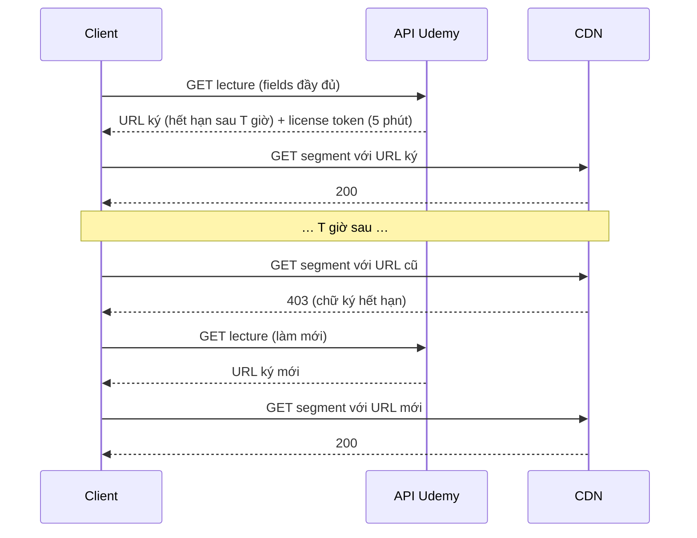

Video khoá học trên Udemy nằm trên CDN dưới dạng **URL ký** (signed URL): đường dẫn kèm chữ ký và thời điểm hết hạn, ai có link chỉ xem được trong một khoảng thời gian. Bài có DRM còn cần thêm một **token license** để xin khoá giải mã. Hai thứ này có hạn dùng rất khác nhau, và người học thì hay để tab mở cả buổi, gập máy đi ăn trưa rồi quay lại bấm play.

Nếu cứ dùng lại dữ liệu cũ, video báo lỗi 403. Nếu mỗi lần bấm play lại gọi API, chuyển bài sẽ chậm, tốn request. Cách của Udemy nằm ở `course-taking/curriculum/lecture.mobx-model.js` và `lecture-view/video-viewer/video-viewer.mobx-store.js`.

> [!TIP]
> **Tóm tắt**
> - Hai mốc thời gian riêng: URL ký coi như sống **4 giờ**, token license **5 phút**. Hết hạn phần nào thì chỉ gọi API lấy lại phần đó (license nhẹ hơn nhiều).
> - Player báo lỗi nguồn hoặc lỗi license thì làm mới rồi phát lại.
> - Bài hiện tại gần xong (còn dưới 15 giây) thì **tải trước dữ liệu bài kế**: chuyển bài không phải chờ API.
> - Bản gốc ghi mốc thời gian cả khi request **lỗi**, chỉ làm mới khi đồng hồ phía client cho là đã hết hạn, và không gộp các lần tải trước chạy cùng lúc. Bản viết lại sửa cả ba.

<iframe class="demo-frame" src="/demos/web-patterns/index.html?theme=dark#/ud-media-expiry" title="Demo ud-media-expiry" loading="lazy" style="height: 1250px"></iframe>

<p class="demo-links">▶ <a href="/demos/web-patterns/index.html#/ud-media-expiry" target="_blank" rel="noopener">Mở demo toàn màn hình ↗</a> · <a href="https://stackblitz.com/github/hunghg255/blog-hunghg/tree/master/examples/web-patterns?file=src/lib/udMediaExpiry.ts" target="_blank" rel="noopener">Sửa code trên StackBlitz ↗</a> · <a href="https://github.com/hunghg255/blog-hunghg/blob/master/examples/web-patterns/src/lib/udMediaExpiry.ts" target="_blank" rel="noopener">Xem source trên GitHub ↗</a></p>

Demo dùng một đồng hồ ảo và một server giả ký URL theo đồng hồ đó. Mỗi thao tác chạy song song trên hai cột: cột trái là logic gốc của Udemy, cột phải là bản viết lại. Ba kịch bản nên thử:

1. **"Request kế tiếp lỗi mạng" → "Phát"**: cột Udemy báo lỗi, tua +6 phút phát lại vẫn lỗi, phải tới +5 giờ mới phát được. Cột viết lại phát được ngay ở lần thử kế.
2. **Bật "Server ký URL chỉ 2 giờ"**, đổi sang bài 3, phát, tua +3 giờ, phát lại: Udemy hiện màn hình lỗi, bản viết lại tự làm mới.
3. **"Gần hết bài → tải trước"**: player gọi tải trước ở 3 lần progress liền nhau. Udemy bắn 3 request, bản viết lại 1.

## Udemy làm thế nào?

### Hai hạn dùng, hai mức làm mới

```js
// asset/constants
export const ASSET_URL_TTL = 4 * 60 * 60 * 1000; // 4 hours in ms
export const ASSET_LICENSE_TOKEN_TTL = 5 * 60 * 1000; // 5 minutes in ms
```

```js
get isDataExpired() {
    return !this.dataLoadTime || new Date() - this.dataLoadTime > ASSET_URL_TTL;
}

get isLicenseTokenExpired() {
    return !this.licenseTokenLoadTime || new Date() - this.licenseTokenLoadTime > ASSET_LICENSE_TOKEN_TTL;
}

loadData(courseResource, extraParams = {}) {
    // Refresh the entire data or only the license auth token when the cached values are expired
    if (this.isDataExpired) {
        return this._fetchData(courseResource, Object.assign({}, {...API_LECTURE_FIELDS}, extraParams, {
            q: Math.random(),
        })).finally(() => {
            this.dataLoadTime = new Date();
            this.licenseTokenLoadTime = this.dataLoadTime;
        });
    } else if (this.isLicenseTokenExpired) {
        return this._fetchData(courseResource, Object.assign({}, {...API_LECTURE_MEDIA_LICENSE_FIELDS}, extraParams, {
            q: Math.random(),
        })).finally(() => {
            this.licenseTokenLoadTime = new Date();
        });
    }
    return Promise.resolve();
}
```

Ba điểm đáng học:

- **Cùng một endpoint, khác danh sách field.** API của Udemy cho chọn field trả về (`fields[asset]=…`). Lần tải đầy đủ lấy URL các độ phân giải, phụ đề, thumbnail…, lần làm mới license chỉ xin `media_license_token`. Response nhỏ hơn hẳn mà không phải mở endpoint mới.
- **`q: Math.random()`** phá cache: request giống hệt lần trước có thể bị trình duyệt, service worker hay CDN trả lại bản cũ, đúng thứ đang cần thay.
- **Tải đầy đủ thì làm mới luôn mốc license**, vì response đầy đủ đã chứa token mới.

### Player lỗi thì làm mới

```js
async onPlayerError(error) {
    // If the video player cannot access the media source or the DRM license we assume that
    // the signed URLs are expired and we try to refresh them.
    const {lecture} = this.lectureViewStore;
    if (
        (error === VideoPlayerErrors.CANNOT_ACCESS_MEDIA_SOURCE && lecture.isDataExpired) ||
        (error === VideoPlayerErrors.CANNOT_RETRIEVE_DRM_LICENSE && lecture.isLicenseTokenExpired)
    ) {
        await this.lectureViewStore.loadLecture();
        return false;
    }
    return true;
}
```

Trả `false` nghĩa là "đừng hiện lỗi, mình đang xử lý". Props mới xuống tới player thì player tự thử lại với URL mới.

### Tải trước bài kế

::: spoiler Xem markCurrentItemComplete và preloadNextItem

```js
markCurrentItemComplete() {
    this.currentCurriculumItem.markAsComplete();
    this.preloadNextItem();
}

preloadNextItem() {
    // preload the next curriculum item as soon as the current one is completed
    // currently only supports preloading lectures
    if (this.nextCurriculumItem?.type === ITEM_TYPES.LECTURE) {
        this.loadItemData(this.nextCurriculumItem);
    }
}
```

:::

`markCurrentItemComplete` được gọi từ `onVideoProgress` mỗi khi vị trí xem vượt qua mốc "còn 15 giây" (bài #3 nói kỹ về cách tính tiến độ). Đến lúc người học bấm "Bài tiếp" hoặc tự chuyển bài, dữ liệu đã nằm sẵn trong model, `loadData` thấy chưa hết hạn và trả về ngay.

## Ba chỗ chưa ổn trong bản gốc

**1. Request lỗi vẫn được tính là "vừa tải xong".** Mốc thời gian được gán trong `.finally()`, tức chạy cả khi `_fetchData` reject. Mạng chập chờn đúng lúc mở bài, request lỗi, model vẫn ghi `dataLoadTime = now`. Bốn giờ tiếp theo `isDataExpired` trả `false`. Khi player báo lỗi nguồn, `onPlayerError` kiểm tra `isDataExpired`, thấy `false` nên không làm mới, và người học nhìn màn hình lỗi. Cách duy nhất để thoát là tải lại trang. Demo kịch bản 1 tái hiện đúng chuỗi này.

**2. Chỉ tin đồng hồ phía client.** Điều kiện "chỉ làm mới khi đã hết hạn" giả định ba thứ: server thật sự ký URL đúng 4 giờ, đồng hồ máy người dùng không bị chỉnh, và khoảng thời gian tính từ lúc nhận response khớp với lúc server ký. Chỉ cần một điều sai (đổi cấu hình CDN xuống 2 giờ, máy ngủ rồi đồng bộ lại giờ…) là lỗi nguồn sẽ không được xử lý. Lỗi 403 từ CDN đã là bằng chứng rõ ràng hơn mọi phép tính giờ: nên làm mới, chỉ cần chặn vòng lặp vô hạn.

**3. Tải trước bị gọi nhiều lần cùng lúc.** `onVideoProgress` chạy mỗi khi tiến độ sang mốc mới. Trong 15 giây cuối nó có thể chạy vài lần (tua, đổi tốc độ, sự kiện `ended`), mỗi lần lại `preloadNextItem`. Vì mốc thời gian chỉ được gán khi request **xong**, các lần gọi trong lúc request đầu đang chạy đều thấy "hết hạn" và bắn thêm request. Đây là suy luận từ code; số request thừa thực tế phụ thuộc mạng nhanh hay chậm.

## Bên trong: hạn dùng của URL ký



CDN kiểm tra chữ ký và thời điểm hết hạn mà không cần hỏi server ứng dụng, nên URL ký rẻ và nhanh. Đổi lại, client không có cách nào "gia hạn" URL: hết hạn là phải xin URL mới. Token license thì ngắn vì nó là chìa khoá xin khoá giải mã: lộ token 5 phút ít rủi ro hơn lộ token cả ngày.

## Viết lại

```ts title=src/lib/udMediaExpiry.ts
  function ensureFresh(): Promise<RefreshKind> {
    if (inFlight) return inFlight;
    if (isDataExpired()) return run('full');
    if (isLicenseExpired()) return run('license');
    return Promise.resolve('none');
  }

  async function handlePlayerError(kind: 'source' | 'license') {
    if (now() - lastErrorRefresh < errorRefreshCooldown) return 'give-up';
    lastErrorRefresh = now();
    // ép hết hạn rồi tải lại: đồng hồ client có thể lệch, tab có thể đã ngủ,
    // hoặc server cấp URL sống ngắn hơn con số client giả định
    if (kind === 'source') dataLoadedAt = -Infinity;
    else licenseLoadedAt = -Infinity;
    try {
      await ensureFresh();
      return 'retry';
    } catch {
      return 'give-up';
    }
  }
```

::: spoiler Xem toàn bộ src/lib/udMediaExpiry.ts

```ts title=src/lib/udMediaExpiry.ts
/**
 * Dữ liệu media có hai hạn dùng khác nhau (ý tưởng từ lecture.mobx-model.js của Udemy):
 * - URL ký (signed URL) của video sống lâu, Udemy giả định 4 giờ;
 * - token license DRM sống ngắn, 5 phút.
 * Hết hạn phần nào thì chỉ tải lại phần đó. Player báo lỗi thì làm mới rồi phát lại.
 * Bài kế tiếp được tải trước khi bài hiện tại gần xong.
 */

export const ASSET_URL_TTL = 4 * 60 * 60 * 1000;
export const LICENSE_TOKEN_TTL = 5 * 60 * 1000;

export type RefreshKind = 'none' | 'full' | 'license';

export interface ExpiringMediaOptions<Data> {
  /** tải toàn bộ: URL ký + token license */
  fetchAll: () => Promise<Data>;
  /** chỉ xin token license mới */
  fetchLicense: () => Promise<string>;
  dataTtl?: number;
  licenseTtl?: number;
  /** khoảng tối thiểu giữa hai lần làm mới do player báo lỗi, chống vòng lặp lỗi → làm mới → lỗi */
  errorRefreshCooldown?: number;
  now?: () => number;
}

export interface ExpiringMedia<Data> {
  readonly data: Data | undefined;
  readonly licenseToken: string | undefined;
  isDataExpired(): boolean;
  isLicenseExpired(): boolean;
  /** tải phần đã hết hạn; nhiều lần gọi cùng lúc dùng chung một request */
  ensureFresh(): Promise<RefreshKind>;
  /**
   * Player báo lỗi nguồn (403/404 khi tải segment) hoặc lỗi license.
   * Làm mới phần tương ứng KỂ CẢ khi đồng hồ phía client cho là chưa hết hạn,
   * nhưng không quá một lần trong `errorRefreshCooldown`.
   */
  handlePlayerError(kind: 'source' | 'license'): Promise<'retry' | 'give-up'>;
}

export function createExpiringMedia<Data extends { licenseToken?: string }>({
  fetchAll,
  fetchLicense,
  dataTtl = ASSET_URL_TTL,
  licenseTtl = LICENSE_TOKEN_TTL,
  errorRefreshCooldown = 30_000,
  now = Date.now,
}: ExpiringMediaOptions<Data>): ExpiringMedia<Data> {
  let data: Data | undefined;
  let licenseToken: string | undefined;
  // -Infinity = chưa tải lần nào; chỉ gán khi request THÀNH CÔNG
  let dataLoadedAt = -Infinity;
  let licenseLoadedAt = -Infinity;
  let lastErrorRefresh = -Infinity;
  let inFlight: Promise<RefreshKind> | null = null;

  const isDataExpired = () => now() - dataLoadedAt > dataTtl;
  const isLicenseExpired = () => now() - licenseLoadedAt > licenseTtl;

  function run(kind: Exclude<RefreshKind, 'none'>): Promise<RefreshKind> {
    // Mốc thời gian lấy lúc BẮT ĐẦU request: URL được server ký trước khi response về tới nơi,
    // nên tính hạn từ lúc nhận response sẽ sống "lâu hơn" thực tế một khoảng bằng độ trễ mạng.
    const startedAt = now();
    const job =
      kind === 'full'
        ? fetchAll().then((next) => {
            data = next;
            licenseToken = next.licenseToken;
            dataLoadedAt = startedAt;
            licenseLoadedAt = startedAt;
          })
        : fetchLicense().then((token) => {
            licenseToken = token;
            licenseLoadedAt = startedAt;
          });
    const current = job.then(() => kind);
    inFlight = current;
    // dù thành công hay lỗi cũng nhả khoá; lỗi thì mốc thời gian giữ nguyên nên lần sau vẫn tải lại
    current
      .finally(() => {
        if (inFlight === current) inFlight = null;
      })
      .catch(() => {});
    return current;
  }

  function ensureFresh(): Promise<RefreshKind> {
    if (inFlight) return inFlight;
    if (isDataExpired()) return run('full');
    if (isLicenseExpired()) return run('license');
    return Promise.resolve('none');
  }

  async function handlePlayerError(kind: 'source' | 'license') {
    if (now() - lastErrorRefresh < errorRefreshCooldown) return 'give-up';
    lastErrorRefresh = now();
    // ép hết hạn rồi tải lại: đồng hồ client có thể lệch, tab có thể đã ngủ,
    // hoặc server cấp URL sống ngắn hơn con số client giả định
    if (kind === 'source') dataLoadedAt = -Infinity;
    else licenseLoadedAt = -Infinity;
    try {
      await ensureFresh();
      return 'retry';
    } catch {
      return 'give-up';
    }
  }

  return {
    get data() {
      return data;
    },
    get licenseToken() {
      return licenseToken;
    },
    isDataExpired,
    isLicenseExpired,
    ensureFresh,
    handlePlayerError,
  };
}

/**
 * Tải trước bài kế khi bài hiện tại còn `offsetSeconds` giây. Gọi bao nhiêu lần cũng được:
 * `ensureFresh` đã gộp request đang chạy và bỏ qua khi dữ liệu còn hạn.
 */
export function maybePreloadNext(
  currentTime: number,
  duration: number,
  next: { ensureFresh(): Promise<RefreshKind> } | undefined,
  offsetSeconds = 15,
) {
  if (!next || duration <= 0) return;
  if (duration - currentTime <= offsetSeconds) {
    void next.ensureFresh().catch(() => {
      // tải trước thất bại không ảnh hưởng bài đang xem; lúc mở bài kế sẽ tải lại
    });
  }
}
```

:::

**Khác bản gốc:**

- Mốc thời gian chỉ được gán khi request **thành công**, và lấy giá trị lúc **bắt đầu** request (URL được ký trước khi response về tới nơi).
- `inFlight` gộp các lần gọi trùng: dù preload bị gọi 3 lần hay người dùng bấm play lúc preload đang chạy, chỉ có một request.
- `handlePlayerError` không hỏi đồng hồ: lỗi nguồn thì ép làm mới URL, lỗi license thì ép làm mới token. Để không lặp vô hạn (URL mới vẫn 403 vì bài bị khoá chẳng hạn), mỗi lần làm mới do lỗi cách nhau tối thiểu `errorRefreshCooldown` (mặc định 30 giây). Trong khoảng đó lỗi tiếp theo trả `'give-up'` để UI hiện lỗi.

## Đi qua code

- `run('full' | 'license')` là chỗ duy nhất gọi API. Khoá `inFlight` chỉ được nhả nếu vẫn trỏ đúng request vừa xong (`if (inFlight === current)`), phòng trường hợp request mới đã bắt đầu.
- `ensureFresh` giữ đúng thứ tự ưu tiên của Udemy: URL hết hạn thì tải đầy đủ (kèm luôn token), chỉ token hết hạn thì xin token.
- `handlePlayerError` đặt mốc của phần lỗi về `-Infinity` rồi gọi `ensureFresh`, nên vẫn dùng chung cơ chế gộp request.
- `maybePreloadNext` an toàn khi gọi liên tục: bài kế còn hạn thì không làm gì, đang tải thì dùng chung promise, lỗi thì bỏ qua vì lúc mở bài sẽ tải lại.

## Tại sao không làm cách khác?

**Sao không xin URL mới mỗi lần bấm play?** Mỗi lần chuyển bài thêm một round-trip trước khi video bắt đầu tải, cộng thêm tải cho API: Udemy có hàng triệu lượt xem mỗi ngày. Cache 4 giờ với tải trước bài kế làm phần lớn lần chuyển bài không cần gọi API.

**Sao không đọc thời điểm hết hạn từ chính URL?** URL ký của CloudFront có tham số `Expires`, Akamai có `exp`… Đọc được thì chính xác hơn đoán 4 giờ. Nhưng định dạng phụ thuộc CDN, mà Udemy dùng nhiều CDN (có hàm `getCDNFromUrl` để phân biệt). Giữ TTL phía client cộng với "lỗi thì làm mới" vừa đơn giản vừa không phụ thuộc CDN. Nếu API trả thêm trường `expires_at` thì nên dùng trường đó.

**Sao token license không sống lâu như URL?** Token đổi được lấy khoá giải mã, URL chỉ cho tải bytes đã mã hoá. Token ngắn hạn giới hạn thiệt hại nếu bị lấy ra khỏi trình duyệt. Xin lại token rất nhẹ (một field), nên 5 phút không tốn kém.

## Edge case và cạm bẫy

- **Tab ngủ.** `setTimeout` bị giãn, nhưng `Date.now()` vẫn đúng nên phép trừ thời gian vẫn đúng. Riêng khi người dùng chỉnh đồng hồ hệ thống thì phép trừ sai: lý do nên coi lỗi 403 là nguồn sự thật cuối cùng.
- **Bài bị khoá giữa chừng** (hoàn tiền, giảng viên gỡ bài): API trả `LECTURE_LOCKED`. Udemy đặt `isUnavailable = true` và hiện màn hình khoá, không thử lại. Bản viết lại cần đường tương tự: `fetchAll` ném lỗi riêng và UI không coi đó là lỗi mạng.
- **Đang phát mà token hết hạn**: license chỉ cần lúc bắt đầu phiên giải mã (và khi đổi khoá, nếu nội dung xoay khoá theo thời gian). Bài dài hơn 5 phút vẫn phát tiếp bình thường. Token chỉ cần mới lúc tua làm player tạo phiên mới, hay khi đổi độ phân giải sang luồng dùng khoá khác.
- **Preload lúc mạng yếu** cạnh tranh băng thông với video đang phát. Request metadata nhỏ nên không đáng kể; nếu muốn tải trước cả vài segment đầu của bài kế thì nên chờ buffer bài hiện tại đủ dày.

## Dùng trong dự án

```ts
const media = createExpiringMedia({
  fetchAll: () => api.get(`/lectures/${id}`, { params: { fields: 'asset,stream_urls,media_license_token', q: Math.random() } }).then((r) => r.data),
  fetchLicense: () => api.get(`/lectures/${id}`, { params: { fields: 'media_license_token', q: Math.random() } }).then((r) => r.data.media_license_token),
});

await media.ensureFresh();
player.load(media.data!.streamUrl, media.licenseToken);

player.on('error', async (e) => {
  const kind = e.code === 'LICENSE' ? 'license' : 'source';
  if ((await media.handlePlayerError(kind)) === 'retry') player.load(media.data!.streamUrl, media.licenseToken);
  else showError(e);
});

player.on('timeupdate', () => maybePreloadNext(player.currentTime, player.duration, nextLectureMedia));
```

::: spoiler Ví dụ test (bản phác, không có trong repo)

```ts
import { describe, expect, it, vi } from 'vitest';
import { createExpiringMedia } from './udMediaExpiry';

function setup() {
  let now = 1_000_000;
  const fetchAll = vi.fn(async () => ({ url: 'u', licenseToken: 't' }));
  const fetchLicense = vi.fn(async () => 't2');
  const media = createExpiringMedia({ fetchAll, fetchLicense, now: () => now, errorRefreshCooldown: 30_000 });
  return { media, fetchAll, fetchLicense, tick: (ms: number) => (now += ms) };
}

describe('createExpiringMedia', () => {
  it('lần đầu tải đầy đủ, sau 6 phút chỉ xin token, sau 5 giờ tải lại đầy đủ', async () => {
    const { media, fetchAll, fetchLicense, tick } = setup();
    expect(await media.ensureFresh()).toBe('full');
    tick(6 * 60_000);
    expect(await media.ensureFresh()).toBe('license');
    tick(5 * 3_600_000);
    expect(await media.ensureFresh()).toBe('full');
    expect(fetchAll).toHaveBeenCalledTimes(2);
    expect(fetchLicense).toHaveBeenCalledTimes(1);
  });

  it('request lỗi thì lần sau vẫn tải lại', async () => {
    const { media, fetchAll } = setup();
    fetchAll.mockRejectedValueOnce(new Error('net'));
    await expect(media.ensureFresh()).rejects.toThrow('net');
    expect(await media.ensureFresh()).toBe('full');
  });

  it('ba lần gọi cùng lúc chỉ có một request', async () => {
    const { media, fetchAll } = setup();
    await Promise.all([media.ensureFresh(), media.ensureFresh(), media.ensureFresh()]);
    expect(fetchAll).toHaveBeenCalledTimes(1);
  });

  it('lỗi nguồn khi còn hạn vẫn làm mới, nhưng không quá một lần mỗi 30 giây', async () => {
    const { media, fetchAll, tick } = setup();
    await media.ensureFresh();
    expect(await media.handlePlayerError('source')).toBe('retry');
    expect(await media.handlePlayerError('source')).toBe('give-up');
    tick(31_000);
    expect(await media.handlePlayerError('source')).toBe('retry');
    expect(fetchAll).toHaveBeenCalledTimes(3);
  });
});
```

:::

## So với thư viện

- **TanStack Query / SWR** làm được phần "cache có hạn + gộp request trùng + prefetch" (`staleTime`, `queryClient.prefetchQuery`). Thiếu sẵn là hai hạn dùng cho hai phần của cùng một dữ liệu và chiến lược "lỗi player thì ép làm mới". Có thể dựng bằng hai query riêng (metadata và token) cộng `invalidateQueries` trong handler lỗi.
- **shaka-player** có `retryParameters` cho request mạng, nhưng nó thử lại **cùng URL**: không giúp gì khi chữ ký đã hết hạn. Việc xin URL mới vẫn phải nằm ở tầng ứng dụng, đúng như cách Udemy làm.

---

Bài này thuộc series **[Học từ mã nguồn Udemy](/series/udemy)** (21 bài, đọc theo thứ tự).

::: spoiler Xem nhanh danh sách bài trong series

*Mở đầu*

- [Mở đầu: bên trong frontend của Udemy](/blogs/learn-from-udemy-source-code)

*Phần 1: video và học bài*

- [#1 DRM đa hệ: Widevine, PlayReady, FairPlay](/blogs/udemy-drm-multi-key-system)
- **#2 URL ký và license hết hạn: tự làm mới, tải trước bài kế** (bài này)
- [#3 Ghi tiến độ xem theo bucket, tự hoàn thành, backoff lỗi](/blogs/udemy-watch-progress-buckets)
- [#4 Thumbnail sprite từ WebVTT và slide trên seekbar](/blogs/udemy-sprite-thumbnails-vtt)
- [#5 Phụ đề: tự chọn ngôn ngữ và editor có phím tắt](/blogs/udemy-captions-auto-select-editor)
- [#6 Đo băng thông, autoplay Safari, iPad giả làm Mac](/blogs/udemy-video-quirks-autoplay)

*Phần 2: bài tập, bài thi, lab*

- [#7 Preview code HTML/React trong iframe sandbox](/blogs/udemy-code-preview-sandbox)
- [#8 Bài thi có giờ: tạm dừng khi rảnh, autosave theo dấu vân tay](/blogs/udemy-timed-exam)
- [#9 Chấm code realtime: đăng ký kênh trước, có đường dự phòng](/blogs/udemy-realtime-grading)
- [#10 Mở lab không bị chặn popup, heartbeat, xung đột phiên](/blogs/udemy-lab-launcher)

*Phần 3: editor và nội dung*

- [#11 ProseMirror: schema theo flag, NodeView React, HTML cho email](/blogs/udemy-prosemirror-integration)
- [#12 Parse HTML an toàn bằng document tách rời](/blogs/udemy-safe-html-parse)
- [#13 Sinh file .ics có VTIMEZONE tự dò giờ mùa hè](/blogs/udemy-ics-vtimezone)
- [#14 Đọc Open Badges giấu trong ảnh PNG và SVG](/blogs/udemy-open-badges-image)

*Phần 4: hạ tầng và trải nghiệm*

- [#15 Pipeline tracking: batch, sendBeacon, bfcache, HTTP 207](/blogs/udemy-event-tracking-pipeline)
- [#16 Gợi ý tính năng mới qua nhiều phiên bằng máy trạng thái](/blogs/udemy-feature-discoverability)
- [#17 Kéo cạnh để resize và mép cuộn mờ dần](/blogs/udemy-resizer-gradient-scroll)
- [#18 Gom request giá khoá học, cập nhật một phần khi áp coupon](/blogs/udemy-price-dataloader-partial-update)
- [#19 Trả lời lạc quan có rollback, autocomplete hai tầng cache](/blogs/udemy-optimistic-reply-autocomplete)
- [#20 Nạp app theo ưu tiên, registry store, HTML cache công khai](/blogs/udemy-app-loader-registry)

:::

Code + demo: [`examples/web-patterns`](https://github.com/hunghg255/blog-hunghg/tree/master/examples/web-patterns) · [Mở trên StackBlitz](https://stackblitz.com/github/hunghg255/blog-hunghg/tree/master/examples/web-patterns)
