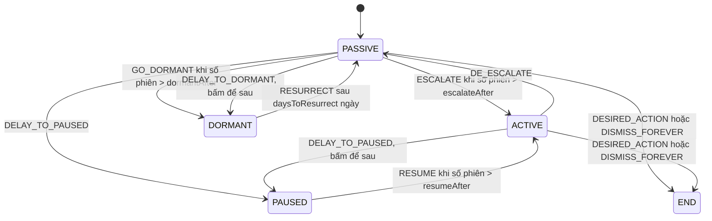

Ra mắt tính năng mới thì ai cũng muốn người dùng biết. Nhưng hiện modal "Thử ngay!" mỗi lần mở trang thì người dùng bực mình. Không hiện gì thì không ai biết tính năng tồn tại. Cách làm tử tế nằm ở giữa: lúc đầu gợi ý nhẹ, ai làm ngơ vài lần mới nhắc mạnh hơn, ai bấm "để sau" thì im lặng một thời gian, ai đã dùng hoặc bấm "không hiện nữa" thì thôi hẳn.

Udemy gói logic này thành một component dùng chung: **feature discoverability**. Bên trong là một máy trạng thái (state machine) 5 trạng thái, viết theo phong cách XState nhưng không dùng thư viện. Trạng thái được lưu trong `localStorage`, riêng theo từng người dùng và từng tính năng. Tính năng đầu tiên dùng nó là "Nhắc lịch học" (bài [#13](/blogs/udemy-ics-vtimezone) nói về file `.ics` của chính tính năng này).

> [!TIP]
> **Tóm tắt**
> - 5 trạng thái: `PASSIVE` (banner nhỏ), `ACTIVE` (modal), `PAUSED` và `DORMANT` (im lặng), `END` (thôi hẳn). Chuyển trạng thái theo sự kiện, có điều kiện (guard) dựa trên **số phiên**.
> - Chuyển trạng thái viết thành một **bảng dữ liệu** thay vì `if/else`. Sự kiện không có trong bảng của trạng thái hiện tại thì bị bỏ qua, nên không bao giờ rơi vào trạng thái vô nghĩa.
> - Lỗi 1: phiên mới chỉ được tính khi vắng **hơn 24 giờ kể từ lần xem gần nhất**, nên người dùng vào hằng ngày không bao giờ được tính thêm phiên.
> - Lỗi 2 và 3: sự kiện phát lên `document` với tên chung như `DISMISS_FOREVER`, nên bấm trên một tính năng thì mọi tính năng đều nhận; và listener không bao giờ được gỡ.

<iframe class="demo-frame" src="/demos/web-patterns/index.html?theme=dark#/ud-discovery" title="Demo ud-discovery" loading="lazy" style="height: 900px"></iframe>

<p class="demo-links">▶ <a href="/demos/web-patterns/index.html#/ud-discovery" target="_blank" rel="noopener">Mở demo toàn màn hình ↗</a> · <a href="https://stackblitz.com/github/hunghg255/blog-hunghg/tree/master/examples/web-patterns?file=src/lib/udDiscoverability.ts" target="_blank" rel="noopener">Sửa code trên StackBlitz ↗</a> · <a href="https://github.com/hunghg255/blog-hunghg/blob/master/examples/web-patterns/src/lib/udDiscoverability.ts" target="_blank" rel="noopener">Xem source trên GitHub ↗</a></p>

## Udemy làm thế nào?

Code nằm ở `udemy.com/webpack---/src/udemy/js/browse/components/feature-discovery/`:

- `feature-discoverability.mobx-store.ts`: máy trạng thái (402 dòng)
- `user-feature-data.mobx-store.ts`: lưu trữ và đếm phiên
- `feature-discoverability.react-component.tsx`: component nhận `config` và `renderingStrategy`

### Bảng trạng thái

```ts
// feature-discoverability.mobx-store.ts (rút gọn, chỉ trạng thái PASSIVE)
[FeatureState.PASSIVE]: {
    on: {
        [FeatureEvents.ESCALATE]:         {cond: this.shouldEscalate, target: FeatureState.ACTIVE},
        [FeatureEvents.DISMISS_FOREVER]:  {action: this.handleDismissForever, target: FeatureState.END},
        [FeatureEvents.GO_DORMANT]:       {action: this.handleGoDormant, cond: this.shouldGoDormant, target: FeatureState.DORMANT},
        [FeatureEvents.DELAY_TO_DORMANT]: {action: this.handleDelayToDormant, target: FeatureState.DORMANT},
        // ...DESIRED_ACTION → END, DELAY_TO_PAUSED → PAUSED
    },
},
```

Các trạng thái khác viết tương tự; sơ đồ đầy đủ ở phần dưới.

Các ngưỡng nằm trong `MachineConfig`: `escalateAfterSessionCount`, `dormantSessionCount`, `resumeAfterSessionCount`, `daysToResurrect`. Hàm `dispatch` tra bảng `states[currentState].on[event.type]`. Có `cond` thì kiểm tra trước, đạt mới chạy `action` và đổi trạng thái. Trạng thái đổi thì gửi một sự kiện tracking `FeatureDiscoveryStateChangeEvent`, để đội sản phẩm đo được bao nhiêu người đi từ banner sang modal rồi tới dùng thật.

`renderingStrategy` cho mỗi trạng thái hiện một component khác nhau, ví dụ `PASSIVE` hiện banner, `ACTIVE` hiện modal. Ở `PAUSED`, `DORMANT`, `END` thì component trả về `null`.

### Đếm phiên

Mỗi lần store được tạo (người dùng mở trang có tính năng):

```ts
if (this.userFeatureDataStore.isNewSession()) {
    this.userFeatureDataStore.incrementSession();
    this.dispatch({type: FeatureEvents.RESUME});
    this.dispatch({type: FeatureEvents.GO_DORMANT});
    this.dispatch({type: FeatureEvents.ESCALATE});
}
this.userFeatureDataStore.updateSessionData(); // lastImpressionDate = Date.now()
this.dispatch({type: FeatureEvents.RESURRECT});
```

Một mẹo gọn: phát **cả ba** sự kiện, để bảng tự quyết. Đang `PAUSED` thì chỉ `RESUME` có nghĩa, đang `PASSIVE` thì `GO_DORMANT` và `ESCALATE` có nghĩa, các sự kiện còn lại tự bị bỏ qua. Không cần một chuỗi `if (state === ...)`.

Còn `isNewSession`:

```ts
// user-feature-data.mobx-store.ts
isNewSession() {
    const currentSessionId = EventTrackingSession.getEventTrackingSessionId();
    const sessionBoundary = this.userFeatureData.lastImpressionDate + ONE_DAY_IN_MS;
    return this.userFeatureData.sessionId != currentSessionId && sessionBoundary < Date.now();
}
```

Hai điều kiện cùng lúc: khác id phiên tracking, **và** đã hơn 24 giờ kể từ `lastImpressionDate`. Dữ liệu lưu qua `udExpiringLocalStorage` (localStorage có hạn dùng 365 ngày) với khoá `me.id + featureName`.

### Sự kiện qua `document`

Component con không gọi store trực tiếp, mà phát sự kiện DOM:

```ts
// learning-reminder-banner.react-component.tsx
document.dispatchEvent(new CustomEvent(FeatureEvents.DELAY_TO_DORMANT));
// learning-reminder-modal.mobx-store.ts
document.dispatchEvent(new CustomEvent(FeatureEvents.DELAY_TO_PAUSED));
```

`FeatureDiscoverability` nghe **mọi** tên trong `FeatureEvents` trên `document`:

`addEventListeners` gắn một arrow function cho mỗi tên sự kiện. Còn hàm gỡ:

```ts
removeEventListeners = () => {
    Object.keys(FeatureEvents).forEach((item) => {
        document.removeEventListener(FeatureEvents[item], () =>
            this.store.dispatch({type: FeatureEvents[item]}),
        );
    });
};
```

### Ba lỗi

**1. Người dùng chăm chỉ không bao giờ được đếm phiên.** Mốc 24 giờ tính từ `lastImpressionDate`, mà giá trị này được cập nhật **mỗi lần** mở trang (`updateSessionData` trong constructor và trong `featureImpressed`). Người vào Udemy đều đặn mỗi 20 giờ thì lần nào cũng chưa đủ 24 giờ, nên `sessionCount` mãi bằng 1 và banner không bao giờ được nâng lên modal. Chỉ ai vắng hơn một ngày mới được đếm. Ngưỡng có vẻ được thiết kế cho ý "mỗi ngày một phiên", nhưng lại đếm theo khoảng nghỉ.

Demo: bấm "Vào lại sau 20 giờ" 8 lần. Cột Udemy vẫn `PASSIVE / 1 phiên`, cột viết lại đã lên `ACTIVE`.

**2. Tên sự kiện chung trên `document`.** Mọi instance nghe `DISMISS_FOREVER`, `DELAY_TO_DORMANT`… ở cùng một chỗ. Hiện tại chỉ có một tính năng dùng component này, nên chưa lộ. Khi trang có hai tính năng mới, bấm "Không hiện nữa" ở banner A thì **cả B cũng vào `END`**. Ngoài ra `handleGoDormant` tự phát lại `GO_DORMANT` lên `document`, nên mọi tính năng khác cũng nhận sự kiện đó.

Demo: bấm "Không hiện nữa" ở "Nhắc lịch học" trong cột Udemy, thì "Ghi chú trong video" cũng biến mất.

**3. Listener không bao giờ được gỡ.** `removeEventListener` truyền vào một arrow function **mới**, khác tham chiếu với hàm đã đăng ký, nên không gỡ được gì. Trong SPA, mỗi lần component mount lại là thêm một store cũ còn nghe sự kiện. Store cũ giữ bản sao `userFeatureData` cũ, nên khi nhận sự kiện nó ghi đè dữ liệu cũ lên `localStorage`.

Thêm hai chi tiết nhỏ: khoá lưu trữ `me.id + featureName` không có ký tự phân cách (user `1` với tính năng `2abc` trùng user `12` với tính năng `abc`, dù khó xảy ra). Còn cờ `dismissForever` và `desiredAction` được lưu nhưng không chỗ nào đọc, vì trạng thái `END` đã đủ.

## Máy trạng thái



Khác biệt giữa `PAUSED` và `DORMANT`: `PAUSED` đếm theo **phiên** rồi quay lại thẳng `ACTIVE` (modal), dùng khi người dùng đã thấy modal và bấm "để sau". `DORMANT` đếm theo **ngày** rồi quay lại `PASSIVE` (banner), dùng khi người dùng làm ngơ banner quá lâu hoặc bấm "để sau" trên banner.

## Viết lại

Bảng trạng thái là dữ liệu thuần, guard và effect là hàm nhỏ:

```ts title=src/lib/udDiscoverability.ts
/** Bảng chuyển trạng thái: sự kiện không có trong bảng của trạng thái hiện tại thì bị bỏ qua. */
export const MACHINE: Record<FeatureState, Partial<Record<FeatureEvent, Transition>>> = {
  PASSIVE: {
    ESCALATE: { target: 'ACTIVE', guard: (d, c) => d.sessionCount > c.escalateAfterSessions },
    DESIRED_ACTION: { target: 'END' },
    DISMISS_FOREVER: { target: 'END' },
    GO_DORMANT: { target: 'DORMANT', guard: shouldGoDormant, effect: markDormant },
    DELAY_TO_DORMANT: { target: 'DORMANT', effect: markDormant },
    DELAY_TO_PAUSED: { target: 'PAUSED', effect: resetCount },
  },
  ACTIVE: {
    DE_ESCALATE: { target: 'PASSIVE' },
    DESIRED_ACTION: { target: 'END' },
    DISMISS_FOREVER: { target: 'END' },
    DELAY_TO_PAUSED: { target: 'PAUSED', effect: resetCount },
  },
  PAUSED: {
    RESUME: { target: 'ACTIVE', guard: (d, c) => d.sessionCount > c.resumeAfterSessions, effect: resetCount },
  },
  DORMANT: {
    RESURRECT: {
      target: 'PASSIVE',
      guard: (d, c, now) => d.dormantSince !== null && now > d.dormantSince + c.daysToResurrect * DAY,
      effect: (d) => {
        d.sessionCount = 1;
        d.dormantSince = null;
      },
    },
  },
  END: {},
};
```

Đếm phiên theo lần đếm gần nhất:

```ts title=src/lib/udDiscoverability.ts
  function isNewSession(sessionId: string) {
    const t = now();
    const anchor = boundary === 'since-last-count' ? data.lastCountedAt : data.lastSeenAt;
    return sessionId !== data.sessionId && t - anchor >= sessionGap;
  }

  /** Gọi mỗi lần người dùng mở trang có tính năng này. */
  function visit(sessionId: string) {
    const t = now();
    if (isNewSession(sessionId)) {
      data.sessionCount += 1;
      data.lastCountedAt = t;
      dispatch('RESUME');
      dispatch('GO_DORMANT');
      dispatch('ESCALATE');
    }
    data.sessionId = sessionId;
    data.lastSeenAt = t;
    dispatch('RESURRECT');
    save();
  }
```

::: spoiler Xem toàn bộ src/lib/udDiscoverability.ts

```ts title=src/lib/udDiscoverability.ts
/**
 * Gợi ý tính năng mới theo nhiều phiên (feature discoverability), ý tưởng từ
 * browse/components/feature-discovery của Udemy: một máy trạng thái nhỏ quyết định lúc nào
 * hiện banner nhẹ (PASSIVE), lúc nào hiện modal (ACTIVE), lúc nào im lặng (PAUSED/DORMANT),
 * lúc nào thôi hẳn (END). Trạng thái lưu theo từng user + tính năng.
 *
 * Khác bản gốc: đếm phiên theo mốc lần ĐẾM gần nhất (bản gốc dùng lần XEM gần nhất nên người
 * vào hằng ngày không bao giờ được đếm thêm phiên), sự kiện gửi đúng tính năng thay vì phát
 * tên chung chung lên `document`, có `dispose()`.
 */

export type FeatureState = 'PASSIVE' | 'ACTIVE' | 'PAUSED' | 'DORMANT' | 'END';
export type FeatureEvent =
  | 'ESCALATE'
  | 'DE_ESCALATE'
  | 'DESIRED_ACTION'
  | 'DISMISS_FOREVER'
  | 'GO_DORMANT'
  | 'DELAY_TO_DORMANT'
  | 'DELAY_TO_PAUSED'
  | 'RESUME'
  | 'RESURRECT';

export interface FeatureConfig {
  id: string;
  /** số phiên ở PASSIVE trước khi được nâng lên ACTIVE */
  escalateAfterSessions: number;
  /** quá số phiên này mà vẫn lờ đi thì cho "ngủ" */
  dormantAfterSessions: number;
  /** PAUSED ("để sau") bao nhiêu phiên thì hiện lại */
  resumeAfterSessions: number;
  /** DORMANT bao nhiêu ngày thì quay lại PASSIVE */
  daysToResurrect: number;
}

export interface FeatureData {
  state: FeatureState;
  sessionCount: number;
  sessionId: string;
  /** lần cuối tính thêm 1 phiên */
  lastCountedAt: number;
  /** lần cuối tính năng được nhìn thấy */
  lastSeenAt: number;
  dormantSince: number | null;
}

export interface FeatureStorage {
  get(key: string): FeatureData | undefined;
  set(key: string, data: FeatureData): void;
}

export const DAY = 24 * 3600 * 1000;

type Guard = (d: FeatureData, c: FeatureConfig, now: number) => boolean;
type Effect = (d: FeatureData, now: number) => void;
interface Transition {
  target: FeatureState;
  guard?: Guard;
  effect?: Effect;
}

const resetCount: Effect = (d) => {
  d.sessionCount = 1;
};
const markDormant: Effect = (d, now) => {
  d.dormantSince = now;
};
const shouldGoDormant: Guard = (d, c) => d.sessionCount > c.dormantAfterSessions;

/** Bảng chuyển trạng thái: sự kiện không có trong bảng của trạng thái hiện tại thì bị bỏ qua. */
export const MACHINE: Record<FeatureState, Partial<Record<FeatureEvent, Transition>>> = {
  PASSIVE: {
    ESCALATE: { target: 'ACTIVE', guard: (d, c) => d.sessionCount > c.escalateAfterSessions },
    DESIRED_ACTION: { target: 'END' },
    DISMISS_FOREVER: { target: 'END' },
    GO_DORMANT: { target: 'DORMANT', guard: shouldGoDormant, effect: markDormant },
    DELAY_TO_DORMANT: { target: 'DORMANT', effect: markDormant },
    DELAY_TO_PAUSED: { target: 'PAUSED', effect: resetCount },
  },
  ACTIVE: {
    DE_ESCALATE: { target: 'PASSIVE' },
    DESIRED_ACTION: { target: 'END' },
    DISMISS_FOREVER: { target: 'END' },
    DELAY_TO_PAUSED: { target: 'PAUSED', effect: resetCount },
  },
  PAUSED: {
    RESUME: { target: 'ACTIVE', guard: (d, c) => d.sessionCount > c.resumeAfterSessions, effect: resetCount },
  },
  DORMANT: {
    RESURRECT: {
      target: 'PASSIVE',
      guard: (d, c, now) => d.dormantSince !== null && now > d.dormantSince + c.daysToResurrect * DAY,
      effect: (d) => {
        d.sessionCount = 1;
        d.dormantSince = null;
      },
    },
  },
  END: {},
};

export interface DiscoveryOptions {
  userId: string;
  storage: FeatureStorage;
  /** id phiên hiện tại (VD từ session tracking); đổi id + đủ khoảng cách thì tính phiên mới */
  sessionId: string;
  now?: () => number;
  /** khoảng tối thiểu giữa hai lần đếm phiên */
  sessionGap?: number;
  /**
   * 'since-last-count' (mặc định): mốc là lần đếm gần nhất.
   * 'since-last-seen': mốc là lần nhìn thấy gần nhất (cách của bản gốc, để so sánh).
   */
  boundary?: 'since-last-count' | 'since-last-seen';
  onTransition?: (from: FeatureState, to: FeatureState, event: FeatureEvent) => void;
}

export function createFeatureDiscovery(config: FeatureConfig, options: DiscoveryOptions) {
  const { storage, userId, now = Date.now, sessionGap = DAY, boundary = 'since-last-count' } = options;
  // dùng ký tự phân cách để "1"+"2abc" không trùng với "12"+"abc"
  const key = `${userId}::${config.id}`;
  const t0 = now();
  const data: FeatureData = storage.get(key) ?? {
    state: 'PASSIVE',
    sessionCount: 1,
    sessionId: options.sessionId,
    lastCountedAt: t0,
    lastSeenAt: t0,
    dormantSince: null,
  };
  let disposed = false;

  const save = () => !disposed && storage.set(key, { ...data });

  function dispatch(event: FeatureEvent) {
    if (disposed) return false;
    const tr = MACHINE[data.state][event];
    const t = now();
    if (!tr || (tr.guard && !tr.guard(data, config, t))) return false;
    const from = data.state;
    tr.effect?.(data, t);
    data.state = tr.target;
    save();
    if (from !== tr.target) options.onTransition?.(from, tr.target, event);
    return true;
  }

  function isNewSession(sessionId: string) {
    const t = now();
    const anchor = boundary === 'since-last-count' ? data.lastCountedAt : data.lastSeenAt;
    return sessionId !== data.sessionId && t - anchor >= sessionGap;
  }

  /** Gọi mỗi lần người dùng mở trang có tính năng này. */
  function visit(sessionId: string) {
    const t = now();
    if (isNewSession(sessionId)) {
      data.sessionCount += 1;
      data.lastCountedAt = t;
      dispatch('RESUME');
      dispatch('GO_DORMANT');
      dispatch('ESCALATE');
    }
    data.sessionId = sessionId;
    data.lastSeenAt = t;
    dispatch('RESURRECT');
    save();
  }

  visit(options.sessionId);

  return {
    dispatch,
    visit,
    get state() {
      return data.state;
    },
    get sessionCount() {
      return data.sessionCount;
    },
    /** trạng thái có hiện gì không */
    get visible() {
      return data.state === 'PASSIVE' || data.state === 'ACTIVE';
    },
    dispose() {
      disposed = true;
    },
  };
}

export type FeatureDiscovery = ReturnType<typeof createFeatureDiscovery>;

/** Lưu vào localStorage, lỗi (private mode, đầy quota) thì bỏ qua. */
export function localStorageAdapter(prefix = 'feature-discovery:'): FeatureStorage {
  return {
    get(k) {
      try {
        const raw = localStorage.getItem(prefix + k);
        return raw ? (JSON.parse(raw) as FeatureData) : undefined;
      } catch {
        return undefined;
      }
    },
    set(k, d) {
      try {
        localStorage.setItem(prefix + k, JSON.stringify(d));
      } catch {
        /* bỏ qua */
      }
    },
  };
}

export function memoryStorage(): FeatureStorage & { dump(): Record<string, FeatureData> } {
  const m = new Map<string, FeatureData>();
  return {
    get: (k) => (m.has(k) ? { ...m.get(k)! } : undefined),
    set: (k, d) => void m.set(k, { ...d }),
    dump: () => Object.fromEntries(m),
  };
}
```

:::

## Đi qua code

- **`MACHINE`** là một object hằng, không phụ thuộc instance (bản gốc tạo lại bảng trong mỗi store vì guard cần `this`). Guard nhận `(data, config, now)` nên là hàm thuần, dễ test riêng.
- **`dispatch`** trả về `true/false` để nơi gọi biết sự kiện có tác dụng không. `onTransition` chỉ gọi khi trạng thái đổi thật, đây là chỗ gửi tracking.
- **`isNewSession`**: mốc là `lastCountedAt`, tức lần **đếm** gần nhất, không phải lần xem gần nhất. Người vào mỗi 20 giờ được đếm khoảng mỗi 40 giờ một phiên (mỗi ngày tối đa một phiên), thay vì không bao giờ. Tham số `boundary: 'since-last-seen'` giữ lại cách của bản gốc để demo so sánh.
- **`visit`** phát cả `RESUME`, `GO_DORMANT`, `ESCALATE` như bản gốc và để bảng tự lọc. Thứ tự giữ nguyên: `GO_DORMANT` trước `ESCALATE`.
- **Không có sự kiện toàn cục.** Component gọi thẳng `feature.dispatch('DELAY_TO_DORMANT')` của đúng tính năng. Muốn tách component nhắc khỏi store, dùng một `EventTarget` riêng cho từng tính năng, đừng dùng `document`.
- **`dispose()`** tắt `dispatch` và `save`, nên instance cũ sau khi unmount không ghi đè dữ liệu nữa.
- **Khoá lưu trữ** `${userId}::${featureId}` có ký tự phân cách.

**Khác bản gốc:** bỏ trường hợp đặc biệt `activation-card` (bản gốc cho `ACTIVE` vào `DORMANT` nếu component chính là activation card). Bỏ hai cờ `dismissForever`/`desiredAction` không ai đọc. Bản viết lại không phụ thuộc MobX và nhận `now()` qua tham số, nên demo tua được thời gian.

## Tại sao không làm cách khác?

- **Dùng XState?** Rất hợp nếu app đã có XState. Với 5 trạng thái và 9 sự kiện, một bảng 30 dòng tự viết là đủ, không cần thêm thư viện vào bundle.
- **Lưu trạng thái ở server?** Tốt hơn nếu người dùng dùng nhiều thiết bị: gợi ý đã tắt trên laptop thì không hiện lại trên điện thoại. `localStorage` đơn giản và không tốn request, nhưng mỗi thiết bị một trạng thái. Interface `FeatureStorage` cho phép đổi sang server mà không sửa máy trạng thái.
- **Đếm theo ngày lịch** ("đã đếm hôm nay chưa") thay cho khoảng 24 giờ? Cũng được, nhưng phải chọn múi giờ. Đếm theo khoảng thời gian từ lần đếm trước không phụ thuộc múi giờ.
- **Một `if/else` lớn?** Sẽ có trường hợp quên chặn, ví dụ nhận `ESCALATE` khi đang `END`. Với bảng, thứ gì không khai báo thì mặc định bị bỏ qua.

## Edge case và cạm bẫy

- **Người dùng mở nhiều tab.** Mỗi tab đọc `localStorage` lúc tạo store rồi ghi đè bản của mình, nên tab đóng sau cùng thắng. Muốn chặt hơn thì nghe sự kiện `storage` để đồng bộ, như bài [đồng bộ đăng nhập giữa tab](/blogs/web-cross-tab-auth-cookie-guard).
- **Đổi config sau khi đã ra mắt** (ví dụ tăng `escalateAfterSessions`): dữ liệu cũ trong `localStorage` vẫn đúng vì chỉ lưu số phiên, guard đọc config mới.
- **Xoá dữ liệu trình duyệt** thì người dùng quay về `PASSIVE`. Chấp nhận được với gợi ý, không chấp nhận được với "đã đồng ý điều khoản".
- **Chế độ riêng tư hoặc localStorage đầy**: `localStorageAdapter` bắt lỗi và bỏ qua, gợi ý vẫn chạy trong phiên hiện tại.
- **Đo lường**: luôn gửi tracking ở `onTransition`. Không có số liệu thì không biết ngưỡng 3 phiên hay 5 phiên mới hợp lý.

## Dùng trong dự án

```tsx
import { useEffect, useMemo, useState } from 'react';
import { createFeatureDiscovery, localStorageAdapter } from './udDiscoverability';

function useFeatureDiscovery(userId: string, sessionId: string) {
  const [, force] = useState(0);
  const feature = useMemo(
    () =>
      createFeatureDiscovery(
        { id: 'learning-reminder', escalateAfterSessions: 3, dormantAfterSessions: 6, resumeAfterSessions: 2, daysToResurrect: 14 },
        { userId, sessionId, storage: localStorageAdapter(), onTransition: (from, to) => { track('feature_state', { from, to }); force((n) => n + 1); } },
      ),
    [userId, sessionId],
  );
  useEffect(() => () => feature.dispose(), [feature]);
  return feature;
}

// trong component:
// feature.state === 'PASSIVE' → <Banner onLater={() => feature.dispatch('DELAY_TO_DORMANT')} />
// feature.state === 'ACTIVE'  → <Modal onLater={() => feature.dispatch('DELAY_TO_PAUSED')} />
```

## Kiểm thử

::: spoiler Ví dụ test (bản phác, không có trong repo)

```ts title=udDiscoverability.test.ts
import { describe, expect, it } from 'vitest';
import { createFeatureDiscovery, memoryStorage, DAY } from './udDiscoverability';

const cfg = { id: 'reminder', escalateAfterSessions: 3, dormantAfterSessions: 6, resumeAfterSessions: 2, daysToResurrect: 14 };

function setup(boundary?: 'since-last-count' | 'since-last-seen') {
  const clock = { now: Date.UTC(2026, 9, 1) };
  const storage = memoryStorage();
  let sid = 0;
  const f = createFeatureDiscovery(cfg, { userId: 'u1', storage, sessionId: 's0', now: () => clock.now, boundary });
  const visitAfter = (hours: number) => {
    clock.now += hours * 3600 * 1000;
    f.visit('s' + ++sid);
  };
  return { f, clock, storage, visitAfter };
}

describe('feature discovery', () => {
  it('người vào mỗi 20 giờ: bản gốc không bao giờ đếm phiên mới', () => {
    const a = setup('since-last-seen');
    const b = setup('since-last-count');
    for (let i = 0; i < 10; i++) { a.visitAfter(20); b.visitAfter(20); }
    expect(a.f.sessionCount).toBe(1);
    expect(a.f.state).toBe('PASSIVE');
    expect(b.f.sessionCount).toBe(6);
    expect(b.f.state).toBe('ACTIVE');
  });

  it('cùng phiên thì không đếm thêm', () => {
    const { f, clock } = setup();
    clock.now += 3 * DAY;
    f.visit('s0');
    expect(f.sessionCount).toBe(1);
  });

  it('để sau → DORMANT, 14 ngày sau quay lại PASSIVE với bộ đếm mới', () => {
    const { f, visitAfter } = setup();
    expect(f.dispatch('DELAY_TO_DORMANT')).toBe(true);
    expect(f.visible).toBe(false);
    visitAfter(24 * 10);
    expect(f.state).toBe('DORMANT');
    visitAfter(24 * 5);
    expect(f.state).toBe('PASSIVE');
    expect(f.sessionCount).toBe(1);
  });

  it('sự kiện không hợp lệ ở trạng thái hiện tại bị bỏ qua', () => {
    const { f } = setup();
    f.dispatch('DISMISS_FOREVER');
    expect(f.state).toBe('END');
    expect(f.dispatch('ESCALATE')).toBe(false);
    expect(f.state).toBe('END');
  });

  it('trạng thái được lưu và đọc lại', () => {
    const { f, storage } = setup();
    f.dispatch('DELAY_TO_PAUSED');
    const again = createFeatureDiscovery(cfg, { userId: 'u1', storage, sessionId: 's0' });
    expect(again.state).toBe('PAUSED');
    expect(Object.keys(storage.dump())).toEqual(['u1::reminder']);
  });
});
```

:::

## So với cách làm khác

- Công cụ onboarding như Pendo, Appcues, Intercom Product Tours làm việc này ở phía họ, có giao diện cho đội sản phẩm cấu hình. Udemy có dùng Pendo (trong bản dump có module `pendo`), nhưng vẫn tự viết máy trạng thái này cho các gợi ý gắn chặt với giao diện của mình.
- Ý tưởng "gợi ý tăng dần rồi lùi lại" giống [đoán ý định người dùng (idle, exit-intent)](/blogs/web-user-intent-idle-exit-wiggle) và [giới hạn tần suất hiển thị bằng bitmask](/blogs/web-frequency-cap-bitmask) của Outlook. Ba kỹ thuật này ghép lại thành một hệ thống nhắc nhở không làm phiền.

---

Bài này thuộc series **[Học từ mã nguồn Udemy](/series/udemy)** (21 bài, đọc theo thứ tự).

::: spoiler Xem nhanh danh sách bài trong series

*Mở đầu*

- [Mở đầu: bên trong frontend của Udemy](/blogs/learn-from-udemy-source-code)

*Phần 1: video và học bài*

- [#1 DRM đa hệ: Widevine, PlayReady, FairPlay](/blogs/udemy-drm-multi-key-system)
- [#2 URL ký và license hết hạn: tự làm mới, tải trước bài kế](/blogs/udemy-expiring-media-urls)
- [#3 Ghi tiến độ xem theo bucket, tự hoàn thành, backoff lỗi](/blogs/udemy-watch-progress-buckets)
- [#4 Thumbnail sprite từ WebVTT và slide trên seekbar](/blogs/udemy-sprite-thumbnails-vtt)
- [#5 Phụ đề: tự chọn ngôn ngữ và editor có phím tắt](/blogs/udemy-captions-auto-select-editor)
- [#6 Đo băng thông, autoplay Safari, iPad giả làm Mac](/blogs/udemy-video-quirks-autoplay)

*Phần 2: bài tập, bài thi, lab*

- [#7 Preview code HTML/React trong iframe sandbox](/blogs/udemy-code-preview-sandbox)
- [#8 Bài thi có giờ: tạm dừng khi rảnh, autosave theo dấu vân tay](/blogs/udemy-timed-exam)
- [#9 Chấm code realtime: đăng ký kênh trước, có đường dự phòng](/blogs/udemy-realtime-grading)
- [#10 Mở lab không bị chặn popup, heartbeat, xung đột phiên](/blogs/udemy-lab-launcher)

*Phần 3: editor và nội dung*

- [#11 ProseMirror: schema theo flag, NodeView React, HTML cho email](/blogs/udemy-prosemirror-integration)
- [#12 Parse HTML an toàn bằng document tách rời](/blogs/udemy-safe-html-parse)
- [#13 Sinh file .ics có VTIMEZONE tự dò giờ mùa hè](/blogs/udemy-ics-vtimezone)
- [#14 Đọc Open Badges giấu trong ảnh PNG và SVG](/blogs/udemy-open-badges-image)

*Phần 4: hạ tầng và trải nghiệm*

- [#15 Pipeline tracking: batch, sendBeacon, bfcache, HTTP 207](/blogs/udemy-event-tracking-pipeline)
- **#16 Gợi ý tính năng mới qua nhiều phiên bằng máy trạng thái** (bài này)
- [#17 Kéo cạnh để resize và mép cuộn mờ dần](/blogs/udemy-resizer-gradient-scroll)
- [#18 Gom request giá khoá học, cập nhật một phần khi áp coupon](/blogs/udemy-price-dataloader-partial-update)
- [#19 Trả lời lạc quan có rollback, autocomplete hai tầng cache](/blogs/udemy-optimistic-reply-autocomplete)
- [#20 Nạp app theo ưu tiên, registry store, HTML cache công khai](/blogs/udemy-app-loader-registry)

:::

Code + demo: [`examples/web-patterns`](https://github.com/hunghg255/blog-hunghg/tree/master/examples/web-patterns) · [Mở trên StackBlitz](https://stackblitz.com/github/hunghg255/blog-hunghg/tree/master/examples/web-patterns)
