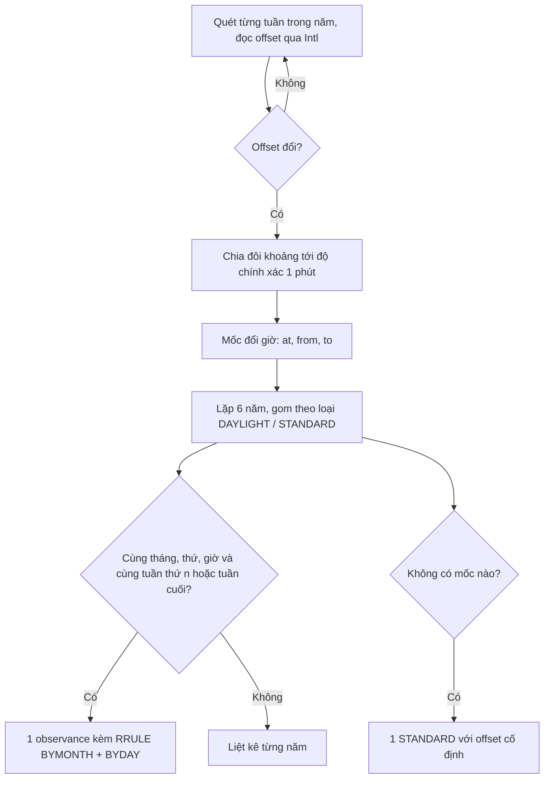

Udemy có tính năng "Nhắc lịch học": bạn chọn giờ học, ví dụ 20:00 mỗi tối, rồi bấm thêm vào lịch. Với Google Calendar, Udemy gọi API. Với Apple Calendar, Outlook và các ứng dụng khác, Udemy tạo một **file `.ics`** ngay trên trình duyệt để bạn tải về và mở.

Nghe thì đơn giản, nhưng có một cái bẫy. Sự kiện lặp "20:00 hằng ngày" ở Los Angeles phải **vẫn là 20:00** sau ngày vặn đồng hồ sang giờ mùa hè (DST). Muốn vậy, file `.ics` phải mô tả múi giờ bằng khối `VTIMEZONE`: lúc nào đổi giờ, đổi từ offset nào sang offset nào. Udemy không gửi kèm cơ sở dữ liệu múi giờ, mà **tự dò các mốc đổi giờ bằng `Date.getTimezoneOffset()`**, thu hẹp dần từ tháng xuống phút.

> [!TIP]
> **Tóm tắt**
> - Cần `VTIMEZONE` để sự kiện lặp giữ đúng giờ qua các lần đổi giờ mùa hè. RFC 5545 bắt buộc có `VTIMEZONE` cho mọi `TZID` dùng trong file.
> - Mẹo của Udemy: không cần thư viện, dò mốc đổi giờ bằng offset của trình duyệt (tháng → ngày → giờ → phút).
> - Bản gốc chỉ đúng cho năm hiện tại và sinh `VTIMEZONE` **rỗng** với múi giờ không có giờ mùa hè như Việt Nam. Ngoài ra: dùng LF thay CRLF, không escape dấu phẩy, tên file xoá hết chữ có dấu.
> - Bản viết lại: dò theo epoch cho múi giờ bất kỳ (qua `Intl`), suy ra quy luật `RRULE` cho mọi năm, gấp dòng 75 octet, tải bằng Blob URL.

<iframe class="demo-frame" src="/demos/web-patterns/index.html?theme=dark#/ud-ics" title="Demo ud-ics" loading="lazy" style="height: 1150px"></iframe>

<p class="demo-links">▶ <a href="/demos/web-patterns/index.html#/ud-ics" target="_blank" rel="noopener">Mở demo toàn màn hình ↗</a> · <a href="https://stackblitz.com/github/hunghg255/blog-hunghg/tree/master/examples/web-patterns?file=src/lib/udIcs.ts" target="_blank" rel="noopener">Sửa code trên StackBlitz ↗</a> · <a href="https://github.com/hunghg255/blog-hunghg/blob/master/examples/web-patterns/src/lib/udIcs.ts" target="_blank" rel="noopener">Xem source trên GitHub ↗</a></p>

## Udemy làm thế nào?

Code nằm ở `udemy.com/webpack---/src/udemy/js/learning-calendar-reminders/calendar-button/`, gồm hai file: `vtimezone.ts` (161 dòng) và `ics-calendar-button.mobx-store.ts` (348 dòng).

### Dò mốc đổi giờ bằng getTimezoneOffset

Ý tưởng chính nằm trong `findDSTBeforeSwitchDates`: lấy ngày 1 tháng 1 của năm hiện tại, nhảy từng tháng và so offset với tháng trước. Offset tăng nghĩa là vào giờ mùa hè, offset giảm nghĩa là ra khỏi giờ mùa hè:

```ts
// vtimezone.ts (rút gọn)
const currDate = new Date(yearDate.getFullYear(), 0, 1);
for (let month = 0; month < 12; month += 1) {
    prevDate = new Date(currDate);
    currDate.setMonth(month);
    const prevTimezoneOffset = -1 * prevDate.getTimezoneOffset();
    const currTimezoneOffset = -1 * currDate.getTimezoneOffset();
    if (currTimezoneOffset > prevTimezoneOffset) {
        dstBeforeSwitchDates.daylightDate = narrowDownDSTBeforeSwitchMonthDate(prevDate);
    } else if (currTimezoneOffset < prevTimezoneOffset) {
        dstBeforeSwitchDates.standardDate = narrowDownDSTBeforeSwitchMonthDate(prevDate);
    }
}
```

Khi đã biết mốc đổi giờ nằm trong tháng nào, hàm `narrowDownDSTBeforeSwitchMonthDate` thu hẹp ba lần: duyệt ngày 1→32, rồi giờ 0→24, rồi phút 0→60. Mỗi lần dừng ở giá trị **ngay trước** chỗ offset đổi. Chú thích trong code giải thích vì sao khoảng là `1, 33` chứ không phải `1, 32`: giá trị cuối (ngày 32, giờ 24, phút 60) tràn sang đơn vị kế tiếp, nên bắt được cả trường hợp mốc đổi giờ rơi đúng đầu tháng, ngày hoặc giờ sau đó.

Kết quả với `America/Los_Angeles` năm 2021 là hai mốc `2021-03-14 01:59` và `2021-11-07 01:59`. Hàm `formatVTimezoneSection` cộng thêm 1 phút để ra giờ đổi thật (02:00), ghi `TZOFFSETFROM` (offset tại 01:59) và `TZOFFSETTO` (offset tại 02:00). Lúc vặn đồng hồ lên, 02:00 không tồn tại nên `new Date(...)` tự nhảy sang 03:00 giờ mùa hè, vừa đúng offset cần ghi.

Đây là một mẹo hay: **dùng chính cơ sở dữ liệu múi giờ có sẵn trong trình duyệt**, không phải tải thêm hàng trăm KB dữ liệu IANA.

### Dựng sự kiện

Store ghép file từ template string:

```ts
// ics-calendar-button.mobx-store.ts (rút gọn)
return `BEGIN:VEVENT
ORGANIZER;CN="Udemy":mailto:no-reply@udemy.com
SUMMARY:${data.title}
SEQUENCE:${data.sequence}
DTSTART${this._getTimezone()}:${this._reformatTime(data.start_time)}
UID:${data.id}
${this._getRrule(data)}
DESCRIPTION:${this._getDescription(...)}
${this._getCancelledStatus(data.is_deleted)}
${this._getNotification(data.notification_time_before, data.title)}
END:VEVENT`;
```

Ba điểm đáng học:

- **Cập nhật và huỷ dùng lại `UID`**: server giữ id của lời nhắc. Mỗi lần sửa thì `SEQUENCE` tăng, nên ứng dụng lịch biết đây là bản mới của **cùng một** sự kiện và thay thế bản cũ. Muốn huỷ thì gửi lại cùng `UID` kèm `STATUS:CANCELLED`.
- `METHOD:PUBLISH` khi tạo mới, `METHOD:REQUEST` khi cập nhật hoặc huỷ.
- `VALARM` với `TRIGGER:-PT10M` để nhắc trước 10 phút.

Cuối cùng là tải file: tạo thẻ `<a>` với `href="data:text/calendar;charset=utf-8,..."`, gán `download`, rồi click.

### Sáu lỗi trong bản gốc

1. **Chỉ đúng cho năm hiện tại.** Chú thích trong code tự thừa nhận: "chỉ định nghĩa STANDARD và DAYLIGHT cho năm nay… không thể dùng cho sự kiện lặp mãi mãi; cần cài đặt phức tạp hơn với RRULE".
2. **`VTIMEZONE` rỗng với múi giờ không có giờ mùa hè.** Việt Nam, Thái Lan, Nhật Bản không đổi giờ, nên cả `daylightDate` lẫn `standardDate` đều `null`, và file ra `BEGIN:VTIMEZONE / TZID:Asia/Ho_Chi_Minh / END:VTIMEZONE`. RFC 5545 §3.6.5 yêu cầu phải có ít nhất một `STANDARD` hoặc `DAYLIGHT`. Người dùng Việt Nam nhận đúng file không hợp lệ.
3. **Xuống dòng bằng LF.** Template string dùng `\n`, trong khi RFC 5545 §3.1 quy định CRLF. Không có bước gấp dòng 75 octet, nên mô tả dài hay tiêu đề tiếng Việt (mỗi chữ có dấu tốn 2–3 byte) dễ vượt giới hạn.
4. **Dòng trống.** Sự kiện không lặp thì `_getRrule` trả về `''`, nhưng dòng `${...}` trong template vẫn còn, thành một dòng trống giữa `VEVENT`. Tương tự với `STATUS` và `VALARM`.
5. **Không escape TEXT.** Tiêu đề do người dùng gõ được nhét thẳng vào `SUMMARY:` và `DESCRIPTION:`. Theo §3.3.11, dấu `,` `;` `\` và xuống dòng phải được escape. Tiêu đề "Học tiếng Nhật, mỗi tối" có dấu phẩy chưa escape.
6. **Tên file mất chữ.** `title.replace(/[^a-zA-Z ]+/g, '')` xoá mọi ký tự ngoài a–z: "Ôn tập" thành `n-tp.ics`, "Học tiếng Nhật, mỗi tối; bài 3 – Đọc hiểu" thành `hc-ting-nht-mi-ti-bi-c-hiu.ics`. Tiêu đề toàn chữ Nhật hay chữ Hàn thì tên file rỗng: `.ics`.

Thêm một chi tiết nhỏ: theo RFC 5546 (iTIP), `METHOD:REQUEST` đi kèm danh sách `ATTENDEE`, còn huỷ sự kiện thì dùng `METHOD:CANCEL`. Nhiều ứng dụng lịch vẫn chấp nhận cách Udemy làm, nhưng đúng chuẩn thì nên là `CANCEL`.

Bấm "Huỷ nhắc lịch" trong demo để thấy khác biệt. Cột bên trái có bộ kiểm tra nhỏ (`checkIcs`) liệt kê đúng các lỗi trên.

## Bên trong file .ics

Một file `.ics` là văn bản theo từng dòng `TÊN;THAM-SỐ=...:GIÁ-TRỊ`, chia khối bằng `BEGIN:`/`END:`. Ba luật hay bị quên:

| Luật | RFC 5545 | Vì sao |
|---|---|---|
| Dòng kết thúc bằng CRLF | §3.1 | Bộ đọc nghiêm ngặt từ chối LF trần |
| Dòng tối đa 75 octet, dòng tiếp bắt đầu bằng 1 dấu cách | §3.1 | Gấp dòng (folding); đếm **byte UTF-8**, không phải ký tự |
| Escape `\` `;` `,` và xuống dòng trong TEXT | §3.3.11 | Dấu phẩy là phân cách của danh sách giá trị |

Khi một thuộc tính có `TZID=America/Los_Angeles`, file **phải** có khối `VTIMEZONE` cùng `TZID`. Ứng dụng lịch dùng khối này để đổi `20261102T200000` (giờ treo tường, wall time) ra thời điểm thật. Nhiều ứng dụng nhận ra tên múi giờ IANA và dùng dữ liệu múi giờ của chính nó, nhưng file vẫn phải hợp lệ cho những ứng dụng không làm vậy.

Mỗi khối `STANDARD`/`DAYLIGHT` (gọi là observance) mô tả một mốc đổi giờ. Có hai cách viết:

- **Liệt kê**: mỗi năm một khối với `DTSTART` cụ thể. Udemy làm cách này, nhưng chỉ cho một năm.
- **Quy luật**: một khối với `RRULE:FREQ=YEARLY;BYMONTH=3;BYDAY=2SU`, nghĩa là "Chủ nhật thứ hai của tháng 3". Một khối đúng cho mọi năm, kể cả với sự kiện lặp không có ngày kết thúc.

`DTSTART` của observance là giờ treo tường tính theo **offset cũ**. Ở Los Angeles, giờ đổi sang giờ mùa hè là `02:00` (PST), còn giờ đổi ngược lại là `02:00` (PDT).



## Viết lại

Bản viết lại không phụ thuộc múi giờ của máy. Offset của một múi giờ bất kỳ tại một thời điểm được tính bằng `Intl.DateTimeFormat` (hàm `tzOffsetMinutes`: lấy giờ treo tường ở múi giờ đó rồi trừ cho chính thời điểm ấy). Từ đó tìm các mốc đổi giờ bằng cách quét tuần rồi chia đôi:

```ts title=src/lib/udIcs.ts
/** Quét từng tuần, thấy offset đổi thì chia đôi khoảng tới độ chính xác 1 phút. */
export function findTransitions(timeZone: string, year: number): Transition[] {
  const result: Transition[] = [];
  const end = Date.UTC(year + 1, 0, 1);
  let t = Date.UTC(year, 0, 1);
  let off = tzOffsetMinutes(timeZone, t);
  while (t < end) {
    const next = Math.min(t + WEEK, end);
    const nextOff = tzOffsetMinutes(timeZone, next);
    if (nextOff !== off) {
      let lo = t;
      let hi = next;
      while (hi - lo > 60000) {
        const mid = Math.floor((lo + hi) / 2 / 60000) * 60000;
        if (tzOffsetMinutes(timeZone, mid) === off) lo = mid;
        else hi = mid;
      }
      result.push({ at: hi, from: off, to: nextOff });
    }
    t = next;
    off = nextOff;
  }
  return result;
}
```

Từ các mốc đổi giờ của 6 năm liên tiếp, `vtimezoneLines` thử suy ra quy luật hằng năm:

```ts title=src/lib/udIcs.ts
  for (const kind of ['STANDARD', 'DAYLIGHT'] as Kind[]) {
    const group = all.filter((t) => (kind === 'DAYLIGHT' ? t.to > t.from : t.to < t.from));
    if (group.length === 0) continue;
    const ds = group.map((t) => describeTransition(timeZone, t));
    const first = ds[0];
    const sameShape = ds.every(
      (d, i) =>
        d.month === first.month &&
        d.weekday === first.weekday &&
        d.time === first.time &&
        group[i].from === group[0].from &&
        group[i].to === group[0].to,
    );
    const nth = ds.every((d) => d.isLast) ? -1 : ds.every((d) => d.nth === first.nth) ? first.nth : 0;

    if (sameShape && nth !== 0 && group.length === years) {
      lines.push(
        `BEGIN:${kind}`,
        `DTSTART:${formatLocal(first.w)}`,
        `RRULE:FREQ=YEARLY;BYMONTH=${first.month};BYDAY=${nth}${WEEKDAYS[first.weekday]}`,
        `TZOFFSETFROM:${formatOffset(group[0].from)}`,
        `TZOFFSETTO:${formatOffset(group[0].to)}`,
        `TZNAME:${first.name}`,
        `END:${kind}`,
      );
    } else {
      // Quy luật không ổn định (luật thay đổi giữa các năm): liệt kê từng lần đổi giờ.
      group.forEach((t, i) => {
        lines.push(
          `BEGIN:${kind}`,
          `DTSTART:${formatLocal(ds[i].w)}`,
          `TZOFFSETFROM:${formatOffset(t.from)}`,
          `TZOFFSETTO:${formatOffset(t.to)}`,
          `TZNAME:${ds[i].name}`,
          `END:${kind}`,
        );
      });
    }
  }
```

Phần còn lại (escape, gấp dòng 75 octet, ghép `VEVENT`, đặt tên file, tải bằng Blob URL) nằm trong file đầy đủ bên dưới.

::: spoiler Xem toàn bộ src/lib/udIcs.ts

```ts title=src/lib/udIcs.ts
/**
 * Sinh file .ics (iCalendar, RFC 5545) cho lịch nhắc học, ý tưởng từ
 * learning-calendar-reminders của Udemy, viết lại với các sửa lỗi:
 * - VTIMEZONE cho múi giờ BẤT KỲ (không chỉ múi giờ của máy), có quy luật RRULE
 *   nên sự kiện lặp nhiều năm vẫn đúng giờ, và vẫn hợp lệ với múi giờ không có giờ mùa hè.
 * - Dòng kết thúc bằng CRLF, gấp dòng ở 75 octet, escape TEXT, không có dòng trống.
 * - Tên file giữ được tiếng Việt (bỏ dấu thay vì xoá cả chữ).
 */

// ---- Offset của một múi giờ tại một thời điểm ----

const dtfCache = new Map<string, Intl.DateTimeFormat>();

function wallFormatter(timeZone: string) {
  let dtf = dtfCache.get(timeZone);
  if (!dtf) {
    dtf = new Intl.DateTimeFormat('en-US', {
      timeZone,
      hourCycle: 'h23',
      year: 'numeric',
      month: 'numeric',
      day: 'numeric',
      hour: 'numeric',
      minute: 'numeric',
      second: 'numeric',
    });
    dtfCache.set(timeZone, dtf);
  }
  return dtf;
}

/** Giờ treo tường (wall time) của `epochMs` tại `timeZone`. */
export function wallParts(timeZone: string, epochMs: number) {
  const parts: Record<string, number> = {};
  for (const p of wallFormatter(timeZone).formatToParts(epochMs)) {
    if (p.type !== 'literal') parts[p.type] = Number(p.value);
  }
  return {
    year: parts.year,
    month: parts.month,
    day: parts.day,
    hour: parts.hour,
    minute: parts.minute,
    second: parts.second,
  };
}

/** Offset (phút, dương ở phía đông UTC) của `timeZone` tại `epochMs`. VD Hà Nội = 420. */
export function tzOffsetMinutes(timeZone: string, epochMs: number) {
  const w = wallParts(timeZone, epochMs);
  const asUtc = Date.UTC(w.year, w.month - 1, w.day, w.hour, w.minute, w.second);
  return Math.round((asUtc - Math.floor(epochMs / 1000) * 1000) / 60000);
}

/**
 * Đổi giờ treo tường ở `timeZone` sang epoch. Giờ bị lặp (vặn lùi) lấy lần đầu; giờ không tồn tại
 * (vặn lên, VD 02:30 ở Los Angeles ngày đổi giờ) bị đẩy về sau thành 03:30, giống Temporal 'compatible'.
 */
export function wallToEpoch(timeZone: string, y: number, mo: number, d: number, h = 0, mi = 0) {
  const naive = Date.UTC(y, mo - 1, d, h, mi);
  const g1 = naive - tzOffsetMinutes(timeZone, naive) * 60000;
  const g2 = naive - tzOffsetMinutes(timeZone, g1) * 60000;
  const w = wallParts(timeZone, g2);
  const ok = w.year === y && w.month === mo && w.day === d && w.hour === h && w.minute === mi;
  return ok ? g2 : Math.max(g1, g2);
}

// ---- Tìm các lần đổi giờ trong một năm ----

export interface Transition {
  /** thời điểm đổi giờ (epoch ms) */
  at: number;
  from: number;
  to: number;
}

const WEEK = 7 * 24 * 3600 * 1000;

/** Quét từng tuần, thấy offset đổi thì chia đôi khoảng tới độ chính xác 1 phút. */
export function findTransitions(timeZone: string, year: number): Transition[] {
  const result: Transition[] = [];
  const end = Date.UTC(year + 1, 0, 1);
  let t = Date.UTC(year, 0, 1);
  let off = tzOffsetMinutes(timeZone, t);
  while (t < end) {
    const next = Math.min(t + WEEK, end);
    const nextOff = tzOffsetMinutes(timeZone, next);
    if (nextOff !== off) {
      let lo = t;
      let hi = next;
      while (hi - lo > 60000) {
        const mid = Math.floor((lo + hi) / 2 / 60000) * 60000;
        if (tzOffsetMinutes(timeZone, mid) === off) lo = mid;
        else hi = mid;
      }
      result.push({ at: hi, from: off, to: nextOff });
    }
    t = next;
    off = nextOff;
  }
  return result;
}

// ---- Định dạng ----

const pad = (n: number, w = 2) => String(n).padStart(w, '0');

/** '+0700', '-0330' */
export function formatOffset(minutes: number) {
  const sign = minutes < 0 ? '-' : '+';
  const a = Math.abs(minutes);
  return `${sign}${pad(Math.floor(a / 60))}${pad(a % 60)}`;
}

/** Giờ treo tường dạng iCalendar: 20261102T200000 */
export function formatLocal(w: { year: number; month: number; day: number; hour: number; minute: number }) {
  return `${w.year}${pad(w.month)}${pad(w.day)}T${pad(w.hour)}${pad(w.minute)}00`;
}

/** Giờ UTC dạng iCalendar: 20261102T130000Z */
export function formatUtc(epochMs: number) {
  return `${new Date(epochMs).toISOString().slice(0, 19).replace(/[-:]/g, '')}Z`;
}

function tzName(timeZone: string, epochMs: number) {
  const part = new Intl.DateTimeFormat('en-US', { timeZone, timeZoneName: 'short' })
    .formatToParts(epochMs)
    .find((p) => p.type === 'timeZoneName');
  return part?.value ?? timeZone;
}

const WEEKDAYS = ['SU', 'MO', 'TU', 'WE', 'TH', 'FR', 'SA'];

/** Lần đổi giờ dạng "Chủ nhật thứ 2 của tháng 3, lúc 02:00 (giờ cũ)". */
function describeTransition(timeZone: string, tr: Transition) {
  // giờ treo tường tính theo offset CŨ, đúng như RFC 5545 yêu cầu cho DTSTART của observance
  const w = wallParts('UTC', tr.at + tr.from * 60000);
  const weekday = new Date(Date.UTC(w.year, w.month - 1, w.day)).getUTCDay();
  const daysInMonth = new Date(Date.UTC(w.year, w.month, 0)).getUTCDate();
  return {
    w,
    month: w.month,
    weekday,
    nth: Math.ceil(w.day / 7),
    isLast: w.day + 7 > daysInMonth,
    time: w.hour * 60 + w.minute,
    name: tzName(timeZone, tr.at),
  };
}

type Kind = 'DAYLIGHT' | 'STANDARD';

/**
 * Các dòng của VTIMEZONE. Thử suy ra quy luật hằng năm (BYMONTH + BYDAY) từ `years` năm;
 * khớp được thì ghi 1 observance có RRULE (đúng cho mọi năm sau), không thì liệt kê từng năm.
 */
export function vtimezoneLines(timeZone: string, fromYear: number, years = 6): string[] {
  const all: Transition[] = [];
  for (let y = fromYear; y < fromYear + years; y++) all.push(...findTransitions(timeZone, y));

  const lines = ['BEGIN:VTIMEZONE', `TZID:${timeZone}`];

  if (all.length === 0) {
    // Không có giờ mùa hè (VD Asia/Ho_Chi_Minh). RFC 5545 vẫn bắt buộc có ít nhất 1 STANDARD.
    const off = tzOffsetMinutes(timeZone, Date.UTC(fromYear, 0, 1));
    lines.push(
      'BEGIN:STANDARD',
      'DTSTART:19700101T000000',
      `TZOFFSETFROM:${formatOffset(off)}`,
      `TZOFFSETTO:${formatOffset(off)}`,
      `TZNAME:${tzName(timeZone, Date.UTC(fromYear, 0, 1))}`,
      'END:STANDARD',
      'END:VTIMEZONE',
    );
    return lines;
  }

  for (const kind of ['STANDARD', 'DAYLIGHT'] as Kind[]) {
    const group = all.filter((t) => (kind === 'DAYLIGHT' ? t.to > t.from : t.to < t.from));
    if (group.length === 0) continue;
    const ds = group.map((t) => describeTransition(timeZone, t));
    const first = ds[0];
    const sameShape = ds.every(
      (d, i) =>
        d.month === first.month &&
        d.weekday === first.weekday &&
        d.time === first.time &&
        group[i].from === group[0].from &&
        group[i].to === group[0].to,
    );
    const nth = ds.every((d) => d.isLast) ? -1 : ds.every((d) => d.nth === first.nth) ? first.nth : 0;

    if (sameShape && nth !== 0 && group.length === years) {
      lines.push(
        `BEGIN:${kind}`,
        `DTSTART:${formatLocal(first.w)}`,
        `RRULE:FREQ=YEARLY;BYMONTH=${first.month};BYDAY=${nth}${WEEKDAYS[first.weekday]}`,
        `TZOFFSETFROM:${formatOffset(group[0].from)}`,
        `TZOFFSETTO:${formatOffset(group[0].to)}`,
        `TZNAME:${first.name}`,
        `END:${kind}`,
      );
    } else {
      // Quy luật không ổn định (luật thay đổi giữa các năm): liệt kê từng lần đổi giờ.
      group.forEach((t, i) => {
        lines.push(
          `BEGIN:${kind}`,
          `DTSTART:${formatLocal(ds[i].w)}`,
          `TZOFFSETFROM:${formatOffset(t.from)}`,
          `TZOFFSETTO:${formatOffset(t.to)}`,
          `TZNAME:${ds[i].name}`,
          `END:${kind}`,
        );
      });
    }
  }
  lines.push('END:VTIMEZONE');
  return lines;
}

// ---- TEXT: escape, gấp dòng ----

/** RFC 5545 §3.3.11: escape \ ; , và xuống dòng. */
export function escapeText(s: string) {
  return s.replace(/\\/g, '\\\\').replace(/;/g, '\\;').replace(/,/g, '\\,').replace(/\r?\n/g, '\\n');
}

const encoder = new TextEncoder();

/** RFC 5545 §3.1: mỗi dòng tối đa 75 octet; dòng tiếp theo bắt đầu bằng 1 dấu cách. Không cắt giữa ký tự UTF-8. */
export function foldLine(line: string): string {
  if (encoder.encode(line).length <= 75) return line;
  const out: string[] = [];
  let current = '';
  let bytes = 0;
  let limit = 75;
  for (const ch of line) {
    const n = encoder.encode(ch).length;
    if (bytes + n > limit) {
      out.push(current);
      current = '';
      bytes = 0;
      limit = 74; // dòng sau còn 74 vì đã tốn 1 octet cho dấu cách đầu dòng
    }
    current += ch;
    bytes += n;
  }
  out.push(current);
  return out.join('\r\n ');
}

// ---- Sự kiện ----

export interface IcsReminder {
  /** id duy nhất, giữ nguyên qua các lần cập nhật */
  uid: string;
  title: string;
  description?: string;
  url?: string;
  timeZone: string;
  /** ngày bắt đầu theo giờ treo tường của timeZone */
  start: { year: number; month: number; day: number; hour: number; minute: number };
  durationMinutes: number;
  repeat?: { freq: 'DAILY' | 'WEEKLY'; byDay?: string[]; until?: { year: number; month: number; day: number } };
  alarmMinutesBefore?: number;
  /** tăng mỗi lần cập nhật để lịch biết bản nào mới hơn */
  sequence: number;
  cancelled?: boolean;
}

/**
 * Tạo nội dung file .ics. Huỷ dùng METHOD:CANCEL + STATUS:CANCELLED (RFC 5546),
 * cùng UID và SEQUENCE lớn hơn để lịch thay thế sự kiện cũ.
 */
export function buildIcs(r: IcsReminder, now = Date.now()): string {
  const startEpoch = wallToEpoch(r.timeZone, r.start.year, r.start.month, r.start.day, r.start.hour, r.start.minute);
  const end = wallParts(r.timeZone, startEpoch + r.durationMinutes * 60000);
  const lines: string[] = [
    'BEGIN:VCALENDAR',
    'VERSION:2.0',
    'PRODID:-//blog.hunghg.me//learning-reminder//VI',
    'CALSCALE:GREGORIAN',
    `METHOD:${r.cancelled ? 'CANCEL' : 'PUBLISH'}`,
    ...vtimezoneLines(r.timeZone, r.start.year),
    'BEGIN:VEVENT',
    `UID:${r.uid}`,
    `SEQUENCE:${r.sequence}`,
    `DTSTAMP:${formatUtc(now)}`,
    `DTSTART;TZID=${r.timeZone}:${formatLocal(r.start)}`,
    `DTEND;TZID=${r.timeZone}:${formatLocal(end)}`,
    `SUMMARY:${escapeText(r.title)}`,
  ];
  if (r.repeat) {
    let rule = `RRULE:FREQ=${r.repeat.freq}`;
    if (r.repeat.byDay?.length) rule += `;BYDAY=${r.repeat.byDay.join(',')}`;
    if (r.repeat.until) {
      // DTSTART có TZID thì UNTIL BẮT BUỘC là giờ UTC (RFC 5545 §3.3.10). Lấy cuối ngày theo giờ địa phương.
      const u = r.repeat.until;
      rule += `;UNTIL=${formatUtc(wallToEpoch(r.timeZone, u.year, u.month, u.day, 23, 59))}`;
    }
    lines.push(rule);
  }
  const desc = [r.description, r.url].filter(Boolean).join('\n');
  if (desc) lines.push(`DESCRIPTION:${escapeText(desc)}`);
  if (r.url) lines.push(`URL:${r.url}`);
  if (r.cancelled) lines.push('STATUS:CANCELLED');
  if (r.alarmMinutesBefore) {
    lines.push(
      'BEGIN:VALARM',
      `TRIGGER:-PT${r.alarmMinutesBefore}M`,
      'ACTION:DISPLAY',
      `DESCRIPTION:${escapeText(r.title)}`,
      'END:VALARM',
    );
  }
  lines.push('END:VEVENT', 'END:VCALENDAR');
  return lines.map(foldLine).join('\r\n') + '\r\n';
}

/** Tên file từ tiêu đề: bỏ dấu (giữ chữ), đ → d, ký tự lạ thành '-'. Không bao giờ rỗng. */
export function icsFileName(title: string) {
  const slug = title
    .normalize('NFD')
    .replace(/\p{M}/gu, '')
    .replace(/đ/g, 'd')
    .replace(/Đ/g, 'D')
    .toLowerCase()
    .replace(/[^\p{L}\p{N}]+/gu, '-')
    .replace(/^-+|-+$/g, '')
    .slice(0, 60);
  return `${slug || 'nhac-hoc'}.ics`;
}

/** Tải file bằng Blob URL (không nhét cả file vào data: URI) rồi thu hồi URL. */
export function downloadIcs(content: string, fileName: string) {
  const url = URL.createObjectURL(new Blob([content], { type: 'text/calendar;charset=utf-8' }));
  const a = document.createElement('a');
  a.href = url;
  a.download = fileName;
  document.body.appendChild(a);
  a.click();
  a.remove();
  setTimeout(() => URL.revokeObjectURL(url), 0);
}
```

:::

::: spoiler Xem src/lib/udIcsCheck.ts (bộ kiểm tra nhỏ dùng trong demo)

```ts title=src/lib/udIcsCheck.ts
/**
 * Kiểm tra nhanh một file .ics theo vài luật hay bị quên của RFC 5545.
 * Không thay được validator đầy đủ (icalendar.org/validator), chỉ bắt lỗi phổ biến.
 */
export interface IcsIssue {
  rule: string;
  detail: string;
}

const encoder = new TextEncoder();

export function checkIcs(text: string): IcsIssue[] {
  const issues: IcsIssue[] = [];
  const bareLf = text.replace(/\r\n/g, '').includes('\n');
  if (bareLf) issues.push({ rule: 'CRLF', detail: 'Dòng kết thúc bằng LF thay vì CRLF (§3.1)' });

  // gỡ gấp dòng trước khi xét nội dung
  const physical = text.split(/\r?\n/);
  const tooLong = physical.filter((l) => encoder.encode(l).length > 75);
  if (tooLong.length) {
    issues.push({ rule: '75 octet', detail: `${tooLong.length} dòng dài hơn 75 octet chưa được gấp (§3.1)` });
  }
  const logical = text.replace(/\r?\n[ \t]/g, '').split(/\r?\n/);
  const body = logical.slice(0, logical[logical.length - 1] === '' ? -1 : undefined);

  const empty = body.filter((l) => l.trim() === '').length;
  if (empty) issues.push({ rule: 'Dòng trống', detail: `${empty} dòng trống giữa các thuộc tính` });

  // VTIMEZONE phải có ít nhất 1 STANDARD hoặc DAYLIGHT
  const tzStart = body.indexOf('BEGIN:VTIMEZONE');
  if (tzStart >= 0) {
    const tzEnd = body.indexOf('END:VTIMEZONE', tzStart);
    const inner = body.slice(tzStart, tzEnd);
    if (!inner.some((l) => l === 'BEGIN:STANDARD' || l === 'BEGIN:DAYLIGHT')) {
      issues.push({ rule: 'VTIMEZONE rỗng', detail: 'VTIMEZONE không có STANDARD/DAYLIGHT (§3.6.5)' });
    }
  }

  // TEXT chưa escape: dấu phẩy/chấm phẩy trần trong SUMMARY/DESCRIPTION
  for (const l of body) {
    const m = /^(SUMMARY|DESCRIPTION|LOCATION)(;[^:]*)?:(.*)$/.exec(l);
    if (m && /(^|[^\\])[,;]/.test(m[3])) {
      issues.push({ rule: 'Escape', detail: `${m[1]} có , hoặc ; chưa escape (§3.3.11)` });
    }
  }

  // DTSTART có TZID thì UNTIL phải là UTC (kết thúc bằng Z)
  const hasTzid = body.some((l) => l.startsWith('DTSTART;TZID='));
  const until = /UNTIL=([0-9T]+Z?)/.exec(body.find((l) => l.startsWith('RRULE:')) ?? '');
  if (hasTzid && until && !until[1].endsWith('Z')) {
    issues.push({ rule: 'UNTIL', detail: 'DTSTART có TZID nhưng UNTIL không phải UTC (§3.3.10)' });
  }
  return issues;
}
```

:::

## Đi qua code

- **`tzOffsetMinutes`**: `formatToParts` với `hourCycle: 'h23'` trả về năm, tháng, ngày, giờ ở múi giờ cần tính. `Date.UTC(...)` của các phần đó trừ đi epoch chính là offset. Cách này chạy ở mọi trình duyệt hiện đại, không cần `timeZoneName: 'longOffset'`.
- **`findTransitions`**: bước nhảy là một tuần chứ không phải một tháng như bản gốc. Hai lần đổi giờ trong cùng tháng (hiếm, nhưng từng xảy ra khi một nước đổi luật) vẫn được bắt. Chia đôi tới 1 phút chỉ tốn khoảng 14 lần gọi `Intl` cho mỗi mốc.
- **`wallToEpoch`**: đổi giờ treo tường sang epoch. Với giờ không tồn tại (02:30 ngày vặn đồng hồ lên) thì đẩy về sau thành 03:30, giống tuỳ chọn `'compatible'` của Temporal. Dùng cho `UNTIL` và cho giờ kết thúc.
- **`vtimezoneLines`**:
  - Cả 6 năm cùng tháng, cùng thứ trong tuần, cùng giờ và cùng "tuần thứ n" (hoặc cùng là tuần cuối tháng) thì ghi một khối có `RRULE`. Berlin ra `BYDAY=-1SU` (Chủ nhật cuối), Los Angeles ra `2SU` và `1SU`.
  - Không có mốc nào (Việt Nam) thì vẫn ghi một `STANDARD` với `TZOFFSETFROM` = `TZOFFSETTO`, để file hợp lệ.
- **`foldLine`**: đếm byte bằng `TextEncoder` và cắt theo **ký tự** (`for…of` duyệt theo code point), nên không bao giờ cắt đôi một chữ "ệ" (3 byte). Dòng đầu tối đa 75 byte, các dòng sau 74 byte vì đã tốn 1 byte cho dấu cách mở đầu.
- **`buildIcs`**:
  - Mảng `lines` chỉ có những dòng thật sự cần, nên không còn dòng trống.
  - `UNTIL` đổi sang UTC (cuối ngày theo giờ địa phương), vì §3.3.10 bắt buộc như vậy khi `DTSTART` có `TZID`.
  - Huỷ thì dùng `METHOD:CANCEL`.
- **`icsFileName`**: tách dấu bằng `normalize('NFD')` rồi bỏ `\p{M}`, đổi riêng `đ`/`Đ` (vì chữ đ không tách được bằng NFD), giữ mọi chữ cái Unicode. Tên rỗng thì dùng mặc định.
- **`downloadIcs`**: dùng Blob URL thay cho `data:` URI, nên không bị giới hạn độ dài URL. Thu hồi URL ngay sau khi click.

**Khác bản gốc:** Udemy chỉ xử lý múi giờ của máy (từ `Intl.DateTimeFormat().resolvedOptions()`). Bản viết lại nhận `timeZone` bất kỳ, nên demo đổi qua lại được giữa Việt Nam, Los Angeles, Berlin, Sydney và Santiago. Udemy đặt `ORGANIZER` là email no-reply; bản viết lại bỏ trường này vì file không phải lời mời họp.

## Tại sao không làm cách khác?

- **Chép sẵn VTIMEZONE cho vài múi giờ phổ biến?** Danh sách múi giờ IANA có hơn 400 mục và luật vẫn thay đổi (Iran bỏ giờ mùa hè từ 2022). Dữ liệu có sẵn trong trình duyệt luôn mới hơn bản chép tay.
- **Dùng thư viện ical?** Các thư viện sinh file iCalendar giải quyết tốt phần escape và gấp dòng. Riêng `VTIMEZONE` thường cần cắm thêm gói dữ liệu múi giờ. Với một nút "Thêm vào lịch", khoảng 300 dòng tự viết dựa trên `Intl` là đủ.
- **Chỉ dùng UTC (`DTSTART:...Z`), bỏ TZID?** Sự kiện một lần thì được. Sự kiện lặp thì không: "20:00 mỗi ngày theo UTC" sẽ lệch một giờ sau khi đổi giờ mùa hè.
- **Dò theo tháng như Udemy?** Đủ cho hầu hết múi giờ, nhưng sẽ trượt nếu có hai lần đổi giờ trong cùng một tháng. Dò theo tuần rồi chia đôi vẫn rẻ và an toàn hơn.

## Edge case và cạm bẫy

- **Luật không theo "Chủ nhật thứ n".** Chile (`America/Santiago`) đổi giờ vào "Chủ nhật đầu tiên từ ngày 2 tháng 4". Năm 2029 rơi vào ngày 8, tức Chủ nhật thứ hai, nên không khớp `BYDAY=1SU`. Bản viết lại nhận ra quy luật không ổn định và liệt kê từng năm. Có thể làm tốt hơn với `BYDAY=SU;BYMONTHDAY=2,3,4,5,6,7,8`.
- **Cửa sổ 6 năm.** Nếu một nước đổi luật sau 6 năm tới, khối `RRULE` sẽ sai từ đó. Không tránh được vì tương lai chưa biết; tạo lại file khi người dùng sửa lời nhắc là đủ.
- **Giờ bắt đầu rơi vào giờ không tồn tại.** Lời nhắc lúc 02:30 ở Los Angeles vào ngày 8/3: ứng dụng lịch sẽ tự dịch. `DTEND` do code tính được đẩy sang 03:30 cho nhất quán.
- **Múi giờ của ai?** Udemy dùng múi giờ trình duyệt. Người đi công tác đặt lịch lúc ở Tokyo sẽ có `TZID=Asia/Tokyo`. Đúng ý nghĩa "20:00 giờ Tokyo", nhưng có thể không phải điều họ muốn. Nên cho chọn múi giờ.
- **Safari và `download`.** Tải file `.ics` trên iOS sẽ hỏi mở bằng Lịch. Một số WebView trong app chặn thuộc tính `download`, nên cần có đường dự phòng (mở Blob URL ở tab mới hoặc gửi email).

## Dùng trong dự án

```ts
import { buildIcs, downloadIcs, icsFileName } from './udIcs';

function addToCalendar(reminder: { id: number; title: string; hour: number; minute: number }) {
  const timeZone = Intl.DateTimeFormat().resolvedOptions().timeZone;
  const today = new Date();
  const ics = buildIcs({
    uid: `reminder-${reminder.id}@your-app.com`,
    title: reminder.title,
    timeZone,
    start: { year: today.getFullYear(), month: today.getMonth() + 1, day: today.getDate(), hour: reminder.hour, minute: reminder.minute },
    durationMinutes: 30,
    repeat: { freq: 'DAILY' },
    alarmMinutesBefore: 10,
    sequence: 0, // tăng mỗi lần sửa
  });
  downloadIcs(ics, icsFileName(reminder.title));
}
```

Lưu `sequence` ở server cùng lời nhắc. Mỗi lần sửa thì tăng lên, huỷ thì truyền `cancelled: true`.

## Kiểm thử

::: spoiler Ví dụ test (bản phác, không có trong repo)

```ts title=udIcs.test.ts
import { describe, expect, it } from 'vitest';
import { buildIcs, escapeText, findTransitions, foldLine, icsFileName, vtimezoneLines, wallToEpoch } from './udIcs';

describe('udIcs', () => {
  it('tìm đúng hai lần đổi giờ của Los Angeles năm 2026', () => {
    const t = findTransitions('America/Los_Angeles', 2026);
    expect(t.map((x) => new Date(x.at).toISOString())).toEqual(['2026-03-08T10:00:00.000Z', '2026-11-01T09:00:00.000Z']);
    expect(t[0]).toMatchObject({ from: -480, to: -420 });
  });

  it('VTIMEZONE dùng RRULE khi quy luật ổn định', () => {
    const lines = vtimezoneLines('America/Los_Angeles', 2026);
    expect(lines).toContain('RRULE:FREQ=YEARLY;BYMONTH=3;BYDAY=2SU');
    expect(lines).toContain('RRULE:FREQ=YEARLY;BYMONTH=11;BYDAY=1SU');
    expect(vtimezoneLines('Europe/Berlin', 2026)).toContain('RRULE:FREQ=YEARLY;BYMONTH=10;BYDAY=-1SU');
  });

  it('múi giờ không có giờ mùa hè vẫn có 1 STANDARD', () => {
    expect(vtimezoneLines('Asia/Ho_Chi_Minh', 2026)).toEqual([
      'BEGIN:VTIMEZONE', 'TZID:Asia/Ho_Chi_Minh', 'BEGIN:STANDARD', 'DTSTART:19700101T000000',
      'TZOFFSETFROM:+0700', 'TZOFFSETTO:+0700', 'TZNAME:GMT+7', 'END:STANDARD', 'END:VTIMEZONE',
    ]);
  });

  it('giờ không tồn tại bị đẩy về sau', () => {
    expect(new Date(wallToEpoch('America/Los_Angeles', 2026, 3, 8, 2, 30)).toISOString()).toBe('2026-03-08T10:30:00.000Z');
  });

  it('escape và gấp dòng không cắt giữa ký tự UTF-8', () => {
    expect(escapeText('a, b; c\\d\nđ')).toBe('a\\, b\\; c\\\\d\\nđ');
    const folded = foldLine('SUMMARY:' + 'Học '.repeat(40));
    const enc = new TextEncoder();
    for (const part of folded.split('\r\n')) expect(enc.encode(part).length).toBeLessThanOrEqual(75);
    expect(folded.replace(/\r\n /g, '')).toBe('SUMMARY:' + 'Học '.repeat(40));
  });

  it('file .ics: CRLF, UNTIL theo UTC, huỷ bằng METHOD:CANCEL', () => {
    const ics = buildIcs({
      uid: 'x@y', title: 'Ôn tập, bài 1', timeZone: 'Asia/Ho_Chi_Minh',
      start: { year: 2026, month: 11, day: 2, hour: 20, minute: 0 }, durationMinutes: 30,
      repeat: { freq: 'DAILY', until: { year: 2026, month: 12, day: 31 } }, sequence: 2, cancelled: true,
    }, Date.UTC(2026, 9, 27));
    expect(ics.split('\r\n').every((l) => !l.includes('\n'))).toBe(true);
    expect(ics).toContain('DTSTART;TZID=Asia/Ho_Chi_Minh:20261102T200000');
    expect(ics).toContain('RRULE:FREQ=DAILY;UNTIL=20261231T165900Z');
    expect(ics).toContain('METHOD:CANCEL');
    expect(ics).toContain('SUMMARY:Ôn tập\\, bài 1');
    expect(ics.split('\r\n').filter((l) => l === '')).toHaveLength(1); // chỉ dòng trống cuối file
  });

  it('tên file giữ được tiếng Việt', () => {
    expect(icsFileName('Đọc hiểu – bài 3')).toBe('doc-hieu-bai-3.ics');
    expect(icsFileName('!!!')).toBe('nhac-hoc.ics');
  });
});
```

:::

Có thể dán file tải về vào [icalendar.org/validator](https://icalendar.org/validator.html) để kiểm tra kỹ hơn bộ `checkIcs` nhỏ trong demo.

## So với cách làm hiện đại

- **Temporal** (`Temporal.ZonedDateTime`, `getTimeZoneTransition`) cho phép hỏi thẳng "lần đổi giờ tiếp theo là khi nào" thay vì dò. Temporal đang dần có mặt trên các trình duyệt (tính tới 10/2026). Kiểm tra [caniuse](https://caniuse.com/temporal) trước khi bỏ cách dò bằng `Intl`.
- Cách đổi giờ treo tường sang thời điểm thật và các bẫy giờ mùa hè khác có ở bài [Xử lý giờ mùa hè không cần thư viện](/blogs/web-dst-without-library), cũng lấy ví dụ từ Udemy.

---

Bài này thuộc series **[Học từ mã nguồn Udemy](/series/udemy)** (21 bài, đọc theo thứ tự).

::: spoiler Xem nhanh danh sách bài trong series

*Mở đầu*

- [Mở đầu: bên trong frontend của Udemy](/blogs/learn-from-udemy-source-code)

*Phần 1: video và học bài*

- [#1 DRM đa hệ: Widevine, PlayReady, FairPlay](/blogs/udemy-drm-multi-key-system)
- [#2 URL ký và license hết hạn: tự làm mới, tải trước bài kế](/blogs/udemy-expiring-media-urls)
- [#3 Ghi tiến độ xem theo bucket, tự hoàn thành, backoff lỗi](/blogs/udemy-watch-progress-buckets)
- [#4 Thumbnail sprite từ WebVTT và slide trên seekbar](/blogs/udemy-sprite-thumbnails-vtt)
- [#5 Phụ đề: tự chọn ngôn ngữ và editor có phím tắt](/blogs/udemy-captions-auto-select-editor)
- [#6 Đo băng thông, autoplay Safari, iPad giả làm Mac](/blogs/udemy-video-quirks-autoplay)

*Phần 2: bài tập, bài thi, lab*

- [#7 Preview code HTML/React trong iframe sandbox](/blogs/udemy-code-preview-sandbox)
- [#8 Bài thi có giờ: tạm dừng khi rảnh, autosave theo dấu vân tay](/blogs/udemy-timed-exam)
- [#9 Chấm code realtime: đăng ký kênh trước, có đường dự phòng](/blogs/udemy-realtime-grading)
- [#10 Mở lab không bị chặn popup, heartbeat, xung đột phiên](/blogs/udemy-lab-launcher)

*Phần 3: editor và nội dung*

- [#11 ProseMirror: schema theo flag, NodeView React, HTML cho email](/blogs/udemy-prosemirror-integration)
- [#12 Parse HTML an toàn bằng document tách rời](/blogs/udemy-safe-html-parse)
- **#13 Sinh file .ics có VTIMEZONE tự dò giờ mùa hè** (bài này)
- [#14 Đọc Open Badges giấu trong ảnh PNG và SVG](/blogs/udemy-open-badges-image)

*Phần 4: hạ tầng và trải nghiệm*

- [#15 Pipeline tracking: batch, sendBeacon, bfcache, HTTP 207](/blogs/udemy-event-tracking-pipeline)
- [#16 Gợi ý tính năng mới qua nhiều phiên bằng máy trạng thái](/blogs/udemy-feature-discoverability)
- [#17 Kéo cạnh để resize và mép cuộn mờ dần](/blogs/udemy-resizer-gradient-scroll)
- [#18 Gom request giá khoá học, cập nhật một phần khi áp coupon](/blogs/udemy-price-dataloader-partial-update)
- [#19 Trả lời lạc quan có rollback, autocomplete hai tầng cache](/blogs/udemy-optimistic-reply-autocomplete)
- [#20 Nạp app theo ưu tiên, registry store, HTML cache công khai](/blogs/udemy-app-loader-registry)

:::

Code + demo: [`examples/web-patterns`](https://github.com/hunghg255/blog-hunghg/tree/master/examples/web-patterns) · [Mở trên StackBlitz](https://stackblitz.com/github/hunghg255/blog-hunghg/tree/master/examples/web-patterns)
