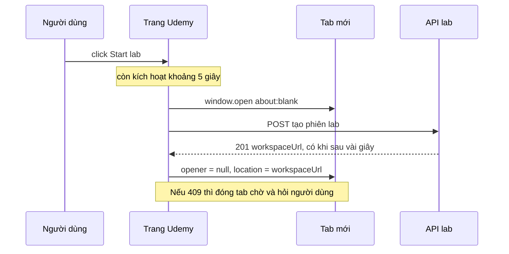

Udemy Labs cho học viên một môi trường thật để thực hành: console AWS, máy ảo Docker, notebook Jupyter. Bấm **Start lab**, Udemy gọi API tạo phiên lab (có khi mất vài giây vì phải dựng máy), rồi mở workspace ở **tab mới**. Trong lúc lab chạy, trang Udemy đếm giờ và định kỳ báo tiến độ lên server.

Hai việc đó đụng hai giới hạn của trình duyệt:

1. **Chặn popup.** `window.open` chỉ được phép khi trang vừa nhận thao tác của người dùng. Gọi API xong mới mở tab thì có thể đã quá hạn và tab bị chặn.
2. **Hẹn giờ với hàm async.** `setInterval(async () => { await … })` không chờ lượt trước xong. Một lần ghi chậm là các tick sau chạy chồng lên.

> [!TIP]
> **Tóm tắt**
> - Mở tab chờ (`about:blank` hoặc trang loading) **đồng bộ trong handler của click**, gọi API sau, rồi mới đổi `location` của tab đó. API lỗi 409 (đang chạy lab khác) thì đóng tab chờ và hỏi người dùng.
> - Đừng truyền chuỗi features như `'close=yes'`: chuỗi khác rỗng làm trình duyệt mở **cửa sổ popup** thay vì tab (đo trên Chromium 153: `toolbar.visible === false`). Nhớ đặt `tab.opener = null` trước khi sang origin khác.
> - Heartbeat 250ms của Udemy dùng `setInterval` với hàm `async`. Khi bước đồng bộ trạng thái chậm, tick sau chạy chồng: trong demo, 12 giây chạy thật bị ghi thành 19,1 giây.
> - Sửa bằng `setTimeout` lồng nhau (lượt sau chỉ hẹn khi lượt trước xong) và `performance.now()` cho đồng hồ đơn điệu.

<iframe class="demo-frame" src="/demos/web-patterns/index.html?theme=dark#/ud-lab-launcher" title="Demo ud-lab-launcher" loading="lazy" style="height: 860px"></iframe>

<p class="demo-links">▶ <a href="/demos/web-patterns/index.html#/ud-lab-launcher" target="_blank" rel="noopener">Mở demo toàn màn hình ↗</a> · <a href="https://stackblitz.com/github/hunghg255/blog-hunghg/tree/master/examples/web-patterns?file=src/lib/udLabLauncher.ts" target="_blank" rel="noopener">Sửa code trên StackBlitz ↗</a> · <a href="https://github.com/hunghg255/blog-hunghg/blob/master/examples/web-patterns/src/lib/udLabLauncher.ts" target="_blank" rel="noopener">Xem source trên GitHub ↗</a></p>

## Udemy làm thế nào?

Mã nằm ở `udemy.com/webpack---/src/udemy/js/labs/`:

- `lab-launcher/lab-launcher.mobx-store.js`: store điều khiển nút Start/Stop/Connect.
- `heartbeat.js`: lớp `Heartbeat`.
- `constants.js`: các hằng `PROGRESS_TIMER_INTERVAL_MS = 250`, `PROGRESS_LOGGING_INTERVAL_MS = 15000`, `PROGRESS_LOGGING_INTERVAL_LIMIT_MS = 300000`, `LAB_ACTION_TIMEOUT_MS = 1000`.

### Mở tab trước, điền URL sau

`startLab()` mở cửa sổ **trước** mọi `await`:

```js
// lab-launcher.mobx-store.js (rút gọn)
async startLab() {
  this.labWindow = window.open('about:blank', '_blank', 'close=yes'); // lab AWS: trang loading của Udemy
  const response = await this._createLabInstance();                  // có thể mất vài giây
  if (!response) return;                                              // 409 / lỗi: đã xử lý bên trong
  if (this.isAWSLab) {                                                // đăng xuất phiên console cũ, chờ 1s
    this.redirectToUrl(AWS_LOGOUT_URL);
    await new Promise((resolve) => setTimeout(resolve, LAB_ACTION_TIMEOUT_MS));
  }
  this.redirectToUrl(this.lab.myLatestInstance.workspaceSsoUrl);      // labWindow.location = url
  this.heartbeat.start();
}
```

Lab AWS mở trang loading của chính Udemy (cùng origin, học viên thấy "đang khởi động"), các lab khác mở `about:blank`. Riêng lab AWS có thêm một bước: trỏ tab tới URL đăng xuất của AWS để huỷ phiên console cũ (học viên có thể vẫn đăng nhập tài khoản AWS của lab trước), chờ 1 giây, rồi mới tới URL đăng nhập một lần (SSO) của lab mới.

Lỗi 409 từ API nghĩa là học viên đang chạy lab khác. `_createLabInstance` bắt riêng mã này: lưu danh sách lab đang chạy, mở modal hỏi có dừng lab cũ không, và **đóng tab chờ** để không để lại tab trắng.

Ba chỗ suy ra từ code (mình không chạy được trên udemy.com):

- `redirectToUrl` gán thẳng `this.labWindow.location = url`. Nếu trình duyệt vẫn chặn (`window.open` trả `null`), dòng này ném `TypeError` và học viên không có đường nào vào lab.
- Nhánh `catch` đọc `e.response.status`. Lỗi mạng (không có response) thì `e.response` là `undefined`, `catch` lại ném lỗi lần nữa.
- Workspace là origin khác (AWS, Vocareum), nhưng tab giữ `window.opener` trỏ về trang Udemy. Có lẽ không ai lợi dụng, nhưng cắt đi thì không tốn gì.

### Nhịp tim

`Heartbeat` tick mỗi 250ms để cập nhật đồng hồ trên giao diện, và mỗi 15 giây gọi lại để ghi tiến độ:

```js
// heartbeat.js
start() {
  if (this.intervalId === null) {
    this.resetLastActivity();
    this.intervalId = setInterval(this.tick, PROGRESS_TIMER_INTERVAL_MS);
  }
}

async tick() {
  const elapsedSinceLastActivityMs = Math.floor(Date.now() - this.lastActivityDate);
  if (elapsedSinceLastActivityMs >= this.elapsedSinceLastActivityMs) {   // chống đồng hồ lùi
    await this.onTick(elapsedSinceLastActivityMs);
    this.elapsedSinceLastActivityMs = elapsedSinceLastActivityMs;
    if (elapsedSinceLastActivityMs >= this.loggingInterval) this.resetLastActivity();
  }
}
```

Phép so sánh `elapsed >= this.elapsedSinceLastActivityMs` là để bỏ qua tick khi đồng hồ máy bị chỉnh lùi (`Date.now()` không đơn điệu). Hàm `onTick` của store ghi tiến độ (`elapsed_time` tối đa 300 giây) rồi `await` đồng bộ trạng thái lab nếu lab đang ở trạng thái chuyển tiếp (starting, stopping), có cờ `refreshInProgress` để không gọi chồng.

Vấn đề là `this.elapsedSinceLastActivityMs` chỉ được cập nhật **sau** `await`. Trong lúc lượt đầu đang chờ đồng bộ, `setInterval` vẫn gọi `tick` mỗi 250ms. Các tick đó so với giá trị cũ, vẫn qua điều kiện, vẫn thấy `elapsed >= 15000`, nên ghi tiến độ thêm một lần nữa. Lượt đầu chờ xong lại `resetLastActivity()` lần nữa, làm mất một quãng thời gian ở cửa sổ kế. Demo thu nhỏ 15 giây xuống 3 giây và cho bước đồng bộ mất 900ms: sau 12 giây, bản giống Udemy ghi 6 lần với tổng 19,1 giây, bản sửa ghi 3 lần, 9,3 giây (cửa sổ thứ tư chưa đủ 3 giây). Hai lần ghi trùng có cùng `start_time`, nên có thể server đã tự khử trùng; mình không kiểm được phía server.

## Bên trong trình duyệt: kích hoạt tạm thời

Chuẩn HTML gọi đây là **transient activation**: khi người dùng click, gõ phím hoặc chạm, cửa sổ được "kích hoạt" trong một khoảng ngắn. Các API nhạy cảm như `window.open`, toàn màn hình hay phát âm thanh chỉ chạy khi cờ này còn. Khoảng thời gian do trình duyệt đặt; Chrome giữ cờ khoảng 5 giây. Trang đọc được trạng thái qua `navigator.userActivation.isActive`.

Cờ không đi theo `await`. Nó chỉ là "thời điểm thao tác gần nhất + khoảng cho phép", nên API trả về sau 1 giây thì vẫn mở được, sau 6,5 giây thì không:



Chuỗi `features` (đối số thứ ba của `window.open`) cũng ảnh hưởng: theo chuẩn, chuỗi rỗng thì mở tab; chuỗi khác rỗng mà không bật `location` hay `toolbar` thì trình duyệt coi là yêu cầu **popup** (cửa sổ nhỏ, không thanh địa chỉ). `'close=yes'` không phải tuỳ chọn có nghĩa, nhưng đủ để biến tab thành popup. Trên Chromium 153, cửa sổ mở bằng `'close=yes'` có `toolbar.visible` và `locationbar.visible` là `false`, mở không có features thì là `true`.

## Viết lại

```ts title=src/lib/udLabLauncher.ts
/**
 * PHẢI gọi đồng bộ trong handler của click: `window.open` chỉ được phép khi trang còn
 * "kích hoạt tạm thời" (transient activation) từ thao tác của người dùng.
 * Tab mở ra trỏ tới trang chờ cùng origin, sau đó mới đổi sang URL thật.
 */
export async function launchInPlaceholder(
  api: LaunchApi,
  placeholderUrl = 'about:blank',
  open: typeof window.open = window.open.bind(window),
): Promise<LaunchResult> {
  // Không truyền chuỗi features: chuỗi khác rỗng (kể cả 'close=yes') làm trình duyệt mở cửa sổ popup thay vì tab.
  const tab = open(placeholderUrl, '_blank');

  try {
    const { workspaceUrl } = await api.createInstance();
    if (!tab || tab.closed) return { kind: 'blocked', url: workspaceUrl };
    // Tab mở bằng window.open giữ `opener` trỏ về trang mình; cắt đi trước khi sang origin khác.
    tab.opener = null;
    tab.location.href = workspaceUrl;
    return { kind: 'opened', url: workspaceUrl };
  } catch (error) {
    tab?.close(); // đừng để lại một tab trắng
    if (error instanceof LabConflictError) return { kind: 'conflict', runningLabs: error.runningLabs };
    return { kind: 'error', message: error instanceof Error ? error.message : String(error) };
  }
}
```

```ts title=src/lib/udLabLauncher.ts
export function createHeartbeat({
  tickMs = 250,
  logEveryMs = 15_000,
  maxElapsedMs = 300_000,
  onTick,
  onLog,
  now = () => performance.now(),
}: HeartbeatOptions) {
  let timer: ReturnType<typeof setTimeout> | undefined;
  let windowStart = 0;
  let running = false;

  // setTimeout lồng nhau thay vì setInterval: lượt sau chỉ được hẹn khi lượt trước (kể cả await) xong,
  // nên một lần ghi chậm không làm các tick sau ghi trùng.
  const loop = async () => {
    if (!running) return;
    const elapsed = now() - windowStart; // performance.now() đơn điệu, không lùi khi đổi giờ máy
    onTick?.(elapsed);
    if (elapsed >= logEveryMs) {
      const startedAt = windowStart;
      windowStart = now();
      try {
        await onLog(startedAt, Math.min(elapsed, maxElapsedMs));
      } catch {
        // ghi lỗi thì bỏ qua lượt này; lượt sau vẫn chạy
      }
    }
    if (running) timer = setTimeout(loop, tickMs);
  };

  return {
    start() {
      if (running) return;
      running = true;
      windowStart = now();
      timer = setTimeout(loop, tickMs);
    },
    stop() {
      running = false;
      clearTimeout(timer);
    },
    get running() {
      return running;
    },
  };
}
```

::: spoiler Xem toàn bộ src/lib/udLabLauncher.ts

```ts title=src/lib/udLabLauncher.ts
/**
 * Mở môi trường lab ở tab mới mà không bị chặn popup, rồi giữ "nhịp tim" cho phiên lab
 * (ý tưởng từ lab-launcher và heartbeat của Udemy).
 */

// ---------- 1. Mở tab trước, điền URL sau ----------

export interface LaunchApi {
  /** tạo phiên lab; ném LabConflictError nếu người dùng đang chạy lab khác */
  createInstance(): Promise<{ workspaceUrl: string }>;
}

export class LabConflictError extends Error {
  constructor(public runningLabs: string[]) {
    super('Đang có lab khác chạy');
  }
}

export type LaunchResult =
  | { kind: 'opened'; url: string }
  | { kind: 'blocked'; url: string } // trình duyệt chặn: đưa link cho người dùng tự bấm
  | { kind: 'conflict'; runningLabs: string[] }
  | { kind: 'error'; message: string };

/**
 * PHẢI gọi đồng bộ trong handler của click: `window.open` chỉ được phép khi trang còn
 * "kích hoạt tạm thời" (transient activation) từ thao tác của người dùng.
 * Tab mở ra trỏ tới trang chờ cùng origin, sau đó mới đổi sang URL thật.
 */
export async function launchInPlaceholder(
  api: LaunchApi,
  placeholderUrl = 'about:blank',
  open: typeof window.open = window.open.bind(window),
): Promise<LaunchResult> {
  // Không truyền chuỗi features: chuỗi khác rỗng (kể cả 'close=yes') làm trình duyệt mở cửa sổ popup thay vì tab.
  const tab = open(placeholderUrl, '_blank');

  try {
    const { workspaceUrl } = await api.createInstance();
    if (!tab || tab.closed) return { kind: 'blocked', url: workspaceUrl };
    // Tab mở bằng window.open giữ `opener` trỏ về trang mình; cắt đi trước khi sang origin khác.
    tab.opener = null;
    tab.location.href = workspaceUrl;
    return { kind: 'opened', url: workspaceUrl };
  } catch (error) {
    tab?.close(); // đừng để lại một tab trắng
    if (error instanceof LabConflictError) return { kind: 'conflict', runningLabs: error.runningLabs };
    return { kind: 'error', message: error instanceof Error ? error.message : String(error) };
  }
}

// ---------- 2. Nhịp tim: tick đều, ghi tiến độ định kỳ, không chồng lượt ----------

export interface HeartbeatOptions {
  /** khoảng tick để cập nhật đồng hồ trên UI (Udemy: 250ms) */
  tickMs?: number;
  /** khoảng ghi tiến độ lên server (Udemy: 15s) */
  logEveryMs?: number;
  /** trần cho một lần ghi, phòng tab ngủ lâu rồi thức dậy (Udemy: 300s) */
  maxElapsedMs?: number;
  onTick?: (elapsedMs: number) => void;
  /**
   * ghi tiến độ; có thể chậm, heartbeat sẽ không gọi chồng.
   * `startedAt` theo đồng hồ `now` (mặc định performance.now(); cần epoch thì cộng performance.timeOrigin).
   */
  onLog: (startedAt: number, elapsedMs: number) => Promise<void>;
  now?: () => number;
}

export function createHeartbeat({
  tickMs = 250,
  logEveryMs = 15_000,
  maxElapsedMs = 300_000,
  onTick,
  onLog,
  now = () => performance.now(),
}: HeartbeatOptions) {
  let timer: ReturnType<typeof setTimeout> | undefined;
  let windowStart = 0;
  let running = false;

  // setTimeout lồng nhau thay vì setInterval: lượt sau chỉ được hẹn khi lượt trước (kể cả await) xong,
  // nên một lần ghi chậm không làm các tick sau ghi trùng.
  const loop = async () => {
    if (!running) return;
    const elapsed = now() - windowStart; // performance.now() đơn điệu, không lùi khi đổi giờ máy
    onTick?.(elapsed);
    if (elapsed >= logEveryMs) {
      const startedAt = windowStart;
      windowStart = now();
      try {
        await onLog(startedAt, Math.min(elapsed, maxElapsedMs));
      } catch {
        // ghi lỗi thì bỏ qua lượt này; lượt sau vẫn chạy
      }
    }
    if (running) timer = setTimeout(loop, tickMs);
  };

  return {
    start() {
      if (running) return;
      running = true;
      windowStart = now();
      timer = setTimeout(loop, tickMs);
    },
    stop() {
      running = false;
      clearTimeout(timer);
    },
    get running() {
      return running;
    },
  };
}
```

:::

## Đi qua code

- **`open(placeholderUrl, '_blank')` ở dòng đầu**, trước mọi `await`: chỗ duy nhất còn chắc chắn có kích hoạt. `open` nhận qua tham số để test được.
- **`!tab || tab.closed`**: trình duyệt chặn (trả `null`) hoặc người dùng đã đóng tab chờ. Thay vì ném lỗi, trả `kind: 'blocked'` kèm URL để giao diện hiện link cho người dùng tự bấm (lúc đó là một cú click mới, có kích hoạt mới).
- **`tab.opener = null` rồi mới đổi `location`**: tab đang ở `about:blank` cùng origin nên còn sửa được `opener`; sang origin khác rồi thì không.
- **`catch`**: lỗi nào cũng đóng tab chờ. `LabConflictError` thành `kind: 'conflict'`, lỗi khác thành `kind: 'error'`. Không đọc `e.response.status` mù quáng.
- **`createHeartbeat`**: `loop` là hàm async tự hẹn lượt sau bằng `setTimeout` **sau khi** `onLog` xong. Không bao giờ có hai lượt chạy cùng lúc, nên không cần cờ `refreshInProgress` hay so sánh `elapsed` với giá trị cũ.
- **`windowStart = now()` trước `await onLog`**: cửa sổ mới bắt đầu ngay lúc ghi, thời gian chờ ghi được tính vào cửa sổ sau, không bị mất và không bị ghi hai lần.
- **`performance.now()`**: đơn điệu, không lùi khi người dùng chỉnh giờ máy. Cần gửi giờ thật thì cộng `performance.timeOrigin`.

**Khác bản gốc:** không có các nhánh riêng cho từng loại lab (AWS logout, Azure đăng nhập tay, lab chạy trong iframe), không có hạn giờ phiên và hộp nhắc hết giờ.

## Tại sao không làm cách khác?

- **Gọi API xong mới `window.open`?** Chạy được nếu API luôn nhanh hơn thời gian kích hoạt, nhưng không có gì đảm bảo. Dựng máy ảo vài giây là chuyện bình thường.
- **Mở thẳng URL workspace trong click, server tự tạo lab khi tab mới tải?** Gọn hơn, nhưng mất chỗ xử lý 409 (đang chạy lab khác) trước khi mở tab, và tab mới phải tự biết lỗi để hiện.
- **Dùng `<a target="_blank">` thay `window.open`?** Link không bị chặn, nhưng phải biết URL ngay lúc click. Đây đúng là đường dự phòng khi bị chặn ở trên.
- **`setInterval` + cờ "đang chạy"?** Udemy có `refreshInProgress` cho bước đồng bộ, nhưng phần ghi tiến độ nằm ngoài cờ đó. Thêm cờ thì sửa được, nhưng `setTimeout` lồng nhau không cần cờ nào.

## Edge case và cạm bẫy

- **Người dùng đóng tab chờ trong lúc API chạy**: `tab.closed` là `true`, đổi `location` không có tác dụng. Bản viết lại coi như bị chặn và trả link.
- **Trang loading cùng origin tốt hơn `about:blank`**: người dùng thấy "đang khởi động" thay vì tab trắng. Tab cùng origin còn có thể nhận thông báo lỗi qua `postMessage` hoặc `BroadcastChannel`.
- **Tab nền bị trình duyệt làm chậm hẹn giờ** (tối thiểu 1 giây, có khi lâu hơn với tab ngủ lâu). Heartbeat tính bằng hiệu thời gian nên không trôi, nhưng một lượt có thể ghi `elapsed` rất lớn: trần `maxElapsedMs` (Udemy 300 giây) chặn trường hợp tab ngủ cả giờ rồi thức dậy.
- **Headless và trình duyệt tắt chặn popup**: `window.open` mở được cả khi hết kích hoạt, nên test tự động không bắt được lỗi này. Kiểm tra `navigator.userActivation.isActive` trong test thay vì chờ popup bị chặn.

## Dùng trong dự án

Mẫu "mở tab chờ trước" dùng cho mọi luồng cần mở trang ngoài sau một bước async: thanh toán qua cổng bên ngoài, đăng nhập OAuth bằng popup, xuất file PDF xem ở tab mới.

```ts
button.addEventListener('click', async () => {
  const result = await launchInPlaceholder(api, '/labs/loading');
  if (result.kind === 'blocked') showLink(result.url);
  if (result.kind === 'conflict') openConflictModal(result.runningLabs);
});
```

::: spoiler Ví dụ test (bản phác, không có trong repo)

```ts
import { describe, expect, it, vi } from 'vitest';
import { createHeartbeat, LabConflictError, launchInPlaceholder } from './udLabLauncher';

describe('launchInPlaceholder', () => {
  it('mở tab trước, gọi API, rồi điền URL và cắt opener', async () => {
    const tab = { closed: false, opener: {} as unknown, location: { href: 'about:blank' }, close: vi.fn() };
    const open = vi.fn(() => tab as unknown as Window);
    const api = { createInstance: vi.fn(async () => ({ workspaceUrl: 'https://lab.example/ws/1' })) };
    expect(await launchInPlaceholder(api, 'about:blank', open)).toEqual({ kind: 'opened', url: 'https://lab.example/ws/1' });
    expect(open).toHaveBeenCalledWith('about:blank', '_blank'); // không có chuỗi features
    expect(tab.opener).toBeNull();
    expect(tab.location.href).toBe('https://lab.example/ws/1');
  });

  it('409: đóng tab chờ và trả danh sách lab đang chạy', async () => {
    const tab = { closed: false, close: vi.fn() };
    const api = { createInstance: async () => { throw new LabConflictError(['Docker']); } };
    expect(await launchInPlaceholder(api, 'about:blank', () => tab as unknown as Window)).toEqual({
      kind: 'conflict',
      runningLabs: ['Docker'],
    });
    expect(tab.close).toHaveBeenCalled();
  });
});

describe('createHeartbeat', () => {
  it('lần ghi chậm không làm các tick sau ghi trùng', async () => {
    vi.useFakeTimers();
    let t = 0;
    const logs: number[] = [];
    const hb = createHeartbeat({
      tickMs: 250,
      logEveryMs: 3000,
      now: () => t,
      onLog: async (_s, elapsed) => {
        logs.push(elapsed);
        await new Promise((r) => setTimeout(r, 900));
      },
    });
    hb.start();
    for (let i = 0; i < 48; i++) { t += 250; await vi.advanceTimersByTimeAsync(250); } // 12 giây
    hb.stop();
    expect(logs.length).toBeLessThanOrEqual(4);
    expect(logs.reduce((a, b) => a + b, 0)).toBeLessThanOrEqual(12000);
    vi.useRealTimers();
  });
});
```

:::

## So với chuẩn web

- **`navigator.userActivation`** (`isActive`, `hasBeenActive`) có trên Chrome và Edge; các trình duyệt khác thì xem [caniuse](https://caniuse.com/mdn-api_navigator_useractivation) (tính tới 10/2026). Dùng để quyết định mở tab ngay hay hiện link.
- **`noopener` trong features**: `window.open(url, '_blank', 'noopener')` cắt `opener` ngay, nhưng khi đó hàm trả về `null`, nên không dùng được cho mẫu "mở trước, điền sau". Đặt `tab.opener = null` như trên là cách thay thế.
- **`<a target="_blank">`** mặc định đã ngầm `rel="noopener"` trên các trình duyệt hiện nay; `window.open` thì không.
- **`scheduler.postTask` / `setTimeout` lồng nhau**: không có API chuẩn nào "setInterval nhưng chờ async"; `setTimeout` lồng nhau vẫn là cách đơn giản nhất.

---

Bài này thuộc series **[Học từ mã nguồn Udemy](/series/udemy)** (21 bài, đọc theo thứ tự).

::: spoiler Xem nhanh danh sách bài trong series

*Mở đầu*

- [Mở đầu: bên trong frontend của Udemy](/blogs/learn-from-udemy-source-code)

*Phần 1: video và học bài*

- [#1 DRM đa hệ: Widevine, PlayReady, FairPlay](/blogs/udemy-drm-multi-key-system)
- [#2 URL ký và license hết hạn: tự làm mới, tải trước bài kế](/blogs/udemy-expiring-media-urls)
- [#3 Ghi tiến độ xem theo bucket, tự hoàn thành, backoff lỗi](/blogs/udemy-watch-progress-buckets)
- [#4 Thumbnail sprite từ WebVTT và slide trên seekbar](/blogs/udemy-sprite-thumbnails-vtt)
- [#5 Phụ đề: tự chọn ngôn ngữ và editor có phím tắt](/blogs/udemy-captions-auto-select-editor)
- [#6 Đo băng thông, autoplay Safari, iPad giả làm Mac](/blogs/udemy-video-quirks-autoplay)

*Phần 2: bài tập, bài thi, lab*

- [#7 Preview code HTML/React trong iframe sandbox](/blogs/udemy-code-preview-sandbox)
- [#8 Bài thi có giờ: tạm dừng khi rảnh, autosave theo dấu vân tay](/blogs/udemy-timed-exam)
- [#9 Chấm code realtime: đăng ký kênh trước, có đường dự phòng](/blogs/udemy-realtime-grading)
- **#10 Mở lab không bị chặn popup, heartbeat, xung đột phiên** (bài này)

*Phần 3: editor và nội dung*

- [#11 ProseMirror: schema theo flag, NodeView React, HTML cho email](/blogs/udemy-prosemirror-integration)
- [#12 Parse HTML an toàn bằng document tách rời](/blogs/udemy-safe-html-parse)
- [#13 Sinh file .ics có VTIMEZONE tự dò giờ mùa hè](/blogs/udemy-ics-vtimezone)
- [#14 Đọc Open Badges giấu trong ảnh PNG và SVG](/blogs/udemy-open-badges-image)

*Phần 4: hạ tầng và trải nghiệm*

- [#15 Pipeline tracking: batch, sendBeacon, bfcache, HTTP 207](/blogs/udemy-event-tracking-pipeline)
- [#16 Gợi ý tính năng mới qua nhiều phiên bằng máy trạng thái](/blogs/udemy-feature-discoverability)
- [#17 Kéo cạnh để resize và mép cuộn mờ dần](/blogs/udemy-resizer-gradient-scroll)
- [#18 Gom request giá khoá học, cập nhật một phần khi áp coupon](/blogs/udemy-price-dataloader-partial-update)
- [#19 Trả lời lạc quan có rollback, autocomplete hai tầng cache](/blogs/udemy-optimistic-reply-autocomplete)
- [#20 Nạp app theo ưu tiên, registry store, HTML cache công khai](/blogs/udemy-app-loader-registry)

:::

Code + demo: [`examples/web-patterns`](https://github.com/hunghg255/blog-hunghg/tree/master/examples/web-patterns) · [Mở trên StackBlitz](https://stackblitz.com/github/hunghg255/blog-hunghg/tree/master/examples/web-patterns)
