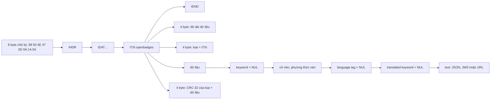

Bạn có chứng chỉ AWS hay Google Cloud trên Credly, và muốn hiện nó trong hồ sơ Udemy. Thay vì bắt bạn dán link, Udemy cho **tải lên chính file ảnh badge**. Chỉ một file PNG hay SVG, vậy mà Udemy biết badge đó là gì và do ai cấp.

Bí mật nằm ở chuẩn **Open Badges**: tổ chức cấp badge "nướng" (bake) thông tin chứng nhận, gọi là assertion, vào bên trong file ảnh. Ảnh trông bình thường, nhưng trong PNG có một chunk văn bản ẩn, còn trong SVG có một thẻ XML riêng. Udemy đọc phần đó ngay trên trình duyệt, lấy ra URL xác minh rồi gửi lên server để kiểm tra.

> [!TIP]
> **Tóm tắt**
> - PNG gồm các chunk `[độ dài][loại][dữ liệu][CRC]`. Badge nằm trong chunk `iTXt` có keyword `openbadges`. Với SVG, badge nằm trong thẻ `<openbadges:assertion>` thuộc namespace `https://purl.imsglobal.org/ob/v2p0`.
> - Cách thiết kế của Udemy đáng học: client chỉ **trích URL**, còn việc **xác minh** do server làm.
> - Bản gốc đọc iTXt bằng giả định "keyword + 5 byte", nên hỏng khi có language tag hoặc nén. SVG chỉ nhận đúng tiền tố `openbadges:`, và loại file được đoán qua `file.type`.
> - Bản viết lại tự đọc chunk bằng `DataView`, kiểm CRC, tách iTXt theo byte NUL, giải nén bằng `DecompressionStream`, tìm SVG theo namespace.

<iframe class="demo-frame" src="/demos/web-patterns/index.html?theme=dark#/ud-badges" title="Demo ud-badges" loading="lazy" style="height: 560px"></iframe>

<p class="demo-links">▶ <a href="/demos/web-patterns/index.html#/ud-badges" target="_blank" rel="noopener">Mở demo toàn màn hình ↗</a> · <a href="https://stackblitz.com/github/hunghg255/blog-hunghg/tree/master/examples/web-patterns?file=src/lib/udOpenBadges.ts" target="_blank" rel="noopener">Sửa code trên StackBlitz ↗</a> · <a href="https://github.com/hunghg255/blog-hunghg/blob/master/examples/web-patterns/src/lib/udOpenBadges.ts" target="_blank" rel="noopener">Xem source trên GitHub ↗</a></p>

## Udemy làm thế nào?

Code nằm ở `udemy.com/webpack---/src/udemy/js/open-badges/upload-badge/`. Component `image-uploader.react-component.tsx` chọn bộ đọc theo `file.type`:

```ts
// image-uploader.react-component.tsx (rút gọn)
if (this.file.type === 'image/svg+xml') return parseSVGFile(this.file);
if (this.file.type === 'image/png') return parsePNGFile(this.file);
```

URL lấy được gửi lên GraphQL qua `useStoreAssertionByUrlMutation({externalUrl})`. **Server** tải assertion từ URL đó, xác minh rồi lưu lại. Đây là điểm thiết kế tốt: ảnh do người dùng tải lên có thể bị sửa tuỳ ý, nên client không tin gì cả, chỉ trích ra chỗ để server tự đi kiểm tra.

### Đọc PNG

`image-parser-utils.ts` dùng thư viện `png-chunks-extract`, một thư viện npm viết cho Node.js nên cần polyfill `Buffer` trên trình duyệt:

```ts
// image-parser-utils.ts (rút gọn)
const PNG_ASSERTION_DATA_OFFSET_BYTES = 5;
const PNG_ASSERTION_KEYWORD = 'openbadges';

const chunks = extractPNGChunks(Buffer.from(await file.arrayBuffer()));
const iTXtChunks = chunks.filter((chunk) => chunk.name === 'iTXt');
const assertionChunk = iTXtChunks
    .map((chunk) => new TextDecoder().decode(chunk.data))
    .find((chunkData) => chunkData.startsWith(PNG_ASSERTION_KEYWORD));
const assertionData = JSON.parse(
    assertionChunk.slice(PNG_ASSERTION_KEYWORD.length + PNG_ASSERTION_DATA_OFFSET_BYTES),
);
return assertionData.id;
```

Phần chú thích trong file liệt kê cấu trúc iTXt, rồi lập luận: chuẩn baking không dùng nén, không dùng language tag hay translated keyword, nên dữ liệu "chắc chắn" bắt đầu sau keyword và 5 byte.

### Đọc SVG

```ts
const svgData = new DOMParser().parseFromString(await file.text(), 'image/svg+xml');
const assertion = svgData.getElementsByTagName('openbadges:assertion')[0];
return assertion.getAttribute('verify'); // Do we need security related checks here?
```

Chú thích "Do we need security related checks here?" là của chính đội Udemy. Câu trả lời ngắn: ở đây thì không nhiều. `DOMParser` chỉ phân tích chứ không chạy script trong SVG, còn ảnh xem trước hiển thị qua ``, nơi script trong SVG cũng không chạy. Phần cần cẩn thận là server khi tải URL, chẳng hạn chống SSRF.

### Năm chỗ hở

Demo nướng cùng một assertion theo 5 cách khác nhau. Cách đọc mô phỏng Udemy hỏng ở 3 cách:

1. **Language tag khác rỗng.** iTXt có trường language tag (ví dụ `vi`) và translated keyword. Khi chúng không rỗng, "keyword + 5 byte" trỏ vào giữa trường, nên `JSON.parse` báo lỗi `Unexpected token`. Chuẩn baking không cấm language tag.
2. **Chunk bị nén.** Cờ nén = 1 thì dữ liệu là zlib, và Udemy đem bytes zlib đi `JSON.parse`. Chuẩn Open Badges 2.0 nói không dùng nén, nên đây không phải lỗi của Udemy, nhưng một bộ đọc chịu được thì không tốn thêm bao nhiêu.
3. **`startsWith('openbadges')`** cũng khớp keyword `openbadgesfoo`. Keyword phải so khớp chính xác.
4. **SVG phụ thuộc tiền tố.** XML cho phép đặt tiền tố tuỳ ý (`xmlns:ob="https://purl.imsglobal.org/ob/v2p0"` rồi viết `<ob:assertion>`). `getElementsByTagName('openbadges:assertion')` so theo tên có tiền tố, nên trượt. Ngoài ra, nếu thẻ không có thuộc tính `verify` mà chứa JSON bên trong, hàm trả về `null` mà không báo lỗi.
5. **Tin `file.type`.** Trình duyệt đoán MIME theo đuôi file. Một file PNG bị đổi tên thành `.svg` sẽ bị đem đi parse như XML. Nên nhìn vào nội dung, tức magic number, như bài [Magic number, EXIF và dán ảnh](/blogs/web-file-magic-number-exif-paste).

Thêm hai điểm nhỏ: assertion đã ký (JWS, dạng `xxx.yyy.zzz`) chưa được hỗ trợ, có `TODO` trong code. Component xem trước gọi `URL.createObjectURL(this.file)` ngay trong `render()` mà không thu hồi, nên mỗi lần render lại tạo thêm một Blob URL.

## Bên trong file PNG



Một vài chi tiết đáng nhớ:

- **Chữ ký 8 byte** bắt đầu bằng `0x89` (không phải ASCII) và chứa `\r\n`, `\x1A`, `\n`. Đây là cách PNG phát hiện file bị chương trình truyền tải "sửa" ký tự xuống dòng.
- **Số nguyên big-endian**, nên `DataView.getUint32` mặc định đọc đúng.
- **CRC-32** tính trên phần loại và dữ liệu, với đa thức `0xEDB88320`. Thêm hay sửa chunk thì phải tính lại CRC, nếu không trình đọc ảnh nghiêm ngặt sẽ từ chối.
- **Phân biệt chunk theo chữ hoa/thường** của chữ cái đầu: `iTXt` viết thường nên là chunk phụ. Bộ giải mã ảnh không hiểu thì bỏ qua, ảnh vẫn hiển thị bình thường. Đó là lý do nhét badge vào đây an toàn.
- **Văn bản trong iTXt là UTF-8**, còn keyword là Latin-1.

## Viết lại

Đọc chunk bằng `DataView` (hàm `readPngChunks`, khoảng 20 dòng, không cần `Buffer`), rồi tách iTXt theo đúng ba byte NUL và giải nén nếu cần:

```ts title=src/lib/udOpenBadges.ts
/**
 * Cấu trúc iTXt: keyword \0 cờ-nén phương-thức-nén languageTag \0 translatedKeyword \0 text.
 * Tìm từng byte NUL thay vì giả định "keyword + 5 byte".
 */
export async function parseITXt(data: Uint8Array): Promise<ITXt> {
  const nul1 = data.indexOf(0);
  if (nul1 < 1 || nul1 > 79) throw new BadgeParseError('Keyword iTXt không hợp lệ');
  const compressed = data[nul1 + 1] === 1;
  const langStart = nul1 + 3;
  const nul2 = data.indexOf(0, langStart);
  const nul3 = data.indexOf(0, nul2 + 1);
  if (nul2 < 0 || nul3 < 0) throw new BadgeParseError('iTXt thiếu dấu phân cách');
  const raw = data.subarray(nul3 + 1);
  return {
    keyword: latin1.decode(data.subarray(0, nul1)),
    compressed,
    languageTag: latin1.decode(data.subarray(langStart, nul2)),
    translatedKeyword: utf8.decode(data.subarray(nul2 + 1, nul3)),
    text: utf8.decode(compressed ? await inflate(raw) : raw),
  };
}
```

SVG thì tìm theo namespace, ưu tiên JSON nằm trong thẻ:

```ts title=src/lib/udOpenBadges.ts
export function readBadgeFromSvg(svgText: string): BadgeAssertion {
  const doc = new DOMParser().parseFromString(svgText, 'image/svg+xml');
  if (doc.getElementsByTagName('parsererror').length) throw new BadgeParseError('SVG không hợp lệ');
  // Theo namespace: tiền tố có thể là "openbadges:", "ob:"… miễn trỏ đúng URI.
  const node = doc.getElementsByTagNameNS(OB_NAMESPACE, 'assertion')[0];
  if (!node) throw new BadgeParseError('SVG không có <openbadges:assertion>');
  const inner = node.textContent?.trim() ?? '';
  const verify = node.getAttribute('verify');
  if (inner) return { source: 'svg', raw: inner, ...classifyAssertion(inner) };
  if (verify) return { source: 'svg', raw: verify, kind: 'url', verifyUrl: verify };
  throw new BadgeParseError('<assertion> không có verify cũng không có nội dung');
}
```

::: spoiler Xem toàn bộ src/lib/udOpenBadges.ts

```ts title=src/lib/udOpenBadges.ts
/**
 * Đọc/nướng (bake) Open Badges trong ảnh PNG và SVG ngay trên trình duyệt.
 * Ý tưởng từ open-badges/upload-badge/image-parser-utils.ts của Udemy, viết lại:
 * - đọc chunk PNG bằng DataView, kiểm CRC, không cần polyfill Buffer của Node;
 * - tách iTXt đúng theo các byte NUL, hỗ trợ cả language tag lẫn nén deflate;
 * - SVG tìm theo namespace chứ không theo tiền tố "openbadges:";
 * - đoán loại file bằng magic number thay vì tin file.type.
 */

const PNG_SIGNATURE = [137, 80, 78, 71, 13, 10, 26, 10];
export const OB_KEYWORD = 'openbadges';
export const OB_NAMESPACE = 'https://purl.imsglobal.org/ob/v2p0';

export interface PngChunk {
  type: string;
  data: Uint8Array;
  crcOk: boolean;
}

// ---- CRC-32 (PNG dùng đa thức 0xEDB88320) ----

const CRC_TABLE = (() => {
  const table = new Uint32Array(256);
  for (let n = 0; n < 256; n++) {
    let c = n;
    for (let k = 0; k < 8; k++) c = c & 1 ? 0xedb88320 ^ (c >>> 1) : c >>> 1;
    table[n] = c >>> 0;
  }
  return table;
})();

export function crc32(bytes: Uint8Array) {
  let c = 0xffffffff;
  for (const b of bytes) c = CRC_TABLE[(c ^ b) & 0xff] ^ (c >>> 8);
  return (c ^ 0xffffffff) >>> 0;
}

// ---- Đọc / ghi chunk ----

export function isPng(bytes: Uint8Array) {
  return PNG_SIGNATURE.every((b, i) => bytes[i] === b);
}

export function readPngChunks(buffer: ArrayBuffer): PngChunk[] {
  const bytes = new Uint8Array(buffer);
  if (!isPng(bytes)) throw new BadgeParseError('Không phải file PNG (sai 8 byte đầu)');
  const view = new DataView(buffer);
  const chunks: PngChunk[] = [];
  let offset = 8;
  while (offset + 12 <= bytes.length) {
    const length = view.getUint32(offset);
    if (offset + 12 + length > bytes.length) throw new BadgeParseError('Chunk bị cắt cụt');
    const typeAndData = bytes.subarray(offset + 4, offset + 8 + length);
    const type = String.fromCharCode(...typeAndData.subarray(0, 4));
    const crc = view.getUint32(offset + 8 + length);
    chunks.push({ type, data: typeAndData.subarray(4), crcOk: crc32(typeAndData) === crc });
    offset += 12 + length;
    if (type === 'IEND') break;
  }
  return chunks;
}

function makeChunk(type: string, data: Uint8Array) {
  const out = new Uint8Array(12 + data.length);
  const view = new DataView(out.buffer);
  view.setUint32(0, data.length);
  for (let i = 0; i < 4; i++) out[4 + i] = type.charCodeAt(i);
  out.set(data, 8);
  view.setUint32(8 + data.length, crc32(out.subarray(4, 8 + data.length)));
  return out;
}

// ---- iTXt ----

export interface ITXt {
  keyword: string;
  compressed: boolean;
  languageTag: string;
  translatedKeyword: string;
  text: string;
}

const latin1 = new TextDecoder('latin1');
const utf8 = new TextDecoder();

/**
 * Cấu trúc iTXt: keyword \0 cờ-nén phương-thức-nén languageTag \0 translatedKeyword \0 text.
 * Tìm từng byte NUL thay vì giả định "keyword + 5 byte".
 */
export async function parseITXt(data: Uint8Array): Promise<ITXt> {
  const nul1 = data.indexOf(0);
  if (nul1 < 1 || nul1 > 79) throw new BadgeParseError('Keyword iTXt không hợp lệ');
  const compressed = data[nul1 + 1] === 1;
  const langStart = nul1 + 3;
  const nul2 = data.indexOf(0, langStart);
  const nul3 = data.indexOf(0, nul2 + 1);
  if (nul2 < 0 || nul3 < 0) throw new BadgeParseError('iTXt thiếu dấu phân cách');
  const raw = data.subarray(nul3 + 1);
  return {
    keyword: latin1.decode(data.subarray(0, nul1)),
    compressed,
    languageTag: latin1.decode(data.subarray(langStart, nul2)),
    translatedKeyword: utf8.decode(data.subarray(nul2 + 1, nul3)),
    text: utf8.decode(compressed ? await inflate(raw) : raw),
  };
}

export async function buildITXt(
  keyword: string,
  text: string,
  { languageTag = '', translatedKeyword = '', compress = false } = {},
): Promise<Uint8Array> {
  const enc = new TextEncoder();
  const body = compress ? await deflate(enc.encode(text)) : enc.encode(text);
  const head = [...enc.encode(keyword), 0, compress ? 1 : 0, 0, ...enc.encode(languageTag), 0, ...enc.encode(translatedKeyword), 0];
  const out = new Uint8Array(head.length + body.length);
  out.set(head);
  out.set(body, head.length);
  return out;
}

async function pipeThrough(bytes: Uint8Array, stream: CompressionStream | DecompressionStream) {
  const res = new Response(new Blob([bytes as BlobPart]).stream().pipeThrough(stream));
  return new Uint8Array(await res.arrayBuffer());
}
// PNG dùng zlib (RFC 1950), chính là 'deflate' của Compression Streams API.
const inflate = (b: Uint8Array) => pipeThrough(b, new DecompressionStream('deflate'));
const deflate = (b: Uint8Array) => pipeThrough(b, new CompressionStream('deflate'));

/** Chèn chunk iTXt openbadges trước IEND, thay chunk cũ nếu có (ảnh chỉ được chứa 1 assertion). */
export async function bakePng(png: ArrayBuffer, assertion: string, options?: Parameters<typeof buildITXt>[2]) {
  const chunks = readPngChunks(png);
  const parts: Uint8Array[] = [new Uint8Array(PNG_SIGNATURE)];
  for (const c of chunks) {
    if (c.type === 'iTXt' && latin1.decode(c.data.subarray(0, c.data.indexOf(0))) === OB_KEYWORD) continue;
    if (c.type === 'IEND') parts.push(makeChunk('iTXt', await buildITXt(OB_KEYWORD, assertion, options)));
    parts.push(makeChunk(c.type, c.data));
  }
  return new Blob(parts as BlobPart[], { type: 'image/png' });
}

// ---- Đọc assertion ----

export class BadgeParseError extends Error {
  name = 'BadgeParseError';
}

export interface BadgeAssertion {
  source: 'png-itxt' | 'svg';
  /** JSON assertion (có `id`), chữ ký JWS, hoặc chỉ là URL */
  kind: 'json' | 'jws' | 'url';
  /** URL để server tải và xác minh assertion */
  verifyUrl: string | null;
  raw: string;
}

/** Phân loại nội dung assertion theo Open Badges 2.0: JSON đã ký hay chưa ký, hoặc URL. */
export function classifyAssertion(raw: string): Pick<BadgeAssertion, 'kind' | 'verifyUrl'> {
  const s = raw.trim();
  if (s.startsWith('{')) {
    let json: { id?: string; verify?: { url?: string } };
    try {
      json = JSON.parse(s);
    } catch {
      throw new BadgeParseError('Assertion JSON hỏng');
    }
    return { kind: 'json', verifyUrl: json.verify?.url ?? json.id ?? null };
  }
  if (/^[\w-]+\.[\w-]+\.[\w-]+$/.test(s)) return { kind: 'jws', verifyUrl: null };
  if (/^https?:\/\//.test(s)) return { kind: 'url', verifyUrl: s };
  throw new BadgeParseError('Không nhận ra định dạng assertion');
}

export async function readBadgeFromPng(buffer: ArrayBuffer): Promise<BadgeAssertion> {
  for (const c of readPngChunks(buffer)) {
    if (c.type !== 'iTXt') continue;
    const itxt = await parseITXt(c.data);
    if (itxt.keyword !== OB_KEYWORD) continue; // so khớp CHÍNH XÁC, không phải startsWith
    return { source: 'png-itxt', raw: itxt.text, ...classifyAssertion(itxt.text) };
  }
  throw new BadgeParseError('PNG không có chunk iTXt "openbadges"');
}

export function readBadgeFromSvg(svgText: string): BadgeAssertion {
  const doc = new DOMParser().parseFromString(svgText, 'image/svg+xml');
  if (doc.getElementsByTagName('parsererror').length) throw new BadgeParseError('SVG không hợp lệ');
  // Theo namespace: tiền tố có thể là "openbadges:", "ob:"… miễn trỏ đúng URI.
  const node = doc.getElementsByTagNameNS(OB_NAMESPACE, 'assertion')[0];
  if (!node) throw new BadgeParseError('SVG không có <openbadges:assertion>');
  const inner = node.textContent?.trim() ?? '';
  const verify = node.getAttribute('verify');
  if (inner) return { source: 'svg', raw: inner, ...classifyAssertion(inner) };
  if (verify) return { source: 'svg', raw: verify, kind: 'url', verifyUrl: verify };
  throw new BadgeParseError('<assertion> không có verify cũng không có nội dung');
}

/** Đoán loại theo nội dung file (magic number), không dựa vào đuôi/MIME do trình duyệt đoán. */
export async function readBadge(file: Blob): Promise<BadgeAssertion> {
  const buffer = await file.arrayBuffer();
  const head = new Uint8Array(buffer, 0, Math.min(256, buffer.byteLength));
  if (isPng(head)) return readBadgeFromPng(buffer);
  const text = utf8.decode(head).trimStart();
  if (text.startsWith('<?xml') || text.startsWith('<svg')) return readBadgeFromSvg(utf8.decode(buffer));
  throw new BadgeParseError('Chỉ hỗ trợ PNG và SVG');
}
```

:::

## Đi qua code

- **`readPngChunks`**: kiểm 8 byte chữ ký, rồi lặp `[length][type][data][crc]`. `subarray` không chép dữ liệu, chỉ tạo view. Chunk bị cắt cụt thì báo lỗi thay vì đọc tràn. `crcOk` được trả về để nơi gọi tự quyết định (demo hiển thị "CRC sai" nếu có).
- **`parseITXt`**: tìm NUL đầu tiên làm hết keyword (1–79 byte theo chuẩn PNG). Byte kế là cờ nén, byte sau là phương thức nén. Language tag kéo tới NUL thứ hai, translated keyword tới NUL thứ ba, phần còn lại là văn bản. Nén thì đi qua `DecompressionStream('deflate')`; tên `deflate` trong Compression Streams API chính là định dạng zlib (RFC 1950) mà PNG dùng.
- **`bakePng`**: một ảnh chỉ nên mang một assertion, nên chunk `openbadges` cũ bị bỏ trước khi chèn chunk mới ngay trước `IEND`. `makeChunk` tính CRC cho phần loại và dữ liệu.
- **`classifyAssertion`**: Open Badges 2.0 cho phép văn bản là JSON assertion (lấy `verify.url` hoặc `id`), JWS đã ký (ba đoạn base64url nối bằng dấu chấm; cần server kiểm chữ ký), hoặc một URL.
- **`readBadgeFromSvg`**: `getElementsByTagNameNS(namespace, 'assertion')` khớp mọi tiền tố. Ưu tiên JSON nằm trong thẻ (thường bọc trong `CDATA`), không có thì lấy thuộc tính `verify`. Không có cả hai thì báo lỗi rõ ràng, thay vì trả `null`.
- **`readBadge`**: nhìn 8 byte đầu để nhận PNG, nhìn `<?xml` hoặc `<svg` để nhận SVG, không tin đuôi file.

**Khác bản gốc:** Udemy trả về `id` của assertion để server tải. Bản viết lại trả về cả loại (`json`/`jws`/`url`), URL xác minh và nội dung gốc, để nơi gọi chọn cách xử lý. Bản viết lại cũng có thêm `bakePng` cho demo và cho test.

## Tại sao không làm cách khác?

- **Dùng `png-chunks-extract` như Udemy?** Được, nhưng thư viện này dựa vào `Buffer` của Node.js, nên bundle phải kèm polyfill. Đọc chunk PNG chỉ khoảng 20 dòng với `DataView`.
- **Decode cả chunk thành chuỗi rồi cắt?** Bytes zlib hay byte NUL bị chuyển thành ký tự thay thế, cắt theo chỉ số ký tự sẽ lệch. Luôn tách theo byte trước, decode sau.
- **Để server đọc luôn file ảnh?** Cũng là một lựa chọn hợp lý, và server vẫn phải xác minh. Đọc ở client giúp báo lỗi ngay ("ảnh này không phải badge") mà không cần tải file lên.

## Edge case và cạm bẫy

- **Ảnh qua công cụ nén** (TinyPNG, ảnh chụp màn hình, mạng xã hội) thường bị bỏ hết chunk phụ, nên badge mất. Cần báo cho người dùng biết "ảnh không chứa thông tin badge" thay vì lỗi chung chung.
- **`toBlob` của canvas** tạo PNG mới không có iTXt. Muốn giữ badge sau khi resize thì phải đọc chunk từ file gốc rồi nướng lại.
- **SVG có `<!DOCTYPE>` với entity** có thể dùng để tạo XML bomb. `DOMParser` của trình duyệt có giới hạn riêng, nhưng nếu làm phía server thì phải tắt việc mở rộng entity.
- **URL trong badge do người dùng kiểm soát.** Server tải URL đó phải chặn địa chỉ nội bộ (SSRF) và giới hạn kích thước, thời gian.
- **JWS**: chỉ server mới kiểm được chữ ký bằng khoá công khai của tổ chức cấp. Client chỉ nên chuyển tiếp.

## Dùng trong dự án

```ts
import { BadgeParseError, readBadge } from './udOpenBadges';

input.addEventListener('change', async () => {
  const file = input.files?.[0];
  if (!file) return;
  try {
    const badge = await readBadge(file);
    // Gửi lên server; server tự tải và xác minh, không tin dữ liệu từ client
    await api.post('/badges/import', { raw: badge.raw, kind: badge.kind, verifyUrl: badge.verifyUrl });
  } catch (e) {
    showError(e instanceof BadgeParseError ? e.message : 'Không đọc được ảnh');
  }
});
```

## Kiểm thử

::: spoiler Ví dụ test (bản phác, không có trong repo)

```ts title=udOpenBadges.test.ts
// @vitest-environment node
import { describe, expect, it } from 'vitest';
import { bakePng, classifyAssertion, crc32, readBadgeFromPng, readPngChunks } from './udOpenBadges';

// PNG 1×1 nhỏ nhất (IHDR + IDAT + IEND)
const PNG = Uint8Array.from(atob('iVBORw0KGgoAAAANSUhEUgAAAAEAAAABCAYAAAAfFcSJAAAADUlEQVR42mNkYPhfDwAChwGA60e6kgAAAABJRU5ErkJggg=='), (c) => c.charCodeAt(0)).buffer;
const assertion = JSON.stringify({ type: 'Assertion', id: 'https://example.org/a/1', verify: { type: 'hosted' } });

describe('udOpenBadges', () => {
  it('CRC-32 đúng chuẩn', () => {
    expect(crc32(new TextEncoder().encode('IEND'))).toBe(0xae426082);
  });

  it.each([{}, { languageTag: 'vi' }, { compress: true }])('nướng rồi đọc lại được (%o)', async (opts) => {
    const buf = await (await bakePng(PNG, assertion, opts)).arrayBuffer();
    const chunks = readPngChunks(buf);
    expect(chunks.map((c) => c.type)).toEqual(['IHDR', 'IDAT', 'iTXt', 'IEND']);
    expect(chunks.every((c) => c.crcOk)).toBe(true);
    const r = await readBadgeFromPng(buf);
    expect(r).toMatchObject({ source: 'png-itxt', kind: 'json', verifyUrl: 'https://example.org/a/1' });
  });

  it('nướng lần hai thì thay chứ không thêm chunk', async () => {
    const once = await (await bakePng(PNG, assertion)).arrayBuffer();
    const twice = await (await bakePng(once, assertion.replace('/1', '/2'))).arrayBuffer();
    expect(readPngChunks(twice).filter((c) => c.type === 'iTXt')).toHaveLength(1);
    expect((await readBadgeFromPng(twice)).verifyUrl).toBe('https://example.org/a/2');
  });

  it('phân loại JSON / JWS / URL', () => {
    expect(classifyAssertion('https://example.org/a/9').kind).toBe('url');
    expect(classifyAssertion('eyJhbGciOiJSUzI1NiJ9.eyJpZCI6IjEifQ.c2ln').kind).toBe('jws');
    expect(() => classifyAssertion('{hỏng')).toThrow('JSON hỏng');
  });
});
```

```ts title=udOpenBadgesSvg.test.ts
import { describe, expect, it } from 'vitest';
import { OB_NAMESPACE, readBadgeFromSvg } from './udOpenBadges';

const svg = (prefix: string, inner = '') =>
  `<svg xmlns="http://www.w3.org/2000/svg" xmlns:${prefix}="${OB_NAMESPACE}"><${prefix}:assertion verify="https://example.org/a/5">${inner}</${prefix}:assertion></svg>`;

describe('readBadgeFromSvg', () => {
  it('tìm theo namespace, không phụ thuộc tiền tố', () => {
    expect(readBadgeFromSvg(svg('openbadges')).verifyUrl).toBe('https://example.org/a/5');
    expect(readBadgeFromSvg(svg('ob')).verifyUrl).toBe('https://example.org/a/5');
  });
  it('ưu tiên assertion JSON nằm trong thẻ', () => {
    const r = readBadgeFromSvg(svg('ob', '<![CDATA[{"id":"https://example.org/a/6"}]]>'));
    expect(r).toMatchObject({ kind: 'json', verifyUrl: 'https://example.org/a/6' });
  });
  it('không có assertion thì báo lỗi rõ ràng', () => {
    expect(() => readBadgeFromSvg('<svg xmlns="http://www.w3.org/2000/svg"/>')).toThrow('không có');
  });
});
```

:::

## So với chuẩn và thư viện

- **Open Badges 3.0** chuyển sang mô hình Verifiable Credentials của W3C. Baking vẫn dùng chunk `iTXt`, nhưng keyword và nội dung khác (chứng chỉ được ký). Bộ đọc chunk ở trên dùng lại được, chỉ cần đổi phần phân loại nội dung.
- **Compression Streams API** (`CompressionStream`, `DecompressionStream`) đã có trên Chrome, Edge, Firefox và Safari (tính tới 10/2026, xem [caniuse](https://caniuse.com/mdn-api_compressionstream)), nên giải nén zlib không cần thư viện.

---

Bài này thuộc series **[Học từ mã nguồn Udemy](/series/udemy)** (21 bài, đọc theo thứ tự).

::: spoiler Xem nhanh danh sách bài trong series

*Mở đầu*

- [Mở đầu: bên trong frontend của Udemy](/blogs/learn-from-udemy-source-code)

*Phần 1: video và học bài*

- [#1 DRM đa hệ: Widevine, PlayReady, FairPlay](/blogs/udemy-drm-multi-key-system)
- [#2 URL ký và license hết hạn: tự làm mới, tải trước bài kế](/blogs/udemy-expiring-media-urls)
- [#3 Ghi tiến độ xem theo bucket, tự hoàn thành, backoff lỗi](/blogs/udemy-watch-progress-buckets)
- [#4 Thumbnail sprite từ WebVTT và slide trên seekbar](/blogs/udemy-sprite-thumbnails-vtt)
- [#5 Phụ đề: tự chọn ngôn ngữ và editor có phím tắt](/blogs/udemy-captions-auto-select-editor)
- [#6 Đo băng thông, autoplay Safari, iPad giả làm Mac](/blogs/udemy-video-quirks-autoplay)

*Phần 2: bài tập, bài thi, lab*

- [#7 Preview code HTML/React trong iframe sandbox](/blogs/udemy-code-preview-sandbox)
- [#8 Bài thi có giờ: tạm dừng khi rảnh, autosave theo dấu vân tay](/blogs/udemy-timed-exam)
- [#9 Chấm code realtime: đăng ký kênh trước, có đường dự phòng](/blogs/udemy-realtime-grading)
- [#10 Mở lab không bị chặn popup, heartbeat, xung đột phiên](/blogs/udemy-lab-launcher)

*Phần 3: editor và nội dung*

- [#11 ProseMirror: schema theo flag, NodeView React, HTML cho email](/blogs/udemy-prosemirror-integration)
- [#12 Parse HTML an toàn bằng document tách rời](/blogs/udemy-safe-html-parse)
- [#13 Sinh file .ics có VTIMEZONE tự dò giờ mùa hè](/blogs/udemy-ics-vtimezone)
- **#14 Đọc Open Badges giấu trong ảnh PNG và SVG** (bài này)

*Phần 4: hạ tầng và trải nghiệm*

- [#15 Pipeline tracking: batch, sendBeacon, bfcache, HTTP 207](/blogs/udemy-event-tracking-pipeline)
- [#16 Gợi ý tính năng mới qua nhiều phiên bằng máy trạng thái](/blogs/udemy-feature-discoverability)
- [#17 Kéo cạnh để resize và mép cuộn mờ dần](/blogs/udemy-resizer-gradient-scroll)
- [#18 Gom request giá khoá học, cập nhật một phần khi áp coupon](/blogs/udemy-price-dataloader-partial-update)
- [#19 Trả lời lạc quan có rollback, autocomplete hai tầng cache](/blogs/udemy-optimistic-reply-autocomplete)
- [#20 Nạp app theo ưu tiên, registry store, HTML cache công khai](/blogs/udemy-app-loader-registry)

:::

Code + demo: [`examples/web-patterns`](https://github.com/hunghg255/blog-hunghg/tree/master/examples/web-patterns) · [Mở trên StackBlitz](https://stackblitz.com/github/hunghg255/blog-hunghg/tree/master/examples/web-patterns)
