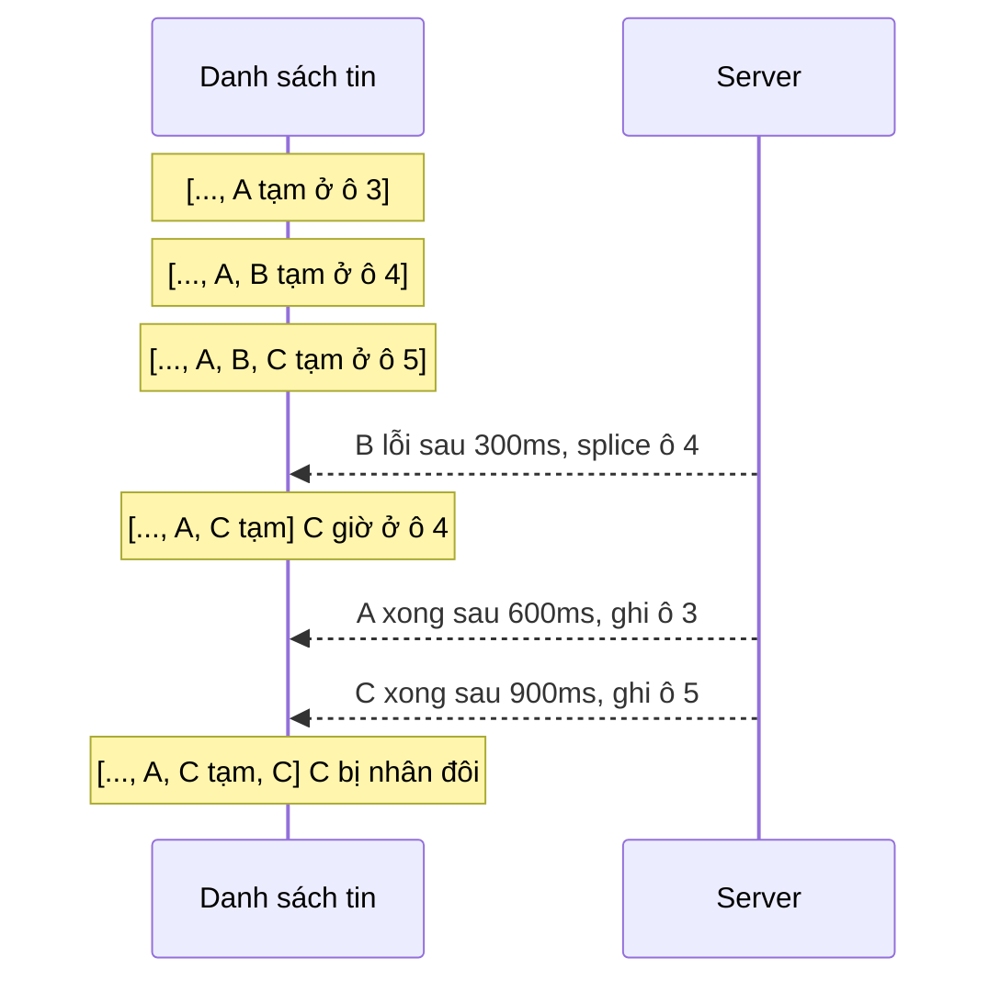

Học viên nhắn cho giảng viên, giảng viên trả lời trong hộp tin của Udemy. Bấm gửi mà phải chờ server 500ms mới thấy tin của mình thì cảm giác chậm, nên Udemy dùng **cập nhật lạc quan** (optimistic update): hiện tin ngay, gửi ngầm, lỗi thì gỡ tin ra. Ở chỗ khác, trang chia sẻ khoá học cho đồng nghiệp qua Slack có ô gõ `@người` hoặc `#kênh` với gợi ý, dùng cache **hai tầng** để không gọi API ở mỗi phím.

Cả hai đều chạy tốt khi mọi thứ diễn ra lần lượt. Bài này xem chúng vỡ thế nào khi nhiều việc chạy **cùng lúc**: gửi ba tin liên tiếp, một tin lỗi; API Slack lỗi đúng một lần.

> [!TIP]
> **Tóm tắt**
> - Udemy hiện tin tạm ngay, nhớ **vị trí** của nó trong mảng; lỗi thì `splice(vị trí, 1)` và khôi phục `last_message` đã chụp lúc gửi.
> - Nhớ theo vị trí sẽ vỡ khi có nhiều tin đang gửi: tin lỗi bị gỡ làm các tin sau dời chỗ. Demo: gửi A, B, C, B lỗi, kết quả hiện **A, C, C**.
> - Tìm tin tạm theo **id tạm**, giữ tin lỗi lại với nút "Gửi lại" thay vì xoá mất nội dung người dùng đã gõ.
> - Autocomplete: tầng 1 cache kết quả API theo **chữ cái đầu**, tầng 2 lọc theo cả chuỗi ngay trên client. Đừng để một lần lỗi khoá mọi lần gõ sau.

<iframe class="demo-frame" src="/demos/web-patterns/index.html?theme=dark#/ud-messaging" title="Demo ud-messaging" loading="lazy" style="height: 1450px"></iframe>

<p class="demo-links">▶ <a href="/demos/web-patterns/index.html#/ud-messaging" target="_blank" rel="noopener">Mở demo toàn màn hình ↗</a> · <a href="https://stackblitz.com/github/hunghg255/blog-hunghg/tree/master/examples/web-patterns?file=src/lib/udMessaging.ts" target="_blank" rel="noopener">Sửa code trên StackBlitz ↗</a> · <a href="https://github.com/hunghg255/blog-hunghg/blob/master/examples/web-patterns/src/lib/udMessaging.ts" target="_blank" rel="noopener">Xem source trên GitHub ↗</a></p>

Thử trong demo: bấm **Gửi A, B, C** và so hai cột. Ở phần 2, gõ `a`, chờ một chút, rồi gõ tiếp `an`, `@an`, `b`: cột "Kiểu Udemy" đứng yên với danh sách cũ và chỉ gọi API một lần.

## Udemy làm thế nào?

### Trả lời lạc quan

[`messaging/new-ia/messaging.mobx-store.js`](https://github.com/hunghg255/codebase/blob/main/udemy.com/webpack---/src/udemy/js/messaging/new-ia/messaging.mobx-store.js):

```js
async replyToThread(thread, content) {
  const lastMessage = thread.last_message,
    newMessage = {
      class: '_message',
      id: lastMessage.id + 1,              // id tạm: id tin cuối + 1
      content,
      created: new Date().toISOString(),
      is_outgoing: true,
      message_thread_id: thread.id,
    };
  const wasMuted = thread.is_muted;
  thread.is_muted = false;                 // nhắn vào thread đang tắt tiếng thì bật lại

  thread.messages.push(newMessage);
  thread.last_message = newMessage;
  const lastMessageIndex = thread.messages.length - 1;

  try {
    const response = await udApi.post(`message-threads/${thread.id}/messages/`, {content});
    runInAction(() => {
      thread.last_message = response.data;
      thread.messages[lastMessageIndex] = thread.last_message;   // thay tin tạm bằng tin thật
    });
    return response.data;
  } catch (error) {
    runInAction(() => {
      thread.is_muted = wasMuted;          // rollback cả trạng thái tắt tiếng
      thread.last_message = lastMessage;
      thread.messages.splice(lastMessageIndex, 1);
    });
    throw error;
  }
}
```

Điểm tốt: rollback **đủ** mọi thứ đã đổi, không chỉ danh sách tin mà cả `last_message` (hiện ở danh sách hội thoại bên trái) và `is_muted`. Rất nhiều code optimistic quên những trạng thái phụ như vậy. Lỗi được `throw` lại để component hiện thông báo.

Thread được chuẩn bị trước các thuộc tính `is_deleted`, `is_muted`, `messages` ngay khi tải (`makeObservableThread`). Comment dài trong code giải thích lý do: với MobX bản cũ, thuộc tính thêm vào object sau khi đã observable thì `observer` không theo dõi được.

### Autocomplete hai tầng

[`organization-common/ufb-social-share/slack-autocomplete.mobx-store.js`](https://github.com/hunghg255/codebase/blob/main/udemy.com/webpack---/src/udemy/js/organization-common/ufb-social-share/slack-autocomplete.mobx-store.js) kế thừa `AutosuggestStore` (gói `@udemy/react-autosuggest-components`, không có trong bản dump; debounce và cache theo query nằm ở đó). Store Slack ghi đè `query` chỉ lấy **chữ cái đầu**:

```js
get cleanInputValue() {
  return this.inputValue.replace('#', '').replace('@', '').toLowerCase();
}

get query() {
  return this.cleanInputValue.substring(0, 1);     // API chỉ nhận 1 ký tự
}

// This is intentionally separate from `cachedSuggestions` on the base AutosuggestStore. (...)
// The API returns all suggestions that match the first character of the input value.
// `this.suggestions` filters the API suggestions for the ones that match the entire input value.
cachedAPISuggestions = {};
```

Gõ `a`, `an`, `ann` đều là query `a`: API được gọi một lần, trả về mọi người và kênh có chữ `a`, lưu ở `cachedAPISuggestions['a']`. Mỗi phím sau đó chỉ lọc lại trên client bằng `includes(cleanInputValue)`, tiền tố `#` chỉ giữ kênh, `@` chỉ giữ người. Người và kênh lấy bằng hai API riêng, chạy song song:

```js
async loadSuggestions({q}) {
  this._resetErrors();                                   // chỉ xoá lỗi khi ô nhập rỗng
  if (this.searchInProgress.has(q)) return;
  if (q in this.cachedAPISuggestions) {
    this.setSuggestions(this._filterMatchingSuggestions(this.cachedAPISuggestions[q]));
    return;
  }
  if (this.isFetchUsersError || this.isFetchChannelsError) {
    this.setSuggestions(this.suggestions);
    return;
  }
  this.searchInProgress.add(q);
  const responses = await Promise.all([this._fetchUsers(q), this._fetchChannels(q)]);
  // (...) gộp kết quả, đặt thông báo lỗi, sắp xếp, lọc, cache nếu cả hai thành công
}
```

`_fetchUsers` và `_fetchChannels` tự bắt lỗi và trả về lỗi thay vì ném, nên `Promise.all` không hỏng khi một bên lỗi: gợi ý của bên còn lại vẫn hiện, kèm thông báo "Không lấy được danh sách người dùng…".

## Chỗ vỡ

### Ba tin cùng bay, tin giữa lỗi



`lastMessageIndex` được chụp lúc gửi. B lỗi thì bị gỡ, C tụt từ ô 5 xuống ô 4, nhưng promise của C vẫn nhớ ô 5. Khi C thành công, nó ghi vào ô 5 (lúc này chưa có gì) và tin tạm của C ở ô 4 nằm lại với trạng thái "đang gửi" mãi. Demo cho đúng kết quả đó: **A, C (đang gửi), C**.

Có thêm hai chỗ cùng gốc:
- Khôi phục `last_message` về ảnh chụp lúc gửi: B lỗi thì `last_message` quay về A tạm, dù C vẫn đang gửi. Ở đây A và C thành công sau đó nên tự đúng lại, nhưng nếu C lỗi trước A thì danh sách hội thoại có thể hiện một tin không còn tồn tại.
- Id tạm `lastMessage.id + 1` có thể trùng id của một tin thật: nếu server cấp id tăng dần (có lẽ vậy, vì code dựa vào đó), tin người kia gửi tới trong lúc mình đang gửi sẽ có đúng id này, làm hai tin cùng `key` trong React.

Một lựa chọn sản phẩm cũng đáng bàn: tin lỗi bị **xoá**, nội dung người dùng đã gõ mất theo (trừ khi component tự giữ lại ô nhập). Đa số app chat giữ tin lỗi lại với dấu "!" và nút gửi lại.

### Một lần lỗi khoá cả ô gợi ý

Cờ `isFetchUsersError` chỉ được xoá trong `_resetErrors` khi **ô nhập rỗng**. Sau một lần lỗi, mọi lần gõ tiếp theo, kể cả gõ chữ khác (`b`), đều đi vào nhánh `if (this.isFetchUsersError || ...)` và trả lại danh sách cũ, không gọi API. Thông báo lỗi bảo người dùng "thử gõ lại", nhưng gõ lại mà không xoá trắng ô thì không có tác dụng. Demo: sau lỗi ở `a`, gõ `an`, `@an`, `b` đều giữ nguyên 4 kênh của lần đầu, tổng 1 lần gọi API; xoá trắng rồi gõ `b` mới gọi lại.

Hai chi tiết nhỏ hơn:
- `suggestions.sort((_) => _.value)` trả về **chuỗi**, không phải số âm/dương. Hàm so sánh trả về giá trị không phải số thì bị ép thành `NaN` và coi như bằng nhau, nên mảng giữ nguyên thứ tự server trả (thường là: người trước, kênh sau, mỗi nhóm theo thứ tự của Slack).
- `if (this.searchInProgress.has(q)) return;` bỏ qua phím gõ khi đang có request cho cùng chữ đầu. Kết quả vẫn đúng vì lúc response về, bộ lọc đọc `cleanInputValue` **hiện tại**; nhưng nếu người dùng đổi chữ đầu trong lúc chờ (`a` → `b`), danh sách của `a` được lọc theo chuỗi `b…` và có thể hiện lẫn kết quả.

## Viết lại

Tin tạm có id riêng và trạng thái; `send` tìm lại tin theo id:

```ts title=src/lib/udMessaging.ts
    reply(content: string) {
      const tempId = `tmp-${++tmpSeq}`;
      if (mutedBeforeSend === null) mutedBeforeSend = thread.muted;
      thread.muted = false;
      thread.messages = [...thread.messages, { id: tempId, content, outgoing: true, status: 'sending' }];
      onChange();
      return send(tempId, content);
    },
```

```ts title=src/lib/udMessaging.ts
  async function send(tempId: string, content: string) {
    try {
      const saved = await post(content);
      replace(tempId, { id: saved.id, status: 'sent' });
      mutedBeforeSend = null;
    } catch {
      replace(tempId, { status: 'failed' });
      // chỉ khôi phục "tắt tiếng" khi không còn tin nào đang gửi và chưa tin nào gửi được
      if (pending() === 0 && mutedBeforeSend !== null) {
        thread.muted = mutedBeforeSend;
        mutedBeforeSend = null;
        onChange();
      }
    }
  }
```

Autocomplete hai tầng:

```ts title=src/lib/udMessaging.ts
  return {
    /** Trả gợi ý cho chuỗi đang gõ; ném lỗi nếu API lỗi (lần sau gõ tiếp sẽ thử lại). */
    async suggest(input: string): Promise<Suggestion[]> {
      const { kind, term, prefix } = parse(input);
      if (!prefix) return [];
      const cached = cache.get(prefix);
      if (cached) return filter(cached, kind, term);
      const failed = failedAt.get(prefix);
      if (failed && Date.now() - failed < retryAfterMs) throw new Error('Vừa lỗi, chờ chút rồi thử lại');
      let p = inflight.get(prefix);
      if (!p) {
        calls++;
        p = fetchPrefix(prefix).finally(() => inflight.delete(prefix));
        inflight.set(prefix, p);
      }
      try {
        const list = await p;
        cache.set(prefix, list);
        failedAt.delete(prefix);
        return filter(list, kind, term);
      } catch (err) {
        failedAt.set(prefix, Date.now());
        throw err;
      }
    },
```

::: spoiler Xem toàn bộ src/lib/udMessaging.ts

```ts title=src/lib/udMessaging.ts
/**
 * Trả lời tin nhắn lạc quan (optimistic) có rollback, và autocomplete cache hai tầng
 * (ý tưởng từ messaging.mobx-store và slack-autocomplete.mobx-store của Udemy).
 *
 * Khác bản gốc:
 * - Tin tạm có id riêng (tiền tố "tmp-"), tìm lại theo id chứ không theo vị trí trong mảng,
 *   nên gửi nhiều tin cùng lúc rồi một tin lỗi không làm hỏng tin khác.
 * - Tin lỗi ở lại với trạng thái "failed" để người dùng gửi lại, thay vì biến mất.
 * - `lastMessage` tính lại từ danh sách thay vì khôi phục ảnh chụp cũ.
 * - Autocomplete: lỗi của một tiền tố không làm khoá mọi lần gõ sau; request đang chạy được dùng
 *   chung thay vì bỏ qua; kết quả sắp xếp đúng.
 */

export type SendStatus = 'sending' | 'sent' | 'failed';

export interface Message {
  id: string;
  content: string;
  outgoing: boolean;
  status: SendStatus;
}

export interface Thread {
  id: string;
  muted: boolean;
  messages: Message[];
}

let tmpSeq = 0;

export function createThreadStore(
  thread: Thread,
  post: (content: string) => Promise<{ id: string }>,
  onChange: () => void,
) {
  // thread bị tắt tiếng thì gửi tin sẽ bật lại; nhớ giá trị cũ để khôi phục khi TẤT CẢ tin đang gửi đều lỗi
  let mutedBeforeSend: boolean | null = null;

  const pending = () => thread.messages.filter((m) => m.status === 'sending').length;
  const replace = (id: string, patch: Partial<Message>) => {
    thread.messages = thread.messages.map((m) => (m.id === id ? { ...m, ...patch } : m));
    onChange();
  };

  async function send(tempId: string, content: string) {
    try {
      const saved = await post(content);
      replace(tempId, { id: saved.id, status: 'sent' });
      mutedBeforeSend = null;
    } catch {
      replace(tempId, { status: 'failed' });
      // chỉ khôi phục "tắt tiếng" khi không còn tin nào đang gửi và chưa tin nào gửi được
      if (pending() === 0 && mutedBeforeSend !== null) {
        thread.muted = mutedBeforeSend;
        mutedBeforeSend = null;
        onChange();
      }
    }
  }

  return {
    get thread() {
      return thread;
    },
    /** Tin cuối cùng không phải tin lỗi (để hiện trong danh sách hội thoại). */
    get lastMessage() {
      return [...thread.messages].reverse().find((m) => m.status !== 'failed');
    },
    reply(content: string) {
      const tempId = `tmp-${++tmpSeq}`;
      if (mutedBeforeSend === null) mutedBeforeSend = thread.muted;
      thread.muted = false;
      thread.messages = [...thread.messages, { id: tempId, content, outgoing: true, status: 'sending' }];
      onChange();
      return send(tempId, content);
    },
    retry(tempId: string) {
      const msg = thread.messages.find((m) => m.id === tempId);
      if (!msg || msg.status !== 'failed') return Promise.resolve();
      replace(tempId, { status: 'sending' });
      return send(tempId, msg.content);
    },
    discard(tempId: string) {
      thread.messages = thread.messages.filter((m) => m.id !== tempId);
      onChange();
    },
  };
}

// ---------------------------------------------------------------- autocomplete hai tầng

export interface Suggestion {
  value: string;
  kind: 'user' | 'channel';
}

export interface PrefixAutocompleteOptions {
  /** Server trả mọi gợi ý khớp tiền tố (Udemy: 1 ký tự đầu). */
  fetchPrefix: (prefix: string) => Promise<Suggestion[]>;
  prefixLength?: number;
  /** Sau lỗi, chờ bao lâu thì cho thử lại tiền tố đó. */
  retryAfterMs?: number;
}

export function createPrefixAutocomplete({ fetchPrefix, prefixLength = 1, retryAfterMs = 2000 }: PrefixAutocompleteOptions) {
  const cache = new Map<string, Suggestion[]>(); // tầng 1: kết quả API theo tiền tố
  const inflight = new Map<string, Promise<Suggestion[]>>();
  const failedAt = new Map<string, number>();
  let calls = 0;

  /** "#gen" → chỉ kênh, "@an" → chỉ người, còn lại cả hai. */
  function parse(input: string) {
    const kind = input.startsWith('#') ? 'channel' : input.startsWith('@') ? 'user' : null;
    const term = input.replace(/^[#@]/, '').toLowerCase();
    return { kind, term, prefix: term.slice(0, prefixLength) };
  }

  // tầng 2: lọc theo toàn bộ chuỗi trên client, sắp tên khớp ở đầu lên trước
  function filter(list: Suggestion[], kind: string | null, term: string) {
    return list
      .filter((s) => (!kind || s.kind === kind) && s.value.toLowerCase().includes(term))
      .sort((a, b) => {
        const aStarts = a.value.toLowerCase().startsWith(term) ? 0 : 1;
        const bStarts = b.value.toLowerCase().startsWith(term) ? 0 : 1;
        return aStarts - bStarts || a.value.localeCompare(b.value);
      });
  }

  return {
    /** Trả gợi ý cho chuỗi đang gõ; ném lỗi nếu API lỗi (lần sau gõ tiếp sẽ thử lại). */
    async suggest(input: string): Promise<Suggestion[]> {
      const { kind, term, prefix } = parse(input);
      if (!prefix) return [];
      const cached = cache.get(prefix);
      if (cached) return filter(cached, kind, term);
      const failed = failedAt.get(prefix);
      if (failed && Date.now() - failed < retryAfterMs) throw new Error('Vừa lỗi, chờ chút rồi thử lại');
      let p = inflight.get(prefix);
      if (!p) {
        calls++;
        p = fetchPrefix(prefix).finally(() => inflight.delete(prefix));
        inflight.set(prefix, p);
      }
      try {
        const list = await p;
        cache.set(prefix, list);
        failedAt.delete(prefix);
        return filter(list, kind, term);
      } catch (err) {
        failedAt.set(prefix, Date.now());
        throw err;
      }
    },
    stats: () => ({ calls, cachedPrefixes: [...cache.keys()] }),
  };
}
```

:::

## Đi qua code

- **Id tạm `tmp-N`** không bao giờ trùng id thật. `replace` tìm tin theo id rồi tạo mảng mới, nên vị trí của tin có đổi bao nhiêu lần cũng không sao.
- **Ba trạng thái** `sending/sent/failed`. Tin lỗi ở lại đúng chỗ của nó trong cuộc trò chuyện, có `retry` (gửi lại cùng nội dung) và `discard` (bỏ).
- **`lastMessage` là getter** tính từ danh sách (tin cuối không lỗi), không phải một ảnh chụp cần khôi phục, nên không thể lệch với danh sách.
- **Tắt tiếng**: nhớ giá trị trước lần gửi đầu tiên của một đợt; chỉ khôi phục khi không còn tin nào đang gửi và chưa tin nào thành công. Một tin thành công là thread đã thật sự có tin mới, server cũng sẽ bỏ tắt tiếng.
- **`inflight`** dùng chung promise đang chạy cho cùng chữ đầu thay vì bỏ qua phím gõ, nên phím nào cũng nhận được kết quả, lọc theo đúng chuỗi của phím đó.
- **`failedAt`** ghi thời điểm lỗi theo **chữ đầu**: trong `retryAfterMs` thì báo lỗi ngay (không gọi API dồn dập), hết thời gian thì phím gõ tiếp theo tự thử lại. Lỗi của `a` không ảnh hưởng `b`.
- **Sắp xếp** theo hai tiêu chí: khớp từ đầu tên lên trước, rồi `localeCompare`.

**Khác bản gốc:** không dùng MobX; người và kênh gộp vào một `fetchPrefix` (dự án thật có thể gọi hai API trong đó và gộp lại như Udemy); không có thông báo lỗi riêng cho từng loại.

## Tại sao không làm cách khác?

- **Không optimistic, chờ server.** An toàn, nhưng gửi tin là thao tác người dùng làm nhiều nhất; chờ 300–800ms mỗi lần rất dễ thấy.
- **Khoá ô nhập khi đang gửi.** Tránh được tin chạy song song, nhưng người gõ nhanh bị chặn. Chat thật cần gửi liên tiếp.
- **Hàng đợi gửi tuần tự** (như [Facebook #31](/blogs/facebook-ordered-send-queue)). Giữ đúng thứ tự trên server, nhưng chậm hơn khi mạng tốt. Có thể kết hợp: hàng đợi tuần tự + tin tạm có id riêng như bản viết lại.
- **Gọi API ở mỗi phím** cho autocomplete. Tốn API, và Slack giới hạn tần suất gọi. Cache theo chữ đầu là cách đơn giản để giảm còn 1 lần gọi cho mỗi chữ cái, đổi lại mỗi lần gọi trả về danh sách lớn hơn.

## Edge case và cạm bẫy

- **Thứ tự hiển thị so với thứ tự trên server.** Ba tin gửi song song có thể được server lưu khác thứ tự. Bản viết lại giữ thứ tự gõ ở client; khi tải lại, server có thể trả khác. Cần thứ tự tuyệt đối thì gửi tuần tự.
- **Gửi lại tin cũ.** Tin lỗi gửi lại sau vài phút sẽ có thời gian tạo mới trên server nhưng vẫn nằm ở vị trí cũ trên client. Một số app chuyển tin gửi lại xuống cuối.
- **Trùng lặp khi server lưu nhưng response lỗi** (mất mạng sau khi gửi). Gửi lại sẽ tạo tin thứ hai. Cách chắc chắn là gửi kèm một khoá idempotency (id tạm của client) để server bỏ bản trùng; xem [Telegram #1](/blogs/telegram-optimistic-send) với `randomId`.
- **Kết quả autocomplete về sai thứ tự.** `suggest` trả kết quả cho đúng chuỗi được hỏi; component phải bỏ kết quả nếu chuỗi trong ô đã khác (so sánh với giá trị hiện tại trước khi `setState`).
- **Danh sách theo chữ đầu quá lớn.** Workspace Slack hàng nghìn người thì chữ `a` trả về rất nhiều. Tăng `prefixLength` lên 2 hoặc giới hạn kết quả phía server.

## Dùng trong dự án

```tsx
function Composer({ store }: { store: ReturnType<typeof createThreadStore> }) {
  const [text, setText] = useState('');
  return (
    <form
      onSubmit={(e) => {
        e.preventDefault();
        if (!text.trim()) return;
        void store.reply(text);   // không await: ô nhập trống ngay, tin hiện ngay
        setText('');
      }}
    >
      <input value={text} onChange={(e) => setText(e.target.value)} />
    </form>
  );
}

function MessageRow({ m, store }: { m: Message; store: ReturnType<typeof createThreadStore> }) {
  return (
    <li aria-busy={m.status === 'sending'}>
      {m.content}
      {m.status === 'failed' && <button onClick={() => store.retry(m.id)}>Gửi lại</button>}
    </li>
  );
}
```

::: spoiler Ví dụ test (bản phác, không có trong repo)

```ts
import { describe, expect, it, vi } from 'vitest';
import { createPrefixAutocomplete, createThreadStore, type Thread } from './udMessaging';

const delay = (ms: number) => new Promise((r) => setTimeout(r, ms));

describe('createThreadStore', () => {
  it('gửi A, B, C với B lỗi: A và C thành công, B ở lại với trạng thái failed', async () => {
    const plan: Record<string, [number, boolean]> = { A: [30, false], B: [10, true], C: [50, false] };
    let id = 0;
    const thread: Thread = { id: 't', muted: false, messages: [] };
    const store = createThreadStore(
      thread,
      async (c) => {
        const [ms, fail] = plan[c];
        await delay(ms);
        if (fail) throw new Error('500');
        return { id: `s${++id}` };
      },
      () => {},
    );
    await Promise.all(['A', 'B', 'C'].map((c) => store.reply(c)));
    expect(thread.messages.map((m) => `${m.content}:${m.status}`)).toEqual(['A:sent', 'B:failed', 'C:sent']);
    expect(store.lastMessage?.content).toBe('C');
  });

  it('tất cả đều lỗi thì khôi phục trạng thái tắt tiếng', async () => {
    const thread: Thread = { id: 't', muted: true, messages: [] };
    const store = createThreadStore(thread, async () => { throw new Error('x'); }, () => {});
    await store.reply('hi');
    expect(thread.muted).toBe(true);
  });
});

describe('createPrefixAutocomplete', () => {
  it('một lần gọi cho cả "a", "an", "@an"', async () => {
    const fetchPrefix = vi.fn(async () => [
      { value: 'anh', kind: 'user' as const },
      { value: 'android', kind: 'channel' as const },
    ]);
    const ac = createPrefixAutocomplete({ fetchPrefix });
    await Promise.all([ac.suggest('a'), ac.suggest('an')]);
    expect((await ac.suggest('@an')).map((s) => s.value)).toEqual(['anh']);
    expect(fetchPrefix).toHaveBeenCalledTimes(1);
  });

  it('lỗi của một chữ đầu không khoá chữ khác, và tự thử lại sau retryAfterMs', async () => {
    let fail = true;
    const ac = createPrefixAutocomplete({
      fetchPrefix: async (p) => {
        if (fail && p === 'a') throw new Error('503');
        return [{ value: `${p}x`, kind: 'user' }];
      },
      retryAfterMs: 20,
    });
    await expect(ac.suggest('a')).rejects.toThrow();
    expect(await ac.suggest('b')).toHaveLength(1);
    fail = false;
    await delay(25);
    expect(await ac.suggest('a')).toHaveLength(1);
  });
});
```

:::

## So với thư viện

- **TanStack Query** có `onMutate` / `onError` / `onSettled` cho optimistic update, với ví dụ chính thức dùng `getQueryData` để chụp và khôi phục cache. Cách chụp toàn bộ cache này có cùng điểm yếu với bản gốc khi nhiều mutation chạy song song; tài liệu của họ khuyên huỷ query đang chạy và tính lại từ server ở `onSettled`. Cách "mỗi tin một id tạm, cập nhật theo id" an toàn hơn cho danh sách.
- **React 19 `useOptimistic`** giữ một bản "lạc quan" của state trong lúc action đang chạy, tự quay về state thật khi action kết thúc. Nó hợp với tin đang gửi, nhưng tin **lỗi** (cần giữ lại để gửi lại) vẫn phải nằm trong state thật như bản viết lại.
- Autocomplete: các thư viện như Downshift hay React Aria lo phần bàn phím và ARIA; phần lấy dữ liệu và cache như trên vẫn tự viết. Xem thêm [Ô tìm kiếm chuẩn production](/blogs/web-production-search-box) về debounce, huỷ request và bôi đậm an toàn.

---

Bài này thuộc series **[Học từ mã nguồn Udemy](/series/udemy)** (21 bài, đọc theo thứ tự).

::: spoiler Xem nhanh danh sách bài trong series

*Mở đầu*

- [Mở đầu: bên trong frontend của Udemy](/blogs/learn-from-udemy-source-code)

*Phần 1: video và học bài*

- [#1 DRM đa hệ: Widevine, PlayReady, FairPlay](/blogs/udemy-drm-multi-key-system)
- [#2 URL ký và license hết hạn: tự làm mới, tải trước bài kế](/blogs/udemy-expiring-media-urls)
- [#3 Ghi tiến độ xem theo bucket, tự hoàn thành, backoff lỗi](/blogs/udemy-watch-progress-buckets)
- [#4 Thumbnail sprite từ WebVTT và slide trên seekbar](/blogs/udemy-sprite-thumbnails-vtt)
- [#5 Phụ đề: tự chọn ngôn ngữ và editor có phím tắt](/blogs/udemy-captions-auto-select-editor)
- [#6 Đo băng thông, autoplay Safari, iPad giả làm Mac](/blogs/udemy-video-quirks-autoplay)

*Phần 2: bài tập, bài thi, lab*

- [#7 Preview code HTML/React trong iframe sandbox](/blogs/udemy-code-preview-sandbox)
- [#8 Bài thi có giờ: tạm dừng khi rảnh, autosave theo dấu vân tay](/blogs/udemy-timed-exam)
- [#9 Chấm code realtime: đăng ký kênh trước, có đường dự phòng](/blogs/udemy-realtime-grading)
- [#10 Mở lab không bị chặn popup, heartbeat, xung đột phiên](/blogs/udemy-lab-launcher)

*Phần 3: editor và nội dung*

- [#11 ProseMirror: schema theo flag, NodeView React, HTML cho email](/blogs/udemy-prosemirror-integration)
- [#12 Parse HTML an toàn bằng document tách rời](/blogs/udemy-safe-html-parse)
- [#13 Sinh file .ics có VTIMEZONE tự dò giờ mùa hè](/blogs/udemy-ics-vtimezone)
- [#14 Đọc Open Badges giấu trong ảnh PNG và SVG](/blogs/udemy-open-badges-image)

*Phần 4: hạ tầng và trải nghiệm*

- [#15 Pipeline tracking: batch, sendBeacon, bfcache, HTTP 207](/blogs/udemy-event-tracking-pipeline)
- [#16 Gợi ý tính năng mới qua nhiều phiên bằng máy trạng thái](/blogs/udemy-feature-discoverability)
- [#17 Kéo cạnh để resize và mép cuộn mờ dần](/blogs/udemy-resizer-gradient-scroll)
- [#18 Gom request giá khoá học, cập nhật một phần khi áp coupon](/blogs/udemy-price-dataloader-partial-update)
- **#19 Trả lời lạc quan có rollback, autocomplete hai tầng cache** (bài này)
- [#20 Nạp app theo ưu tiên, registry store, HTML cache công khai](/blogs/udemy-app-loader-registry)

:::

Code + demo: [`examples/web-patterns`](https://github.com/hunghg255/blog-hunghg/tree/master/examples/web-patterns) · [Mở trên StackBlitz](https://stackblitz.com/github/hunghg255/blog-hunghg/tree/master/examples/web-patterns)
