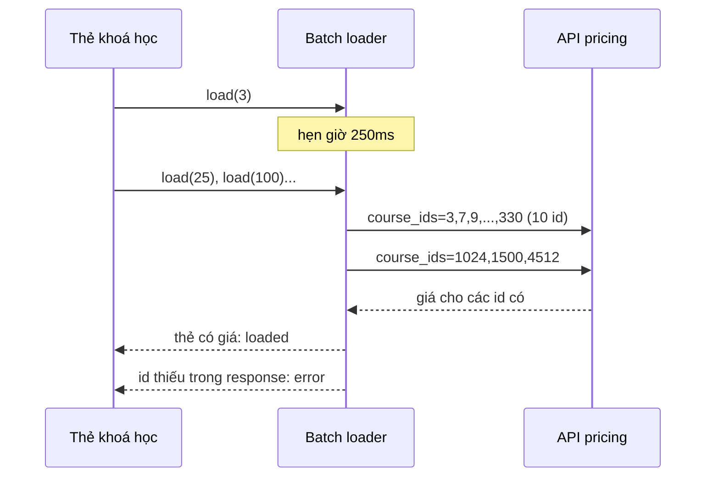

Trang chủ Udemy có hàng chục thẻ khoá học, mỗi thẻ hiện giá. Giá không nằm trong HTML: nó phụ thuộc quốc gia, tiền tệ, chương trình khuyến mãi, mã giảm giá đang áp, nên được lấy riêng qua API `pricing/`. Nếu mỗi thẻ tự gọi API thì 24 thẻ là 24 request, mỗi lần cuộn thêm một hàng lại thêm vài request.

Trang chi tiết khoá học thì ngược lại: một trang, nhưng gồm hàng chục khối (nút mua, giá, mã giảm giá, gợi ý, đếm ngược khuyến mãi…). Khi người dùng nhập mã giảm giá, chỉ những khối liên quan tới giá cần đổi; tải lại cả trang là thừa.

Bài này đọc hai mảnh code xử lý hai việc đó: `CoursePriceStore` và `CourseLandingComponentsStore`.

> [!TIP]
> **Tóm tắt**
> - **Gom request**: thẻ nào cần giá thì đăng ký id; store chờ 250ms rồi gửi theo lô 10 id. 24 thẻ còn 3–4 request.
> - **Cập nhật một phần**: mỗi khối của trang có context riêng, lưu trong một map theo tên; áp mã chỉ tải lại 7 tên trong `COMPONENTS_TO_UPDATE`.
> - Bản gốc có hai chỗ hở: id server không trả về thì thẻ treo "đang tải" mãi; áp mã liên tiếp thì response cũ về sau có thể đè giá của mã mới.
> - Bản viết lại: id thiếu thành lỗi, sắp id theo số, và "lần gọi mới nhất thắng" cho từng khối.

<iframe class="demo-frame" src="/demos/web-patterns/index.html?theme=dark#/ud-price-loader" title="Demo ud-price-loader" loading="lazy" style="height: 1500px"></iframe>

<p class="demo-links">▶ <a href="/demos/web-patterns/index.html#/ud-price-loader" target="_blank" rel="noopener">Mở demo toàn màn hình ↗</a> · <a href="https://stackblitz.com/github/hunghg255/blog-hunghg/tree/master/examples/web-patterns?file=src/lib/udPriceLoader.ts" target="_blank" rel="noopener">Sửa code trên StackBlitz ↗</a> · <a href="https://github.com/hunghg255/blog-hunghg/blob/master/examples/web-patterns/src/lib/udPriceLoader.ts" target="_blank" rel="noopener">Xem source trên GitHub ↗</a></p>

Thử trong demo: ở phần 1, chọn **Kiểu Udemy**, giữ "Server bỏ sót id 1024 và 61", bấm **Tải trang**: hai thẻ treo "Đang tải…" mãi. Để ý dòng `course_ids` của lô đầu: `100,1024,12,1500,207,25,3,…`. Ở phần 2, tắt "Lần gọi mới nhất thắng" rồi bấm **Đổi mã liên tiếp**.

## Udemy làm thế nào?

### CoursePriceStore: gom id trong 250ms

[`course-price-store/course-price-store.ts`](https://github.com/hunghg255/codebase/blob/main/udemy.com/webpack---/src/course-price-store/course-price-store.ts) là một MobX store dùng chung cho cả trang. Mỗi thẻ khoá học gọi `registerCourse` khi render:

```ts
const BATCH_SIZE = 10;

registerCourse = (course: PriceStoreCourse, initialPrice?: CoursePrice) => {
  this.modelMap.set(+course.id, course);   // giữ model để cập nhật lại sau (cho funnel logging)

  const existingPrice = this.priceMap.get(course.id);
  if (existingPrice && existingPrice.status !== PriceStatus.PRICE_STATUS_ERROR) {
    return;                                // đã có hoặc đang tải: không xin lại
  }
  this.setCoursePrice(course.id, initialPrice);   // status = 'loading'
  if (this._courseIdsToFetch.length === 0) {
    this._courseIdsToFetch.push(course.id);
    this._loadCourses();                   // id đầu tiên của một lượt: hẹn giờ
  } else {
    this._courseIdsToFetch.push(course.id);
  }
};

_loadCourses = () => {
  if (serverOrClient.isClient) {
    const timeoutId = setTimeout(this.requestInBatches, 250);
    this._timeouts.push(timeoutId);
  }
};
```

Id đầu tiên của một lượt bật hẹn giờ 250ms; các thẻ render trong 250ms đó chỉ thêm id vào mảng. Hết giờ thì cắt mảng thành lô 10 id:

```ts
private requestInBatches = () => {
  const sortedCourseIds = this._courseIdsToFetch.sort();
  while (sortedCourseIds.length !== 0) {
    const courseIds = sortedCourseIds.splice(0, BATCH_SIZE);
    udApi.get(PRICING_API, {
      params: {course_ids: courseIds.join(','), 'fields[pricing_result]': PRICING_API_FIELDS},
    })
      .then(this.updatePriceMap)
      .catch(this.updateErrorState(courseIds));
  }
  this.isLoading = false;
};
```

Vài điểm đáng học:
- `status` có ba giá trị `loading/loaded/error`. Thẻ hiện skeleton khi `loading`, và `registerCourse` cho phép đăng ký lại một id **lỗi** để thử lại.
- Có thể truyền `initialPrice` (giá đã có sẵn trong dữ liệu trang) để hiện ngay, rồi mới thay bằng giá từ API.
- `reloadCourses()` đánh dấu mọi giá là lỗi rồi đăng ký lại: dùng khi người dùng áp mã trong giỏ hàng, phần "Có thể bạn thích" phải đổi giá theo.
- Chỉ chạy trên client (`serverOrClient.isClient`): server render trang không gọi API giá.

### CourseLandingComponentsStore: mỗi khối một context

Trang khoá học được dựng từ các khối có tên: `buy_button`, `purchase`, `redeem_coupon`, `curriculum`, `reviews`… Dữ liệu của từng khối lấy từ một endpoint duy nhất, chọn khối bằng tham số ([`course-landing-components.mobx-store.js`](https://github.com/hunghg255/codebase/blob/main/udemy.com/webpack---/src/udemy/js/course-landing-page/course-landing-components.mobx-store.js)):

```js
contexts = new ObservableMap();

populate(componentNames, parameters) {
  if (componentNames.length === 0) return Promise.resolve({});
  return this._fetch(componentNames, parameters).then((response) =>
    this.update(componentNames, response.data));
}

_fetch(components, parameters) {
  const apiUrl = `/course-landing-components/${this.courseId}/me/${this.window.location.search}`;
  return udApi.get(apiUrl, {params: {components: components.join(','), ...parameters}});
}

@action
_update(componentName, componentContext) {
  this.contexts.set(componentName, componentContext);
}
```

Mỗi khối được bọc bằng `injectCourseLandingPageContext('purchase')` ([`inject-course-landing-component-context.tsx`](https://github.com/hunghg255/codebase/blob/main/udemy.com/webpack---/src/udemy/js/course-landing-page/components/inject-course-landing-component-context.tsx)). Wrapper này là một `observer` chỉ đọc `store.contexts.get(componentName)`. `ObservableMap` của MobX theo dõi **từng key**, nên khi `contexts.set('purchase', …)` thì chỉ khối `purchase` render lại.

Khi áp mã giảm giá ([`coupon.mobx-store.ts`](https://github.com/hunghg255/codebase/blob/main/udemy.com/webpack---/src/udemy/js/course-landing-page/components/redeem-coupon/coupon.mobx-store.ts)):

```ts
export const COMPONENTS_TO_UPDATE = [
  'buy_button', 'purchase', 'redeem_coupon', 'recommendation',
  'discount_expiration', 'gift_this_course', 'available_coupons',
];

applyInputCode() {
  this.enterLoadingMode();
  return this.clcStore
    ?.populate(COMPONENTS_TO_UPDATE, {discountCode: [this.inputCode, ...this.currentCodes].join(',')})
    .then((data) => { this._updateState(data); /* … */ });
}
```

Server tính lại giá, hạn khuyến mãi, gợi ý… cho đúng 7 khối, trả về trong một response. Phần còn lại của trang (mô tả, giáo trình, đánh giá) đứng yên. Đây là một dạng "server-driven UI" nhẹ: server quyết định nội dung từng khối, client chỉ biết tên khối.

Có thêm cờ `isIsomorphic`: khối render được ở server thì context được trải thẳng vào props (`Object.assign(componentProps, {...componentContext})`), khối chỉ chạy ở client thì nhận nguyên object `componentContext`.

## Chỗ hở của bản gốc

**1. Id không có trong response thì treo "đang tải".** `updatePriceMap` chỉ duyệt các id **có** trong `responseData.data.courses`. Id đã gửi đi mà server không trả về (khoá học bị ẩn ở quốc gia này, bị gỡ, lỗi dữ liệu) giữ nguyên `status: 'loading'` mãi, và vì không phải `'error'` nên `registerCourse` cũng không cho thử lại. Demo: bật "server bỏ sót", hai thẻ hiện "Đang tải…" vô thời hạn.

**2. `sort()` không có hàm so sánh.** `Array.prototype.sort()` mặc định so **chuỗi**, nên `[3, 25, 100, 1024]` thành `[100, 1024, 25, 3]`. Kết quả vẫn ổn định (cùng tập id ra cùng thứ tự), nên mục đích có lẽ là giữ URL ổn định để dễ trúng cache, và việc này vẫn đạt. Nhưng các lô bị chia theo thứ tự chữ chứ không theo số, và ai đọc log sẽ thấy lạ.

**3. Áp mã liên tiếp, response cũ đè response mới.** `populate` không biết có lần gọi nào mới hơn. Áp mã A (server tính lâu, 900ms) rồi đổi sang mã B (200ms): B về trước, rồi A về sau và ghi đè 7 khối bằng giá của A. Demo: tắt "Lần gọi mới nhất thắng", kết quả cuối cùng là giá của GIAM10 trong khi người dùng vừa áp GIAM50.

Ngoài ra:
- `isLoading = false` được gán ngay sau khi **gửi** request, chưa đợi response, nên cờ này gần như không có ý nghĩa.
- `registerCourse` tra `priceMap.get(course.id)` mà không ép kiểu, trong khi `updatePriceMap` lưu bằng `parseInt(courseId)`. Kiểu `PriceStoreCourse` khai báo `id: number` nên bình thường không sao; nếu ở đâu đó id là chuỗi, cùng một khoá học sẽ có hai key (`"123"` treo loading, `123` có giá).
- `removeCouponCode` gọi `populate(...).then(...)` mà không có `catch`: API lỗi thì ô mã giảm giá kẹt ở trạng thái loading.

## Bên trong trình duyệt



Hẹn giờ 250ms là sự đánh đổi giữa số request và độ trễ hiển thị: lâu hơn thì gom được nhiều thẻ hơn, nhưng thẻ đầu tiên chờ lâu hơn. Thư viện DataLoader của Facebook dùng mốc nhỏ hơn nhiều (gom trong cùng một tick); Udemy chọn 250ms vì thẻ khoá học mount rải rác theo lần cuộn và theo từng unit của trang, không cùng một tick.

## Viết lại

Batch loader:

```ts title=src/lib/udPriceLoader.ts
  function flush() {
    timer = null;
    // sắp theo số để cùng một tập id luôn ra cùng URL (dễ trúng cache CDN)
    const ids = [...new Set(queue)].sort((a, b) => a - b);
    queue = [];
    for (let i = 0; i < ids.length; i += maxBatchSize) {
      const batch = ids.slice(i, i + maxBatchSize);
      requests++;
      fetchBatch(batch).then(
        (result) => {
          for (const id of batch) {
            if (id in result) set(id, { status: 'loaded', value: result[id] });
            else set(id, { status: 'error', error: 'server không trả về id này' });
          }
        },
        (err: unknown) => {
          for (const id of batch) set(id, { status: 'error', error: String(err) });
        },
      );
    }
  }

  /** Đăng ký một id; đã có (và không lỗi) thì bỏ qua. `id` luôn được ép về số. */
  function load(rawId: number | string) {
    const id = Number(rawId);
    const current = entries.get(id);
    if (current && current.status !== 'error') return;
    set(id, { status: 'loading', value: current?.value });
    queue.push(id);
    timer ??= setTimeout(flush, delay);
  }
```

Store context theo khối, có "lần gọi mới nhất thắng":

```ts title=src/lib/udPriceLoader.ts
    async populate(names: string[], params: Record<string, string> = {}) {
      const id = ++seq;
      names.forEach((n) => owner.set(n, id));
      const result = await fetchComponents(names, params);
      const applied: string[] = [];
      for (const name of names) {
        if (latestWins && owner.get(name) !== id) continue; // đã có lần gọi mới hơn
        contexts.set(name, result[name]);
        applied.push(name);
        notify(name);
      }
      return { applied, stale: names.length - applied.length };
    },
```

::: spoiler Xem toàn bộ src/lib/udPriceLoader.ts

```ts title=src/lib/udPriceLoader.ts
/**
 * Gom nhiều yêu cầu lấy giá thành vài request theo lô (ý tưởng từ CoursePriceStore của Udemy),
 * và cập nhật MỘT PHẦN trang khi áp mã giảm giá (ý tưởng từ CourseLandingComponentsStore).
 *
 * Khác bản gốc:
 * - id có trong lô nhưng server không trả về thì báo lỗi, không treo "đang tải" mãi.
 * - Sắp id theo số (a - b) thay vì `.sort()` mặc định (so như chuỗi).
 * - `populate` chỉ nhận kết quả của lần gọi MỚI NHẤT: áp mã A rồi mã B nhanh, response A về
 *   muộn cũng không đè giá của B.
 */

export type LoadStatus = 'loading' | 'loaded' | 'error';

export interface Entry<V> {
  status: LoadStatus;
  value?: V;
  error?: string;
}

export interface BatchLoaderOptions<V> {
  /** Lấy một lô id. Trả về map id → giá trị; id nào thiếu sẽ bị coi là lỗi. */
  fetchBatch: (ids: number[]) => Promise<Record<number, V>>;
  /** Udemy: 10 id mỗi request. */
  maxBatchSize?: number;
  /** Udemy: chờ 250ms để gom các card mount gần nhau. */
  delay?: number;
}

export function createBatchLoader<V>({ fetchBatch, maxBatchSize = 10, delay = 250 }: BatchLoaderOptions<V>) {
  const entries = new Map<number, Entry<V>>();
  const listeners = new Set<() => void>();
  let queue: number[] = [];
  let timer: ReturnType<typeof setTimeout> | null = null;
  let requests = 0;

  const notify = () => listeners.forEach((l) => l());
  const set = (id: number, entry: Entry<V>) => {
    entries.set(id, entry);
    notify();
  };

  function flush() {
    timer = null;
    // sắp theo số để cùng một tập id luôn ra cùng URL (dễ trúng cache CDN)
    const ids = [...new Set(queue)].sort((a, b) => a - b);
    queue = [];
    for (let i = 0; i < ids.length; i += maxBatchSize) {
      const batch = ids.slice(i, i + maxBatchSize);
      requests++;
      fetchBatch(batch).then(
        (result) => {
          for (const id of batch) {
            if (id in result) set(id, { status: 'loaded', value: result[id] });
            else set(id, { status: 'error', error: 'server không trả về id này' });
          }
        },
        (err: unknown) => {
          for (const id of batch) set(id, { status: 'error', error: String(err) });
        },
      );
    }
  }

  /** Đăng ký một id; đã có (và không lỗi) thì bỏ qua. `id` luôn được ép về số. */
  function load(rawId: number | string) {
    const id = Number(rawId);
    const current = entries.get(id);
    if (current && current.status !== 'error') return;
    set(id, { status: 'loading', value: current?.value });
    queue.push(id);
    timer ??= setTimeout(flush, delay);
  }

  return {
    load,
    /** Tải lại mọi id đang có (vd: sau khi áp mã giảm giá trong giỏ hàng). */
    reloadAll() {
      for (const id of [...entries.keys()]) {
        entries.set(id, { ...entries.get(id)!, status: 'error' });
        load(id);
      }
    },
    get: (id: number) => entries.get(Number(id)),
    stats: () => ({ requests, pending: queue.length }),
    subscribe(listener: () => void) {
      listeners.add(listener);
      return () => listeners.delete(listener);
    },
    reset() {
      if (timer) clearTimeout(timer);
      timer = null;
      queue = [];
      entries.clear();
      requests = 0;
      notify();
    },
  };
}

// ---------------------------------------------------------------- cập nhật một phần

export interface ComponentContextStoreOptions<C> {
  /** Lấy context cho một danh sách component, kèm tham số (vd: mã giảm giá). */
  fetchComponents: (names: string[], params: Record<string, string>) => Promise<Record<string, C>>;
  /** Bản gốc không có: bỏ qua response của lần gọi cũ hơn. */
  latestWins?: boolean;
}

export function createComponentContextStore<C>({ fetchComponents, latestWins = true }: ComponentContextStoreOptions<C>) {
  const contexts = new Map<string, C>();
  const listeners = new Map<string, Set<() => void>>();
  // mỗi tên component nhớ lần gọi mới nhất đã "giành quyền" ghi nó
  const owner = new Map<string, number>();
  let seq = 0;

  const notify = (name: string) => listeners.get(name)?.forEach((l) => l());

  return {
    get: (name: string) => contexts.get(name),
    /** Chỉ component có tên `name` được báo khi context của nó đổi. */
    subscribe(name: string, listener: () => void) {
      if (!listeners.has(name)) listeners.set(name, new Set());
      listeners.get(name)!.add(listener);
      return () => listeners.get(name)!.delete(listener);
    },
    async populate(names: string[], params: Record<string, string> = {}) {
      const id = ++seq;
      names.forEach((n) => owner.set(n, id));
      const result = await fetchComponents(names, params);
      const applied: string[] = [];
      for (const name of names) {
        if (latestWins && owner.get(name) !== id) continue; // đã có lần gọi mới hơn
        contexts.set(name, result[name]);
        applied.push(name);
        notify(name);
      }
      return { applied, stale: names.length - applied.length };
    },
  };
}
```

:::

## Đi qua code

- `load` ép id về số ngay đầu vào, nên id dạng chuỗi hay số đều chung một key.
- `timer ??= setTimeout(flush, delay)` thay cho "nếu mảng rỗng thì hẹn giờ": hẹn giờ gắn với việc **chưa có hẹn giờ**, không phụ thuộc độ dài mảng.
- `flush` khử trùng (`new Set`), sắp theo số, cắt lô. Với từng id trong lô: có trong kết quả thì `loaded`, không có thì `error` với lý do rõ ràng. Thẻ lỗi có thể đăng ký lại để thử.
- `createComponentContextStore` giữ listener **theo tên khối**, nên chỉ khối có context đổi mới render lại, giống `ObservableMap` theo key của MobX. Trong demo, áp mã chỉ tăng số render của 4 khối viền tím.
- `owner` nhớ, cho từng khối, lần gọi `populate` mới nhất đã đụng tới nó. Response về mà khối đã có chủ mới thì bỏ qua khối đó. Hai lần gọi chạm các khối khác nhau thì không cản nhau.

**Khác bản gốc:** không dùng MobX (store tự viết với `subscribe`), id thiếu thành lỗi, sắp theo số, và có "lần gọi mới nhất thắng". Bản viết lại không giữ `modelMap` (Udemy dùng để cập nhật model cũ cho funnel logging).

## Tại sao không làm cách khác?

- **Mỗi thẻ tự gọi API.** Đơn giản nhất, nhưng 24 thẻ là 24 request. Với HTTP/2 thì chi phí mỗi request nhỏ hơn trước, nhưng server vẫn phải tính giá 24 lần, mỗi lần tra khuyến mãi, tỉ giá, mã đang áp.
- **Trả giá ngay trong dữ liệu danh sách khoá học.** Udemy cache công khai HTML và dữ liệu danh sách (xem [#20](/blogs/udemy-app-loader-registry)); giá phụ thuộc người xem nên phải tách ra mới cache được phần còn lại.
- **Tải lại cả trang khi áp mã.** Mất vị trí cuộn, video xem trước dừng, và server render lại những khối không đổi.
- **AbortController thay cho "mới nhất thắng".** Huỷ request cũ cũng được, nhưng server có thể đã xử lý xong. Bỏ qua kết quả ở client thì đúng trong mọi trường hợp; có thể làm cả hai.

## Edge case và cạm bẫy

- **Id lỗi lặp lại mãi.** Đăng ký lại id lỗi ở mỗi lần render có thể tạo vòng gọi API liên tục. Nên giới hạn số lần thử hoặc chỉ thử lại khi người dùng thao tác (cuộn lại, bấm "thử lại").
- **Lô quá lớn.** 10 id mỗi lô giữ URL ngắn và response nhỏ. Tăng lên thì ít request hơn, nhưng một id chậm làm cả lô chậm.
- **"Mới nhất thắng" theo từng khối, không theo cả lần gọi.** Hai lần `populate` có tập khối khác nhau vẫn cùng áp được. Nếu các khối phụ thuộc lẫn nhau (giá ở `purchase` phải khớp giá ở `buy_button`), hãy để chúng luôn đi cùng một lần gọi như `COMPONENTS_TO_UPDATE` của Udemy.
- **Lỗi của `populate`.** Bản viết lại ném lỗi ra cho người gọi; phải `catch` và thoát trạng thái loading, đừng lặp lại chỗ thiếu `catch` của `removeCouponCode`.

## Dùng trong dự án

```tsx
const prices = createBatchLoader<Price>({
  fetchBatch: async (ids) => {
    const res = await fetch(`/api/pricing?course_ids=${ids.join(',')}`);
    if (!res.ok) throw new Error(String(res.status));
    return (await res.json()).courses;          // { [id]: Price }
  },
});

function usePrice(id: number) {
  useEffect(() => prices.load(id), [id]);
  return useSyncExternalStore(prices.subscribe, () => prices.get(id));
}

function CourseCard({ course }: { course: Course }) {
  const price = usePrice(course.id);
  if (!price || price.status === 'loading') return <PriceSkeleton />;
  if (price.status === 'error') return <button onClick={() => prices.load(course.id)}>Thử lại</button>;
  return <span>{price.value!.formatted}</span>;
}
```

::: spoiler Ví dụ test (bản phác, không có trong repo)

```ts
import { afterEach, describe, expect, it, vi } from 'vitest';
import { createBatchLoader, createComponentContextStore } from './udPriceLoader';

afterEach(() => vi.useRealTimers());

describe('createBatchLoader', () => {
  it('gom id trong 250ms, sắp theo số, cắt lô 10', async () => {
    vi.useFakeTimers();
    const calls: number[][] = [];
    const loader = createBatchLoader<number>({
      fetchBatch: async (ids) => {
        calls.push(ids);
        return Object.fromEntries(ids.map((id) => [id, id * 2]));
      },
    });
    [100, 3, 25, ...Array.from({ length: 10 }, (_, i) => 200 + i)].forEach((id) => loader.load(id));
    await vi.advanceTimersByTimeAsync(250);
    expect(calls[0].slice(0, 3)).toEqual([3, 25, 100]);
    expect(calls.map((c) => c.length)).toEqual([10, 3]);
    expect(loader.get(25)).toEqual({ status: 'loaded', value: 50 });
  });

  it('id server không trả về thành lỗi và có thể thử lại', async () => {
    vi.useFakeTimers();
    let missing = true;
    const loader = createBatchLoader<string>({
      fetchBatch: async (ids) => Object.fromEntries(ids.filter((id) => !(missing && id === 7)).map((id) => [id, 'ok'])),
    });
    loader.load(7);
    await vi.advanceTimersByTimeAsync(250);
    expect(loader.get(7)?.status).toBe('error');
    missing = false;
    loader.load(7);
    await vi.advanceTimersByTimeAsync(250);
    expect(loader.get(7)?.status).toBe('loaded');
  });

  it('"7" và 7 là cùng một id', async () => {
    vi.useFakeTimers();
    const fetchBatch = vi.fn(async (ids: number[]) => Object.fromEntries(ids.map((id) => [id, 1])));
    const loader = createBatchLoader({ fetchBatch });
    loader.load('7');
    loader.load(7);
    await vi.advanceTimersByTimeAsync(250);
    expect(fetchBatch).toHaveBeenCalledWith([7]);
  });
});

describe('createComponentContextStore', () => {
  it('response cũ về sau không đè response mới', async () => {
    const store = createComponentContextStore<string>({
      fetchComponents: (names, { code }) =>
        new Promise((r) => setTimeout(() => r(Object.fromEntries(names.map((n) => [n, code]))), code === 'A' ? 50 : 10)),
    });
    await Promise.all([store.populate(['purchase'], { code: 'A' }), store.populate(['purchase'], { code: 'B' })]);
    expect(store.get('purchase')).toBe('B');
  });

  it('chỉ báo cho listener của khối bị đổi', async () => {
    const store = createComponentContextStore<number>({ fetchComponents: async (names) => Object.fromEntries(names.map((n) => [n, 1])) });
    const purchase = vi.fn();
    const rating = vi.fn();
    store.subscribe('purchase', purchase);
    store.subscribe('rating', rating);
    await store.populate(['purchase']);
    expect(purchase).toHaveBeenCalledTimes(1);
    expect(rating).not.toHaveBeenCalled();
  });
});
```

:::

## So với thư viện

- **[DataLoader](https://github.com/graphql/dataloader)** là cách gom request phổ biến nhất, gom theo tick và có cache theo key. Hàm batch của nó phải trả về mảng cùng độ dài và cùng thứ tự với danh sách key (key không có dữ liệu thì đặt `null` hoặc một `Error` ở vị trí đó), sai độ dài là DataLoader báo lỗi, nên không có chuyện "treo" như bản gốc. Bản viết lại giữ tinh thần đó nhưng hỗ trợ trạng thái `loading` để UI hiện skeleton.
- **TanStack Query / SWR** cache theo key và khử trùng request giống nhau, nhưng không tự gộp nhiều key thành một request; cần tự viết lớp gom như trên rồi gọi bên trong `queryFn`.
- Bài [Gộp lời gọi API trong cùng một tick (Facebook)](/blogs/facebook-api-batcher) so sánh cách Facebook gom lời gọi Graph API: Facebook gom trong cùng một tick với tối đa 50 lời gọi, Udemy chờ 250ms với 10 id mỗi lô.

---

Bài này thuộc series **[Học từ mã nguồn Udemy](/series/udemy)** (21 bài, đọc theo thứ tự).

::: spoiler Xem nhanh danh sách bài trong series

*Mở đầu*

- [Mở đầu: bên trong frontend của Udemy](/blogs/learn-from-udemy-source-code)

*Phần 1: video và học bài*

- [#1 DRM đa hệ: Widevine, PlayReady, FairPlay](/blogs/udemy-drm-multi-key-system)
- [#2 URL ký và license hết hạn: tự làm mới, tải trước bài kế](/blogs/udemy-expiring-media-urls)
- [#3 Ghi tiến độ xem theo bucket, tự hoàn thành, backoff lỗi](/blogs/udemy-watch-progress-buckets)
- [#4 Thumbnail sprite từ WebVTT và slide trên seekbar](/blogs/udemy-sprite-thumbnails-vtt)
- [#5 Phụ đề: tự chọn ngôn ngữ và editor có phím tắt](/blogs/udemy-captions-auto-select-editor)
- [#6 Đo băng thông, autoplay Safari, iPad giả làm Mac](/blogs/udemy-video-quirks-autoplay)

*Phần 2: bài tập, bài thi, lab*

- [#7 Preview code HTML/React trong iframe sandbox](/blogs/udemy-code-preview-sandbox)
- [#8 Bài thi có giờ: tạm dừng khi rảnh, autosave theo dấu vân tay](/blogs/udemy-timed-exam)
- [#9 Chấm code realtime: đăng ký kênh trước, có đường dự phòng](/blogs/udemy-realtime-grading)
- [#10 Mở lab không bị chặn popup, heartbeat, xung đột phiên](/blogs/udemy-lab-launcher)

*Phần 3: editor và nội dung*

- [#11 ProseMirror: schema theo flag, NodeView React, HTML cho email](/blogs/udemy-prosemirror-integration)
- [#12 Parse HTML an toàn bằng document tách rời](/blogs/udemy-safe-html-parse)
- [#13 Sinh file .ics có VTIMEZONE tự dò giờ mùa hè](/blogs/udemy-ics-vtimezone)
- [#14 Đọc Open Badges giấu trong ảnh PNG và SVG](/blogs/udemy-open-badges-image)

*Phần 4: hạ tầng và trải nghiệm*

- [#15 Pipeline tracking: batch, sendBeacon, bfcache, HTTP 207](/blogs/udemy-event-tracking-pipeline)
- [#16 Gợi ý tính năng mới qua nhiều phiên bằng máy trạng thái](/blogs/udemy-feature-discoverability)
- [#17 Kéo cạnh để resize và mép cuộn mờ dần](/blogs/udemy-resizer-gradient-scroll)
- **#18 Gom request giá khoá học, cập nhật một phần khi áp coupon** (bài này)
- [#19 Trả lời lạc quan có rollback, autocomplete hai tầng cache](/blogs/udemy-optimistic-reply-autocomplete)
- [#20 Nạp app theo ưu tiên, registry store, HTML cache công khai](/blogs/udemy-app-loader-registry)

:::

Code + demo: [`examples/web-patterns`](https://github.com/hunghg255/blog-hunghg/tree/master/examples/web-patterns) · [Mở trên StackBlitz](https://stackblitz.com/github/hunghg255/blog-hunghg/tree/master/examples/web-patterns)
