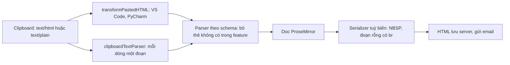

Udemy có rất nhiều ô soạn thảo rich text: hỏi đáp trong khoá học, mô tả khoá học, thông báo giảng viên gửi học viên (đi qua email), bài giảng dạng text, câu hỏi quiz có công thức toán. Mỗi chỗ cần một bộ tính năng khác nhau: ô hỏi đáp cần code block, mô tả khoá học thì không; thông báo cần link nhưng không cần ảnh.

Udemy dùng chung một editor dựng trên **ProseMirror** cho tất cả, với vài mẹo đáng học:

- Schema (danh sách node và mark editor hiểu) **được dựng theo bộ feature** của từng chỗ dùng.
- HTML dán từ IDE được **chuẩn hoá** trước khi parse: VS Code và PyCharm dán HTML có tô màu cú pháp chứ không phải chữ thuần.
- HTML xuất ra phải **hiển thị đúng trong email**, nơi `white-space: pre-wrap` không dùng được.
- Công thức toán là một **component React** sống giữa vùng soạn thảo, qua NodeView.

> [!TIP]
> **Tóm tắt**
> - `buildSchema(features)` chỉ thêm mark/node khi feature bật. HTML dán vào chứa thẻ không có trong schema thì ProseMirror tự bỏ thẻ, giữ chữ: lọc HTML miễn phí.
> - `transformPastedHTML` đổi `<div style="white-space: pre">` của VS Code thành `<pre>`, đổi `<br>` trong `<pre>` của PyCharm thành xuống dòng. Mọi thao tác HTML làm trên **document tách rời** để `` không chạy (xem [bài #12](/blogs/udemy-safe-html-parse)).
> - Xuất HTML cho email: chuỗi dấu cách thành NBSP xen kẽ cách thường, đoạn rỗng `<p></p>` thành `<p><br></p>`. Bản gốc bỏ sót dấu cách đơn ở đầu và cuối đoạn.
> - NodeView của công thức toán không có `update()`, nên mỗi lần node đổi, component React bị huỷ rồi tạo lại.

<iframe class="demo-frame" src="/demos/web-patterns/index.html?theme=dark#/ud-prosemirror" title="Demo ud-prosemirror" loading="lazy" style="height: 1180px"></iframe>

<p class="demo-links">▶ <a href="/demos/web-patterns/index.html#/ud-prosemirror" target="_blank" rel="noopener">Mở demo toàn màn hình ↗</a> · <a href="https://stackblitz.com/github/hunghg255/blog-hunghg/tree/master/examples/web-patterns?file=src/lib/udProseMirror.ts" target="_blank" rel="noopener">Sửa code trên StackBlitz ↗</a> · <a href="https://github.com/hunghg255/blog-hunghg/blob/master/examples/web-patterns/src/lib/udProseMirror.ts" target="_blank" rel="noopener">Xem source trên GitHub ↗</a></p>

## Udemy làm thế nào?

Mã nằm ở `udemy.com/webpack---/src/udemy/js/ud-prosemirror/` (`build-schema.js`, `helpers.js`, `build-commands.js`, `build-keymaps.js`) và `base-components/ungraduated/form/rich-text-editor/` (component React bọc ngoài, NodeView cho ảnh và công thức).

### Schema dựng theo feature

```js
// build-schema.js (rút gọn)
const buildSchema = (features) => new Schema({ marks: buildMarks(features), nodes: buildNodes(features) });

extendIfEnabled(features, 'TOGGLE_STRONG', marks, {
  strong: { parseDOM: [
    { tag: 'strong' },
    { tag: 'b', getAttrs: (node) => node.style.fontWeight !== 'normal' },
    { style: 'font-weight', getAttrs: (value) => /^(bold(er)?|[5-9]\d{2,})$/.test(value) },
  ] },
});
```

`extendIfEnabled` chỉ `Object.assign` khi `features` (một `Set`) có đủ các feature yêu cầu. Kết quả: mỗi theme của editor (hỏi đáp, mô tả, thông báo…) có một schema riêng, và ProseMirror tự bảo đảm nội dung không bao giờ chứa thứ schema không có. Dán một bảng HTML vào ô không hỗ trợ bảng thì chỉ còn chữ.

Ba chi tiết trong schema:

- **`<b style="font-weight:normal">`**: Google Docs bọc cả đoạn dán trong một thẻ `<b>` như vậy. Rule `getAttrs` loại nó, nếu không cả đoạn sẽ thành chữ đậm.
- **`font-weight` bằng regex**: Google Docs đánh dấu đậm bằng `<span style="font-weight:700">`. Regex của Udemy coi cả `500` là đậm, trong khi 500 là "medium". Bản viết lại dùng từ 600.
- **`figcaption` là mark, không phải node**: comment trong file giải thích ProseMirror không cho trộn nội dung inline và block; làm `` thành block thì không bọc link quanh ảnh được, làm `figcaption` thành node inline thì đôi khi nó rỗng và contenteditable không cho gõ vào node rỗng. Biến chú thích ảnh thành một mark trên đoạn chữ ngay sau ảnh là cách né cả hai.

Mọi node block còn có `reparseInView: true` và thuộc tính `dir`. Comment ghi đây là tính năng thử nghiệm Udemy đề nghị trong issue ProseMirror #825: có extension và phím tắt đổi hướng chữ (RTL) bằng cách sửa style `direction` trực tiếp trên DOM, và Udemy muốn ProseMirror đọc lại thay đổi đó vào node. Bản dump không có `prosemirror-view` nên mình không kiểm được phiên bản họ dùng xử lý cờ này ra sao.

### Dán từ IDE

ProseMirror cho ba chỗ móc vào luồng dán: `transformPastedHTML` (sửa chuỗi HTML trước khi parse), `clipboardTextParser` (dán chữ thuần), và parser (`DOMParser` của ProseMirror). Udemy móc cả ba trong `createCustomParser`:

```js
// helpers.js (rút gọn)
parser.transformPastedHTML = function (html) {
  const container = getDetachedDoc().createElement('div');
  container.innerHTML = html;
  Array.from(container.querySelectorAll('pre')).forEach((pre) => {
    pre.textContent = getTextWithNormalizedNewlinesFromDOMNode(pre);   // PyCharm: <br> trong <pre>
  });
  Array.from(container.querySelectorAll('div'))
    .filter((div) => div.style.whiteSpace === 'pre')                    // VS Code
    .forEach((div) => replaceWithPre(div, getTextWithNormalizedNewlinesFromDOMNode(div)));
  return container.innerHTML;
};
```

Editor không có code block thì mỗi dòng thành một `<p style="white-space: pre">`. Chữ thuần dán vào thì mỗi dòng một `<p>` (`parseClipboardText`), không gộp hết vào một đoạn như mặc định.

`getTextWithNormalizedNewlinesFromDOMNode` đổi `<br>` thành `\n` bằng cách thay chuỗi trên `innerHTML` với regex `/<br\s*\/?>/g`, rồi gán lại `innerHTML`. Hai hệ quả nhỏ: hàm sửa luôn nút đầu vào, và `<br>` có thuộc tính (`<br class="…">`) không khớp regex nên bị mất thay vì thành xuống dòng. Bản viết lại thao tác trên cây DOM (`querySelectorAll('br')`) trên một bản sao.

### HTML cho email

Thông báo của giảng viên được gửi qua email, mà nhiều email client không hỗ trợ `white-space: pre-wrap` hay `min-height`. Serializer tuỳ biến của Udemy sửa hai chỗ:

```js
// helpers.js
export function applyHackToPreserveWhitespace(textNode) {
  const NBSP = '\xa0';
  return textNode.withText(textNode.textContent.replace(/ +/g, (spaces) => {
    if (spaces.length === 1) return ' ';
    return Array.from(spaces, (_, i) => (i % 2 === 0 ? NBSP : ' ')).join('');
  }));
}

export function applyHackToPreserveEmptyLines(emptyParagraphDOMNode) {
  emptyParagraphDOMNode.appendChild(getDetachedDoc().createElement('br')); // <p></p> → <p><br></p>
  return emptyParagraphDOMNode;
}
```

NBSP và dấu cách thường xen kẽ: trình duyệt không gộp NBSP, nên khoảng trắng giữ nguyên độ rộng; còn dấu cách thường xen giữa cho phép xuống dòng (dùng toàn NBSP thì cả cụm thành một "từ" dài không ngắt được). Dấu cách **đơn** thì để nguyên, vì đứng giữa hai chữ nó không bị gộp. Nhưng dấu cách đơn ở **đầu** hoặc **cuối** đoạn thì có bị bỏ: đo trong demo, đoạn có một dấu cách đầu rộng 155px ở cả HTML thô lẫn bản Udemy, 159px ở bản sửa. Đoạn rỗng không có `<br>` thì cao 0px, có `<br>` thì cao đúng một dòng (23px).

### NodeView cho công thức toán

```js
// rich-text-editor/math-editor-node-view.js
export default class MathEditorNodeView {
  constructor(node, view, getPos, model, doCommand, isInline) {
    this.dom = document.createElement('div');
    if (isInline) this.dom.style.display = 'inline-block';
    ReactDOM.render(<MathEditor node={node} getPos={getPos} model={model} ... />, this.dom);
  }
  ignoreMutation() { return true; }   // DOM bên trong do React quản lý, ProseMirror đừng đọc lại
  destroy() { ReactDOM.unmountComponentAtNode(this.dom); this.dom = null; }
}
```

NodeView là cách ProseMirror cho mình tự vẽ một node. `ignoreMutation() { return true }` báo ProseMirror bỏ qua mọi thay đổi DOM bên trong (React vẽ lại công thức thì ProseMirror không tưởng là người dùng gõ). Class này không có `update(node)`: khi node đổi (ví dụ sửa công thức), ProseMirror không cập nhật được NodeView cũ nên huỷ nó và tạo cái mới, React unmount rồi mount lại `<MathEditor>`. `ReactDOM.render` cũng là API cũ, React 18 thay bằng `createRoot`.

## Luồng dữ liệu



Mọi bước tạo DOM tạm (B, C, F) đều dùng `getDetachedDoc()`: một document tạo bằng `document.implementation.createHTMLDocument`, không gắn với cửa sổ nào nên không tải ảnh, không chạy `onerror`. Đây là chủ đề của [bài #12](/blogs/udemy-safe-html-parse).

## Viết lại

Bản viết lại không phụ thuộc ProseMirror, mỗi hàm ứng với một hook ở trên. "Schema theo feature" được mô phỏng bằng `filterToSchema(html, features)`: một bộ lọc thẻ theo danh sách feature, xem trong file đầy đủ bên dưới.

Dán từ IDE, thao tác trên cây DOM thay vì regex trên chuỗi:

```ts title=src/lib/udProseMirror.ts
/**
 * VS Code dán <div style="white-space: pre">, PyCharm dán <pre> có <br> bên trong.
 * Chuẩn hoá về <pre>text</pre>; nếu editor không có code block thì mỗi dòng một <p>.
 */
export function normalizePastedHtml(html: string, opts: { codeBlock: boolean }): string {
  const doc = getDetachedDoc();
  const root = parseInert(html);

  const toParagraphs = (el: Element, text: string) => {
    for (const line of text.split('\n')) {
      const p = doc.createElement('p');
      p.textContent = line;
      el.before(p);
    }
    el.remove();
  };

  root.querySelectorAll('pre').forEach((pre) => {
    const text = textWithNewlines(pre);
    if (opts.codeBlock) pre.textContent = text;
    else toParagraphs(pre, text);
  });
  root.querySelectorAll('div').forEach((div) => {
    if ((div as HTMLElement).style.whiteSpace !== 'pre') return;
    const text = textWithNewlines(div);
    if (opts.codeBlock) {
      const pre = doc.createElement('pre');
      pre.textContent = text;
      div.replaceWith(pre);
    } else toParagraphs(div, text);
  });
  return root.innerHTML;
}
```

Giữ dấu cách cho email, thêm trường hợp đầu và cuối đoạn:

```ts title=src/lib/udProseMirror.ts
/**
 * Email client không hỗ trợ `white-space: pre-wrap`, nên nhiều dấu cách liền nhau bị gộp thành một.
 * Đổi chuỗi dấu cách thành NBSP và cách thường xen kẽ (vẫn xuống dòng được), và đổi cả dấu cách
 * đơn ở đầu/cuối đoạn (bản của Udemy bỏ sót hai trường hợp này).
 */
export function preserveSpaces(text: string, opts: { atStart: boolean; atEnd: boolean }): string {
  let out = text.replace(/ {2,}/g, (spaces) =>
    Array.from(spaces, (_, i) => (i % 2 === 0 ? NBSP : ' ')).join(''),
  );
  if (opts.atStart && out.startsWith(' ')) out = NBSP + out.slice(1);
  if (opts.atEnd && out.endsWith(' ')) out = out.slice(0, -1) + NBSP;
  return out;
}
```

::: spoiler Xem toàn bộ src/lib/udProseMirror.ts

```ts title=src/lib/udProseMirror.ts
/**
 * Những mẹo quanh editor rich text của Udemy (ProseMirror), viết lại không phụ thuộc ProseMirror:
 * schema bật/tắt theo feature, chuẩn hoá HTML dán từ IDE, và xuất HTML hiển thị đúng trong email.
 * Mỗi hàm ứng với một hook của ProseMirror (ghi trong comment) để áp vào editor thật.
 */
import { checkHref, getDetachedDoc, parseInert } from './udSafeHtml';

// ---------- 1. "Schema" theo feature flag ----------

export type Feature = 'bold' | 'italic' | 'code' | 'link' | 'codeBlock' | 'list';

/** Thẻ được giữ lại theo từng feature (ProseMirror: chỉ thêm mark/node vào Schema khi feature bật). */
const TAGS_BY_FEATURE: Record<Feature, string[]> = {
  bold: ['strong', 'b'],
  italic: ['em', 'i'],
  code: ['code'],
  link: ['a'],
  codeBlock: ['pre'],
  list: ['ul', 'ol', 'li'],
};
const ALWAYS = ['p', 'br'];

export function allowedTags(features: Set<Feature>): Set<string> {
  const tags = new Set(ALWAYS);
  features.forEach((f) => TAGS_BY_FEATURE[f].forEach((t) => tags.add(t)));
  return tags;
}

/**
 * Lọc HTML theo "schema": thẻ không cho phép thì bỏ thẻ, giữ chữ bên trong
 * (giống cách ProseMirror bỏ qua mark/node không có trong schema khi parse).
 * Link phải qua checkHref; href lưu lại là giá trị đã chuẩn hoá, không phải chuỗi gốc.
 */
export function filterToSchema(html: string, features: Set<Feature>): string {
  const allowed = allowedTags(features);
  const root = parseInert(html);

  const visit = (node: Node) => {
    for (const child of Array.from(node.childNodes)) {
      if (child.nodeType === Node.COMMENT_NODE) {
        child.remove();
        continue;
      }
      if (child.nodeType !== Node.ELEMENT_NODE) continue;
      let el = child as Element;
      visit(el);
      // Google Docs không dùng <b>/<i> mà dùng <span style="font-weight:700">: đổi sang thẻ ngữ nghĩa
      // (ProseMirror: parse rule theo style, Udemy dùng /^(bold(er)?|[5-9]\d{2,})$/ cho font-weight)
      const semantic = styleToTag(el as HTMLElement);
      if (semantic) {
        const replacement = getDetachedDoc().createElement(semantic);
        replacement.append(...Array.from(el.childNodes));
        el.replaceWith(replacement);
        el = replacement;
      }
      const tag = el.tagName.toLowerCase();
      // <b style="font-weight:normal"> là vỏ bọc Google Docs thêm vào, không phải chữ đậm
      const fakeBold = tag === 'b' && (el as HTMLElement).style.fontWeight === 'normal';
      if (!allowed.has(tag) || fakeBold) {
        if (tag === 'script' || tag === 'style') el.remove();
        else el.replaceWith(...Array.from(el.childNodes));
        continue;
      }
      // bỏ mọi attribute, trừ href đã kiểm tra
      const href = tag === 'a' ? el.getAttribute('href') : null;
      for (const attr of Array.from(el.attributes)) el.removeAttribute(attr.name);
      if (tag === 'a') {
        const check = href ? checkHref(href) : null;
        if (check?.ok) el.setAttribute('href', check.href);
        else el.replaceWith(...Array.from(el.childNodes));
      }
    }
  };
  visit(root);
  return root.innerHTML;
}

function styleToTag(el: HTMLElement): 'strong' | 'em' | null {
  if (el.tagName !== 'SPAN') return null;
  if (/^(bold(er)?|[6-9]\d{2})$/.test(el.style.fontWeight)) return 'strong';
  if (el.style.fontStyle === 'italic') return 'em';
  return null;
}

// ---------- 2. Dán từ IDE (ProseMirror: EditorProps.transformPastedHTML) ----------

/** Chữ trong một nút, coi <br> và mỗi <div> con là xuống dòng. Không sửa nút đầu vào. */
export function textWithNewlines(node: Element): string {
  const clone = node.cloneNode(true) as Element;
  clone.querySelectorAll('br').forEach((br) => br.replaceWith('\n'));
  clone.querySelectorAll('div').forEach((div) => {
    if (!div.querySelector('div') && div.nextSibling) div.append('\n');
  });
  return clone.textContent ?? '';
}

/**
 * VS Code dán <div style="white-space: pre">, PyCharm dán <pre> có <br> bên trong.
 * Chuẩn hoá về <pre>text</pre>; nếu editor không có code block thì mỗi dòng một <p>.
 */
export function normalizePastedHtml(html: string, opts: { codeBlock: boolean }): string {
  const doc = getDetachedDoc();
  const root = parseInert(html);

  const toParagraphs = (el: Element, text: string) => {
    for (const line of text.split('\n')) {
      const p = doc.createElement('p');
      p.textContent = line;
      el.before(p);
    }
    el.remove();
  };

  root.querySelectorAll('pre').forEach((pre) => {
    const text = textWithNewlines(pre);
    if (opts.codeBlock) pre.textContent = text;
    else toParagraphs(pre, text);
  });
  root.querySelectorAll('div').forEach((div) => {
    if ((div as HTMLElement).style.whiteSpace !== 'pre') return;
    const text = textWithNewlines(div);
    if (opts.codeBlock) {
      const pre = doc.createElement('pre');
      pre.textContent = text;
      div.replaceWith(pre);
    } else toParagraphs(div, text);
  });
  return root.innerHTML;
}

/** Dán chữ thuần: mỗi dòng một đoạn (ProseMirror: clipboardTextParser). */
export function textToParagraphs(text: string): string {
  const root = parseInert('');
  for (const line of text.split(/\r\n?|\n/)) {
    const p = getDetachedDoc().createElement('p');
    p.textContent = line;
    root.append(p);
  }
  return root.innerHTML;
}

// ---------- 3. Xuất HTML cho email (ProseMirror: DOMSerializer tuỳ biến) ----------

const NBSP = '\u00a0';

/**
 * Email client không hỗ trợ `white-space: pre-wrap`, nên nhiều dấu cách liền nhau bị gộp thành một.
 * Đổi chuỗi dấu cách thành NBSP và cách thường xen kẽ (vẫn xuống dòng được), và đổi cả dấu cách
 * đơn ở đầu/cuối đoạn (bản của Udemy bỏ sót hai trường hợp này).
 */
export function preserveSpaces(text: string, opts: { atStart: boolean; atEnd: boolean }): string {
  let out = text.replace(/ {2,}/g, (spaces) =>
    Array.from(spaces, (_, i) => (i % 2 === 0 ? NBSP : ' ')).join(''),
  );
  if (opts.atStart && out.startsWith(' ')) out = NBSP + out.slice(1);
  if (opts.atEnd && out.endsWith(' ')) out = out.slice(0, -1) + NBSP;
  return out;
}

/** HTML editor → HTML gửi email: giữ dấu cách, và đoạn rỗng <p></p> thành <p><br></p> để vẫn cao một dòng. */
export function toEmailHtml(html: string): string {
  const root = parseInert(html);
  root.querySelectorAll('p').forEach((p) => {
    if (p.childNodes.length === 0) p.append(getDetachedDoc().createElement('br'));
  });

  // Xử lý theo từng khối (đoạn, mục danh sách): biết nút chữ nào đứng đầu, nút nào đứng cuối khối.
  const blocks = [root, ...Array.from(root.querySelectorAll('p, li'))];
  for (const block of blocks) {
    const texts: Text[] = [];
    const walker = getDetachedDoc().createTreeWalker(block, NodeFilter.SHOW_TEXT);
    while (walker.nextNode()) {
      const text = walker.currentNode as Text;
      const owner = text.parentElement?.closest('p, li') ?? root;
      if (owner !== block) continue; // thuộc khối con, xử lý ở vòng của khối đó
      if (text.parentElement?.closest('pre, code')) continue; // code giữ nguyên
      // khoảng trắng định dạng giữa các thẻ khối (vd "\n  " giữa hai <p>): để nguyên, nếu không sẽ thành dòng thừa
      if (owner === root && text.data.trim() === '') continue;
      texts.push(text);
    }
    const nonEmpty = texts.filter((t) => t.data.trim() !== '');
    texts.forEach((text) => {
      text.data = preserveSpaces(text.data, {
        atStart: text === nonEmpty[0] || nonEmpty.length === 0,
        atEnd: text === nonEmpty[nonEmpty.length - 1] || nonEmpty.length === 0,
      });
    });
  }
  return root.innerHTML;
}
```

:::

## Đi qua code

- **`filterToSchema`** đi từ lá lên gốc: thẻ không có trong feature thì `replaceWith(...childNodes)` (bỏ thẻ, giữ chữ), giống ProseMirror bỏ qua mark không có trong schema. `<script>`/`<style>` thì xoá hẳn cả nội dung.
- **`styleToTag`**: `<span style="font-weight:700">` thành `<strong>`, `font-style: italic` thành `<em>`, trước khi xét thẻ có được phép không.
- **Link**: href đi qua `checkHref` của [bài #12](/blogs/udemy-safe-html-parse) và **giá trị đã chuẩn hoá** được ghi lại. Schema của Udemy gọi `validateHref` nhưng trả về `href` gốc, nên chuỗi như `javascript:alert(1)//udemy.com` lọt qua bước parse (bài #12 có phân tích).
- **`textWithNewlines`** làm trên `cloneNode(true)`, không sửa nút đầu vào; mọi `<br>` (kể cả có thuộc tính) đều thành `\n`.
- **`preserveSpaces`** nhận `atStart`/`atEnd`; `toEmailHtml` tính hai cờ này theo từng khối (`<p>`, `<li>`) và bỏ qua khoảng trắng định dạng giữa các thẻ khối, nếu không NBSP chèn vào đó sẽ thành một dòng thừa.

**Khác bản gốc:** không có ProseMirror (không có transaction, undo, keymap); "schema" chỉ là danh sách thẻ; NodeView trong demo dùng `createPortal` vào một `<span contenteditable="false">` thay vì NodeView thật.

Với ProseMirror thật, NodeView nên có `update` để giữ component:

```ts
class MathNodeView implements NodeView {
  dom = document.createElement('span');
  private root = createRoot(this.dom);
  constructor(private node: Node) { this.render(); }
  update(node: Node) {
    if (node.type !== this.node.type) return false; // khác loại: để ProseMirror tạo mới
    this.node = node;
    this.render();                                   // giữ component, chỉ đổi props
    return true;
  }
  ignoreMutation() { return true; }
  destroy() { this.root.unmount(); }
  private render() { this.root.render(<MathEditor tex={this.node.attrs.tex} />); }
}
```

## Tại sao không làm cách khác?

- **Một schema đầy đủ rồi tắt nút trên toolbar?** Toolbar tắt nhưng người dùng vẫn dán được bảng, ảnh, code block vào. Schema theo feature chặn ngay từ bước parse.
- **Lọc HTML bằng DOMPurify trước khi đưa vào editor?** Vẫn nên làm ở chỗ hiển thị, nhưng DOMPurify không biết "ô này không được có code block". Schema là bộ lọc theo ngữ nghĩa, DOMPurify là bộ lọc an toàn; hai việc khác nhau.
- **Dùng toàn NBSP cho khoảng trắng?** Cả cụm thành một từ dài không xuống dòng được; HTML cũng dài hơn. Xen kẽ là đủ.
- **Đặt `white-space: pre-wrap` trong email?** Nhiều email client bỏ qua (Udemy dẫn bảng của Campaign Monitor trong comment).

## Edge case và cạm bẫy

- **NBSP khi sao chép ngược**: người nhận copy đoạn chữ từ email sẽ được NBSP chứ không phải dấu cách, có thể làm hỏng việc dán code. Không dùng hack này cho code (`<pre>`, `<code>` được bỏ qua).
- **Tab trong code dán từ IDE**: `<pre>` giữ tab, `<p style="white-space: pre">` cũng vậy; nhưng email client có thể đổi tab thành một dấu cách.
- **Tiêu chí "đậm"**: `font-weight: 500` có thể là "medium" của một font, không phải đậm. Udemy coi là đậm, bản viết lại thì không; chọn theo dữ liệu thực tế bạn hay nhận.
- **Google Docs `<b id="docs-internal-guid-…">`**: luôn có `font-weight: normal`, phải loại trước khi xét thẻ `<b>`.
- **NodeView không có `update`**: mỗi lần sửa node, component bị mount lại, mất state nội bộ (con trỏ trong ô nhập công thức, trạng thái mở popover). Demo đếm số lần mount để thấy.

## Dùng trong dự án

Với ProseMirror (hoặc Tiptap, vốn dựng trên ProseMirror), các hàm ở đây gắn vào props của `EditorView`:

```ts
new EditorView(el, {
  state,
  transformPastedHTML: (html) => normalizePastedHtml(html, { codeBlock: features.has('codeBlock') }),
  clipboardTextParser: (text, $context) =>
    DOMParser.fromSchema(schema).parseSlice(parseInert(textToParagraphs(text)), { context: $context }),
});
// Khi gửi email:
const html = toEmailHtml(serializeToHtml(view.state.doc));
```

::: spoiler Ví dụ test (bản phác, không có trong repo)

```ts
import { describe, expect, it } from 'vitest';
import { filterToSchema, normalizePastedHtml, preserveSpaces, toEmailHtml } from './udProseMirror';

const NB = ' ';

describe('preserveSpaces', () => {
  it('xen kẽ NBSP và dấu cách, giữ cả dấu cách đơn ở đầu/cuối đoạn', () => {
    expect(preserveSpaces('a    b', { atStart: false, atEnd: false })).toBe('a' + NB + ' ' + NB + ' b');
    expect(preserveSpaces(' a ', { atStart: true, atEnd: true })).toBe(NB + 'a' + NB);
    expect(preserveSpaces(' a ', { atStart: false, atEnd: false })).toBe(' a ');
  });
});

describe('toEmailHtml', () => {
  it('đoạn rỗng thành <p><br></p>, code giữ nguyên', () => {
    expect(toEmailHtml('<p></p><p>x  y</p><p><code>a  b</code></p>')).toBe(
      '<p><br></p><p>x&nbsp; y</p><p><code>a  b</code></p>',
    );
  });
});

describe('normalizePastedHtml', () => {
  it('VS Code thành <pre>; <br> trong <pre> (kể cả có class) thành xuống dòng', () => {
    expect(normalizePastedHtml('<div style="white-space:pre"><div>a</div><div>b</div></div>', { codeBlock: true })).toBe(
      '<pre>a\nb</pre>',
    );
    expect(normalizePastedHtml('<pre>x<br>y<br class="z"></pre>', { codeBlock: true })).toBe('<pre>x\ny\n</pre>');
    expect(normalizePastedHtml('<pre>x<br>y</pre>', { codeBlock: false })).toBe('<p>x</p><p>y</p>');
  });
});

describe('filterToSchema', () => {
  it('giữ thẻ của feature đang bật, đổi span đậm thành <strong>, bỏ link javascript:', () => {
    const html =
      '<p><span style="font-weight:700">A</span> <i>B</i> <a href="javascript:alert(1)//x.com">C</a> <a href="udemy.com">D</a></p>';
    expect(filterToSchema(html, new Set(['bold', 'link']))).toBe(
      '<p><strong>A</strong> B C <a href="https://udemy.com/">D</a></p>',
    );
    expect(filterToSchema(html, new Set())).toBe('<p>A B C D</p>');
  });
});
```

:::

## So với thư viện khác

- **Tiptap** dựng trên ProseMirror, mỗi tính năng là một extension: bật extension nào thì schema có node/mark đó. Chính là ý tưởng "schema theo feature" của Udemy, đóng gói sẵn.
- **Lexical** (Meta) có `importDOM` theo từng loại node và cũng bỏ qua thẻ không có node tương ứng.
- **Email**: các công cụ soạn email như MJML tự xử lý nhiều quirk của email client, nhưng khoảng trắng liên tiếp trong nội dung người dùng vẫn phải đổi sang NBSP như trên.

---

Bài này thuộc series **[Học từ mã nguồn Udemy](/series/udemy)** (21 bài, đọc theo thứ tự).

::: spoiler Xem nhanh danh sách bài trong series

*Mở đầu*

- [Mở đầu: bên trong frontend của Udemy](/blogs/learn-from-udemy-source-code)

*Phần 1: video và học bài*

- [#1 DRM đa hệ: Widevine, PlayReady, FairPlay](/blogs/udemy-drm-multi-key-system)
- [#2 URL ký và license hết hạn: tự làm mới, tải trước bài kế](/blogs/udemy-expiring-media-urls)
- [#3 Ghi tiến độ xem theo bucket, tự hoàn thành, backoff lỗi](/blogs/udemy-watch-progress-buckets)
- [#4 Thumbnail sprite từ WebVTT và slide trên seekbar](/blogs/udemy-sprite-thumbnails-vtt)
- [#5 Phụ đề: tự chọn ngôn ngữ và editor có phím tắt](/blogs/udemy-captions-auto-select-editor)
- [#6 Đo băng thông, autoplay Safari, iPad giả làm Mac](/blogs/udemy-video-quirks-autoplay)

*Phần 2: bài tập, bài thi, lab*

- [#7 Preview code HTML/React trong iframe sandbox](/blogs/udemy-code-preview-sandbox)
- [#8 Bài thi có giờ: tạm dừng khi rảnh, autosave theo dấu vân tay](/blogs/udemy-timed-exam)
- [#9 Chấm code realtime: đăng ký kênh trước, có đường dự phòng](/blogs/udemy-realtime-grading)
- [#10 Mở lab không bị chặn popup, heartbeat, xung đột phiên](/blogs/udemy-lab-launcher)

*Phần 3: editor và nội dung*

- **#11 ProseMirror: schema theo flag, NodeView React, HTML cho email** (bài này)
- [#12 Parse HTML an toàn bằng document tách rời](/blogs/udemy-safe-html-parse)
- [#13 Sinh file .ics có VTIMEZONE tự dò giờ mùa hè](/blogs/udemy-ics-vtimezone)
- [#14 Đọc Open Badges giấu trong ảnh PNG và SVG](/blogs/udemy-open-badges-image)

*Phần 4: hạ tầng và trải nghiệm*

- [#15 Pipeline tracking: batch, sendBeacon, bfcache, HTTP 207](/blogs/udemy-event-tracking-pipeline)
- [#16 Gợi ý tính năng mới qua nhiều phiên bằng máy trạng thái](/blogs/udemy-feature-discoverability)
- [#17 Kéo cạnh để resize và mép cuộn mờ dần](/blogs/udemy-resizer-gradient-scroll)
- [#18 Gom request giá khoá học, cập nhật một phần khi áp coupon](/blogs/udemy-price-dataloader-partial-update)
- [#19 Trả lời lạc quan có rollback, autocomplete hai tầng cache](/blogs/udemy-optimistic-reply-autocomplete)
- [#20 Nạp app theo ưu tiên, registry store, HTML cache công khai](/blogs/udemy-app-loader-registry)

:::

Code + demo: [`examples/web-patterns`](https://github.com/hunghg255/blog-hunghg/tree/master/examples/web-patterns) · [Mở trên StackBlitz](https://stackblitz.com/github/hunghg255/blog-hunghg/tree/master/examples/web-patterns)
