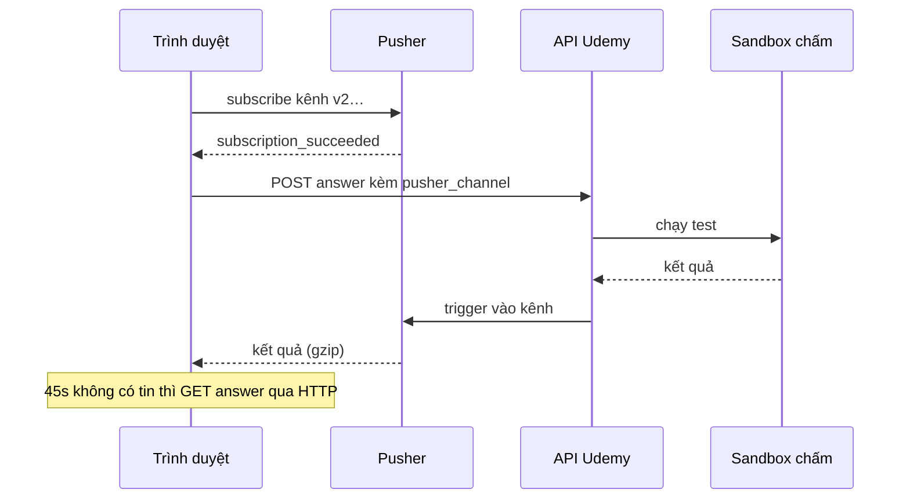

Bài tập code trên Udemy (coding exercise) có nút **Check solution**. Bấm vào, code của học viên được gửi lên, một sandbox chạy test, vài giây sau giao diện báo "Đạt" hoặc chỉ ra test nào sai. Chấm bài mất từ vài trăm mili giây tới chục giây, nên một request HTTP chờ kết quả không phải lựa chọn hay: dễ timeout ở proxy, và giữ kết nối vô ích.

Udemy làm theo kiểu "gửi rồi chờ tin": trình duyệt gửi bài kèm tên một **kênh realtime** (Pusher), server chấm xong thì bắn kết quả vào kênh đó. Nghe đơn giản, nhưng có ba chỗ dễ sai:

1. Server chấm nhanh hơn lúc trình duyệt kịp nghe kênh: kết quả bắn vào kênh trống và mất.
2. Kết nối realtime chết giữa chừng (mạng công ty chặn WebSocket, Wi-Fi chập chờn): học viên chờ mãi.
3. Autosave chạy song song với nút Check: cùng một code bị lưu hai lần.

> [!TIP]
> **Tóm tắt**
> - Thứ tự đúng: **subscribe kênh xong rồi mới gửi bài**. Pub/sub kiểu Pusher không giữ tin cho kênh chưa có ai nghe.
> - Có đường dự phòng: 45 giây không có tin (hoặc kết nối báo `unavailable`) thì hỏi lại qua HTTP. Bản gốc chỉ hỏi một lần và đọc `score === 1` ngay, nên bài chưa chấm xong bị báo sai.
> - Kết quả có thể là bytes gzip. Bản gốc dùng `pako`, trình duyệt bây giờ có sẵn `DecompressionStream`.
> - Lỗi nhỏ của bản gốc: `saveTimerId = null` rồi mới `clearTimeout(saveTimerId)`, nên lượt autosave đang hẹn không bị huỷ và code bị lưu trùng. Bản "IDE-like" mới hơn của chính Udemy đã đảo lại đúng thứ tự.

<iframe class="demo-frame" src="/demos/web-patterns/index.html?theme=dark#/ud-grading" title="Demo ud-grading" loading="lazy" style="height: 900px"></iframe>

<p class="demo-links">▶ <a href="/demos/web-patterns/index.html#/ud-grading" target="_blank" rel="noopener">Mở demo toàn màn hình ↗</a> · <a href="https://stackblitz.com/github/hunghg255/blog-hunghg/tree/master/examples/web-patterns?file=src/lib/udGrading.ts" target="_blank" rel="noopener">Sửa code trên StackBlitz ↗</a> · <a href="https://github.com/hunghg255/blog-hunghg/blob/master/examples/web-patterns/src/lib/udGrading.ts" target="_blank" rel="noopener">Xem source trên GitHub ↗</a></p>

## Udemy làm thế nào?

Có hai mảnh, đều nằm trong `udemy.com/webpack---/src/udemy/js/`:

- `utils/pusher-event-handler.js`: lớp `PusherEventHandler` bọc client Pusher.
- `course-taking/quiz-view/coding-exercise/coding-exercise.mobx-store.js`: store của màn hình bài tập (bản cũ). Bản giao diện mới nằm ở `coding-exercise-ide-like/coding-exercise.mobx-store.tsx`.

### Kênh dùng một lần, tên ngẫu nhiên

Mỗi lần bấm Check, `evaluate()` tạo một `PusherEventHandler` mới. Constructor tạo client, đặt tên kênh và đăng ký các sự kiện:

```js
// utils/pusher-event-handler.js (rút gọn)
this.pusherChannel = `v2${Math.floor(Math.random() * Math.pow(10, 12) + Date.now())}`;
const channel = this.pusherClient.subscribe(this.pusherChannel);

channel.bind('pusher:subscription_succeeded', onSubscriptionSucceeded);
channel.bind(pusherEvent, this.pusherEventHandler);
this.pusherClient.connection.bind('unavailable', () => { timeoutHandler(); this.destroy(); });
this.pusherClient.connection.bind('failed', () => { onSubscriptionError(); this.destroy(); });

const maxIdleTime = 45 * 1000;
this.idleTimeout = setTimeout(() => { this.destroy(); timeoutHandler(); }, maxIdleTime);
```

Comment phía trên class ghi "called if there is no response from Pusher within 12s", còn code thật đặt 45 giây. Comment cũ, code đã đổi.

Tên kênh là `v2` + một số ngẫu nhiên cộng thời gian. Đây là kênh Pusher công khai (không có tiền tố `private-`), nên ai đoán được tên kênh là nghe được kết quả chấm. Rủi ro thấp vì kết quả chỉ là log chấm bài, nhưng `crypto.randomUUID()` khó đoán hơn hẳn và không tốn gì thêm.

### Subscribe xong mới gửi bài

Điểm hay nhất nằm ở store: bài **chỉ được POST trong callback `onSubscriptionSucceeded`**, kèm tên kênh để server biết bắn kết quả vào đâu:

```js
// coding-exercise.mobx-store.js (rút gọn)
onSubscriptionSucceeded() {
  return this.saveCodingExercise(true)   // POST answer, body có pusher_channel
    .then(() => Tracker.publishEvent(new CodingExerciseEvaluateSuccessEvent(...)))
    .catch(() => { this._evaluatorErrorHandler('backend_error'); this.eventHandler.destroy(); });
}

evaluate() {
  if (this.isEvaluating) return;
  this.isEvaluating = true;
  this.eventHandler?.destroy();
  this.eventHandler = new PusherEventHandler(
    pusherResultHandlerWrapper(this.evaluatorResponseHandler),
    this.timeoutHandler, this.onSubscriptionSucceeded, this.onSubscriptionError,
    udConfig.third_party.pusher.coding_exercise_event,
  );
}
```

Nhờ thứ tự này, sandbox chấm nhanh cỡ nào cũng không làm mất kết quả. Kết quả về qua `pusherResultHandlerWrapper`: nếu là `Uint8Array` thì `pako.ungzip` rồi `JSON.parse` (log biên dịch có thể dài, nén lại cho nhẹ). `evaluatorResponseHandler` phân loại: không đạt mà có `compile_logs` là `compile_error`, không có là `test_error`.

### Đường dự phòng: hỏi lại một lần

`timeoutHandler` (khi hết 45 giây, hoặc Pusher báo `unavailable`) gọi `fallbackOnEvaluationResult()`:

```js
fallbackOnEvaluationResult() {
  return udApi.get(`.../coding-exercise-answers/`)
    .then((response) => this.setResult(response.data.results[0].score === 1));
}
```

Chỉ hỏi **một lần** và coi `score === 1` là đạt. Nếu sandbox còn đang chấm (chấm chậm hơn hạn chờ, hay Pusher rớt ngay đầu), `score` chưa có, `setResult(false)` và học viên thấy "Sai" dù code đúng. Bật "Kênh realtime chết" + "Server chấm 2500ms" + "Hỏi lại một lần" trong demo để thấy đúng tình huống này.

Còn một trường hợp nữa, suy ra từ code: nếu kết nối Pusher hỏng **trước khi** subscribe xong, `onSubscriptionSucceeded` không bao giờ chạy, tức bài lần này **chưa từng được gửi**. Đường dự phòng vẫn GET `results[0]`, có lẽ là kết quả của lần lưu trước.

### Autosave và lỗi `clearTimeout(null)`

Store tự lưu code 2 giây sau lần gõ cuối (`AUTOSAVE_DELAY = 2000`), kiểu "single-flight có lượt cuối": đang có lượt hẹn thì chỉ bật cờ `autoSaveRequested`, lưu xong mới hẹn lượt tiếp:

```js
scheduleAutoSave() {
  if (this.saveTimerId) { this.autoSaveRequested = true; return; }
  this.saveTimerId = setTimeout(this.saveCodingExercise, AUTOSAVE_DELAY);
}

saveCodingExercise(evaluate = false) {
  return udApi.post(...).finally(() => {
    this.saveTimerId = null;
    clearTimeout(this.saveTimerId);   // ← id đã là null: không huỷ được gì
    if (this.autoSaveRequested) { this.autoSaveRequested = false; this.scheduleAutoSave(); }
  });
}
```

Hai dòng trong `finally` bị ngược. Gõ một ký tự rồi bấm Check ngay: lần lưu của Check chạy xong, `clearTimeout(null)` không làm gì, lượt autosave đang hẹn vẫn bắn và lưu cùng đoạn code thêm lần nữa. Không hỏng dữ liệu, chỉ thừa một request. Bản `coding-exercise-ide-like` đã sửa đúng: `clearTimeout(this.saveTimerId)` trước, `this.saveTimerId = undefined` sau.

Chi tiết nhỏ khác: `saveCodingExercise` tự `catch` lỗi, nên promise trả về luôn resolve. `onSubscriptionSucceeded` vì thế luôn chạy nhánh `.then`, gửi sự kiện tracking "EvaluateSuccess" kể cả khi POST lỗi (nhánh `.catch` của nó không bao giờ chạy).

## Bên trong: vì sao kết quả có thể mất

Pusher (và đa số dịch vụ pub/sub cho trình duyệt: Ably, Socket.IO rooms, Redis pub/sub phía sau) **không lưu tin cho kênh**. Server `trigger` một sự kiện vào kênh: ai đang subscribe thì nhận, không ai thì tin biến mất. Subscribe cũng không tức thì: client phải mở WebSocket (nếu chưa có), gửi lệnh subscribe, chờ server xác nhận (`pusher:subscription_succeeded`). Mạng chậm thì bước này mất vài trăm mili giây, đủ để một bài chấm nhanh về trước.



Nếu đảo hai bước đầu với bước POST (cách "gửi trước, subscribe sau" trong demo), mũi tên "trigger vào kênh" có thể tới trước "subscription_succeeded", và tin rơi vào kênh trống.

## Viết lại

Bản viết lại không phụ thuộc Pusher: chỉ cần một `RealtimeClient` có `subscribe(channel, { onSubscribed, onMessage, onError })` trả về hàm huỷ. Pusher, Ably hay WebSocket tự viết đều bọc được về interface này.

Hàm chính trả về một Promise, giải quyết bằng kết quả từ kênh hoặc từ đường dự phòng:

```ts title=src/lib/udGrading.ts
export function gradeWithRealtime({
  client,
  submit,
  fetchResult,
  idleMs = 45_000,
  fallbackAttempts = 5,
  fallbackIntervalMs = 2_000,
  signal,
}: GradeOptions): Promise<{ result: GradeResult; source: GradeSource; channel: string }> {
  const channel = createChannelName();

  return new Promise((resolve, reject) => {
    let settled = false;
    let submitted: Promise<void> | null = null;
    let idleTimer: ReturnType<typeof setTimeout> | undefined;
    let unsubscribe = () => {}; // gán sau; client có thể gọi handler ngay trong subscribe()
    const submitOnce = () => (submitted ??= submit(channel));

    const cleanup = () => {
      settled = true;
      clearTimeout(idleTimer);
      unsubscribe();
    };

    const fail = (error: unknown) => {
      if (settled) return;
      cleanup();
      reject(error);
    };

    // Đường dự phòng: hỏi lại qua HTTP cho tới khi server báo đã chấm xong.
    const fallback = async () => {
      if (settled) return;
      cleanup();
      try {
        // Kênh chưa từng subscribe được thì bài cũng chưa được gửi: gửi bù trước khi hỏi lại.
        await submitOnce();
        for (let attempt = 0; attempt < fallbackAttempts; attempt++) {
          const result = await fetchResult();
          if (result) return resolve({ result, source: 'fallback', channel });
          await sleep(fallbackIntervalMs, signal);
        }
        reject(new Error('Hết lượt hỏi lại mà server vẫn chưa chấm xong'));
      } catch (error) {
        reject(error);
      }
    };
```

```ts title=src/lib/udGrading.ts

    unsubscribe = client.subscribe(channel, {
      onSubscribed: () => {
        // Đã nghe kênh rồi mới gửi bài: kết quả về sớm cũng không bị lỡ.
        submitOnce().catch(fail);
      },
      onMessage: (raw) => {
        if (settled) return;
        decodePayload(raw).then((data) => {
          if (settled) return;
          cleanup();
          resolve({ result: data as GradeResult, source: 'realtime', channel });
        }, fail);
      },
      // Không đăng ký được kênh: chuyển ngay sang hỏi lại qua HTTP (fallback tự gửi bài nếu cần).
      onError: () => {
        if (!settled) fallback();
      },
    });

    idleTimer = setTimeout(fallback, idleMs);
    signal?.addEventListener('abort', () => fail(signal.reason), { once: true });
  });
}
```

Autosave (`createAutosave`, cuối file) giữ nguyên ý tưởng single-flight của Udemy, chỉ sửa thứ tự huỷ và tách `cancel()` cho nút Check dùng.

::: spoiler Xem toàn bộ src/lib/udGrading.ts

```ts title=src/lib/udGrading.ts
/**
 * Chấm code bất đồng bộ qua kênh realtime (ý tưởng từ coding exercise của Udemy).
 *
 * - Đăng ký kênh realtime XONG mới gửi bài: server chấm nhanh cỡ nào cũng không mất kết quả.
 * - Không có tin trong `idleMs` (mất kết nối, server im lặng) thì chuyển sang hỏi lại bằng HTTP,
 *   và chỉ chấp nhận kết quả khi server báo đã chấm xong.
 * - Payload có thể bị nén gzip: giải bằng DecompressionStream có sẵn của trình duyệt.
 */

export interface GradeResult {
  passed: boolean;
  /** log biên dịch / chạy test, để phân loại lỗi */
  compileLogs: string;
  testLogs: string;
}

export type GradeSource = 'realtime' | 'fallback';

/** Kênh realtime tối giản (Pusher, Ably, WebSocket tự viết… đều map được về interface này). */
export interface RealtimeClient {
  subscribe(
    channel: string,
    handlers: {
      onSubscribed: () => void;
      onMessage: (data: unknown) => void;
      onError: (reason: string) => void;
    },
  ): () => void;
}

export interface GradeOptions {
  client: RealtimeClient;
  /** gửi bài kèm tên kênh để server biết bắn kết quả vào đâu */
  submit: (channel: string) => Promise<void>;
  /** hỏi lại kết quả qua HTTP; `null` = server chưa chấm xong */
  fetchResult: () => Promise<GradeResult | null>;
  /** không nhận được gì trong khoảng này thì chuyển sang hỏi lại (Udemy dùng 45s) */
  idleMs?: number;
  /** số lần hỏi lại và khoảng cách giữa các lần */
  fallbackAttempts?: number;
  fallbackIntervalMs?: number;
  signal?: AbortSignal;
}

/** Tên kênh khó đoán: ai biết tên kênh công khai là nghe được kết quả. */
export function createChannelName() {
  return `grade-${crypto.randomUUID()}`;
}

/** Kết quả có thể là object, chuỗi JSON, hoặc bytes gzip của chuỗi JSON. */
export async function decodePayload(raw: unknown): Promise<unknown> {
  if (raw instanceof Uint8Array) {
    const stream = new Blob([raw as Uint8Array<ArrayBuffer>]).stream().pipeThrough(new DecompressionStream('gzip'));
    return JSON.parse(await new Response(stream).text());
  }
  if (typeof raw === 'string') return JSON.parse(raw);
  return raw;
}

export async function gzipJson(value: unknown): Promise<Uint8Array> {
  const stream = new Blob([JSON.stringify(value)]).stream().pipeThrough(new CompressionStream('gzip'));
  return new Uint8Array(await new Response(stream).arrayBuffer());
}

/** Phân loại kết quả như Udemy: có log biên dịch là lỗi biên dịch, không có là sai test. */
export function classifyFailure(result: GradeResult): 'passed' | 'compile_error' | 'test_error' {
  if (result.passed) return 'passed';
  return result.compileLogs.length > 0 ? 'compile_error' : 'test_error';
}

const sleep = (ms: number, signal?: AbortSignal) =>
  new Promise<void>((resolve, reject) => {
    const id = setTimeout(resolve, ms);
    signal?.addEventListener(
      'abort',
      () => {
        clearTimeout(id);
        reject(signal.reason);
      },
      { once: true },
    );
  });

export function gradeWithRealtime({
  client,
  submit,
  fetchResult,
  idleMs = 45_000,
  fallbackAttempts = 5,
  fallbackIntervalMs = 2_000,
  signal,
}: GradeOptions): Promise<{ result: GradeResult; source: GradeSource; channel: string }> {
  const channel = createChannelName();

  return new Promise((resolve, reject) => {
    let settled = false;
    let submitted: Promise<void> | null = null;
    let idleTimer: ReturnType<typeof setTimeout> | undefined;
    let unsubscribe = () => {}; // gán sau; client có thể gọi handler ngay trong subscribe()
    const submitOnce = () => (submitted ??= submit(channel));

    const cleanup = () => {
      settled = true;
      clearTimeout(idleTimer);
      unsubscribe();
    };

    const fail = (error: unknown) => {
      if (settled) return;
      cleanup();
      reject(error);
    };

    // Đường dự phòng: hỏi lại qua HTTP cho tới khi server báo đã chấm xong.
    const fallback = async () => {
      if (settled) return;
      cleanup();
      try {
        // Kênh chưa từng subscribe được thì bài cũng chưa được gửi: gửi bù trước khi hỏi lại.
        await submitOnce();
        for (let attempt = 0; attempt < fallbackAttempts; attempt++) {
          const result = await fetchResult();
          if (result) return resolve({ result, source: 'fallback', channel });
          await sleep(fallbackIntervalMs, signal);
        }
        reject(new Error('Hết lượt hỏi lại mà server vẫn chưa chấm xong'));
      } catch (error) {
        reject(error);
      }
    };

    unsubscribe = client.subscribe(channel, {
      onSubscribed: () => {
        // Đã nghe kênh rồi mới gửi bài: kết quả về sớm cũng không bị lỡ.
        submitOnce().catch(fail);
      },
      onMessage: (raw) => {
        if (settled) return;
        decodePayload(raw).then((data) => {
          if (settled) return;
          cleanup();
          resolve({ result: data as GradeResult, source: 'realtime', channel });
        }, fail);
      },
      // Không đăng ký được kênh: chuyển ngay sang hỏi lại qua HTTP (fallback tự gửi bài nếu cần).
      onError: () => {
        if (!settled) fallback();
      },
    });

    idleTimer = setTimeout(fallback, idleMs);
    signal?.addEventListener('abort', () => fail(signal.reason), { once: true });
  });
}

/**
 * Autosave kiểu "single-flight có lượt cuối": đang có lượt hẹn thì chỉ đánh dấu,
 * lưu xong mới hẹn lượt tiếp. `flush()` huỷ lượt đang hẹn rồi lưu ngay (dùng khi bấm "Kiểm tra").
 */
export function createAutosave(save: () => Promise<void>, delayMs = 2_000) {
  let timer: ReturnType<typeof setTimeout> | undefined;
  let saving: Promise<void> | null = null;
  let dirtyWhileSaving = false;

  const run = async () => {
    timer = undefined;
    if (saving) {
      dirtyWhileSaving = true;
      return saving;
    }
    saving = save().finally(() => {
      saving = null;
      if (dirtyWhileSaving) {
        dirtyWhileSaving = false;
        schedule();
      }
    });
    return saving;
  };

  function schedule() {
    if (timer !== undefined) return; // đã hẹn, thay đổi mới sẽ đi chung lượt này
    timer = setTimeout(run, delayMs);
  }

  /** Huỷ lượt đang hẹn. Thứ tự đúng: clearTimeout TRƯỚC, xoá id SAU. */
  function cancel() {
    clearTimeout(timer);
    timer = undefined;
  }

  return {
    schedule,
    cancel,
    /** Huỷ lượt đang hẹn rồi lưu ngay. */
    flush() {
      cancel();
      return run();
    },
    get pending() {
      return timer !== undefined;
    },
  };
}
```

:::

## Đi qua code

- **`submitOnce`**: bài chỉ được gửi một lần dù đường nào gọi tới. Bình thường là trong `onSubscribed`. Nếu kênh không bao giờ subscribe được, `fallback()` gửi bù trước khi hỏi lại: đây là trường hợp bản gốc bỏ sót.
- **`settled` + `cleanup()`**: kết quả từ kênh và từ đường dự phòng có thể đua nhau. Ai về trước thì thắng, `cleanup()` huỷ hẹn giờ và unsubscribe để kênh không treo.
- **`fetchResult()` trả `null` khi chưa chấm xong**: đường dự phòng hỏi lại tối đa `fallbackAttempts` lần, mỗi lần cách `fallbackIntervalMs`. API phía server cần phân biệt "chưa chấm" với "chấm rồi, sai", ví dụ `score: null` so với `score: 0`.
- **`decodePayload`**: `Uint8Array` thì giải gzip bằng `DecompressionStream('gzip')`, chuỗi thì `JSON.parse`, object thì giữ nguyên. Thay được thư viện `pako` bằng API có sẵn.
- **`unsubscribe` khai báo trước bằng hàm rỗng**: client nào gọi `onError` ngay trong `subscribe()` (đồng bộ) thì `cleanup()` vẫn chạy được, không dính lỗi "dùng biến trước khi khai báo".
- **`createAutosave().cancel()`**: `clearTimeout` trước, xoá id sau. Nút Check gọi `cancel()` vì lần gửi bài đã mang theo code mới nhất.

**Khác bản gốc:**
- Hỏi lại tới khi server báo chấm xong, thay vì đọc `score` một lần.
- Kênh không subscribe được thì vẫn gửi bài rồi hỏi lại; bản gốc báo lỗi `pusher_subscription_error` (khi Pusher báo `failed`) hoặc đọc kết quả cũ (khi `unavailable`).
- Tên kênh dùng `crypto.randomUUID()`.
- Không có tracking/metrics.

## Tại sao không làm cách khác?

- **Một request HTTP chờ tới khi chấm xong (long request)?** Dễ đụng timeout của proxy hay load balancer, chiếm kết nối, và người dùng đóng tab thì server vẫn chấm. Tách "gửi bài" và "nhận kết quả" ra thì mỗi phần đơn giản hơn.
- **Polling HTTP từ đầu?** Chạy được, và là đường dự phòng ở trên. Nhưng polling mỗi giây cho hàng nghìn học viên cùng lúc tốn request vô ích. Kênh realtime chỉ tốn một tin khi có kết quả.
- **Server-Sent Events cho riêng request này?** Hợp lý nếu tự vận hành server: một `EventSource` tới `/evaluate/<id>/events`, server đẩy kết quả rồi đóng. Udemy đã dùng Pusher cho thứ khác nên tận dụng luôn.
- **Gửi bài trước rồi subscribe?** Như demo: kết quả về sớm là mất, phải chờ đường dự phòng (45 giây ở bản gốc).

## Edge case và cạm bẫy

- **Bấm Check liên tục**: bản gốc chặn bằng `isEvaluating` và huỷ handler cũ trước khi tạo cái mới. Bản viết lại nhận `signal` (AbortSignal) để nơi gọi huỷ lượt cũ.
- **Server cần phân biệt "chưa chấm" và "sai"**: nếu API chỉ trả `score: 0` cho cả hai, đường dự phòng nào cũng đoán sai.
- **Kênh công khai**: ai biết tên kênh là nghe được. Với dữ liệu nhạy cảm hơn log chấm bài, dùng kênh private (Pusher có `private-`/`presence-`, cần endpoint xác thực).
- **Tab ngủ**: trình duyệt có thể ngắt WebSocket của tab nền. Lúc tab thức dậy, hẹn giờ 45 giây có thể đã quá hạn, đường dự phòng chạy: kết quả vẫn đúng nhờ hỏi lại.
- **`DecompressionStream`** có trên Chrome, Edge, Firefox và Safari bản mới (tính tới 10/2026). Cần hỗ trợ trình duyệt cũ thì giữ `pako` làm dự phòng.

## Dùng trong dự án

Bất kỳ tác vụ chạy lâu nào phía server đều dùng được khung này: xuất báo cáo, render video, build preview. Với Pusher thật, `subscribe` của `RealtimeClient` chỉ cần gọi `pusher.subscribe(channel)` rồi `bind` ba sự kiện `pusher:subscription_succeeded`, `pusher:subscription_error` và sự kiện kết quả của bạn. Phần gọi:

```ts
const { result, source } = await gradeWithRealtime({
  client: pusherClient,
  submit: (channel) => api.post(`/exercises/${id}/answers`, { files, channel }),
  fetchResult: async () => {
    const { data } = await api.get(`/exercises/${id}/answers/latest`);
    return data.status === 'graded' ? data.result : null; // phân biệt "chưa chấm" với "sai"
  },
});
```

::: spoiler Ví dụ test (bản phác, không có trong repo)

```ts
// @vitest-environment node
import { describe, expect, it, vi } from 'vitest';
import { createAutosave, gradeWithRealtime, gzipJson, type RealtimeClient } from './udGrading';

function fakeClient(opts: { subscribeMs: number; down?: boolean }) {
  const listeners = new Map<string, (d: unknown) => void>();
  const client: RealtimeClient = {
    subscribe(channel, h) {
      const id = setTimeout(() => {
        if (opts.down) return;
        listeners.set(channel, h.onMessage);
        h.onSubscribed();
      }, opts.subscribeMs);
      return () => { clearTimeout(id); listeners.delete(channel); };
    },
  };
  return { client, publish: (c: string, d: unknown) => listeners.get(c)?.(d) };
}

const PASS = { passed: true, compileLogs: '', testLogs: 'ok' };

describe('gradeWithRealtime', () => {
  it('chỉ gửi bài sau khi subscribe xong, nhận kết quả gzip qua kênh', async () => {
    const { client, publish } = fakeClient({ subscribeMs: 50 });
    const submit = vi.fn(async (channel: string) => { publish(channel, await gzipJson(PASS)); });
    const out = await gradeWithRealtime({ client, submit, fetchResult: async () => null, idleMs: 1000 });
    expect(submit).toHaveBeenCalledTimes(1);
    expect(out).toMatchObject({ source: 'realtime', result: PASS });
  });

  it('kênh chết: tự gửi bài rồi hỏi lại tới khi server chấm xong', async () => {
    const { client } = fakeClient({ subscribeMs: 10, down: true });
    let graded: typeof PASS | null = null;
    const submit = vi.fn(async () => { setTimeout(() => (graded = PASS), 120); });
    const fetchResult = vi.fn(async () => graded);
    const out = await gradeWithRealtime({ client, submit, fetchResult, idleMs: 50, fallbackIntervalMs: 50 });
    expect(submit).toHaveBeenCalledTimes(1);
    expect(out.source).toBe('fallback');
    expect(fetchResult.mock.calls.length).toBeGreaterThan(1);
  });
});

describe('createAutosave', () => {
  it('cancel() huỷ lượt đang hẹn: bấm Check không lưu trùng', async () => {
    vi.useFakeTimers();
    const save = vi.fn(async () => {});
    const autosave = createAutosave(save, 2000);
    autosave.schedule();
    autosave.cancel();
    await vi.advanceTimersByTimeAsync(5000);
    expect(save).not.toHaveBeenCalled();
    vi.useRealTimers();
  });
});
```

:::

## So với thư viện và chuẩn web

- **Pusher Channels / Ably**: dịch vụ pub/sub có SDK trình duyệt. Cả hai không giữ tin cho kênh chưa có người nghe (trừ khi bật tính năng lưu lịch sử riêng, như "rewind" của Ably), nên thứ tự "subscribe rồi mới gửi" vẫn cần.
- **WebSocket tự viết**: có thể gửi `requestId` khi gửi bài và nhận kết quả theo id trên cùng kết nối, không cần tên kênh. Vẫn cần đường dự phòng khi kết nối rớt.
- **Server-Sent Events**: một chiều, đủ cho "đẩy kết quả về". Trình duyệt tự kết nối lại và gửi `Last-Event-ID`, nên server có thể phát lại tin bị lỡ nếu có lưu.
- **`CompressionStream` / `DecompressionStream`** (gzip, deflate) là API chuẩn, thay được `pako` cho nhu cầu nén/giải nén đơn giản.

---

Bài này thuộc series **[Học từ mã nguồn Udemy](/series/udemy)** (21 bài, đọc theo thứ tự).

::: spoiler Xem nhanh danh sách bài trong series

*Mở đầu*

- [Mở đầu: bên trong frontend của Udemy](/blogs/learn-from-udemy-source-code)

*Phần 1: video và học bài*

- [#1 DRM đa hệ: Widevine, PlayReady, FairPlay](/blogs/udemy-drm-multi-key-system)
- [#2 URL ký và license hết hạn: tự làm mới, tải trước bài kế](/blogs/udemy-expiring-media-urls)
- [#3 Ghi tiến độ xem theo bucket, tự hoàn thành, backoff lỗi](/blogs/udemy-watch-progress-buckets)
- [#4 Thumbnail sprite từ WebVTT và slide trên seekbar](/blogs/udemy-sprite-thumbnails-vtt)
- [#5 Phụ đề: tự chọn ngôn ngữ và editor có phím tắt](/blogs/udemy-captions-auto-select-editor)
- [#6 Đo băng thông, autoplay Safari, iPad giả làm Mac](/blogs/udemy-video-quirks-autoplay)

*Phần 2: bài tập, bài thi, lab*

- [#7 Preview code HTML/React trong iframe sandbox](/blogs/udemy-code-preview-sandbox)
- [#8 Bài thi có giờ: tạm dừng khi rảnh, autosave theo dấu vân tay](/blogs/udemy-timed-exam)
- **#9 Chấm code realtime: đăng ký kênh trước, có đường dự phòng** (bài này)
- [#10 Mở lab không bị chặn popup, heartbeat, xung đột phiên](/blogs/udemy-lab-launcher)

*Phần 3: editor và nội dung*

- [#11 ProseMirror: schema theo flag, NodeView React, HTML cho email](/blogs/udemy-prosemirror-integration)
- [#12 Parse HTML an toàn bằng document tách rời](/blogs/udemy-safe-html-parse)
- [#13 Sinh file .ics có VTIMEZONE tự dò giờ mùa hè](/blogs/udemy-ics-vtimezone)
- [#14 Đọc Open Badges giấu trong ảnh PNG và SVG](/blogs/udemy-open-badges-image)

*Phần 4: hạ tầng và trải nghiệm*

- [#15 Pipeline tracking: batch, sendBeacon, bfcache, HTTP 207](/blogs/udemy-event-tracking-pipeline)
- [#16 Gợi ý tính năng mới qua nhiều phiên bằng máy trạng thái](/blogs/udemy-feature-discoverability)
- [#17 Kéo cạnh để resize và mép cuộn mờ dần](/blogs/udemy-resizer-gradient-scroll)
- [#18 Gom request giá khoá học, cập nhật một phần khi áp coupon](/blogs/udemy-price-dataloader-partial-update)
- [#19 Trả lời lạc quan có rollback, autocomplete hai tầng cache](/blogs/udemy-optimistic-reply-autocomplete)
- [#20 Nạp app theo ưu tiên, registry store, HTML cache công khai](/blogs/udemy-app-loader-registry)

:::

Code + demo: [`examples/web-patterns`](https://github.com/hunghg255/blog-hunghg/tree/master/examples/web-patterns) · [Mở trên StackBlitz](https://stackblitz.com/github/hunghg255/blog-hunghg/tree/master/examples/web-patterns)
