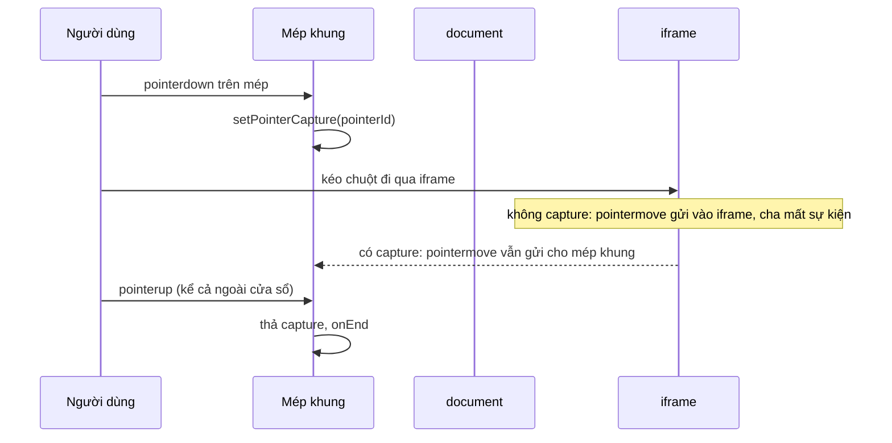

Trong bài tập lập trình của Udemy, màn hình chia ba khung: đề bài, editor và khung xem trước. Người học kéo thanh dọc giữa các khung để đổi kích thước. Ở trang chủ, hàng chủ đề cuộn ngang có mép phải mờ dần, gợi ý "còn nữa, cuộn tiếp đi".

Hai thứ này nhìn thì nhỏ, nhưng có nhiều chỗ dễ sai: kéo qua iframe thì mất sự kiện, kéo mép trái thì khung "chạy" khỏi tay, bôi đen chữ trong khung thì không được, mép mờ hiện cả khi không có gì để cuộn, sang theme tối thì lớp mờ màu trắng thành một vệt sáng.

Udemy tự viết cả hai thay vì dùng thư viện. Comment đầu file `Resizer` ghi rõ lý do: interact.js thì được bảo trì tốt nhưng nặng 23kb gzip, không đáng cho một việc nhỏ như vậy.

> [!TIP]
> **Tóm tắt**
> - `Resizer` của Udemy tính kích thước mới từ vị trí chuột **so với khung hiện tại**. Cách này đúng khi khung được neo ở phía đối diện với mép kéo, sai (cộng dồn) khi không neo.
> - Tính từ **điểm bắt đầu kéo** (delta) thì đúng trong mọi bố cục. Pointer Events + `setPointerCapture` thay được cả bốn listener gắn sẵn trên `document`.
> - Chỉ `preventDefault` khi nhấn đúng mép, để người dùng vẫn bôi đen được chữ bên trong.
> - Mép cuộn mờ: dùng `mask-image` (mờ về trong suốt) thay cho lớp phủ màu nền, và tính lại khi kích thước đổi.

<iframe class="demo-frame" src="/demos/web-patterns/index.html?theme=dark#/ud-resizer" title="Demo ud-resizer" loading="lazy" style="height: 1180px"></iframe>

<p class="demo-links">▶ <a href="/demos/web-patterns/index.html#/ud-resizer" target="_blank" rel="noopener">Mở demo toàn màn hình ↗</a> · <a href="https://stackblitz.com/github/hunghg255/blog-hunghg/tree/master/examples/web-patterns?file=src/lib/udResizer.ts" target="_blank" rel="noopener">Sửa code trên StackBlitz ↗</a> · <a href="https://github.com/hunghg255/blog-hunghg/blob/master/examples/web-patterns/src/lib/udResizer.ts" target="_blank" rel="noopener">Xem source trên GitHub ↗</a></p>

Thử trong demo: ở phần 1, đổi "Khung neo" sang **bên trái** rồi kéo mép tím ở chế độ "Kiểu Udemy", khung phình ra vài trăm pixel dù chuột chỉ đi 60px. Ở phần 2, bấm "Bớt còn 3 chip" và "Hướng chữ: RTL" rồi so hai hàng.

## Udemy làm thế nào?

### Resizer: một component bọc khung

[`base-components/ungraduated/resizer/resizer.react-component.js`](https://github.com/hunghg255/codebase/blob/main/udemy.com/webpack---/src/udemy/js/base-components/ungraduated/resizer/resizer.react-component.js) là một class component khoảng 200 dòng. Nó bọc khung cần đổi kích thước, nhận cấu hình mép nào được kéo, và gọi `onMove` với kích thước mới. Việc áp kích thước do component cha làm.

```js
static defaultProps = {
  edges: {top: true, left: true, right: true, bottom: true},
  dragMargin: isMobileBrowser ? 30 : 5,   // ngón tay cần vùng bắt mép to hơn chuột
};

componentDidMount() {
  document.addEventListener('mousemove', this.onMouseMove);
  document.addEventListener('mouseup', this.onMouseUp);
  document.addEventListener('touchmove', this.onTouchMove);
  document.addEventListener('touchend', this.onTouchEnd);
}
```

Giá trị của mỗi mép có thể là `true` hoặc một **selector**. Trình sửa ảnh trong rich-text editor dùng `edges={{right: '.js-resizer-handle', bottom: '.js-resizer-handle'}}`: chỉ kéo được khi nhấn vào đúng tay nắm ở góc, nhấn vào ảnh thì không. Đây là một ý hay, cùng một component dùng được cho cả "kéo cả mép" lẫn "chỉ kéo tay nắm".

Khi nhấn chuột, component xác định con trỏ đang nằm trên mép nào:

```js
onDown(event) {
  this.calculateDimensions(event);         // đọc getBoundingClientRect, x/y so với khung
  const margin = this.props.dragMargin;
  this.edges = {
    onTop: this.isEdgeEnabled('top', event.target) && this.y < margin,
    onLeft: this.isEdgeEnabled('left', event.target) && this.x < margin,
    onRight: this.isEdgeEnabled('right', event.target) && this.x >= this.width - margin,
    onBottom: this.isEdgeEnabled('bottom', event.target) && this.y >= this.height - margin,
  };
  this.setResizeCursor();   // đặt cursor lên body để giữ nguyên khi chuột rời mép
  this.isResizing = this.edges.onTop || this.edges.onLeft || this.edges.onRight || this.edges.onBottom;
}
```

Rồi mỗi lần chuột di chuyển, nó đọc lại kích thước khung và tính kích thước mới:

```js
get resizeData() {
  let width = this.width, height = this.height;
  if (this.edges.onTop) height = this.height - this.y;
  else if (this.edges.onBottom) height = this.y;
  if (this.edges.onLeft) width = this.width - this.x;
  else if (this.edges.onRight) width = this.x;
  return {width, height, edges: this.edges, container: this.ref};
}
```

`this.x`, `this.width` được đọc **lại** ở mỗi `mousemove`. Với mép phải và mép dưới, công thức `width = x` (vị trí chuột tính từ mép trái) luôn đúng. Với mép trái, `width = width - x` chỉ đúng khi mép trái **di chuyển theo** chuột, tức là khung được neo bên phải. Khung xem trước trong IDE của Udemy đúng là như vậy: nó nằm bên phải một layout flex, nên rộng ra thì mép trái lùi sang trái.

### Khung xem trước có iframe

Khung xem trước ([`preview-resizer.react-component.tsx`](https://github.com/hunghg255/codebase/blob/main/udemy.com/webpack---/src/udemy/js/course-taking/quiz-view/coding-exercise-ide-like/preview-area/preview-resizer.react-component.tsx)) chứa một iframe chạy code của học viên. Iframe là một document khác: khi con trỏ đi vào iframe, `mousemove` được gửi cho document của iframe chứ không phải document cha. Udemy xử lý bằng cách gắn cờ `isPanelResizing` trong lúc kéo, và iframe nhận thêm class `resizing`:

```tsx
<Resizer edges={{left: true}} onStart={store.onResizerStart} onEnd={store.onResizerEnd} onMove={onMove} … />

// trong Preview:
<iframe styleName={classNames({resizing: this.props.isResizing})} … />
```

File CSS của class này không có trong bản dump (chỉ có bảng tên class đã băm), nhưng có lẽ nó là `pointer-events: none`: tắt nhận chuột của iframe để `mousemove` tiếp tục tới document cha.

### GradientScroll: hai lớp phủ

[`gradient-scroll.react-component.tsx`](https://github.com/hunghg255/codebase/blob/main/udemy.com/webpack---/src/udemy/js/browse/components/discovery-units/included-topics-unit/gradient-scroll.react-component.tsx) bọc hàng chủ đề ở trang chủ:

```tsx
const [scrollAnchor, setScrollAnchor] = useState<'left' | 'right' | undefined>('left');

const handleScroll = (e: Event) => {
  const {scrollLeft, scrollWidth, offsetWidth} = e.target as HTMLDivElement;
  if (scrollLeft <= threshold) setScrollAnchor('left');
  else if (scrollLeft >= scrollWidth - offsetWidth - threshold) setScrollAnchor('right');
  else if (scrollAnchor) setScrollAnchor(undefined);
};

{scrollAnchor !== 'right' && <div className={styles['gradient-right']} />}
{scrollAnchor !== 'left' && <div className={styles['gradient-left']} />}
```

Hai lớp phủ là `div` tuyệt đối, rộng 4.8rem, `pointer-events: none`, nền `linear-gradient(to left, #fff, rgba(255,255,255,0))`. Cuộn tới đầu thì ẩn lớp bên trái, tới cuối thì ẩn lớp bên phải. Điểm hay nhỏ: chỉ gọi `setScrollAnchor(undefined)` khi trạng thái chưa là `undefined`, để không render lại ở mỗi sự kiện scroll khi đang ở giữa.

## Ba lỗi của bản gốc

**1. Kéo mép trái của khung không neo thì cộng dồn.** Nếu mép trái đứng yên khi khung rộng ra (khung neo trái, chỉ mép phải lùi), chuột ở cách mép trái `d` px thì `x = -d`, nên `width = width + d`. Lần `mousemove` sau, khung đã rộng thêm `d` nhưng mép trái vẫn ở chỗ cũ, chuột vẫn cách nó `d` px, nên lại cộng thêm `d`. Trong demo, kéo 60px rồi giữ chuột vài nhịp, khung từ 260 lên **746px**. Trong code của Udemy, mọi chỗ dùng `edges={{left: true}}` đều là khung neo phải, nên lỗi này có lẽ chưa từng lộ ra; nhưng component được đặt trong `base-components`, người khác dùng lại sẽ gặp.

**2. Không bôi đen được chữ bên trong.** `onMouseDown` gọi `event.preventDefault()` cho **mọi** cú nhấn trên khung, kể cả nhấn vào nội dung, trước khi biết có trúng mép hay không. `preventDefault` ở `mousedown` chặn trình duyệt bắt đầu vùng chọn (và chuyển focus). Đề bài trong bài tập lập trình nằm trong khung có `Resizer`; người học muốn bôi đen một đoạn đề để copy thì không được. Demo đo: kiểu Udemy chọn được 0 ký tự, bản viết lại chọn được 51 ký tự với cùng một thao tác kéo chuột.

**3. Mép mờ hiện sai.** Trạng thái ban đầu là `'left'` và chỉ đổi khi người dùng **cuộn**, nên:
- hàng chỉ có 3 chủ đề, không tràn, vẫn có lớp mờ ở mép phải;
- cửa sổ rộng ra hay hẹp lại không cập nhật;
- trong RTL, `scrollLeft` là số âm (0 ở mép phải, âm dần về trái) trên các trình duyệt hiện đại, nên `scrollLeft <= threshold` luôn đúng: lớp mờ nằm ở mép phải mãi, trong khi nội dung bị che lại ở bên trái;
- lớp phủ màu `#fff` cố định: sang nền tối nó thành một vệt trắng (ảnh demo ở theme tối cho thấy rõ).

Thêm một chi tiết: hàm dự phòng của `selectorMatches` là arrow function dùng `this`, mà arrow function không có `this` riêng. Nhánh này chỉ chạy trên trình duyệt quá cũ không có `Element.prototype.matches` nên không gây hại thực tế.

## Bên trong trình duyệt



`setPointerCapture` bảo trình duyệt gửi mọi sự kiện của con trỏ đó cho phần tử đã capture, bất kể con trỏ đang ở đâu, kể cả trên iframe hay ngoài cửa sổ trình duyệt, cho tới `pointerup` hoặc `pointercancel`. Nhờ vậy không cần gắn listener lên `document`, và trường hợp thường gặp nhất (kéo qua iframe) cũng tự được xử lý. Vẫn nên tắt `pointer-events` của iframe trong lúc kéo để con trỏ hiển thị đúng, nhưng sự kiện không còn phụ thuộc vào nó.

Pointer Events gộp chuột, cảm ứng và bút vào một API. Với cảm ứng, cần thêm `touch-action: none` trên tay nắm, nếu không trình duyệt sẽ coi cú kéo là cuộn trang và gửi `pointercancel`.

## Viết lại

Phần tính toán tách thành hàm thuần, dễ test:

```ts title=src/lib/udResizer.ts
/**
 * Kích thước mới tính từ kích thước lúc bắt đầu kéo và quãng con trỏ đã đi.
 * Kéo mép trái sang trái (dx < 0) thì rộng ra, mép phải sang phải (dx > 0) thì rộng ra.
 */
export function computeSize(start: Box, dx: number, dy: number, hit: EdgeHit, limits: SizeLimits = {}): Box {
  let { width, height } = start;
  if (hit.left) width = start.width - dx;
  else if (hit.right) width = start.width + dx;
  if (hit.top) height = start.height - dy;
  else if (hit.bottom) height = start.height + dy;
  return {
    width: clamp(width, limits.minWidth, limits.maxWidth),
    height: clamp(height, limits.minHeight, limits.maxHeight),
  };
}
```

Kích thước mới chỉ phụ thuộc kích thước **lúc bắt đầu kéo** và quãng chuột đã đi, không đọc lại DOM. Kết quả giống nhau dù khung neo trái, neo phải hay căn giữa.

Phần gắn sự kiện:

```ts title=src/lib/udResizer.ts
  const onDown = (event: PointerEvent) => {
    if (event.button !== 0) return;
    const { rect, hit } = hitFor(event);
    if (!hasEdge(hit)) return; // nhấn vào nội dung: để trình duyệt xử lý (chọn chữ, focus…)
    event.preventDefault();
    el.setPointerCapture(event.pointerId);
    const start = { width: rect.width, height: rect.height };
    drag = { id: event.pointerId, startX: event.clientX, startY: event.clientY, start, hit, last: start };
    // giữ con trỏ resize kể cả khi chuột rời khỏi mép, và tắt pointer-events của iframe
    document.documentElement.classList.add('is-resizing');
    document.documentElement.style.setProperty('--resize-cursor', cursorFor(hit));
    options.onStart?.(start, hit);
  };

  const onMove = (event: PointerEvent) => {
    if (!drag || event.pointerId !== drag.id) return;
    drag.last = computeSize(drag.start, event.clientX - drag.startX, event.clientY - drag.startY, drag.hit, options);
    options.onMove(drag.last, drag.hit);
  };

  const finish = (event: PointerEvent) => {
    if (!drag || event.pointerId !== drag.id) return;
    const { last, hit } = drag;
    drag = null;
    document.documentElement.classList.remove('is-resizing');
    options.onEnd?.(last, hit);
  };
```

Trạng thái mép mờ tính bằng một hàm thuần, đúng cả khi không tràn và khi RTL:

```ts title=src/lib/udResizer.ts
/**
 * `scrollLeft` trong RTL là số âm (0 ở mép phải, -max ở mép trái) trên mọi trình duyệt hiện đại,
 * nên lấy trị tuyệt đối rồi tính theo "đầu" và "cuối" của dòng chữ thay vì trái/phải.
 */
export function fadeState(scrollLeft: number, scrollWidth: number, clientWidth: number, threshold = 10): FadeState {
  const max = scrollWidth - clientWidth;
  if (max <= 1) return { start: false, end: false }; // không tràn: không làm mờ gì cả
  const pos = Math.abs(scrollLeft);
  return { start: pos > threshold, end: pos < max - threshold };
}
```

::: spoiler Xem toàn bộ src/lib/udResizer.ts

```ts title=src/lib/udResizer.ts
/**
 * Kéo cạnh để đổi kích thước một khối, và làm mờ mép của một hàng cuộn ngang
 * (ý tưởng từ Resizer và GradientScroll của Udemy).
 *
 * Khác bản gốc:
 * - Dùng Pointer Events + setPointerCapture thay cho mousemove/touchmove gắn sẵn trên document:
 *   kéo qua iframe hay ra ngoài cửa sổ vẫn nhận được sự kiện, và chỉ nghe khi đang kéo.
 * - Tính kích thước từ vị trí BẮT ĐẦU kéo (delta), nên kéo cạnh trái/trên vẫn đúng
 *   dù khối được neo bên trái hay bên phải.
 * - Chỉ chặn hành vi mặc định khi nhấn đúng vào mép, nên chọn chữ bên trong vẫn được.
 */

export type Edge = 'top' | 'right' | 'bottom' | 'left';

export interface EdgeHit {
  top: boolean;
  right: boolean;
  bottom: boolean;
  left: boolean;
}

export const NO_EDGE: EdgeHit = { top: false, right: false, bottom: false, left: false };

export interface Box {
  width: number;
  height: number;
}

/** Con trỏ (x, y tính từ góc trên trái của khối) có đang nằm trên mép nào không. */
export function edgeAt(
  box: Box,
  x: number,
  y: number,
  margin: number,
  enabled: Partial<Record<Edge, boolean>>,
): EdgeHit {
  return {
    top: !!enabled.top && y >= 0 && y < margin,
    left: !!enabled.left && x >= 0 && x < margin,
    right: !!enabled.right && x <= box.width && x >= box.width - margin,
    bottom: !!enabled.bottom && y <= box.height && y >= box.height - margin,
  };
}

export const hasEdge = (hit: EdgeHit) => hit.top || hit.right || hit.bottom || hit.left;

/** Con trỏ chuột phù hợp với tổ hợp mép đang kéo. */
export function cursorFor(hit: EdgeHit): string {
  const vertical = hit.top || hit.bottom;
  const horizontal = hit.left || hit.right;
  if (vertical && horizontal) {
    // góc trên-trái và dưới-phải cùng một hướng chéo, hai góc còn lại hướng kia
    return (hit.top && hit.left) || (hit.bottom && hit.right) ? 'nwse-resize' : 'nesw-resize';
  }
  if (vertical) return 'ns-resize';
  if (horizontal) return 'ew-resize';
  return '';
}

export interface SizeLimits {
  minWidth?: number;
  maxWidth?: number;
  minHeight?: number;
  maxHeight?: number;
}

const clamp = (value: number, min = -Infinity, max = Infinity) => Math.min(max, Math.max(min, value));

/**
 * Kích thước mới tính từ kích thước lúc bắt đầu kéo và quãng con trỏ đã đi.
 * Kéo mép trái sang trái (dx < 0) thì rộng ra, mép phải sang phải (dx > 0) thì rộng ra.
 */
export function computeSize(start: Box, dx: number, dy: number, hit: EdgeHit, limits: SizeLimits = {}): Box {
  let { width, height } = start;
  if (hit.left) width = start.width - dx;
  else if (hit.right) width = start.width + dx;
  if (hit.top) height = start.height - dy;
  else if (hit.bottom) height = start.height + dy;
  return {
    width: clamp(width, limits.minWidth, limits.maxWidth),
    height: clamp(height, limits.minHeight, limits.maxHeight),
  };
}

export interface ResizerOptions extends SizeLimits {
  edges: Partial<Record<Edge, boolean>>;
  /** Vùng bắt mép (px). Udemy: 30px trên mobile, 5px trên desktop. */
  dragMargin?: number;
  onStart?: (size: Box, hit: EdgeHit) => void;
  onMove: (size: Box, hit: EdgeHit) => void;
  onEnd?: (size: Box, hit: EdgeHit) => void;
}

/** Gắn hành vi kéo-mép vào `el`. Trả về hàm gỡ. */
export function attachResizer(el: HTMLElement, options: ResizerOptions): () => void {
  const coarse = typeof matchMedia === 'function' && matchMedia('(pointer: coarse)').matches;
  let drag: { id: number; startX: number; startY: number; start: Box; hit: EdgeHit; last: Box } | null = null;

  const localPoint = (event: PointerEvent) => {
    const rect = el.getBoundingClientRect();
    return { rect, x: event.clientX - rect.left, y: event.clientY - rect.top };
  };

  const hitFor = (event: PointerEvent) => {
    const { rect, x, y } = localPoint(event);
    // ngón tay to hơn con trỏ chuột: tăng vùng bắt mép khi input là cảm ứng
    const margin = options.dragMargin ?? (event.pointerType === 'touch' || coarse ? 30 : 6);
    return { rect, hit: edgeAt(rect, x, y, margin, options.edges) };
  };

  const onHover = (event: PointerEvent) => {
    if (drag) return;
    el.style.cursor = cursorFor(hitFor(event).hit);
  };

  const onDown = (event: PointerEvent) => {
    if (event.button !== 0) return;
    const { rect, hit } = hitFor(event);
    if (!hasEdge(hit)) return; // nhấn vào nội dung: để trình duyệt xử lý (chọn chữ, focus…)
    event.preventDefault();
    el.setPointerCapture(event.pointerId);
    const start = { width: rect.width, height: rect.height };
    drag = { id: event.pointerId, startX: event.clientX, startY: event.clientY, start, hit, last: start };
    // giữ con trỏ resize kể cả khi chuột rời khỏi mép, và tắt pointer-events của iframe
    document.documentElement.classList.add('is-resizing');
    document.documentElement.style.setProperty('--resize-cursor', cursorFor(hit));
    options.onStart?.(start, hit);
  };

  const onMove = (event: PointerEvent) => {
    if (!drag || event.pointerId !== drag.id) return;
    drag.last = computeSize(drag.start, event.clientX - drag.startX, event.clientY - drag.startY, drag.hit, options);
    options.onMove(drag.last, drag.hit);
  };

  const finish = (event: PointerEvent) => {
    if (!drag || event.pointerId !== drag.id) return;
    const { last, hit } = drag;
    drag = null;
    document.documentElement.classList.remove('is-resizing');
    options.onEnd?.(last, hit);
  };

  el.addEventListener('pointermove', onHover);
  el.addEventListener('pointerdown', onDown);
  el.addEventListener('pointermove', onMove);
  el.addEventListener('pointerup', finish);
  el.addEventListener('pointercancel', finish);
  return () => {
    el.removeEventListener('pointermove', onHover);
    el.removeEventListener('pointerdown', onDown);
    el.removeEventListener('pointermove', onMove);
    el.removeEventListener('pointerup', finish);
    el.removeEventListener('pointercancel', finish);
    document.documentElement.classList.remove('is-resizing');
  };
}

// ---------------------------------------------------------------- mép cuộn mờ dần

/** Mép nào đang còn nội dung bị che (cần làm mờ). */
export type FadeState = { start: boolean; end: boolean };

/**
 * `scrollLeft` trong RTL là số âm (0 ở mép phải, -max ở mép trái) trên mọi trình duyệt hiện đại,
 * nên lấy trị tuyệt đối rồi tính theo "đầu" và "cuối" của dòng chữ thay vì trái/phải.
 */
export function fadeState(scrollLeft: number, scrollWidth: number, clientWidth: number, threshold = 10): FadeState {
  const max = scrollWidth - clientWidth;
  if (max <= 1) return { start: false, end: false }; // không tràn: không làm mờ gì cả
  const pos = Math.abs(scrollLeft);
  return { start: pos > threshold, end: pos < max - threshold };
}

/** Theo dõi một hàng cuộn ngang, gọi `onChange` khi trạng thái mờ đổi (kể cả khi đổi kích thước). */
export function watchFade(scroller: HTMLElement, onChange: (state: FadeState) => void, threshold = 10): () => void {
  let last = '';
  const update = () => {
    const state = fadeState(scroller.scrollLeft, scroller.scrollWidth, scroller.clientWidth, threshold);
    const key = `${state.start}${state.end}`;
    if (key === last) return; // tránh render lại ở mỗi sự kiện scroll
    last = key;
    onChange(state);
  };
  update();
  scroller.addEventListener('scroll', update, { passive: true });
  const ro = typeof ResizeObserver === 'function' ? new ResizeObserver(update) : null;
  ro?.observe(scroller);
  // nội dung bên trong đổi (thêm/bớt chip) cũng làm scrollWidth đổi
  if (scroller.firstElementChild) ro?.observe(scroller.firstElementChild);
  return () => {
    scroller.removeEventListener('scroll', update);
    ro?.disconnect();
  };
}

/** Giá trị `mask-image` tương ứng: mờ dần về trong suốt, chạy trên mọi màu nền. */
export function fadeMask({ start, end }: FadeState, size = 48, rtl = false): string {
  const s = start ? `transparent, #000 ${size}px` : '#000, #000';
  const e = end ? `#000 calc(100% - ${size}px), transparent` : '#000';
  // gradient không có hướng "logic", nên RTL thì đổi chiều bằng tay
  return `linear-gradient(to ${rtl ? 'left' : 'right'}, ${s}, ${e})`;
}
```

:::

## Đi qua code

- `edgeAt` và `cursorFor` thay cho bốn biến `onTop/onLeft…` và chuỗi `if` tám nhánh của bản gốc. `cursorFor` gộp lại theo quy luật: góc trên-trái và dưới-phải dùng `nwse-resize`, hai góc còn lại `nesw-resize`.
- `onDown` thoát ngay nếu không trúng mép, nên nhấn vào nội dung vẫn bôi đen chữ, focus input bình thường. Chỉ khi trúng mép mới `preventDefault` và capture.
- Vùng bắt mép lấy theo `event.pointerType === 'touch'` (thiết bị đang dùng) thay vì `isMobileBrowser` (đoán từ user agent). Laptop màn cảm ứng dùng ngón tay vẫn được vùng 30px.
- Class `is-resizing` trên `<html>` giữ con trỏ resize ở mọi nơi trong lúc kéo và tắt `pointer-events` của iframe, giống `setResizeCursor` và class `resizing` của Udemy nhưng gom về một chỗ.
- `fadeState` lấy `Math.abs(scrollLeft)` và nói theo "đầu/cuối" dòng chữ, nên đúng cả LTR lẫn RTL. Không tràn thì trả `{start: false, end: false}`.
- `watchFade` dùng `ResizeObserver` cho cả khung cuộn lẫn phần tử con, nên đổi cửa sổ hay thêm bớt chip đều tính lại. Nó chỉ gọi `onChange` khi trạng thái đổi, giữ được điểm hay của bản gốc (không render lại ở mỗi lần scroll).

**Khác bản gốc:** Pointer Events + capture thay cho bốn listener gắn sẵn trên `document`; tính theo delta từ điểm bắt đầu; `mask-image` thay cho lớp phủ trắng; có xử lý RTL và đổi kích thước. Bản viết lại chưa hỗ trợ edge là selector như Udemy; muốn có thì kiểm `event.target.closest(selector)` trong `hitFor`.

## Tại sao không làm cách khác?

- **`resize: horizontal` của CSS.** Có sẵn, không cần JS, nhưng tay nắm chỉ ở góc dưới phải, không đổi được vị trí hay kích thước, không kéo được mép trái, và không có sự kiện "đang kéo" để tắt iframe hay lưu kích thước.
- **Thư viện (interact.js, react-resizable…).** Đầy đủ hơn (snap, tỉ lệ, giới hạn), nhưng Udemy đã cân nhắc kích thước gói và chọn tự viết. Với một trường hợp "kéo một mép, có min/max", 100 dòng là đủ.
- **Lớp phủ gradient màu nền (như Udemy) so với `mask-image`.** Lớp phủ phải biết màu nền chính xác; đặt trên ảnh, gradient hay theme tối là lộ. `mask-image` làm mờ chính nội dung về trong suốt nên hợp mọi nền. Đổi lại, mask áp lên cả thanh cuộn của hàng, nên cần chừa `padding-bottom` cho thanh cuộn nếu muốn nó không bị mờ.

## Edge case và cạm bẫy

- **Pointer capture và `click`.** Sau khi capture, `click` có thể được gửi cho phần tử đã capture. Tay nắm thường không cần `click` nên không sao, nhưng đừng đặt nút bấm ngay trên mép.
- **Cảm ứng mà quên `touch-action: none`.** Trình duyệt bắt đầu cuộn trang và gửi `pointercancel` sau vài pixel; `finish` xử lý `pointercancel` nên không kẹt trạng thái, nhưng người dùng không kéo được.
- **Giới hạn kích thước.** Khung xem trước của Udemy kẹp `Math.min(scrollWidth - 32, Math.max(16, width))` ở `onMove`. Bản viết lại nhận `minWidth/maxWidth` trong options; vẫn nên kẹp theo bề rộng thực tế của layout khi cửa sổ thu nhỏ.
- **Lưu kích thước.** Udemy lưu bề rộng khung vào store (`setCodingExerciseResizePanelValue`). Lưu ở `onEnd` thay vì `onMove` để không ghi localStorage hay gọi API vài chục lần mỗi giây.
- **Bàn phím.** Cả bản gốc lẫn bản viết lại chưa cho đổi kích thước bằng phím. Nên thêm `role="separator"`, `aria-valuenow`, `tabindex="0"` cho tay nắm và xử lý phím mũi tên.

## Dùng trong dự án

```tsx
function SplitPane({ children }: { children: React.ReactNode }) {
  const ref = useRef<HTMLDivElement>(null);
  const [width, setWidth] = useState(() => Number(localStorage.getItem('panel-w')) || 320);

  useEffect(
    () =>
      attachResizer(ref.current!, {
        edges: { left: true },
        minWidth: 200,
        maxWidth: 900,
        onMove: (size) => setWidth(size.width),
        onEnd: (size) => localStorage.setItem('panel-w', String(Math.round(size.width))),
      }),
    [],
  );

  return (
    <aside ref={ref} className='panel' style={{ width }}>
      <div className='panel-handle' />
      {children}
    </aside>
  );
}
```

```css
.panel { position: relative; }
.panel-handle { position: absolute; inset: 0 auto 0 0; width: 6px; touch-action: none; }
html.is-resizing, html.is-resizing * { cursor: var(--resize-cursor) !important; user-select: none; }
html.is-resizing iframe { pointer-events: none; }
```

::: spoiler Ví dụ test (bản phác, không có trong repo)

```ts
import { describe, expect, it } from 'vitest';
import { computeSize, cursorFor, edgeAt, fadeState } from './udResizer';

describe('computeSize', () => {
  const start = { width: 260, height: 180 };
  const left = { top: false, right: false, bottom: false, left: true };

  it('kéo mép trái sang trái thì rộng ra đúng bằng quãng kéo', () => {
    expect(computeSize(start, -60, 0, left).width).toBe(320);
  });

  it('giữ chuột ở cùng chỗ không làm khung lớn thêm (khác bản gốc)', () => {
    // gọi nhiều lần với cùng dx: kết quả không đổi vì luôn tính từ start
    const once = computeSize(start, -60, 0, left);
    const again = computeSize(start, -60, 0, left);
    expect(again).toEqual(once);
  });

  it('kẹp theo min/max', () => {
    expect(computeSize(start, 500, 0, left, { minWidth: 120 }).width).toBe(120);
  });
});

describe('edgeAt / cursorFor', () => {
  it('chỉ nhận mép được bật', () => {
    const hit = edgeAt({ width: 200, height: 100 }, 2, 50, 6, { left: true });
    expect(hit).toEqual({ top: false, right: false, bottom: false, left: true });
    expect(edgeAt({ width: 200, height: 100 }, 198, 50, 6, { left: true }).right).toBe(false);
  });

  it('chọn đúng con trỏ cho góc', () => {
    expect(cursorFor({ top: true, left: true, right: false, bottom: false })).toBe('nwse-resize');
    expect(cursorFor({ top: true, left: false, right: true, bottom: false })).toBe('nesw-resize');
    expect(cursorFor({ top: false, left: true, right: false, bottom: false })).toBe('ew-resize');
  });
});

describe('fadeState', () => {
  it('không tràn thì không mờ mép nào', () => {
    expect(fadeState(0, 300, 600)).toEqual({ start: false, end: false });
  });
  it('ở đầu thì chỉ mờ mép cuối', () => {
    expect(fadeState(0, 2000, 600)).toEqual({ start: false, end: true });
  });
  it('RTL: scrollLeft âm vẫn tính đúng', () => {
    expect(fadeState(-1400, 2000, 600)).toEqual({ start: true, end: false });
  });
});
```

:::

## So với cách làm hiện đại

- **Pointer Events** và `setPointerCapture` có trên mọi trình duyệt chính từ lâu ([caniuse](https://caniuse.com/pointer)); không còn lý do tách riêng mouse và touch như bản gốc.
- **`mask-image`** không cần tiền tố trên các trình duyệt chính (tính tới 10/2026); bản viết lại vẫn đặt thêm `-webkit-mask-image` cho trình duyệt cũ hơn.
- **Scroll-driven animations** (`animation-timeline: scroll()`) cho phép làm mép mờ thuần CSS: animate độ mờ của mask theo vị trí cuộn. Chromium đã hỗ trợ; các trình duyệt khác hãy kiểm tra trên [caniuse](https://caniuse.com/css-scroll-driven-animations) trước khi bỏ hẳn JS. Cách JS trong bài vẫn chạy ở mọi nơi.

---

Bài này thuộc series **[Học từ mã nguồn Udemy](/series/udemy)** (21 bài, đọc theo thứ tự).

::: spoiler Xem nhanh danh sách bài trong series

*Mở đầu*

- [Mở đầu: bên trong frontend của Udemy](/blogs/learn-from-udemy-source-code)

*Phần 1: video và học bài*

- [#1 DRM đa hệ: Widevine, PlayReady, FairPlay](/blogs/udemy-drm-multi-key-system)
- [#2 URL ký và license hết hạn: tự làm mới, tải trước bài kế](/blogs/udemy-expiring-media-urls)
- [#3 Ghi tiến độ xem theo bucket, tự hoàn thành, backoff lỗi](/blogs/udemy-watch-progress-buckets)
- [#4 Thumbnail sprite từ WebVTT và slide trên seekbar](/blogs/udemy-sprite-thumbnails-vtt)
- [#5 Phụ đề: tự chọn ngôn ngữ và editor có phím tắt](/blogs/udemy-captions-auto-select-editor)
- [#6 Đo băng thông, autoplay Safari, iPad giả làm Mac](/blogs/udemy-video-quirks-autoplay)

*Phần 2: bài tập, bài thi, lab*

- [#7 Preview code HTML/React trong iframe sandbox](/blogs/udemy-code-preview-sandbox)
- [#8 Bài thi có giờ: tạm dừng khi rảnh, autosave theo dấu vân tay](/blogs/udemy-timed-exam)
- [#9 Chấm code realtime: đăng ký kênh trước, có đường dự phòng](/blogs/udemy-realtime-grading)
- [#10 Mở lab không bị chặn popup, heartbeat, xung đột phiên](/blogs/udemy-lab-launcher)

*Phần 3: editor và nội dung*

- [#11 ProseMirror: schema theo flag, NodeView React, HTML cho email](/blogs/udemy-prosemirror-integration)
- [#12 Parse HTML an toàn bằng document tách rời](/blogs/udemy-safe-html-parse)
- [#13 Sinh file .ics có VTIMEZONE tự dò giờ mùa hè](/blogs/udemy-ics-vtimezone)
- [#14 Đọc Open Badges giấu trong ảnh PNG và SVG](/blogs/udemy-open-badges-image)

*Phần 4: hạ tầng và trải nghiệm*

- [#15 Pipeline tracking: batch, sendBeacon, bfcache, HTTP 207](/blogs/udemy-event-tracking-pipeline)
- [#16 Gợi ý tính năng mới qua nhiều phiên bằng máy trạng thái](/blogs/udemy-feature-discoverability)
- **#17 Kéo cạnh để resize và mép cuộn mờ dần** (bài này)
- [#18 Gom request giá khoá học, cập nhật một phần khi áp coupon](/blogs/udemy-price-dataloader-partial-update)
- [#19 Trả lời lạc quan có rollback, autocomplete hai tầng cache](/blogs/udemy-optimistic-reply-autocomplete)
- [#20 Nạp app theo ưu tiên, registry store, HTML cache công khai](/blogs/udemy-app-loader-registry)

:::

Code + demo: [`examples/web-patterns`](https://github.com/hunghg255/blog-hunghg/tree/master/examples/web-patterns) · [Mở trên StackBlitz](https://stackblitz.com/github/hunghg255/blog-hunghg/tree/master/examples/web-patterns)
