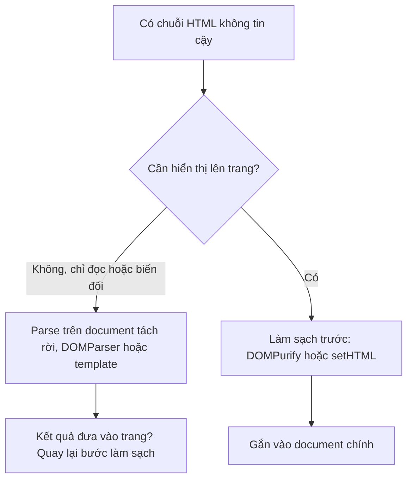

Frontend nào cũng có lúc cần **xử lý HTML mà không hiển thị**: lấy chữ thuần từ mô tả khoá học để làm đoạn trích, chuẩn hoá HTML người dùng dán vào editor, đếm số ảnh trong bài viết. Cách nhanh nhất là tạo một `div`, gán `innerHTML`, rồi đọc `textContent`. Cách đó **chạy được script** của chuỗi HTML, dù `div` chưa từng được gắn vào trang:

```js
const div = document.createElement('div');
div.innerHTML = ''; // onerror chạy!
const text = div.textContent;
```

Editor rich text của Udemy làm việc này ở rất nhiều chỗ (xem [bài #11](/blogs/udemy-prosemirror-integration)), và họ có một hàm nhỏ để làm cho đúng.

> [!TIP]
> **Tóm tắt**
> - Phần tử tạo từ `document` chính thì chưa gắn vào trang vẫn tải ảnh và chạy `onerror`. Phần tử thuộc một document **tạo bằng `document.implementation.createHTMLDocument()`** thì không: document đó không gắn với cửa sổ nào.
> - `DOMParser` và `<template>` cũng "trơ" như vậy. Đo trên Chromium 153: cùng một payload, chỉ cách `document.createElement('div').innerHTML` làm `onerror` chạy.
> - `validateHref` của Udemy (chép theo Django) kiểm tra scheme bằng cách cắt chuỗi theo `://`. Chuỗi như `javascript:alert(1)//udemy.com` không có `://` nên bị coi là "không có scheme" và được nhận. Kiểm bằng `new URL()` thì không lọt.
> - Udemy có lớp bảo vệ thứ hai: HTML hiển thị đi qua DOMPurify (`safelySetInnerHTML`). Trình duyệt mới đã có Sanitizer API (`Element.setHTML`).

<iframe class="demo-frame" src="/demos/web-patterns/index.html?theme=dark#/ud-safe-html" title="Demo ud-safe-html" loading="lazy" style="height: 980px"></iframe>

<p class="demo-links">▶ <a href="/demos/web-patterns/index.html#/ud-safe-html" target="_blank" rel="noopener">Mở demo toàn màn hình ↗</a> · <a href="https://stackblitz.com/github/hunghg255/blog-hunghg/tree/master/examples/web-patterns?file=src/lib/udSafeHtml.ts" target="_blank" rel="noopener">Sửa code trên StackBlitz ↗</a> · <a href="https://github.com/hunghg255/blog-hunghg/blob/master/examples/web-patterns/src/lib/udSafeHtml.ts" target="_blank" rel="noopener">Xem source trên GitHub ↗</a></p>

## Udemy làm thế nào?

### Một document dùng chung, tạo một lần

`udemy.com/webpack---/src/udemy/js/base-components/ungraduated/form/rich-text-editor/helpers.js`:

```js
// This is adapted from the prosemirror-view `readHTML` method.
// If we need to create a DOM node, but we don't need to render it, then it's safer to
// use a detached document. If we set innerHTML to something like
// 
// via the main document, the `onload` executes, whereas via a detached document, it doesn't.
let detachedDoc = null;

export function getDetachedDoc() {
  if (!detachedDoc) detachedDoc = document.implementation.createHTMLDocument('title');
  return detachedDoc;
}
```

`htmlToText(html)` ngay bên dưới chỉ là `getDetachedDoc().createElement('div')`, gán `innerHTML`, trả `textContent`.

Comment ghi rõ nguồn gốc: ProseMirror làm y như vậy khi đọc HTML từ clipboard. Comment cũng nói mặt trái: phần tử cần **hiển thị** thì phải dùng document chính, vì một số sự kiện (như `mousedown`) không hoạt động trên document tách rời. `getDetachedDoc()` được dùng khắp `ud-prosemirror/helpers.js`: parse HTML dán vào, tách dòng, serializer.

Document được tạo **một lần** rồi dùng lại (`createHTMLDocument` không rẻ). Phần tử tạo ra từ nó không bao giờ được gắn vào đâu, nên dùng chung không đụng nhau.

### Kiểm tra href theo Django

Cùng file có `validateHref`, dùng cho form chèn link và cho rule parse thẻ `<a>` của schema:

```js
// Copied from django.core.validators:URLValidator.
const URL_SCHEMES = ['http', 'https', 'ftp', 'ftps'];
// ... (bắt buộc nhập, nhánh mailto:, đường dẫn bắt đầu bằng '/' thì nhận luôn)
} else if (href && !href.startsWith('/')) {
  const requiredPartOfURL = /([\w-]{1,63}\.[a-zA-Z-]{2,63}|(?:\d{1,3}\.){3}\d{1,3})/g;
  if (!href.match(requiredPartOfURL)) error.href = gettext('Enter a valid URL.');
  else {
    const scheme = href.split('://')[0];
    if (scheme === href) validatedData.href = `http://${href}`;          // google.com -> http://google.com
    else if (!URL_SCHEMES.includes(scheme.toLowerCase())) error.href = gettext('Enter a valid URL.');
  }
}
```

Ý đồ: có `://` thì scheme phải nằm trong danh sách; không có `://` thì coi như người dùng gõ thiếu (`google.com`) và thêm `http://`. Vấn đề nằm ở giả định "không có `://` nghĩa là không có scheme". `javascript:`, `data:` không cần `//`:

| href | `validateHref` | Ghi chú |
|---|---|---|
| `javascript:alert(document.domain)//udemy.com` | nhận | có chữ giống tên miền, không có `://` |
| `JAVASCRIPT:alert(1)//a.io` | nhận | như trên |
| `data:text/html,<script>…</script>//x.co` | nhận | như trên |
| `javascript://udemy.com/%0aalert(1)` | từ chối | có `://`, scheme `javascript` không có trong danh sách |
| `/\evil.com` | nhận | coi là đường dẫn trong site, trình duyệt hiểu là `https://evil.com/` |

(Bảng chạy lại logic trên bằng Node; dòng cuối kiểm bằng `new URL('/\\evil.com', 'https://www.udemy.com').href`.)

Hai nơi gọi xử lý kết quả khác nhau:

- **Form chèn link** (`anchor-form.mobx-model.js`) dùng `validatedData.href`, tức chuỗi đã bị thêm `http://` phía trước: `http://javascript:alert(…)//udemy.com`. Vô hại.
- **Rule parse `<a>` trong schema** (`ud-prosemirror/build-schema.js`) chỉ xem có `error.href` hay không, còn `href` trả về là **chuỗi gốc** từ DOM:

```js
getAttrs(dom) {
  const attrs = { href: dom.getAttribute('href'), title: dom.getAttribute('title') };
  const validatedData = {}, error = {};
  validateHref(attrs.href, validatedData, error, true, gettext);
  if (error.href) return false;
  return attrs;            // href gốc, không phải validatedData.href
}
```

Nghĩa là HTML dán vào editor có `<a href="javascript:…//udemy.com">` thì link đó vào được nội dung. Có lẽ không khai thác được ở chỗ hiển thị: Udemy có `utils/escape/safely-set-inner-html.js`, thay `dangerouslySetInnerHTML` bằng `DOMPurify.sanitize`, mà DOMPurify mặc định bỏ href `javascript:`. Comment trong file đó nói rõ lý do họ vẫn lọc ở client "even if we've already sanitized on the server". Mình không kiểm được mọi chỗ hiển thị nội dung này có đi qua DOMPurify hay không.

## Bên trong trình duyệt: vì sao document tách rời "trơ"

Khi phần tử `` được tạo với `src`, trình duyệt bắt đầu tải ảnh **ngay lập tức** nếu document chứa nó có "browsing context" (gắn với một cửa sổ), không cần ảnh được gắn vào cây DOM hiển thị. Tải lỗi thì bắn `error`, và thuộc tính `onerror` chạy như script của trang.

Document tạo bằng `createHTMLDocument`, `DOMParser` hay nội dung của `<template>` **không có browsing context**: không tải tài nguyên, không chạy script, không bắn sự kiện tải. Cây DOM vẫn đầy đủ để đọc `textContent`, `querySelectorAll`, sửa thuộc tính.



Điểm cần nhớ ở nhánh trái: cây DOM "trơ" chỉ an toàn **chừng nào nó còn trơ**. Lấy `innerHTML` của nó rồi gán vào trang thì mọi thứ bên trong sống lại.

## Viết lại

```ts title=src/lib/udSafeHtml.ts
let detachedDoc: Document | null = null;

/**
 * Document "tách rời": tạo bằng createHTMLDocument nên không gắn với cửa sổ nào.
 * Gán innerHTML trên phần tử của document này KHÔNG tải ảnh, KHÔNG chạy onload/onerror.
 * Phần tử tạo từ `document` chính thì khác: chưa gắn vào trang vẫn tải ảnh và chạy onerror.
 */
export function getDetachedDoc(): Document {
  detachedDoc ??= document.implementation.createHTMLDocument('');
  return detachedDoc;
}

/** Parse một chuỗi HTML thành cây DOM "trơ" (không tải, không chạy gì). */
export function parseInert(html: string): HTMLElement {
  const div = getDetachedDoc().createElement('div');
  div.innerHTML = html;
  return div;
}

/** Lấy chữ thuần từ HTML mà không để  kịp chạy. */
export function htmlToText(html: string | null | undefined): string {
  if (!html) return '';
  return parseInert(html).textContent ?? '';
}
```

Kiểm tra href bằng `URL` của trình duyệt, và trả về giá trị đã chuẩn hoá để nơi gọi không dùng nhầm chuỗi gốc:

```ts title=src/lib/udSafeHtml.ts
const ALLOWED_PROTOCOLS = new Set(['http:', 'https:', 'ftp:', 'ftps:', 'mailto:']);
const DOMAIN_LIKE = /^([\w-]{1,63}\.)+[a-z-]{2,63}(:\d+)?([/?#]|$)|^(\d{1,3}\.){3}\d{1,3}([:/?#]|$)/i;

export type HrefCheck = { ok: true; href: string } | { ok: false; reason: string };

/**
 * Kiểm tra href người dùng gõ hoặc dán vào editor.
 * Dựa trên `URL` của trình duyệt thay vì cắt chuỗi theo '://', nên `javascript:`, `data:`,
 * `/\evil.com` không lọt qua. Trả về href ĐÃ CHUẨN HOÁ: nơi gọi phải dùng giá trị này,
 * không dùng lại chuỗi gốc.
 */
export function checkHref(input: string, base = 'https://example.com'): HrefCheck {
  const href = input.trim();
  if (!href) return { ok: false, reason: 'Bắt buộc nhập' };

  // đường dẫn tương đối trong site: chỉ chấp nhận một dấu '/' ở đầu, theo sau không phải '/' hay '\'
  if (href.startsWith('/')) {
    if (/^\/[/\\]/.test(href)) return { ok: false, reason: 'Đường dẫn trỏ ra domain khác (//, /\\)' };
    return { ok: true, href };
  }

  // "google.com" không có scheme: thêm https:// rồi mới parse
  // ("example.com:8080" trông giống scheme "example.com:", nên xét dạng tên miền trước)
  const hasScheme = /^[a-z][a-z\d+.-]*:/i.test(href) && !DOMAIN_LIKE.test(href);
  const candidate = hasScheme ? href : DOMAIN_LIKE.test(href) ? `https://${href}` : null;
  if (!candidate) return { ok: false, reason: 'Không giống một URL' };

  let url: URL;
  try {
    url = new URL(candidate, base);
  } catch {
    return { ok: false, reason: 'URL không hợp lệ' };
  }
  if (!ALLOWED_PROTOCOLS.has(url.protocol)) return { ok: false, reason: `Không cho phép giao thức ${url.protocol}` };
  if (url.protocol === 'mailto:') {
    return /^[^@\s]+@[^@\s]+\.[^@\s]+$/.test(decodeURIComponent(url.pathname))
      ? { ok: true, href: url.href }
      : { ok: false, reason: 'Email không hợp lệ' };
  }
  if (!url.hostname.includes('.') && url.hostname !== 'localhost') return { ok: false, reason: 'Thiếu tên miền' };
  return { ok: true, href: url.href };
}
```

::: spoiler Xem toàn bộ src/lib/udSafeHtml.ts

```ts title=src/lib/udSafeHtml.ts
/**
 * Parse HTML không chạy script, và kiểm tra href (ý tưởng từ rich-text-editor/helpers.js của Udemy).
 */

let detachedDoc: Document | null = null;

/**
 * Document "tách rời": tạo bằng createHTMLDocument nên không gắn với cửa sổ nào.
 * Gán innerHTML trên phần tử của document này KHÔNG tải ảnh, KHÔNG chạy onload/onerror.
 * Phần tử tạo từ `document` chính thì khác: chưa gắn vào trang vẫn tải ảnh và chạy onerror.
 */
export function getDetachedDoc(): Document {
  detachedDoc ??= document.implementation.createHTMLDocument('');
  return detachedDoc;
}

/** Parse một chuỗi HTML thành cây DOM "trơ" (không tải, không chạy gì). */
export function parseInert(html: string): HTMLElement {
  const div = getDetachedDoc().createElement('div');
  div.innerHTML = html;
  return div;
}

/** Lấy chữ thuần từ HTML mà không để  kịp chạy. */
export function htmlToText(html: string | null | undefined): string {
  if (!html) return '';
  return parseInert(html).textContent ?? '';
}

// ---------- kiểm tra href ----------

const ALLOWED_PROTOCOLS = new Set(['http:', 'https:', 'ftp:', 'ftps:', 'mailto:']);
const DOMAIN_LIKE = /^([\w-]{1,63}\.)+[a-z-]{2,63}(:\d+)?([/?#]|$)|^(\d{1,3}\.){3}\d{1,3}([:/?#]|$)/i;

export type HrefCheck = { ok: true; href: string } | { ok: false; reason: string };

/**
 * Kiểm tra href người dùng gõ hoặc dán vào editor.
 * Dựa trên `URL` của trình duyệt thay vì cắt chuỗi theo '://', nên `javascript:`, `data:`,
 * `/\evil.com` không lọt qua. Trả về href ĐÃ CHUẨN HOÁ: nơi gọi phải dùng giá trị này,
 * không dùng lại chuỗi gốc.
 */
export function checkHref(input: string, base = 'https://example.com'): HrefCheck {
  const href = input.trim();
  if (!href) return { ok: false, reason: 'Bắt buộc nhập' };

  // đường dẫn tương đối trong site: chỉ chấp nhận một dấu '/' ở đầu, theo sau không phải '/' hay '\'
  if (href.startsWith('/')) {
    if (/^\/[/\\]/.test(href)) return { ok: false, reason: 'Đường dẫn trỏ ra domain khác (//, /\\)' };
    return { ok: true, href };
  }

  // "google.com" không có scheme: thêm https:// rồi mới parse
  // ("example.com:8080" trông giống scheme "example.com:", nên xét dạng tên miền trước)
  const hasScheme = /^[a-z][a-z\d+.-]*:/i.test(href) && !DOMAIN_LIKE.test(href);
  const candidate = hasScheme ? href : DOMAIN_LIKE.test(href) ? `https://${href}` : null;
  if (!candidate) return { ok: false, reason: 'Không giống một URL' };

  let url: URL;
  try {
    url = new URL(candidate, base);
  } catch {
    return { ok: false, reason: 'URL không hợp lệ' };
  }
  if (!ALLOWED_PROTOCOLS.has(url.protocol)) return { ok: false, reason: `Không cho phép giao thức ${url.protocol}` };
  if (url.protocol === 'mailto:') {
    return /^[^@\s]+@[^@\s]+\.[^@\s]+$/.test(decodeURIComponent(url.pathname))
      ? { ok: true, href: url.href }
      : { ok: false, reason: 'Email không hợp lệ' };
  }
  if (!url.hostname.includes('.') && url.hostname !== 'localhost') return { ok: false, reason: 'Thiếu tên miền' };
  return { ok: true, href: url.href };
}

/** Phát hiện Sanitizer API (`Element.setHTML`) — trình duyệt chưa hỗ trợ thì dùng thư viện như DOMPurify. */
export function hasSetHTML(): boolean {
  return typeof (Element.prototype as Element & { setHTML?: unknown }).setHTML === 'function';
}
```

:::

## Đi qua code

- **`detachedDoc ??= …`**: tạo một lần, dùng lại. `createHTMLDocument('')` tạo một document HTML đầy đủ (có `<html>`, `<head>`, `<body>`).
- **`parseInert`** trả về một `div` của document tách rời. Phần tử này **không** dùng được với API cần gắn vào trang (đo kích thước, focus, sự kiện chuột); cần thì `document.importNode` sau khi đã làm sạch.
- **`checkHref`**: đường dẫn bắt đầu bằng `/` chỉ được nhận nếu ký tự thứ hai không phải `/` hay `\`, vì trình duyệt coi `//evil.com` và `/\evil.com` là URL tuyệt đối tới domain khác.
- **`hasScheme`** dùng regex scheme chuẩn (`chữ cái` + `chữ, số, +, -, .` + `:`), nhưng loại trừ dạng tên miền có cổng (`example.com:8080`) vì nó trông giống scheme `example.com:`.
- **`new URL(candidate)`** rồi kiểm `url.protocol` trong danh sách cho phép. `JAVASCRIPT:` được URL chuẩn hoá thành `javascript:`, không lọt qua kiểu so chữ hoa/thường.
- **Trả `href` đã chuẩn hoá** (`url.href`): `udemy.com/x` thành `https://udemy.com/x`. Nơi gọi phải ghi giá trị này, không phải chuỗi đầu vào: đúng chỗ schema của Udemy bị hở.

**Khác bản gốc:** thêm `https://` thay vì `http://` cho tên miền thiếu scheme; từ chối `//` và `/\`; email kiểm bằng regex đơn giản trên phần sau `mailto:` đã giải mã.

## Tại sao không làm cách khác?

- **Regex xoá `on*=` và `<script>`?** Có vô số cách viết lại thuộc tính và thẻ (`<svg onload>`, `<iframe srcdoc>`, entity lồng nhau). Đừng tự làm sạch HTML bằng regex.
- **`DOMParser` thay cho document tách rời?** Cũng trơ và tiện hơn cho cả trang HTML. Document dùng chung của Udemy tiết kiệm việc tạo document mới mỗi lần parse một đoạn nhỏ, và các phần tử tạo ra cùng một `ownerDocument`, dễ chuyển qua lại.
- **`<template>`?** Trơ, nhưng nội dung nằm trong `template.content` (một `DocumentFragment`), không phải con trực tiếp. Hợp khi muốn `cloneNode` để gắn vào trang sau khi đã làm sạch.
- **Chỉ dựa vào DOMPurify ở chỗ hiển thị?** Nên có, nhưng nội dung có thể đi ra nhiều nơi (email, app mobile, API). Chặn `javascript:` từ lúc nhập thì nơi nào hiển thị cũng an toàn hơn.

## Edge case và cạm bẫy

- **`innerHTML` của cây trơ vẫn chứa payload**: chỉ việc parse là an toàn, gán kết quả vào trang thì không.
- **`` trong document tách rời không có kích thước**: `naturalWidth` luôn 0 vì ảnh không tải. Muốn đọc kích thước ảnh thì phải tải trong document chính (và đó là lúc `onerror` chạy).
- **URL tương đối với base**: `checkHref` dùng `base` chỉ để parse; href tương đối như `/home` được trả nguyên, không gắn với base.
- **`localhost`** hay địa chỉ IP: `checkHref` nhận `localhost` và IPv4, không nhận IPv6 viết tắt. Điều chỉnh theo nhu cầu.
- **Unicode trong tên miền**: `new URL('https://ví-dụ.vn')` tự chuyển sang punycode (`xn--…`). Muốn hiện tên miền gốc cho người dùng thì giữ thêm chuỗi đầu vào để hiển thị, nhưng lưu `url.href`.

## Dùng trong dự án

```ts
// Đoạn trích không có HTML cho thẻ <meta name="description">
const excerpt = htmlToText(course.description).slice(0, 160);

// Đếm ảnh mà không tải ảnh nào
const imageCount = parseInert(post.html).querySelectorAll('img').length;

// Form chèn link
const check = checkHref(input.value);
if (!check.ok) showError(check.reason);
else insertLink(check.href); // giá trị đã chuẩn hoá
```

::: spoiler Ví dụ test (bản phác, không có trong repo)

```ts
import { describe, expect, it } from 'vitest';
import { checkHref, htmlToText, parseInert } from './udSafeHtml';

describe('checkHref', () => {
  it.each([
    ['https://udemy.com/a', 'https://udemy.com/a'],
    ['udemy.com/x', 'https://udemy.com/x'],
    ['example.com:8080/d', 'https://example.com:8080/d'],
    ['mailto:a@b.co', 'mailto:a@b.co'],
    ['/home', '/home'],
  ])('nhận %s', (input, href) => {
    expect(checkHref(input)).toEqual({ ok: true, href });
  });

  it.each(['javascript:alert(1)//udemy.com', 'JAVASCRIPT:alert(1)//a.io', 'data:text/html,x//a.co', '/\\evil.com', '//evil.com', 'mailto:abc'])(
    'từ chối %s',
    (input) => {
      expect(checkHref(input).ok).toBe(false);
    },
  );
});

describe('parseInert / htmlToText', () => {
  it('lấy chữ, cây DOM thuộc document tách rời', () => {
    expect(htmlToText('<p>Xin <b>chào</b></p>')).toBe('Xin chào');
    expect(parseInert('<p>a</p>').ownerDocument).not.toBe(document);
  });
});
```

:::

## So với thư viện và chuẩn web

- **DOMPurify**: thư viện làm sạch HTML phổ biến nhất; mặc định bỏ thẻ script, thuộc tính sự kiện và URL `javascript:`. Bản thân nó cũng parse trên một document trơ.
- **Sanitizer API** (`Element.setHTML`, `Document.parseHTML`): làm sạch ngay trong trình duyệt, không cần thư viện. Chromium 153 trong demo đã có `setHTML`; thử `div.setHTML('<b>hi</b><a href="javascript:1">l</a>')` cho ra `<b>hi</b><a>l</a>`. Các trình duyệt khác thì kiểm tra [caniuse](https://caniuse.com/mdn-api_element_sethtml) trước khi bỏ DOMPurify (tính tới 10/2026).
- **Trusted Types**: chính sách CSP buộc mọi phép gán `innerHTML` đi qua một hàm làm sạch, bắt được các chỗ quên. Hợp với codebase lớn như Udemy, nơi họ phải đánh dấu tay `REVIEWED_BY_APPSEC` cạnh mỗi `dangerouslySetInnerHTML`.
- **`URL` và `URL.canParse`**: parser URL chuẩn WHATWG, giống hệt cách trình duyệt hiểu `href`. Dùng nó để kiểm URL thay vì regex hay cắt chuỗi.

---

Bài này thuộc series **[Học từ mã nguồn Udemy](/series/udemy)** (21 bài, đọc theo thứ tự).

::: spoiler Xem nhanh danh sách bài trong series

*Mở đầu*

- [Mở đầu: bên trong frontend của Udemy](/blogs/learn-from-udemy-source-code)

*Phần 1: video và học bài*

- [#1 DRM đa hệ: Widevine, PlayReady, FairPlay](/blogs/udemy-drm-multi-key-system)
- [#2 URL ký và license hết hạn: tự làm mới, tải trước bài kế](/blogs/udemy-expiring-media-urls)
- [#3 Ghi tiến độ xem theo bucket, tự hoàn thành, backoff lỗi](/blogs/udemy-watch-progress-buckets)
- [#4 Thumbnail sprite từ WebVTT và slide trên seekbar](/blogs/udemy-sprite-thumbnails-vtt)
- [#5 Phụ đề: tự chọn ngôn ngữ và editor có phím tắt](/blogs/udemy-captions-auto-select-editor)
- [#6 Đo băng thông, autoplay Safari, iPad giả làm Mac](/blogs/udemy-video-quirks-autoplay)

*Phần 2: bài tập, bài thi, lab*

- [#7 Preview code HTML/React trong iframe sandbox](/blogs/udemy-code-preview-sandbox)
- [#8 Bài thi có giờ: tạm dừng khi rảnh, autosave theo dấu vân tay](/blogs/udemy-timed-exam)
- [#9 Chấm code realtime: đăng ký kênh trước, có đường dự phòng](/blogs/udemy-realtime-grading)
- [#10 Mở lab không bị chặn popup, heartbeat, xung đột phiên](/blogs/udemy-lab-launcher)

*Phần 3: editor và nội dung*

- [#11 ProseMirror: schema theo flag, NodeView React, HTML cho email](/blogs/udemy-prosemirror-integration)
- **#12 Parse HTML an toàn bằng document tách rời** (bài này)
- [#13 Sinh file .ics có VTIMEZONE tự dò giờ mùa hè](/blogs/udemy-ics-vtimezone)
- [#14 Đọc Open Badges giấu trong ảnh PNG và SVG](/blogs/udemy-open-badges-image)

*Phần 4: hạ tầng và trải nghiệm*

- [#15 Pipeline tracking: batch, sendBeacon, bfcache, HTTP 207](/blogs/udemy-event-tracking-pipeline)
- [#16 Gợi ý tính năng mới qua nhiều phiên bằng máy trạng thái](/blogs/udemy-feature-discoverability)
- [#17 Kéo cạnh để resize và mép cuộn mờ dần](/blogs/udemy-resizer-gradient-scroll)
- [#18 Gom request giá khoá học, cập nhật một phần khi áp coupon](/blogs/udemy-price-dataloader-partial-update)
- [#19 Trả lời lạc quan có rollback, autocomplete hai tầng cache](/blogs/udemy-optimistic-reply-autocomplete)
- [#20 Nạp app theo ưu tiên, registry store, HTML cache công khai](/blogs/udemy-app-loader-registry)

:::

Code + demo: [`examples/web-patterns`](https://github.com/hunghg255/blog-hunghg/tree/master/examples/web-patterns) · [Mở trên StackBlitz](https://stackblitz.com/github/hunghg255/blog-hunghg/tree/master/examples/web-patterns)
