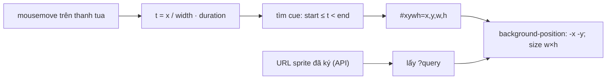

Rê chuột trên thanh tua của YouTube, Netflix hay Udemy, bạn thấy một khung ảnh nhỏ của đúng thời điểm đó. Tải một ảnh cho mỗi thời điểm thì bài 10 phút với khung 5 giây là 120 request. Cách phổ biến là gộp mọi khung vào **một ảnh sprite** lớn, rồi dùng một file **WebVTT** nói khoảng thời gian nào ứng với ô nào trong sprite:

```
WEBVTT

00:00:00.000 --> 00:00:05.000
thumbs-sprite.jpg#xywh=0,0,160,90

00:00:05.000 --> 00:00:10.000
thumbs-sprite.jpg#xywh=160,0,160,90
```

Udemy làm đúng như vậy trong thư mục `shaka-video-player/sneak-peek/` (tên nội bộ là "sneak peek"), cùng hàm `parseSpriteImageLink` trong `shaka-video-player/utils.ts`. Bài dạng "video mashup" (video kèm slide trình chiếu) thì có một biến thể: thanh tua chia theo slide, rê vào đoạn nào hiện slide đó (`asset/video/mashup/video-mashup-thumbnails.react-component.js`).

> [!TIP]
> **Tóm tắt**
> - Một ảnh sprite + một file VTT: cue nói khoảng thời gian, fragment `#xywh=x,y,w,h` nói ô trong sprite.
> - File VTT chứa đường dẫn tương đối, không có chữ ký CDN. Udemy lấy phần query (chữ ký) của URL sprite mà API trả về rồi gắn vào.
> - Chia thanh tua theo slide phải làm tròn theo **vị trí cộng dồn**. Udemy làm tròn từng đoạn về số nguyên rồi để đoạn cuối gánh phần dư, sai số dồn lại tới 11% trong demo.
> - Hai lỗi đo khác: không hiểu tiền tố `pixel:` của chuẩn Media Fragments, và trộn toạ độ màn hình (`screenX`) với toạ độ viewport.

<iframe class="demo-frame" src="/demos/web-patterns/index.html?theme=dark#/ud-sprite-thumbs" title="Demo ud-sprite-thumbs" loading="lazy" style="height: 1150px"></iframe>

<p class="demo-links">▶ <a href="/demos/web-patterns/index.html#/ud-sprite-thumbs" target="_blank" rel="noopener">Mở demo toàn màn hình ↗</a> · <a href="https://stackblitz.com/github/hunghg255/blog-hunghg/tree/master/examples/web-patterns?file=src/lib/udSpriteThumbs.ts" target="_blank" rel="noopener">Sửa code trên StackBlitz ↗</a> · <a href="https://github.com/hunghg255/blog-hunghg/blob/master/examples/web-patterns/src/lib/udSpriteThumbs.ts" target="_blank" rel="noopener">Xem source trên GitHub ↗</a></p>

Sprite trong demo được **vẽ bằng canvas** ngay trong trang (60 ô, mỗi ô 5 giây), VTT cũng sinh ra tại chỗ, nên không tải gì từ ngoài. Ở phần mashup, rê chuột tới khoảng 90% thanh: slide thật là #26, kiểu Udemy báo #29.

## Udemy làm thế nào?

### Đọc VTT, tìm cue, cắt ô

Component tải file VTT bằng axios, parse bằng thư viện `webvtt-parser` rồi đổi từng cue thành `VTTCue`:

::: spoiler Xem đoạn tải và parse VTT

```ts
axios.get(this.sneakPeekStore.thumbnailsVTTUrl).then((response) => {
    const parser = new WebVTTParser(this.sneakPeekStore.videoElement, 'thumbnails');
    const cues = parser.parse(response.data).cues;
    for (let i = 0; i < cues.length; i++) {
        const cue = cues[i];
        this.sneakPeekStore.sneakPeekCues.push(new VTTCue(cue.startTime, cue.endTime, cue.text));
    }
});
```

:::

Khi chuột di chuyển, đổi vị trí chuột thành thời điểm rồi duyệt cue:

```ts
const mouseTime = Math.floor((this.mouseLeftPosition / offsetWidth) * this.sneakPeekStore.duration);
// The API returns us the full file URL, but we need the path up until the file as it's inside the .vtt already
const baseUrl = this.sneakPeekStore.thumbSpriteUrl.toString().split('?')[0];
const basePath = `${baseUrl.slice(0, baseUrl.lastIndexOf('/'))}/`;

while (i < this.sneakPeekStore.sneakPeekCues.length) {
    const cue = this.sneakPeekStore.sneakPeekCues[i];
    if (cue.startTime <= mouseTime && cue.endTime >= mouseTime) {
        imageSettings = parseSpriteImageLink(cue.text, basePath);
        break;
    }
    i++;
}
```

`parseSpriteImageLink` tách phần trước `#` làm đường dẫn ảnh, phần sau `xywh=` thành bốn số:

```ts
const data = hashString.substring(5).split(',');
return { src: basePath + lsrc, x: +data[0], y: +data[1], w: +data[2], h: +data[3] };
```

Cắt ô bằng CSS `clip: rect(top, right, bottom, left)` trên thẻ `` đặt lệch `left: -x; top: -y`.

### Chữ ký CDN

Chi tiết đáng học nhất nằm ở `imgSrc`:

```ts
get imgSrc() {
    // …
    return baseUrl + this.imageSettings.src + this.sneakPeekStore.thumbSpriteUrl.search;
}
```

API trả về URL sprite **đã ký** (`…/sprite.jpg?Expires=…&Signature=…`). File VTT do hệ thống xử lý video sinh ra một lần, nên không thể chứa chữ ký (chữ ký hết hạn sau vài giờ, bài #2). Lấy `search` (phần `?…`) của URL đã ký gắn vào đường dẫn trong VTT là đủ để CDN cho tải. Mẹo này chỉ đúng khi chữ ký áp cho cả thư mục (CloudFront signed URL với chính sách wildcard chẳng hạn) hoặc khi VTT chỉ trỏ tới chính file sprite đó.

### Đặt khung không tràn mép

```ts
let containerLeft = this.mouseLeftPosition;
const halfWidth = this.imageSettings.w / 2;
// make sure that the sneak peek doesn't fall off the right side of the left side of the player
if (containerLeft + halfWidth > right) {
    containerLeft = right - this.imageSettings.w;
} else if (containerLeft < halfWidth) {
    containerLeft = 0;
} else {
    containerLeft = containerLeft - halfWidth;
}
```

Căn giữa theo chuột, gần mép thì dính vào mép. Bản viết lại gói ba nhánh này thành một biểu thức `min(max(0, x - w/2), barWidth - w)`.

### Mashup: chia thanh tua theo slide

```js
/*
 * To ensure that the widths of the intervals sum to 100%,
 * interval 5 has width = 100 - SUM(widths of 1 through 4).
 */
get thumbnails() {
    let lastInterval = 100;
    return slides.map((slide, thumbnailIndex) => {
        let interval;
        if (thumbnailIndex === slides.length - 1) {
            interval = lastInterval; // Makes sure width percentages sum to exactly 100%.
        } else {
            // Calculate the slide time interval rounding it to 2 decimal places
            interval = Math.round(((slides[thumbnailIndex + 1].time - slides[thumbnailIndex].time) / duration) * 100);
        }
        lastInterval -= interval;
        return <VideoMashupThumbnail key={thumbnailIndex} width={`${interval}%`} /* … */ />;
    });
}
```

Mỗi slide là một `div` có bề rộng phần trăm, đặt trong một flex container phủ lên thanh tua. Rê vào div nào thì hiện ảnh slide đó. Không cần tính thời điểm từ toạ độ chuột: trình duyệt tự làm hit-test.

## Ba chỗ đo sai

**1. Sai số làm tròn dồn vào đoạn cuối.** Comment nói "rounding it to 2 decimal places" nhưng `Math.round(x)` làm tròn về **số nguyên**. Mỗi đoạn sai tối đa 0,5%, và đoạn cuối gánh toàn bộ sai số cộng dồn. Ví dụ trong demo: video 1000 giây, đổi slide mỗi 34 giây. Mỗi đoạn thật dài 3,4% nhưng được làm tròn thành 3%, 29 đoạn đầu cộng lại 87%, đoạn cuối nhận 13% thay vì 1,4%. Rê chuột ở 90% thanh tua (giây 900, slide #26), kiểu Udemy hiện slide #29. Nếu nhiều đoạn bị làm tròn **lên** (ví dụ 39 slide, mỗi đoạn 2,6% thành 3%), tổng 38 đoạn đầu thành 114% và đoạn cuối có bề rộng **âm**.

Cách đúng là làm tròn **vị trí mép** của từng đoạn (tính từ đầu), rồi lấy hiệu hai mép liên tiếp. Sai số của mỗi mép không vượt nửa đơn vị làm tròn và không dồn lại.

**2. Tiền tố `pixel:` thành `NaN`.** Chuẩn W3C Media Fragments cho phép `#xywh=pixel:160,0,160,90` (và `percent:`). `+'pixel:160'` là `NaN`, ô bị đặt sai. File VTT do chính Udemy sinh ra có lẽ không dùng tiền tố này, nên lỗi chỉ lộ ra nếu đổi công cụ sinh sprite.

**3. Trộn hai hệ toạ độ ở mashup.** Khi rê vào một đoạn:

```js
onMouseEnter(thumbnailIndex, event) {
    this.mouseXPosition = event.screenX;
    // …
}
```

còn vị trí của video lấy bằng `getBoundingClientRect().x`, sau đó lấy hiệu hai giá trị để quyết định khung slide căn trái hay căn phải. `screenX` tính từ mép **màn hình**, `getBoundingClientRect` tính từ mép **viewport**. Cửa sổ trình duyệt không nằm sát mép trái màn hình (màn hình thứ hai, cửa sổ thu nhỏ) thì hiệu bị cộng thêm vị trí cửa sổ, và khung slide lật sang căn phải quá sớm. Phải dùng `clientX` cho cùng hệ với `getBoundingClientRect`.

Hai điều nhỏ khác: tìm cue bằng vòng lặp tuyến tính mỗi lần chuột di chuyển (60–200 cue nên không chậm, nhưng tìm kiếm nhị phân cũng chỉ vài dòng), và `clip` là thuộc tính CSS đã lỗi thời, nên thay bằng `background-position` hoặc `object-view-box`.

## Bên trong: từ toạ độ chuột tới ô sprite



## Viết lại

```ts title=src/lib/udSpriteThumbs.ts
/** Tìm cue chứa thời điểm `t` bằng tìm kiếm nhị phân (cue đã sắp theo start). */
export function findCue(cues: ThumbCue[], t: number): ThumbCue | undefined {
  let lo = 0;
  let hi = cues.length - 1;
  while (lo <= hi) {
    const mid = (lo + hi) >> 1;
    const cue = cues[mid];
    if (t < cue.start) hi = mid - 1;
    else if (t >= cue.end) lo = mid + 1;
    else return cue;
  }
  return undefined;
}
```

```ts title=src/lib/udSpriteThumbs.ts

/**
 * Chia thanh tua thành các đoạn theo thời điểm đổi slide, trả về % bề rộng từng đoạn.
 * Làm tròn theo VỊ TRÍ CỘNG DỒN: mép phải đoạn i = round(time[i+1] / duration · 100, decimals).
 * Sai số không dồn lại, tổng luôn đúng 100 và không đoạn nào âm.
 */
export function slideIntervals(times: number[], duration: number, decimals = 2): number[] {
  const factor = 10 ** decimals;
  const edge = (t: number) => Math.round((Math.min(Math.max(t, 0), duration) / duration) * 100 * factor) / factor;
  return times.map((t, i) => {
    const left = i === 0 ? 0 : edge(t);
    const right = i === times.length - 1 ? 100 : edge(times[i + 1]);
    return Math.round((right - left) * factor) / factor;
  });
}
```

::: spoiler Xem toàn bộ src/lib/udSpriteThumbs.ts

```ts title=src/lib/udSpriteThumbs.ts
/**
 * Thumbnail xem trước khi rê chuột trên thanh tua video, lấy từ MỘT ảnh sprite
 * và một file WebVTT chỉ toạ độ từng ô (ý tưởng từ sneak-peek + parseSpriteImageLink của Udemy).
 *
 *   00:00:00.000 --> 00:00:05.000
 *   sprite.jpg#xywh=0,0,160,90
 *
 * Kèm cách chia thanh tua thành các đoạn theo slide (video mashup) sao cho tổng đúng 100%.
 */

export interface ThumbCue {
  start: number;
  end: number;
  text: string;
}

export interface SpriteRef {
  src: string;
  x: number;
  y: number;
  w: number;
  h: number;
}

/** "01:02:03.456" hoặc "02:03.456" → giây */
export function parseTimestamp(text: string): number {
  const parts = text.trim().split(':');
  let seconds = 0;
  for (const part of parts) seconds = seconds * 60 + Number(part.replace(',', '.'));
  return seconds;
}

/** Parser WebVTT tối giản, đủ cho file thumbnail: bỏ header, NOTE, id cue. */
export function parseThumbnailVtt(text: string): ThumbCue[] {
  const cues: ThumbCue[] = [];
  const blocks = text.replace(/\r\n?/g, '\n').split(/\n{2,}/);
  for (const block of blocks) {
    const lines = block.split('\n').filter(Boolean);
    const timingIndex = lines.findIndex((line) => line.includes('-->'));
    if (timingIndex === -1) continue;
    const [from, to] = lines[timingIndex].split('-->');
    const payload = lines.slice(timingIndex + 1).join('\n').trim();
    if (!payload) continue;
    cues.push({ start: parseTimestamp(from), end: parseTimestamp(to.trim().split(/\s+/)[0]), text: payload });
  }
  return cues.sort((a, b) => a.start - b.start);
}

/**
 * "sprite.jpg#xywh=160,0,160,90" → { src, x, y, w, h }.
 * Đúng chuẩn Media Fragments, phần sau "xywh=" có thể có tiền tố "pixel:".
 * Đường dẫn tương đối được ghép với `baseUrl` (thư mục của file VTT).
 */
export function parseSpriteRef(text: string, baseUrl = ''): SpriteRef {
  const hash = text.indexOf('#');
  const path = hash === -1 ? text : text.slice(0, hash);
  const src = /^(https?:|data:|blob:|\/)/.test(path) ? path : baseUrl + path;
  const match = hash === -1 ? null : /xywh=(?:pixel:)?(\d+),(\d+),(\d+),(\d+)/.exec(text.slice(hash + 1));
  if (!match) return { src, x: 0, y: 0, w: 0, h: 0 };
  const [x, y, w, h] = match.slice(1).map(Number);
  return { src, x, y, w, h };
}

/** Tìm cue chứa thời điểm `t` bằng tìm kiếm nhị phân (cue đã sắp theo start). */
export function findCue(cues: ThumbCue[], t: number): ThumbCue | undefined {
  let lo = 0;
  let hi = cues.length - 1;
  while (lo <= hi) {
    const mid = (lo + hi) >> 1;
    const cue = cues[mid];
    if (t < cue.start) hi = mid - 1;
    else if (t >= cue.end) lo = mid + 1;
    else return cue;
  }
  return undefined;
}

/**
 * URL trong VTT không mang chữ ký CDN. Udemy lấy phần query (chữ ký) của URL sprite mà API
 * trả về rồi gắn vào mọi đường dẫn ảnh trong VTT.
 */
export function withSignature(src: string, signedUrl: string): string {
  const query = signedUrl.includes('?') ? signedUrl.slice(signedUrl.indexOf('?')) : '';
  if (!query) return src;
  return src.includes('?') ? `${src}&${query.slice(1)}` : src + query;
}

/** Style hiện một ô của sprite bằng background-position, không cần `clip` (đã lỗi thời). */
export function spriteStyle(ref: SpriteRef) {
  return {
    width: `${ref.w}px`,
    height: `${ref.h}px`,
    backgroundImage: `url("${ref.src}")`,
    backgroundPosition: `-${ref.x}px -${ref.y}px`,
    backgroundRepeat: 'no-repeat',
  };
}

/** Vị trí ngang của khung thumbnail: căn giữa theo chuột, kẹp trong thanh tua. */
export function tooltipLeft(mouseX: number, thumbWidth: number, barWidth: number) {
  return Math.min(Math.max(0, mouseX - thumbWidth / 2), Math.max(0, barWidth - thumbWidth));
}

/**
 * Chia thanh tua thành các đoạn theo thời điểm đổi slide, trả về % bề rộng từng đoạn.
 * Làm tròn theo VỊ TRÍ CỘNG DỒN: mép phải đoạn i = round(time[i+1] / duration · 100, decimals).
 * Sai số không dồn lại, tổng luôn đúng 100 và không đoạn nào âm.
 */
export function slideIntervals(times: number[], duration: number, decimals = 2): number[] {
  const factor = 10 ** decimals;
  const edge = (t: number) => Math.round((Math.min(Math.max(t, 0), duration) / duration) * 100 * factor) / factor;
  return times.map((t, i) => {
    const left = i === 0 ? 0 : edge(t);
    const right = i === times.length - 1 ? 100 : edge(times[i + 1]);
    return Math.round((right - left) * factor) / factor;
  });
}

/** Cách làm của Udemy để so sánh: làm tròn từng đoạn về số nguyên, đoạn cuối gánh phần dư. */
export function slideIntervalsUdemy(times: number[], duration: number): number[] {
  let last = 100;
  return times.map((_, i) => {
    let interval: number;
    if (i === times.length - 1) interval = last;
    else interval = Math.round(((times[i + 1] - times[i]) / duration) * 100);
    last -= interval;
    return interval;
  });
}
```

:::

**Khác bản gốc:**

- Parser VTT tối giản tự viết (bỏ phụ thuộc `webvtt-parser`), đủ cho file thumbnail: chỉ cần mốc thời gian và một dòng nội dung.
- `parseSpriteRef` chấp nhận `pixel:`, URL tuyệt đối, `data:`/`blob:` và ghép đường dẫn tương đối với thư mục của VTT.
- `findCue` tìm nhị phân, khoảng nửa mở `[start, end)` để mốc ranh giới thuộc đúng một cue.
- `spriteStyle` dùng `background-position` thay cho `clip`.
- `slideIntervals` làm tròn theo vị trí cộng dồn, giữ 2 chữ số thập phân như comment của Udemy định làm. Hàm `slideIntervalsUdemy` giữ lại để so sánh trong demo.

## Đi qua code

- `parseTimestamp` nhận cả `mm:ss.mmm` lẫn `hh:mm:ss.mmm`, và dấu phẩy thập phân (định dạng SRT hay bị dán nhầm vào VTT).
- `parseThumbnailVtt` tách khối theo dòng trống, bỏ qua khối không có `-->` (header `WEBVTT`, `NOTE`, `STYLE`), lấy phần trước khoảng trắng đầu tiên của mốc kết thúc để bỏ cue settings như `align:start`.
- `withSignature` nối query bằng `&` nếu đường dẫn trong VTT đã có query riêng.
- `slideIntervals` kẹp thời điểm slide vào `[0, duration]`, slide đầu luôn bắt đầu ở 0% và slide cuối luôn kết thúc ở 100%.

## Tại sao không làm cách khác?

**Sao không dùng `<track kind="metadata">` để trình duyệt tự parse VTT?** Được, và Udemy đã nửa đường đi tới đó: họ tạo `VTTCue` thật. Nhưng track metadata gắn vào thẻ video sẽ bắn `cuechange` theo thời gian **phát**, trong khi thumbnail cần tra theo thời gian **chuột**. Cuối cùng vẫn phải tự duyệt danh sách cue. Tự parse thì không phụ thuộc thẻ video và chạy được cả khi video chưa tải.

**Sao không tạo thumbnail tại chỗ bằng canvas từ video?** Phải tải và giải mã đoạn video tương ứng cho mỗi lần rê chuột: chậm và tốn băng thông. Với video DRM thì không thể, vì canvas không đọc được khung hình đã mã hoá. Sprite sinh trước một lần ở server là cách rẻ nhất.

**Sao không dùng một ảnh riêng cho mỗi khung?** 60–120 request nhỏ, mỗi cái một lần TLS/HTTP overhead và một mục trong cache. Sprite 1600×540 JPEG chất lượng vừa chỉ khoảng 100–200KB, một request, tải xong là rê chuột mượt.

## Edge case và cạm bẫy

- **Màn hình độ phân giải cao**: ô 160×90 trên màn 2× sẽ mờ. Có thể sinh sprite 2× rồi đặt `background-size` bằng một nửa kích thước sprite.
- **Video dài**: sprite quá lớn (ví dụ 4000×4000) gây tốn bộ nhớ giải mã trên mobile. Chia thành nhiều sprite, mỗi cue trỏ tới sprite tương ứng; `parseSpriteRef` đã đọc đường dẫn theo từng cue nên không cần sửa.
- **Thời lượng chưa biết** (trước `loadedmetadata`): `t = x / width · duration` ra `NaN`. Udemy nghe `durationchange` và `loadedmetadata` để cập nhật; nên ẩn thumbnail tới khi có thời lượng.
- **Cảm ứng**: không có hover. Udemy đọc `changedTouches[0].pageX` để hiện thumbnail khi kéo thanh tua bằng ngón tay.

## Dùng trong dự án

```ts
const vttText = await fetch(lecture.thumbnailVttUrl).then((r) => r.text());
const cues = parseThumbnailVtt(vttText);
const baseUrl = lecture.spriteUrl.split('?')[0].replace(/[^/]*$/, '');

seekbar.addEventListener('pointermove', (e) => {
  const rect = seekbar.getBoundingClientRect();
  const x = e.clientX - rect.left;
  const cue = findCue(cues, (x / rect.width) * video.duration);
  if (!cue) return hideThumb();
  const ref = parseSpriteRef(cue.text, baseUrl);
  ref.src = withSignature(ref.src, lecture.spriteUrl);
  Object.assign(thumb.style, spriteStyle(ref), { left: `${tooltipLeft(x, ref.w, rect.width)}px` });
});
```

::: spoiler Ví dụ test (bản phác, không có trong repo)

```ts
import { describe, expect, it } from 'vitest';
import { findCue, parseSpriteRef, parseThumbnailVtt, slideIntervals, slideIntervalsUdemy, tooltipLeft, withSignature } from './udSpriteThumbs';

const VTT = `WEBVTT

NOTE sinh tự động

00:00.000 --> 00:05.000
sprite.jpg#xywh=0,0,160,90

00:00:05.000 --> 00:00:10.000 align:start
sprite.jpg#xywh=pixel:160,0,160,90
`;

describe('VTT + sprite', () => {
  const cues = parseThumbnailVtt(VTT);
  it('parse 2 cue, bỏ NOTE và cue settings', () => {
    expect(cues.map((c) => [c.start, c.end])).toEqual([[0, 5], [5, 10]]);
  });
  it('mốc ranh giới thuộc cue sau', () => {
    expect(findCue(cues, 5)?.text).toContain('pixel:160');
    expect(findCue(cues, 10)).toBeUndefined();
  });
  it('hiểu tiền tố pixel: và ghép base', () => {
    expect(parseSpriteRef(cues[1].text, 'https://cdn/x/')).toEqual({ src: 'https://cdn/x/sprite.jpg', x: 160, y: 0, w: 160, h: 90 });
  });
  it('gắn chữ ký của URL đã ký', () => {
    expect(withSignature('https://cdn/x/sprite.jpg', 'https://cdn/x/sprite.jpg?Signature=abc')).toBe('https://cdn/x/sprite.jpg?Signature=abc');
  });
  it('khung không tràn mép', () => {
    expect(tooltipLeft(5, 160, 800)).toBe(0);
    expect(tooltipLeft(795, 160, 800)).toBe(640);
  });
});

describe('slideIntervals', () => {
  const times = Array.from({ length: 30 }, (_, i) => i * 34);
  it('tổng 100, đoạn cuối đúng 1,4%', () => {
    const widths = slideIntervals(times, 1000);
    expect(widths.reduce((a, b) => a + b, 0)).toBeCloseTo(100, 6);
    expect(widths[29]).toBeCloseTo(1.4, 6);
  });
  it('cách cũ dồn sai số vào đoạn cuối', () => {
    expect(slideIntervalsUdemy(times, 1000)[29]).toBe(13);
  });
  it('không đoạn nào âm kể cả khi làm tròn lên', () => {
    const t = Array.from({ length: 39 }, (_, i) => i * 26); // 38 đoạn × 2,6% → làm tròn 3%
    expect(Math.min(...slideIntervals(t, 1000))).toBeGreaterThanOrEqual(0);
    expect(Math.min(...slideIntervalsUdemy(t, 1000))).toBeLessThan(0);
  });
});
```

:::

## So với thư viện

- **Video.js** có plugin `videojs-vtt-thumbnails` làm đúng việc này (đọc VTT có `#xywh`). **Vidstack**, **Plyr** (`previewThumbnails`), **JW Player**, **Mux Player** đều hỗ trợ thumbnail VTT dạng sprite sẵn.
- **shaka-player** đọc được thumbnail track nếu manifest khai báo (DASH image adaptation set, HLS `#EXT-X-IMAGE-STREAM-INF`), qua `player.getThumbnails(trackId, time)`. Udemy giữ cách tự đọc VTT, có lẽ vì sprite được sinh riêng, không nằm trong manifest.
- Công cụ sinh sprite + VTT: `ffmpeg` (filter `fps` + `tile`) hoặc dịch vụ như Mux, Cloudflare Stream, AWS MediaConvert (xuất thumbnail dạng ảnh rời, cần tự ghép).

---

Bài này thuộc series **[Học từ mã nguồn Udemy](/series/udemy)** (21 bài, đọc theo thứ tự).

::: spoiler Xem nhanh danh sách bài trong series

*Mở đầu*

- [Mở đầu: bên trong frontend của Udemy](/blogs/learn-from-udemy-source-code)

*Phần 1: video và học bài*

- [#1 DRM đa hệ: Widevine, PlayReady, FairPlay](/blogs/udemy-drm-multi-key-system)
- [#2 URL ký và license hết hạn: tự làm mới, tải trước bài kế](/blogs/udemy-expiring-media-urls)
- [#3 Ghi tiến độ xem theo bucket, tự hoàn thành, backoff lỗi](/blogs/udemy-watch-progress-buckets)
- **#4 Thumbnail sprite từ WebVTT và slide trên seekbar** (bài này)
- [#5 Phụ đề: tự chọn ngôn ngữ và editor có phím tắt](/blogs/udemy-captions-auto-select-editor)
- [#6 Đo băng thông, autoplay Safari, iPad giả làm Mac](/blogs/udemy-video-quirks-autoplay)

*Phần 2: bài tập, bài thi, lab*

- [#7 Preview code HTML/React trong iframe sandbox](/blogs/udemy-code-preview-sandbox)
- [#8 Bài thi có giờ: tạm dừng khi rảnh, autosave theo dấu vân tay](/blogs/udemy-timed-exam)
- [#9 Chấm code realtime: đăng ký kênh trước, có đường dự phòng](/blogs/udemy-realtime-grading)
- [#10 Mở lab không bị chặn popup, heartbeat, xung đột phiên](/blogs/udemy-lab-launcher)

*Phần 3: editor và nội dung*

- [#11 ProseMirror: schema theo flag, NodeView React, HTML cho email](/blogs/udemy-prosemirror-integration)
- [#12 Parse HTML an toàn bằng document tách rời](/blogs/udemy-safe-html-parse)
- [#13 Sinh file .ics có VTIMEZONE tự dò giờ mùa hè](/blogs/udemy-ics-vtimezone)
- [#14 Đọc Open Badges giấu trong ảnh PNG và SVG](/blogs/udemy-open-badges-image)

*Phần 4: hạ tầng và trải nghiệm*

- [#15 Pipeline tracking: batch, sendBeacon, bfcache, HTTP 207](/blogs/udemy-event-tracking-pipeline)
- [#16 Gợi ý tính năng mới qua nhiều phiên bằng máy trạng thái](/blogs/udemy-feature-discoverability)
- [#17 Kéo cạnh để resize và mép cuộn mờ dần](/blogs/udemy-resizer-gradient-scroll)
- [#18 Gom request giá khoá học, cập nhật một phần khi áp coupon](/blogs/udemy-price-dataloader-partial-update)
- [#19 Trả lời lạc quan có rollback, autocomplete hai tầng cache](/blogs/udemy-optimistic-reply-autocomplete)
- [#20 Nạp app theo ưu tiên, registry store, HTML cache công khai](/blogs/udemy-app-loader-registry)

:::

Code + demo: [`examples/web-patterns`](https://github.com/hunghg255/blog-hunghg/tree/master/examples/web-patterns) · [Mở trên StackBlitz](https://stackblitz.com/github/hunghg255/blog-hunghg/tree/master/examples/web-patterns)
