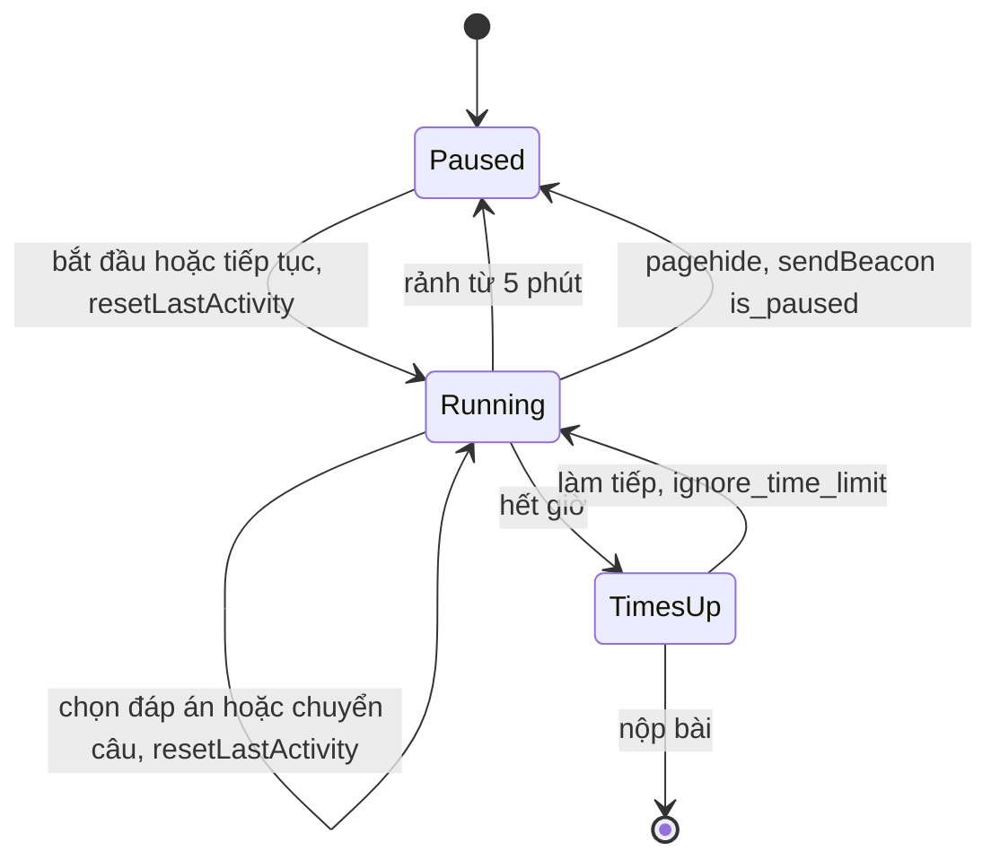

Practice test trên Udemy mô phỏng bài thi chứng chỉ: 60 câu, 90 phút, có đồng hồ đếm ngược. Đồng hồ trong trình duyệt nghe thì dễ (`setInterval` mỗi giây trừ 1), nhưng làm sai thì học viên mất giờ oan hoặc được cộng giờ không công:

- `setInterval` bị trình duyệt làm chậm khi tab ẩn, nên đếm tick là trôi.
- Học viên đi pha cà phê 20 phút mà quên bấm tạm dừng.
- Gập laptop giữa chừng: không có tick nào chạy trong lúc máy ngủ.
- Đóng tab: phải báo server "đang tạm dừng" trong khi trang đang bị huỷ.
- Mất mạng hay đóng tab giữa chừng thì đáp án đã chọn phải còn.

> [!TIP]
> **Tóm tắt**
> - Udemy không cộng dồn tick: lưu mốc `lastActivityDate`, mỗi 200 ms tính `Math.floor((Date.now() - lastActivityDate) / 1000)` và chỉ cho con số tăng. Không trôi, không bị chỉnh đồng hồ lùi.
> - Rảnh 5 phút (`MAX_IDLE_SECONDS`) thì tự tạm dừng; rời trang thì tạm dừng bằng `navigator.sendBeacon`.
> - Lỗi: khoảng rảnh trước khi tự dừng (và cả thời gian máy ngủ) vẫn bị tính vào giờ làm bài. Gập máy 30 phút là mất 30 phút.
> - Tự lưu khi "dấu vân tay" `{questionIndex, answerIds}` đổi; dấu vân tay không có chữ của câu điền vào chỗ trống. Listener `pagehide` gỡ nhầm hàm nên không bao giờ được gỡ.

<iframe class="demo-frame" src="/demos/web-patterns/index.html?theme=dark#/ud-exam-timer" title="Demo ud-exam-timer" loading="lazy" style="height: 900px"></iframe>

<p class="demo-links">▶ <a href="/demos/web-patterns/index.html#/ud-exam-timer" target="_blank" rel="noopener">Mở demo toàn màn hình ↗</a> · <a href="https://stackblitz.com/github/hunghg255/blog-hunghg/tree/master/examples/web-patterns?file=src/lib/udExamTimer.ts" target="_blank" rel="noopener">Sửa code trên StackBlitz ↗</a> · <a href="https://github.com/hunghg255/blog-hunghg/blob/master/examples/web-patterns/src/lib/udExamTimer.ts" target="_blank" rel="noopener">Xem source trên GitHub ↗</a></p>

## Udemy làm thế nào?

### Đồng hồ theo giờ thật

`course-taking/quiz-view/practice-test/question/test-timer.mobx-model.js` có comment đầu file giải thích rõ mô hình: thời gian đã dùng (`elapsed_time`, lấy từ server) được chia thành hai phần quanh mốc hoạt động cuối:

::: spoiler Xem đoạn code gốc (rút gọn)

```js
// test-timer.mobx-model.js (rút gọn)
@computed get timeRemaining() {
  const duration = this.quizViewStore.attempt.results_summary.duration;
  return duration - (this.elapsedUntilLastActivity + this.elapsedSinceLastActivity);
}

_tick() {
  const elapsedSinceLastActivity = Math.floor((Date.now() - this.lastActivityDate) / 1000);
  if (elapsedSinceLastActivity > this.elapsedSinceLastActivity) {
    this.elapsedSinceLastActivity = elapsedSinceLastActivity;
  }
  if (this.timeRemaining <= 0 && !this.ignoreTimeLimit) this.showTimesUpConfirmation();
  else if (this.elapsedSinceLastActivity >= MAX_IDLE_SECONDS) this.pause();
}

resetLastActivity() {
  this.elapsedUntilLastActivity += this.elapsedSinceLastActivity;
  this.elapsedSinceLastActivity = 0;
  this.lastActivityDate = Date.now();
}
```

:::

Với `TIMER_INTERVAL = 200` và `MAX_IDLE_SECONDS = 5 * 60` trong `practice-test/constants.js`.

Vì sao hay:

- **Không đếm tick.** Mỗi lần tick chỉ *đọc* đồng hồ. Tick bị trễ (tab nền, CPU bận) thì lần sau tự đúng lại. Tick 200 ms để màn hình cập nhật mượt, không phải để đếm.
- **Chỉ tăng.** `if (elapsedSinceLastActivity > this.elapsedSinceLastActivity)`: người dùng chỉnh đồng hồ máy lùi lại thì thời gian không giảm.
- **"Hoạt động" do code gọi.** Chọn đáp án, đánh dấu xem lại, chuyển câu… đều gọi `resetLastActivity()`. Di chuột thì không tính: đi ra ngoài mà để chuột trên trang cũng không được coi là đang làm bài.
- **Hết giờ vẫn cho làm tiếp.** `showTimesUpConfirmation` hỏi người dùng; chọn tiếp tục thì `ignoreTimeLimit = true` và lưu lên server (`ignore_time_limit: true`). Practice test để luyện tập, không phải thi thật.

### Lỗi: rảnh và ngủ vẫn bị tính giờ

Khi `elapsedSinceLastActivity >= 300`, timer gọi `pause()`, nhưng 300 giây rảnh đó đã nằm trong `elapsedSinceLastActivity`. Lần tiếp tục, `_start()` gọi `resetLastActivity()` cộng nó vào `elapsedUntilLastActivity`. Kết quả: mỗi lần quên bấm tạm dừng, học viên mất đủ 5 phút.

Gập laptop còn tệ hơn: trong lúc máy ngủ không có tick nào. Mở máy sau 30 phút, tick đầu tiên đọc được `elapsedSinceLastActivity = 1800`, thấy ≥ 300 nên tạm dừng, và cả 1800 giây được tính. Demo có nút "Gập máy 30 phút": bản kiểu gốc còn 28:28, bản viết lại còn 59:30.

Phía server có lẽ cũng tính như vậy: request tạm dừng chỉ gửi `{is_paused: true}`, còn `elapsed_time` do server trả về lần sau, nên khả năng cao server đo từ lúc tiếp tục tới lúc nhận lệnh dừng. Đây là suy luận, vì code server không có trong dump.

### Tạm dừng khi rời trang

::: spoiler Xem đoạn code gốc (rút gọn)

```js
// practice-test/practice-test-page.react-component.js (rút gọn)
componentDidMount() { window.addEventListener('pagehide', this.handlePageHide); }
componentWillUnmount() {
  window.removeEventListener('pagehide', this.pauseQuiz); // ← gỡ nhầm hàm
  this.pauseQuiz();
}

// quiz-view.mobx-store.js
updateAttemptWithBeacon(data = {}) {
  const body = new Blob([JSON.stringify(data)], { type: 'application/json; charset=UTF-8' });
  navigator.sendBeacon(`/api-2.0${attemptApi(course.id, this.quiz.id)}${this.attempt.id}/pause/`, body);
}
```

:::

- **`pagehide` + `sendBeacon`** là cặp đúng: `beforeunload`/`unload` không chạy ổn định trên mobile, còn request thường có thể bị huỷ khi trang đóng. Comment trong code dẫn bài của CSS-Tricks về việc này.
- **Lỗi:** thêm `this.handlePageHide` nhưng gỡ `this.pauseQuiz`, hai hàm khác nhau, nên listener không bao giờ bị gỡ. Mỗi lần học viên vào lại bài thi trong cùng phiên SPA, thêm một listener cũ còn giữ tham chiếu tới component đã unmount.
- `sendBeacon` không gửi được header tuỳ ý. Nếu API đòi header CSRF (Django REST Framework với session auth thì đòi), endpoint `/pause/` phải nhận token qua đường khác hoặc được miễn. Mình không kiểm chứng được phía server.

### Tự lưu theo dấu vân tay

`practice-test.mobx-store.js` không lưu theo timer mà theo **thay đổi trạng thái**:

```js
@computed get currentQuestionAndAnswers() {
  const question = this.quizViewStore.currentQuestion;
  if (!question) return null;
  return {
    questionIndex: question.questionIndex,
    answerIds: question.selectedAnswers.map((answer) => answer.id).join(','),
  };
}
// observe(this, 'currentQuestionAndAnswers', ({ newValue, oldValue }) => this.answerTestQuestion(prev, next, {...}))
```

Đổi câu (để server biết học viên dừng ở câu nào) hoặc đổi đáp án đều kích hoạt lưu, kèm thời gian đã ở trên câu đó. Hàm lưu sắp `answerIds` để thứ tự đáp án bị xáo trộn khi hiển thị không ảnh hưởng.

**Chỗ hụt:** với câu điền vào chỗ trống, chữ học viên gõ nằm ở `answer.userAnswer`, không nằm trong dấu vân tay. Gõ xong mà chưa chuyển câu thì chưa có gì được lưu; nếu đóng tab lúc đó, `pagehide` chỉ gửi lệnh tạm dừng, không gửi đáp án. Trong `toggleIsMarkedForReview` còn một dòng đáng ngờ: `sortedAnswerIds[answerId] = question.answers[answerId].userAnswer`, dùng id đáp án làm *chỉ số mảng* (khác với nhánh tương ứng trong `answerTestQuestion`).



## Viết lại

### Đồng hồ

Trạng thái chỉ gồm `committed` (đã chốt), `sinceActivity` (giây kể từ lần hoạt động cuối) và mốc `lastActivity`. Phần đáng xem là `tick`:

```ts title=src/lib/udExamTimer.ts
    /** gọi đều đặn (vd mỗi 200ms như bản gốc); chỉ đọc đồng hồ, không cộng dồn */
    tick() {
      if (paused) return;
      const seconds = Math.floor((now() - lastActivity) / 1000);
      // chỉ cho tăng: đồng hồ máy bị chỉnh lùi thì giữ nguyên
      if (seconds > sinceActivity) sinceActivity = seconds;

      if (api.remaining <= 0) {
        timesUp = true;
        paused = true;
        commit();
        onTimesUp?.();
      } else if (sinceActivity >= maxIdleSec) {
        const idle = sinceActivity;
        if (idleCharge === 'until-last-activity') {
          // máy ngủ / bỏ đi: chỉ tính một khoảng ân hạn sau lần hoạt động cuối
          sinceActivity = Math.min(sinceActivity, graceSec);
        }
        paused = true;
        commit();
        onIdlePause?.(idleCharge === 'charge-idle' ? idle : Math.min(idle, graceSec));
      }
      emit();
    },
  };
  return api;
}
```

**Khác bản gốc:** tuỳ chọn `idleCharge: 'until-last-activity'` (mặc định) chỉ tính tối đa `graceSec` (30 giây) sau lần hoạt động cuối khi tự dừng vì rảnh, nên quên bấm dừng hay gập máy không làm mất giờ; `'charge-idle'` giữ đúng hành vi gốc. Nguồn thời gian `now` truyền vào được, để test và demo dùng đồng hồ giả.

### Rời trang và tự lưu

`pauseOnLeave` gắn một hàm vào cả `pagehide` lẫn `visibilitychange` và trả hàm gỡ *đúng hàm đó*; `sendPauseBeacon` gói dữ liệu thành `Blob` JSON. Tự lưu:

```ts title=src/lib/udExamTimer.ts
/**
 * Dấu vân tay của trạng thái cần lưu. Bản gốc chỉ gồm số câu + id đáp án đã chọn, nên chữ
 * gõ vào câu điền vào chỗ trống không làm đổi dấu vân tay; bản này thêm cả nội dung đó.
 */
export const answerFingerprint = (questionIndex: number, q: ExamQuestion) =>
  `${questionIndex}|${[...q.selected].sort((a, b) => a - b).join(',')}|${q.kind === 'fill-in' ? q.text ?? '' : ''}`;

/**
 * Gọi `save` mỗi khi dấu vân tay đổi. Đổi câu thì lưu ngay; chỉ đổi chữ thì chờ `debounceMs`.
 */
export function createAutoSave(save: (reason: 'question-change' | 'answer-change') => void, debounceMs = 800) {
  let lastFingerprint: string | null = null;
  let lastQuestion: number | null = null;
  let timer: ReturnType<typeof setTimeout> | undefined;
  return {
    observe(questionIndex: number, q: ExamQuestion) {
      const fp = answerFingerprint(questionIndex, q);
      if (lastFingerprint === null) {
        lastFingerprint = fp;
        lastQuestion = questionIndex;
        return;
      }
      if (fp === lastFingerprint) return;
      const questionChanged = questionIndex !== lastQuestion;
      lastFingerprint = fp;
      lastQuestion = questionIndex;
      clearTimeout(timer);
      if (questionChanged) save('question-change');
      else timer = setTimeout(() => save('answer-change'), q.kind === 'fill-in' ? debounceMs : 0);
    },
    dispose() {
      clearTimeout(timer);
    },
  };
}
```

**Khác bản gốc:** nghe cả `pagehide` lẫn `visibilitychange → hidden` (trên mobile, chuyển app thường chỉ có cái sau) và hàm gỡ dùng đúng hàm đã gắn; dấu vân tay có chữ của câu điền vào chỗ trống, và đổi chữ thì chờ 800 ms rồi mới lưu.

::: spoiler Xem toàn bộ src/lib/udExamTimer.ts

```ts title=src/lib/udExamTimer.ts
/**
 * Đồng hồ bài thi có giờ, kiểu "practice test" của Udemy:
 * - tính thời gian bằng đồng hồ thật (Date.now), không cộng dồn tick → không trôi
 * - tự tạm dừng khi người dùng không làm gì quá lâu
 * - tạm dừng khi rời trang bằng sendBeacon
 * - tự lưu đáp án khi "dấu vân tay" {câu hiện tại, đáp án đã chọn} đổi
 *
 * Ý tưởng từ `course-taking/quiz-view/practice-test/question/test-timer.mobx-model.js` và
 * `practice-test.mobx-store.js` của Udemy, viết lại từ đầu.
 */

export type IdleCharge =
  /** như bản gốc: khoảng rảnh trước khi tự dừng vẫn bị tính vào thời gian làm bài */
  | 'charge-idle'
  /** chỉ tính tới lần hoạt động cuối (+ `graceSec`) */
  | 'until-last-activity';

export interface ExamTimerOptions {
  /** tổng thời gian cho phép (giây) */
  durationSec: number;
  /** đã dùng bao nhiêu giây (lấy từ server) */
  elapsedSec?: number;
  /** rảnh bao lâu thì tự dừng, mặc định 5 phút như bản gốc */
  maxIdleSec?: number;
  idleCharge?: IdleCharge;
  /** với 'until-last-activity': cộng thêm bao nhiêu giây sau lần hoạt động cuối, mặc định 30 */
  graceSec?: number;
  /** nguồn thời gian (ms), cho phép test với đồng hồ giả */
  now?: () => number;
  onTimesUp?: () => void;
  onIdlePause?: (chargedIdleSec: number) => void;
  onChange?: () => void;
}

export function createExamTimer({
  durationSec,
  elapsedSec = 0,
  maxIdleSec = 5 * 60,
  idleCharge = 'until-last-activity',
  graceSec = 30,
  now = Date.now,
  onTimesUp,
  onIdlePause,
  onChange,
}: ExamTimerOptions) {
  let committed = elapsedSec; // đã chốt, tới lần hoạt động trước
  let sinceActivity = 0; // giây kể từ lần hoạt động gần nhất
  let lastActivity = now();
  let paused = true;
  let timesUp = false;

  const emit = () => onChange?.();

  const commit = () => {
    committed += sinceActivity;
    sinceActivity = 0;
    lastActivity = now();
  };

  const api = {
    get elapsed() {
      return committed + sinceActivity;
    },
    get remaining() {
      return durationSec - api.elapsed;
    },
    get isPaused() {
      return paused;
    },
    get isTimesUp() {
      return timesUp;
    },

    start() {
      if (!paused) return;
      paused = false;
      lastActivity = now();
      emit();
    },

    pause() {
      if (paused) return;
      paused = true;
      commit();
      emit();
    },

    /** người dùng vừa làm gì đó (chọn đáp án, chuyển câu…) */
    activity() {
      if (paused) return;
      commit();
      emit();
    },

    /** gọi đều đặn (vd mỗi 200ms như bản gốc); chỉ đọc đồng hồ, không cộng dồn */
    tick() {
      if (paused) return;
      const seconds = Math.floor((now() - lastActivity) / 1000);
      // chỉ cho tăng: đồng hồ máy bị chỉnh lùi thì giữ nguyên
      if (seconds > sinceActivity) sinceActivity = seconds;

      if (api.remaining <= 0) {
        timesUp = true;
        paused = true;
        commit();
        onTimesUp?.();
      } else if (sinceActivity >= maxIdleSec) {
        const idle = sinceActivity;
        if (idleCharge === 'until-last-activity') {
          // máy ngủ / bỏ đi: chỉ tính một khoảng ân hạn sau lần hoạt động cuối
          sinceActivity = Math.min(sinceActivity, graceSec);
        }
        paused = true;
        commit();
        onIdlePause?.(idleCharge === 'charge-idle' ? idle : Math.min(idle, graceSec));
      }
      emit();
    },
  };
  return api;
}

export type ExamTimer = ReturnType<typeof createExamTimer>;

/**
 * Báo server "tạm dừng" khi rời trang. sendBeacon vẫn gửi được khi trang đang đóng, nhưng
 * KHÔNG đặt được header: nếu API đòi header CSRF (vd X-CSRFToken của Django) thì phải đưa
 * token vào body hoặc miễn kiểm tra cho endpoint này.
 */
export function sendPauseBeacon(url: string, data: Record<string, unknown>, send = navigator.sendBeacon?.bind(navigator)) {
  const body = new Blob([JSON.stringify(data)], { type: 'application/json' });
  return send ? send(url, body) : false;
}

/** Tạm dừng khi trang bị ẩn/đóng. Trả hàm gỡ (gỡ đúng hàm đã gắn). */
export function pauseOnLeave(onLeave: () => void) {
  const onVisibility = () => {
    if (document.visibilityState === 'hidden') onLeave();
  };
  window.addEventListener('pagehide', onLeave);
  document.addEventListener('visibilitychange', onVisibility);
  return () => {
    window.removeEventListener('pagehide', onLeave);
    document.removeEventListener('visibilitychange', onVisibility);
  };
}

// ---------------------------------------------------------------------------
// Tự lưu theo dấu vân tay

export interface ExamQuestion {
  id: number;
  kind: 'choice' | 'fill-in';
  selected: number[];
  /** với câu điền vào chỗ trống */
  text?: string;
}

/**
 * Dấu vân tay của trạng thái cần lưu. Bản gốc chỉ gồm số câu + id đáp án đã chọn, nên chữ
 * gõ vào câu điền vào chỗ trống không làm đổi dấu vân tay; bản này thêm cả nội dung đó.
 */
export const answerFingerprint = (questionIndex: number, q: ExamQuestion) =>
  `${questionIndex}|${[...q.selected].sort((a, b) => a - b).join(',')}|${q.kind === 'fill-in' ? q.text ?? '' : ''}`;

/**
 * Gọi `save` mỗi khi dấu vân tay đổi. Đổi câu thì lưu ngay; chỉ đổi chữ thì chờ `debounceMs`.
 */
export function createAutoSave(save: (reason: 'question-change' | 'answer-change') => void, debounceMs = 800) {
  let lastFingerprint: string | null = null;
  let lastQuestion: number | null = null;
  let timer: ReturnType<typeof setTimeout> | undefined;
  return {
    observe(questionIndex: number, q: ExamQuestion) {
      const fp = answerFingerprint(questionIndex, q);
      if (lastFingerprint === null) {
        lastFingerprint = fp;
        lastQuestion = questionIndex;
        return;
      }
      if (fp === lastFingerprint) return;
      const questionChanged = questionIndex !== lastQuestion;
      lastFingerprint = fp;
      lastQuestion = questionIndex;
      clearTimeout(timer);
      if (questionChanged) save('question-change');
      else timer = setTimeout(() => save('answer-change'), q.kind === 'fill-in' ? debounceMs : 0);
    },
    dispose() {
      clearTimeout(timer);
    },
  };
}
```

:::

## Đi qua code

- `committed` + `sinceActivity` tương ứng với `elapsedUntilLastActivity` + `elapsedSinceLastActivity` của Udemy. `commit()` dồn phần sau vào phần trước và đặt lại mốc.
- Trong `tick`, nhánh rảnh cắt `sinceActivity` xuống `graceSec` *trước* khi `commit()`. Thời gian sau lần hoạt động cuối quá 30 giây coi như không làm bài.
- `onIdlePause(chargedIdleSec)` báo đã tính thêm bao nhiêu, để giao diện nói rõ "Đã tạm dừng vì bạn rời đi; tính thêm 0:30".
- `createAutoSave` lưu ngay khi đổi câu, nhưng hoãn khi chỉ đổi chữ. Bộ đếm hoãn bị huỷ khi đổi câu, vì lưu do đổi câu đã gồm cả chữ.

## Tại sao không làm cách khác?

- **Server tự tính giờ hoàn toàn?** Server không biết học viên còn ngồi trước máy hay không. Client phát hiện rảnh, server chỉ cần nhận "dừng/tiếp tục". Nhưng con số cuối cùng vẫn nên tính ở server để không bị sửa từ client.
- **Đếm tick (`remaining -= 1`)?** Trôi khi tab ẩn: Chrome giới hạn timer của tab nền, và có chế độ giới hạn mạnh hơn sau vài phút ẩn. Đọc `Date.now()` mỗi tick thì miễn nhiễm.
- **`performance.now()` thay `Date.now()`?** `performance.now()` không bị chỉnh đồng hồ ảnh hưởng, nhưng trên một số nền tảng nó có thể không chạy trong lúc máy ngủ. `Date.now()` + "chỉ cho tăng" như Udemy là lựa chọn thực dụng.
- **Lưu theo timer (mỗi 10 giây)?** Gửi request thừa khi không có gì đổi, và vẫn mất tối đa 10 giây dữ liệu. Lưu theo dấu vân tay chỉ gửi khi cần.

## Edge case và cạm bẫy

- **Nhiều tab cùng một bài thi:** mỗi tab có timer riêng; một tab dừng, tab kia vẫn chạy. Dùng tab chủ (xem [bầu tab chủ](/blogs/web-leader-tab-notifications)) hoặc để server từ chối tab thứ hai.
- **`sendBeacon` trả `false`** khi payload quá lớn hoặc hàng đợi đầy. Lệnh tạm dừng rất nhỏ nên hiếm, nhưng nên ghi lại để lần mở sau tự gửi.
- **bfcache:** quay lại bằng nút Back có thể khôi phục trang từ bộ nhớ đệm mà không chạy lại `componentDidMount`. Nghe `pageshow` với `event.persisted` để đồng bộ lại thời gian từ server.
- **Máy ngủ:** chỉ cần một tick sau khi thức dậy là thấy khoảng nhảy lớn; xử lý như rảnh.
- **Đáp án lưu thất bại:** Udemy hoàn tác trạng thái "đánh dấu xem lại" khi API lỗi; với đáp án thì nên giữ hàng đợi để gửi lại.

## Dùng trong dự án

```ts
const timer = createExamTimer({
  durationSec: attempt.duration,
  elapsedSec: attempt.elapsed_time,
  onIdlePause: (charged) => toast(`Đã tạm dừng vì không có thao tác. Tính thêm ${charged}s.`),
  onTimesUp: () => openTimesUpDialog(),
});
setInterval(timer.tick, 200);
const off = pauseOnLeave(() => {
  timer.pause();
  sendPauseBeacon(`/api/attempts/${attempt.id}/pause/`, { is_paused: true, csrf: csrfToken });
});
```

## Kiểm thử

::: spoiler Ví dụ test (bản phác, không có trong repo)

```ts
import { describe, expect, it, vi } from 'vitest';
import { answerFingerprint, createAutoSave, createExamTimer } from './udExamTimer';

const clock = () => {
  let t = 0;
  return { now: () => t, advance: (ms: number) => (t += ms) };
};

describe('createExamTimer', () => {
  it('gập máy 30 phút: kiểu gốc mất 30 phút, bản mới chỉ 30 giây', () => {
    for (const [idleCharge, expected] of [['charge-idle', 1800], ['until-last-activity', 30]] as const) {
      const c = clock();
      const t = createExamTimer({ durationSec: 3600, idleCharge, now: c.now });
      t.start();
      c.advance(30 * 60 * 1000);
      t.tick();
      expect(t.isPaused).toBe(true);
      expect(t.elapsed).toBe(expected);
    }
  });
  it('không lùi khi đồng hồ máy bị chỉnh', () => {
    const c = clock();
    const t = createExamTimer({ durationSec: 600, now: c.now });
    t.start();
    c.advance(10_000);
    t.tick();
    c.advance(-5_000);
    t.tick();
    expect(t.elapsed).toBe(10);
  });
});

describe('autosave', () => {
  it('chữ của câu điền vào chỗ trống làm đổi dấu vân tay', () => {
    const q = { id: 1, kind: 'fill-in' as const, selected: [], text: 'a' };
    expect(answerFingerprint(0, q)).not.toBe(answerFingerprint(0, { ...q, text: 'ab' }));
  });
  it('đổi câu lưu ngay, đổi chữ thì hoãn', () => {
    vi.useFakeTimers();
    const save = vi.fn();
    const auto = createAutoSave(save, 500);
    const q = { id: 1, kind: 'fill-in' as const, selected: [], text: '' };
    auto.observe(0, q);
    auto.observe(0, { ...q, text: 'x' });
    expect(save).not.toHaveBeenCalled();
    vi.advanceTimersByTime(500);
    expect(save).toHaveBeenCalledWith('answer-change');
    auto.observe(1, q);
    expect(save).toHaveBeenLastCalledWith('question-change');
  });
});
```

:::

## So với chuẩn web

- Page Lifecycle: `pagehide` và `visibilitychange` là hai sự kiện đáng tin để lưu trạng thái lúc rời trang; `unload` đang bị các trình duyệt hạn chế dần (tính tới 10/2026).
- `fetch(url, { keepalive: true })` là lựa chọn thay `sendBeacon` khi cần header (CSRF, Authorization), với giới hạn tổng payload khoảng 64 KB cho các request keepalive đang bay.
- Idle Detection API (`IdleDetector`) phát hiện người dùng rời máy ở mức hệ điều hành, nhưng chỉ có trên Chromium và cần xin quyền; với bài thi, "không có thao tác trên trang" như Udemy là đủ.

---

Bài này thuộc series **[Học từ mã nguồn Udemy](/series/udemy)** (21 bài, đọc theo thứ tự).

::: spoiler Xem nhanh danh sách bài trong series

*Mở đầu*

- [Mở đầu: bên trong frontend của Udemy](/blogs/learn-from-udemy-source-code)

*Phần 1: video và học bài*

- [#1 DRM đa hệ: Widevine, PlayReady, FairPlay](/blogs/udemy-drm-multi-key-system)
- [#2 URL ký và license hết hạn: tự làm mới, tải trước bài kế](/blogs/udemy-expiring-media-urls)
- [#3 Ghi tiến độ xem theo bucket, tự hoàn thành, backoff lỗi](/blogs/udemy-watch-progress-buckets)
- [#4 Thumbnail sprite từ WebVTT và slide trên seekbar](/blogs/udemy-sprite-thumbnails-vtt)
- [#5 Phụ đề: tự chọn ngôn ngữ và editor có phím tắt](/blogs/udemy-captions-auto-select-editor)
- [#6 Đo băng thông, autoplay Safari, iPad giả làm Mac](/blogs/udemy-video-quirks-autoplay)

*Phần 2: bài tập, bài thi, lab*

- [#7 Preview code HTML/React trong iframe sandbox](/blogs/udemy-code-preview-sandbox)
- **#8 Bài thi có giờ: tạm dừng khi rảnh, autosave theo dấu vân tay** (bài này)
- [#9 Chấm code realtime: đăng ký kênh trước, có đường dự phòng](/blogs/udemy-realtime-grading)
- [#10 Mở lab không bị chặn popup, heartbeat, xung đột phiên](/blogs/udemy-lab-launcher)

*Phần 3: editor và nội dung*

- [#11 ProseMirror: schema theo flag, NodeView React, HTML cho email](/blogs/udemy-prosemirror-integration)
- [#12 Parse HTML an toàn bằng document tách rời](/blogs/udemy-safe-html-parse)
- [#13 Sinh file .ics có VTIMEZONE tự dò giờ mùa hè](/blogs/udemy-ics-vtimezone)
- [#14 Đọc Open Badges giấu trong ảnh PNG và SVG](/blogs/udemy-open-badges-image)

*Phần 4: hạ tầng và trải nghiệm*

- [#15 Pipeline tracking: batch, sendBeacon, bfcache, HTTP 207](/blogs/udemy-event-tracking-pipeline)
- [#16 Gợi ý tính năng mới qua nhiều phiên bằng máy trạng thái](/blogs/udemy-feature-discoverability)
- [#17 Kéo cạnh để resize và mép cuộn mờ dần](/blogs/udemy-resizer-gradient-scroll)
- [#18 Gom request giá khoá học, cập nhật một phần khi áp coupon](/blogs/udemy-price-dataloader-partial-update)
- [#19 Trả lời lạc quan có rollback, autocomplete hai tầng cache](/blogs/udemy-optimistic-reply-autocomplete)
- [#20 Nạp app theo ưu tiên, registry store, HTML cache công khai](/blogs/udemy-app-loader-registry)

:::

Code + demo: [`examples/web-patterns`](https://github.com/hunghg255/blog-hunghg/tree/master/examples/web-patterns) · [Mở trên StackBlitz](https://stackblitz.com/github/hunghg255/blog-hunghg/tree/master/examples/web-patterns)
