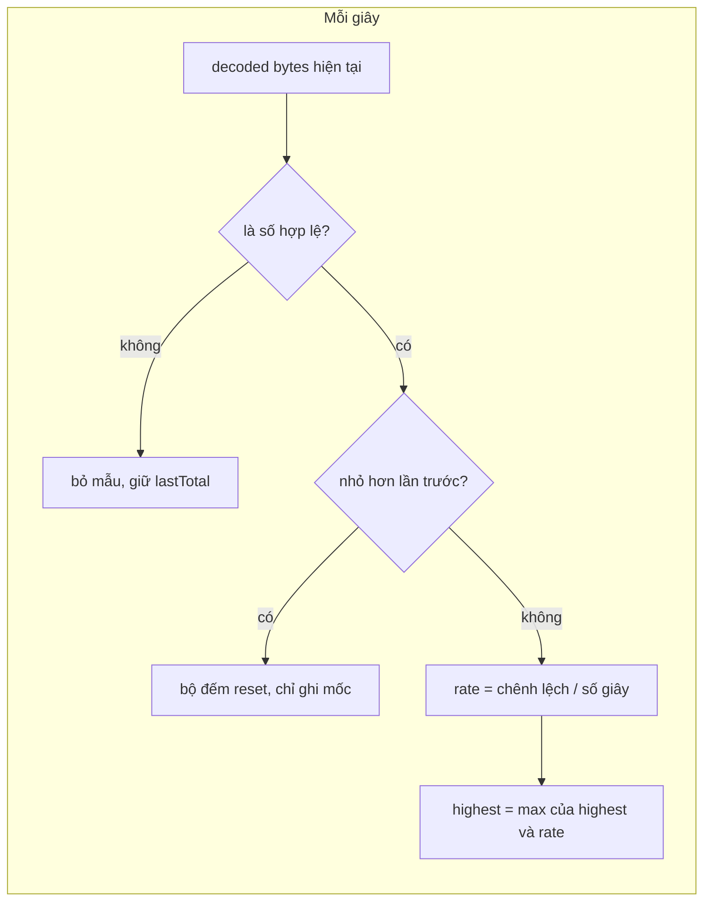

Viết player video cho một nền tảng học trực tuyến, phần khó không nằm ở nút Play. Nó nằm ở những câu hỏi lặt vặt mà trình duyệt không trả lời thẳng:

- Mạng của học viên này nhanh tới đâu? Để báo cáo chất lượng và chọn độ phân giải, mà không muốn chọc vào tầng network.
- Làm sao để video *sẵn sàng phát* (đã có dữ liệu) trước khi người dùng bấm, khi có trình duyệt không tải gì nếu chưa phát?
- Người dùng này đang trên iPad hay Mac, khi Safari trên iPad gửi đúng user agent của Mac?

Player dựa trên video.js của Udemy (thư mục `video-player/`, trước khi chuyển sang Shaka) có câu trả lời cho cả ba, kèm vài lỗi nhỏ đáng học.

> [!TIP]
> **Tóm tắt**
> - Đo băng thông "high-watermark": mỗi giây đọc `webkitVideoDecodedByteCount + webkitAudioDecodedByteCount` của thẻ video, lấy tốc độ cao nhất từng thấy. Không cần hook request nào.
> - Bản gốc không kiểm tra thuộc tính có tồn tại: trên Firefox phép cộng ra `NaN`, watermark kẹt ở 0 mãi. Kiểm tra trước, bỏ mẫu không hợp lệ.
> - `forcePlay`: tắt tiếng → `play()` → chờ `readyState >= 4` → trả lại trạng thái tắt tiếng/dừng cũ. Bản gốc lưu promise vĩnh viễn nên chỉ chạy được một lần trong đời player.
> - iPadOS 13+ gửi UA của Mac; dấu hiệu còn lại là `platform === 'MacIntel'` mà `maxTouchPoints > 1`. Khi đổi tên OS thì nhớ bỏ cả số phiên bản giả.

<iframe class="demo-frame" src="/demos/web-patterns/index.html?theme=dark#/ud-video-quirks" title="Demo ud-video-quirks" loading="lazy" style="height: 1320px"></iframe>

<p class="demo-links">▶ <a href="/demos/web-patterns/index.html#/ud-video-quirks" target="_blank" rel="noopener">Mở demo toàn màn hình ↗</a> · <a href="https://stackblitz.com/github/hunghg255/blog-hunghg/tree/master/examples/web-patterns?file=src/lib/udVideoQuirks.ts" target="_blank" rel="noopener">Sửa code trên StackBlitz ↗</a> · <a href="https://github.com/hunghg255/blog-hunghg/blob/master/examples/web-patterns/src/lib/udVideoQuirks.ts" target="_blank" rel="noopener">Xem source trên GitHub ↗</a></p>

## Udemy làm thế nào?

### 1. Băng thông cao nhất, không đụng network

Plugin `video-player/videojs-setup/bandwidth-watermark.js` mở đầu bằng một comment dài giải thích vì sao không viết bộ đo băng thông "xịn": luồng sự kiện `progress`/`stalled` của các loại video khác nhau, khi bị throttle thì có khoảng chết… Họ chọn cách đơn giản: chỉ giữ **mức cao nhất** (high-watermark). Vì lúc mới mở, player luôn tải hết tốc lực để có buffer, nên mức cao nhất phản ánh khá đúng băng thông thật, dù về sau có những khoảng tải chậm cố ý.

```js
// video-player/videojs-setup/watermark.js
export default class Watermark {
  highest = 0;
  lastTotal = 0;
  add(newTotal, secsSamplePeriod) {
    const sample = (newTotal - this.lastTotal) / secsSamplePeriod;
    if (sample > this.highest) this.highest = sample;
    this.lastTotal = newTotal;
  }
}
```

Mỗi giây, plugin đưa vào ba bộ đếm:

- `bytesSecHighestDecoder`: `videoEl.webkitAudioDecodedByteCount + videoEl.webkitVideoDecodedByteCount`, số byte trình duyệt *đã giải mã*. Đây là thuộc tính có tiền tố của WebKit/Chromium, không nằm trong chuẩn.
- `millisSecHighestBandwidth`: `bufferedPercent() * duration * 1000`, tức số mili-giây media đã buffer. Chia cho thời gian thực ra "mỗi giây tải được bao nhiêu giây video", một chỉ số dễ hiểu hơn byte/giây: lớn hơn 1000 nghĩa là tải nhanh hơn tốc độ phát.
- `bytesSecHighestHLSBandwidth`: cộng `stats.total` từ sự kiện `hlsfragloaded` của plugin HLS.

Kết quả được gửi kèm sự kiện analytics của player (`helpers.js`, `bandwidthWatermarksEventData`), làm tròn và **bỏ qua giá trị falsy**.

**Lỗi:** trên trình duyệt không có hai thuộc tính `webkit*DecodedByteCount` (Firefox), `undefined + undefined` là `NaN`. `NaN > highest` luôn sai nên `highest` đứng ở 0, và `lastTotal` thành `NaN` nên mọi mẫu sau cũng `NaN`. Vì `0` là falsy, chỉ số này âm thầm biến mất khỏi analytics thay vì báo "không hỗ trợ". Demo có ô "giả lập Firefox" để thấy `lastTotal` thành `NaN`.

Player mới dùng Shaka thì đoạn gọi plugin này bị comment (`// this.videoPlayer.bandwidthWatermark();` trong `shaka-video-player.react-component.tsx`); Shaka có ước lượng băng thông riêng cho ABR.

### 2. forcePlay: phát tắt tiếng để ép trình duyệt tải

Trong `udemy-patches.js`:

::: spoiler Xem đoạn code gốc (rút gọn)

```js
// video-player/videojs-setup/udemy-patches.js (rút gọn)
player.forcePlay = function () {
  if (forcePlayPromise) return forcePlayPromise;
  forcePlayPromise = new Promise((resolve) => {
    wasMuted = this.muted();
    wasPaused = this.paused();
    this.muted(true);
    this.play();
    statusListenerTimeoutId = setInterval(() => {
      try {
        if (this.readyState() >= 4) { resolve(); this.trigger('canplay'); this.trigger('canplaythrough'); throw new Error(); }
        if (this.paused()) { this.play(); this.currentTime(this.currentTime()); }
        if (++retryCount >= 100) { resolve(); throw new Error(); }
      } catch (e1) {
        clearInterval(statusListenerTimeoutId);
        wasPaused && this.pause();
        this.muted(wasMuted);
      }
    }, 100);
  });
  return forcePlayPromise;
};
```

:::

Comment trong code giải thích: nhiều component cùng nghe sự kiện của player, và "một số trình duyệt" (họ nêu Safari) không bắn `canplay`/`canplaythrough` nếu video chưa phát, nên chuỗi khởi tạo kẹt. Giải pháp: phát ở chế độ tắt tiếng (được phép tự phát), chờ đủ dữ liệu, tự bắn hai sự kiện kia, rồi trả lại trạng thái cũ. `video-player.mobx-store.js` gọi nó mỗi khi đổi nguồn (sau `loadstart`), rồi tua `+0.1` giây và bắn `sourceready`.

Mấy chi tiết:

- Dùng `throw new Error()` bên trong `try` như một lệnh `goto` để nhảy vào nhánh dọn dẹp. Chạy được nhưng khó đọc.
- Trong lúc chờ, nếu video bị dừng (trình duyệt tự dừng, hoặc component khác gọi pause) thì gọi lại `play()` và "tua tại chỗ" (`currentTime(currentTime())`) để đánh thức.
- Thứ tự trả lại là **pause trước, bỏ tắt tiếng sau**. Bỏ tắt tiếng một video đang tự phát khi chưa có thao tác người dùng có thể bị chính sách autoplay chặn; dừng trước thì tránh được.

**Lỗi:** `forcePlayPromise` không bao giờ được xoá. Lần gọi thứ hai trên cùng player trả ngay promise đã resolve, không tắt tiếng, không phát, không chờ gì. Nếu cùng một player đổi nguồn (ví dụ đổi danh sách độ phân giải), phần "khởi động" không chạy lại mà `.then` vẫn tua `+0.1` và bắn `sourceready` như thể đã sẵn sàng. Demo có nút "forcePlay (kiểu gốc)" bấm lần hai để thấy.

Cùng file có `fixCurrentTime`: mọi lệnh tua về đúng `0` bị đổi thành `0.1`. Code không ghi lý do; có lẽ vì có trình duyệt bỏ qua lệnh tua về 0 khi đang ở rất gần 0. Cái giá là người dùng không bao giờ xem lại được 100 ms đầu.

### 3. iPad giả làm Mac

Từ iPadOS 13, Safari trên iPad mặc định "request desktop website" và gửi user agent của Mac. `video-player/utils.js`:

```js
// video-player/utils.js (rút gọn)
export const parsedUserAgent = { browser: uaParser.getBrowser(), os: uaParser.getOS(), device: uaParser.getDevice() };
parsedUserAgent.os.majorVersion = getMajorVersion(parsedUserAgent.os.version);
parsedUserAgent.isMobile = parsedUserAgent.device.type === 'mobile';
// Bugfix for iOS 13
if (parsedUserAgent.os.name === 'Mac OS' && window.navigator.platform === 'MacIntel' && navigator.maxTouchPoints > 1) {
  parsedUserAgent.os.name = 'iOS';
}
```

Dấu hiệu dùng được: `navigator.platform` vẫn là `MacIntel`, nhưng Mac không có màn hình cảm ứng nhiều điểm, nên `maxTouchPoints > 1` gần như chắc là iPad.

**Lỗi:** bản vá chỉ đổi `os.name`. `os.version` và `os.majorVersion` vẫn là phiên bản macOS giả trong UA (thường `10.15.7`), và `isMobile` đã được tính *trước* bản vá. Lúc video bắt đầu phát, player đếm chỉ số `udemy-video-player.viewed` (qua `udApiStat`) với `platform: parsedUserAgent.os.name` và `platformVersion: parsedUserAgent.os.majorVersion`: một iPad chạy iPadOS 17 bị ghi là "iOS 10". Bảng trong demo so hai cách.



## Viết lại

### Watermark an toàn

```ts title=src/lib/udVideoQuirks.ts
/** Giữ tốc độ cao nhất từng thấy của một bộ đếm tăng dần (bytes, ms…). */
export class Watermark {
  highest = 0;
  private lastTotal: number | null = null;

  /**
   * @param total giá trị cộng dồn hiện tại của bộ đếm
   * @param seconds số giây kể từ lần đo trước
   * @returns tốc độ của mẫu này, hoặc null nếu bỏ qua
   */
  add(total: number | undefined, seconds: number): number | null {
    // Bản gốc không kiểm tra: một lần `undefined` (trình duyệt không có bộ đếm) biến
    // lastTotal thành NaN và mọi mẫu sau đó đều NaN — watermark kẹt ở 0 mãi.
    if (total == null || !Number.isFinite(total) || seconds <= 0) return null;
    if (this.lastTotal === null || total < this.lastTotal) {
      // mẫu đầu, hoặc bộ đếm bị reset (đổi nguồn video): chỉ ghi mốc
      this.lastTotal = total;
      return null;
    }
    const rate = (total - this.lastTotal) / seconds;
    this.lastTotal = total;
    if (rate > this.highest) this.highest = rate;
    return rate;
  }
}
```

`decodedBytes(video)` trả `undefined` khi trình duyệt không có thuộc tính `webkitVideoDecodedByteCount`, thay vì cộng ra `NaN`.

### forcePlay chạy lại được

```ts title=src/lib/udVideoQuirks.ts
/**
 * Ép trình duyệt tải đủ dữ liệu: tắt tiếng → play() → chờ readyState đủ → trả lại trạng
 * thái tắt tiếng / dừng ban đầu. Nhiều trình duyệt không tải trước nếu chưa phát, và chỉ
 * cho tự phát khi tắt tiếng.
 *
 * Khác bản gốc:
 * - nghe sự kiện thay vì poll mỗi 100ms tối đa 100 lần;
 * - promise được xoá khi xong, gọi lần sau vẫn chạy (bản gốc giữ promise đã resolve mãi,
 *   nên chỉ có tác dụng một lần trong đời player);
 * - play() bị từ chối (kể cả khi đã tắt tiếng) thì trả 'blocked' thay vì nuốt lỗi.
 */
export function forcePlay(video: HTMLVideoElement, { timeoutMs = 10_000, readyState = 4 }: ForcePlayOptions = {}) {
  const pending = pendingForcePlay.get(video);
  if (pending) return pending;

  const wasMuted = video.muted;
  const wasPaused = video.paused;

  const promise = new Promise<ForcePlayResult>((resolve) => {
    let done = false;
    const finish = (result: ForcePlayResult) => {
      if (done) return;
      done = true;
      clearTimeout(timer);
      video.removeEventListener('canplaythrough', check);
      video.removeEventListener('canplay', check);
      video.removeEventListener('loadeddata', check);
      if (wasPaused) video.pause();
      video.muted = wasMuted;
      resolve(result);
    };
    const check = () => {
      if (video.readyState >= readyState) finish('ready');
    };
    const timer = setTimeout(() => finish('timeout'), timeoutMs);
    video.addEventListener('canplaythrough', check);
    video.addEventListener('canplay', check);
    video.addEventListener('loadeddata', check);

    video.muted = true;
    Promise.resolve(video.play()).then(check, () => finish('blocked'));
  }).finally(() => pendingForcePlay.delete(video));

  pendingForcePlay.set(video, promise);
  return promise;
}
```

### Nhận diện iPad

`detectPlatform` xét `iPhone`/`iPad` trong UA trước, rồi tới nhánh Mac: nếu `platform === 'MacIntel'` và `maxTouchPoints > 1` thì trả `{ os: 'iPadOS', version: undefined, isTablet: true, spoofedDesktopUA: true }`, bỏ hẳn số phiên bản macOS giả.

**Khác bản gốc:** watermark bỏ qua mẫu không phải số và mẫu đầu tiên (bản gốc tính mẫu đầu từ 0, tức mọi byte đã giải mã trước khi plugin khởi động dồn vào giây đầu); bộ đếm bị reset (đổi nguồn) thì chỉ ghi mốc. `forcePlay` nghe sự kiện thay vì poll, trả kết quả `'ready' | 'timeout' | 'blocked'`, và xoá promise khi xong. Nhận diện iPad trả `version: undefined` khi UA là giả, và đánh dấu `spoofedDesktopUA` để analytics phân biệt.

::: spoiler Xem toàn bộ src/lib/udVideoQuirks.ts

```ts title=src/lib/udVideoQuirks.ts
/**
 * Mấy "mẹo vặt" quanh thẻ <video> mà player của Udemy phải tự lo:
 * - đo băng thông cao nhất (high-watermark) chỉ bằng bộ đếm byte đã giải mã của trình duyệt
 * - forcePlay: ép trình duyệt tải đủ dữ liệu bằng cách phát ở chế độ tắt tiếng rồi trả lại trạng thái cũ
 * - nhận ra iPad chạy iPadOS 13+ (Safari báo mình là Mac)
 *
 * Ý tưởng từ `video-player/videojs-setup/bandwidth-watermark.js`, `watermark.js`,
 * `udemy-patches.js` và `video-player/utils.js` của Udemy, viết lại từ đầu.
 */

// ---------------------------------------------------------------------------
// 1. High-watermark

/** Giữ tốc độ cao nhất từng thấy của một bộ đếm tăng dần (bytes, ms…). */
export class Watermark {
  highest = 0;
  private lastTotal: number | null = null;

  /**
   * @param total giá trị cộng dồn hiện tại của bộ đếm
   * @param seconds số giây kể từ lần đo trước
   * @returns tốc độ của mẫu này, hoặc null nếu bỏ qua
   */
  add(total: number | undefined, seconds: number): number | null {
    // Bản gốc không kiểm tra: một lần `undefined` (trình duyệt không có bộ đếm) biến
    // lastTotal thành NaN và mọi mẫu sau đó đều NaN — watermark kẹt ở 0 mãi.
    if (total == null || !Number.isFinite(total) || seconds <= 0) return null;
    if (this.lastTotal === null || total < this.lastTotal) {
      // mẫu đầu, hoặc bộ đếm bị reset (đổi nguồn video): chỉ ghi mốc
      this.lastTotal = total;
      return null;
    }
    const rate = (total - this.lastTotal) / seconds;
    this.lastTotal = total;
    if (rate > this.highest) this.highest = rate;
    return rate;
  }
}

type DecodedCounters = HTMLVideoElement & {
  webkitAudioDecodedByteCount?: number;
  webkitVideoDecodedByteCount?: number;
};

/**
 * Tổng byte audio + video trình duyệt đã giải mã (thuộc tính có tiền tố webkit, có trên Chromium
 * và Safari). Trả undefined nếu không hỗ trợ, thay vì NaN.
 */
export function decodedBytes(video: HTMLVideoElement): number | undefined {
  const v = video as DecodedCounters;
  if (typeof v.webkitVideoDecodedByteCount !== 'number') return undefined;
  return v.webkitVideoDecodedByteCount + (v.webkitAudioDecodedByteCount ?? 0);
}

/**
 * Số mili-giây media đã được buffer (cộng các khoảng trong `video.buffered`).
 * Chia cho thời gian thực sẽ ra "tải nhanh gấp mấy lần tốc độ phát".
 */
export function bufferedMillis(video: HTMLVideoElement): number {
  let total = 0;
  for (let i = 0; i < video.buffered.length; i++) total += video.buffered.end(i) - video.buffered.start(i);
  return total * 1000;
}

export interface BandwidthSample {
  decoderBytesPerSec: number | null;
  bufferedMsPerSec: number | null;
  highest: { decoderBytesPerSec: number; bufferedMsPerSec: number };
}

/** Lấy mẫu mỗi `intervalMs`, báo kết quả qua `onSample`. Trả hàm dừng. */
export function watchBandwidth(
  video: HTMLVideoElement,
  onSample: (sample: BandwidthSample) => void,
  {
    intervalMs = 1000,
    readBytes = decodedBytes,
    now = () => performance.now(),
  }: { intervalMs?: number; readBytes?: (v: HTMLVideoElement) => number | undefined; now?: () => number } = {},
) {
  const decoder = new Watermark();
  const buffered = new Watermark();
  let last = now();
  decoder.add(readBytes(video), 1);
  buffered.add(bufferedMillis(video), 1);
  const id = setInterval(() => {
    const t = now();
    const seconds = (t - last) / 1000;
    last = t;
    onSample({
      decoderBytesPerSec: decoder.add(readBytes(video), seconds),
      bufferedMsPerSec: buffered.add(bufferedMillis(video), seconds),
      highest: { decoderBytesPerSec: decoder.highest, bufferedMsPerSec: buffered.highest },
    });
  }, intervalMs);
  return () => clearInterval(id);
}

// ---------------------------------------------------------------------------
// 2. forcePlay

export interface ForcePlayOptions {
  /** chờ tối đa bao lâu (ms), mặc định 10 giây */
  timeoutMs?: number;
  /** readyState cần đạt, mặc định HAVE_ENOUGH_DATA (4) */
  readyState?: number;
}

export type ForcePlayResult = 'ready' | 'timeout' | 'blocked';

const pendingForcePlay = new WeakMap<HTMLVideoElement, Promise<ForcePlayResult>>();

/**
 * Ép trình duyệt tải đủ dữ liệu: tắt tiếng → play() → chờ readyState đủ → trả lại trạng
 * thái tắt tiếng / dừng ban đầu. Nhiều trình duyệt không tải trước nếu chưa phát, và chỉ
 * cho tự phát khi tắt tiếng.
 *
 * Khác bản gốc:
 * - nghe sự kiện thay vì poll mỗi 100ms tối đa 100 lần;
 * - promise được xoá khi xong, gọi lần sau vẫn chạy (bản gốc giữ promise đã resolve mãi,
 *   nên chỉ có tác dụng một lần trong đời player);
 * - play() bị từ chối (kể cả khi đã tắt tiếng) thì trả 'blocked' thay vì nuốt lỗi.
 */
export function forcePlay(video: HTMLVideoElement, { timeoutMs = 10_000, readyState = 4 }: ForcePlayOptions = {}) {
  const pending = pendingForcePlay.get(video);
  if (pending) return pending;

  const wasMuted = video.muted;
  const wasPaused = video.paused;

  const promise = new Promise<ForcePlayResult>((resolve) => {
    let done = false;
    const finish = (result: ForcePlayResult) => {
      if (done) return;
      done = true;
      clearTimeout(timer);
      video.removeEventListener('canplaythrough', check);
      video.removeEventListener('canplay', check);
      video.removeEventListener('loadeddata', check);
      if (wasPaused) video.pause();
      video.muted = wasMuted;
      resolve(result);
    };
    const check = () => {
      if (video.readyState >= readyState) finish('ready');
    };
    const timer = setTimeout(() => finish('timeout'), timeoutMs);
    video.addEventListener('canplaythrough', check);
    video.addEventListener('canplay', check);
    video.addEventListener('loadeddata', check);

    video.muted = true;
    Promise.resolve(video.play()).then(check, () => finish('blocked'));
  }).finally(() => pendingForcePlay.delete(video));

  pendingForcePlay.set(video, promise);
  return promise;
}

/**
 * Tua về 0: player của Udemy đổi 0 thành 0.1 vì có trình duyệt bỏ qua lệnh tua về đúng 0
 * (có lẽ khi đang ở rất gần 0). Đổi lại, người dùng mất 100ms đầu mỗi lần tua về đầu.
 */
export const safeSeekTime = (time: number, nudge = 0.1) => (time === 0 ? nudge : time);

// ---------------------------------------------------------------------------
// 3. Nền tảng

export interface PlatformInput {
  userAgent: string;
  /** navigator.platform, vd 'MacIntel', 'iPhone' */
  platform: string;
  maxTouchPoints: number;
}

export interface Platform {
  os: 'iOS' | 'iPadOS' | 'macOS' | 'Android' | 'Windows' | 'other';
  /** phiên bản hệ điều hành, undefined nếu không tin được */
  version?: string;
  isTablet: boolean;
  isMobile: boolean;
  /** true khi UA là của Mac nhưng máy thật là iPad */
  spoofedDesktopUA: boolean;
}

const versionFrom = (ua: string, re: RegExp) => ua.match(re)?.[1]?.replace(/_/g, '.');

/**
 * Từ iPadOS 13, Safari trên iPad mặc định gửi UA của Mac. Dấu hiệu còn lại: platform vẫn là
 * 'MacIntel' nhưng có màn hình cảm ứng nhiều điểm (Mac không có).
 */
export function detectPlatform({ userAgent, platform, maxTouchPoints }: PlatformInput): Platform {
  if (/iPhone|iPod/.test(userAgent)) {
    return { os: 'iOS', version: versionFrom(userAgent, /OS (\d+[_\d]*)/), isTablet: false, isMobile: true, spoofedDesktopUA: false };
  }
  if (/iPad/.test(userAgent)) {
    return { os: 'iPadOS', version: versionFrom(userAgent, /OS (\d+[_\d]*)/), isTablet: true, isMobile: false, spoofedDesktopUA: false };
  }
  if (/Mac OS X/.test(userAgent)) {
    if (platform === 'MacIntel' && maxTouchPoints > 1) {
      // Phiên bản trong UA là của macOS giả (thường 10.15.7), không phải iPadOS: bỏ đi.
      return { os: 'iPadOS', version: undefined, isTablet: true, isMobile: false, spoofedDesktopUA: true };
    }
    return { os: 'macOS', version: versionFrom(userAgent, /Mac OS X (\d+[_.\d]*)/), isTablet: false, isMobile: false, spoofedDesktopUA: false };
  }
  if (/Android/.test(userAgent)) {
    const isMobile = /Mobile/.test(userAgent);
    return { os: 'Android', version: versionFrom(userAgent, /Android (\d+[.\d]*)/), isTablet: !isMobile, isMobile, spoofedDesktopUA: false };
  }
  if (/Windows/.test(userAgent)) return { os: 'Windows', isTablet: false, isMobile: false, spoofedDesktopUA: false };
  return { os: 'other', isTablet: false, isMobile: false, spoofedDesktopUA: false };
}
```

:::

## Đi qua code

- `decodedBytes` kiểm tra `typeof v.webkitVideoDecodedByteCount !== 'number'` rồi trả `undefined`. Người gọi quyết định hiển thị "không hỗ trợ" thay vì một con số sai.
- `watchBandwidth` đo bằng `performance.now()`, không dùng `Date.now()`: đồng hồ hệ thống bị chỉnh giữa hai lần đo không làm ra số giây âm.
- `forcePlay` dùng `WeakMap` theo từng thẻ video để gộp các lần gọi đồng thời (giống ý định của bản gốc), nhưng `.finally` xoá khỏi map, nên lần sau chạy lại.
- `detectPlatform` xét `iPhone`/`iPad` trong UA trước (iPad ở chế độ "mobile website" vẫn gửi `iPad`), rồi mới tới nhánh Mac giả.

## Tại sao không làm cách khác?

- **Đo băng thông bằng Resource Timing hoặc Network Information API?** `navigator.connection.downlink` chỉ có trên Chromium và bị làm tròn; Resource Timing cần `Timing-Allow-Origin` với CDN khác origin. Bộ đếm byte giải mã thì có sẵn trên Chromium và Safari, không cần cấu hình gì. Đổi lại, đó là byte *đã giải mã*, không phải byte tải về; nếu trình duyệt tải trước nhiều mà chưa giải mã, con số thấp hơn thật.
- **`preload="auto"` thay vì forcePlay?** `preload` chỉ là gợi ý; Safari iOS bỏ qua nó để tiết kiệm dữ liệu. Phát tắt tiếng là cách chắc chắn hơn để có dữ liệu, với cái giá là tốn băng thông cho video người dùng có thể không xem.
- **Dùng User-Agent Client Hints (`navigator.userAgentData`)?** Safari không hỗ trợ (tính tới 10/2026), mà iPad chính là Safari. Phát hiện tính năng (feature detection) vẫn là cách tốt nhất; chỉ dùng nhận diện nền tảng cho analytics và những lỗi riêng của từng trình duyệt.

## Edge case và cạm bẫy

- **Tab nền:** `setInterval` bị giới hạn còn khoảng 1 lần/giây hoặc chậm hơn khi tab ẩn. Vì chia cho số giây thật giữa hai lần đo, tốc độ vẫn đúng, nhưng mẫu thưa đi.
- **Đổi nguồn video:** bộ đếm giải mã về 0. Bản gốc sẽ tính một mẫu âm (không ảnh hưởng `highest`), bản viết lại coi đó là reset.
- **forcePlay khi trình duyệt chặn cả phát tắt tiếng** (chế độ tiết kiệm pin, chính sách doanh nghiệp): `play()` bị reject. Bản gốc nuốt lỗi rồi poll 10 giây; bản viết lại trả `'blocked'` ngay để hiện nút "Bấm để phát".
- **`maxTouchPoints` trên Mac có màn hình cảm ứng ngoài** hoặc trình giả lập: hiếm, nhưng có thể nhận nhầm. Đừng dùng kết quả này để chặn tính năng, chỉ để điều chỉnh.
- **iPad dùng Chrome hoặc Firefox:** cũng dùng WebKit và cũng có thể gửi UA Mac; dấu hiệu `MacIntel + maxTouchPoints` vẫn đúng.

## Dùng trong dự án

```ts
const stop = watchBandwidth(video, (s) => {
  if (s.highest.decoderBytesPerSec) analytics.set('bw_decoder_high', Math.round(s.highest.decoderBytesPerSec));
});

const result = await forcePlay(video, { timeoutMs: 8000 });
if (result === 'blocked') showTapToPlay();

const platform = detectPlatform({ userAgent: navigator.userAgent, platform: navigator.platform, maxTouchPoints: navigator.maxTouchPoints });
analytics.set('os', platform.os);
if (platform.version) analytics.set('os_version', platform.version);
```

## Kiểm thử

::: spoiler Ví dụ test (bản phác, không có trong repo)

```ts
import { describe, expect, it } from 'vitest';
import { Watermark, detectPlatform } from './udVideoQuirks';

describe('Watermark', () => {
  it('bỏ qua undefined thay vì kẹt NaN', () => {
    const w = new Watermark();
    w.add(0, 1);
    w.add(undefined, 1);
    w.add(1000, 1);
    expect(w.highest).toBe(1000);
  });
  it('bộ đếm reset thì chỉ ghi mốc', () => {
    const w = new Watermark();
    w.add(5000, 1);
    expect(w.add(100, 1)).toBeNull();
    expect(w.add(600, 1)).toBe(500);
  });
});

describe('detectPlatform', () => {
  const macUA = 'Mozilla/5.0 (Macintosh; Intel Mac OS X 10_15_7) AppleWebKit/605.1.15 (KHTML, like Gecko) Version/17.0 Safari/605.1.15';
  it('iPad gửi UA Mac', () => {
    const p = detectPlatform({ userAgent: macUA, platform: 'MacIntel', maxTouchPoints: 5 });
    expect(p).toMatchObject({ os: 'iPadOS', isTablet: true, spoofedDesktopUA: true, version: undefined });
  });
  it('Mac thật', () => {
    expect(detectPlatform({ userAgent: macUA, platform: 'MacIntel', maxTouchPoints: 0 }).os).toBe('macOS');
  });
});
```

:::

## So với chuẩn web

- `webkitVideoDecodedByteCount`/`webkitAudioDecodedByteCount` không thuộc chuẩn HTML. Chuẩn có `video.getVideoPlaybackQuality()` (số khung hình đã giải mã, bị bỏ) nhưng không có số byte.
- Media Capabilities API (`navigator.mediaCapabilities.decodingInfo`) trả lời "thiết bị này giải mã mượt cấu hình X không", hữu ích hơn cho việc chọn độ phân giải ban đầu.
- Chính sách autoplay: các trình duyệt lớn cho tự phát khi video tắt tiếng (tính tới 10/2026); `video.play()` trả promise để biết có bị chặn không.

---

Bài này thuộc series **[Học từ mã nguồn Udemy](/series/udemy)** (21 bài, đọc theo thứ tự).

::: spoiler Xem nhanh danh sách bài trong series

*Mở đầu*

- [Mở đầu: bên trong frontend của Udemy](/blogs/learn-from-udemy-source-code)

*Phần 1: video và học bài*

- [#1 DRM đa hệ: Widevine, PlayReady, FairPlay](/blogs/udemy-drm-multi-key-system)
- [#2 URL ký và license hết hạn: tự làm mới, tải trước bài kế](/blogs/udemy-expiring-media-urls)
- [#3 Ghi tiến độ xem theo bucket, tự hoàn thành, backoff lỗi](/blogs/udemy-watch-progress-buckets)
- [#4 Thumbnail sprite từ WebVTT và slide trên seekbar](/blogs/udemy-sprite-thumbnails-vtt)
- [#5 Phụ đề: tự chọn ngôn ngữ và editor có phím tắt](/blogs/udemy-captions-auto-select-editor)
- **#6 Đo băng thông, autoplay Safari, iPad giả làm Mac** (bài này)

*Phần 2: bài tập, bài thi, lab*

- [#7 Preview code HTML/React trong iframe sandbox](/blogs/udemy-code-preview-sandbox)
- [#8 Bài thi có giờ: tạm dừng khi rảnh, autosave theo dấu vân tay](/blogs/udemy-timed-exam)
- [#9 Chấm code realtime: đăng ký kênh trước, có đường dự phòng](/blogs/udemy-realtime-grading)
- [#10 Mở lab không bị chặn popup, heartbeat, xung đột phiên](/blogs/udemy-lab-launcher)

*Phần 3: editor và nội dung*

- [#11 ProseMirror: schema theo flag, NodeView React, HTML cho email](/blogs/udemy-prosemirror-integration)
- [#12 Parse HTML an toàn bằng document tách rời](/blogs/udemy-safe-html-parse)
- [#13 Sinh file .ics có VTIMEZONE tự dò giờ mùa hè](/blogs/udemy-ics-vtimezone)
- [#14 Đọc Open Badges giấu trong ảnh PNG và SVG](/blogs/udemy-open-badges-image)

*Phần 4: hạ tầng và trải nghiệm*

- [#15 Pipeline tracking: batch, sendBeacon, bfcache, HTTP 207](/blogs/udemy-event-tracking-pipeline)
- [#16 Gợi ý tính năng mới qua nhiều phiên bằng máy trạng thái](/blogs/udemy-feature-discoverability)
- [#17 Kéo cạnh để resize và mép cuộn mờ dần](/blogs/udemy-resizer-gradient-scroll)
- [#18 Gom request giá khoá học, cập nhật một phần khi áp coupon](/blogs/udemy-price-dataloader-partial-update)
- [#19 Trả lời lạc quan có rollback, autocomplete hai tầng cache](/blogs/udemy-optimistic-reply-autocomplete)
- [#20 Nạp app theo ưu tiên, registry store, HTML cache công khai](/blogs/udemy-app-loader-registry)

:::

Code + demo: [`examples/web-patterns`](https://github.com/hunghg255/blog-hunghg/tree/master/examples/web-patterns) · [Mở trên StackBlitz](https://stackblitz.com/github/hunghg255/blog-hunghg/tree/master/examples/web-patterns)
